<p align="center">
  <a href="https://ofox.ai/seedance-2-5-prompts?utm_source=github&utm_medium=banner&utm_campaign=awesome-seedance-2-5">
    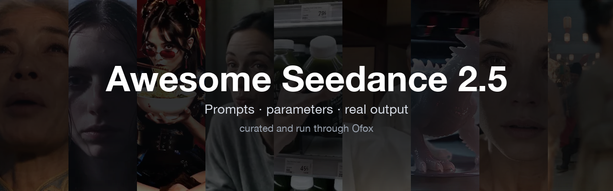
  </a>
</p>

<p align="center">
  <a href="https://awesome.re"></a>
  <a href="LICENSE"></a>
  <a href="#table-of-contents"></a>
  <a href="https://app.ofox.ai/playground?utm_source=github&utm_medium=badge&utm_campaign=awesome-seedance-2-5"></a>
  <a href="https://app.ofox.ai?utm_source=github&utm_medium=badge&utm_campaign=awesome-seedance-2-5"></a>
</p>

<p align="center">
  <a href="README.md">English</a> ·
  <a href="README.zh-CN.md">简体中文</a> ·
  <a href="README.ja.md">日本語</a>
</p>

# Awesome Seedance 2.5

A curated collection of prompts, parameters, and real output for
ByteDance's Seedance 2.5 video model — every case with a complete prompt,
a preview, and (for self-run cases) the exact bill. Curated and run
through [Ofox](https://ofox.ai/seedance-2-5-prompts?utm_source=github&utm_medium=readme&utm_campaign=awesome-seedance-2-5).

## What is Seedance 2.5?

Seedance 2.5 is ByteDance's text-to-video and image-to-video model:
4–30 second clips, up to 1080p, 8 aspect ratios, with synced audio on by
default. It's available today through the
[Ofox video API](https://ofox.ai/models/bytedance/seedance-2.5?utm_source=github&utm_medium=readme&utm_campaign=awesome-seedance-2-5) —
no Chinese business entity or phone number required to get a key, unlike
going straight to the upstream provider.

```bash
curl -X POST https://api.ofox.ai/v1/videos \
  -H "Authorization: Bearer $OFOX_API_KEY" \
  -H "Content-Type: application/json" \
  -d '{"model":"bytedance/seedance-2.5","prompt":"A neon-lit Tokyo alley at night, cinematic dolly-in, rain reflections","duration":10,"resolution":"1080p","aspect_ratio":"16:9"}'
# -> {"id": "..."}; poll GET /v1/videos/{id} until "status" is "completed"
```

Full parameter reference and error codes:
[Ofox video API docs](https://ofox.ai/docs/api/videos?utm_source=github&utm_medium=readme&utm_campaign=awesome-seedance-2-5).
Get a key: [app.ofox.ai](https://app.ofox.ai?utm_source=github&utm_medium=readme&utm_campaign=awesome-seedance-2-5).

## Pricing

Seedance 2.5 per-second rate on Ofox, as of 2026-08 (source:
[ofox.ai/models/bytedance/seedance-2.5](https://ofox.ai/models/bytedance/seedance-2.5?utm_source=github&utm_medium=readme&utm_campaign=awesome-seedance-2-5) —
re-verify against the live page before quoting a number you intend to hold
someone to, particularly the "time-limited" 1080p rate):

| Resolution | Text-to-video (t2v) | Video-to-video (v2v) |
|---|---|---|
| 480p | $0.11/s | $0.14/s |
| 720p | $0.24/s | $0.30/s |
| 1080p | $0.48/s (list $0.60/s, time-limited) | $0.568/s (list $0.71/s) |

- Duration: 4–30 seconds, any integer.
- Aspect ratios: 21:9 / 16:9 / 4:3 / 1:1 / 3:4 / 9:16 / adaptive.
- Audio is on by default and already covered by the per-second rate above
  — it's not billed separately.

Use this table to estimate a run **before** you start it. The `费用` (cost)
line on a self-run case below is not an estimate off this table — it is the
amount actually billed for that job, and it carries the job id that was
billed, so every number traces back to one API call. See
[`CASE_TEMPLATE.md`](CASE_TEMPLATE.md).

## Table of Contents

1. [Short Drama (短剧)](#short-drama)
2. [Anime Drama (漫剧)](#anime-drama)
3. [Ad Creative (创意广告)](#ad-creative)
4. [Product Video (电商产品视频)](#product-video)
5. [Talking Head (口播和数字人)](#talking-head)
6. [UGC Ads (UGC风格广告)](#ugc-ads)
7. [Shorts & Reels (社媒短视频)](#shorts-reels)
8. [Product Demo (产品演示)](#product-demo)
9. [Keyframe Animation (首尾帧动画)](#keyframe-animation)
10. [Video Extend & Edit (视频延长和编辑)](#video-extend-edit)
11. [Image Edit (图生图和修图)](#image-edit)
12. [Product Image (电商主图和海报)](#product-image)
13. [Music Video (音乐可视化和MV)](#music-video)
14. [Explainer (教学解说视频)](#explainer)

<a id="short-drama"></a>
### Short Drama (短剧)

<a id="case-1"></a>
### Case 1: Guardian robot and grandmother, nine-shot storyboard (守护机器人与老奶奶 · 九宫格分镜) — by ByteDance

<a href="https://ofox.ai/seedance-2-5-prompts?utm_source=github&utm_medium=case&utm_campaign=awesome-seedance-2-5#case-1"></a>

▶ [Watch the full video on ofox.ai](https://ofox.ai/seedance-2-5-prompts?utm_source=github&utm_medium=case&utm_campaign=awesome-seedance-2-5#case-1)

**输入素材**（4 张官方参考图）

| | | | |
|:---:|:---:|:---:|:---:|
| 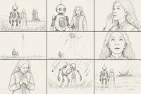<br><sub>image1 · 九宫格分镜</sub> | <br><sub>image2 · 环境</sub> | 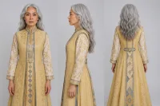<br><sub>image3 · 机器人</sub> | <br><sub>image4 · 老奶奶</sub> |

<details>
<summary><strong>Prompt</strong> — image1: 九宫格分镜参考，用于整体镜头结构、景别与运镜节奏。 image2: 火箭发射场黄昏草原实拍参考，用于环境构图、暖金夕照与冷暮蓝的写实彩色实拍质感基准。 image3: 主体 1 (守护机器人) 角色外观参考。 image4: 主体 2 (老奶奶) 角色外观参考。 【主体设定】 主体 …</summary>

~~~~text
image1: 九宫格分镜参考，用于整体镜头结构、景别与运镜节奏。
image2: 火箭发射场黄昏草原实拍参考，用于环境构图、暖金夕照与冷暮蓝的写实彩色实拍质感基准。
image3: 主体 1 (守护机器人) 角色外观参考。
image4: 主体 2 (老奶奶) 角色外观参考。
【主体设定】
主体 1 (守护机器人): 参考 image3，近未来做旧复古机器人，做旧蓝绿色金属机身、斑驳锈蚀，圆顶头，两只发光的红色圆形机眼，细天线，细长关节四肢；体型高大，约为人类两倍高。
主体 2 (老奶奶): 参考 image4，瘦小年迈女性，银发挽成低髻，皱纹深刻，身穿明黄金色及地长裙、缀金蓝刺绣胸襟，神情不舍；身高只及机器人胸口。
环境 (黄昏草原・发射场): 参考 image2，近未来黄昏草原，暮色天空由暖金渐入冷蓝，远处地平线一座发射台矗立白色火箭、蒸汽升腾；及膝野草随风起伏，广袤空旷。
【整体风格】
真人实拍彩色电影正片，写实照片级质感，全程真实彩色画面；彩色 35mm 电影胶片质感，细腻真实胶片颗粒，浓郁饱满的电影级调色，IMAX 大画幅质感；手持摄影，呼吸感摇晃，浅景深大光圈，前景持续飘散的草叶、火星与灰烬，微微倾斜荷兰角，暖金夕照与冷暮蓝、爆炸暖橙强烈对撞，16:9 横屏。近未来温情灾难片氛围，静谧、悲壮、守护与不舍。
【严格排除】黑白、单色、灰度、去色；手绘、素描、线稿、插画、漫画、动画；分镜稿 / 故事板、草图；移轴微缩、玩偶感、塑料 CG、油腻过曝 CG。
【分镜头】(9 镜 ≈ 30s)
镜头 1 (0-3s): 超远景低机位仰视，黄昏草原两人背影仰望远方火箭。台词 (机器人): "I'm right here. I won't let go."
镜头 2 (3-6s): 正面中景手持，机器人搀扶老奶奶。
镜头 3 (6-10s): 面部特写，老奶奶眼含不舍。台词 (老奶奶): "Fly safe, my child. Come back to me."
镜头 4 (10-14s): 超远景仰摇，火箭升空拖曳浓白烟迹。台词 (老奶奶): "There he goes... there he goes."
镜头 5 (14-18s): 超远景，火箭在半空爆炸碎裂。台词 (老奶奶): "No... no, no—"
镜头 6 (18-22s): 面部大特写，老奶奶瞳孔骤缩泪滑落。台词 (老奶奶): "...he was almost there."
镜头 7 (22-25s): 特写转近景，老奶奶崩溃痛哭。台词 (老奶奶): "Bring him back! Please— bring him back!"
镜头 8 (25-28s): 超低视角近乎垂直仰拍，机器人环抱老奶奶罩成保护穹顶。台词 (机器人): "Don't look up. I've got you."
镜头 9 (28-30s): 超远景背影，两人紧紧相拥剪影。台词 (机器人): "I'm still here. I'll stay... as long as you need."
~~~~

</details>

**参数**：Seedance 2.5 · 火山方舟 · r2v · 30s · 未标注 · 16:9 · 带音频
**来源**：火山方舟官方文档 · [中文](https://docs.volcengine.com/docs/82379/2607689?lang=zh) · [English](https://docs.byteplus.com/en/docs/ModelArk/2607689)

<sub>Preview frame © 2026 ByteDance, from the official demo video · Prompt by ByteDance · <a href="https://docs.volcengine.com/docs/82379/2607689?lang=zh">source</a></sub>

[Back to top](#table-of-contents)

<a id="case-2"></a>
### Case 2: Peking opera "Farewell My Concubine", one take (京剧霸王别姬 · 一镜到底) — by ByteDance

<a href="https://ofox.ai/seedance-2-5-prompts?utm_source=github&utm_medium=case&utm_campaign=awesome-seedance-2-5#case-2">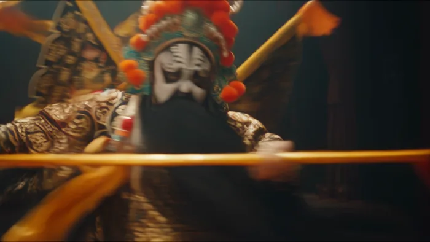</a>

▶ [Watch the full video on ofox.ai](https://ofox.ai/seedance-2-5-prompts?utm_source=github&utm_medium=case&utm_campaign=awesome-seedance-2-5#case-2)

**输入素材**：未公开 —— ByteDance Seed 博客只发布了成片，未随文发布输入素材

<details>
<summary><strong>Prompt</strong> — 16:9 宽幅电影级质感，一镜到底，丝滑运镜，无剪辑。场景参考 @图片 4。 0-5 秒：@图片 2 霸王近景开场，镜头缓慢环绕上半身并过渡至中景；霸王旋身翻转，随后身体与靠旗从镜头前快速掠过，形成自然遮挡，镜头顺势绕至 @图片 1 虞姬身侧。6-10 秒：镜头稳定环绕 @图片 1 虞姬中景，跟随水…</summary>

~~~~text
16:9 宽幅电影级质感，一镜到底，丝滑运镜，无剪辑。场景参考 @图片 4。 0-5 秒：@图片 2 霸王近景开场，镜头缓慢环绕上半身并过渡至中景；霸王旋身翻转，随后身体与靠旗从镜头前快速掠过，形成自然遮挡，镜头顺势绕至 @图片 1 虞姬身侧。6-10 秒：镜头稳定环绕 @图片 1 虞姬中景，跟随水袖动作完成环绕运镜虞姬抬臂、挑腕、展袖、半转身。最后收袖定格，侧身看向霸王。11-20 秒：@图片 3 武生出场完成后空翻腾动作，随后霸王居中，武生在对侧进退攻防。虞姬位于霸王侧后方以水袖配合，形成刚柔对比。镜头从武生中近景缓慢后拉至舞台大景，结尾三人面向观众同步京剧落幕亮相。
~~~~

</details>

**参数**：Seedance 2.5 · 未标注 · r2v · 20s（由 11–20 秒段落隐含）· 未标注 · 16:9 · 未标注
**来源**：ByteDance Seed 官方博客 · [中文](https://seed.bytedance.com/zh/blog/one-take-creation-flexible-referencing-introducing-seedance-2-5) · [English](https://seed.bytedance.com/en/blog/one-take-creation-flexible-referencing-introducing-seedance-2-5)

<sub>Preview frame © 2026 ByteDance, from the official demo video · Prompt by ByteDance · <a href="https://seed.bytedance.com/zh/blog/one-take-creation-flexible-referencing-introducing-seedance-2-5">source</a></sub>

[Back to top](#table-of-contents)

<a id="case-3"></a>
### Case 3: Cinematic breakup farewell, one continuous take (电影感分手告别·一镜到底) — by @liyue_ai

<a href="https://ofox.ai/seedance-2-5-prompts?utm_source=github&utm_medium=case&utm_campaign=awesome-seedance-2-5#case-3"></a>

▶ [Watch the full video on ofox.ai](https://ofox.ai/seedance-2-5-prompts?utm_source=github&utm_medium=case&utm_campaign=awesome-seedance-2-5#case-3)

<details>
<summary><strong>Prompt</strong> — ## 一、镜头核心 - 成片时长：约 15 秒。 - 推荐画幅：16:9。原文件是 9:16 教程排版，但其中的人物表演画面本身接近横向 16:9。 - 镜头形式：第三人称、正面越肩构图、一镜到底，不切正反打。 - 景别变化：从近景/胸上景开始，结尾因女主后撤自然变为稍松的中近景。 - 情绪路径：紧…</summary>

~~~~text
## 一、镜头核心 - 成片时长：约 15 秒。 - 推荐画幅：16:9。原文件是 9:16 教程排版，但其中的人物表演画面本身接近横向 16:9。 - 镜头形式：第三人称、正面越肩构图、一镜到底，不切正反打。 - 景别变化：从近景/胸上景开始，结尾因女主后撤自然变为稍松的中近景。 - 情绪路径：紧张准备 → 听见熟悉问候 → 短暂动摇 → 苦笑掩饰 → 决绝宣告 → 克制退场。 - 核心表演链：刺激（门开、听见男声）→ 理解停顿 → 无意识反应（闭眼、吸气）→ 主动选择（抬眼、苦笑）→ 台词（"WE'RE DONE."）→ 残留情绪（仍不舍但拉开距离）。 ## 二、人物与场景 ### 女主 参考上传图片 {{Mixed 1}} 外表柔软、干净，真实皮肤质感，不过度磨皮。她来这里之前已经做过决定，但真正见到男主时仍会动摇；表演不是愤怒，而是压住痛苦后的告别。 ### 男主 只以镜头右前方的深色失焦肩部、头部轮廓出现，不露脸、不抢焦、不进入清晰景深。声音温和、亲昵，尚未意识到女主是来结束关系的。 ### 场景与氛围 住宅门口或临近庭院的入口，背景可见柔化的绿色植物、浅灰路面和几颗暖色圆形散景。整体是傍晚前后的自然光感：人物左前方约 45° 的柔和冷白主光，背景带少量暖金色轮廓光。空间安静，空气似乎刚下过雨或带着潮湿感。氛围温柔、克制、疏离，不做强烈戏剧化灯光。 > 说明：焦段与灯光参数是根据画面反推的复拍建议，并非原视频元数据。建议使用全画幅等效 70–100mm 中长焦、较浅景深；焦点始终锁定女主双眼。 ## 三、15 秒连续表演脚本 ### 0.0–0.8 秒｜门开，人物被揭示 画面先被男主深色、严重失焦的身体轮廓大面积遮住。门打开后，男主略微向镜头右侧移动，女主从遮挡后被揭示，站在门外，正对男主。机位保持稳定，不突然推拉。 女主没有立刻抬头。她下巴轻收，视线停在男主胸口或门槛附近，嘴唇自然分开一点。身体看似安静，但肩颈带着轻微僵硬，像已经在门外排练过很多次。 声音：轻微开门声、衣料摩擦、安静的户外底噪。 ### 0.8–3.2 秒｜用呼吸压住情绪 女主缓慢吸气，动作很小：胸口与锁骨区域轻微抬起，肩膀先绷紧一点，再缓慢落下。她的目光仍向下，眼睑逐渐闭合，闭眼时间略长于正常眨眼。 不要立刻流泪，不要夸张皱眉。只保留两个可见信号：呼吸变深、唇角轻微发紧。她试图把即将失控的情绪压回去。 镜头：固定近景，浅景深，男主虚化轮廓留在画面右侧作为关系压力。 ### 3.2–5.4 秒｜听见熟悉的问候 男主画外音自然地说："Hey, what's up, baby?" 语气轻松、带一点笑意，像平常迎接她一样。 女主先保持闭眼约半秒，让声音真正落进身体。随后喉咙轻轻吞咽，眉心只出现很浅的紧张，不抬头、不回答。她缓慢呼出刚才那口气，嘴唇微动，却没有形成语言。 表演重点：反应必须发生在听见台词之后；熟悉的亲昵让她短暂动摇，但没有改变决定。 ### 5.4–7.5 秒｜抬眼，对视，短暂动摇 女主先睁眼，再抬视线，最后才微微抬起下巴，动作分三层完成。焦点从男主胸口缓慢移到男主眼睛。眼神由散乱转为清晰，眼底有湿润感，但泪水不掉落。 她与男主对视后停住。鼻息稍乱，嘴唇轻轻抿合，面部仍然保持克制。镜头不要推进，让观众主动观察她的变化。 ### 7.5–9.3 秒｜苦笑成为最后一道防线 女主嘴角极轻地向一侧抬起，形成一个不完整、略不对称的苦笑。笑意只停留在嘴角，没有进入眼睛。她仍望着男主，像在确认自己熟悉的人还在，却也确认这段关系已经无法继续。 苦笑持续不到两秒，随后慢慢消失。消失后不要立刻变成冷脸，仍保留一点不舍和受伤，让悲伤与决心同时存在。 ### 9.3–10.6 秒｜宣告结束 女主保持眼神接触，以很轻、很清晰、没有怒气的声音说："We're done." 说话前留一个短促吸气；"We're"仍带着残余的温柔，"done"落下时眼神变得更稳定。嘴部动作自然，不刻意咬字，不大幅摇头。台词结束后双唇轻合，停顿半秒。 声音：保留真实呼吸和轻微环境声；不需要煽情配乐，不需要额外字幕。 ### 10.6–13.4 秒｜让沉默完成切割 女主继续看着男主，不马上离开。她的表情逐渐回到近乎平静，眼睛仍有水光，下巴轻轻收紧。身体重心开始从前脚转向后脚，显示她准备离开，但上半身还有一点不愿拉开距离的迟疑。 镜头保持停留，不切男主反应。男主仍只是右侧虚焦前景，让观众只能从女主脸上感受这句话的重量。 ### 13.4–15.1 秒｜后撤，关系距离被具象化 女主缓慢向后退一至两小步，眼神最初仍留在男主脸上。她的身体在画面中自然变小，景别由近景松到中近景；肩膀放松、站姿重新变直，表情从痛苦转为疏离而坚定。 最后定格状态：女主与男主之间的距离已经被拉开，她没有转身逃跑，也没有情绪崩溃，只用平静的后撤完成告别。焦点仍锁在她脸上，背景与男主保持柔和虚化。 ## 四、摄影执行要点 - 机位在男主肩后、接近女主眼睛高度，男主位于画面右侧前景，女主居中略偏左。 - 始终遵守同一条视线轴，不跳轴、不突然切换主观视角。 - 主要使用固定机位或极轻微的稳定呼吸感；结尾的景别变化来自女主后撤，不用明显变焦。 - 对焦点始终在女主眼睛；男主轮廓、庭院背景和灯光散景保持失焦。 - 曝光保护女主肤色与浅金发丝，避免高光溢出；保留真实皮肤纹理、细小不对称和自然眨眼。 - 每个情绪段只保留 1–3 个可见信号，避免眉毛、眼睛、鼻翼、嘴角同时机械运动。 ## 五、连续性与禁止项 - 女主身份、发型、耳环、项链、灰色翻领针织上衣、体型和年龄感全程一致。 - 男主始终不露脸、不抢焦，不突然变成清晰人物，也不与女主发生肢体接触。 - 不新增眼泪滚落、歇斯底里哭泣、愤怒瞪眼、突然大笑或夸张摇头。 - 不使用正反打、快速推镜、环绕镜头、突然变焦或多机位切换。 - 不改变光线方向、背景空间、两人站位轴线和女主视线高度。 - 不继承原教程视频顶部的参考图、底部滚动文字、平台水印和排版黑边；只复刻其中人物表演画面的镜头与情绪逻辑。
~~~~

</details>

**参数**：Seedance 2.5 · 未标注 · t2v · 15s · 未标注 · 16:9 · 带音频
**来源**：[@liyue_ai](https://x.com/liyue_ai) · [原帖](https://x.com/liyue_ai/status/2090378405288300626)

<sub>Preview © 2026 <a href="https://x.com/liyue_ai/status/2090378405288300626">@liyue_ai</a> · Prompt by <a href="https://x.com/liyue_ai/status/2090378405288300626">@liyue_ai</a></sub>

[Back to top](#table-of-contents)

<a id="case-4"></a>
### Case 4: Hotel thriller, encrypted USB, balcony escape (酒店惊悚·加密U盘·阳台脱逃) — by @aiwithaly

<a href="https://ofox.ai/seedance-2-5-prompts?utm_source=github&utm_medium=case&utm_campaign=awesome-seedance-2-5#case-4"></a>

▶ [Watch the full video on ofox.ai](https://ofox.ai/seedance-2-5-prompts?utm_source=github&utm_medium=case&utm_campaign=awesome-seedance-2-5#case-4)

<details>
<summary><strong>Prompt</strong> — 超写实电影级 30 秒动作惊悚场景，背景设定在深夜高层现代高档酒店房间内。一位身穿深色实用夹克、长裤和舒适鞋子的成年职业女性，在旅行包中发现了一个神秘的加密 USB 驱动器后，意识到自己正被追捕。 0–5 秒：酒店桌面上 USB 驱动器的紧凑微距特写。她迅速抓起驱动器，看向房门，将其放入旅行包并合上…</summary>

~~~~text
超写实电影级 30 秒动作惊悚场景，背景设定在深夜高层现代高档酒店房间内。一位身穿深色实用夹克、长裤和舒适鞋子的成年职业女性，在旅行包中发现了一个神秘的加密 USB 驱动器后，意识到自己正被追捕。 0–5 秒：酒店桌面上 USB 驱动器的紧凑微距特写。她迅速抓起驱动器，看向房门，将其放入旅行包并合上。三声突如其来的敲门声让她僵在原地。 5–10 秒：镜头缓慢推向酒店房门。随之而来的是沉重的敲门声，一个低沉的男声说道："开门。我们知道你在里面。"她的表情从困惑转为恐惧。她低声说："这不可能"，然后小心翼翼地后退。 10–15 秒：门把手缓慢向下转动的极端特写。逼真的门闩和锁具声音。切至她惊恐的脸部特写，她抓起旅行包冲向阳台。 15–20 秒：她用双手推开玻璃阳台门，克服了轨道阻力。凉爽的夜风自然地吹动她的头发和夹克。身后，酒店房门因撞击而剧烈震动。她小心地踏上阳台，在高处边缘保持着逼真的平衡感。 20–25 秒：又一次强力撞击撞向房门。锁具和门框在门最终沿铰链自然向内打开前进行了抵抗。门口出现了一个模糊的轮廓。随着她向阳台深处移动，散落的纸张因气流而飘动。 25–30 秒：她到达栏杆旁，俯瞰远处的城市。她转向由狭窄缝隙隔开的相邻阳台，然后回头看向逼近的轮廓。她紧紧抓住栏杆，低声说："冷静。"戏剧性的远景镜头展示了酒店外立面、她的阳台以及相邻的阳台。 基于电影写实主义，逼真的真人表演与生物力学，准确的重力、动量、惯性、摩擦力、平衡感、门体结构、滑动玻璃门运动、织物运动、物体重量、自然的夜间照明、克制的手持摄影、逼真的景深、自然的运动模糊、实拍效果美学、同步的对白与音效设计，以及远处的城市环境音、脚步声、呼吸声、撞门声、锁具震动、玻璃门移动声和夜风声。 无超级英雄物理效果，无不可能的跳跃，无坠落，无瞬间移动，无漂浮物体，无爆炸门，无无故破碎的玻璃，无夸张的风效，无机械化表演，无扭曲的解剖结构，无面部或服装变化，无重复角色，无不可能的摄像机运动，无 CGI 感，无血腥，无暴力，无文字，无 Logo，无水印。 在悬念达到顶峰时以硬切黑屏结束。
~~~~

</details>

**参数**：Seedance 2.5 · 未标注 · t2v · 未标注 · 未标注 · 未标注 · 未标注
**来源**：[@aiwithaly](https://x.com/aiwithaly) · [原帖](https://x.com/aiwithaly/status/2094295756878622745)

<sub>Preview © 2026 <a href="https://x.com/aiwithaly/status/2094295756878622745">@aiwithaly</a> · Prompt by <a href="https://x.com/aiwithaly/status/2094295756878622745">@aiwithaly</a></sub>

[Back to top](#table-of-contents)

<a id="case-5"></a>
### Case 5: 90s multi-cam sitcom, “Cat Book Club” (90年代多机位情景喜剧·猫咪读书会) — by @frametheory058

<a href="https://ofox.ai/seedance-2-5-prompts?utm_source=github&utm_medium=case&utm_campaign=awesome-seedance-2-5#case-5">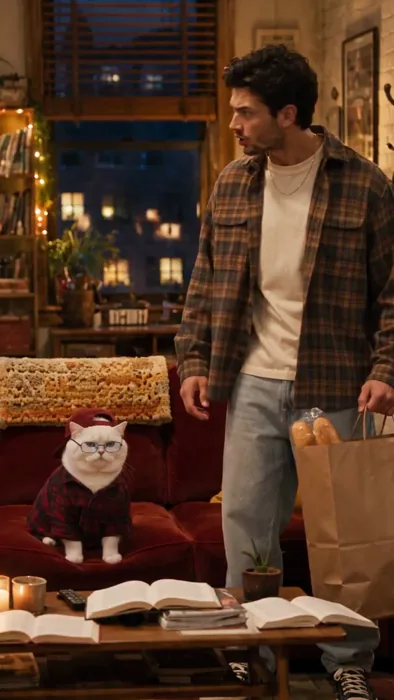</a>

▶ [Watch the full video on ofox.ai](https://ofox.ai/seedance-2-5-prompts?utm_source=github&utm_medium=case&utm_campaign=awesome-seedance-2-5#case-5)

<details>
<summary><strong>Prompt</strong> — 创作一个 30 秒的 90 年代多机位情景喜剧场景，9:16 竖屏，采用真实的 35mm 电视胶片质感拍摄。明亮舒适的公寓，温暖的钨丝灯光，柔和均匀的补光，细腻的胶片颗粒感，窗外是傍晚的蓝色暮色，呈现地道的情景喜剧舞台调度和自然的观众笑声。 一名年轻男子提着杂货走进公寓，当他发现 12 只真实的猫正…</summary>

~~~~text
创作一个 30 秒的 90 年代多机位情景喜剧场景，9:16 竖屏，采用真实的 35mm 电视胶片质感拍摄。明亮舒适的公寓，温暖的钨丝灯光，柔和均匀的补光，细腻的胶片颗粒感，窗外是傍晚的蓝色暮色，呈现地道的情景喜剧舞台调度和自然的观众笑声。 一名年轻男子提着杂货走进公寓，当他发现 12 只真实的猫正在举办"读书会"时，他惊呆了。猫咪们自然地分散在红色沙发、扶手椅、地毯和茶几区域，旁边放着打开的书。他那只胖乎乎的白猫戴着反戴的酒红色鸭舌帽、长方形眼镜，身穿红黑格子法兰绒衬衫，自豪地坐在沙发中央。所有猫咪必须保持完全写实的四足家猫形象；只有那只白猫会说话，带着优雅的英式口音。 0:00–0:05 男子难以置信地环顾四周。 男子："不。别闹。这到底是什么？" 猫："读书会。" 男子："读书会？！" 猫："每周四。" 0:05–0:11 男子："我的客厅里有 11 只猫！" 猫："12 只。" 男子："第 12 只在哪——？" 另一只猫突然从他的购物袋里自然地探出头来。 男子："噢，拜托！" 0:11–0:17 男子指着书。 男子："你们连字都不认识！" 全场死寂。所有猫咪逐渐转过头，自然地盯着他看。 男子，突然变得不确定："……对吧？" 0:17–0:22 白猫从眼镜上方看他。 猫："然而，不知怎么的……你还是这里最笨的一个。" 观众爆发出巨大的笑声。男子对着镜头露出疲惫的表情。 0:22–0:27 男子："够了！全都出去！读书会结束了！" 猫："我们投票了。" 男子："结果呢？！" 猫："你走。" 0:27–0:30 门铃响了。男子打开门，发现外面坐着另一只真实的猫，嘴里轻轻叼着一本平装书。 沙发上的猫："太好了。那是 Margaret。" 男子无奈地闭上眼睛。画面定格，伴随着巨大的笑声、掌声和一段简短欢快的 90 年代情景喜剧片尾音乐。 超写实的物理场景，自然的真人表演，真实的猫毛和解剖结构，可信的物理效果和不完美的猫科动物动作。禁止出现 CGI/AI 感、拟人化猫咪、人类般的猫咪动作、多余肢体、卡通风格、未来主义元素、深色电影调色、字幕、Logo 或水印。
~~~~

</details>

**参数**：Seedance 2.5 · 未标注 · t2v · 未标注 · 未标注 · 未标注 · 未标注
**来源**：[@frametheory058](https://x.com/frametheory058) · [原帖](https://x.com/frametheory058/status/2094258542492733717)

<sub>Preview © 2026 <a href="https://x.com/frametheory058/status/2094258542492733717">@frametheory058</a> · Prompt by <a href="https://x.com/frametheory058/status/2094258542492733717">@frametheory058</a></sub>

[Back to top](#table-of-contents)

<a id="case-6"></a>
### Case 6: London techno club, 30-second one-shot (伦敦电子舞曲俱乐部·30秒一镜到底) — by @JMSvid

<a href="https://ofox.ai/seedance-2-5-prompts?utm_source=github&utm_medium=case&utm_campaign=awesome-seedance-2-5#case-6">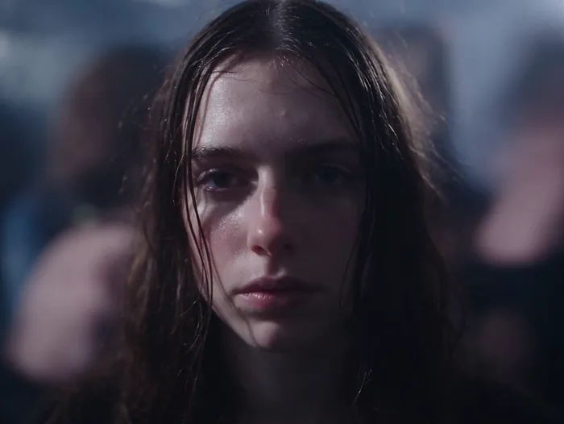</a>

▶ [Watch the full video on ofox.ai](https://ofox.ai/seedance-2-5-prompts?utm_source=github&utm_medium=case&utm_campaign=awesome-seedance-2-5#case-6)

<details>
<summary><strong>Prompt</strong> — Original scene, 30 seconds, one continuous shot, no cuts.  0–8 seconds: Inside a packed underground London techno club. The camera holds tightly on th…</summary>

~~~~text
Original scene, 30 seconds, one continuous shot, no cuts.

0–8 seconds: Inside a packed underground London techno club. The camera holds tightly on the face of a young English woman. She is Caucasian, brunette, with delicate features and melancholy behind her eyes. She remains centered in frame and only sways subtly with the music. Around her, the crowd moves intensely and chaotically, with bodies, arms, shoulders and faces constantly passing close to camera, creating strong motion blur and a sense of pressure and overwhelm.

Fast white strobe lights flash continuously, pushing the image back and forth between near-total darkness and sudden bursts of harsh illumination. In the darker intervals, only silhouettes, rim light, glints of sweat and fragmented movement are visible. Each flash briefly reveals fragments of her face—her eyes, cheekbones, wet strands of hair, and distant expression—before she disappears again into darkness. She feels strangely still and emotionally detached while the crowd around her becomes a mass of blurred bodies and flickering light. Heavy four-on-the-floor techno dominates the soundscape, loud, compressed and physically overwhelming.

8–16 seconds: She stays in this space for a moment longer, absorbing the intensity, then finally breaks her gaze, turns and begins pulling herself out of the crowd. The camera does not cut. It releases from the locked close-up and shifts into a close handheld follow shot, staying just behind and slightly beside her as she pushes through dancers. Bodies knock into her shoulders. Arms and backs occasionally obscure the frame. The camera feels intimate, bumped and instinctive, struggling through the same crowded space with her.

As she leaves the center of the dancefloor, the strobing becomes less dominant and the club lighting grows dirtier and more practical. She enters a narrow back passage leading away from the main room.

16–23 seconds: She moves through a cramped, dirty corridor with graffiti-covered walls, peeling paint, torn posters, exposed pipes, damp patches, flickering fluorescent lights and littered plastic cups on the floor. People lean against the walls smoking, chatting, waiting, watching others pass. She threads through them silently. The camera stays close and observational, catching the rustle of fabric, brief shoulder contact and bodies slipping past in the narrow space.

The music becomes more muffled and distant as she moves farther from the dancefloor. The heavy techno remains present only as a low, dulled throb through the walls. Footsteps, clothing friction, breathing, shuffling bodies and indistinct overlapping crowd chatter become clearer. No individual conversation is intelligible. She does not speak.

23–30 seconds: She pushes through the exit and steps into the cold London night. Outside the club, groups of people stand smoking, talking, drifting in and out of the entrance. Streetlight mixes with spill from the doorway and practical urban light. She walks to the nearest dirty exterior wall and pauses. With slightly shaky hands, she lights a cigarette. The flame briefly illuminates her face. She takes a drag, leans back against the wall, then slowly slides down into a seated position on the pavement.

The camera follows her downward and settles at her level, then holds. She sits smoking in silence, looking past the moving crowd into the distance, disconnected from everything around her. People continue crossing the frame, talking, laughing and smoking nearby, but she feels completely alone inside the busy environment.

The sound transitions from overwhelming club techno, to muffled bass and corridor ambience, to distant low-frequency vibration outside mixed with cigarette lighter clicks, breathing, street ambience, footsteps and indistinct smoker chatter. No dialogue.

The overall image should feel raw, naturalistic and grounded, with visible film grain, slight exposure fluctuation, realistic skin texture and subtle handheld instability. Avoid glossy polish, commercial beauty lighting and music-video slickness.
~~~~

</details>

**参数**：Seedance 2.5 · 未标注 · t2v · 30s · 未标注 · 未标注 · 未标注
**来源**：[@JMSvid](https://x.com/JMSvid) · [原帖](https://x.com/JMSvid/status/2083210992343756893)

<sub>Preview © 2026 <a href="https://x.com/JMSvid/status/2083210992343756893">@JMSvid</a> · Prompt by <a href="https://x.com/JMSvid/status/2083210992343756893">@JMSvid</a></sub>

[Back to top](#table-of-contents)

<a id="case-7"></a>
### Case 7: Midnight laundromat short film (午夜自助洗衣店短片) — by @bmx_ai13

<a href="https://ofox.ai/seedance-2-5-prompts?utm_source=github&utm_medium=case&utm_campaign=awesome-seedance-2-5#case-7">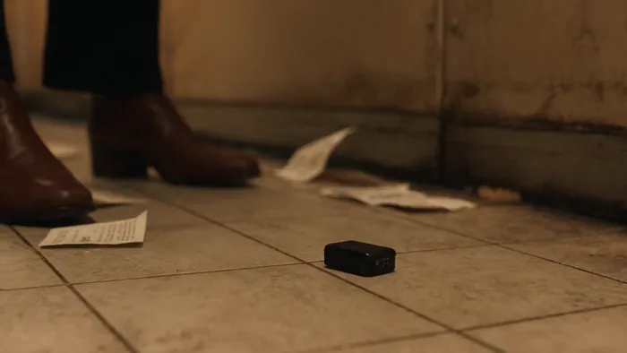</a>

▶ [Watch the full video on ofox.ai](https://ofox.ai/seedance-2-5-prompts?utm_source=github&utm_medium=case&utm_campaign=awesome-seedance-2-5#case-7)

<details>
<summary><strong>Prompt</strong> — Create a 30 second cinematic short film titled The Suit Was Still Listening, presented in 16:9 with synchronized dialogue, environmental sound, and or…</summary>

~~~~text
Create a 30 second cinematic short film titled The Suit Was Still Listening, presented in 16:9 with synchronized dialogue, environmental sound, and original music. The film must feel completely live action, physically grounded, and captured on location, never glossy or synthetic.

Visual language: a rain soaked neighborhood laundromat at midnight, warm amber fluorescent tubes inside, cold blue street light and moving car reflections outside, wet pavement, fogged windows, chipped enamel machines, baskets, detergent boxes, loose receipts, realistic skin texture, natural eye moisture, subtle fabric lint, imperfect hair, restrained film grain, gentle halation, lifted shadows, rich but believable color. Wardrobe creates bold editorial color blocking: Mara wears a cobalt trench over a cream blouse, Noah wears a rust knit polo, the teenage attendant wears faded green workwear, and an elderly customer wears a pale gray suit and dark hat. Use expressive medium close shots, tactile inserts, occasional low angles, clean profile compositions, and brief handheld movement that feels operated by a human. Preserve consistent faces, clothing, props, screen direction, reflections, hand anatomy, and spatial continuity. Use realistic speech timing, breathing, blinking, eye focus, and precise lip synchronization.

0 to 3 seconds. Exterior wide shot through falling rain. A lonely laundromat glows on a dark corner. A black sedan turns slowly into the street. Camera makes a subtle forward creep. Music begins with muted upright bass, brushed snare, a low analog pulse, and the rhythmic churn of washers.

3 to 6 seconds. Interior macro shot through a round washer door. A red scarf turns through soap and water. Cut to Mara opening a dryer. A tiny black transmitter falls from the lining of a cream suit and strikes the tile with a sharp metallic click. The score briefly drops out.

6 to 10 seconds. Low medium two shot. Noah freezes beside a folding table. He says quietly, You said clean the suit. Mara studies the transmitter in her palm and replies, I did. You hid a heartbeat in the lining. Keep the delivery controlled and intimate, not theatrical.

10 to 14 seconds. Tight insert on the teenage attendant checking an old signal meter beside the change machine. A green needle jumps. He looks toward the fogged front window and says, It is still transmitting. Camera racks focus from the meter to white headlights sliding across the glass.

14 to 18 seconds. The sedan stops outside. The elderly customer continues folding a shirt without looking up. He says, Then he is already here. Hold on Mara as the moving headlights carve across her face. Let silence, rain, and machine motors carry the tension.

18 to 22 seconds. Noah whispers, Back door. The old man calmly turns the deadbolt on the back exit and answers, Too obvious. Mara notices a delivery rider outside pushing a rolling laundry cart past the window. Use a fast sequence of close shots: her eyes, the transmitter, the cart wheel, the sedan mirror.

22 to 27 seconds. Mara crosses naturally behind a row of machines, slips the transmitter into a sealed laundry bag on the moving cart through an open service hatch, and returns without drawing attention. Noah asks, What did you do. Mara watches the cart continue down the wet street and says, Gave him a cleaner story.

27 to 30 seconds. Exterior telephoto view. The black sedan pulls away and follows the cart. Cut back inside to a symmetrical medium shot of the four characters framed by spinning washer doors. The red scarf circles behind Mara like a slow warning light. She sits opposite Noah and says, Now tell me who owns the suit. End on the transmitter signal fading from the attendant meter as the final bass note lands.

Sound design must include rain on glass, distant tires on wet road, washer motors, dryer buttons, fabric movement, the transmitter click, door lock, fluorescent hum, and soft room reflections around every voice. Dialogue must remain clean and naturally mixed above the music. Avoid visual distortion, artificial camera acceleration, floating objects, excessive shallow focus, oversharpening, plastic skin, extra fingers, unreadable signage, random background motion, or dreamlike effects.
~~~~

</details>

**参数**：Seedance 2.5 · 未标注 · t2v · 30s · 未标注 · 16:9 · 未标注
**来源**：[@bmx_ai13](https://x.com/bmx_ai13) · [原帖](https://x.com/bmx_ai13/status/2083124798461489228)

<sub>Preview © 2026 <a href="https://x.com/bmx_ai13/status/2083124798461489228">@bmx_ai13</a> · Prompt by <a href="https://x.com/bmx_ai13/status/2083124798461489228">@bmx_ai13</a></sub>

[Back to top](#table-of-contents)

<a id="case-8"></a>
### Case 8: Epic fantasy continuous long take (史诗奇幻一镜到底长镜头) — by @aicanvas_frames

<a href="https://ofox.ai/seedance-2-5-prompts?utm_source=github&utm_medium=case&utm_campaign=awesome-seedance-2-5#case-8"></a>

▶ [Watch the full video on ofox.ai](https://ofox.ai/seedance-2-5-prompts?utm_source=github&utm_medium=case&utm_campaign=awesome-seedance-2-5#case-8)

<details>
<summary><strong>Prompt</strong> — 16:9, 30 seconds, an epic photorealistic fantasy cinematic long take, original worldbuilding, one continuous shot, continuous camera movement, no hard…</summary>

~~~~text
16:9, 30 seconds, an epic photorealistic fantasy cinematic long take, original worldbuilding, one continuous shot, continuous camera movement, no hard cuts, and no references to any existing film, character, actor, or recognizable cinematic scene.

OVERALL STYLE:
A high-budget fantasy film aesthetic with realistic cinematography, monumental world scale, and a beautiful protagonist with natural skin, realistic expressions, and believable body proportions. The overall tone is intelligent, elegant, mysterious, and courageous, never childish, cartoonish, or exaggerated cosplay. Four locations are connected through one continuous flight path: Iceland’s black coastline, an alternate Victorian London, a Paris-inspired city at night in the rain, and a futuristic New York-inspired aerial metropolis.

UNIFIED COLOR PALETTE:
Deep black, silver-gray, and warm gold remain the dominant colors throughout the film. Iceland adds cold blue; London adds gray-green and amber; Paris adds deep blue and wet gold; New York adds deep teal, silver-white, and gold. Maintain realistic atmospheric perspective, thin mist, rainfall, wet surfaces, glass reflections, and volumetric light throughout. Avoid a video-game look, concept-art appearance, and plastic materials.

MAIN CHARACTER:
There is only one female protagonist throughout the entire video. She is approximately 28 years old, slender, exceptionally beautiful, intelligent, elegant, and quietly determined. Her refined facial features are completely original and must not copy any real actor or movie character. She has naturally bright eyes, clearly defined eyebrows, a soft but strong facial structure, natural skin tone, realistic skin texture, and a restrained, focused expression.

She has warm chestnut-brown hair reaching her waist, naturally wavy at the ends. Part of her hair is blown behind her shoulders by the wind. Her hairstyle must remain identical throughout the entire film.

She wears a deep forest-green long coat, an ivory high-neck blouse, a dark-red knitted scarf, brown leather wrist guards, dark-gray trousers, and worn leather boots. Her costume has an elevated British fantasy aesthetic, but she does not wear a school uniform or pointed hat. Do not include badges, school emblems, magical-school symbols, recognizable character costumes, or elements from any existing film.

She rides the same original flying broom throughout the sequence: a dark, aged wooden handle with silver-gray metallic fibers at the rear and a small warm-gold light at the front. The broom’s shape, size, color, and materials must never change.

HER OBJECTIVE:
She is flying through different cities to carry the small warm-gold light toward the far edge of the clouds. She is not a combat character. She does not attack anyone or cast explosive magic. She simply continues forward through cities, coastlines, fog, rain, and high-altitude air. Her emotional progression moves from concentration to wonder, then finally to freedom and determination.

0-5 SECONDS: TAKEOFF FROM ICELAND’S BLACK-SAND BEACH
The shot begins extremely low above a black volcanic beach using a 24mm wide-angle lens. Black ocean waves are on the left, towering basalt columns on the right, and blue-white glacial mountains in the distance. Cold blue clouds press down across the sky, while a narrow line of warm golden sunset remains near the horizon.

The beautiful female traveler rapidly enters from the rear right of the frame, riding her broom just above the ocean surface. Her chestnut-brown hair streams backward in the sea wind. Her dark-red scarf creates a clean motion line behind her, while her deep forest-green coat moves naturally in the airflow. The warm-gold light at the front of the broom illuminates the sea mist and droplets of water.

The camera follows her from behind with a stable FPV movement, keeping her slightly right of center. It must not circle around to the front or allow her to leave the frame. Her body leans slightly forward; one hand holds the broom handle while the other maintains balance. She flies toward a massive wall of blue ice.

At the fourth second, she enters a natural裂缝 beneath the ice wall. The ice passes rapidly along both sides of the camera. Cold blue crystals briefly intersect with the warm-gold light, creating the first natural transition. No explosion, magical smoke, or sudden transformation.

5-12 SECONDS: VICTORIAN LONDON IN THE FOG
As the ice clears the lens, the environment naturally becomes an alternate Victorian city at night. The protagonist and broom retain exactly the same direction, speed, clothing, appearance, and flying posture. The camera continues following from behind.

Below are wet dark-gray stone streets. Red-brick buildings, black iron bridges, narrow windows, and old amber streetlamps line both sides. Several dark-red double-decker public vehicles without text or branding move slowly through the fog. The city should evoke Victorian London without reproducing real landmarks.

The camera gradually transitions from fast FPV pursuit into a smooth three-quarter rear tracking shot, moving approximately 45 degrees to her left side. Her beautiful profile appears briefly. Her eyes remain focused, and her hair and scarf maintain stable continuity. The warm-gold light leaves only a short trail through the rain and fog.

She passes beneath a black elevated iron bridge. Its steel structure moves across the top of the frame as a brief physical occlusion. The camera does not cut, and when the obstruction clears, she remains on the same movement axis.

At the tenth second, she flies into a massive arched railway station. Its roof is made from black steel beams and wet glass, with rainwater flowing across the surface. The roof completely covers the frame, creating the second natural transition.

12-19 SECONDS: PARIS-INSPIRED CITY IN THE RAIN
When the glass roof clears the camera, the environment becomes a romantic, original Paris-inspired city at night in the rain. Do not reproduce real landmarks. Preserve only the atmosphere of stone bridges, a river, narrow streets, classical stone buildings, wrought-iron balconies, and warm window light.

The protagonist flies low above a broad river. The water reflects golden windows and the deep-blue night sky. Pale-gray stone buildings, tall narrow windows, wet rooftops, and fine rain lines extend along both sides. Her deep-green coat and dark-red scarf form a clear silhouette against the blue city, while her chestnut hair streams backward.

The camera moves into a parallel tracking position on her right side. The broom stays approximately three meters above the river. The camera remains slightly below shoulder level, preserving the spatial relationship between the woman, broom, river, and architecture. She passes beneath a sequence of classical stone bridges whose arches form continuous reflections in the water.

At the seventeenth second, she enters a long mirror corridor made from wet glass walls. The reflections may show only the same woman, the same broom, and the same warm-gold light. Do not create duplicate people. Rainwater, city lights, and reflections slide along the glass surfaces.

A powerful warm-gold light appears at the end of the corridor. She flies toward it, creating the third natural transition.

19-24 SECONDS: FUTURISTIC NEW YORK-INSPIRED CITY
The mirror corridor opens into an original futuristic New York-inspired metropolis. The camera rapidly but smoothly shifts from the three-quarter rear position into a controlled forward-facing FPV shot moving backward in front of her. Her beautiful, focused face, chestnut hair, dark-red scarf, and the golden broom light are briefly visible.

Below are wet streets, glass skyscrapers, metallic elevated bridges, and enormous urban canyons. The buildings reflect golden light, a deep-teal night sky, and silver-white mist. All screens and glass surfaces must remain abstract and free of text, advertisements, logos, or branding.

She flies between two skyscrapers. The glass wall on the left passes close to the camera, while a vast urban canyon opens on the right. The camera briefly maintains its backward-facing position before completing one stable 90-degree upward movement, transitioning from her face to a position above her.

Do not spin rapidly, make her tumble, or transform the broom into an aircraft. She remains graceful, skilled, and stable.

At the twenty-third second, she bursts out from between the skyscrapers. The city lights rapidly become smaller below her, while the warm-gold light at the front of the broom becomes the only stable light source near the center of the image.

24-30 SECONDS: THE FINAL WORLD ABOVE THE CLOUDS
The camera continues rising at high speed and passes through a dense layer of cloud. When the clouds clear, the protagonist appears high above a vast cloud sea, hovering on her broom.

She gradually slows down and changes from a forward-leaning posture to a more upright position. Her chestnut hair and dark-red scarf move backward in the high-altitude wind. The camera moves from the front to her right rear side, then rises into a high-angle 24mm wide shot.

Distant traces of the four worlds appear below without forming a chaotic collage: Iceland’s black coastline and blue glacier on the far left; London-inspired red-brick structures and gray-green fog in the middle distance; Paris-inspired golden waterways and stone bridges on the right; and silver-white lights from the New York-inspired glass city at the lowest level.

These locations must exist only as distant spatial layers. Do not suddenly reproduce four complete cities or make buildings float and reorganize. A warm golden horizon appears at the edge of the clouds, suggesting that another world is waiting beyond it.

At the twenty-eighth second, the protagonist raises her right hand. The warm-gold light at the front of the broom emits one thin beam toward the horizon. The beam only illuminates a new path through the clouds. It does not explode, create a giant energy sphere, or alter her appearance.

During seconds twenty-nine to thirty, the camera becomes completely stable. The protagonist, broom, cloud sea, distant layers of the four cities, and golden horizon are all clearly visible. She appears as a beautiful but small figure near the lower center of the frame, facing the open world. The final emotion is freedom, wonder, and the sense that the journey will continue.

CAMERA AND PACING:
0-5 seconds: low-altitude rear FPV pursuit.
5-12 seconds: smooth three-quarter rear tracking through London.
12-19 seconds: parallel low-altitude tracking through Paris.
19-24 seconds: one controlled front-facing backward FPV movement through New York.
24-30 seconds: continuous rise into a high-angle wide establishing shot.
Use FPV speed only during the Iceland takeoff and New York skyscraper passage. Keep the London and Paris sections controlled, elegant, and spatially readable.

SOUND DESIGN:
Iceland: ocean waves, cold wind, low glacial rumbling, and subtle vibration from the wooden broom.
London: rain, steam, iron-bridge resonance, and distant wheels.
Paris: rain droplets, water, distant bells, and low strings.
New York: low urban rumble, wind pressure across glass, and metallic structural resonance.
Above the clouds, all city sounds gradually fade, leaving high-altitude wind, a subtle metallic resonance from the broom fibers, and one warm sustained string note.

CONTINUITY RESTRICTIONS:
Only one female protagonist appears throughout the video.
She must remain exceptionally beautiful, natural, and realistic, with stable original facial features that do not copy any actor or film character.
Her chestnut-brown hair must retain the same color, length, and hairstyle.
Her forest-green coat, ivory blouse, dark-red scarf, brown wrist guards, dark-gray trousers, and worn boots must remain unchanged.
The broom must remain the same dark aged wooden broom with silver-gray metallic fibers and a warm-gold front light.
Do not add companions or other flying characters.
Do not include pointed hats, school uniforms, magical schools, badges, school emblems, castles, recognizable film characters, superhero logos, or brand symbols.
Do not generate text, subtitles, advertisements, UI elements, logos, or readable signs.
Do not allow buildings to melt, drift, resize, or suddenly reorganize.
Do not create duplicate figures in mirrors.
Maintain realistic physical behavior for ice, rain, water, glass, fog, and clouds.
Do not use hard cuts, sudden spinning, random shaking, abrupt zooms, body deformation, face replacement, explosions, large-scale destruction, or unmotivated effects.
Keep the protagonist, broom, flying direction, city geography, and lighting transitions continuous and visually traceable.
~~~~

</details>

**参数**：Seedance 2.5 · 未标注 · t2v · 30s · 未标注 · 16:9 · 未标注
**来源**：[@aicanvas_frames](https://x.com/aicanvas_frames) · [原帖](https://x.com/aicanvas_frames/status/2083383374840787223)

<sub>Preview © 2026 <a href="https://x.com/aicanvas_frames/status/2083383374840787223">@aicanvas_frames</a> · Prompt by <a href="https://x.com/aicanvas_frames/status/2083383374840787223">@aicanvas_frames</a></sub>

[Back to top](#table-of-contents)

<a id="case-65"></a>
### Case 65: Rainy-night argument, 14 timecoded shots (雨夜争吵 ·《如果我拿不出这些钱》) — by @cosset_li

<a href="https://ofox.ai/seedance-2-5-prompts?utm_source=github&utm_medium=case&utm_campaign=awesome-seedance-2-5#case-65"></a>

▶ [Watch the full video on ofox.ai](https://ofox.ai/seedance-2-5-prompts?utm_source=github&utm_medium=case&utm_campaign=awesome-seedance-2-5#case-65)

<details>
<summary><strong>Prompt</strong> — Seedance 2.5 AI生成｜《如果我拿不出这些钱》30秒情感短剧提示词  全局设定 16:9横屏，30秒，电影级写实摄影，日系都市雨夜，固定机位（50/85mm人像镜头，浅景深），男女始终面对面（女右男左），雨势逐渐增大。小满（28岁东亚女性，长直黑发，清冷淡颜）与男主（34岁，黑色偏分短发…</summary>

~~~~text
Seedance 2.5 AI生成｜《如果我拿不出这些钱》30秒情感短剧提示词

全局设定
16:9横屏，30秒，电影级写实摄影，日系都市雨夜，固定机位（50/85mm人像镜头，浅景深），男女始终面对面（女右男左），雨势逐渐增大。小满（28岁东亚女性，长直黑发，清冷淡颜）与男主（34岁，黑色偏分短发，深色亨利领上衣）全程同一人物、同一服装，仅随雨水湿润。

镜头序列
镜1（0-1.8s） 小满眼眶泛红，努力忍泪，风撩动湿发，委屈开口：“明明所有人都说我很好……”眼神紧盯对方。
镜2（1.8-3.8s） 男主低头，右手抬起又放下，声音低沉自责：“对你最好，是我配不上你……”尾音减弱。
镜3（3.8-5.7s） 小满愣住，轻摇头，泪水滑落，身体前倾：“我没有说你不配……”语气不解。
镜4（5.7-7.8s） 呼吸变急，拨开贴颊湿发，质问带哭腔：“为什么你越来越不在意我呢……”
镜5（7.8-9.8s） 突然安静，低头颤抖，再抬头疲惫：“明明我那么在乎你……”
镜6（9.8-12.2s） 男主双手按胸，雨水冲湿偏分短发，崩溃吼出：“我没钱了……我没钱了！”（第二遍带哭腔）。小满瞬间甩出一记真实耳光，男主头偏右，后退半步，怔住后流泪。
镜7（12.2-14.5s） 男主不怒反急，身体前倾，手指比划：“你要的是很多很多的爱……”
镜8（14.5-17.2s） 小满睁大眼，意识到什么；切男主痛苦低语：“可我需要很多很多的钱……”眼神闪躲。
镜9（17.2-19.5s） 男主双手抱头，湿发凌乱，放下后喘息：“你以为我们的爱是靠什么支撑着的？”
镜10（19.5-22.2s） 快速列举，手势自然：“住房、旅游、过节送礼、谈婚论嫁……”声音急促。
镜11（22.2-24.8s） 极近景，湿发贴额，泪雨混流，嘶吼：“哪一个不需要钱？！”尾音喊破后戛然。
镜12（24.8-26.5s） 切小满，完全沉默，泪流不止，湿发贴颊，嘴微张又合上，只剩雨声。
镜13（26.5-28.3s） 男主泄力，手放胸口，低头再抬头，沙哑：“如果我拿不出这些钱……”
镜14（28.3-30s） 双手无力摊开，望雨夜，回看女生，极轻颤抖：“我用什么来证明我的爱……”对视0.3秒，雨幕落下，结束。

表演与声音
情绪曲线：小满委屈→不解→质问→心碎→震惊→沉默；男主自责→崩溃→解释→爆发→无力。全程真实雨声，呼吸与衣物摩擦声，无喧宾夺主BGM，镜11音乐退出，镜12仅雨声，镜14雨声+轻呼吸。

一致性约束
禁止换脸/变发型/换装/左右移位，头发仅随雨水变湿，偏分始终可辨，耳光真实无慢动作，所有口型同步中文对白。

#AI生成 #Seedance2.5 #情感短剧 #雨夜争吵 #现实压力 #电影级AI
~~~~

</details>

**参数**：Seedance 2.5 · 未标注 · t2v · 30s · 未标注 · 16:9 · 带音频
**来源**：[@cosset_li](https://space.bilibili.com/3546814332537575) · [原帖](https://www.bilibili.com/video/BV1y1bL6ZE9v)

<sub>Preview © 2026 <a href="https://www.bilibili.com/video/BV1y1bL6ZE9v">@cosset_li</a> · Prompt by <a href="https://www.bilibili.com/video/BV1y1bL6ZE9v">@cosset_li</a></sub>

[Back to top](#table-of-contents)

<a id="case-1001"></a>
### Case 1001: The toasting dress and one plate (敬酒服 · 一盘菜) — by Ofox Team

<a href="https://ofox.ai/seedance-2-5-prompts?utm_source=github&utm_medium=case&utm_campaign=awesome-seedance-2-5#case-1001"></a>

▶ [Watch the full video on ofox.ai](https://ofox.ai/seedance-2-5-prompts?utm_source=github&utm_medium=case&utm_campaign=awesome-seedance-2-5#case-1001)

<details>
<summary><strong>Prompt</strong> — FORMAT: 16:9, 30 seconds, 9 shots; three hard cuts, the other five boundaries carried in camera as named on the timeline. STYLE: live-action, colour 3…</summary>

~~~~text
FORMAT: 16:9, 30 seconds, 9 shots; three hard cuts, the other five boundaries carried in camera as named on the timeline.
STYLE: live-action, colour 35mm film grain, slight exposure fluctuation; the camera crosses three light worlds inside one scene — the banquet hall is warm tungsten with red lantern bounce, the service corridor behind it is cold green-white fluorescent on wet stainless steel and steam, the propped-open fire door at the end is deep blue night on wet concrete; real skin texture, no smoothing, no beauty filter.
THE BRIDE: woman around 30, slim; hair pinned up with a few strands come loose at the temples, heavy banquet makeup slightly worn through, small pearl earrings; a red brocade qipao-style toasting dress with a short mandarin collar, the hem gathered up in her left hand, flat black shoes; steady, tired, not tearful. Referred to as "the bride".
THE MOTHER: woman in her late 50s, shorter and solid; permed short black hair, a maroon jacquard jacket with a red corsage pinned crooked at the shoulder, reading glasses pushed up onto her head; she carries a small white plate with four or five pieces of food on it in both hands and does not put it down until the last shot. Referred to as "the mother".
SCENE: the back of a hotel banquet hall on a wedding night, and the service side behind it. In the hall: twenty red-draped round tables, a lit stage, a microphone toast running, guests standing and sitting. At the side wall: a heavy red curtain. Behind it: a narrow service corridor of stainless trolleys, steam, stacked plastic crates and a wet tiled floor, waiters passing with loaded trays. At the end of the corridor: a fire door propped open onto a concrete landing — the rain has just stopped, the ground is wet and reflective, a dark city block beyond. The banquet stays audible through the wall throughout.
ARC: she walks out of a banquet too loud to hear anything in → her mother comes after her down the service corridor with a small plate → the mother assumes she is having second thoughts and starts to persuade → she does not take up that thread → she says the thing she actually came out to say → the mother looks down at the plate, is sat on a crate, and eats one bite.

SHOT 1 (0-4s): Wide, chest height, moving — a close handheld follow that starts behind her at the back of the hall and stays just behind and beside her as she crosses right to left between the round tables, hem gathered in one hand, looking at nobody; a toast runs on the lit stage behind her and two guests step out of her way. No line. Sound: a microphone toast, applause, dishes, a very loud room.
Without cutting, the camera pushes through the gap in the heavy red curtain into the service corridor, and the hall noise drops behind it to a muffled bass through the wall.
SHOT 2 (4-7.5s): Medium from behind, the same close handheld follow, now just behind and beside her in the corridor; steam crosses the frame, a trolley passes on her right, the wet floor throws the fluorescent tubes back up at her. She does not look back. No line. Sound: extraction fans, plates stacking, one kitchen shout, a trolley wheel, the hall thudding through the wall.
Without cutting, a loaded waiter tray sweeps across the lens; the camera comes out of the occlusion having swung back the way it came, and finds the mother just inside the curtain.
SHOT 3 (7.5-10s): Medium single on the mother, handheld, moving with her as she comes through the curtain with the plate held out in front of her in both hands and looks down the corridor for her daughter; a waiter steps around her. No line. Sound: the corridor, her shoes on wet tile.
HARD CUT.
SHOT 4 (10-13.5s): Wide, low, from inside the corridor looking at the propped-open fire door; the camera arrives on a short handheld drift and settles as the bride stops in the doorway, puts one hand flat on the door frame and breathes out into the blue night; wet concrete and one far streetlight beyond her. The mother (off-screen, careful, not scolding): 「你一口没吃。」 Sound: water dripping off a canopy outside, the fans behind, no music.
HARD CUT.
SHOT 5 (13.5-17s): Medium single on the mother, three-quarter, the camera drifting in a few centimetres; she lifts the plate slightly, as if the plate were the argument. The mother (quiet, pleading, no anger): 「都到这一步了。」 Sound: her breath, the dripping water.
HARD CUT.
SHOT 6 (17-20.5s): Close-up single on the bride, reverse angle on the same eye-line, faint handheld drift; she looks at the plate and not at her mother, and one loose strand moves in the air from the open door. The bride (level, no bitterness, unhurried): 「妈，我不是不想结。」 A short breath before it; on the last word her eyes come up to her mother. Sound: dripping water, one fan.
Without cutting, the raised hand of the bride passes very close to the lens and briefly covers most of the frame; the camera comes out of the occlusion on the plate.
SHOT 7 (20.5-23s): Macro insert, held with only a faint breathing sway: the small white plate in the hands of the mother, the food untouched and going cold, one thumb pressed on the rim, the crooked corsage out of focus above it. No line. Sound: the corridor, two breaths.
Without cutting, the camera tilts up from the plate to the face of the mother.
SHOT 8 (23-26.5s): Close-up on the mother, holding after the tilt; she is listening, not answering. The bride (off-screen, quieter, almost apologetic): 「我是想你今天也吃一口。」 Her mouth opens slightly, then closes; she looks down at the plate she is holding. Sound: the dripping water, the banquet still thudding through the wall.
Without cutting, the camera pulls back and down as the bride steps into frame from the right and takes the plate out of her hands.
SHOT 9 (26.5-30s): Wide, low, from the wet corridor floor: the bride sets the plate on an overturned plastic crate beside the open fire door, puts both hands on the shoulders of her mother and sits her down on a second crate, then sits beside her; the mother picks up one piece and eats it. The camera settles and holds the two of them, the blue doorway and the crates for the last second. No line. Sound: water dripping, the banquet through the wall, two people breathing; no music.

CAMERA: movement per shot, and held is a value here rather than the absence of one — a close handheld follow in 1 and 2 that carries through the curtain, handheld with the mother in 3, a short drift that settles in 4, a few centimetres of push in 5, a faint drift in 6, held with a breathing sway on the macro insert in 7, a tilt up in 8, a pull back and down into the low wide of 9; 28mm in the hall, in the corridor and on the final wide, 70mm for the singles, macro for the insert; shallow depth of field on the singles, deeper on the follows; the eye-line axis between the two of them is set in shot 4 and never crossed — the singles in 5 and 6 are a shot and reverse shot on that axis, which is wanted, not forbidden.
SOUND: three stages the camera crosses, and the mix follows it — the hall is a microphone toast, applause, dishes and a very loud room; from the curtain onward the banquet is only a muffled bass through the wall; the corridor is extraction fans, plates stacking, one kitchen shout and a trolley wheel; the landing is water dripping off a canopy, one far road and two breaths. No music at any point. Dialogue in Mandarin Chinese, mouths matched to Mandarin.
CONSISTENCY: the face of the bride, the pinned-up hair with loose strands at the temples, the pearl earrings, the red brocade qipao-style dress and the flat black shoes identical in every shot; the face of the mother, the permed short hair, the maroon jacquard jacket, the crooked red corsage and the reading glasses on her head identical in every shot; the small white plate and the food on it identical from shot 3 to shot 9; the hall stays lit and loud behind the wall, the fire door stays propped open, the corridor floor stays wet, and the rain does not start again.
AVOID: subtitles, captions, on-screen text, watermarks, logos, legible signage; extra or warped limbs, warped hands, hands passing through the plate; CGI look, plastic skin, skin smoothing, beauty filter; dissolves, jump cuts, whip pans, sudden zooms, crossing the eye-line axis; a white wedding gown, a groom, guests following them out of the hall, anyone else speaking; theatrical over-acting, raised voices, tears rolling, embracing, kneeling.
~~~~

</details>

**参数**：Seedance 2.5 · Ofox · t2v · 30s · 480p · 16:9 · 带音频
**费用**：$3.30（job 844c9145-9b10-4335-9fdc-ec4937793a2f）
**来源**：Ofox 实测

[Back to top](#table-of-contents)

<a id="case-1002"></a>
### Case 1002: Duel in the bamboo grove at night (竹林夜战) — by Ofox Team

<a href="https://ofox.ai/seedance-2-5-prompts?utm_source=github&utm_medium=case&utm_campaign=awesome-seedance-2-5#case-1002"></a>

▶ [Watch the full video on ofox.ai](https://ofox.ai/seedance-2-5-prompts?utm_source=github&utm_medium=case&utm_campaign=awesome-seedance-2-5#case-1002)

<details>
<summary><strong>Prompt</strong> — FORMAT: 16:9, 30 seconds, 10 shots; three hard cuts, the other six boundaries carried in camera as named on the timeline. STYLE: live-action wuxia cin…</summary>

~~~~text
FORMAT: 16:9, 30 seconds, 10 shots; three hard cuts, the other six boundaries carried in camera as named on the timeline.
STYLE: live-action wuxia cinema, colour 35mm film grain with a soft diffusion haze from the fog; the only light is moonlight in hard-edged shafts through the bamboo canopy, throwing sculptural rim light along cheekbones, jawlines, hair and blade edges; skin carries a natural warm sheen, catching the moonlight rather than looking flat; a cool blue-silver key from above, a faint warm bounce off the ground mist below.
THE SWORDSMAN: man late 20s, tall and lean with squared shoulders and a long-limbed build; a sharp, angular jaw, a straight high-bridged nose, narrow phoenix-shaped eyes under straight dark brows, defined cheekbones; long black hair pulled back into a high topknot with a few loose strands at the temples, a dark jade hairpin through the knot; a fitted charcoal-black changshan robe with a stand collar, thin silver-thread embroidery at the cuffs, a wide indigo silk sash cinched at the waist, black leather vambraces on both forearms; carries a straight double-edged jian in a black lacquered scabbard with a silver guard, the blade catching a cold gleam. Referred to as "the swordsman".
THE SWORDSWOMAN: woman mid-20s, slender but strong, a straight posture; almond-shaped eyes, a straight fine nose, a soft but defined jawline, high cheekbones; a high ponytail bound with a crimson silk ribbon that streams behind her in the wind, loose strands crossing one temple; a fitted crimson silk changyi with a stand mandarin collar and black piping down the front, a black sash at the waist with a pale jade pendant, black fitted trousers, soft black boots; carries a curved single-edged dao with a crimson tassel at the pommel and a dark wood grip. Referred to as "the swordswoman".
SCENE: a dense bamboo grove deep at night. Tall bamboo stalks rise into a canopy that breaks the moonlight into hard-edged shafts, some falling directly on the small clearing at the centre where the two of them fight, others lost in the grove beyond. Ground mist sits at ankle height and drifts with every gust. Fallen bamboo leaves cover the ground and lift into the air with the wind of every strike. A few free-standing thick bamboo stalks stand inside the clearing itself, close enough for the fight to move through and around them.
ARC: a poised standoff across the misted clearing, then first blade contact with sparks at the point of contact, then she presses the attack with a spinning slash, then he parries and closes the gap and a sleeve is cut away, then the fight moves fast through the bamboo stalks, then a bamboo trunk is severed and falls between them, then blades lock at the guard and she speaks, then he breaks the lock with a decisive strike that freezes mid-air, then her block holds and he staggers back, then both step apart with weapons lowered as the mist settles between them.

SHOT 1 (0-2.5s): Wide, static, at chest height across the clearing. The swordsman and the swordswoman face each other from opposite edges of the misted clearing, bamboo stalks rising around them, moonlight falling in shafts between the canopy gaps, ground mist drifting at ankle height, bamboo leaves settling around their feet. Neither moves. No line. Sound: wind through bamboo leaves, a distant owl, silence between them.
Without cutting, a thick bamboo stalk between them sweeps across the lens as the swordsman closes the distance in one stride; the camera comes out of the occlusion already on the first clash.
SHOT 2 (2.5-5s): Medium two-shot, low handheld, moving with the collision. The straight jian meets the curved dao at the guard in one hard block, sparks scattering at the point of contact, a gust of wind sweeping leaves outward from the impact. He disengages first, stepping back half a pace. No line. Sound: the ring of steel on steel, wind, both breathing hard.
HARD CUT.
SHOT 3 (5-7.5s): Close-up on the swordswoman, following the spin, low handheld. Her dao arcs through a full spinning slash, the crimson ribbon and the hem of her changyi snapping outward with the motion, one bamboo leaf sliced clean in the foreground and drifting down in two pieces. No line. Sound: the whistle of the blade through the air, cloth snapping, leaves rustling.
Without cutting, her dao sweeps very close across the lens on the follow-through of the strike, briefly filling the frame; the camera comes out of the occlusion already on his counter, the jian already rising to meet it.
SHOT 4 (7.5-10s): Close-up on the swordsman, low handheld, moving with the parry. The jian angles up to intercept the dao at the last instant, sparks bursting off the point of contact, the edge of the dao catching the loose end of his sleeve and cutting away a thin strip of dark cloth that drifts off in the wind. No line. Sound: steel grinding on steel, a thin tear of cloth, wind.
HARD CUT.
SHOT 5 (10-13s): Wide, tracking, moving with them through the bamboo. The camera follows the two of them weaving between the free-standing bamboo stalks in the clearing, blades trading fast blows in motion blur, one stalk grazed by the jian and left leaning. No line. Sound: rapid clashes of steel, footfalls on packed earth, wind moving through the grove.
Without cutting, the camera pushes through the gap between two bamboo stalks as the fight spins past on either side of it, arriving on the other side already mid-exchange.
SHOT 6 (13-15.5s): Medium, low angle, handheld, close on the exchange. Three blade contacts land in quick succession, sparks flashing at each point of contact, bamboo leaves kicked up around their feet; the dao lands a clean horizontal cut across a bamboo stalk at chest height, the top half beginning to lean and fall. No line. Sound: three fast clangs of steel, the crack of the cut bamboo starting to give.
Without cutting, the severed bamboo trunk drops and sweeps across the lens between them; the camera comes out of the occlusion on the next beat, the two of them now closer, blades already locked at the guard.
SHOT 7 (15.5-18.5s): Close two-shot, locked blades at the guard, faces close, held with a faint handheld sway. Both breathing hard, a gust lifting loose leaves and the loose strands at her temple between them; the jian and the dao grind against each other at the crossed edges, neither giving ground. The swordswoman (quiet, controlled, a faint challenge, not mocking): 「你的剑，还是这么急。」 A short breath before it; on 急 her eyes narrow slightly, the pressure on the blade held steady. Sound: the grind of locked steel, wind, both breathing.
HARD CUT.
SHOT 8 (18.5-23s): Wide, low angle. He breaks the lock and swings the jian in one decisive arc directly past the lens toward her, an extreme speed ramp on the swing, then the frame flash-freezes for an instant on the peak of the block: her dao raised to intercept the jian a hand-width from her shoulder, both weapons frozen mid-motion, a single moonbeam catching the crossed blade edges, bamboo leaves suspended in the air around them. No line. Sound: the whistle of the swing accelerating, then total silence on the freeze.
Without cutting, motion resumes from the freeze at normal speed as her dao deflects the jian wide, the force of the block sending a visible gust that scatters the suspended leaves outward and sends him staggering half a step back; the camera holds through the resume.
SHOT 9 (23-26.5s): Medium, handheld, holding on the swordsman. He catches his balance on the second step, plants his back foot, breathing hard, the jian lowered to his side; a beat of stillness between them, the wind settling, mist drifting low again around their feet. No line. Sound: his breath slowing, wind dropping, one leaf settling on the ground.
Without cutting, the camera drifts back and widens as both of them step back from each other, weapons lowering.
SHOT 10 (26.5-30s): Wide, static after the drift settles, at chest height across the clearing again, mirroring shot 1. Both fighters stand apart, weapons lowered but not sheathed, moonlight steady in its shafts between them, mist settling at their feet, a long held look between them. The camera settles and holds on both of them for the last second. No line. Sound: wind through the leaves, mist settling, no music.

CAMERA: movement per shot, and held is a value here rather than the absence of one — static in 1 and mirrored static in 10, the standoff bookends; low handheld with the collision in 2; low handheld following the spin in 3; low handheld with the parry in 4; wide tracking through the bamboo in 5 that carries through the pass-through; low angle handheld on the triple clash in 6; held with a faint sway on the locked blades in 7; a wide low angle carrying the speed ramp and the freeze in 8; handheld holding on him through the recovery in 9; a drift back and wide settling into the static close of 10. 24mm wide for the wides and the tracking shot, 50 to 85mm for the close-ups and the two-shots; shallow depth of field on every close-up and two-shot, deeper on the wides; focus stays on the blade edges at the point of every contact; the eye-line axis between them is set in shot 1 and never crossed.
SOUND: forest night ambience throughout — wind through the bamboo canopy, leaves rustling, an occasional distant owl; every blade contact carries its own ring of steel on steel; cloth snapping and tearing on the cut sleeve in shot 4; the crack of bamboo giving way in shots 5 and 6; near total silence on the flash freeze in shot 8, then the gust and the stagger; both fighters breathing hard through shots 7 to 9. A single low sustained string note enters under the freeze in shot 8 and fades out by shot 9; no music anywhere else. Dialogue in Mandarin Chinese, mouth matched to Mandarin. No narration, no subtitles.
CONSISTENCY: the face of the swordsman, the topknot with the jade hairpin, the charcoal changshan robe with the silver-thread cuffs, the indigo sash, the black vambraces and the straight jian with its black scabbard identical in every shot, including the cut sleeve staying cut from shot 4 onward; the face of the swordswoman, the high ponytail with the crimson ribbon, the crimson changyi with the black piping, the black sash with the jade pendant and the curved dao with its crimson tassel identical in every shot; the moonlight direction and the layout of the bamboo stalks in the clearing do not change, aside from the one stalk cut and fallen in shot 6.
AVOID: subtitles, captions, on-screen text, watermarks, logos; extra or warped limbs, warped hands, blades passing through bodies; a real historical figure, a real public figure, any recognisable public identity; blood, open wounds, cuts to skin, severed limbs, a blade piercing a body, death, a corpse; glowing energy, magical light effects, floating or flying that breaks contact with the ground, wire-fu physics; CGI look, plastic skin, waxy skin; dissolves, jump cuts, whip pans, crossing the eye-line axis; theatrical over-acting, exaggerated grimacing, screaming.
~~~~

</details>

**参数**：Seedance 2.5 · Ofox · t2v · 30s · 720p · 16:9 · 带音频
**费用**：$7.20（job 4e5c9581-d462-443b-9663-b1aa6d72f527）
**来源**：Ofox 实测

[Back to top](#table-of-contents)

<a id="case-1003"></a>
### Case 1003: The handover, and the car at the mouth of the alley (雨夜交接 · 巷口那辆车) — by Ofox Team

<a href="https://ofox.ai/seedance-2-5-prompts?utm_source=github&utm_medium=case&utm_campaign=awesome-seedance-2-5#case-1003">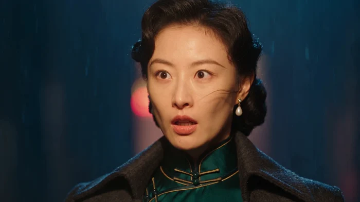</a>

▶ [Watch the full video on ofox.ai](https://ofox.ai/seedance-2-5-prompts?utm_source=github&utm_medium=case&utm_campaign=awesome-seedance-2-5#case-1003)

<details>
<summary><strong>Prompt</strong> — FORMAT: 16:9, 20 seconds, 8 shots; five hard cuts, two boundaries carried in camera as named on the timeline. STYLE: live-action 1930s Shanghai noir, …</summary>

~~~~text
FORMAT: 16:9, 20 seconds, 8 shots; five hard cuts, two boundaries carried in camera as named on the timeline.
STYLE: live-action 1930s Shanghai noir, photographed with a fashion-editorial cinematic eye — colour 35mm film grain, hyper-realistic skin texture with a natural sheen catching the light rather than looking flat; the only light is a single caged bulb above the doorway and the warm tungsten spill through the open door, throwing hard-edged rim light along cheekbones, jawlines and wet fabric, deep shadow filling the rest; cool blue-grey night beyond the light, rain falling through it in visible streaks, red and amber neon reflected in the standing water down the alley.
HER: woman late 20s, striking bone structure — high cheekbones, a straight fine nose, a defined jawline, almond-shaped eyes with a level unafraid gaze, thin arched brows, dark red matte lipstick; black hair set in soft finger waves pinned close at the nape, a single pearl drop earring; a fitted dark emerald green silk qipao with a stand mandarin collar, fine gold-thread piping at the collar and frog closures, an open charcoal wool trench coat over it, collar turned up, rain beaded on one shoulder; a small black clutch held in both hands, a thin gold ring on one finger; composed, giving nothing away. Referred to as "her".
HIM: man late 30s, tall, upright, lean; a sharp brow ridge, deep-set eyes, a straight nose, a clean-shaven angular jaw; dark hair combed back close to the scalp with a faint sheen; a dark grey fedora with the brim pulled low, a charcoal wool overcoat over a white shirt and black tie, black leather gloves, a silver pocket-watch chain at the waistcoat; still, unreadable, in no hurry. Referred to as "him".
SCENE: the covered back doorway of a dance hall on a rainy Shanghai night, 1930s — a heavy iron-framed door standing ajar with warm tungsten light spilling across wet black cobblestones, a short flight of worn stone steps, a dented metal rubbish bin, stacked wooden crates, a single bare bulb in a wire cage over the doorway; the alley runs away toward a street where blurred red and amber neon reflects in standing water, rain falling through every light in visible streaks; a wet brick wall on one side with old pasted notices reduced to an unreadable blur of paper and shadow; ground fog low against the cobbles, water running steadily from a downpipe.
ARC: the handover completes → his line lands, level and unhurried → the flicker she cannot quite stop → the held stillness between them → she turns without a word → she steps into the rain and the neon, resolve settling into her spine.

SHOT 1 (0-2s): Wide, restrained handheld sway, chest height across the doorway. Her gloved hand extends a small silk-wrapped packet into his waiting hand at the threshold, rain streaking through the bulb light between them, water beading on the shoulder of her coat; his fingers close around it without looking down. No line. Sound: rain on stone and tin, the crinkle of the wrapped paper, water in the downpipe.
Without cutting, the loose wet hem of her coat swings across the lens as her hand withdraws; the camera comes out of the occlusion already close on her fingers curling back into her coat pocket.
SHOT 2 (2-4.5s): Macro insert on her hand, handheld, subtle breathing sway. Her fingers close around the clasp of the clutch, knuckles pale for a moment then relaxing; off-screen, the faint sound of the packet disappearing into his coat. No line. Sound: cloth, the packet settling, rain.
HARD CUT.
SHOT 3 (4.5-7s): Medium two-shot from behind his shoulder toward her, handheld follow. She lifts her eyes to his; an even, unhurried look passes between them, rain falling past both faces, breath visible in the cold. No line. Sound: rain, both breathing, a distant tram bell.
HARD CUT.
SHOT 4 (7-9.5s): Close-up on him, locked camera, chest-up, the brim of his fedora shadowing his eyes and leaving only his jaw and mouth lit. Him (level, unhurried, almost gentle — no threat in the tone, which is what makes it land): 「巷口那辆车，已经等你三天了。」 The line comes slowly, evenly, filling almost the whole shot. Sound: his voice, rain, one distant tram bell fading.
HARD CUT.
SHOT 5 (9.5-12s): Close-up on her, locked camera, chest-up. For the first half second she is still taking the words in; then the shot drops into slow motion for 1.5 seconds on the exact instant her eyes widen a fraction and her breath catches, one strand of hair trembling against her cheek in the wind, rain hanging visibly in the frame; then back to speed for the final half second as her jaw sets and the flicker is gone, replaced by careful stillness. No line. Sound: near total silence under the slow motion but for one low sustained string note; rain resumes in full at normal speed.
HARD CUT.
SHOT 6 (12-14.5s): Medium two-shot, handheld, breathing sway. She says nothing; her gaze drops a fraction, her body turning half a step away from him, water dripping from the cage of the bulb between them; he stays exactly where he is, unhurried, not pressing further. No line. Sound: rain, water dripping, the silence held between them.
Without cutting, she turns and steps deeper into the alley shadow; the camera drifts sideways with her, the doorway light sliding off her shoulder, arriving already following her retreat.
SHOT 7 (14.5-17s): Medium three-quarter profile, handheld follow, staying just behind and beside her. She walks a few steps down the alley, jaw tight, one hand closing hard around the clutch, the doorway light and his silhouette shrinking behind her; rain streaks past in the foreground. No line. Sound: her footsteps on wet stone, rain, the tram bell now gone.
HARD CUT.
SHOT 8 (17-20s): Wide, handheld with a slow trailing push, from further down the alley. She reaches the mouth of the alley where the neon-lit street begins, pauses for half a second in the reflected red and amber light without turning back, then walks on into the rain; the camera settles as she recedes, holding on her retreating silhouette for the last second. No line. Sound: rain, distant traffic, the tram bell does not return; one low string note re-enters and fades under the final second.

CAMERA: movement per shot, and locked is a deliberate choice on only two of them — restrained handheld sway on the wide establishing shot in 1; handheld macro on the hand insert in 2; handheld two-shot follow in 3; locked, no movement at all, on the line in 4 and on the reveal in 5, so nothing competes with either face; handheld two-shot in 6 carrying into the drift; handheld follow close behind her in 7; a handheld wide with a slow trailing push in 8. 35mm-equivalent for the wides, 85mm-equivalent for the close-ups and the two-shots; shallow depth of field on every close-up, deeper on the wides; focus stays on whichever face is speaking or listening; the eye-line axis between them is set in shot 1 and never crossed.
SOUND: rain on stone and tin throughout, water steady in the downpipe, a distant tram bell that fades out after shot 4 and never returns; his line spoken level and unhurried; near total silence under the slow-motion insert in shot 5 but for one low sustained string note, which re-enters once more under the final second of shot 8 and fades out; no other music anywhere in the clip. Dialogue in Mandarin Chinese, mouth matched to Mandarin. No narration, no subtitles.
CONSISTENCY: her face, the finger-wave hairstyle, the pearl earring, the emerald qipao with its gold piping, the charcoal trench coat, the black clutch and the gold ring identical in every shot; his face, the low brim of the fedora and the shadow it casts, the charcoal overcoat, white shirt, black tie and pocket-watch chain identical in every shot; the position and light direction of the caged bulb, and the layout of the alley — the steps, the bin, the crates, the downpipe — do not change; rain intensity and the neon colour in the distance stay constant.
AVOID: subtitles, captions, on-screen text, watermarks, logos; any legible text anywhere in frame — no readable shop signage, street signs, posters, or Chinese or English characters of any kind, including in the distant background; all signage and lettering must render only as an unreadable blur of light and shadow; a real historical figure, a real public figure, any recognisable real political, military or intelligence organisation; blood, open wounds, cuts to skin, weapons, a gun or blade of any kind, a weapon or a hand pointed at a person, physical violence, death, a corpse; extra or warped limbs, warped hands; CGI look, plastic skin, waxy skin; dissolves, jump cuts, whip pans, crossing the eye-line axis; theatrical over-acting, exaggerated fear, screaming.
~~~~

</details>

**参数**：Seedance 2.5 · Ofox · t2v · 20s · 720p · 16:9 · 带音频
**费用**：$4.80（job 41f87ac7-d7a6-4c8c-8efd-feb7bdc4818d）
**来源**：Ofox 实测

[Back to top](#table-of-contents)

<a id="case-1004"></a>
### Case 1004: Good that you are back (回来就好) — by Ofox Team

<a href="https://ofox.ai/seedance-2-5-prompts?utm_source=github&utm_medium=case&utm_campaign=awesome-seedance-2-5#case-1004">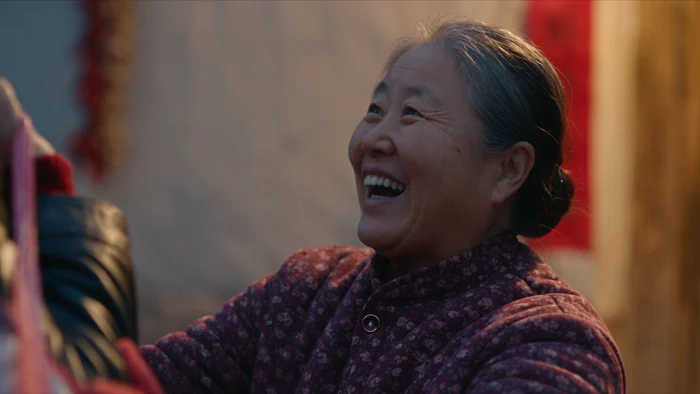</a>

▶ [Watch the full video on ofox.ai](https://ofox.ai/seedance-2-5-prompts?utm_source=github&utm_medium=case&utm_campaign=awesome-seedance-2-5#case-1004)

<details>
<summary><strong>Prompt</strong> — FORMAT: 16:9, 20 seconds, 7 shots; three hard cuts and three in-camera transitions (a pass-through, an occlusion, and a camera drift) named on the tim…</summary>

~~~~text
FORMAT: 16:9, 20 seconds, 7 shots; three hard cuts and three in-camera transitions (a pass-through, an occlusion, and a camera drift) named on the timeline.
STYLE: live-action, rural northern China at dusk on the eve of the Lunar New Year, around 2010, photographed as an honest documentary family portrait rather than a fashion-editorial or glamour-lit one — colour 35mm film grain, real skin texture with visible pores, creases and windburn on every face, no beauty retouching, no skin smoothing, no glamour lighting; the only light is the warm tungsten spill through the open door and the glow of the red lantern under the eaves, catching faces at close range against the cold blue-grey dusk beyond the courtyard wall.
MOTHER: woman in her late 50s, short and slightly stooped, a kind weathered face with deep laugh lines at the eyes, greying hair pinned back plainly; a padded maroon floral-print cotton jacket over dark trousers and a faded apron, worn cloth shoes, hands red from cold work. Referred to as the mother.
FATHER: man in his early 60s, thin and upright, a lined sun-darkened face, close-cropped grey hair; a navy padded work coat over a grey sweater, an unlit cigarette tucked behind one ear. Referred to as the father.
SON: man around 28, tall, city-thinned, a tired but warm face with real stubble and slightly chapped lips, short black hair; a black imitation-leather jacket over a red sweater, jeans and city trainers, a large red-white-blue striped nylon bag on one shoulder, a small Nokia bar phone in his coat pocket. Referred to as the son.
SCENE: the swept-earth courtyard of a single-storey brick and whitewash farmhouse at dusk on the eve of the Lunar New Year, around 2010; a wooden double door standing open with warm tungsten light spilling out, fresh red paper couplets pasted either side of the door and a red diamond paper square above it, one red cloth lantern glowing under the eaves; scattered red firecracker paper across the yard, a dusty blue three-wheeled farm motorcycle parked against the wall with a striped nylon bag still strapped to it, a stack of firewood, an enamel basin on a low stool, strings of dried corn and red chillies hanging from the eaves; a low brick wall with an open gate to a dirt lane, bare persimmon and poplar branches against a cold blue-grey dusk sky, distant low hills, thin smoke rising from a neighbouring chimney; through the open door, the flicker of a television and a round table already laid.
ARC: waiting in the cold at the lit doorway → the gate, and an engine somewhere past it → the mother sees him first and cannot quite believe it → the bag eases off the shoulder of the son and into the hands of the father → the mother pulls him toward the warm light and the waiting table → the three of them cross the threshold together.

SHOT 1 (0-3s): Wide, locked camera, chest height, from the open gate looking at the house, deep depth of field; the paper couplets sit at the very edges of the frame, small and softened by the falling dusk light and the distance. The mother and the father stand together in the lit doorway, breath visible in the cold, listening. No line. Sound: wind through bare branches, a distant two-stroke engine drawing nearer somewhere past the gate, the lantern creaking, one faint firecracker pop far off.
Without cutting, the camera pushes through the open gate into the courtyard, arriving already close behind the son as he steps through carrying the striped bag.
SHOT 2 (3-6s): Medium wide, handheld follow, breathing sway, staying just behind and beside the son as he crosses the yard; his boots crunch over the scattered firecracker paper, the doorway light finding his tired face; the mother and the father are already stepping down to meet him, soft and out of focus at the edge of frame, the door itself out of frame so no couplets are visible from this angle. No line. Sound: boots on paper and packed earth, cloth, the engine fading out behind the wall.
HARD CUT.
SHOT 3 (6-9s): Close-up, locked camera, on the mother, chest-up, shallow depth of field; she has stepped a few paces into the yard, the blurred background is firewood and lantern glow, no paper or text of any kind behind her. She reaches up and takes hold of the sleeve of the son, her eyes glassy, a laugh catching in her throat. The mother (warm, disbelieving): 「哎呀，回来了！」 Sound: her voice, a stifled breath, wind easing.
HARD CUT.
SHOT 4 (9-12s): Close-up, handheld, subtle breathing sway, on the son, chest-up, shallow depth of field, the same soft yard background as shot 3, no paper or text in frame. He eases the strap of the bag down off his shoulder without fully setting it down, a tired half-smile breaking through. The son (a little sheepish, warm): 「妈，路上雪大堵车，来晚了。」 Sound: the canvas strap creaking loose, his voice, the wind easing further.
Without cutting, the father steps in from frame right, his shoulder sweeping close past the lens as he closes the last step; the camera comes out of the occlusion already on the two of them together.
SHOT 5 (12-15s): Medium two-shot, locked camera, on the father and the son, shallow depth of field, one paper couplet just visible at the far edge of frame, soft in the blur. The father reaches over and lifts the striped bag off the shoulder of the son, settling it onto his own shoulder without a word first. The father (gruff, quiet warmth): 「回来就好，回来就好。」 Sound: the strap shifting and resettling, his low voice.
HARD CUT.
SHOT 6 (15-17.5s): Medium three-shot, handheld, breathing sway, as the mother takes hold of the sleeve of the son and turns him toward the door; the warm light and the flicker of the television spill wider across the three of them, one paper couplet at the door edge half-covered by the shoulder of the father as he passes in front of it. The mother (already moving, practical): 「锅里炖着肉呢，快进屋，外头风大，别站着了。」 Sound: her voice, footsteps on the swept earth, the television murmuring faintly through the door.
Without cutting, the camera drifts back and rises a little as the three of them turn together toward the door, the doorway light widening to fill the frame.
SHOT 7 (17.5-20s): Wide, locked camera, from just behind the three of them, framed by the doorway; the paper couplets sit right at the outer edges of frame, partly cut off and blown soft by the glare of the warm light. The son pauses half a step in the light and looks back once at the dark courtyard and the gate. The son (quiet, low, almost to himself): 「妈，我回来了。」 He steps through after the others; the door light fills the frame around all three, and the camera settles and holds on the warm glow and the low hum of the television for the last second. Sound: his voice, the door light humming warm, the wind falling away, held through the final second.

CAMERA: movement per shot, and locked is a deliberate choice on four of the seven — the establishing wide of shot 1, the close-up on the mother in shot 3, the two-shot on the father and the son in shot 5, and the closing wide of shot 7, so nothing competes with either face or with the threshold itself; handheld with subtle breathing sway on the follow behind the son in shot 2, on his close-up in shot 4, and on the turn toward the door in shot 6. 35mm-equivalent for the wides, 50 to 70mm-equivalent for the close-ups and the two-shot; deep depth of field only on the establishing wide of shot 1, shallow on every close-up and on shot 5; focus stays on whichever face is speaking or listening; the eye-line axis set in shot 2, as the son approaches the doorway, is never crossed.
SOUND: wind through bare branches, a distant two-stroke engine that fades out after shot 2 and never returns, boots on scattered firecracker paper and packed earth, the canvas strap of the bag, a red lantern creaking, the muffled hum of a television through the open door, one faint firecracker pop far off in shot 1 only; no music anywhere in the clip, no narration. Dialogue in Mandarin Chinese, mouths matched to Mandarin.
CONSISTENCY: the mother — her face, greying pinned-back hair, maroon floral cotton jacket, apron and cold-reddened hands — identical in every shot; the father — his face, close-cropped grey hair, navy padded coat, grey sweater and the unlit cigarette behind one ear — identical in every shot; the son — his face, stubble, black imitation-leather jacket, red sweater, jeans, city trainers, and the striped nylon bag until it passes to the father in shot 5 — identical in every shot; the tungsten light of the doorway, the red lantern, and the position of the couplets, the motorcycle, the firewood and the basin in the courtyard do not change; the cold blue-grey dusk and the warm light spilling from the door stay constant.
AVOID: subtitles, captions, on-screen text, watermarks, logos; any legible text anywhere in frame, including on the paper couplets, the red diamond paper square above the door, and any other pasted or printed surface, at any distance — every couplet and paper square must render as an unreadable blur of red paper and shadow, never as a sharp, centred, readable surface; a real historical figure, a real public figure; CGI look, plastic skin, beauty retouching, skin smoothing, waxy skin, glamour lighting; extra or warped limbs, warped hands; dissolves, jump cuts, whip pans, crossing the eye-line axis; theatrical over-acting, sobbing, exaggerated wailing.
~~~~

</details>

**参数**：Seedance 2.5 · Ofox · t2v · 20s · 720p · 16:9 · 带音频
**费用**：$4.80（job 036ac3a8-6f68-47ad-a553-86a29aa3e5b8）
**来源**：Ofox 实测

[Back to top](#table-of-contents)

<a id="anime-drama"></a>
### Anime Drama (漫剧)

<a id="case-9"></a>
### Case 9: Anime school hallway kung-fu fight (动漫风格校园走廊武术格斗) — by @AiwithElisia

<a href="https://ofox.ai/seedance-2-5-prompts?utm_source=github&utm_medium=case&utm_campaign=awesome-seedance-2-5#case-9"></a>

▶ [Watch the full video on ofox.ai](https://ofox.ai/seedance-2-5-prompts?utm_source=github&utm_medium=case&utm_campaign=awesome-seedance-2-5#case-9)

<details>
<summary><strong>Prompt</strong> — 创建一个电影级、照片级真实感的动漫风格校园走廊格斗场景。  一位美丽的年轻日韩裔女学生，留着短款柔和的淡紫色头发，戴着一个小巧的蓝白花朵发夹，站在明亮但氛围感十足的日本高中走廊里。她穿着传统的校服：浅灰色修身西装外套配深色滚边，白色衬衫，系着巨大的淡蓝色蝴蝶结，深海军蓝百褶裙，白色过膝袜和深棕色/黑…</summary>

~~~~text
创建一个电影级、照片级真实感的动漫风格校园走廊格斗场景。

一位美丽的年轻日韩裔女学生，留着短款柔和的淡紫色头发，戴着一个小巧的蓝白花朵发夹，站在明亮但氛围感十足的日本高中走廊里。她穿着传统的校服：浅灰色修身西装外套配深色滚边，白色衬衫，系着巨大的淡蓝色蝴蝶结，深海军蓝百褶裙，白色过膝袜和深棕色/黑色低跟校鞋。背景中还有几位穿着同款灰色校服的女学生。

场景开始于一个特写镜头，淡紫色头发的女孩神情严肃且充满情绪地看向站在她面前的另一位女学生。自然光透过巨大的走廊窗户射入，营造出柔和、漫射的电影级光影。镜头具有浅景深效果，展现出真实的皮肤纹理、自然的表情以及细微的手持摄影晃动感。

随着女孩们对峙，紧张感不断升级。镜头在全景、特写和动态肩后镜头之间切换。淡紫色头发的女孩做出防御反应，并开始与另一位女学生格斗。展示真实的武术风格动作、出拳、格挡和踢腿，动作符合人体力学，且具有自然的惯性。

在某一时刻，展示一个低角度特写镜头，拍摄几名学生的鞋子在略显湿润、具有反射效果的校园走廊地板上快速移动。随着角色的移动，可以看到水面的倒影和细微的水花。

继续使用动态手持追踪镜头，拍摄淡紫色头发的女孩与另一名学生交手。包含一个戏剧性的侧踢和防御动作。背景中的学生们在远处注视着这场冲突，脸上带着惊讶和担忧的表情。

镜头应随着动作自然移动：特写 → 中景 → 追踪镜头 → 低角度足部镜头 → 走廊全景 → 特写。在快速移动时使用真实的动态模糊，同时保持面部和重要细节清晰。

走廊应看起来真实且富有生活气息：巨大的窗户、浅色的墙壁、木质教室门、抛光且具有反射效果的地板、清冷的阴天自然光以及略带戏剧性的氛围。

临近结尾时，淡紫色头发的女孩在冲突结束后走向镜头。她直视镜头，表情严肃而坚定，而其他女学生在背景中保持模糊状态。

超真实真人电影摄影，照片级真实面部，真实的日本校园环境，电影级构图，自然的皮肤毛孔，真实的织物和头发运动，物理准确的阴影，柔和的阴天自然光，浅景深，细微的胶片颗粒感，手持摄影，真实的动态模糊，戏剧性的节奏，高细节纹理，4K 电影级画质。

宽高比：16:9。
时长：约 30 秒。
风格：照片级真实感电影真人拍摄，真实的人体运动，动漫风格
~~~~

</details>

**参数**：Seedance 2.5 · 未标注 · t2v · 30s · 未标注 · 16:9 · 未标注
**来源**：[@AiwithElisia](https://x.com/AiwithElisia) · [原帖](https://x.com/AiwithElisia/status/2092843448462454971)

<sub>Preview © 2026 <a href="https://x.com/AiwithElisia/status/2092843448462454971">@AiwithElisia</a> · Prompt by <a href="https://x.com/AiwithElisia/status/2092843448462454971">@AiwithElisia</a></sub>

[Back to top](#table-of-contents)

<a id="case-10"></a>
### Case 10: Cute anime girl in a magical garden (可爱动漫少女魔法花园场景) — by @LudovicCreator

<a href="https://ofox.ai/seedance-2-5-prompts?utm_source=github&utm_medium=case&utm_campaign=awesome-seedance-2-5#case-10">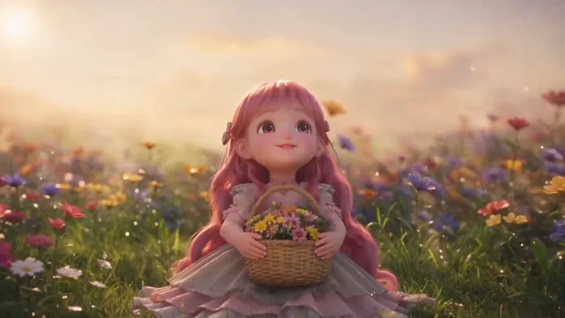</a>

▶ [Watch the full video on ofox.ai](https://ofox.ai/seedance-2-5-prompts?utm_source=github&utm_medium=case&utm_campaign=awesome-seedance-2-5#case-10)

<details>
<summary><strong>Prompt</strong> — [项目类型] 文本生成视频。30 秒可爱动漫场景。单角色，无对白。  [全局设定] 黄金时刻阳光明媚的魔法花园。柔和的暖色调灯光。鲜花、草地、闪烁的魔法氛围。明亮欢快的色彩。梦幻般的电影级动漫美学。  [角色：可爱动漫少女] 12-14 岁，大大的闪亮眼睛，可爱的圆脸，长长的粉色头发配有丝带，穿着褶…</summary>

~~~~text
[项目类型] 文本生成视频。30 秒可爱动漫场景。单角色，无对白。

[全局设定] 黄金时刻阳光明媚的魔法花园。柔和的暖色调灯光。鲜花、草地、闪烁的魔法氛围。明亮欢快的色彩。梦幻般的电影级动漫美学。

[角色：可爱动漫少女] 12-14 岁，大大的闪亮眼睛，可爱的圆脸，长长的粉色头发配有丝带，穿着褶边淡色连衣裙（柔和色调）。天真、快乐、充满活力。娇小的比例。可爱的表情。

[场景描述]

[开场，0–6 秒] 黄金时刻魔法花园的广角镜头。闪光和光点在空气中漂浮。可爱的少女独自坐在草地上，周围环绕着五颜六色的鲜花。她抬头望向天空，露出灿烂的笑容，双眼闪闪发光。她将一篮鲜花抱在胸前。柔和的音乐响起——轻柔而欢快。镜头缓慢环绕她，捕捉她宁静的喜悦。

[趣味时刻，6–15 秒] 少女突然纯真地跳了起来。她开始在草地上旋转，双臂张开，咯咯地笑（可爱的高音笑声）。当她旋转时，花瓣在她周围飞舞。魔法闪光跟随她的动作，仿佛留下了光之轨迹。她采摘鲜花并挥舞，划出花瓣和闪光的小弧线。她的表情不断变化——惊奇、喜悦、纯粹的快乐。镜头跟随她俏皮的动作。花园对她的快乐做出回应——花朵发出更明亮的光芒，闪光变得更加强烈。

[魔法互动，15–24 秒] 一只可爱的小动物出现（蝴蝶、小狐狸或魔法生物）。少女注意到后，眼睛因惊喜而睁大。她轻轻伸出手。小动物小心翼翼地靠近。它触碰她的手时，她咯咯地笑了起来。她坐下来，小动物坐在她身边。它们共享一段安静的时光。她轻轻抚摸小动物，两者都感到无比满足。魔法光环环绕着它们。闪光增强。场景充满了纯真与魔法。

[结尾时刻，24–30 秒] 少女躺在草地上仰望天空。小动物蜷缩在她身边。日落的金色光芒洒满场景。闪光懒洋洋地在空气中漂浮。她闭上眼睛，平静地微笑，感到无比幸福与安宁。镜头缓慢拉远，展示她在广阔美丽花园中的娇小身影，被魔法光芒包围。音乐达到柔和的顶点。定格在这个纯粹宁静的喜悦瞬间。

[音频] 轻柔的音乐盒旋律，伴随轻盈的管弦乐弦乐和柔和的钟声。可爱少女的咯咯笑声（纯粹的快乐，非嘲讽）。花瓣轻轻沙沙作响。魔法闪光的声音（微妙，不过度，柔和的叮当声）。轻柔的动物叫声（轻微的喵喵声、拍打声）。草地上的脚步声（轻快、俏皮）。最后时刻：仅保留音乐和微风吹过花丛的声音。

[视觉风格]
— 动漫 3D 风格化（圆润讨喜的设计）
— 持续的闪光和魔法粒子
— 黄金时刻光效
~~~~

</details>

**参数**：Seedance 2.5 · 未标注 · t2v · 30s · 未标注 · 未标注 · 带音频
**来源**：[@LudovicCreator](https://x.com/LudovicCreator) · [原帖](https://x.com/LudovicCreator/status/2093277563992854638)

<sub>Preview © 2026 <a href="https://x.com/LudovicCreator/status/2093277563992854638">@LudovicCreator</a> · Prompt by <a href="https://x.com/LudovicCreator/status/2093277563992854638">@LudovicCreator</a></sub>

[Back to top](#table-of-contents)

<a id="case-11"></a>
### Case 11: Cartoon bulldog vs. live-action boxer (卡通斗牛犬大战真人拳击手) — by @BaBELL81

<a href="https://ofox.ai/seedance-2-5-prompts?utm_source=github&utm_medium=case&utm_campaign=awesome-seedance-2-5#case-11">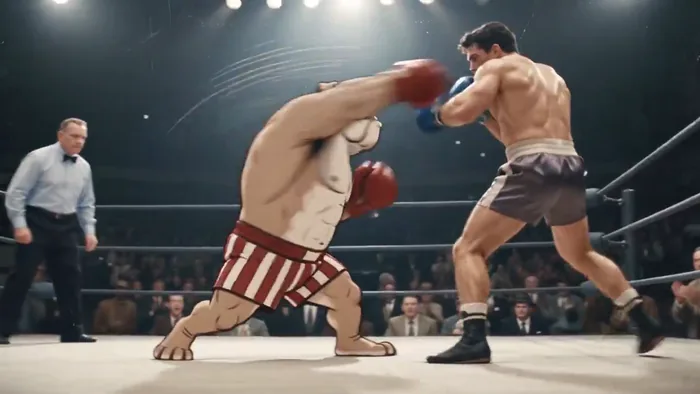</a>

▶ [Watch the full video on ofox.ai](https://ofox.ai/seedance-2-5-prompts?utm_source=github&utm_medium=case&utm_campaign=awesome-seedance-2-5#case-11)

**输入素材**：未公开 —— 原作者只发布了成片，未提供输入素材

<details>
<summary><strong>Prompt</strong> — Use Image 1 for the large muscular cartoon bulldog boxer, Image 2 for the live-action Caucasian American boxer, and Image 3 for the vintage arena, rin…</summary>

~~~~text
Use Image 1 for the large muscular cartoon bulldog boxer, Image 2 for the live-action Caucasian American boxer, and Image 3 for the vintage arena, ring, crowd, and lighting.

Create an intense 24-second boxing sequence in 10 shots.

The bulldog remains a hand-drawn 2D character inspired by 1969 American TV cartoons, keeping the same face, proportions, red gloves, and striped shorts. Never make him realistic. The human boxer remains fully photorealistic.

Style: heated live sports documentary broadcast. Handheld ringside cameras, reactive pans, imperfect reframing, small zoom corrections, natural shake, motion blur, focus breathing, faded 35mm colors, soft lens bloom, subtle gate weave, and naturally changing film grain. No frozen grain or fixed texture.

Strong white spotlights illuminate the ring. The crowd is darker but visible and constantly reacting. Crowd cheering continues from the first frame to the last: shouting, applause, whistles, and stomping. Reactions grow louder after major punches. An excited male English commentator speaks continuously. No music.

Each numbered shot is one continuous camera take. The camera may pan, track, dolly, or reframe, but must not jump to a new position inside the same shot.

Comic effects must resemble authentic 1969 American comics: imperfect hand-drawn lines, thick black outlines, red, yellow, white, and black colors, halftone dots, faded ink, and slight print misregistration.

Use effects sparingly:
SPEED LINES on fast punches.
One-frame SMEAR FRAME on the strongest punches.
Small IMPACT BURSTS on selected hits.
IMPACT FLASH and SHOCKWAVE RING only on the decisive counter and final uppercut.
WOBBLE LINES and yellow rotating stars only when the human is badly dazed.

Use only these comic sound effects on major clean hits:
THWACK! POW! SMACK! WHAM! CRACK!

SHOT 1 — 0.0–2.0
High-angle view of the packed arena. The ring is under strong spotlights. Both fighters wait in opposite corners. The bell rings, the crowd erupts, and both walk toward the center as the camera pushes closer.

SHOT 2 — 2.0–4.0
Slightly elevated wide shot from outside the ring with ropes in the foreground. The referee steps back. Both fighters raise their guards, circle, and test distance. The handheld camera tracks right.

SHOT 3 — 4.0–6.2
Low canvas-level angle. The bulldog throws a jab with brief SPEED LINES. The human narrowly avoids it and counters with a jab that the bulldog blocks. Quick natural pan. No comic text.

SHOT 4 — 6.2–8.8
Slightly high-angle shot through the ropes. The human attacks with a combination. A left jab lands with a small IMPACT BURST and THWACK! A right straight follows with POW!, a brief IMPACT FLASH, and a small burst. A left hook lands with only a subtle impact mark. The camera tracks as the bulldog retreats.

SHOT 5 — 8.8–11.2
Close handheld shot from the opposite side. The human keeps pressing with short punches. The bulldog blocks several and absorbs one body shot. The camera urgently reframes. The bulldog answers with a short face hook using a small red IMPACT BURST and SMACK!

SHOT 6 — 11.2–14.0
Over-the-shoulder from behind the human. The human throws a powerful right straight. The bulldog slips underneath. The camera pans with the missed glove. Without cutting, the bulldog plants his feet, rotates, and launches a right counterpunch with SPEED LINES and a one-frame SMEAR FRAME.

SHOT 7 — 14.0–16.8
Tight ringside impact shot. The bulldog's right straight lands on the human's cheek in very brief slow motion. His cheek compresses and sweat flies. At contact, show a large IMPACT BURST, white IMPACT FLASH, radial lines, short SHOCKWAVE RING, and WHAM! The effects vanish immediately. Return to normal speed as the human staggers backward. The crowd explodes.

SHOT 8 — 16.8–19.2
Slightly elevated ringside shot. The human is badly dazed but standing. WOBBLE LINES and three yellow stars briefly appear. The bulldog lands one body punch without text, then a short face hook with SPEED LINES, a small burst, and SMACK!

SHOT 9 — 19.2–21.5
Low diagonal ringside angle. The bulldog throws a compact uppercut with a one-frame SMEAR FRAME. It lands under the chin with IMPACT FLASH, red-yellow IMPACT BURST, short SHOCKWAVE RING, and CRACK! The human falls into the ropes, drops to one knee, and collapses safely. The referee stops the fight. The bulldog steps back. Yellow stars fade.

SHOT 10 — 21.5–24.0
Final slightly high-angle wide shot. The referee brings the bulldog to the center and raises one arm. Red-and-white paper streamers fly into the ring. Vintage photographers fire flashbulbs and strong white strobes. The crowd remains standing, shouting, clapping, whistling, and waving hats. The handheld camera slowly pushes closer until the final frame.
~~~~

</details>

**参数**：Seedance 2.5 · 即梦 · i2v · 24s · 未标注 · 未标注 · 带音频
**来源**：[@BaBELL81](https://x.com/BaBELL81) · [原帖](https://x.com/BaBELL81/status/2083562978730029228)

<sub>Preview © 2026 <a href="https://x.com/BaBELL81/status/2083562978730029228">@BaBELL81</a> · Prompt by <a href="https://x.com/BaBELL81/status/2083562978730029228">@BaBELL81</a></sub>

[Back to top](#table-of-contents)

<a id="case-66"></a>
### Case 66: Backlit mountain-gate swordsman (山门石阶持剑少年 · 强逆光晴日) — by @平面设计柚子

<a href="https://ofox.ai/seedance-2-5-prompts?utm_source=github&utm_medium=case&utm_campaign=awesome-seedance-2-5#case-66">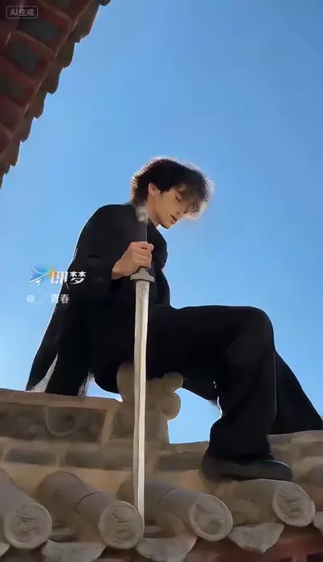</a>

▶ [Watch the full video on ofox.ai](https://ofox.ai/seedance-2-5-prompts?utm_source=github&utm_medium=case&utm_campaign=awesome-seedance-2-5#case-66)

<details>
<summary><strong>Prompt</strong> — 一位年轻男子，深色微卷短发，五官立体深邃，身穿黑色高领内搭、黑色长款宽松外套和黑色长裤。镜头沿石阶向前平稳推进，男子从远处向镜头走来，随后镜头快速推近至近景，男子右手持银色长剑将剑尖直指镜头中心，左手自然下垂，嘴角上扬露出自信微笑，阳光在剑身反射出高光；接着镜头切换为低角度仰拍，男子站在传统建筑飞檐…</summary>

~~~~text
一位年轻男子，深色微卷短发，五官立体深邃，身穿黑色高领内搭、黑色长款宽松外套和黑色长裤。镜头沿石阶向前平稳推进，男子从远处向镜头走来，随后镜头快速推近至近景，男子右手持银色长剑将剑尖直指镜头中心，左手自然下垂，嘴角上扬露出自信微笑，阳光在剑身反射出高光；接着镜头切换为低角度仰拍，男子站在传统建筑飞檐的屋顶上，背对镜头后迅速转身，右腿单腿蹲在屋脊兽上，双手紧握长剑剑柄将剑尖向下垂直刺出，黑色外套下摆随风飘动；然后镜头切至面部大特写，男子闭着双眼面带惬意微笑，阳光照亮侧脸，随后他缓缓睁开双眼温柔地看向镜头；随后镜头拉回中景，男子在石阶上向前快速奔跑，接着双腿急停微蹲降低重心，双手持剑在身前快速横向挥舞划出银色弧线，黑色外套和头发随动作剧烈甩动；紧接着镜头切至近景，男子站在石质栏杆旁双眼微闭，一把银色长剑悬浮在他头部侧上方，他右手单手持黑色剑鞘，左手自然搭在栏杆上；最后镜头推至面部特写，男子面带温柔微笑注视镜头，强烈的阳光从左上方射入，在镜头前形成明亮的光晕和闪烁的镜头光斑。场景为依山而建的中国传统石质建筑，有石栏杆、石阶、飞檐翘角，背景是陡峭岩壁和青山，晴朗白天，强烈的自然侧逆光，彩色，明亮高调，电影感，超清 4K，写实，光影细腻，竖屏。
~~~~

</details>

**参数**：Seedance 2.5 · 即梦 · t2v · 未标注 · 未标注 · 未标注 · 未标注
**来源**：[@平面设计柚子](https://space.bilibili.com/3546650324765434) · [原帖](https://www.bilibili.com/video/BV1Yru367Emg)

<sub>Preview © 2026 <a href="https://www.bilibili.com/video/BV1Yru367Emg">@平面设计柚子</a> · Prompt by <a href="https://www.bilibili.com/video/BV1Yru367Emg">@平面设计柚子</a></sub>

[Back to top](#table-of-contents)

<a id="case-67"></a>
### Case 67: Many-headed black dragon, chained stone gate (多头黑龙 · 锁链石门 · 雷暴仙侠) — by @平面设计柚子

<a href="https://ofox.ai/seedance-2-5-prompts?utm_source=github&utm_medium=case&utm_campaign=awesome-seedance-2-5#case-67"></a>

▶ [Watch the full video on ofox.ai](https://ofox.ai/seedance-2-5-prompts?utm_source=github&utm_medium=case&utm_campaign=awesome-seedance-2-5#case-67)

<details>
<summary><strong>Prompt</strong> — 多头暗黑金属质感巨龙鳞片锋利带刺，粗大带倒刺的黑色金属锁链与带有复杂暗金浮雕和兽首门环的巨大黑色石门，身穿白色暗纹多层长袍、黑发高束戴冠的俊美冷峻东方仙侠男子，黑灰色调的古代宫殿城市群。先，多头黑龙在雷暴云层中向前突进，周围碎石和冰渣向四周剧烈飞溅，闪电在龙身周围闪烁，镜头快速向前推进穿过云层；接着…</summary>

~~~~text
多头暗黑金属质感巨龙鳞片锋利带刺，粗大带倒刺的黑色金属锁链与带有复杂暗金浮雕和兽首门环的巨大黑色石门，身穿白色暗纹多层长袍、黑发高束戴冠的俊美冷峻东方仙侠男子，黑灰色调的古代宫殿城市群。先，多头黑龙在雷暴云层中向前突进，周围碎石和冰渣向四周剧烈飞溅，闪电在龙身周围闪烁，镜头快速向前推进穿过云层；接着，粗大的黑色锁链在暴雨中紧绷，镜头沿着锁链快速向上推进，展现锁链连接的巨大黑色浮雕石门，闪电照亮石门上的兽首门环，雨水斜向飘落；然后，白衣男子站在巨大的黑色石台顶部，狂风使他的长发和白色衣袂剧烈向后飘动，镜头从低角度缓慢向上推，展现男子全身及背后漩涡状的雷暴云层；随后，镜头推至男子中近景，他神情冷峻，缓缓抬起右手，食指笔直指向上方，白色的电流特效在他的手臂和身体周围游走闪烁；最后，镜头瞬间切换至高空俯视，快速向后拉远并上升，展现下方庞大的黑灰色古代城市，城市中心的高台周围燃起暗红色的火焰，巨大的锁链从天空垂下，碎片在空中飞舞。场景为末日般的恶劣天气，乌云密布，狂风暴雨，电闪雷鸣，天空呈现漩涡状。运镜包含快速推进、沿物体推进、低角度仰拍推镜头、缓慢推近、快速拉远上升，景别从特写、中景、全景、中近景到大远景变化，中心构图。光影为低调冷色调，黑灰蓝为主，闪电提供瞬态强侧光和顶光，明暗对比极强。风格为暗黑奇幻东方仙侠史诗CG，电影感，超清4K，高细节写实材质，高帧率运动带有速度线和动态模糊。画幅9:16。
~~~~

</details>

**参数**：Seedance 2.5 · 即梦 · t2v · 未标注 · 未标注 · 9:16 · 未标注
**来源**：[@平面设计柚子](https://space.bilibili.com/3546650324765434) · [原帖](https://www.bilibili.com/video/BV1Xru36jEdC)

<sub>Preview © 2026 <a href="https://www.bilibili.com/video/BV1Xru36jEdC">@平面设计柚子</a> · Prompt by <a href="https://www.bilibili.com/video/BV1Xru36jEdC">@平面设计柚子</a></sub>

[Back to top](#table-of-contents)

<a id="case-68"></a>
### Case 68: Purple-eyed awakening in a shattered void (紫瞳觉醒 · 破碎虚空符文莲花) — by @平面设计柚子

<a href="https://ofox.ai/seedance-2-5-prompts?utm_source=github&utm_medium=case&utm_campaign=awesome-seedance-2-5#case-68">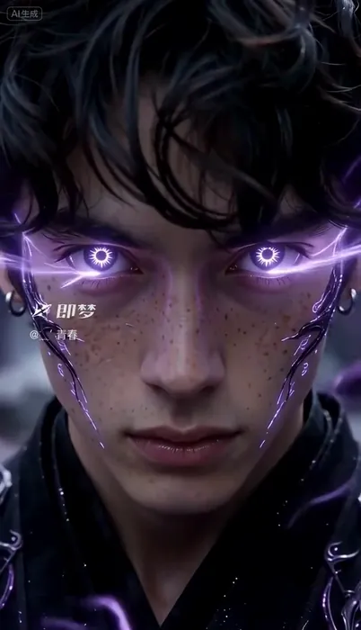</a>

▶ [Watch the full video on ofox.ai](https://ofox.ai/seedance-2-5-prompts?utm_source=github&utm_medium=case&utm_campaign=awesome-seedance-2-5#case-68)

<details>
<summary><strong>Prompt</strong> — 一名黑色微卷短发、面部带有清晰雀斑、佩戴耳环的年轻男性，身穿带有银色紫色云纹暗花的黑色古风交领长袍，材质呈现丝绸与皮革光泽。镜头先在破碎的黑暗空间中快速向前推进，穿过大量悬浮旋转的黑色古风建筑碎片和紫色光点，向中心的紫色能量漩涡靠近；接着镜头穿过碎片后减速平稳向前推进，展现该男子站在古风建筑平台上，…</summary>

~~~~text
一名黑色微卷短发、面部带有清晰雀斑、佩戴耳环的年轻男性，身穿带有银色紫色云纹暗花的黑色古风交领长袍，材质呈现丝绸与皮革光泽。镜头先在破碎的黑暗空间中快速向前推进，穿过大量悬浮旋转的黑色古风建筑碎片和紫色光点，向中心的紫色能量漩涡靠近；接着镜头穿过碎片后减速平稳向前推进，展现该男子站在古风建筑平台上，背后巨大的半透明紫色符文光带如花瓣般在空中缓缓舒展蜿蜒飘动；随后男子缓慢抬起右臂，小臂向上翻转使掌心朝上，微微低头注视掌心，动作平稳，伴随背后紫色光带的轻微摇曳；紧接着男子右手掌心中央迅速凝聚出一团内部光影流转的紫色能量光球，散发强烈紫光并照亮手部与衣襟，周围空气产生轻微扭曲；镜头推至面部特写，男子微微抬头直视前方，紫色能量纹路从眼角和脸颊迅速向外蔓延，双眼开始闪烁紫光；随后男子双眼完全变为发光的紫色，瞳孔呈现清晰的星芒齿轮状纹理，眼周紫色纹路如电流般微微跳动，他面无表情直视镜头，眼神极具压迫感；最后镜头迅速向后拉远，男子身体悬浮于半空，背后紫色光带完全展开如同巨大紫色莲花，黑色长袍下摆和衣带在强烈能量气流中剧烈翻飞，周围悬浮的建筑碎片随之剧烈震动。场景为高空中的破碎古风建筑群与深邃黑暗虚空，空间内充满紫色能量粒子。运镜包含快速推进、缓慢推镜头、微距平移与快速拉远，景别从远景过渡到特写再回到全景。画面采用暗黑底色搭配高饱和度霓虹紫色，低调影调，明暗对比强烈，自发光光源形成锐利高光与深邃阴影。3D玄幻动画风格，CGI特效，东方仙侠与暗黑奇幻色彩，电影感，超清4K，光影细腻，粒子特效丰富，景深明显，动作流畅。画幅比例9:16。
~~~~

</details>

**参数**：Seedance 2.5 · 即梦 · t2v · 未标注 · 未标注 · 9:16 · 未标注
**来源**：[@平面设计柚子](https://space.bilibili.com/3546650324765434) · [原帖](https://www.bilibili.com/video/BV1LYuR6rEke)

<sub>Preview © 2026 <a href="https://www.bilibili.com/video/BV1LYuR6rEke">@平面设计柚子</a> · Prompt by <a href="https://www.bilibili.com/video/BV1LYuR6rEke">@平面设计柚子</a></sub>

[Back to top](#table-of-contents)

<a id="case-69"></a>
### Case 69: Desert duel with a giant beast, 30s single take (沙漠女主战巨兽 · 30 秒一刀未剪) — by @刺芒aigc

<a href="https://ofox.ai/seedance-2-5-prompts?utm_source=github&utm_medium=case&utm_campaign=awesome-seedance-2-5#case-69"></a>

▶ [Watch the full video on ofox.ai](https://ofox.ai/seedance-2-5-prompts?utm_source=github&utm_medium=case&utm_campaign=awesome-seedance-2-5#case-69)

**输入素材**：未公开 —— 原作者只发布了成片，未提供输入素材

<details>
<summary><strong>Prompt</strong> — 低机位从@女主侧前方斜向上移动，@女主位于画面左侧，右手持@古刀斜垂身侧，镜头贴近沙地缓慢抬升到肩部高度，风沙掠过前景，衣摆和发丝随风摆动，伴随风沙呼啸、衣料抽动和刀身轻微震鸣。镜头保持运动，沿她身体外侧绕到身后偏左形成过肩构图，远处@巨兽从沙尘中的残破古风废墟里踏出，巨足落地震裂地面，碎石和尘土向…</summary>

~~~~text
低机位从@女主侧前方斜向上移动，@女主位于画面左侧，右手持@古刀斜垂身侧，镜头贴近沙地缓慢抬升到肩部高度，风沙掠过前景，衣摆和发丝随风摆动，伴随风沙呼啸、衣料抽动和刀身轻微震鸣。镜头保持运动，沿她身体外侧绕到身后偏左形成过肩构图，远处@巨兽从沙尘中的残破古风废墟里踏出，巨足落地震裂地面，碎石和尘土向外炸开，@女主压低身体立即全速冲出。 [无缝风格转场] 随着冲刺直接进入日式动漫3D游戏CG画质，切为ACT第三人称侧后跟拍，镜头位于@女主身后偏右低位高速追随，脚步连续蹬地踢出长条沙尾，背景废墟快速拉伸，刀身拖出短促赤色残光。@巨兽迎面挥爪砸下，@女主向侧前方高速滑步切入攻击内侧，右手@古刀由下向上斩中前肢，刀弧爆出强烈光痕和火星，命中伴随沉重切击声与血肉冲击，@巨兽立即甩头撞击反攻，@女主贴身绕侧连续横斩、回身斩、突刺，动作不断线。 [HARD CUT] 镜头转为高速侧向跟拍，@巨兽前肢重踏掀起环形冲击波，地面大片龟裂，@女主踩上倾斜断墙借力跃起，从巨兽侧上方斜切而下，连续三次高速斩击在空中留下交叉刀光，落地后立即滑步追砍。@巨兽甩尾横扫逼迫她急停转向，尾部撞中残墙使墙体整片爆裂，碎砖和沙尘横穿画面，@女主穿过尘幕再次突进，一记重斩将@巨兽压向后方废墟，伴随密集斩击声、兽吼、碎石爆裂和墙体坍塌声。 [连续追击] 镜头贴近@女主右后方肩线跟随，她绕着@巨兽高速移动，连续闪避巨爪、顶撞与踏击，每次闪避后立刻反击，@古刀在近身连击中拉出短促刀光残痕，命中时产生明显震动、火星和沙尘爆散。@巨兽猛扑压下，@女主低身滑过前肢下方，转身重斩其侧腹，再借碎石跃起斩向肩颈，双方连续进攻与反击保持快速节奏，周围地面和断墙在冲击中持续碎裂。 [终结技] @巨兽重击落空出现破绽，镜头快速拉开再俯冲推向@女主，她滑步停下，右手将@古刀斜置身侧蓄力，刀身瞬间聚集高亮赤金能量，周围沙尘被气流吸成旋转涡流，碎石悬起震动，脚下裂纹向四周扩散。下一瞬间@女主高速突进化作一道斜向刀光贯穿@巨兽，镜头沿斩击轨迹高速甩移，巨兽身上爆开巨大斩痕，短暂停顿后庞大身体轰然倒向残墙，墙体整体崩塌，碎石、尘浪和冲击波向外爆发。镜头落在@女主斜后方，她站在画面一侧缓缓收刀，刀光逐渐熄灭，背景是倒下的@巨兽与翻滚沙尘。
~~~~

</details>

**参数**：Seedance 2.5 · 未标注 · r2v · 未标注 · 未标注 · 未标注 · 带音频
**来源**：[@刺芒aigc](https://space.bilibili.com/3706991820147515) · [原帖](https://www.bilibili.com/video/BV187ub6dEmU)

<sub>Preview © 2026 <a href="https://www.bilibili.com/video/BV187ub6dEmU">@刺芒aigc</a> · Prompt by <a href="https://www.bilibili.com/video/BV187ub6dEmU">@刺芒aigc</a></sub>

[Back to top](#table-of-contents)

<a id="case-1008"></a>
### Case 1008: The Last Lamp (最后一盏) — by Ofox Team

| 输入 | 输出 |
|:---:|:---:|
|  | <a href="https://ofox.ai/seedance-2-5-prompts?utm_source=github&utm_medium=case&utm_campaign=awesome-seedance-2-5#case-1008">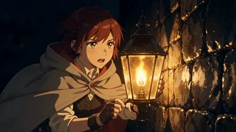</a> |

▶ [Watch the full video on ofox.ai](https://ofox.ai/seedance-2-5-prompts?utm_source=github&utm_medium=case&utm_campaign=awesome-seedance-2-5#case-1008)

<details>
<summary><strong>Prompt</strong> — Start exactly on the opening frame. FORMAT: 16:9 horizontal, 20 seconds, 3 shots, hard cuts on the timestamps. STYLE: modern theatrical anime, cel-sha…</summary>

~~~~text
Start exactly on the opening frame.
FORMAT: 16:9 horizontal, 20 seconds, 3 shots, hard cuts on the timestamps.
STYLE: modern theatrical anime, cel-shaded, clean line art, flat vibrant colour with deep saturated darks, painterly background art; no photographic texture overlay. STRONG CHIAROSCURO throughout, high contrast: deep near-black shadow pressed against hot lamp gold, hard rim light carving every silhouette, never flat even lighting. Dense layered compositions in every shot - a reflective wet foreground, the subject in the midground, a receding chain of lamps and lit windows behind, the hillside city and its castle silhouette far off under a cold pale teal sky. Warm gold against cold teal in every frame. The light is the whole story: shot 1 the light winning, shot 2 the darkness taking the street back, shot 3 one point of gold holding out.
THE GIRL: about sixteen, slender; short dark auburn hair with one thin side braid tucked behind her ear; amber eyes; a pale grey hooded short cape lined in deep rust, a dark charcoal work vest over a cream shirt, a leather belt at her hip carrying a small brass oil lantern and a ring of flint; a fingerless leather glove on her right hand, fingertips smudged black with lamp soot. Diligent, unhurried, stubborn. Referred to as "the girl".
SCENE: one long wet cobbled street running steeply downhill between tall old stone houses toward a walled hillside city, lined with tall iron street lamps - at dusk in fine rain, then at night in a storm.
RULES - quiet: one action per segment, long enough to read. No fast cutting, no jump cuts inside a segment. The lamps and the darkness are the second character; every segment must show the light gaining or losing ground.

[Lighting, 0-7s] The camera holds on her at this low street-level three-quarter angle - she is mid-left in profile, the lighting pole raised to the lamp at centre - then cranes slowly up and back. The wick blooms brighter, its broken gold reflection stretches down the wet cobbles toward the lens, and the whole hillside opens up behind her: a chain of already-lit lamps and hundreds of warm windows shrinking into the rain haze. She lowers the pole and watches it for a beat, rain on her face. The girl, quietly and plainly: "今日も、明かりを灯します。"
HARD CUT.
[The storm, 7-14s] Night, heavy rain, violent wind. Wide shot straight down the street from high up. The furthest lamp gutters and dies, then the next, then the next - a wave of blackness walking up the hill toward the camera, swallowing the windows as it comes, faster than she can move. The girl runs against it with the brass lantern clutched to her chest, cape snapping, water sheeting off the cobbles and throwing torn reflections; a glass housing cracks and goes out just as she passes it, and her rim light dies with it. The camera tracks with her, low and unsteady. No dialogue in this segment.
HARD CUT.
[The last one, 14-20s] She reaches the last lamp still standing at the foot of the street and turns her back to the wind, spreading her cape as a shield; in near-total darkness her face is lit only from below by the lantern in her hands as she feeds the flame into the glass housing with her gloved hand. The wick catches and holds, and the gold comes back up across her face and the wet stone. She lifts her head, rain running off her chin, amber eyes bright. The girl, quietly: "一つ残っていれば、誰かが帰れる。" The camera pulls back and up into a high wide of the entire black street and the dark city, one point of gold in it; hold one second.

AUDIO: fine rain, the scrape of the lighting pole, the soft whump of the wick catching, distant evening bells / then storm wind, hard rain on stone, glass cracking, lamps guttering out one by one, her boots in water and her breath / then the wind dropping to a hiss, rain thinning, the single flame steady / her two lines spoken in Japanese, quiet and plain; nobody else speaks / at the end only rain and the small flame remain. No BGM, no music, no score, no instruments, no humming, no singing, no narration, no subtitles.
CONSISTENCY: the girl's face, facial proportions, skin tone, body type, short dark auburn hair with the thin side braid, amber eyes, pale grey hooded cape with rust lining, charcoal vest, cream shirt, leather belt, brass lantern and the fingerless glove identical in every shot; strictly no random character changes; never change the visual style.
AVOID: subtitles, watermarks, logos, on-screen text; fast cutting and jump cuts inside a segment; photorealism, 3D game CG, plastic skin; identity drift; flat washed-out lighting, low contrast; modern clothing, electric lighting, cars.
Modern theatrical anime, cel-shaded, high contrast chiaroscuro, expressive facial animation, dense painterly background art, cinematic depth of field, character design consistent throughout.
~~~~

</details>

**参数**：Seedance 2.5 · Ofox · i2v · 20s · 720p · adaptive · 带音频
**费用**：$4.80（job 98f2c80e-219d-4973-818f-42e3d9c53379）
**来源**：Ofox 实测

[Back to top](#table-of-contents)

<a id="case-1010"></a>
### Case 1010: Eight Lightning Fangs (雷牙・八重) — by Ofox Team

| 输入 | 输出 |
|:---:|:---:|
| 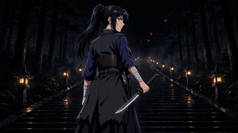 | <a href="https://ofox.ai/seedance-2-5-prompts?utm_source=github&utm_medium=case&utm_campaign=awesome-seedance-2-5#case-1010"></a> |

▶ [Watch the full video on ofox.ai](https://ofox.ai/seedance-2-5-prompts?utm_source=github&utm_medium=case&utm_campaign=awesome-seedance-2-5#case-1010)

<details>
<summary><strong>Prompt</strong> — Start exactly on the opening frame. FORMAT: 16:9 horizontal, 30 seconds, 10 shots, hard cuts on the timestamps. STYLE: modern theatrical anime, cel-sh…</summary>

~~~~text
Start exactly on the opening frame.
FORMAT: 16:9 horizontal, 30 seconds, 10 shots, hard cuts on the timestamps.
STYLE: modern theatrical anime, cel-shaded, clean line art, flat vibrant colour with deep saturated darks, painterly background art; no photographic texture overlay. STRONG CHIAROSCURO, extreme contrast throughout: near-black cedar forest and night sky against small hot lantern orange, and against the gold-violet of the lightning; hard rim light on every silhouette; never flat even lighting. Dense layered depth in every shot: wet reflective stone in the foreground, the fight in the midground, the receding double row of stone lanterns and black cedar trunks behind.
THE WOMAN: mid-twenties, tall and long-limbed with mature adult proportions, straight-backed and composed, a calm hard gaze; sharp cool grey eyes with upswept outer corners; jet-black hair, no gradient, in a high ponytail with two loose strands at the temples; deep indigo Japanese short-jacket and hakama, a plain dark leather chest guard, white wrapped bracers; a plain charcoal short haori with a ragged torn hem and no pattern of any kind; a slim straight sword, cold silver blade with no colour gradient, plain square iron guard. Her blade is ALREADY DRAWN and in her right hand from the first frame; it is sheathed only once, at the very end. Referred to as "the woman".
THE DEMON: not humanoid. A shifting mass of liquid blackness that holds no fixed shape - it pours, bulges and re-forms; from inside it, long thin claws and clusters of small red glowing eyes push out and withdraw. It has no face and no body plan. It never becomes a person.
SCENE: a long stone stairway at night in a cedar forest after rain, stone lanterns down both sides, mist in the lantern beams, wet steps mirroring the flames.
RULES - action: each shot is one continuous camera take, no jump to a new position inside a shot. Every strike runs visible target then body entry then strike motion then clear contact then immediate body reaction then balance change then next action; no reaction before contact; no effects in place of real body motion. Full speed throughout - no slow motion, no speed ramps, no freeze frames. Effects allowed: SPEED LINES, SMEAR FRAME, IMPACT BURST, SHOCKWAVE RING - sparingly, and the heaviest only on the finishing blow. Lightning is gold-violet, thin and forked, and it lights the whole forest for the instant it exists.

[1. Found, 0-4s] The camera holds behind and left of her, then rises and pushes slowly up the stairway past her shoulder. She stands with the drawn blade lowered at her side, looking up into the dark. More red points open above her - three, then eight, then too many to count. One thread of gold-violet runs the length of the silver blade and dies. She turns her head a few degrees further toward them. The woman, low and level: "……見つけた。"
HARD CUT.
[2. First exchange, 4-7.5s] Wide side-on shot across the steps. The black mass pours down the stairway and a long claw comes down at her; she steps off the line and the claw splits the stone where she stood, chips flying. She is already turning into the gap.
HARD CUT.
[3. Her answer, 7.5-11s] Low tracking shot rising with her. She cuts upward backhand through the mass; gold-violet arcs tear along the wound and the blackness recoils up the steps, shedding eyes that wink out as they fall.
HARD CUT.
[4. Three at once, 11-14.5s] Medium shot, the camera circling her. Three thin claws stab in from three sides; she parries all three, one two three, sparks and thin lightning at every contact, her feet sliding back a hand's width each time.
HARD CUT.
[5. Struck down, 14.5-18s] The fourth blow catches her and throws her; she hits a stone lantern back-first and it bursts, scattering orange fire across the wet steps. She comes up on one knee, still holding the blade, and her gaze goes colder; gold-violet begins to leak from her shoulders and forearms. Behind her the mass swells into a wall and every eye in it opens at once.
HARD CUT.
[6. Gathering, 18-19.5s] Tight close-up. She drops low with the blade held back and low behind her, both hands on the hilt; lightning pours down her arms and floods the whole length of the steel until it is a bar of gold-violet, and the stone under her boots cracks and lifts. The woman, shouting: "雷牙——八重！"
HARD CUT.
[7. The strike, 19.5-21s] The frame holds the empty stairway for a beat - she is no longer where she was. A single gold-violet diagonal tears across the whole screen, SPEED LINES and one SMEAR FRAME, the forest lit white-gold for that instant.
HARD CUT.
[8. Eight fangs, 21-23s] Eight afterimages of her enter the black mass from eight directions at once, each one a clean stroke; every cut line bursts gold-violet, IMPACT BURST on each, a SHOCKWAVE RING going out across the treetops.
HARD CUT.
[9. Undone, 23-27s] The mass is lit from inside by the eight burning lines, holds one moment, then comes apart into ash that lifts upward through the lantern light. She lands with her back to the camera at the top of the steps and slides the sword home for the first time; the guard closes with one hard click.
HARD CUT.
[10. After, 27-30s] The camera pulls back and cranes up into a high wide of the whole stairway. One by one the stone lanterns light again down both sides, a double line of small warm flames running away downhill, ash still drifting up through them. She stands alone halfway down the frame, small. Hold one second.

AUDIO: mist and dripping cedar, a single distant temple bell / then stone splitting, cloth snapping, blade on claw, her breath and boots on wet stone, lantern glass bursting / then the deep crack and roll of lightning on the finishing blow, ash hissing, and one hard click as the guard closes / at the end only rain-drip and the bell again. Her two lines in Japanese, low and hard; the demon has no voice, only a wet shifting sound. No BGM, no music, no score, no instruments, no humming, no singing, no narration, no subtitles.
CONSISTENCY: the woman's face, facial proportions, adult build, skin tone, jet-black high ponytail with the two temple strands, cool grey upswept eyes, indigo jacket and hakama, leather chest guard, white bracers, plain charcoal torn-hem haori and the plain silver blade identical in every shot; strictly no random character changes; never change the visual style.
AVOID: subtitles, watermarks, logos, on-screen text; photorealism, 3D game CG, plastic skin; identity drift; the demon ever taking human shape or growing a face; any patterned haori, checkered or flame motifs, earrings, or a colour-gradient blade; flat washed-out lighting, low contrast; slow motion, speed ramps, freeze frames; reactions landing before contact; effects standing in for body motion.
Modern theatrical anime, cel-shaded, high contrast chiaroscuro, expressive facial animation, dense painterly background art, character design consistent throughout.
~~~~

</details>

**参数**：Seedance 2.5 · Ofox · i2v · 30s · 720p · adaptive · 带音频
**费用**：$7.20（job 7dd61aab-6843-42b1-a4e4-4254753d7d94）
**来源**：Ofox 实测

[Back to top](#table-of-contents)

<a id="case-1013"></a>
### Case 1013: Water vs fire, night school corridor (水火对决・深夜学园走廊) — by Ofox Team

| 输入 | 输出 |
|:---:|:---:|
|  | <a href="https://ofox.ai/seedance-2-5-prompts?utm_source=github&utm_medium=case&utm_campaign=awesome-seedance-2-5#case-1013">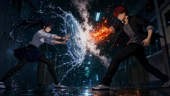</a> |

▶ [Watch the full video on ofox.ai](https://ofox.ai/seedance-2-5-prompts?utm_source=github&utm_medium=case&utm_campaign=awesome-seedance-2-5#case-1013)

<details>
<summary><strong>Prompt</strong> — 严格从首帧图开始。第一帧就是正在发生的战斗，禁止重新站位、禁止重新对峙、禁止慢慢准备。  【格式】16:9横屏，30秒，one continuous generation，一镜到底，无硬切、无跳切、无黑场。  【画风】现代剧场版赛璐璐动画：干净有力的线条、平涂高饱和色、强边缘光与硬投影，夜间冷蓝绿荧…</summary>

~~~~text
严格从首帧图开始。第一帧就是正在发生的战斗，禁止重新站位、禁止重新对峙、禁止慢慢准备。

【格式】16:9横屏，30秒，one continuous generation，一镜到底，无硬切、无跳切、无黑场。

【画风】现代剧场版赛璐璐动画：干净有力的线条、平涂高饱和色、强边缘光与硬投影，夜间冷蓝绿荧光与橙红火光强对比。高速动作用 SPEED LINES、SMEAR FRAME、IMPACT BURST、IMPACT FLASH、SHOCKWAVE RING 表现，只用在决定性命中上，节制使用。绝不写实真人、绝不3D游戏CG、绝不塑料皮肤。

【角色A—水】首帧图左侧少女为唯一身份基准：冰蓝色瞳孔、深藏青近黑长发高马尾（发梢湿透）、挽袖白衬衫、深藏青短裙、深色打底裤、室内鞋、左手腕褪色红绳。称作「水少女」。
【角色B—火】首帧图右侧少年为唯一身份基准：琥珀色瞳孔、凌乱暗红短发、敞开的黑色制服外套、灰色T恤、深色长裤。称作「火少年」。

【场景】深夜学园走廊，两侧储物柜与教室门向纵深退去，天花板冷蓝绿荧光灯管闪烁，地面湿滑反光。

【能力规则】水少女可直接从自身持续生成大量真实透明水，不依赖环境水源；除以水强化拳脚外，必须清楚打出独立水系技能。火少年直接生成火焰与高热，以近身火焰格斗为主。水必须是透明液体，有折射、飞溅、重量与惯性；火必须有热压与上升气流；水火接触必产生真实白色蒸汽与热扭曲。禁止巨大海啸、火龙、魔法阵、发光魔法水、游戏能量球。

【PHYSICAL CONTACT LOCK — 最高优先级】所有近身动作严格遵循：VISIBLE TARGET → BODY ENTRY → REAL STRIKE MOTION → CLEAR CONTACT → IMMEDIATE BODY REACTION → BALANCE CHANGE → NEXT ACTION。禁止接触前提前出现受击反应。禁止特效代替真实人体动作。双方都必须成功命中对方。防御后必须立即反击。NO CAUTIOUS ACTION. NO HESITATION. NO WAITING. NO LONG RESET. FULL COMMITMENT ON EVERY ATTACK.

【00:00–00:05 — VORTEX REDIRECT + HYDRAULIC BURST】第一帧直接爆发。火焰前臂压向旋转水盾，接触点蒸汽暴涨。水少女不后退，猛然改变水盾旋转方向——VORTEX REDIRECT——真实把他的右臂向外带偏，他的肩线与上身随力量转开。她立即切入：LEFT ELBOW CONTACT → RIGHT BODY PUNCH → KNEE STRIKE，三次连续命中不许停顿。最后双掌真实拍上他胸前，掌心之间的水瞬间高压压缩——HYDRAULIC BURST——零距离透明水压爆发，他明显被推退数步，鞋底在湿地面上刮出水花。

【00:05–00:10 — FIRE RUSH vs WATER WHIP】他后退中立刻稳住重心，脚后短促火焰助推前冲——FIRE RUSH。LEFT FIRE HOOK → 水少女低头闪过，速度线横扫；RIGHT FIRE ELBOW 实际连接她肩侧 → 她上身明显受力并横移一步。她不再退，右手猛挥并当场生成一条高速粗水流——WATER WHIP——精准缠住他攻击前臂，用全身旋转力量猛拉，把他的上身与攻击线强制带向侧方。她沿拉扯方向直接冲入：KNEE CONTACT → WATER-ASSISTED SIDE KICK。

【00:10–00:15 — PRESSURE WAVE】他用高热瞬间蒸散水鞭并直接再次前冲。她不等待，双掌前推，从自身瞬间生成大量透明水——PRESSURE WAVE。不是海啸，是一道填满走廊宽度、短距离、高密度的厚重水墙，猛烈向前推进。他双臂交叉以高密度火压正面顶住：PRESSURE WAVE → FIRE CONTACT → VIOLENT STEAM GENERATION，整条走廊被白色蒸汽灌满，荧光灯在蒸汽里散成光斑。他被推动但没有倒下，顶着水压强行穿过逐渐蒸散的水墙，从蒸汽中冲出，FIRE FOREARM 实际连接她上身，她被强行推开。

【00:15–00:20 — VORTEX BREAK】他继续追击：FIRE BODY HOOK 实际命中 → 她明确受力；紧接 FIRE KNEE 继续前压。第三次攻击将要进入时，她双臂从下向上猛烈展开——VORTEX BREAK。大量水在她周身瞬间形成短暂的高速螺旋水压场。不是保护罩，不持续防守。ROTATING WATER PRESSURE EXPANDS OUTWARD，他的攻击手臂、肩部与重心被短暂强制打开。她立刻从旋涡内部冲出：HYDRO STEP ENTRY → ELBOW CONTACT → BODY KICK → HYDRAULIC PALM，掌心接触后短促水压爆发，再次把他推离。

【00:20–00:25 — HYDRO DRILL】他落脚即再次 FIRE RUSH，右前臂形成极高密度火焰层。她同时右臂后拉，大量透明水沿手掌、前臂、上臂高速螺旋压缩——HYDRO DRILL。不是魔法光束，是围绕真实手臂高速旋转的厚重高压水流。双方正面快速进入：FIRE FOREARM vs ROTATING HYDRO DRILL。真实前臂距离接近 → 水火正面碰撞 → 高温蒸汽猛烈爆发，冲击波环向两侧掀起地面积水。短暂力量对抗后，她猛然把 HYDRO DRILL 向外旋转，把他的火焰手臂与肩线一起带偏。禁止停下来摆Pose。

【00:25–00:30 — MAXIMUM HYDRO FINISH】他立即用另一只火拳做最后一次高速反击。她左前臂生成短促 ROTATING WATER LAYER，真实接触火拳后向外 redirect，他因自身前冲惯性导致躯干打开。她随即转体起腿：REAL KICK CONTACT FIRST → 命中瞬间大量压缩水沿同一踢击方向爆发 → FIRE + WATER → MASSIVE STEAM BURST。绝对禁止水先爆炸、禁止他先移动、禁止脚最后才碰到；真实踢击是第一段，压缩水爆发是第二段强化。他被强力推离战斗中心，失去平衡落到走廊后方，身上主要火焰消散。她高速旋转后真实落地，因连续高强度战斗明显喘息、调整重心，不摆英雄姿势，抬头看向他的方向，湿透的马尾贴在肩上。最后极短一瞬，他垂下的手旁重新亮起一小簇微弱火焰。

【摄影】剧场版动作作画质感。handheld close tracking、OTS、lateral tracking、low-angle tracking、short whip-pan，镜头随身体位移穿过走廊空间。镜头运动激烈但必须始终看清动作。重要攻击必须让攻击者与目标在接触前后短暂处于同一画面。动作可读性优先于特效。只允许最终踢击接触瞬间最多0.2秒 micro slow motion，其余全程正常高速。一镜到底，禁止硬切、禁止跳切、禁止瞬移、禁止黑场。

【AUDIO】节奏层：低沉太鼓连打与心跳般的低频轰鸣，纯打击节奏，随打斗强度逐段加快加重，最终踢击时全部撞在一起——这是打击节奏，不是配乐：没有旋律、没有和弦、没有乐器演奏、没有歌声、没有主题曲、没有BGM。音效层：高压水流的冲刷与撕裂、火焰的低吼与爆燃、水火接触的剧烈蒸汽爆裂、肉体命中的沉闷冲击、鞋底在湿地面的刮擦、储物柜与玻璃的震颤、走廊回声。人声层：双方短促的发力吼声与喘息，无台词、无对白、无旁白。结尾只剩她的喘息、滴水声与荧光灯的电流嗡鸣。

【CONSISTENCY】水少女的脸、五官比例、肤色、体型、发型发色、高马尾、左腕红绳、白衬衫、藏青短裙、深色打底裤全程完全一致；火少年的脸、五官比例、肤色、体型、暗红短发、黑色外套、灰T恤、深色长裤全程完全一致。严禁角色随机变化，严禁中途换脸，严禁改变画风。

【严格禁止】禁止字幕、水印、logo、任何文字、拟声词文字。禁止谨慎、试探、犹豫。禁止双方分开后等待。禁止连续格挡。禁止攻击空气。禁止接触前受击。禁止瞬移。禁止长时间蓄力。禁止英雄Pose。禁止只用水强化拳脚——必须清楚表现 HYDRAULIC BURST、WATER WHIP、PRESSURE WAVE、VORTEX BREAK、HYDRO DRILL 五个独立水系技能。禁止巨大火球、火龙、海啸、魔法阵、蓝色发光魔法水、游戏粒子。禁止写实真人、3D、游戏CG、塑料皮肤。

现代剧场版赛璐璐动画，表情作画有张力，动作可读性优先，角色设计全程一致。
~~~~

</details>

**参数**：Seedance 2.5 · Ofox · i2v · 30s · 720p · adaptive · 带音频
**费用**：$7.20（job c192dbe6-ae09-4dba-8e81-3a3e82ff5912）
**来源**：Ofox 实测

[Back to top](#table-of-contents)

<a id="case-1014"></a>
### Case 1014: Arc vs wind, flooded factory courtyard (雷风对决・暴雨工厂中庭) — by Ofox Team

| 输入 | 输出 |
|:---:|:---:|
| 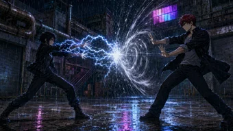 | <a href="https://ofox.ai/seedance-2-5-prompts?utm_source=github&utm_medium=case&utm_campaign=awesome-seedance-2-5#case-1014"></a> |

▶ [Watch the full video on ofox.ai](https://ofox.ai/seedance-2-5-prompts?utm_source=github&utm_medium=case&utm_campaign=awesome-seedance-2-5#case-1014)

<details>
<summary><strong>Prompt</strong> — 严格从首帧图开始。第一帧就是正在发生的对撞，雷弧与风旋已经在空中相接，闪光点亮两人侧脸。  【格式】16:9横屏，15秒，4段。硬切发生在 00:04、00:08、00:11.5 三处，其余段内保持连续运镜。  【画风】现代剧场版赛璐璐动画：干净有力的线条、平涂高饱和色、强边缘光与硬投影；夜雨、冷蓝…</summary>

~~~~text
严格从首帧图开始。第一帧就是正在发生的对撞，雷弧与风旋已经在空中相接，闪光点亮两人侧脸。

【格式】16:9横屏，15秒，4段。硬切发生在 00:04、00:08、00:11.5 三处，其余段内保持连续运镜。

【画风】现代剧场版赛璐璐动画：干净有力的线条、平涂高饱和色、强边缘光与硬投影；夜雨、冷蓝白电光与洋红青霓虹的强对比。

【角色A—雷】首帧图左侧少女为唯一身份基准：短黑发被雨打湿贴额、深色拉链夹克、深色长裤、旧短靴；白蓝色电弧缠绕前臂、在指间跳跃。称作「雷少女」。
【角色B—风】首帧图右侧少年为唯一身份基准：暗红短发、敞开的黑色长外套、灰白衬衫、深色长裤；掌前有可见的高速旋转风环，雨水绕环偏折。称作「风少年」。

【场景】暴雨夜，旧工厂之间的积水中庭。地面积水没过鞋面，裂缝混凝土，两侧卷帘门与锈蚀管道，墙上方一块洋红与青色的招牌，低云被城市光映成暗橙。

【材质与光】雨以可见的斜线落下，被下方与侧方的光源照亮。水顺着布料成股流下而不是整片反光；湿卷帘门与管道上的高光被落下的雨点打断、散开，不是单一镜面亮斑；积水倒影随涟漪碎成条状。暗部在外套褶皱与管道下方保持深黑；高光滚降而不是硬切死白。电光是唯一的高频光源，每次爆发都在湿地面上投出一次短促的反光。

【能力规则】雷少女的电弧沿真实手臂与手指走，可导入积水；风少年的风是可见的压缩气旋，靠偏折雨幕与掀起水花来显形。两者都必须有重量与惯性，不是发光特效贴图。

【PHYSICAL CONTACT LOCK】所有近身动作严格遵循：VISIBLE TARGET → BODY ENTRY → REAL STRIKE MOTION → CLEAR CONTACT → IMMEDIATE BODY REACTION → BALANCE CHANGE → NEXT ACTION。接触之前对方不出现受击反应；不用特效代替真实人体动作。

【00:00–00:04 — ARC BREAK】第一帧直接爆发。风环把雷弧向外压偏，雷少女顺着被压偏的方向低身切入，右肩先行、左掌贴上他前臂外侧，电流沿接触点炸开一圈短促白光，他的重心被真实带开半步。镜头随她切入横移，两人始终同框。
HARD CUT at 00:04.

【00:04–00:08 — WIND RUSH】风少年脚下气旋炸开水花，借风高速前冲。他的右掌推出压缩风刃，雷少女侧身让过，风刃击中身后的卷帘门，金属被压出一道明显凹陷并震颤。她不退，右手向下拍进积水——电流沿水面高速扩散。镜头低角度贴近水面追随电流扩散方向。
HARD CUT at 00:08.

【00:08–00:11.5 — GROUND CONDUCT】水中电流抵达他脚下，他被迫向上跃起脱离水面。空中他双掌下压制造风压缓冲，雷少女已经在落点等他：VISIBLE TARGET → 她起跳入身 → 右肘真实接触他胸前 → 他上身明显受力后仰 → 两人一起砸回积水，水花高高炸开。镜头跟随两人一起下落。
HARD CUT at 00:11.5.

【00:11.5–00:15 — THUNDER STEP FINISH】两人几乎同时从水里起身。风少年双掌合拢压出最后一道正面风墙；雷少女不绕开，双臂交叉正面顶进风墙，电弧沿风墙表面炸成网状。她穿过风墙的瞬间右膝已经抬起：REAL KNEE CONTACT FIRST → 命中他腹侧的同时电流沿接触点爆发 → 他被真实推离并踉跄后退数步，单膝跪进积水。动作在 00:13 全部结束。此后镜头缓缓收住，雨继续落，她保持落地姿势喘息，电弧在指间衰减成零星火花，画面停在两人隔着雨幕对视。

【摄影】剧场版动作作画质感。handheld close tracking、low-angle tracking、lateral tracking、short whip-pan，镜头随身体位移穿过中庭空间。镜头运动激烈但动作必须始终看得清——动作可读性优先于特效。每一次重要接触，攻击者与目标在接触前后必须短暂处于同一画面。

【特效预算】速度线、抹帧、冲击闪光、冲击波环：只用在 00:08 的电流扩散与 00:13 的膝撞两处。micro slow motion 至多 0.15 秒，只允许出现在 00:13 膝撞接触的那一瞬，其余全程正常高速。

【AUDIO】节奏层：低沉太鼓连打与心跳般的低频轰鸣，纯打击节奏，随四段逐段加快加重，00:13 全部撞在一起——这是打击节奏，不是配乐：没有旋律、没有和弦、没有乐器演奏、没有歌声、没有主题曲、没有BGM。音效层：持续的雨声与地面积水的溅落、电流的高频爆裂与嗡鸣、风压的低频推挤、金属卷帘门的震颤、肉体命中的沉闷冲击、鞋底在积水里的刮擦、工厂中庭的回声。人声层：双方短促的发力吼声与喘息，无台词、无对白、无旁白。结尾只剩雨声、她的喘息与电弧衰减的细碎噼啪。

【CONSISTENCY】雷少女的脸、五官比例、肤色、体型、短黑发、深色拉链夹克、深色长裤、旧短靴全程完全一致；风少年的脸、五官比例、肤色、体型、暗红短发、黑色长外套、灰白衬衫、深色长裤全程完全一致。严禁角色随机变化，严禁中途换脸，严禁改变画风。

【AVOID】字幕、水印、logo、任何屏幕文字、拟声词文字；写实真人、3D、游戏CG、塑料皮肤、磨皮、统一镜面高光、全局过曝；魔法阵、游戏能量球、发光粒子贴图；角色身份漂移。
~~~~

</details>

**参数**：Seedance 2.5 · Ofox · i2v · 15s · 720p · adaptive · 带音频
**费用**：$3.60（job 9cd773d0-b84e-4135-bc75-8f4e8963be2b）
**来源**：Ofox 实测

[Back to top](#table-of-contents)

<a id="ad-creative"></a>
### Ad Creative (创意广告)

<a id="case-12"></a>
### Case 12: Fruit biscuit commercial (果味饼干广告片) — by ByteDance

<a href="https://ofox.ai/seedance-2-5-prompts?utm_source=github&utm_medium=case&utm_campaign=awesome-seedance-2-5#case-12"></a>

▶ [Watch the full video on ofox.ai](https://ofox.ai/seedance-2-5-prompts?utm_source=github&utm_medium=case&utm_campaign=awesome-seedance-2-5#case-12)

**输入素材**（1 张官方参考图 + 6 段参考视频，视频只取首帧）

| | | | |
|:---:|:---:|:---:|:---:|
| <br><sub>@图像1 · 草莓味</sub> | <br><sub>@视频1 首帧</sub> | <br><sub>@视频2 首帧</sub> | <br><sub>@视频3 首帧</sub> |
| <br><sub>@视频4 首帧</sub> | <br><sub>@视频5 首帧</sub> | <br><sub>@视频6 首帧</sub> |  |

<details>
<summary><strong>Prompt</strong> — 明亮多彩的广告片风格，果味饼干为主角，包含草莓、苹果、葡萄、橙子四种口味，草莓味参考@图像1，饼干与对应水果以强秩序感的几何阵列排布，整体画面干净、高级、节奏强。开场水果快速建立视觉聚焦，参考@视频1的构图，音乐重拍切入。随后不同口味饼干整齐排列，切特写，参考@视频2的动态和运镜。高潮段一块饼干被折…</summary>

~~~~text
明亮多彩的广告片风格，果味饼干为主角，包含草莓、苹果、葡萄、橙子四种口味，草莓味参考@图像1，饼干与对应水果以强秩序感的几何阵列排布，整体画面干净、高级、节奏强。开场水果快速建立视觉聚焦，参考@视频1的构图，音乐重拍切入。随后不同口味饼干整齐排列，切特写，参考@视频2的动态和运镜。高潮段一块饼干被折断，瞬间进入慢动作，果味夹心爆开，碎屑飞溅，果汁感与颗粒冲击被放大展示，参考@视频3的冲击感。横向阵列，形成节奏抛物感，参考@视频4的运动，突出秩序美感与产品丰富度。随后迅速回到快节奏剪辑。结尾英文文字 One bite of crispness, a heart full of delight 快速分词切换入画，配合强节奏文字运动与产品定格，参考@视频5，最终品牌感收束，饼干和水果向四周发散，参考@视频6画面充满年轻、活力、好吃、想分享的广告氛围。
~~~~

</details>

**参数**：Seedance 2.5 · 火山方舟 · r2v · 15s（API 示例值；页面成片实测 26.3s）· 未标注 · 16:9 · 带音频
**来源**：火山方舟官方文档 · [中文](https://docs.volcengine.com/docs/82379/2607688?lang=zh) · [English](https://docs.byteplus.com/en/docs/ModelArk/2607688)

<sub>Preview frame © 2026 ByteDance, from the official demo video · Prompt by ByteDance · <a href="https://docs.volcengine.com/docs/82379/2607688?lang=zh">source</a></sub>

[Back to top](#table-of-contents)

<a id="case-13"></a>
### Case 13: Steampunk 30-second motion graphics (蒸汽朋克 30 秒 3D 动态图形序列) — by ByteDance

<a href="https://ofox.ai/seedance-2-5-prompts?utm_source=github&utm_medium=case&utm_campaign=awesome-seedance-2-5#case-13">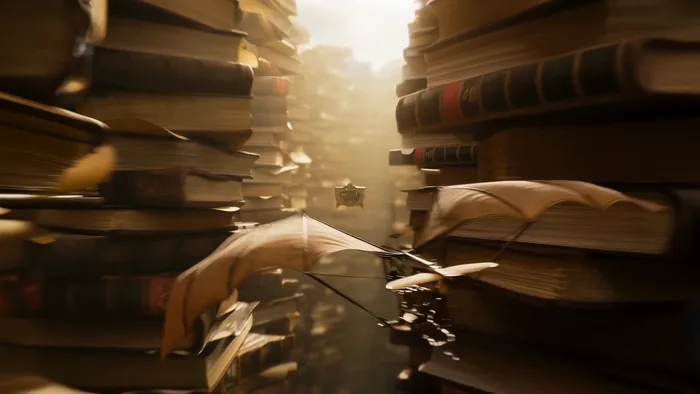</a>

▶ [Watch the full video on ofox.ai](https://ofox.ai/seedance-2-5-prompts?utm_source=github&utm_medium=case&utm_campaign=awesome-seedance-2-5#case-13)

**输入素材**（1 张官方参考图）

| |
|:---:|
| <br><sub>@图像1 · logo</sub> |

<details>
<summary><strong>Prompt</strong> — 一段高级、极具电影感的30秒3D动态图形序列，采用精致的蒸汽朋克与复古微缩景观风格，配合连续流畅的环绕与穿透运镜。 [0-10秒]： 古董黄铜钟面微距特写，奇迹般层层展开为相互啮合的旋转齿轮环与体积雾。镜头向下穿透齿轮，一架机械扑翼机（Ornithopter），正从由做旧古籍堆叠而成的微缩峡谷中盘旋…</summary>

~~~~text
一段高级、极具电影感的30秒3D动态图形序列，采用精致的蒸汽朋克与复古微缩景观风格，配合连续流畅的环绕与穿透运镜。 [0-10秒]： 古董黄铜钟面微距特写，奇迹般层层展开为相互啮合的旋转齿轮环与体积雾。镜头向下穿透齿轮，一架机械扑翼机（Ornithopter），正从由做旧古籍堆叠而成的微缩峡谷中盘旋升空。 [10-20秒]： 镜头跟随扑翼机的轨迹向前滑行，无缝穿透入一个高速旋转的华丽黄铜幻影箱（Zoetrope），内部投射出飞驰的机械骏马动态光影。光影跃出箱体，场景瞬间化为一辆黄铜质感悬浮缆车，正沿着微光铜轨穿梭于机械齿轮森林，沐浴着电影级的黄金时刻光线。 [20-30秒]： 镜头优雅向下平移，缆车下方出现一艘精美的发条木制机械帆船，在深蓝色玻璃材质的起伏海浪中破浪前行。海浪尽头无缝演变为一轮发光巨月，一群举着摇曳提灯的探险者剪影，正沿着星空下的水晶矿脉山脊艰难跋涉。镜头平滑螺旋拉远，穿过空灵云朵，回到滴答作响的宏大黄铜钟面。最后一秒出现 logo，参考@图像1。 技术规格： 超写实机械纹理，丰富黄铜与金色调，电影级浅景深。平滑连贯的无缝穿梭运镜，极强的史诗感与奇幻冒险氛围。
~~~~

</details>

**参数**：Seedance 2.5 · 火山方舟 · r2v · 30s · 720p（Ark 默认，未显式设置）· 16:9 · 带音频
**来源**：火山方舟官方文档 · [中文](https://docs.volcengine.com/docs/82379/2607688?lang=zh) · [English](https://docs.byteplus.com/en/docs/ModelArk/2607688)

<sub>Preview frame © 2026 ByteDance, from the official demo video · Prompt by ByteDance · <a href="https://docs.volcengine.com/docs/82379/2607688?lang=zh">source</a></sub>

[Back to top](#table-of-contents)

<a id="case-14"></a>
### Case 14: Crimson-studio noodle commercial (绯红影棚拉面广告) — by @AIwithSynthia

<a href="https://ofox.ai/seedance-2-5-prompts?utm_source=github&utm_medium=case&utm_campaign=awesome-seedance-2-5#case-14"></a>

▶ [Watch the full video on ofox.ai](https://ofox.ai/seedance-2-5-prompts?utm_source=github&utm_medium=case&utm_campaign=awesome-seedance-2-5#case-14)

<details>
<summary><strong>Prompt</strong> — Style: Bold high-energy food commercial cinematography, 8K photorealistic, deep crimson-red studio backdrop, dramatic dynamic splash effects, glossy v…</summary>

~~~~text
Style: Bold high-energy food commercial cinematography, 8K photorealistic, deep crimson-red studio backdrop, dramatic dynamic splash effects, glossy vibrant styling, fashion-editorial meets food-ad tone. 24fps, punchy fast-paced motion with slow-motion splash inserts, no jitter.
Character: A stylish young woman with double-bun hairstyle adorned with colorful beaded accents and ribbons, red tinted sunglasses, bold red lipstick, wearing a blue-and-black dragon-print traditional-style dress with a wide black belt. Confident, playful, high-fashion attitude.
Subject: A white ceramic bowl filled with rich reddish-brown broth, noodles, bok choy, lotus root slices, enoki mushrooms, and dumplings — dynamic splashing broth throughout.
Setting: A deep red studio backdrop with golden fan props framing the scene.
CUT 1 — Dynamic action shot, slow motion: She lifts chopsticks holding noodles high above the bowl, broth splashing dramatically upward with lotus root and bok choy suspended mid-air, confident smirk toward camera.
CUT 2 — Medium shot, seated pose: She sits cross-legged holding the bowl, chopsticks lifting noodles toward her mouth, red sunglasses catching studio light.
CUT 3  — Elegant seated pose, static hold: She leans back gracefully with legs crossed, bowl balanced in one hand, confident editorial gaze into camera.
CUT 4 — Medium shot, presenting pose: She holds the bowl forward toward camera with both hands, steam rising gently, inviting confident expression.
CUT 5  — Explosive splash shot, slow motion: Broth erupts upward in a dramatic arc as she reaches toward the bowl with chopsticks, lotus root and greens flying through the air in rich detail.
CUT 6  — Extreme dynamic splash shot, slow motion: A massive eruption of broth, noodles, and vegetables cascades around her in full-body motion, chopsticks raised triumphantly, golden fans framing the chaos.
CUT 7  — Action eating shot, slow motion: She lifts a large tangle of noodles from the steaming bowl with chopsticks, broth dripping and splashing at the edges, focused intense expression.
CUT 8 — Extreme close-up, dramatic splash: Broth splashes upward around her face as she peers over lowered sunglasses with wide, playful surprise, mouth open mid-reaction.
CUT 9 — Final hero shot, slow motion: She adjusts her sunglasses with one hand while broth splashes dynamically beside her, confident final pose against the deep red backdrop with golden fans in frame.
Camera: Fast dynamic handheld-style energy on splash shots, smooth static holds on posed shots, high-speed capture for slow-motion splash details.
Lighting: Bold saturated studio lighting, warm rim light on broth and steam, sharp contrast against the deep red backdrop.
Color palette: Crimson red, warm amber broth tones, deep indigo-blue dress pattern, gold accents.
Audio: Upbeat energetic instrumental with punchy percussion hits synced to splash moments, sizzling/broth-splash SFX, chopstick clicks, playful vocal ad-lib on the final reaction shot.
~~~~

</details>

**参数**：Seedance 2.5 · 未标注 · t2v · 未标注 · 未标注 · 未标注 · 带音频
**来源**：[@AIwithSynthia](https://x.com/AIwithSynthia) · [原帖](https://x.com/AIwithSynthia/status/2084852008448905417)

<sub>Preview © 2026 <a href="https://x.com/AIwithSynthia/status/2084852008448905417">@AIwithSynthia</a> · Prompt by <a href="https://x.com/AIwithSynthia/status/2084852008448905417">@AIwithSynthia</a></sub>

[Back to top](#table-of-contents)

<a id="case-15"></a>
### Case 15: Impossible warrior fashion editorial (不可能战士时尚大片) — by @charaspowerai

<a href="https://ofox.ai/seedance-2-5-prompts?utm_source=github&utm_medium=case&utm_campaign=awesome-seedance-2-5#case-15"></a>

▶ [Watch the full video on ofox.ai](https://ofox.ai/seedance-2-5-prompts?utm_source=github&utm_medium=case&utm_campaign=awesome-seedance-2-5#case-15)

**输入素材**：未公开 —— 原作者只发布了成片，未提供输入素材

<details>
<summary><strong>Prompt</strong> — Use the provided image as the strict visual reference for the warrior’s face, blonde hair, armor, fur jacket, leather boots, sword, body proportions, …</summary>

~~~~text
Use the provided image as the strict visual reference for the warrior’s face, blonde hair, armor, fur jacket, leather boots, sword, body proportions, ruined battlefield, burning fortress, smoke, embers, and dark cinematic atmosphere. Preserve her identity and outfit throughout the entire sequence.

Create a 20-second impossible high-fashion warrior photoshoot, blending sensual confidence, brutal fantasy action, luxury editorial posing, explosive VFX, and aggressive cinematic camera work. The result must feel like a viral fashion campaign filmed in the middle of a medieval war.

0–4 seconds — Iconic opening pose
Begin with the exact composition of the reference image. The warrior stands on shattered stone, sword lowered beside her, staring directly into the lens. Her hair and fur move violently in the wind while embers spiral around her. The camera rushes toward her with a low-angle dolly-in. A powerful white flash freezes her pose, followed by a horizontal blue lens flare crossing her eyes and armor.

4–8 seconds — Fashion meets combat
She walks toward the camera with controlled, sensual confidence as explosions erupt behind her. Use rapid editorial cuts: close-up of her eyes, lips, hand tightening around the sword, fur texture, armored waist, boots crushing burning debris. She suddenly pivots and blocks an incoming blade from an unseen attacker. Sparks explode across the lens as the camera whip-pans around her.

8–12 seconds — Impossible action photoshoot
She launches into a fast spinning sword movement, cutting through smoke and shattered banners. Freeze her mid-motion in a dramatic fashion pose as dozens of camera flashes fire from impossible angles. Add elegant motion echoes, metallic silhouette trails, floating reflective shards, streaking embers, and anamorphic lens flares. Each flash captures a different powerful pose before snapping back into live action.

12–16 seconds — Sensual hero moment
The action suddenly slows. She plants the sword into the ground, steps close to the lens, and leans slightly forward with a fierce, provocative gaze. Wind sweeps her hair across her face while warm firelight shapes her silhouette. The camera performs a tight orbit around her body and rises into a close-up. A strong golden lens flare blooms behind her shoulder as ash drifts through the frame.

16–20 seconds — Epic viral finale
A massive explosion destroys part of the fortress behind her. Without looking back, she pulls the sword free and turns sharply toward the camera. Use an extreme speed ramp as she swings the blade directly past the lens, creating a seamless transition into three rapid flash-frozen editorial poses: sword over her shoulder, blade pointed downward, then a dominant frontal stance.

Finish on a slow-motion hero frame with the warrior standing perfectly centered, smoke and fire behind her, embers suspended in the air, her hair flowing, armor glowing along the edges, and a huge cinematic lens flare crossing the screen.

Ultra-premium fantasy fashion editorial, sensual but powerful warrior energy, impossible battlefield photoshoot, luxury magazine attitude, brutal sword choreography, low-angle camera, macro beauty shots, whip-pans, fast orbit movement, snap zooms, speed ramps, flash photography, freeze frames, motion echoes, metallic VFX, realistic fire and debris, dramatic anamorphic lens flares, realistic hair and fabric physics, no dialogue, no text, no subtitles, no identity drift, no wardrobe change, no facial deformation, no extra limbs.
~~~~

</details>

**参数**：Seedance 2.5 · 未标注 · i2v · 20s · 未标注 · 未标注 · 未标注
**来源**：[@charaspowerai](https://x.com/charaspowerai) · [原帖](https://x.com/charaspowerai/status/2083251609115468147)

<sub>Preview © 2026 <a href="https://x.com/charaspowerai/status/2083251609115468147">@charaspowerai</a> · Prompt by <a href="https://x.com/charaspowerai/status/2083251609115468147">@charaspowerai</a></sub>

[Back to top](#table-of-contents)

<a id="case-1005"></a>
### Case 1005: Running shoe, dust on landing (跑鞋 · 落地扬尘) — by Ofox Team

| 输入 | 输出 |
|:---:|:---:|
|  | <a href="https://ofox.ai/seedance-2-5-prompts?utm_source=github&utm_medium=case&utm_campaign=awesome-seedance-2-5#case-1005"></a> |

▶ [Watch the full video on ofox.ai](https://ofox.ai/seedance-2-5-prompts?utm_source=github&utm_medium=case&utm_campaign=awesome-seedance-2-5#case-1005)

<details>
<summary><strong>Prompt</strong> — Begin with the exact composition of the reference image; the first frame is that image.  FORMAT: 20 seconds, wide landscape 16:9 following the referen…</summary>

~~~~text
Begin with the exact composition of the reference image; the first frame is that image.

FORMAT: 20 seconds, wide landscape 16:9 following the reference frame, 7 shots, a hard cut on every one of the six boundaries, no other kind of transition anywhere.
STYLE: athletic footwear commercial, 8K photoreal studio product cinematography, hyper-realistic engineered knit, foam and translucent rubber textures, real skin and real fabric; bright, fast and high-key throughout, high saturation and strong colour pop, everything crisp and airy with no deep shadow anywhere except the one clean contact shadow under the shoe.
COLOR PALETTE: bright pale grey seamless floor and background, electric cobalt blue, bright lime green, warm orange, clean white foam and white laces, translucent amber, and the pale neutral grey of fine dust in the light.
RUNNER: a woman in her late twenties, lean athletic build, dark hair pulled back tight into a high ponytail, plain matte black running shorts, a plain heather grey sleeveless training top, low plain white ankle socks on both feet, no jewellery, no watch, no wristband, nothing printed or embroidered on any garment. No person appears in the reference frame and no person is in shot for the first four seconds. The runner is described here in words only and is generated from this description; she arrives at 4 seconds and is built up from the feet upward across the clip, first as a foot, then as an ankle and two hands, then as a calf and a knee, and only once as a whole body at a distance. Her face is never turned toward the lens, never in focus and never in close-up at any point in the clip.
PRODUCT: the exact shoe in the reference image and no other. A modern low-profile running trainer in a bold high-saturation colourway: an electric cobalt blue engineered knit upper with a fine visible mesh weave, a bright lime green asymmetric side panel stitched with contrasting white thread, a warm orange heel counter, flat white round laces threaded through six pairs of eyelets, a thick chunky white foam midsole with a subtly sculpted sidewall, and a translucent amber rubber outsole with a deep fishscale tread pattern. The reference frame is the only authority on how this shoe looks, including its orientation in the opening and closing shots: the toe points to frame left and the heel sits at frame right, at a three-quarter angle, tilted just off the floor at the heel so a crisp shadow falls to the left. Every panel, seam, stitch line, eyelet and tread block stays exactly as it is in the reference frame for the whole clip. Do not restyle, recolour, reshape or redesign any part of it, and do not add a panel, a strip, a stripe, an overlay, a tab, a patch, a badge or a marking that is not already there.
SCENE: a bright pale grey seamless studio, floor and background the same tone with no visible join, no wall, no corner, no horizon, no prop, no furniture and no object of any kind other than the shoe and the runner. The light is clean high-key studio light: one large soft source above and slightly right giving crisp specular highlights on the white foam midsole and the translucent amber outsole, and a second fill from the left lifting the shadow side of the knit. Fine grey dust particles hang and drift in the air throughout, catching the light. The floor, the background, the two light sources and the shadow direction do not change at any point in the clip.

0-3s HOOK: hold the reference composition exactly. Medium product shot at shoe height, the single shoe centred on the bright floor, toe to frame left and heel to frame right, generous bright space all around it, the crisp contact shadow falling to the left. The camera is almost still, only the faintest slow push toward the shoe. The only movement in frame is fine grey dust drifting down through the light. No person, no foot and no hand is in frame. Sound: quiet studio room tone only, no music.
HARD CUT.
3-5.5s SHOWCASE A, the foot arrives: floor-level extreme close from the same side as the opening shot, the camera locked flat on the floor. The translucent amber outsole and the white foam midsole fill the lower half of frame, the knit upper fills the middle, and the collar and the tongue are above the top edge of frame and therefore out of shot. For the first second the shoe stands alone, unchanged and untouched. At 4 seconds a foot in a low plain white ankle sock enters fast from frame right, slides into the shoe in one clean motion, and the heel drops in and seats itself; the white foam compresses very slightly under the weight and the amber outsole presses flat and level against the floor. Only the foot and a few centimetres of bare ankle ever enter frame. Sound: the dry scuff of a sock against a knit lining, the soft knock of a heel seating, room tone.
HARD CUT.
5.5-8s SHOWCASE B, the laces: close on the lacing from above and slightly to the left, the shoe filling frame from the toe to the collar, the tongue running away from the lens and staying soft and unfocused. Two hands come in from the top of frame, take the crossed white lace bands on either side and pull them snug in one quick tug, then a second shorter tug; the knit upper draws in around the foot, the lace bands lift clear of the eyelets and settle back. Only two hands, the ankle and a short length of shin are ever in frame. Sound: the fast dry zip of round laces running through eyelets, two soft tugs, room tone.
HARD CUT.
8-10.5s CLIMAX A, the drive: low side tracking shot at ankle height, the camera travelling left and keeping pace. From a still stance the shoe loads: the white foam midsole compresses hard, the heel lifts, the amber outsole rolls forward through the forefoot and pushes off, and the first stride drives out of frame left while a small puff of grey dust lifts off the floor behind it. The calf and the knee enter the top of frame; nothing above the knee is in shot. Full speed. Sound: one hard sole scuff, the deep compression of foam under load, the sharp slap of the other foot landing, room tone.
HARD CUT.
10.5-14.5s CLIMAX B, the landing, and the only slow motion anywhere in the clip: low three-quarter front view at ankle height, the camera held still while the runner comes toward it and passes. 10.5-11.2s at full speed: the leading foot is in flight, the knee driving, the shoe crossing the frame from left to right. 11.2-13.2s in slow motion, two seconds taken out of this four-second shot and out of the nine seconds of the climax, not added to the clip: the landing itself. The amber outsole meets the bright floor, the deep fishscale tread flattens and grips, the white foam midsole compresses through its full travel and rebounds, the cobalt knit flexes and creases across the forefoot, the lime green side panel stretches, the white lace bands go tight, and a low ring of fine grey dust blooms outward from the point of contact and hangs there in the light. 13.2-14.5s back at full speed: the foot rolls through, pushes off, leaves frame, and the ring of dust collapses. The shot still ends at 14.5 seconds. Sound: the slap of the landing stretched long and low under the slow motion, foam creaking under load, then the crisp scuff of the push off as full speed returns.
HARD CUT.
14.5-17s CLIMAX C, the whole body, once and at a distance: wide and low, the studio bright and empty, the runner small in frame and seen from behind and slightly to the side, running away from the lens and across toward frame right with the head turned away, so the face is never toward the lens and no facial detail is resolved at this distance. Both feet wear the same shoe as the reference frame, a matching left and right pair, and the shoes are the brightest and most saturated thing in the picture; the amber outsoles flash as each foot leaves the floor and a light trail of grey dust rises behind her. The camera pans a few degrees to follow and does nothing else. Sound: a steady fast cadence of shoes striking a hard studio floor, one quiet breath, room tone.
HARD CUT.
17-20s CLOSE: a cut back to the product alone, not a continuation of the run. Hero frame, the exact composition of the opening shot: the single shoe centred on the bright pale grey floor, toe to frame left and heel to frame right, the same three-quarter angle, the same crisp shadow falling to the left, the same generous bright space around it. The studio is empty; no person, foot, leg, hand or sock is in frame. The camera is fully settled and completely motionless. The only movement is the last few grey dust particles drifting down through the light and settling. No word, letter, number, logo or graphic appears in this shot, and none has appeared anywhere earlier in the clip. Hold the final frame perfectly still for the last full second. Sound: the room tone drops away to near silence and the clip ends on it.

CAMERA: a movement stated per shot, and locked is a value here rather than the absence of one. The faintest slow push on the held opening; a locked floor-level extreme close for the foot arriving; a locked close from above and slightly left for the laces; a lateral tracking move to frame left at ankle height for the drive; a completely held low three-quarter front view for the landing, where every bit of motion in frame belongs to the runner and none to the camera; a pan of a few degrees for the one wide shot; and a fully settled, motionless hero frame at the end. Macro and short telephoto for the three close shots, a medium lens for the opening and closing product frames, a wide lens for the one full-body shot. Depth of field deep enough in the close shots that the knit weave, the stitch line on the side panel and the fishscale tread all stay sharp, while the collar and the tongue stay soft whenever they are in frame at all. Focus stays on the shoe in every single shot, never on the runner. No handheld shake, no wobble, no whip pan, no zoom, no rack focus, and no camera movement that carries across a cut.
AUDIO: recorded sound effects and studio room tone only, and absolutely no music of any kind - no score, no soundtrack, no instrument, no drums, no percussion, no bass, no synth, no strings, no piano, no guitar, no bell, no chime, no drone, no pad, no melody, no rhythm track, no beat, no humming, no singing, and no designed whoosh or riser sweeps. No dialogue, no voiceover, no narration, no counting and no spoken words of any kind anywhere in the clip. The only sounds are: quiet studio room tone under everything; the dry scuff of a sock against a knit lining; the soft knock of a heel seating; round laces running fast through eyelets and two soft tugs; foam compressing and creaking under load; the sharp slap of a sole landing on a hard floor, stretched long and low under the slow motion; a steady fast cadence of running steps on a hard studio floor; and one quiet breath.
CONSISTENCY: the shoe silhouette and every element of the colourway are identical in every shot and identical to the reference frame - the electric cobalt blue engineered knit upper with its fine visible mesh weave, the bright lime green asymmetric side panel with its contrasting white stitch line, the warm orange heel counter, the flat white round laces threaded through six pairs of eyelets, the thick white foam midsole with its sculpted sidewall, and the translucent amber rubber outsole with its deep fishscale tread. In the one wide shot where both feet are visible, the second shoe is the exact mirror image of the first, the same model and the same colourway, and the two form one matching pair. The small blue tab at the top of the tongue stays exactly as it is in the reference frame: soft, unfocused and unresolved. Never bring it into sharp focus, never enlarge it, never move it, never sharpen it, never resolve it into a badge, a patch, a logo, a wordmark or lettering of any kind, and never add anything to it or beside it. The bright pale grey seamless floor and background, the soft key light from above and slightly right, the fill from the left and the shadow falling to the left are the same in every shot. The runner is in frame only between 4 seconds and 17 seconds; before 4 seconds and after 17 seconds the shoe stands alone in an empty studio. Her clothing, her socks and her tied-back hair do not change while she is in frame. Exactly two things change state in the whole clip: a foot goes into the shoe and the laces are pulled snug.
AVOID: any text, lettering, character, letter, digit, number or symbol anywhere in frame at any point in the clip. No brand name, no logo, no wordmark, no monogram, no emblem, no badge, no shoe size, no size marking, no model number, no care label, no heel tab lettering, no insole print, no outsole lettering, no printing or embroidery on the tongue, on the side panel, on the heel, on the socks or on any garment. No subtitles, no captions, no slogan, no tagline, no title card, no text card, no closing card, no watermark, no logo overlay, no interface graphics, and no invented lettering on the floor or in the background. No close-up of the tongue and no sharp detail of the tongue at any point. No face toward the lens, no facial close-up, no portrait, no head and shoulders shot. No warped, melted, stretched or duplicated limbs, no extra leg, no extra arm, no third hand, no warped or extra fingers, no warped or extra toes, no foot bending the wrong way, no ankle bending backwards, no knee bending backwards, no leg with two knees, no limb passing through the shoe. No bare foot, no barefoot runner, no bare foot beside a shod foot, no missing sock, no mismatched socks, no sock worn outside the shoe, no shoe worn on the wrong foot. No third shoe, no spare shoe lying in frame, no odd or mismatched pair, no shoe in a different colourway, no shoe of a different model, no shoe box, no second pair, and no empty shoe hovering in the air. The colourway never changes: the knit never turns black, white or grey, the side panel never stops being lime green, the heel counter never stops being orange, the laces never change colour, and the outsole never stops being translucent amber. No dissolves, no fades between shots, no cross fades, no jump cuts, no whip pans, no speed ramp at any cut, no camera shake, no zoom and no rack focus; exactly six hard cuts and no other kind of transition anywhere. No slow motion anywhere except the two seconds written into the landing shot, and no freeze frame at any point. The background never darkens, never turns into a street, a road, a running track, a gym, a park or any outdoor location, and never gains a wall, a corner, a shelf, a sign, a screen, a mirror or a piece of furniture. No water, no rain, no puddle, no fire, no sparks, no glowing energy, no light trails, no motion-graphic lines, no speed lines, no sparkle particles, no lens flare stars, no confetti and no haze beyond the fine dust already described. No music, no score, no instrumental cue, no percussion and no melodic or rhythmic audio bed of any kind. No plastic or CGI look, no cartoonish or oversaturated grade beyond the bright commercial look described, no skin smoothing, no beauty retouching and no plastic skin.
~~~~

</details>

**参数**：Seedance 2.5 · Ofox · i2v · 20s · 720p · adaptive · 带音频
**费用**：$4.80（job ac927785-92ef-4e28-97b9-ff8172ec5554）
**来源**：Ofox 实测

[Back to top](#table-of-contents)

<a id="case-1006"></a>
### Case 1006: YUNQI sparkling oolong (YUNQI 气泡乌龙茶) — by Ofox Team

| 输入 | 输出 |
|:---:|:---:|
|  | <a href="https://ofox.ai/seedance-2-5-prompts?utm_source=github&utm_medium=case&utm_campaign=awesome-seedance-2-5#case-1006"></a> |

▶ [Watch the full video on ofox.ai](https://ofox.ai/seedance-2-5-prompts?utm_source=github&utm_medium=case&utm_campaign=awesome-seedance-2-5#case-1006)

<details>
<summary><strong>Prompt</strong> — Begin with the exact composition of the reference image; the first frame is that image.  FORMAT: 15 seconds, wide landscape 16:9 following the referen…</summary>

~~~~text
Begin with the exact composition of the reference image; the first frame is that image.

FORMAT: 15 seconds, wide landscape 16:9 following the reference frame, 5 shots, a hard cut on every one of the four boundaries, no other kind of transition anywhere.
STYLE: luxury beverage commercial, 8K photoreal studio product cinematography, cinematic colour grade, hyper-realistic glass, condensation and carbonation, realistic reflections on wet stone; slow, dark and patient throughout, everything falling into deep shadow except what one warm gold rim light chooses to show.
COLOR PALETTE: near-black background and deep shadow, amber-gold liquid, warm gold rim light and brushed gold cap, matte cream label, a cool blue-grey fill on the condensation, one small note of osmanthus yellow low in the foreground.
PRODUCT: the exact bottle in the reference image and no other. A clear glass bottle of sparkling oolong tea with a rounded shoulder and a short neck; amber-gold liquid with fine bubbles rising in steady columns; cold condensation beaded across the upper half of the glass; a brushed gold screw cap with a knurled edge; and a matte cream paper label with visible paper texture wrapped low around the body, carrying the single word YUNQI in widely spaced thin dark charcoal capitals with one small dark line ornament centred directly beneath it. The reference frame is the only authority on how this product looks. The label, the word YUNQI, its letter spacing, the small ornament beneath it, the bottle silhouette, the shoulder, the neck, the gold cap and every proportion stay exactly as they are in the reference frame for the whole clip. Do not regenerate, redraw, restyle, re-letter, translate or reword the label, and do not add a second word, a slogan, a barcode, a volume marking or any other marking to it.
SCENE: a wet black polished speckled stone surface that reflects the bottle, against a deep near-black background carrying only a faint warm gradient far behind and to the right; three fresh osmanthus sprigs with tiny yellow blossoms lie softly out of focus on the stone at frame left, one dry oolong leaf lies on the stone at frame right. A single warm gold rim light from behind and to the right traces the silhouette of the bottle and lights the rising bubbles from within; a soft cool fill from the left picks out the condensation; everything else stays in deep shadow. The background, the stone, the light direction and the two foreground props do not change at any point in the clip.

0-3s HOOK: hold the reference composition exactly. Frontal medium shot, the bottle centred, generous dark space either side, its reflection in the wet stone below. The camera is almost still, only the faintest slow inward drift. Inside the glass the bubble columns climb steadily; one bead of condensation releases from the shoulder of the glass and runs down. Nothing else moves. Sound: quiet room tone only, no music.
HARD CUT.
3-5.5s SHOWCASE A: extreme macro inside the amber liquid, no label and no cap in frame, the glass filling the whole picture. The camera drifts slowly upward with the bubbles. Hundreds of fine bubbles rise through gold-lit amber and break against the underside of the surface. Sound: fine carbonation, close and dry.
HARD CUT.
5.5-8s SHOWCASE B: medium on the bottle again with the label face-on. The camera orbits about 30 degrees around the bottle at constant height and constant speed, from a slight three-quarter angle toward dead front, so the label turns further toward the lens rather than away from it; the warm gold rim light travels along the wet edge of the glass and across the knurled edge of the cap as the camera moves. The word YUNQI stays sharp, centred and fully legible for the whole move. Sound: a faint ring of the glass under the moving light, room tone.
HARD CUT.
8-12s CLIMAX: macro on the neck and the cap, the label just below the bottom of frame, camera locked. 8-9s at full speed: a hand in a dark charcoal glove enters from frame right, only the gloved fingers and the edge of the glove ever visible, closes on the knurled edge of the cap and gives it a quarter turn. 9-11s in slow motion, two seconds taken out of this four-second shot and not added to the clip: the seal breaks, a fine ring of cold white mist rolls out over the lip and down the shoulder of the glass, three condensation droplets jump loose from the neck, and every bubble column inside surges upward at once. 11-12s back at full speed: the cap lifts clear and out of the top of frame and the glove withdraws to frame right. The shot still ends at 12 seconds. Sound: the dry crack of the seal, then a long slow hiss of escaping gas stretched under the slow motion, then carbonation surging as full speed returns.
HARD CUT.
12-15s CLOSE: hero frame, the same frontal medium composition as the opening shot. The bottle is now open, the brushed gold cap rests on the wet stone beside it, a thin ribbon of cold mist still lifts from the open neck, one last bead runs down the glass. The camera settles completely and stops moving. In the empty dark space at frame left, level with the shoulder of the bottle and well above the osmanthus sprigs, the single word YUNQI fades up small and clean in soft warm cream, thin and widely spaced in the same letterforms as the label, and holds; no other word, letter or mark appears with it. Hold the final frame perfectly still for the last second. Sound: the hiss fades to nothing and the clip ends on quiet room tone.

CAMERA: a movement stated per shot and every one of them slow. An almost imperceptible inward drift on the held opening; a slow vertical drift upward through the liquid on the macro; a 30 degree orbit at constant height and constant speed on the showcase; a locked macro on the cap where the only motion in frame is the cap turning, the mist rolling and the glove entering and leaving; and a fully settled, motionless hero frame at the end. Macro and long lens throughout, shallow depth of field in every shot, the background always far out of focus. Focus stays on the bottle, and on the label whenever the label is in frame. No handheld shake, no whip pan, no zoom, no rack focus, and no camera movement that carries across a cut.
AUDIO: recorded sound effects and room tone only, and absolutely no music of any kind - no score, no soundtrack, no instrument, no cello, no strings, no piano, no bell, no chime, no drone, no pad, no melody, no rhythm track, no humming and no singing. No dialogue, no voiceover, no narration and no spoken words of any kind anywhere in the clip. The only sounds are: fine carbonation inside the glass, the dry crack of the seal breaking, a long slow hiss of escaping gas stretched under the slow motion, one droplet landing on wet stone, and quiet room tone under everything.
CONSISTENCY: the bottle silhouette, the rounded shoulder and short neck, the glass thickness, the amber colour of the liquid, the brushed gold cap with its knurled edge, and above all the matte cream label with the word YUNQI, its letter spacing and the small ornament beneath it are identical in every shot and identical to the reference frame. The wet black speckled stone and its reflection of the bottle, the near-black background, the warm gold rim light from behind right, the cool fill from the left, the three osmanthus sprigs at frame left and the single dry oolong leaf at frame right do not move, change or disappear between shots. Exactly two things change state in the whole clip: the cap goes from closed to off, and the brand card fades up in the final shot.
AVOID: any text, lettering, character, digit or symbol anywhere in frame other than the word YUNQI on the label and the same word YUNQI as the brand card in the final shot. No subtitles, no captions, no slogan, no tagline, no second word, no barcode, no volume or ingredient marking, no watermark, no logo overlay, no interface graphics, no invented lettering on the stone or in the background, and no redrawn, restyled, misspelled, mirrored or partly formed version of the word YUNQI. No second bottle, no duplicate bottle, no drinking glass, no straw, no ice cubes, no fruit, no person, no face, no body, no bare skin, no bare hand, no wrist or forearm in frame, no second hand, no warped or extra fingers, no extra limbs. The bottle never floats, tips, pours or spills, and the liquid never changes colour. No dissolves, no fades between shots, no jump cuts, no whip pans, no speed ramp at any cut, no camera shake. The background never lightens or turns white, the props never move, the light direction never changes. No music, no score, no instrumental cue, no melodic or rhythmic audio bed of any kind. No plastic or CGI look, no oversaturated or cartoonish grade, no lens flare stars, no sparkle particles.
~~~~

</details>

**参数**：Seedance 2.5 · Ofox · i2v · 15s · 720p · adaptive · 带音频
**费用**：$3.60（job 7ae7d49e-7eb9-4165-9d95-09cd525d53ed）
**来源**：Ofox 实测

[Back to top](#table-of-contents)

<a id="case-1007"></a>
### Case 1007: AURA serum, one drop in the afternoon (AURA 精华油 · 午后一滴) — by Ofox Team

| 输入 | 输出 |
|:---:|:---:|
|  | <a href="https://ofox.ai/seedance-2-5-prompts?utm_source=github&utm_medium=case&utm_campaign=awesome-seedance-2-5#case-1007"></a> |

▶ [Watch the full video on ofox.ai](https://ofox.ai/seedance-2-5-prompts?utm_source=github&utm_medium=case&utm_campaign=awesome-seedance-2-5#case-1007)

<details>
<summary><strong>Prompt</strong> — Begin with the exact composition of the reference image; the first frame is that image.  FORMAT: 15 seconds, wide landscape 16:9 following the referen…</summary>

~~~~text
Begin with the exact composition of the reference image; the first frame is that image.

FORMAT: 15 seconds, wide landscape 16:9 following the reference frame, 5 shots, a hard cut on every one of the four boundaries, no other kind of transition anywhere.
STYLE: quiet premium skincare commercial shot as a real moment in a real room, 8K photoreal, cinematic colour grade, hyper-realistic frosted glass and clear glass, natural late-afternoon window light through half-closed blinds, visible dust in the air; slow, warm and patient, the light dimming as the afternoon goes.
COLOR PALETTE: warm off-white wall, deep warm walnut desk, amber-gold serum, cream matte paper label, matte black dropper cap, sage-grey eucalyptus, clear water and clear glass, with the whole frame drifting slightly warmer and lower in key as the clip runs.
PRODUCT: the exact bottle in the reference image and no other. A cylindrical frosted glass serum bottle filled with clear amber-gold oil, a matte black screw collar and a matte black rubber dropper bulb above it, the glass pipette visible standing inside the oil, and a matte cream paper label with visible paper texture wrapped around the middle of the body carrying the single word AURA in widely spaced thin dark charcoal capitals and nothing else. The reference frame is the only authority on how this product looks. The label, the word AURA, its letter spacing, the bottle silhouette, the frosted finish, the black collar and bulb, the pipette inside and every proportion stay exactly as they are in the reference frame for the whole clip. Do not regenerate, redraw, restyle, re-letter, translate or reword the label, and do not add a second word, a slogan, a barcode, a volume marking or any other marking to it.
SCENE: a solid warm walnut desk with visible open grain, against a plain warm off-white wall. The wall is entirely bare - no shelf, no book, no picture, no poster, no notice and no printed surface of any kind anywhere in the room. Late afternoon sun comes through half-closed venetian blinds off frame left and lays soft parallel bars of warm light across the wall and along the desk, with fine dust drifting slowly through them. A plain clear drinking glass half full of water stands on the desk behind and left of the bottle and throws a bright caustic of light onto the wood. A single sage-grey eucalyptus sprig lies on the desk at frame right. Deep empty wall fills the upper right of the frame. The desk, the wall, the glass of water, the eucalyptus sprig and the direction of the light do not change at any point in the clip; only the light bars creep slowly lower and warmer as the afternoon dims.

0-3s HOOK: hold the reference composition exactly. Frontal medium shot, the bottle a little left of centre on the wood, the glass of water behind it, the eucalyptus sprig at frame right, empty wall above right. The camera is almost still, only the faintest slow inward drift. Dust motes drift down through the bars of light; the caustic thrown by the glass of water trembles very slightly; one narrow leaf of the eucalyptus sprig settles by a millimetre. Nothing else moves. Sound: quiet room tone only, a room with a window open somewhere far off, no music.
HARD CUT.
3-5s SHOWCASE A: extreme macro inside the amber oil, no label and no cap in frame, the frosted glass and the oil filling the whole picture. The camera drifts slowly upward through the oil. A bar of window light refracts through the glass and lies across the oil as a soft amber band, and the surface of the oil holds one slow shallow bow of movement. Sound: room tone, nothing else, very quiet.
HARD CUT.
5-7s SHOWCASE B: medium on the bottle again with the label face-on. The camera orbits about 25 degrees around the bottle at constant height and constant speed, from a slight three-quarter angle toward dead front, so the label turns further toward the lens rather than away from it; a bar of window light travels across the frosted glass and along the matte black collar as the camera moves. The word AURA stays sharp, centred and fully legible for the whole move. Sound: room tone, the faint settle of the desk.
HARD CUT.
7-12s CLIMAX: macro on the black dropper bulb and the mouth of the bottle, the label just below the bottom of frame, camera locked. 7-8.5s at full speed: two fingers and a thumb enter from frame right, only the fingertips and the first knuckle ever visible and never more of the hand than that, close on the matte black bulb and lift the glass pipette clear of the mouth; a thin thread of amber oil runs back off the pipette into the bottle. 8.5-10.5s in slow motion, two seconds taken out of this five-second shot and not added to the clip: a single drop swells at the glass tip of the pipette, hangs, catches the bar of window light and glows through like a small amber lens with the bars of the blinds visible bent inside it, then releases and falls. 10.5-12s back at full speed: the drop lands on the surface of the oil in the bottle, one clean ring spreads out and dies against the glass, and the fingers withdraw to frame right. The shot still ends at 12 seconds. Sound: the small dry click of glass against glass as the pipette lifts, a long soft draw of air stretched under the slow motion, then one quiet plip as the drop lands, then room tone.
HARD CUT.
12-15s CLOSE: hero frame, the same frontal medium composition as the opening shot. The dropper is seated back in the bottle exactly as in the reference frame, one bead of oil sits on the outside of the frosted glass, and the bars of window light now lie visibly lower and warmer across the wall and the wood than they did in the opening shot. The camera settles completely and stops moving. In the empty wall space at upper frame right, well clear of the bottle and well above the eucalyptus sprig, the single word AURA fades up small and clean in soft warm cream, thin and widely spaced in the same letterforms as the label, and holds; no other word, letter or mark appears with it. Hold the final frame perfectly still for the last second. Sound: room tone alone, thinning to near silence as the clip ends.

CAMERA: a movement stated per shot and every one of them slow. An almost imperceptible inward drift on the held opening; a slow vertical drift upward through the oil on the macro; a 25 degree orbit at constant height and constant speed on the showcase; a locked macro on the dropper where the only motion in frame is the pipette lifting, the drop swelling and falling and the fingertips entering and leaving; and a fully settled, motionless hero frame at the end. Macro and long lens throughout, shallow depth of field in every shot, the wall always far out of focus. Focus stays on the bottle, and on the label whenever the label is in frame. No handheld shake, no whip pan, no zoom, no rack focus, and no camera movement that carries across a cut.
AUDIO: recorded sound effects and quiet room tone only, and absolutely no music of any kind - no score, no soundtrack, no instrument, no cello, no strings, no piano, no bell, no chime, no drone, no pad, no melody, no rhythm track, no humming and no singing. No dialogue, no voiceover, no narration and no spoken words of any kind anywhere in the clip. The only sounds are: quiet room tone with a far-off open window under everything, the small dry click of glass against glass as the pipette lifts, a long soft draw of air stretched under the slow motion, and one quiet plip as the drop lands on the oil.
CONSISTENCY: the bottle silhouette, the frosted glass finish, the amber colour of the oil, the matte black collar and rubber bulb, the glass pipette inside, and above all the matte cream label with the word AURA and its letter spacing are identical in every shot and identical to the reference frame. The walnut desk and its grain, the bare warm off-white wall, the direction of the window light from frame left, the parallel bars of the blinds, the clear glass of water behind left with its caustic on the wood, and the single eucalyptus sprig at frame right do not move, change or disappear between shots. Exactly three things change state in the whole clip: the pipette is lifted and returned, one drop falls and rings the surface of the oil, and the brand card fades up in the final shot. The light bars only ever creep lower and warmer, never brighter, never higher, and never change direction.
AVOID: any text, lettering, character, digit or symbol anywhere in frame other than the word AURA on the label and the same word AURA as the brand card in the final shot. No subtitles, no captions, no slogan, no tagline, no second word, no barcode, no volume or ingredient marking, no watermark, no logo overlay, no interface graphics, and no redrawn, restyled, misspelled, mirrored or partly formed version of the word AURA. Nothing that could carry printed matter enters the frame at any point: no book, no book spine, no notebook, no sticky note, no paper, no envelope, no card, no packaging box, no carton, no bottle carton, no magazine, no newspaper, no phone, no laptop, no screen, no shelf, no picture frame, no poster and no signage. No second bottle, no duplicate bottle, no pump bottle, no jar, no tube, no towel, no flower other than the one eucalyptus sprig, no candle, no plant pot. No face, no head, no body, no arm, no wrist, no forearm, no bare shoulder, no second hand, no full hand, no palm, no warped or extra fingers and no extra limbs - never more of the hand than the fingertips and first knuckle of two fingers and a thumb. The serum never lands on skin. The bottle never floats, tips, pours or spills, the glass of water never spills, and the oil never changes colour. No dissolves, no fades between shots, no jump cuts, no whip pans, no speed ramp at any cut, no camera shake. The wall never lightens or turns white, the props never move, the light direction never changes. No music, no score, no instrumental cue, no melodic or rhythmic audio bed of any kind. No plastic or CGI look, no oversaturated or cartoonish grade, no lens flare stars, no sparkle particles, no floating glitter.
~~~~

</details>

**参数**：Seedance 2.5 · Ofox · i2v · 15s · 720p · adaptive · 带音频
**费用**：$3.60（job 60fbea52-b14b-4796-80bf-03afe0aa4fa0）
**来源**：Ofox 实测

[Back to top](#table-of-contents)

<a id="product-video"></a>
### Product Video (电商产品视频)

<a id="case-16"></a>
### Case 16: Breakfast cereal commercial (蜂蜜麦片早餐广告) — by @juliaevee

<a href="https://ofox.ai/seedance-2-5-prompts?utm_source=github&utm_medium=case&utm_campaign=awesome-seedance-2-5#case-16"></a>

▶ [Watch the full video on ofox.ai](https://ofox.ai/seedance-2-5-prompts?utm_source=github&utm_medium=case&utm_campaign=awesome-seedance-2-5#case-16)

<details>
<summary><strong>Prompt</strong> — High-quality, photorealistic 4K breakfast cereal ad sequence set in a bright, sunlit modern kitchen. A beautiful woman in white satin robe holds a yel…</summary>

~~~~text
High-quality, photorealistic 4K breakfast cereal ad sequence set in a bright, sunlit modern kitchen. A beautiful woman in white satin robe holds a yellow "Honey Crunch Cereal" box, smiling. Smooth shot transitions show: 1) She pours golden cereal and almonds into a white bowl. 2) Fresh milk pours from a glass bottle in slow motion onto the cereal. 3) She smiles eating a spoonful of delicious cereal. 4) Cinematic macro close-up of golden honey drizzling smoothly onto the bowl, cereal box softly blurred in background. Warm morning light, hyperrealistic style, luxury aesthetic, smooth camera movement, 60fps.
~~~~

</details>

**参数**：Seedance 2.5 · 未标注 · t2v · 未标注 · 未标注 · 未标注 · 未标注
**来源**：[@juliaevee](https://x.com/juliaevee) · [原帖](https://x.com/juliaevee/status/2094235741195035020)

<sub>Preview © 2026 <a href="https://x.com/juliaevee/status/2094235741195035020">@juliaevee</a> · Prompt by <a href="https://x.com/juliaevee/status/2094235741195035020">@juliaevee</a></sub>

[Back to top](#table-of-contents)

<a id="case-17"></a>
### Case 17: Blue & copper luxury hair-styling tool reveal (蓝铜配色高端造型工具揭幕) — by @AvelyrahnAI

<a href="https://ofox.ai/seedance-2-5-prompts?utm_source=github&utm_medium=case&utm_campaign=awesome-seedance-2-5#case-17">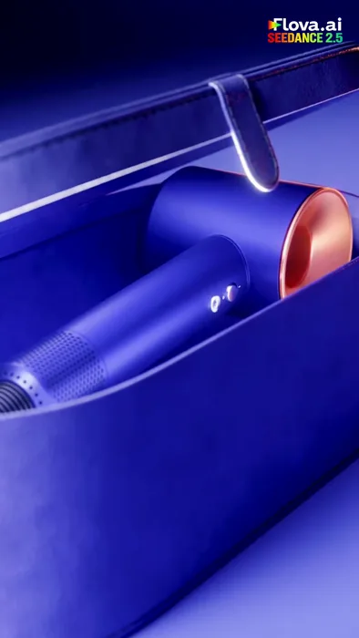</a>

▶ [Watch the full video on ofox.ai](https://ofox.ai/seedance-2-5-prompts?utm_source=github&utm_medium=case&utm_campaign=awesome-seedance-2-5#case-17)

<details>
<summary><strong>Prompt</strong> — A set of fashionable, high-end 3D cinematic commercial advertisement footage showcasing a luxurious blue and copper styling tool set. The scene begins…</summary>

~~~~text
A set of fashionable, high-end 3D cinematic commercial advertisement footage showcasing a luxurious blue and copper styling tool set. The scene begins with a purple leather storage box placed on a bright reflective surface, presented under textured studio lighting. The box lid automatically opens, revealing a premium blue hair dryer with glowing copper accents. Smooth macro camera pans showcase various accessories—straight nozzle, diffuser nozzle, and styling barrel—neatly arranged on the reflective surface next to the main device. Minimalist luxury product showcase, hyper-realistic textures, studio softbox reflections, cinematic depth of field, 4k resolution, smooth 60fps motion.
~~~~

</details>

**参数**：Seedance 2.5 · 未标注 · t2v · 未标注 · 未标注 · 未标注 · 未标注
**来源**：[@AvelyrahnAI](https://x.com/AvelyrahnAI) · [原帖](https://x.com/AvelyrahnAI/status/2093932080497594740)

<sub>Preview © 2026 <a href="https://x.com/AvelyrahnAI/status/2093932080497594740">@AvelyrahnAI</a> · Prompt by <a href="https://x.com/AvelyrahnAI/status/2093932080497594740">@AvelyrahnAI</a></sub>

[Back to top](#table-of-contents)

<a id="case-18"></a>
### Case 18: Retro anime hair-salon commercial (复古动漫风格发型改造广告) — by @AIwithJessica

<a href="https://ofox.ai/seedance-2-5-prompts?utm_source=github&utm_medium=case&utm_campaign=awesome-seedance-2-5#case-18">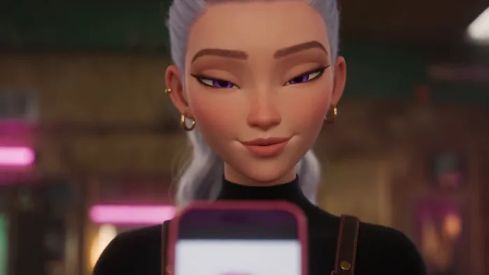</a>

▶ [Watch the full video on ofox.ai](https://ofox.ai/seedance-2-5-prompts?utm_source=github&utm_medium=case&utm_campaign=awesome-seedance-2-5#case-18)

<details>
<summary><strong>Prompt</strong> — 创建一个 30 秒的现代复古动漫风格 3D 赛璐珞混合广告，比例为 16:9。  场景设定在一个温馨的霓虹灯复古沙龙，配有温暖的电影级灯光、柔和的 VHS 颗粒感以及轻柔的合成器波（synthwave）色彩光晕。在整个视频中，保持发型师和顾客的形象一致。  顾客始终是画面焦点。  顾客： 身材苗条、…</summary>

~~~~text
创建一个 30 秒的现代复古动漫风格 3D 赛璐珞混合广告，比例为 16:9。

场景设定在一个温馨的霓虹灯复古沙龙，配有温暖的电影级灯光、柔和的 VHS 颗粒感以及轻柔的合成器波（synthwave）色彩光晕。在整个视频中，保持发型师和顾客的形象一致。

顾客始终是画面焦点。

顾客：
身材苗条、干练、时髦的年轻女孩，留着齐肩直发，刘海利落时髦，鼻翼和耳朵各有一个穿孔，戴着闪亮的圆框眼镜，身穿米色大廓形高领毛衣，佩戴金链项链，表情自信中带着一丝紧张。

发型师：
美丽的年轻女性，留着长长的波浪形银紫色头发，扎成松散的马尾辫，有着优雅的杏仁状紫罗兰色眼睛，黑色修身上衣外罩复古围裙，佩戴小金圈耳环。她气质温婉、优雅且从容自信。

故事脚本（分镜）：

[0:00–0:04] 顾客自信地走进店里，调整了一下眼镜，坐在沙龙椅上。
顾客："我今天想尝试点大胆的造型。"

[0:04–0:07] 她展示手机上鲜艳的马卡龙色系发型参考图。发型师微笑着回应。
发型师："噢，这很适合你。"

[0:07–0:11] 慢镜头：发型师仔细地将头发分区，梳理平顺。

[0:11–0:15] 发型师轻柔地将柔和的彩虹马卡龙色染料涂抹在头发上，刷染动作缓慢而精准。

[0:15–0:19] 头发在水下缓慢冲洗，色彩柔和地流动。

[0:19–0:22] 用吹风机吹干头发，动作轻柔流畅。

[0:22–0:25] 最终造型修整——打造出柔和的波浪卷，并别上一个小发夹。

每次仅展示一个沙龙动作。每个动作的时长需足够清晰地展现过程。禁止快速剪辑。禁止延时摄影。禁止跳剪。

[0:25–0:30] 宽幅电影级展示——她看向镜子，双眼睁大，随后绽放出灿烂幸福的笑容，抚摸着自己色彩斑斓的头发。
顾客："我太喜欢了！"
发型师：（微笑）"我就说吧。"

高品质现代复古动漫动画，富有表现力的面部特写动画，逼真的柔顺发质物理效果，细腻的手部动作，电影级缓慢运镜，浅景深，温暖的霓虹复古灯光，角色设计保持一致，无故障，无字幕，无水印。
~~~~

</details>

**参数**：Seedance 2.5 · 未标注 · t2v · 30s · 未标注 · 16:9 · 带音频
**来源**：[@AIwithJessica](https://x.com/AIwithJessica) · [原帖](https://x.com/AIwithJessica/status/2093127123687108856)

<sub>Preview © 2026 <a href="https://x.com/AIwithJessica/status/2093127123687108856">@AIwithJessica</a> · Prompt by <a href="https://x.com/AIwithJessica/status/2093127123687108856">@AIwithJessica</a></sub>

[Back to top](#table-of-contents)

<a id="case-19"></a>
### Case 19: Luxury diamond lightning reveal (奢华钻石闪电揭幕) — by @NoOneIsHere2603

<a href="https://ofox.ai/seedance-2-5-prompts?utm_source=github&utm_medium=case&utm_campaign=awesome-seedance-2-5#case-19"></a>

▶ [Watch the full video on ofox.ai](https://ofox.ai/seedance-2-5-prompts?utm_source=github&utm_medium=case&utm_campaign=awesome-seedance-2-5#case-19)

<details>
<summary><strong>Prompt</strong> — Create a cinematic luxury diamond advertisement with a dark premium aesthetic. A black jewelry box slowly opens to reveal a flawless diamond. The came…</summary>

~~~~text
Create a cinematic luxury diamond advertisement with a dark premium aesthetic. A black jewelry box slowly opens to reveal a flawless diamond. The camera pushes in for an extreme close-up as a gloved hand lifts the diamond. As it rises, electric-blue energy and realistic lightning begin forming around it. The diamond floats in the air while powerful lightning strikes in the background, with glowing particles, volumetric lighting, realistic reflections and physically accurate diamond refraction. Smooth cinematic camera movement, dramatic lighting, photorealistic CGI, premium commercial quality, realistic physics, highly detailed, consistent diamond throughout the entire shot.
~~~~

</details>

**参数**：Seedance 2.5 · 未标注 · t2v · 未标注 · 未标注 · 未标注 · 未标注
**来源**：[@NoOneIsHere2603](https://x.com/NoOneIsHere2603) · [原帖](https://x.com/NoOneIsHere2603/status/2087048124523254024)

<sub>Preview © 2026 <a href="https://x.com/NoOneIsHere2603/status/2087048124523254024">@NoOneIsHere2603</a> · Prompt by <a href="https://x.com/NoOneIsHere2603/status/2087048124523254024">@NoOneIsHere2603</a></sub>

[Back to top](#table-of-contents)

<a id="case-1009"></a>
### Case 1009: Hand grinder, an orbit bought with four waypoint pictures, arm B (手摇磨豆机 · 用四格画面换来的环绕（B 组）) — by Ofox Team

<a href="https://ofox.ai/seedance-2-5-prompts?utm_source=github&utm_medium=case&utm_campaign=awesome-seedance-2-5#case-1009">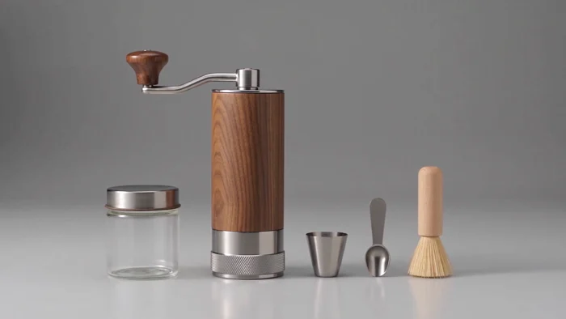</a>

▶ [Watch the full video on ofox.ai](https://ofox.ai/seedance-2-5-prompts?utm_source=github&utm_medium=case&utm_campaign=awesome-seedance-2-5#case-1009)

<details>
<summary><strong>Prompt</strong> — 12 seconds, 16:9. PRODUCT: a hand coffee grinder, walnut brown with brushed stainless steel, oiled open-grain walnut on the cylindrical body and matte…</summary>

~~~~text
12 seconds, 16:9.
PRODUCT: a hand coffee grinder, walnut brown with brushed stainless steel, oiled open-grain walnut on the cylindrical body and matte brushed steel on the upper collar, the crank arm and the base ring; a slim cylindrical walnut body about the height of a tall glass, a brushed steel collar seated on top of it with a visible flush seam where metal meets wood, a single brushed steel crank arm rising from the centre of the collar and bending once at a right angle to a small rounded walnut knob, and a knurled brushed steel adjustment ring encircling the very bottom of the body with fine vertical grooves cut into it; accessories: a clear glass storage jar with a brushed steel screw lid, a small brushed steel scoop, a short brush with a pale wooden handle. The product stays identical in shape, colour, proportions, wood grain direction, steel finish and the geometry of the crank arm and the knurled ring throughout. There is no printed text, no logo, no engraving and no marking anywhere on the product or on any accessory.
SCENE: the product centered on a light grey studio surface against a light grey backdrop; even studio softbox lighting from above and slightly front, soft true reflections of the walnut and the steel in the surface, no props, no shadows on the backdrop. Background, surface and light do not change.

0-3s    REVEAL - a plain light grey box lid lifts straight up and out of the top of frame, showing the grinder standing upright and centered, crank arm attached and still. Static front view, camera locked.
HARD CUT.
3-6s    DETAIL - macro on the bottom of the body: the knurled steel adjustment ring fills the lower frame with the flush seam between the brushed steel collar and the oiled walnut visible above it. The camera pushes in slowly and straight; a soft highlight slides along the grooves of the knurled ring and across the open grain of the wood. The product does not move.
HARD CUT.
6-10s   ORBIT - one single continuous camera move with no cut anywhere inside this segment. The camera travels around the standing grinder anticlockwise at constant height and constant speed, keeping the grinder centered in frame the whole way, and what the frame shows changes as it goes: at about 7s the camera is level with the right side of the body, the crank arm running away from the lens in sharp foreshortening and the knurled ring seen edge-on; at about 8s the camera is directly behind the grinder, the crank arm pointing away from the lens so that only the smooth back of the brushed steel collar and the walnut knob beyond it are visible, and the wood grain reads as an unbroken cylinder with no seam facing the lens; at about 9s the camera is level with the left side, the crank arm now sweeping toward the lens from the far side; by 10s the camera has returned to the exact front view of the opening shot. The grinder itself does not move, does not rotate on its axis and does not tip at any point - every change in the picture comes from the camera having travelled. The crank arm keeps its exact length, thickness and right-angle bend at every one of these positions, and the walnut grain runs vertically on the body throughout.
HARD CUT.
10-12s  ACCESSORIES - the three accessories lie neatly in a row on the grey surface beside the standing grinder, evenly spaced and not touching: the glass jar, the steel scoop, the wooden-handled brush. A slow macro pan travels left to right across them. Hold the final frame perfectly still for the last half second.

SOUND: none.
AVOID: any text, lettering, character, digit, logo, engraving, brand mark or watermark anywhere in frame, on the product, on the accessories, on the surface or on the backdrop; subtitles, captions, logo overlays, interface graphics. No deformation of the crank arm, no bending, kinking, thinning, thickening, doubling or disappearing of it, and no parts clipping through each other. No second grinder, no duplicated accessory, no extra jar, scoop or brush, and no accessory appearing before the final segment. No hand, no arm, no finger, no person and no reflection of a person in the steel or the glass. Nothing floats; every object stays in contact with the surface. No camera shake, no handheld motion, no zoom, no rack focus, no sudden reframing, no dissolves, no fades between shots, no speed ramp. The grinder never tips, rotates on its own axis, opens or comes apart, and the wood grain never changes direction. No plastic or CGI look, no oversaturated grade, no lens flare stars, no sparkle particles, no floating dust motes.
hyper-realistic textures, realistic reflections of walnut and brushed steel, smooth 60fps motion.
~~~~

</details>

**参数**：Seedance 2.5 · Ofox · t2v · 12s · 720p · 16:9 · 无音频
**费用**：$2.88（job 50f623b2-c54a-4d9d-9646-31dd06e2a926）
**来源**：Ofox 实测

[Back to top](#table-of-contents)

<a id="case-1011"></a>
### Case 1011: Tortoiseshell eyeglasses, after a shot size was written on every waypoint (钛腿玳瑁眼镜 · 每个 waypoint 都写景别之后) — by Ofox Team

<a href="https://ofox.ai/seedance-2-5-prompts?utm_source=github&utm_medium=case&utm_campaign=awesome-seedance-2-5#case-1011">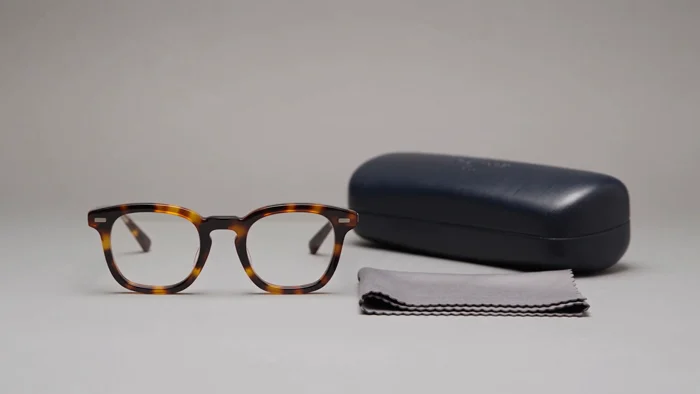</a>

▶ [Watch the full video on ofox.ai](https://ofox.ai/seedance-2-5-prompts?utm_source=github&utm_medium=case&utm_campaign=awesome-seedance-2-5#case-1011)

<details>
<summary><strong>Prompt</strong> — 12 seconds, 16:9. PRODUCT: a pair of eyeglasses, warm tortoiseshell brown with brushed silver titanium, a polished acetate frame front in a mottled to…</summary>

~~~~text
12 seconds, 16:9.
PRODUCT: a pair of eyeglasses, warm tortoiseshell brown with brushed silver titanium, a polished acetate frame front in a mottled tortoiseshell pattern of amber, chestnut and near-black, holding two clear anti-reflective lenses with a faint cool sheen; the two temples are slim flat brushed titanium bars, each joined to the frame front by a small barrel hinge of three interleaved knuckles, and each ending in a short warm tortoiseshell acetate tip. The pair rests on the surface with both temples folded flat against the back of the frame front, the front tilted slightly up and facing the camera. The product stays identical in shape, colour, proportions, tortoiseshell pattern, lens clarity, titanium finish and hinge geometry throughout, and the temples keep exactly their length, width and thickness. There is no printed text, no logo, no engraving, no etching and no marking anywhere on the frame, the temples, the tips, the lenses or any accessory.
SCENE: the product centered on a light grey studio surface against a light grey backdrop; even studio softbox lighting from above and slightly front, soft true reflections of the acetate and the titanium in the surface, no props, no shadows on the backdrop. Background, surface and light do not change.

0-3s    REVEAL - a plain light grey box lid lifts straight up and out of the top of frame, showing the folded glasses resting on the surface, front facing the camera. Static front view, the whole pair in frame from temple tip to temple tip with margin, camera locked.
HARD CUT.
3-6s    DETAIL - macro on one barrel hinge: the three interleaved titanium knuckles fill the centre of the frame, with the mottled edge of the acetate frame front on one side of them and the flat brushed temple bar on the other. The camera pushes in slowly and straight; a soft highlight travels along the brushed grain of the temple and across the polished acetate. The product does not move.
HARD CUT.
6-10s   ORBIT - one single continuous camera move, no cut anywhere inside this segment. The camera travels around the folded glasses at constant height and constant speed, the pair centered the whole way, and the frame shows a new side as it goes: at about 7.5s the frame front is seen along its own length so the two lenses overlap into a single narrow shape and one hinge barrel reads as a stack of small cylinders nearest the lens, with the whole pair in frame from the far temple tip to the near lens edge and margin around it; at about 9s the two folded temples fill the middle of the frame as two parallel brushed bars with the back of the frame front behind them and no lens surface facing the lens at all, with the whole pair in frame from tip to frame front and margin around it; by 10s the camera is back on the exact front view of the opening shot, both lenses facing the camera, the whole pair in frame from temple tip to temple tip with margin. At every one of those views the entire pair of glasses is inside the frame, nothing cropped. The product does not move, does not rotate on its axis, does not tip, and the temples never unfold.
HARD CUT.
10-12s  ACCESSORIES - two accessories lie on the grey surface to the right of the glasses and only to the right, both on the same line, evenly spaced and not touching each other or the glasses: nearest the glasses a closed slim hard case in matte charcoal, and beyond it a folded grey microfiber cloth. Nothing lies to the left of the glasses and nothing lies above or below that line. A slow macro pan travels left to right from the glasses across the two accessories. Hold the final frame perfectly still for the last half second.

SOUND: none.
AVOID: any text, lettering, character, digit, logo, brand mark, engraving, etching or watermark anywhere in frame, on the frame front, the temples, the tips, the lenses, the case, the cloth, the surface or the backdrop; subtitles, captions, logo overlays, interface graphics. No deformation of the temples - no bending, kinking, thinning, thickening, twisting, doubling or disappearing of either one - and no third temple. No hinge deformation, no extra or missing knuckles, and no parts clipping through each other. No second pair of glasses, no duplicated accessory, no extra case or cloth, and no accessory appearing before the final segment. The lenses stay clear throughout and never darken, tint, mirror or turn reflective like sunglasses, and no lens is ever missing or cracked. No face, no head, no eyes, no nose, no ear, no hand, no finger, no person anywhere in frame, and no reflection or silhouette of a person in the lenses, the titanium or the surface. Nothing floats; the glasses and both accessories stay in contact with the surface. No camera shake, no handheld motion, no zoom, no rack focus, no sudden reframing, no dissolves, no fades between shots, no speed ramp. The glasses never unfold, never open, never stand upright on their temples and never change their tortoiseshell pattern. No plastic or CGI look, no oversaturated grade, no lens flare stars, no sparkle particles, no floating dust motes.
hyper-realistic textures, realistic reflections of acetate and brushed titanium, smooth 60fps motion.
~~~~

</details>

**参数**：Seedance 2.5 · Ofox · t2v · 12s · 720p · 16:9 · 无音频
**费用**：$2.88（job 8efeb556-bf38-45ec-940b-a792ef74bfcf）
**来源**：Ofox 实测

[Back to top](#table-of-contents)

<a id="case-1012"></a>
### Case 1012: Hardshell jacket haul with an on-camera presenter, after the frame-locked product was put on a body (冲锋衣口播带货 · 首帧锁的产品被人穿上之后) — by Ofox Team

| 输入 | 输出 |
|:---:|:---:|
| 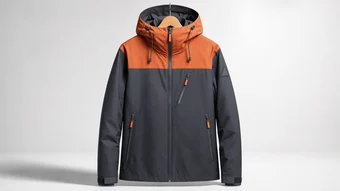 | <a href="https://ofox.ai/seedance-2-5-prompts?utm_source=github&utm_medium=case&utm_campaign=awesome-seedance-2-5#case-1012">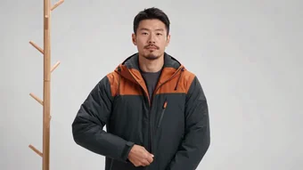</a> |

▶ [Watch the full video on ofox.ai](https://ofox.ai/seedance-2-5-prompts?utm_source=github&utm_medium=case&utm_campaign=awesome-seedance-2-5#case-1012)

<details>
<summary><strong>Prompt</strong> — 严格从首帧图开始。第一个画面就是 image1 里那件挂在木衣架上的冲锋衣，正面、肩部端平、与 image1 完全一致。禁止重新布光、禁止换成另一件衣服、禁止一开场就出现人。  【格式】16:9 横屏，30 秒，真人实拍质感的电商带货短片，四段，段间硬切。  【画风】自然写实的商业短视频质感，柔和真…</summary>

~~~~text
严格从首帧图开始。第一个画面就是 image1 里那件挂在木衣架上的冲锋衣，正面、肩部端平、与 image1 完全一致。禁止重新布光、禁止换成另一件衣服、禁止一开场就出现人。

【格式】16:9 横屏，30 秒，真人实拍质感的电商带货短片，四段，段间硬切。

【画风】自然写实的商业短视频质感，柔和真实的皮肤与面料光泽，轻微手持呼吸感，无电影调色滤镜，无慢动作。

【产品锁定】image1 精确给出这件冲锋衣的外观，全片任何一秒都不得改变：主体、袖子与下半身是深炭灰色哑光防撕格纹面料，织纹细密；砖橙色育克覆盖双肩与上胸，色块分界是一条横直缝线，落在锁骨下方，并越过双肩延伸到上背；正面正中一条主拉链，从下摆直上到下巴，拉链头是一小块亮橙色方片；左胸一个斜向拉链口袋，袋口朝画面中心方向倾斜；两侧胯部各一个竖向手袋，带同色拉链；连帽为固定式，帽兜深，帽檐硬挺成型，帽口两侧各垂下一根抽绳，绳头自由悬着；每只袖口有一块长方形魔术贴调节襻，平贴在袖子上；左上臂有一块空白的三角山形布贴。这件冲锋衣上没有任何印刷文字、没有 logo 文字、没有刺绣字样、没有数字、没有尺码标、没有洗水标；胸前、后背、袖子、帽子和那块三角布贴上都不带任何字样，那块布贴始终是空白的。

【人物】一名三十岁上下的亚洲男性讲解者，短黑发，干净的短须，神情放松自信；内搭一件素色深灰长袖圆领衫，深色长裤。全片自始至终是同一个人，同一张脸，同一个发型，同一件内搭。

【段落一 商品展示 0-8 秒】
0-2 秒 中景正面：木衣架上的冲锋衣静置不动，与 image1 同一角度，浅灰色影棚背景，画面里没有人。
2-5 秒 近景推入：镜头平直推近到胸前，正中主拉链与左胸斜袋口袋填满画面中部，亮橙色拉链头在画面中心，高光沿拉链齿滑过。
5-8 秒 中近景，从右前方四十五度：镜头移到衣服右前方，肩部砖橙色育克与深炭灰主体的分界缝线在转折处清晰可见，整件衣服连下摆完整在画面内并留有余量。
硬切。

【段落二 模特换装 8-18 秒】
8-11 秒 全景：讲解者从画面右侧走进来，站到衣架旁边，转身面向镜头，双手自然垂下，开口说话。整个人从头到脚在画面内。
11-14 秒 中景：他伸手把冲锋衣从木衣架上取下来，双手抓住两侧肩部把衣服在胸前撑开，正面朝向镜头，橙色育克与正中主拉链完整可见。
14-18 秒 中景：他先把左臂穿进袖子，再把右臂穿进去，把衣服整个上身，然后右手抓住拉链头，一把拉上正中主拉链，一路拉到下巴。
硬切。

【段落三 真实使用场景 18-28 秒】
18-21 秒 户外全景：清晨的山脊碎石小路，远处是覆着薄雪的山脊线和低垂的云，他穿着这件冲锋衣朝镜头方向走来，风把帽口两侧的抽绳吹得斜飘，整个人在画面内。
21-25 秒 中景：他停下脚步，双手把帽子拉起来戴到头上，硬挺的帽檐在风里保持形状不塌陷，砖橙色育克在冷灰色的天光下明显跳出来。
25-28 秒 近景：他侧头望向远处的山脊，冷风吹动面料表面，他开口说话，脸和上胸的橙色育克都在画面内。
硬切。

【段落四 定格 28-30 秒】
28-30 秒 中景：他在原地站定不动，正面朝向镜头，整件冲锋衣从帽子到下摆完整入画，画面完全静止，没有任何镜头移动。

【台词】全片只有四句中文，由出镜者对着镜头自然说出，语速平稳，音量适中，其余时间只有环境声。
9-11 秒，他看着镜头说：「这件冲锋衣，我在山上穿了一整个冬天。」
15-17 秒，他一边拉拉链一边说：「拉链一拉到顶，风就进不来。」
22-24 秒，他戴上帽子后说：「帽檐是硬的，风雪里不会塌。」
26-28 秒，他望着远处说：「零下十度，它就是我的外壳。」

【声音】段落一只有安静的影棚底噪。段落二有衣架的轻微木质碰撞声和拉链一次性拉到顶的金属摩擦声。段落三有持续的高原风声和碎石路上的脚步声。段落四风声渐弱。

【一致性锁】那件冲锋衣从第 0 秒到第 30 秒始终是同一件：深炭灰主体加砖橙色肩胸育克的两色分区不变，横直分界缝线的位置不变，正中一条主拉链不变，左胸一个斜袋不变，两侧各一个手袋不变，硬檐连帽与两根抽绳不变，两只袖口的魔术贴襻不变，左上臂那块空白三角布贴不变且始终无字。讲解者从第 8 秒到第 30 秒是同一个人，同一张脸。

【避免】不要出现任何文字、字母、汉字、数字、品牌名、吊牌、水印、字幕。不要在那块三角布贴上出现任何字样。不要出现第二件冲锋衣。不要出现第三个口袋。不要在胸前出现第二条拉链。不要出现第二个人。不要在第 8 秒之前出现任何人、手、皮肤或身体部位。不要换脸、不要换发型、不要换内搭。不要把深炭灰和砖橙的分区换成别的配色或别的位置。不要让帽檐塌陷变软。不要溶解转场、不要淡入淡出、不要跳切、不要黑场、不要慢动作、不要镜头晃动失控。不要出现假模特、人台或衣服自己飘浮。
~~~~

</details>

**参数**：Seedance 2.5 · Ofox · i2v · 30s · 720p · adaptive · 带音频
**费用**：$7.20（job e378f058-f224-4450-94b4-798840ad139b）
**来源**：Ofox 实测

[Back to top](#table-of-contents)

<a id="talking-head"></a>
### Talking Head (口播和数字人)

<a id="case-20"></a>
### Case 20: AI knowledge-sharing digital-human host (AI知识分享数字人口播) — by @Adam38363368936

<a href="https://ofox.ai/seedance-2-5-prompts?utm_source=github&utm_medium=case&utm_campaign=awesome-seedance-2-5#case-20"></a>

▶ [Watch the full video on ofox.ai](https://ofox.ai/seedance-2-5-prompts?utm_source=github&utm_medium=case&utm_campaign=awesome-seedance-2-5#case-20)

**输入素材**：未公开 —— 原作者只发布了成片，未提供输入素材

<details>
<summary><strong>Prompt</strong> — 使用参考图中的女性人物作为唯一人物参考，保持人物五官、发型、肤色、服装和整体气质高度一致。  9:16竖屏，10秒，超写实真人知识科普口播。  人物坐在真实居家书房中，胸口以上中近景，固定机位，镜头基本不运动。自然窗光从侧前方照射，背景书架轻微虚化，整体像真实知识博主用相机拍摄。  人物面对镜头自然…</summary>

~~~~text
使用参考图中的女性人物作为唯一人物参考，保持人物五官、发型、肤色、服装和整体气质高度一致。

9:16竖屏，10秒，超写实真人知识科普口播。

人物坐在真实居家书房中，胸口以上中近景，固定机位，镜头基本不运动。自然窗光从侧前方照射，背景书架轻微虚化，整体像真实知识博主用相机拍摄。

人物面对镜头自然口播：

"很多人以为，AI回答问题是在数据库里找答案。其实不是，它更像是在根据前面的内容，不断预测接下来最可能出现的词。"

表演要求：
0-2秒：自然直视镜头开场，语气像在聊天，轻微眨眼。
2-5秒：说到"其实不是"时，轻轻摇头一次，眉毛有自然变化。
5-8秒：解释"根据前面的内容"时，一只手自然进入画面做很小的解释手势。
8-10秒：说完"最可能出现的词"，轻微点头收尾。

整个过程不要背稿感，不要主持人播音腔。
嘴型严格匹配中文语音。
保留自然眨眼、呼吸、微表情、轻微头部运动和真实皮肤纹理。
眼神可以偶尔短暂偏离镜头，再自然看回。
手势克制，不要频繁挥手。

真实手机/微单拍摄质感，轻微传感器噪点，真实肤质，不磨皮，不网红滤镜，不塑料皮肤，不夸张电影光影，不运镜，不字幕，不水印，不画面文字。
~~~~

</details>

**参数**：Seedance 2.5 · 未标注 · i2v · 10s · 未标注 · 9:16 · 带音频
**来源**：[@Adam38363368936](https://x.com/Adam38363368936) · [原帖](https://x.com/Adam38363368936/status/2087137939906339316)

<sub>Preview © 2026 <a href="https://x.com/Adam38363368936/status/2087137939906339316">@Adam38363368936</a> · Prompt by <a href="https://x.com/Adam38363368936/status/2087137939906339316">@Adam38363368936</a></sub>

[Back to top](#table-of-contents)

<a id="case-21"></a>
### Case 21: Ghost-story voiceover visualization (鬼故事旁白视觉化) — by @pzf_ai

<a href="https://ofox.ai/seedance-2-5-prompts?utm_source=github&utm_medium=case&utm_campaign=awesome-seedance-2-5#case-21">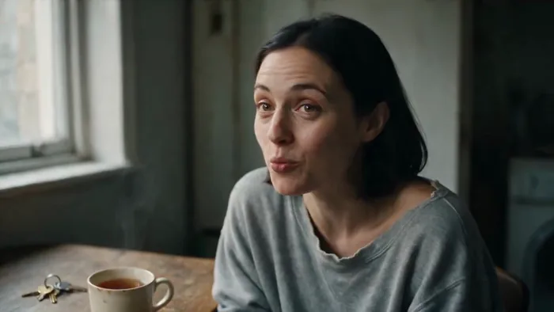</a>

▶ [Watch the full video on ofox.ai](https://ofox.ai/seedance-2-5-prompts?utm_source=github&utm_medium=case&utm_campaign=awesome-seedance-2-5#case-21)

**输入素材**：未公开 —— 原作者只发布了成片，未提供输入素材

<details>
<summary><strong>Prompt</strong> — Use [image1] as the start of the video. She is speaking to an unseen person off camera. She says: "So I go to see this flat. Top floor, rent's half wh…</summary>

~~~~text
Use [image1] as the start of the video. She is speaking to an unseen person off camera. She says: "So I go to see this flat. Top floor, rent's half what it should be, and the agent won't come up the stairs with me." Then cut to the voice only of the woman from [image1] as she continues to talk as a voiceover only. As she talks, her words are visualised as a story in the same visual style. The voiceover is: "First room: shoes. Hundreds of pairs, all facing the door, laces done up. Second room's got rain in it. Indoor rain, proper raincloud pouring raindrops all over the carpet. Third room, there's a window looking out onto a beach in full summer. It was February." Illustrate the voiceover sequence to tell the story visually. Then cut back to [image1] and she says with a smile: "Anyway. I signed the lease that afternoon."
~~~~

</details>

**参数**：Seedance 2.5 · 即梦 · i2v · 未标注 · 未标注 · 未标注 · 带音频
**来源**：[@pzf_ai](https://x.com/pzf_ai) · [原帖](https://x.com/pzf_ai/status/2084617506941960646)

<sub>Preview © 2026 <a href="https://x.com/pzf_ai/status/2084617506941960646">@pzf_ai</a> · Prompt by <a href="https://x.com/pzf_ai/status/2084617506941960646">@pzf_ai</a></sub>

[Back to top](#table-of-contents)

<a id="case-22"></a>
### Case 22: Retro spaceship captain monologue (复古飞船船长独白) — by @CaptainHaHaa

<a href="https://ofox.ai/seedance-2-5-prompts?utm_source=github&utm_medium=case&utm_campaign=awesome-seedance-2-5#case-22">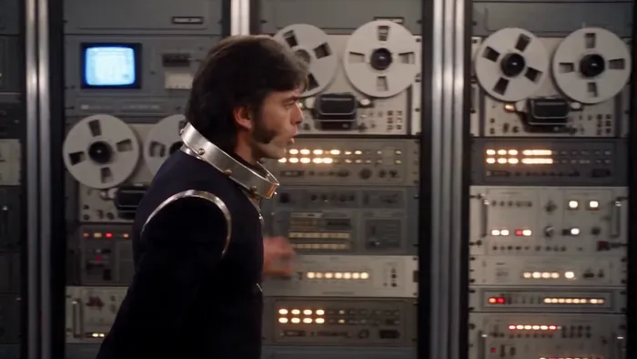</a>

▶ [Watch the full video on ofox.ai](https://ofox.ai/seedance-2-5-prompts?utm_source=github&utm_medium=case&utm_campaign=awesome-seedance-2-5#case-22)

**输入素材**：未公开 —— 原作者只发布了成片，未提供输入素材

<details>
<summary><strong>Prompt</strong> — Style: cinematic retro sci-fi, inspired by grand 1970s/80s space films, practical effects, symmetrical compositions, slow deliberate camera movement, …</summary>

~~~~text
Style: cinematic retro sci-fi, inspired by grand 1970s/80s space films, practical effects, symmetrical compositions, slow deliberate camera movement, cream-and-chrome spaceship interiors, big buttons, glowing panels, analog readouts, subtle film grain, soft haze, dramatic but thoughtful mood. Captain HaHaa has charm, swagger, and warmth. He walks through his ship while delivering a reflective monologue in a confident Australian accent. The tone is philosophical but grounded, ending hopeful and personal.

SHOT 1 - 0:00-0:05

Visual: Wide symmetrical shot of a long cream-and-chrome spaceship corridor with glowing wall panels, blinking buttons, and retro consoles built into the walls. Captain HaHaa walks slowly toward camera from the far end, hands loosely behind his back at first, calm and reflective.

Camera: Slow centered dolly backward, very smooth, stately and elegant.

Dialogue: "Well, here we are, mates, a brand-new age."

SHOT 2 - 0:05-0:10

Visual: Side-profile tracking shot as Captain walks past a row of large retro computer stations, reel-to-reel style panels, switches, and glowing instrument clusters. He lightly brushes a hand across the edge of a chrome console as he passes. Soft practical reflections shimmer across his black uniform and silver trim.

Camera: Lateral tracking shot, smooth and measured.

Dialogue: "Longer models, bigger worlds, and enough artificial intelligence to make the universe feel rather small."

SHOT 3 - 0:10-0:15

Visual: Captain stops at a large observation window or glowing circular display. He looks out thoughtfully, half in silhouette, ship lights glowing behind him. This should feel like a classic contemplative sci-fi image. He turns slightly back toward camera with a knowing expression.

Camera: Medium-wide, slow push in from behind and to the side.

Dialogue: "But don't get too dazzled. Without a proper story, all that power is just pretty lights doing tricks in the dark."

SHOT 4 - 0:15-0:20

Visual: Medium close-up as Captain resumes walking, now moving through a control room doorway with large blinking panels and oversized buttons in the foreground. He points lightly toward camera as he talks, casual and assured, like he's sharing hard-earned wisdom.

Camera: Front-facing tracking medium close-up, slight handheld softness but still controlled.

Dialogue: "A machine can build the world… but it can't tell us why we should care about it."

SHOT 5 - 0:20-0:25

Visual: Captain enters the main bridge in a low-angle hero shot. The bridge is spacious, practical, and beautifully retro: cream consoles, chrome rails, oversized lit buttons, glowing instrument panels, and soft haze in the air. As he steps through the doorway, Fishman Mike and Ron are already there waiting for him near their stations. They both look toward him and give him a friendly thumbs up. Captain gives a small acknowledging grin as he keeps moving forward. After the thumbs up, Fishman Mike and Ron turn and begin working at the bridge controls in the background, adding life and movement behind him.

Camera: Low-angle slow push in, slightly epic, widening just enough to include Fishman Mike and Ron in the bridge space.

Dialogue: "That's our job." "And right now, when almost anything can be made, the rarest thing you can bring to it is yourself."

SHOT 6 - 0:25-0:30

Visual: Tight medium close-up of Captain HaHaa near or beside the captain's chair as he finishes his speech. Behind him, slightly out of focus, Fishman Mike and Ron continue working at their stations, pressing buttons, checking readouts, and moving with purpose. The bridge feels alive but never distracts from Captain. He leans toward camera slightly with a cheeky half-smile, warm eyes, full Captain HaHaa charisma.

Camera: Subtle push in, intimate and strong, with shallow depth of field so Captain stays dominant while Mike and Ron remain visible in the background.

Dialogue: "So be weird. Be honest. Make the thing only you would make." "What a bloody good time to be alive."
~~~~

</details>

**参数**：Seedance 2.5 · 未标注 · i2v · 30s · 未标注 · 未标注 · 带音频
**来源**：[@CaptainHaHaa](https://x.com/CaptainHaHaa) · [原帖](https://x.com/CaptainHaHaa/status/2083525930992247050)

<sub>Preview © 2026 <a href="https://x.com/CaptainHaHaa/status/2083525930992247050">@CaptainHaHaa</a> · Prompt by <a href="https://x.com/CaptainHaHaa/status/2083525930992247050">@CaptainHaHaa</a></sub>

[Back to top](#table-of-contents)

<a id="ugc-ads"></a>
### UGC Ads (UGC风格广告)

<a id="case-23"></a>
### Case 23: Dog cafe vlog, one-click assembly (小狗咖啡店 vlog · 一键成片) — by ByteDance

<a href="https://ofox.ai/seedance-2-5-prompts?utm_source=github&utm_medium=case&utm_campaign=awesome-seedance-2-5#case-23"></a>

▶ [Watch the full video on ofox.ai](https://ofox.ai/seedance-2-5-prompts?utm_source=github&utm_medium=case&utm_campaign=awesome-seedance-2-5#case-23)

**输入素材**（8 张官方参考图）

| | | | |
|:---:|:---:|:---:|:---:|
| 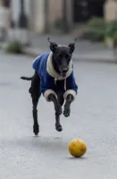<br><sub>参考图 1</sub> | 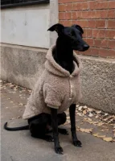<br><sub>参考图 2</sub> | <br><sub>参考图 3</sub> | 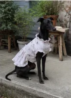<br><sub>参考图 4</sub> |
| <br><sub>参考图 5</sub> | <br><sub>参考图 6</sub> | <br><sub>参考图 7</sub> | <br><sub>参考图 8</sub> |

**Prompt**

~~~~text
将所有图片进行一键成片，图片顺序自由安排，生成一个手绘动态涂鸦抠像风格的咖啡店 vlog，记录一只小狗穿着不同可爱服装在咖啡店打卡拍照的趣味日常。生成具有网感的趣味音频或者 bgm。
图片可以微微动起来，live 图的效果，但不要改变原图，保持和原图的高度一致。
~~~~

**参数**：Seedance 2.5 · 火山方舟 · r2v（一键成片）· 未标注 · 未标注 · 未标注 · 带音频
**来源**：火山方舟官方文档 · [中文](https://docs.volcengine.com/docs/82379/2607689?lang=zh) · [English](https://docs.byteplus.com/en/docs/ModelArk/2607689)

<sub>Preview frame © 2026 ByteDance, from the official demo video · Prompt by ByteDance · <a href="https://docs.volcengine.com/docs/82379/2607689?lang=zh">source</a></sub>

[Back to top](#table-of-contents)

<a id="case-24"></a>
### Case 24: Sunglasses unboxing identity ad (墨镜开箱身份定制广告) — by @AIwithkhan

<a href="https://ofox.ai/seedance-2-5-prompts?utm_source=github&utm_medium=case&utm_campaign=awesome-seedance-2-5#case-24"></a>

▶ [Watch the full video on ofox.ai](https://ofox.ai/seedance-2-5-prompts?utm_source=github&utm_medium=case&utm_campaign=awesome-seedance-2-5#case-24)

**输入素材**：未公开 —— 原作者只发布了成片，未提供输入素材

<details>
<summary><strong>Prompt</strong> — Use the uploaded reference image as the exact character reference. Preserve her facial identity, hairstyle, eye color, makeup, skin tone, body proport…</summary>

~~~~text
Use the uploaded reference image as the exact character reference. Preserve her facial identity, hairstyle, eye color, makeup, skin tone, body proportions, white sleeveless fitted top, light blue wide-leg jeans, pearl choker, rings, and bracelets consistently throughout the video. Use the uploaded sunglasses, retail box, and leather carrying case as locked product references. Maintain perfect product consistency, including the frame shape, lenses, hinges, colors, materials, and proportions.

Create an ultra-realistic UGC luxury creator review filmed inside a modern luxury bedroom with warm golden-hour sunlight, soft natural shadows, and a premium lifestyle aesthetic. The camera feels like a handheld smartphone with subtle natural movement while maintaining cinematic commercial quality.

The video begins with the woman sitting on the bed beside the retail box and leather case. Smiling at the camera, she says, "I genuinely wasn't expecting to love these this much." She picks up the box, opens it naturally, reveals the leather case, then slowly removes the sunglasses while continuing, "The packaging already feels incredibly premium."

She rotates the sunglasses slowly in front of the camera, showing the frame, hinges, and lenses as natural reflections glide across the surface. She smiles and says, "The finish feels amazing, and they're incredibly lightweight."

She puts on the sunglasses, stands up, and walks toward a large full-length mirror. Looking at her reflection, she adjusts the frame naturally and says, "Honestly... they look so good, and they're really comfortable on the eyes, even in bright sunlight."

She turns slightly left and right so the sunglasses catch the sunlight from different angles before removing them with a smile. Walking back to the bed, she places the sunglasses beside the leather case and retail box, then picks them up one last time and holds them beside her face.

Looking directly into the camera, she smiles warmly and says, "Definitely one of my favorite accessories this year." The camera slowly pushes in on the sunglasses before fading out.

Ultra-realistic UGC fashion content, authentic creator review, cinematic handheld smartphone movement, luxury bedroom, macro product cinematography, realistic reflections, detailed frame textures, expressive facial animation, perfect lip sync, shallow depth of field, premium color grading, 4K HDR, 16:9, no subtitles, no logos, no watermarks, no on-screen text.
~~~~

</details>

**参数**：Seedance 2.5 · 未标注 · i2v · 未标注 · 未标注 · 16:9 · 带音频
**来源**：[@AIwithkhan](https://x.com/AIwithkhan) · [原帖](https://x.com/AIwithkhan/status/2084608509837275231)

<sub>Preview © 2026 <a href="https://x.com/AIwithkhan/status/2084608509837275231">@AIwithkhan</a> · Prompt by <a href="https://x.com/AIwithkhan/status/2084608509837275231">@AIwithkhan</a></sub>

[Back to top](#table-of-contents)

<a id="case-25"></a>
### Case 25: Gym bench phone recording (健身房长椅手机自拍) — by @simplyannisa

<a href="https://ofox.ai/seedance-2-5-prompts?utm_source=github&utm_medium=case&utm_campaign=awesome-seedance-2-5#case-25">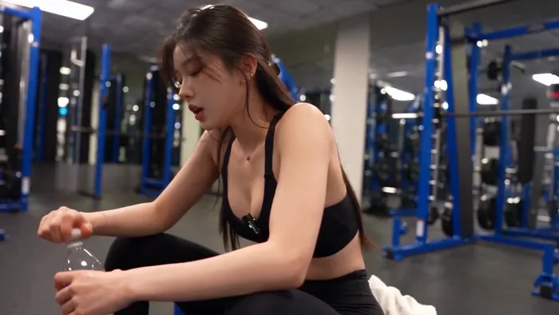</a>

▶ [Watch the full video on ofox.ai](https://ofox.ai/seedance-2-5-prompts?utm_source=github&utm_medium=case&utm_campaign=awesome-seedance-2-5#case-25)

<details>
<summary><strong>Prompt</strong> — FORMAT: 30-second horizontal 16:9 realistic smartphone video.  Create an authentic, imperfect everyday gym phone recording, as if a friend casually le…</summary>

~~~~text
FORMAT: 30-second horizontal 16:9 realistic smartphone video.

Create an authentic, imperfect everyday gym phone recording, as if a friend casually left a phone recording on a nearby bench. Use a standard smartphone camera with mild autofocus hunting, subtle exposure shifts, natural motion blur, compression artifacts, and slightly uneven handheld framing. No polished commercial look.

00–05s — ARRIVAL

The character walks into a nearly empty gym after finishing a difficult set. They place a water bottle and towel beside a bench, sit down heavily, and lean forward with both elbows on their knees. Their breathing is noticeably heavy.

Camera remains several feet away at a slightly low angle, as if casually recording from a phone placed on a gym bench.

05–10s — RECOVERY

They slowly unscrew the water bottle, take two small drinks, then pause with the bottle still in their hand. Their chest continues rising and falling from exertion.

They look down at their hands for a moment, flex their fingers, then wipe sweat from their forehead with the towel.

10–15s — THE NEXT SET

A gym timer or workout screen is visible in the background but remains completely out of focus and unreadable.

The character notices the timer, looks at it, gives a small tired smile, and shakes their head as if realizing they have less rest time than expected.

They stand up slowly and roll their shoulders.

15–20s — PUSHING THROUGH

They walk toward a cable machine and adjust the weight themselves.

Close natural phone framing as they step into position. They briefly close their eyes, take one deep breath, then begin a controlled exercise set.

Show realistic physical effort: tightening muscles, sweat collecting around the forehead and neck, slight trembling near the end of each repetition, natural breathing rather than exaggerated acting.

20–25s — FINAL REP

The final repetitions become visibly difficult.

They pause halfway through one repetition, breathe hard, regain control, and complete the movement with genuine effort.

After finishing, they slowly release the handle, bend forward slightly, and place their hands on their thighs while catching their breath.

25–30s — QUIET ENDING

They grab the towel, wipe their face and neck, then look directly toward the phone for a brief moment.

With a tired but satisfied expression, they quietly say in a natural low voice:

“Okay… that was worth it.”

They pick up the water bottle and walk out of frame.

End naturally while the camera continues recording for a moment before the clip stops.

AUDIO

Natural gym ambience only: distant weights being placed down, cable machine sounds, rubber flooring footsteps, ventilation hum, subtle clothing movement, water bottle clicks, realistic breathing, and occasional muffled gym sounds.

Dialogue should sound spontaneous and slightly breathless, not scripted or theatrical.

VISUAL REALISM

Authentic smartphone footage, ordinary gym lighting, realistic skin texture, visible pores, natural sweat, slightly flushed face, damp hair around the forehead, realistic muscle movement, imperfect exposure, mild phone-camera sharpening, compression noise, subtle autofocus changes, believable shadows and reflections.

STRICTLY AVOID: cinematic color grading, beauty filters, artificial skin smoothing, dramatic slow motion, music, subtitles, captions, logos, readable text, fake gym equipment, exaggerated muscles, perfect lighting, fisheye distortion, excessive camera shake, unrealistic sweat, duplicated limbs, warped hands, unnatural facial expressions, scene cuts, time jumps, or skipping the described actions.
~~~~

</details>

**参数**：Seedance 2.5 · 未标注 · t2v · 30s · 未标注 · 16:9 · 未标注
**来源**：[@simplyannisa](https://x.com/simplyannisa) · [原帖](https://x.com/simplyannisa/status/2087078357595009085)

<sub>Preview © 2026 <a href="https://x.com/simplyannisa/status/2087078357595009085">@simplyannisa</a> · Prompt by <a href="https://x.com/simplyannisa/status/2087078357595009085">@simplyannisa</a></sub>

[Back to top](#table-of-contents)

<a id="case-26"></a>
### Case 26: Chiropractic clinic social video (整脊诊所社媒宣传视频) — by @bmx_ai13

<a href="https://ofox.ai/seedance-2-5-prompts?utm_source=github&utm_medium=case&utm_campaign=awesome-seedance-2-5#case-26">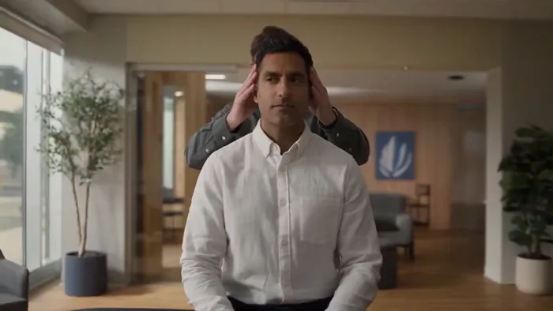</a>

▶ [Watch the full video on ofox.ai](https://ofox.ai/seedance-2-5-prompts?utm_source=github&utm_medium=case&utm_campaign=awesome-seedance-2-5#case-26)

<details>
<summary><strong>Prompt</strong> — Create a 30 second 16:9 cinematic social video set inside a modern chiropractic and mobility clinic during late morning. The room has pale warm walls,…</summary>

~~~~text
Create a 30 second 16:9 cinematic social video set inside a modern chiropractic and mobility clinic during late morning. The room has pale warm walls, clean wood flooring, black padded treatment tables, gray visitor chairs, a few green plants, subtle wall art, and tall windows overlooking leafy trees. Use natural daylight mixed with soft ceiling light, realistic skin texture, true fabric behavior, accurate anatomy, physically believable contact, consistent faces, and natural micro expressions. No text, no logos, no watermarks, no surreal motion.

From 0 to 4 seconds, open on a wide establishing shot with a slow handheld push through the clinic. A calm male practitioner in a charcoal shirt guides an adult male client in a white shirt toward a treatment table. Other staff move softly in the distant background. The mood feels professional, relaxed, and observational.

From 4 to 8 seconds, cut to a medium seated shot. The client sits centered while the practitioner stands behind him, gently checking shoulder level and neck rotation. Use small natural camera drift, shallow depth of field, window light on one side of the face, and realistic eye contact. Show quiet anticipation without exaggerated acting.

From 8 to 12 seconds, move into a close side angle as the practitioner carefully positions the head for a controlled neck release. Keep the motion restrained and anatomically correct. Capture a quick release, a subtle facial reaction, a sharp breath, and an immediate smile. Let the camera react with a tiny authentic handheld movement rather than a dramatic shake.

From 12 to 17 seconds, cut to a medium wide side view of the client lying on his side on the table. The practitioner braces the shoulder and pelvis, pauses, then performs one compact lumbar adjustment. Show realistic weight transfer, table cushion compression, shirt folds, breathing, hand pressure, and a brief surprised laugh from the client.

From 17 to 22 seconds, cut to the client lying face down. The practitioner palpates the upper back, stacks both hands, and applies one controlled thoracic compression. Use a slightly lower camera angle, soft reflections on the table, gentle background activity, and a brief focus pull from the hands to the client’s relieved expression.

From 22 to 26 seconds, transition to a head of table view. The client lies on his back while the practitioner places a black traction strap beneath the base of the skull. Build tension slowly and safely, then deliver one short controlled pull. The client reacts with wide eyes, then laughs and covers his face for a moment.

From 26 to 30 seconds, finish with the client sitting upright, rolling his shoulders and turning his neck comfortably while the practitioner stands beside him. End on an honest shared smile and a slow pullback that reveals the bright clinic. Keep the final moment calm and satisfying, not promotional.

Audio should feel captured on location with soft room ambience, distant clinic movement, clothing rustle, table creaks, natural breathing, quiet conversation without clearly audible words, and crisp but not exaggerated adjustment sounds. Add a low volume modern instrumental track with warm piano, soft bass, light percussion, and a gentle rise at each release, ending on a clean resolved note.
~~~~

</details>

**参数**：Seedance 2.5 · 未标注 · t2v · 30s · 未标注 · 16:9 · 未标注
**来源**：[@bmx_ai13](https://x.com/bmx_ai13) · [原帖](https://x.com/bmx_ai13/status/2083501494150574415)

<sub>Preview © 2026 <a href="https://x.com/bmx_ai13/status/2083501494150574415">@bmx_ai13</a> · Prompt by <a href="https://x.com/bmx_ai13/status/2083501494150574415">@bmx_ai13</a></sub>

[Back to top](#table-of-contents)

<a id="case-27"></a>
### Case 27: Organic grocery UGC shopping vlog (有机超市UGC购物Vlog) — by @aiwithsynthia

<a href="https://ofox.ai/seedance-2-5-prompts?utm_source=github&utm_medium=case&utm_campaign=awesome-seedance-2-5#case-27"></a>

▶ [Watch the full video on ofox.ai](https://ofox.ai/seedance-2-5-prompts?utm_source=github&utm_medium=case&utm_campaign=awesome-seedance-2-5#case-27)

<details>
<summary><strong>Prompt</strong> — A realistic UGC-style from  lifestyle grocery shopping vlog filmed vertically on a smartphone with natural handheld movement and subtle camera shake. …</summary>

~~~~text
A realistic UGC-style from  lifestyle grocery shopping vlog filmed vertically on a smartphone with natural handheld movement and subtle camera shake. The video opens with the young woman entering a modern premium organic grocery store with warm ambient lighting, clean wooden shelves, fresh produce, and a bright minimalist interior. She holds the phone in selfie mode, smiles naturally, and gestures for viewers to follow her. She walks toward the refrigerated drinks section, scans the shelves, and picks up a green cold-pressed juice bottle, turning it slowly so the label faces the camera. Cut to a cinematic close-up as she twists the cap open and takes a refreshing sip beside a large sunlit window, smiling with a satisfied expression. Transition to a POV shot from inside a shopping cart as she pushes it through wide grocery aisles, occasionally looking down into the cart and smiling. Follow with an over-the-shoulder walking shot through beautifully organized shelves filled with premium groceries. Close-up of her hand selecting fresh oranges, gently inspecting one before placing it into the cart. End with a close-up of her picking up a vibrant dragon fruit, rotating it naturally in her hand while admiring its color before placing it into the cart. Finish with her walking toward the checkout while smiling at the camera, pushing the cart under warm golden lighting.

Ultra-realistic, authentic creator content, premium grocery aesthetic, natural body language, realistic facial expressions, soft cinematic lighting, shallow depth of field, smooth transitions, realistic store ambience, subtle background music, 4K HDR, 24fps, clean color grading, lifestyle commercial quality.
~~~~

</details>

**参数**：Seedance 2.5 · 未标注 · t2v · 20s · 未标注 · 9:16 · 未标注
**来源**：[@aiwithsynthia](https://x.com/aiwithsynthia) · [原帖](https://x.com/aiwithsynthia/status/2084264050717045019)

<sub>Preview © 2026 <a href="https://x.com/aiwithsynthia/status/2084264050717045019">@aiwithsynthia</a> · Prompt by <a href="https://x.com/aiwithsynthia/status/2084264050717045019">@aiwithsynthia</a></sub>

[Back to top](#table-of-contents)

<a id="shorts-reels"></a>
### Shorts & Reels (社媒短视频)

<a id="case-28"></a>
### Case 28: Panda cub in the forest (熊猫幼崽) — by ByteDance

<a href="https://ofox.ai/seedance-2-5-prompts?utm_source=github&utm_medium=case&utm_campaign=awesome-seedance-2-5#case-28"></a>

▶ [Watch the full video on ofox.ai](https://ofox.ai/seedance-2-5-prompts?utm_source=github&utm_medium=case&utm_campaign=awesome-seedance-2-5#case-28)

<details>
<summary><strong>Prompt</strong> — 写实自然纪录片风格，电影级真实光影，温暖的午后, 在森林草坡上, 一只圆滚滚的熊猫幼崽从坡上滚下来.  熊猫黑白毛发蓬松真实，体型小而胖，动作笨拙可爱。场景为绿色森林斜坡，地面覆盖青草、苔藓、三叶草、泥土、小石块、枯枝和少量小黄花，虚化背景中有高大树干与树林。镜头为低机位中远景，轻微手持感，整体基本…</summary>

~~~~text
写实自然纪录片风格，电影级真实光影，温暖的午后, 在森林草坡上, 一只圆滚滚的熊猫幼崽从坡上滚下来.

熊猫黑白毛发蓬松真实，体型小而胖，动作笨拙可爱。场景为绿色森林斜坡，地面覆盖青草、苔藓、三叶草、泥土、小石块、枯枝和少量小黄花，虚化背景中有高大树干与树林。镜头为低机位中远景，轻微手持感，整体基本固定，始终保持熊猫在画面中。

0s-3s：一只熊猫幼崽趴在绿色草坡上，身体圆滚滚, 它刚开始顺着斜坡慢慢侧滚，动作笨拙，草叶被身体轻轻压弯。微风拂过, 阳光从左上方穿过树林，形成斑驳光影。
3s-8s：熊猫滚到画面右下方，动作逐渐停止，从侧躺变成趴卧。它的圆脸朝向镜头，前爪压在草地上，熊猫趴在前景草丛中，身体调整到舒服的姿势，头部小幅抬起又放低, 发出轻微哼唧声。

低机位，轻微手持感，轻微跟随熊猫向右下方移动。景深自然，前景草叶轻微虚化，熊猫主体清晰，背景树林柔和虚化。自然环境音，风声、熊猫滚动时轻微柔软的扑通声, 整体温暖、真实、自然。
~~~~

</details>

**参数**：Seedance 2.5 · 火山方舟 · t2v · 8s（由提示词分段隐含）· 未标注 · 未标注 · 带音频
**来源**：火山方舟官方文档 · [中文](https://docs.volcengine.com/docs/82379/2607689?lang=zh) · [English](https://docs.byteplus.com/en/docs/ModelArk/2607689)

<sub>Preview frame © 2026 ByteDance, from the official demo video · Prompt by ByteDance · <a href="https://docs.volcengine.com/docs/82379/2607689?lang=zh">source</a></sub>

[Back to top](#table-of-contents)

<a id="case-29"></a>
### Case 29: Pixel wuxia vertical short (像素武侠竖屏) — by ByteDance

<a href="https://ofox.ai/seedance-2-5-prompts?utm_source=github&utm_medium=case&utm_campaign=awesome-seedance-2-5#case-29">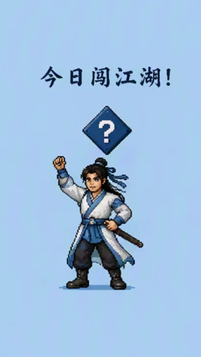</a>

▶ [Watch the full video on ofox.ai](https://ofox.ai/seedance-2-5-prompts?utm_source=github&utm_medium=case&utm_campaign=awesome-seedance-2-5#case-29)

**输入素材**（6 张官方关键帧参考图）

| | | | |
|:---:|:---:|:---:|:---:|
| <br><sub>@图片1</sub> | <br><sub>@图片2</sub> | <br><sub>@图片3</sub> | 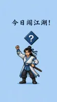<br><sub>@图片4</sub> |
| <br><sub>@图片5</sub> | <br><sub>@图片6</sub> |  |  |

<details>
<summary><strong>Prompt</strong> — 根据 @图片1 - @图片6 制作一镜到底的像素武侠主题竖版视频，背景音乐使用国风 8bit 武侠风格音乐。全片统一浅蓝底色，像素风格统一，画面干净通透。 镜头 1：静止展示 @图片 1 的「江湖风云」水墨风格 logo，背景为统一浅蓝底色，画面保持约 1 秒静止。 镜头 2：@图片 1 中的文字区…</summary>

~~~~text
根据 @图片1 - @图片6 制作一镜到底的像素武侠主题竖版视频，背景音乐使用国风 8bit 武侠风格音乐。全片统一浅蓝底色，像素风格统一，画面干净通透。
镜头 1：静止展示 @图片 1 的「江湖风云」水墨风格 logo，背景为统一浅蓝底色，画面保持约 1 秒静止。
镜头 2：@图片 1 中的文字区域消失后，@图片 2 的武侠男性角色像素脸部特写从画面底部滑入；角色眨眨眼看向镜头，随后快速向下位移离场；角色离场后，原本 logo 处变为 @图片 3 的蓝色「武功秘籍」像素书。
镜头 3：紧接 @图片 4，像素武侠小人角色从画面下方用力向上跃出，顶起上方的蓝色菱形问号标，问号标上方弹出深蓝色粗体字「今日闯江湖！」；角色落地后摆出 @图片 4 的站姿 pose，随后抬手打招呼，接着做出预备跑动作，转身向画面右侧奔跑（奔跑姿态参考 @图片 5），镜头跟随角色向右移动，角色从画面右侧跳出画面。
镜头 4：@图片 6 的 UI 界面从画面右侧位移入画，像素武侠角色从画面右上角跳入，落在「三月廿七日」大字的右下方，张开双臂摆出热情展示的定格姿势，最终定格在该画面。
整体像素武侠美术风格，色调统一浅蓝底，运镜连贯顺滑呈现一镜到底的连续位移与跟随，元素过渡自然、角色动作衔接流畅，画面无卡顿、无闪烁；文字与 UI 清晰稳定。
~~~~

</details>

**参数**：Seedance 2.5 · 火山方舟 · r2v · 15s · 720p · 9:16 · 带音频
**来源**：火山方舟官方文档 · [中文](https://docs.volcengine.com/docs/82379/2607689?lang=zh) · [English](https://docs.byteplus.com/en/docs/ModelArk/2607689)

<sub>Preview frame © 2026 ByteDance, from the official demo video · Prompt by ByteDance · <a href="https://docs.volcengine.com/docs/82379/2607689?lang=zh">source</a></sub>

[Back to top](#table-of-contents)

<a id="case-30"></a>
### Case 30: Spicy food challenge, confidence to collapse (吃辣挑战·从自信到崩溃) — by @oggii_0

<a href="https://ofox.ai/seedance-2-5-prompts?utm_source=github&utm_medium=case&utm_campaign=awesome-seedance-2-5#case-30">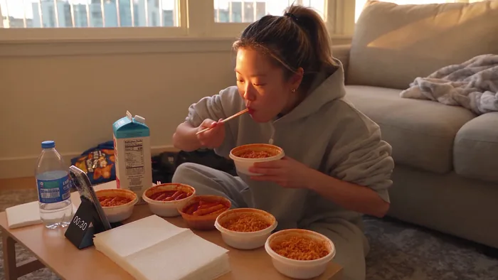</a>

▶ [Watch the full video on ofox.ai](https://ofox.ai/seedance-2-5-prompts?utm_source=github&utm_medium=case&utm_campaign=awesome-seedance-2-5#case-30)

<details>
<summary><strong>Prompt</strong> — 创作一段 30 秒、1080p 超写实的个人家庭视频，内容是一位韩国年轻女性自信地接受朋友发起的吃辣挑战，却在辣味袭来时彻底"破防"的全过程。无需参考图。主要人物：20 出头的韩国年轻女性，充满随性活泼的能量，自然妆容，表情生动，从起初的自负自信转变为真实的痛苦。头发扎成高马尾以"避免碍事"，几缕碎…</summary>

~~~~text
创作一段 30 秒、1080p 超写实的个人家庭视频，内容是一位韩国年轻女性自信地接受朋友发起的吃辣挑战，却在辣味袭来时彻底"破防"的全过程。无需参考图。主要人物：20 出头的韩国年轻女性，充满随性活泼的能量，自然妆容，表情生动，从起初的自负自信转变为真实的痛苦。头发扎成高马尾以"避免碍事"，几缕碎发散落在外，戴着小巧的耳钉。身穿灰色大码连帽衫，袖子挽起，穿着宽松的运动裤，盘腿坐在地板上，仿佛准备迎接一场战斗。在整个视频中保持相同的面部特征、发型、服装、身体比例和外貌。场景：一个温馨、有生活气息的客厅地板，午后的阳光透过窗户洒入。低矮的咖啡桌上摆放着一排辣度递增的炒年糕/拉面碗，旁边放着一叠餐巾纸、一盒牛奶和一杯水以备"不时之需"，手机靠在水瓶上计时，半袋吃剩的零食被推到一边，沙发上随意丢着一条毯子。普通、略显凌乱，非常真实。摄像/视觉美学：由朋友用手机拍摄的原始个人素材，全程带有强烈的手持 Vlog 晃动感。随着朋友为了捕捉她脸部更好的角度而变换位置，镜头会有轻微的抖动。自动对焦在冒热气的碗和她的脸之间切换。当她惊慌失措地去拿水时，画面有轻微的运动模糊。随着午后光线的变化，曝光度略有偏移。画面可见数字噪点，窗户光线带来略微温暖的色调。没有防抖，没有电影级的润色——它应该感觉像是一段为了群聊挑战而拍摄的真实视频。00:00–00:05 —— 自信的准备：她夸张地挽起袖子，在碗上方掰动手指，仿佛要干一件大事。她看向镜头，完全不当回事，露出自负的微笑。"这算什么。我从小就是吃辣长大的。" 00:05–00:10 —— 第一口：她拿起第一个最不辣的碗，自信地吃了一口，随意地咀嚼着，点头表示很简单。"看吧？没什么。" 镜头保持稳定，镜头外的朋友显然不为所动："那个基本就是番茄酱，继续吃。" 00:10–00:15 —— 转变：她转向第二个更辣的碗。吃了几口后，她点头的速度慢了下来。她的眼睛开始微微泛泪，伸手去拿水杯"润润喉"，依然试图表现得随意。她的声音听起来有些紧绷："没——没事，只是有点热。" 镜头微微推近，捕捉到她额头上开始渗出的汗珠。00:15–00:20 —— 失去镇定：她吃到了最辣的那碗。刚吃一口，她的整张脸都变了——双眼圆睁，用手扇着张开的嘴，抓起牛奶盒直接喝了起来。她重重地放下牛奶，呼吸急促，指着碗控诉道："好吧——好吧，那个不正常，那不是——" 镜头随着镜头外朋友爆发出的笑声而剧烈晃动。00:20–00:25 —— 全面崩溃：她抓起餐巾纸，一边用手扇着舌头，一边发出痛苦的声音，坐在原地微微摇晃。她再次伸手去拿水，猛灌一口，随即立刻后悔，又抓回牛奶。镜头外的朋友笑得几乎拿不稳手机："你不是说你从小吃辣长大的吗？！" 她泪眼汪汪地瞪了镜头一眼，无法回应，依然在扇着嘴。00:25–00:30 —— 最后一刻：她瘫倒在沙发上，彻底认输，牛奶盒紧贴在胸前，脸颊通红，眼泪还在打转。她看着镜头，声音沙哑且狼狈。"……我不是从小吃辣长大的。我撒谎了。" 她虚弱地竖起大拇指朝下，画面随着朋友的笑声剧烈晃动，视频戛然而止，转为黑屏。音频：仅限自然环境音：咀嚼声、吸鼻涕声、夸张的呼气和喘息声、打开牛奶盒和吞咽声、餐巾纸摩擦声、镜头外朋友真实的笑声、玻璃杯碰撞桌面的声音，以及手持摄像机的噪音。无背景音乐。无旁白。无人工音效。台词："这算什么。我从小就是吃辣长大的。" / "看吧？没什么。" / "那个基本就是番茄酱，继续吃。"（朋友） / "没——没事，只是有点热。" / "好吧——好吧，那个不正常，那不是——" / "你不是说你从小吃辣长大的吗？！"（朋友） / "……我不是从小吃辣长大的。我撒谎了。" 最终效果：真实、逐渐升级的肢体喜剧，完全建立在对真实辣味的真实反应之上——从自信的否认到彻底的投降。有趣、有共鸣、感觉像未排练过，那种会被直接发到群聊里并配上"哈哈哈哈"的视频。没有超出真实吃辣反应的夸张表演。没有虚假的强撑——喜剧效果来自于她防线崩溃的速度和彻底程度。
~~~~

</details>

**参数**：Seedance 2.5 · 未标注 · t2v · 未标注 · 未标注 · 未标注 · 未标注
**来源**：[@oggii_0](https://x.com/oggii_0) · [原帖](https://x.com/oggii_0/status/2094267751477232053)

<sub>Preview © 2026 <a href="https://x.com/oggii_0/status/2094267751477232053">@oggii_0</a> · Prompt by <a href="https://x.com/oggii_0/status/2094267751477232053">@oggii_0</a></sub>

[Back to top](#table-of-contents)

<a id="case-31"></a>
### Case 31: Korean gym vlog, DV camcorder (韩式健身房 Vlog·DV 摄像机质感) — by @doctorwasif

<a href="https://ofox.ai/seedance-2-5-prompts?utm_source=github&utm_medium=case&utm_campaign=awesome-seedance-2-5#case-31">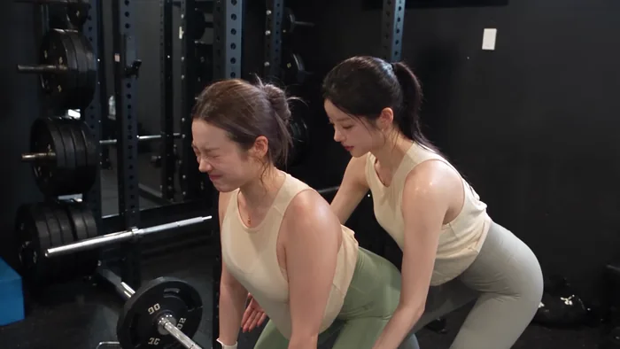</a>

▶ [Watch the full video on ofox.ai](https://ofox.ai/seedance-2-5-prompts?utm_source=github&utm_medium=case&utm_campaign=awesome-seedance-2-5#case-31)

<details>
<summary><strong>Prompt</strong> — 摄像/视觉：DV 16mm 磁带摄像机 Vlog 美学，POV 在 CHASE 和 PARTNER 之间切换，有时放置在健身器材上。手持晃动、构图不完美、对焦延迟、笨拙的变焦、偶尔出现人脸被切断的情况。柔和模糊的磁带质感、微弱的噪点、泛光暖色高光、闪烁的曝光、柔和的对比度、真实的皮肤质感。汗水和潮红…</summary>

~~~~text
摄像/视觉：DV 16mm 磁带摄像机 Vlog 美学，POV 在 CHASE 和 PARTNER 之间切换，有时放置在健身器材上。手持晃动、构图不完美、对焦延迟、笨拙的变焦、偶尔出现人脸被切断的情况。柔和模糊的磁带质感、微弱的噪点、泛光暖色高光、闪烁的曝光、柔和的对比度、真实的皮肤质感。汗水和潮红的面部在整个过程中逐渐加深。摄像机始终不可见。 角色： CHASE：韩国偶像，20 多岁，黑色高马尾，眼神生动，脸颊潮红，身材苗条健美。穿着轻便保守的夏季运动上衣 + 高腰紧身裤/及膝短裤，运动鞋。 PARTNER：韩国女性，20 多岁，年龄/活力相仿，扎发，健美身材，轻便保守的运动装，运动鞋。无首饰。两人都大汗淋漓。 场景：炎热的夏季健身房，空调坏了，光线温暖而强烈，风扇吹着热风，开着的门，架子、垫子、镜子、水瓶。 30 秒分镜 — 15 个镜头： 1. 0–2 秒：固定机位。两人边扇风边走进来。CHASE："好吧，今天这里实在太热了。" 2. 2–4 秒：手持。PARTNER 指着坏掉的空调："空调从今天早上就坏了。" 3. 4–6 秒：在架子旁，CHASE 装杠铃片，PARTNER 辅助。"我们坚持下去吧。" 4. 6–8 秒：固定机位。CHASE 举重，PARTNER 辅助。 5. 8–9.5 秒：特写，双手紧握出汗的杠铃，汗水滴落。环境音。 6. 9.5–11.5 秒：PARTNER 举重，CHASE 辅助："你能行的，加油！" 7. 11.5–13.5 秒：两人喘气、扇动衣服、大笑。PARTNER："好吧，我已经湿透了。" 8. 13.5–15.5 秒：拿着水走向垫子。CHASE："喝水时间，强制执行。" 9. 15.5–17.5 秒：固定机位。两人喝水、叹气、大笑。 10. 17.5–19.5 秒：两人比赛做平板支撑。PARTNER："谁先放弃？" 11. 19.5–21.5 秒：用力支撑，汗水滴落。CHASE："不—是—我—" 12. 21.5–23.5 秒：特写，汗水滴在垫子上，沉重的呼吸声。 13. 23.5–25.5 秒：两人瘫倒大笑。PARTNER："好吧，这正式算平局。" 14. 25.5–27.5 秒：坐起来，开玩笑地用毛巾互相扇风。CHASE："这热度简直疯了。" 15. 27.5–30 秒：手臂长度的自拍。两人满头大汗、咧嘴笑、疲惫地击掌。CHASE："好吧，我们活下来了——大家下次见！" 基调：俏皮、汗水感、充满活力的健身 Vlog。充满竞争但又相互支持的对话，真实的疲惫与欢笑。热度和汗水从开始到结束逐渐升级。
~~~~

</details>

**参数**：Seedance 2.5 · 未标注 · t2v · 未标注 · 未标注 · 未标注 · 未标注
**来源**：[@doctorwasif](https://x.com/doctorwasif) · [原帖](https://x.com/doctorwasif/status/2093928113130619122)

<sub>Preview © 2026 <a href="https://x.com/doctorwasif/status/2093928113130619122">@doctorwasif</a> · Prompt by <a href="https://x.com/doctorwasif/status/2093928113130619122">@doctorwasif</a></sub>

[Back to top](#table-of-contents)

<a id="case-32"></a>
### Case 32: Madrid grocery run, 2004 MiniDV home video (马德里超市采购·2004年MiniDV家庭录像) — by @ZephyraLeigh

<a href="https://ofox.ai/seedance-2-5-prompts?utm_source=github&utm_medium=case&utm_campaign=awesome-seedance-2-5#case-32">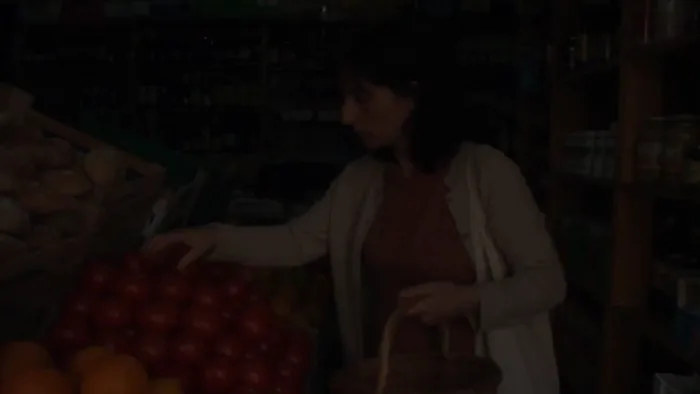</a>

▶ [Watch the full video on ofox.ai](https://ofox.ai/seedance-2-5-prompts?utm_source=github&utm_medium=case&utm_campaign=awesome-seedance-2-5#case-32)

<details>
<summary><strong>Prompt</strong> — 主要人物：25 岁西班牙年轻女性，自然日常装扮，齐肩深棕色长发，留着略显凌乱的刘海，真实的皮肤质感，淡妆，下班后神态轻松。 身穿褪色的赤陶色 T 恤、轻便米色开衫、高腰深蓝色牛仔裤、旧白色运动鞋，手提一个简约帆布袋。请在整个过程中保持人物身份、服装、发型和外貌的一致性。 地点：温暖工作日傍晚的普通马…</summary>

~~~~text
主要人物：25 岁西班牙年轻女性，自然日常装扮，齐肩深棕色长发，留着略显凌乱的刘海，真实的皮肤质感，淡妆，下班后神态轻松。 身穿褪色的赤陶色 T 恤、轻便米色开衫、高腰深蓝色牛仔裤、旧白色运动鞋，手提一个简约帆布袋。请在整个过程中保持人物身份、服装、发型和外貌的一致性。 地点：温暖工作日傍晚的普通马德里住宅区。小型本地杂货店、带有阳台的公寓楼、停放的小型汽车、踏板摩托车、悬铃木、瓷砖人行道、回收箱以及下班回家的居民。无著名地标、旅游街道或刻意安排的活动。 视觉风格：超写实纪录片风格。真实的日常行为，自然的肢体语言，自发的本地互动，地道的西班牙社区氛围。 摄像风格：21 世纪初消费级 MiniDV 摄像机。强烈的肩扛式抖动，不完美的构图，在货架与人物面部之间自动对焦的拉扯感，进出商店时的曝光波动，褪色的色彩，柔和的对比度，轻微的运动模糊，DV 压缩伪影，轻微的传感器噪点，无防抖。 00:00–00:03 她提着一个空帆布袋走在住宅区的人行道上。在靠近一家小型社区商店时，她查看了一份手写的购物清单。 00:03–00:06 在店内，她拿起西红柿和橙子，随意地比较了一下，然后放入篮子。自动对焦短暂地锁定在色彩鲜艳的农产品上。 00:06–00:09 她挑选了一条面包和一盒牛奶。店主在柜台后向她打招呼，她微笑着回应。 00:09–00:12 店外，她站在树下整理帆布袋里的杂货。一辆踏板摩托车从她身后缓慢驶过。 00:12–00:15 她注意到摄像机，轻声笑了笑，举起购物袋展示她买的东西，然后继续朝公寓走去。拍摄者跟了几步，随后不小心将镜头对准了地面，画面切黑。 音频：仅自然环境音——西班牙语交谈声、商店门铃声、购物袋摩擦声、脚步声、踏板摩托车声、远处的交通声、鸟鸣声、公寓生活声以及轻微的社区闲聊声。无背景音乐。无旁白。 目标：一段 2004 年被遗忘的 MiniDV 家庭录像，记录了马德里一次平凡的下班后购物过程——本地化、随意、不完美、温暖、怀旧且完全真实可信。
~~~~

</details>

**参数**：Seedance 2.5 · 未标注 · t2v · 未标注 · 未标注 · 未标注 · 未标注
**来源**：[@ZephyraLeigh](https://x.com/ZephyraLeigh) · [原帖](https://x.com/ZephyraLeigh/status/2094038963233435763)

<sub>Preview © 2026 <a href="https://x.com/ZephyraLeigh/status/2094038963233435763">@ZephyraLeigh</a> · Prompt by <a href="https://x.com/ZephyraLeigh/status/2094038963233435763">@ZephyraLeigh</a></sub>

[Back to top](#table-of-contents)

<a id="case-33"></a>
### Case 33: Japanese dojo travel vlog, first lesson (日本道场旅拍·武道初体验) — by @SimplyAnnisa

<a href="https://ofox.ai/seedance-2-5-prompts?utm_source=github&utm_medium=case&utm_campaign=awesome-seedance-2-5#case-33"></a>

▶ [Watch the full video on ofox.ai](https://ofox.ai/seedance-2-5-prompts?utm_source=github&utm_medium=case&utm_campaign=awesome-seedance-2-5#case-33)

<details>
<summary><strong>Prompt</strong> — 制作一段 20 秒超写实、轻松的智能手机旅行 Vlog，全程由同一位 20 岁出头的韩国女性出镜。她拥有小巧的鹅蛋脸、棕色眼睛、自然的珊瑚色嘴唇、白皙真实的皮肤和一头乌黑的长直发。保持面部特征、发型、身体比例和外貌完全一致，严禁变形或身份特征偏移。 旅行穿搭：米色廓形针织毛衣、深蓝色直筒牛仔裤、白色…</summary>

~~~~text
制作一段 20 秒超写实、轻松的智能手机旅行 Vlog，全程由同一位 20 岁出头的韩国女性出镜。她拥有小巧的鹅蛋脸、棕色眼睛、自然的珊瑚色嘴唇、白皙真实的皮肤和一头乌黑的长直发。保持面部特征、发型、身体比例和外貌完全一致，严禁变形或身份特征偏移。 旅行穿搭：米色廓形针织毛衣、深蓝色直筒牛仔裤、白色低帮运动鞋和小型斜挎包。头发扎成随意的低马尾，留有自然碎发。 训练穿搭：米白色棉质道服风格上衣，搭配同色系白色训练裤和纯深蓝色初学者腰带。无任何 Logo、文字或图案。训练期间保持此服装完全一致。 风格：真实的手机手持拍摄视角，构图不完美，带有轻微的镜头晃动、自动对焦偏移、自然曝光、轻微的动态模糊，以及真实的皮肤质感、眨眼和身体动作。严禁电影感镜头、无人机、稳定器、美颜滤镜或商业广告感。 地点：宁静的日本乡村社区，以及一个拥有传统建筑、木地板和自然采光的小型正宗道场。严禁出现著名地标。 0:00–0:04：她一边自拍一边走向道场，神情兴奋且好奇。她用韩语自然地说道："오늘은 일본 무술을 직接 배워볼게요!"（今天我要亲自尝试学习日本武术！） 她简短地展示了道场入口，随后切回自拍模式。 0:04–0:07：进入道场后，她已换上训练服。她整理了一下袖子。一位友好的教练恭敬地鞠躬；她有些笨拙地回礼并微笑。 0:07–0:11：教练演示了一个简单的初学者站姿和受控的手部动作。她笨拙地模仿，脚位放错，在教练冷静地纠正姿势后，她再次尝试。 0:11–0:15：她尝试进行缓慢的初学者站姿转换，配合受控的防御性手臂动作，期间短暂失去平衡，随后稳住重心并自然地笑了出来。教练给予鼓励的微笑。动作需保持安全且符合初学者水平。 0:15–0:18：自然跳剪。同一位女性，服装和外貌完全一致。她重复了刚才的动作序列，平衡感明显提升，但看起来仍是初学者水平。她自豪地笑了。 0:18–0:20：道场外，在午后柔和的阳光下，她对着镜头自拍，略微喘着气并微笑着。她说："생각보다 어렵지만 정말 재미있어요!"（比想象中难，但真的很有趣！） 她挥了挥手，放下手机。 音频：自然的韩国女性原声，口型同步准确。包含脚步声、衣物摩擦声、道场环境音、远处的社区声音和微风声。无背景音乐或戏剧性音效。 最终规则：照片级真实感，真实的智能手机 Vlog 风格，符合物理规律，展现初学者水平的武术动作。严禁打斗、夸张动作、动作编排、著名地标、Logo、品牌、字幕、文字、水印或视觉特效。
~~~~

</details>

**参数**：Seedance 2.5 · 未标注 · t2v · 未标注 · 未标注 · 未标注 · 未标注
**来源**：[@SimplyAnnisa](https://x.com/SimplyAnnisa) · [原帖](https://x.com/SimplyAnnisa/status/2093978574692679983)

<sub>Preview © 2026 <a href="https://x.com/SimplyAnnisa/status/2093978574692679983">@SimplyAnnisa</a> · Prompt by <a href="https://x.com/SimplyAnnisa/status/2093978574692679983">@SimplyAnnisa</a></sub>

[Back to top](#table-of-contents)

<a id="case-34"></a>
### Case 34: Cyber skydive freefall cut sequence (赛博跳伞自由落体剪辑序列) — by @opener_ai

<a href="https://ofox.ai/seedance-2-5-prompts?utm_source=github&utm_medium=case&utm_campaign=awesome-seedance-2-5#case-34"></a>

▶ [Watch the full video on ofox.ai](https://ofox.ai/seedance-2-5-prompts?utm_source=github&utm_medium=case&utm_campaign=awesome-seedance-2-5#case-34)

**输入素材**：未公开 —— 原作者只发布了成片，未提供输入素材

<details>
<summary><strong>Prompt</strong> — Prompt  IDENTITY: @Image1 supplies identity only — face, long black hair, low-brim cap, glossy black bodysuit, segmented cybernetic right arm, circuit…</summary>

~~~~text
Prompt

IDENTITY: @Image1 supplies identity only — face, long black hair, low-brim cap, glossy black bodysuit, segmented cybernetic right arm, circuit tattoos, heeled boots. Frame is one continuous open-sky environment edge to edge. Cuts every 2-3s, no shot over 3s, one camera movement per shot. 0-2s | Worm-eye far below, whip tilt up as she pushes off the spire ledge. [Cut] 2-4s | Macro on her heel leaving the lip, static. [Cut] 4-6s | Top-down on her back, falling with her, hair rips straight up. [Cut] 6-8s | Boot macro, black plates streak in and latch over her shins, static. [Cut] 8-10s | Side track, thigh and hip plates snap shut. [Cut] 10-12s | Cybernetic arm macro, forearm plating extends over it, static. [Cut] 12-15s | Wide, chest harness clamps on, two stabilizer fins fold from her back, push-in. [Cut] 15-17s | Face close-up, a thin dark visor slides from the cap brim over her eyes, locked. [Cut] 17-20s | Extreme wide, geared figure punches the cloud layer, twin vapor spirals. [Cut] 20-23s | Head-down delta dive, fins biting air, hard push-in on her back. [Cut] 23-26s | Ground-level low angle, she swells in frame fast. [Cut] 26-28s | She lands in a deep crouch, cybernetic arm braced on stone, cracks radiate 4m in a spider-web pattern. [Cut] 28-30s | 0.4x slow motion, concentric shockwave ripple distorts the air outward, dust erupts to waist height, she rises into a recovery stance. GEAR: plates arrive as fast streaks from off-frame, each locking with a latch snap and a thin amber seam that fades in 0.4s and lights her skin. Assembly runs 6-17s, one region per shot. PHYSICS: terminal velocity, hair and fabric dragged upward, motion blur on background only, subject sharp, faster after 17s. AUDIO: wind roar climbing, latch snap on each lock, sub-bass on every cut, half beat of silence at 25.5s, air-pressure boom at 26s, rumble tail. STYLE: painterly anime illustration matching @Image1, cel-and-gradient shading, cool desaturated sky.
~~~~

</details>

**参数**：Seedance 2.5 · 未标注 · i2v · 30s · 未标注 · 未标注 · 未标注
**来源**：[@opener_ai](https://x.com/opener_ai) · [原帖](https://x.com/opener_ai/status/2083542433078624470)

<sub>Preview © 2026 <a href="https://x.com/opener_ai/status/2083542433078624470">@opener_ai</a> · Prompt by <a href="https://x.com/opener_ai/status/2083542433078624470">@opener_ai</a></sub>

[Back to top](#table-of-contents)

<a id="case-35"></a>
### Case 35: Olympic badminton smash, slow motion (奥运羽毛球杀球·慢动作) — by @tanabe_fragm

<a href="https://ofox.ai/seedance-2-5-prompts?utm_source=github&utm_medium=case&utm_campaign=awesome-seedance-2-5#case-35"></a>

▶ [Watch the full video on ofox.ai](https://ofox.ai/seedance-2-5-prompts?utm_source=github&utm_medium=case&utm_campaign=awesome-seedance-2-5#case-35)

<details>
<summary><strong>Prompt</strong> — A cinematic slow-motion shot of a professional Caucasian male badminton player competing in the Olympic finals. He leaps high into the air with explos…</summary>

~~~~text
A cinematic slow-motion shot of a professional Caucasian male badminton player competing in the Olympic finals. He leaps high into the air with explosive power for a powerful smash. Focus on the intense facial expression and the flexed muscles of his arm. As he hits the shuttlecock, a subtle motion blur and wind effect are visible. The background shows a packed Olympic arena with blurred crowds and bright stadium lights. Smooth camera tracking following his jump. 4K, ultra-realistic, high frame rate, vivid colors, athletic anatomy, professional sports photography style.
~~~~

</details>

**参数**：Seedance 2.5 · 未标注 · t2v · 15s · 未标注 · 未标注 · 未标注
**来源**：[@tanabe_fragm](https://x.com/tanabe_fragm) · [原帖](https://x.com/tanabe_fragm/status/2083140946640916720)

<sub>Preview © 2026 <a href="https://x.com/tanabe_fragm/status/2083140946640916720">@tanabe_fragm</a> · Prompt by <a href="https://x.com/tanabe_fragm/status/2083140946640916720">@tanabe_fragm</a></sub>

[Back to top](#table-of-contents)

<a id="case-36"></a>
### Case 36: “Chase,” a DV camcorder self-shot day (Chase 的一天·DV自拍随拍) — by @doctorwasif

<a href="https://ofox.ai/seedance-2-5-prompts?utm_source=github&utm_medium=case&utm_campaign=awesome-seedance-2-5#case-36"></a>

▶ [Watch the full video on ofox.ai](https://ofox.ai/seedance-2-5-prompts?utm_source=github&utm_medium=case&utm_campaign=awesome-seedance-2-5#case-36)

**输入素材**：未公开 —— 原作者只发布了成片，未提供输入素材

<details>
<summary><strong>Prompt</strong> — **CAMERA:** DV 16mm tape camcorder handheld feel. POV of CHASE holding the camera herself throughout each location, occasionally propped briefly for h…</summary>

~~~~text
**CAMERA:**
DV 16mm tape camcorder handheld feel. POV of CHASE holding the camera herself throughout each location, occasionally propped briefly for hands-free moments. Hand shake, misaligned framing, delayed focus pulls, clumsy zooms, occasional face cut-off framing, imperfect shots. Camcorder never appears on screen.

**LOOK:**
Soft, slightly blurry tape quality, faint tape noise, bloomed highlights, flickering auto-exposure, muted contrast, realistic skin tones — lighting shifts per location (dim early-morning dorm → fluorescent vocal room → mirror-lit practice room → stark evaluation room lighting).

**STYLE:**
Nostalgic, determined montage feel — younger, rawer energy than her current polished vlogs, evoking a flashback to trainee days. Quick cuts stitched across locations, reflective voiceover narration plays over the visuals instead of synced dialogue. Mood shifts from tired to focused to nervous, ending on quiet resolve.

**Character**

CHASE — Korean trainee (ref image), late teens/early 20s (younger, flashback version of herself). Long straight black hair, often in a simple ponytail or braid, minimal to no makeup, tired but determined eyes. Wearing simple practice clothes — a plain long-sleeve top and joggers or sweats, fully covering arms and torso, no jewelry.

**Setting Progression**

Trainee dorm room (early morning) → vocal lesson room (morning) → dance practice room (afternoon) → evaluation room (evening).

**Storyboard (15s, 5 cuts)**

1. *(~3s, dorm, propped camera, dim early light)* She wakes up before sunrise, rubbing her eyes, quietly getting ready in the dark so as not to wake roommates. VOICEOVER (CHASE): "Back then, mornings started before the sun even came up."

2. *(~3s, vocal room, handheld, fluorescent light)* She stands at a mic, sheet in hand, focused and a little nervous, mouthing through warmups. VOICEOVER (CHASE): "Every note mattered — you never knew who was listening."

3. *(~3s, practice room, handheld, mirror wall)* She's mid-motion rehearsing choreography, sweat forming, repeating a step over and over. VOICEOVER (CHASE): "I must have run that same eight-count a hundred times."

4. *(~3s, practice room, macro insert)* Close-up on her feet repeating the same step, breathing audible, tape blur softening the motion. No narration — ambient practice room sound only.

5. *(~3s, evaluation room, wide-to-close, tense finish)* She stands nervously in front of unseen evaluators, hands clasped, taking a steadying breath before the camera holds on her face. VOICEOVER (CHASE): "That was the version of me that started all of this."
~~~~

</details>

**参数**：Seedance 2.5 · 未标注 · i2v · 15s · 未标注 · 未标注 · 未标注
**来源**：[@doctorwasif](https://x.com/doctorwasif) · [原帖](https://x.com/doctorwasif/status/2083539372478251247)

<sub>Preview © 2026 <a href="https://x.com/doctorwasif/status/2083539372478251247">@doctorwasif</a> · Prompt by <a href="https://x.com/doctorwasif/status/2083539372478251247">@doctorwasif</a></sub>

[Back to top](#table-of-contents)

<a id="case-64"></a>
### Case 64: Friend-filmed day-trip vlog, city to coast (朋友跟拍的一日旅拍 · 从街区到海边) — by @BubbleBrain

<a href="https://ofox.ai/seedance-2-5-prompts?utm_source=github&utm_medium=case&utm_campaign=awesome-seedance-2-5#case-64"></a>

▶ [Watch the full video on ofox.ai](https://ofox.ai/seedance-2-5-prompts?utm_source=github&utm_medium=case&utm_campaign=awesome-seedance-2-5#case-64)

**输入素材**：未公开 —— 原作者只发布了成片，未提供输入素材

<details>
<summary><strong>Prompt</strong> — A realistic handheld travel vlog filmed by a friend following the main character throughout the day. Use the woman from …</summary>

~~~~text
A realistic handheld travel vlog filmed by a friend following the main character throughout the day. Use the woman from the reference image as the main subject. Maintain her exact facial identity, hairstyle, facial features, and body proportions throughout the entire video. The camera feels like a real personal vlog camera, not a commercial production. Natural handheld movement, casual framing, imperfect human camera motion, authentic everyday atmosphere. No scripted acting. The woman behaves naturally, interacting with the environment like a real travel vlog. 0-5s: Morning departure. The woman leaves a cozy apartment with a small backpack. She checks her phone, smiles at the camera, adjusts her hair, and starts walking outside. The camera follows her from behind, slightly shaky like a friend filming. Morning sunlight, quiet neighborhood streets, people starting their day. 5-12s: Exploring the city. The camera follows her walking through local streets. She visits a small cafe, buys a drink, briefly talks to the camera, laughs naturally. She walks through a street market, looks at small shops, takes casual photos. The camera stays close, capturing spontaneous moments. 12-20s: Arriving at the beach. She takes public transportation or walks toward the coast. The environment gradually changes from city streets to a seaside town. Ocean breeze moves her hair. She looks excited when she sees the ocean. The camera follows her walking along the beach. She picks up a seashell, watches waves, and interacts naturally with people nearby. 20-27s: Summer beach afternoon. She meets friends at the beach. Everyone chats, laughs, plays near the water. The camera moves naturally between people, capturing real candid moments. She looks back at the camera and smiles. 27-30s: Ending moment. Golden hour sunset. She sits near the ocean, holding a drink, watching the sunset. The camera slowly moves backward, revealing the beach, waves, and the peaceful evening. A feeling of a real personal travel memory. Visual style: Authentic travel vlog footage. Realistic smartphone or mirrorless camera look. Natural daylight. Casual handheld movement. Slight camera shake. Real human reactions. Documentary realism. No cinematic commercial look. No dramatic posing. No artificial transitions. No text overlays. No logos. No face changes. No identity changes.
~~~~

</details>

**参数**：Seedance 2.5 · 未标注 · i2v · 30s · 未标注 · 未标注 · 未标注
**来源**：[@BubbleBrain](https://x.com/BubbleBrain) · [原帖](https://x.com/BubbleBrain/status/2083659648108990925)

<sub>Preview © 2026 <a href="https://x.com/BubbleBrain/status/2083659648108990925">@BubbleBrain</a> · Prompt by <a href="https://x.com/BubbleBrain/status/2083659648108990925">@BubbleBrain</a></sub>

[Back to top](#table-of-contents)

<a id="case-70"></a>
### Case 70: MiniDV morning vlog in an old residential lane (老生活区晨间 Vlog · MiniDV 质感) — by @羊羊Vincent

<a href="https://ofox.ai/seedance-2-5-prompts?utm_source=github&utm_medium=case&utm_campaign=awesome-seedance-2-5#case-70">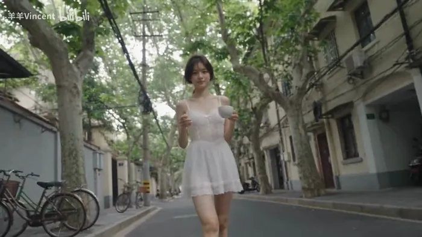</a>

▶ [Watch the full video on ofox.ai](https://ofox.ai/seedance-2-5-prompts?utm_source=github&utm_medium=case&utm_campaign=awesome-seedance-2-5#case-70)

**输入素材**：未公开 —— 原作者只发布了成片，未提供输入素材

<details>
<summary><strong>Prompt</strong> — 完整提示词： 【视觉与风格设定】 画质与摄影机美学：2000年代初家用手持小型DV摄像机（MiniDV）录像风格，强烈的手持摇晃与抖动、频繁且随意的重新构图、偶发自动对焦搜索与镜头呼吸、曝光偶有波动。低对比度、泛白褪色感（faded/washed-out）、伴随轻微数字噪点与轻度压缩感，无任何现代稳…</summary>

~~~~text
完整提示词：
【视觉与风格设定】
画质与摄影机美学：2000年代初家用手持小型DV摄像机（MiniDV）录像风格，强烈的手持摇晃与抖动、频繁且随意的重新构图、偶发自动对焦搜索与镜头呼吸、曝光偶有波动。低对比度、泛白褪色感（faded/washed-out）、伴随轻微数字噪点与轻度压缩感，无任何现代稳定器滤镜或商业调色。
场景环境：安静老旧的生活住宅区，狭窄水泥小巷、带小露台的矮房、院内晾衣绳、花盆绿植、停靠的自行车/摩托车、茂密树木与纵横交错的架空电线，纯粹真实的生活街区，无任何商业或店铺元素。
音频设计：纯环境原声（无背景音乐）。清晨鸟鸣、微风拂过树叶的沙沙声、远处摩托车引擎声、脚步踏在水泥路上的声响、猫叫声、咖啡杯轻碰声。
角色设计@ 角色设定
【分秒时间轴细节（0-15s）】
00:00 - 00:05 | 开场与小巷相遇
画面：开场镜头略微失焦随后对准，女性坐在路边水泥地面整理侧马尾，手臂抬起并露出真诚微笑，微风吹拂发丝。紧接着摄像机跟随着她站起并拐入狭窄小巷，她蹲下身轻抚并喂食一只主动走近的流浪小猫，镜头有明显的手持摇晃与焦点轻微飘移。
00:05 - 00:10 | 院落日常与邻里挥手
画面：切换至前院晨间日常，她在晾衣绳上晾挂衣物，微风轻轻吹拂；随后镜头松散漂移至房屋露台，她静静端着咖啡杯坐着望向街道。接着镜头右侧近景捕捉到她抬手向画外邻居热情挥手示意，摄像机慢了半拍才调整好构图跟随她的动作。
00:10 - 00:15 | 街道漫步与戛然而止
画面：摄像机以手持低位缓慢倒退跟随她在街道上漫步，她手拿咖啡杯，在注意到镜头时微微转头露出一抹安静柔和的微笑。
结尾：在第15秒视频画面无任何渐隐过渡，中途直接硬切为纯黑屏，伴随DV机电源切断的突兀停录感。
~~~~

</details>

**参数**：Seedance 2.5 · 未标注 · r2v · 15s · 未标注 · 未标注 · 带音频
**来源**：[@羊羊Vincent](https://space.bilibili.com/283745134) · [原帖](https://www.bilibili.com/video/BV1tDhV6eEgT)

<sub>Preview © 2026 <a href="https://www.bilibili.com/video/BV1tDhV6eEgT">@羊羊Vincent</a> · Prompt by <a href="https://www.bilibili.com/video/BV1tDhV6eEgT">@羊羊Vincent</a></sub>

[Back to top](#table-of-contents)

<a id="product-demo"></a>
### Product Demo (产品演示)

<a id="case-37"></a>
### Case 37: Clay-model car assembly render (白模渲染 · 汽车拼装) — by ByteDance

<a href="https://ofox.ai/seedance-2-5-prompts?utm_source=github&utm_medium=case&utm_campaign=awesome-seedance-2-5#case-37"></a>

▶ [Watch the full video on ofox.ai](https://ofox.ai/seedance-2-5-prompts?utm_source=github&utm_medium=case&utm_campaign=awesome-seedance-2-5#case-37)

**输入素材**：未公开 —— ByteDance Seed 博客只发布了成片，未随文发布输入素材

**Prompt**

~~~~text
参考 @白模 1 的运镜、构图、景别、空间关系、零件位置、模型结构、装配顺序和运动轨迹。参考 @图片 1 的材质、光照、色彩、反射和氛围，将白模渲染为高端真实汽车拼装片段。
~~~~

**参数**：Seedance 2.5 · 未标注 · r2v · 未标注 · 未标注 · 未标注 · 未标注
**来源**：ByteDance Seed 官方博客 · [中文](https://seed.bytedance.com/zh/blog/one-take-creation-flexible-referencing-introducing-seedance-2-5) · [English](https://seed.bytedance.com/en/blog/one-take-creation-flexible-referencing-introducing-seedance-2-5)

<sub>Preview frame © 2026 ByteDance, from the official demo video · Prompt by ByteDance · <a href="https://seed.bytedance.com/zh/blog/one-take-creation-flexible-referencing-introducing-seedance-2-5">source</a></sub>

[Back to top](#table-of-contents)

<a id="case-38"></a>
### Case 38: Automated french-fry factory line (全自动薯条工厂生产线) — by @aiwithaly

<a href="https://ofox.ai/seedance-2-5-prompts?utm_source=github&utm_medium=case&utm_campaign=awesome-seedance-2-5#case-38"></a>

▶ [Watch the full video on ofox.ai](https://ofox.ai/seedance-2-5-prompts?utm_source=github&utm_medium=case&utm_campaign=awesome-seedance-2-5#case-38)

<details>
<summary><strong>Prompt</strong> — 一家现代化的自动化炸薯条工厂从头到尾处理新鲜土豆。土豆经由不锈钢传送带运送，通过工业清洗和去皮机，随后进入精密切割设备，加工成大小均匀的薯条。新鲜切割的薯条依次经过漂烫、热油炸制、沥油和冷却系统，最终到达自动称重和包装机。薯条被分装、密封在食品级包装袋中，经由质量控制扫描仪检测，并由机械臂装入纸箱。…</summary>

~~~~text
一家现代化的自动化炸薯条工厂从头到尾处理新鲜土豆。土豆经由不锈钢传送带运送，通过工业清洗和去皮机，随后进入精密切割设备，加工成大小均匀的薯条。新鲜切割的薯条依次经过漂烫、热油炸制、沥油和冷却系统，最终到达自动称重和包装机。薯条被分装、密封在食品级包装袋中，经由质量控制扫描仪检测，并由机械臂装入纸箱。超写实工业食品生产纪录片，真实的土豆和薯条物理效果，物理精确的机械设备，连续的传送带运动，逼真的水流，真实的油炸气泡，自然的蒸汽，精准的机械臂动作，卫生的工厂环境，明亮的工业 LED 照明，逼真的不锈钢反光，穿着规范防护装备的受训工人，流畅的纪录片摄影风格，真实的工厂音效，包括传送带电机声、流水声、切割机声、油炸气泡声、冷却风扇声和包装机械声，无旁白，无背景音乐，视觉连续性无缝衔接，无 CGI 感，无悬浮物体，无变形食物，无机械穿模，无过量蒸汽，无灯光闪烁，无文字覆盖、标志或水印。
~~~~

</details>

**参数**：Seedance 2.5 · 未标注 · t2v · 未标注 · 未标注 · 未标注 · 未标注
**来源**：[@aiwithaly](https://x.com/aiwithaly) · [原帖](https://x.com/aiwithaly/status/2091031033986634183)

<sub>Preview © 2026 <a href="https://x.com/aiwithaly/status/2091031033986634183">@aiwithaly</a> · Prompt by <a href="https://x.com/aiwithaly/status/2091031033986634183">@aiwithaly</a></sub>

[Back to top](#table-of-contents)

<a id="case-39"></a>
### Case 39: Industrial 3D printer, print-to-life dragon (工业3D打印机·打印成真的巨龙) — by @PromptSin

<a href="https://ofox.ai/seedance-2-5-prompts?utm_source=github&utm_medium=case&utm_campaign=awesome-seedance-2-5#case-39"></a>

▶ [Watch the full video on ofox.ai](https://ofox.ai/seedance-2-5-prompts?utm_source=github&utm_medium=case&utm_campaign=awesome-seedance-2-5#case-39)

<details>
<summary><strong>Prompt</strong> — 创建一个 15 秒的写实电影级奇幻序列，在黑暗的专业 3D 打印车间内进行单镜头长镜头拍摄。 一台大型工业树脂 3D 打印机正在其构建平台上快速打印一只凶猛的微型龙。这条龙在整个过程中具有连贯的解剖结构设计：四条肌肉发达的腿、一对巨大的折叠翅膀、一条长长的盔甲尾巴、锋利的角、带有微妙深红色高光的层叠…</summary>

~~~~text
创建一个 15 秒的写实电影级奇幻序列，在黑暗的专业 3D 打印车间内进行单镜头长镜头拍摄。 一台大型工业树脂 3D 打印机正在其构建平台上快速打印一只凶猛的微型龙。这条龙在整个过程中具有连贯的解剖结构设计：四条肌肉发达的腿、一对巨大的折叠翅膀、一条长长的盔甲尾巴、锋利的角、带有微妙深红色高光的层叠黑色鳞片、琥珀色的眼睛以及强壮的爬行动物头部。从打印到动画化，必须保持龙的身份、解剖结构、鳞片图案、角、翅膀和比例完全一致。 0–4 秒：从打印机内部的极致微距特写开始。清晰展示龙从脚部向上快速成型的加速打印过程。薄薄的树脂层按正确的物理顺序构建出腿部、躯干、尾巴、折叠的翅膀、颈部、角和头部。打印机机械装置高速移动，同时保持机械上的真实感。当完整的实体龙出现时，摄像机缓慢绕着构建平台旋转。在第 4 秒时，打印机停止，成品龙在平台上静止片刻。 4–7 秒：摄像机推进至龙的脸部特写。其坚硬的打印表面逐渐转化为真实的黑色鳞片，且不改变其轮廓或解剖结构。温暖的琥珀色光芒在其眼中点亮。它的胸部随着第一次呼吸而起伏，爪子在平台上抓挠，尾巴自然摆动，鼻孔中冒出淡淡的烟雾。这种转变从头部到尾部平滑蔓延，呈现出逼真的材质细节。 7–11 秒：龙抬起头，完全展开双翼并发出凶猛的咆哮。翅膀产生的气流将松散的树脂粉尘和车间里的小纸片吹向四周。它蹲下身子，从构建平台上用力一蹬，带着真实的重量感、肌肉运动和空气动力学拍翼动作冲向空中。身后的打印机保持完好。 11–15 秒：摄像机以快速、平滑的追踪镜头跟随龙，穿过车间设备飞向一扇敞开的大型工业窗户。它强有力地拍打翅膀，飞入夜空并攀升至屋顶之上。最后以广角电影镜头展现活生生的龙飞向月光下的城市天际线，下方仍可见发光的 3D 打印车间。定格最终画面。 摄像机与风格：写实真人电影摄影，黑暗工业车间，戏剧性的实用照明，冷蓝色环境光与温暖的红色打印机灯光交织，极致微距细节，浅景深，逼真的树脂半透明感，精细的鳞片，自然的运动模糊和体积光尘埃。采用单一连续的摄像机轨迹：微距环绕、面部推进、起飞追踪和外部航拍揭示。
~~~~

</details>

**参数**：Seedance 2.5 · 未标注 · t2v · 未标注 · 未标注 · 未标注 · 未标注
**来源**：[@PromptSin](https://x.com/PromptSin) · [原帖](https://x.com/PromptSin/status/2094070647395901652)

<sub>Preview © 2026 <a href="https://x.com/PromptSin/status/2094070647395901652">@PromptSin</a> · Prompt by <a href="https://x.com/PromptSin/status/2094070647395901652">@PromptSin</a></sub>

[Back to top](#table-of-contents)

<a id="case-40"></a>
### Case 40: Identity-locked morning routine brief (身份锁定晨间日程简报) — by @doctorwasif

<a href="https://ofox.ai/seedance-2-5-prompts?utm_source=github&utm_medium=case&utm_campaign=awesome-seedance-2-5#case-40"></a>

▶ [Watch the full video on ofox.ai](https://ofox.ai/seedance-2-5-prompts?utm_source=github&utm_medium=case&utm_campaign=awesome-seedance-2-5#case-40)

**输入素材**：未公开 —— 原作者只发布了成片，未提供输入素材

<details>
<summary><strong>Prompt</strong> — Subject: Person from Image1. Face and hairstyle must match Image1 exactly; do not change identity. Ignore its outfit, background, pose, and text. Outf…</summary>

~~~~text
Subject: Person from Image1. Face and hairstyle must match Image1 exactly; do not change identity. Ignore its outfit, background, pose, and text. Outfit: oversized casual sleepwear, messy morning look. 9:16 vertical.

Old iPhone everyday-video aesthetic throughout: static phone propped on bathroom sink, standard 1x lens, no distortion, heavy noise/compression, slight mirror steam, warm/off-white overhead lighting. Natural skin, pores, flyaways, under-eye tiredness. No beauty filter, grading, cinematic/CG look, fisheye, vignette, or legible text.

0–4s: Groggy, walks in yawning, glances at phone/mirror, rubs eyes.
4–8s: Brushes messy hair and mutters, "okay... five more minutes wasn't enough."
8–12s: Steps on bathroom scale, looks down, gives a subtle eye-roll/sigh/shrug, steps off.
12–16s: Opens small closet, holds up two shirts one after another, indecisive.
16–19s: Chooses the first, tosses the other aside, looks at camera and says softly, "…this one. good enough for today," with a tired smile; freeze final frame.

Bathroom clutter: toothpaste/skincare bottles, but all labels illegible. Sound only: bathroom ambience, hairbrush, scale beep/click, fabric rustle, close muffled sleepy voice with slight bathroom reverb. Keep all cuts and actions; no skipped scenes or on-screen text.
~~~~

</details>

**参数**：Seedance 2.5 · 未标注 · i2v · 未标注 · 未标注 · 9:16 · 带音频
**来源**：[@doctorwasif](https://x.com/doctorwasif) · [原帖](https://x.com/doctorwasif/status/2087528917972431102)

<sub>Preview © 2026 <a href="https://x.com/doctorwasif/status/2087528917972431102">@doctorwasif</a> · Prompt by <a href="https://x.com/doctorwasif/status/2087528917972431102">@doctorwasif</a></sub>

[Back to top](#table-of-contents)

<a id="case-41"></a>
### Case 41: Office washroom fashion transformation (办公室洗手间时尚变装) — by @bmx_ai13

<a href="https://ofox.ai/seedance-2-5-prompts?utm_source=github&utm_medium=case&utm_campaign=awesome-seedance-2-5#case-41"></a>

▶ [Watch the full video on ofox.ai](https://ofox.ai/seedance-2-5-prompts?utm_source=github&utm_medium=case&utm_campaign=awesome-seedance-2-5#case-41)

<details>
<summary><strong>Prompt</strong> — Create a 30 second photorealistic fashion transformation video in a 16:9 landscape frame. A stylish young woman with long softly waved brown hair, war…</summary>

~~~~text
Create a 30 second photorealistic fashion transformation video in a 16:9 landscape frame. A stylish young woman with long softly waved brown hair, warm medium skin, round black glasses, small earrings, natural makeup, and consistent facial features stands in the same modern office washroom or dressing area for the entire video. The background has large charcoal gray stone tiles, a pale ceiling, a slim black wall rail on the left, and a narrow metal partition line on the right. Keep every architectural line perfectly fixed across all cuts.

Camera is locked on a tripod at eye level, medium full shot from mid thigh upward, using a natural 35 mm equivalent smartphone lens. The subject remains centered with enough space on both sides for the landscape composition. No camera shake, zoom, reframing, or perspective change. Use crisp realistic detail, true skin texture, fine hair strands, believable fabric folds, accurate hands, subtle breathing, and tiny posture adjustments. Lighting is soft cool overhead office lighting with gentle facial fill, mild reflections on the gray tiles, consistent exposure, and realistic shadow direction.

Begin with her palm very close to the lens, briefly obscuring most of the frame. She pulls her hand away and reveals the first outfit, a sleeveless pale blue floral office dress with a light scarf over one shoulder. She looks calmly into the camera, lowers her arm, places one hand on her hip, glances upward with a mildly unimpressed expression, then folds her arms. Match this exact folded arm pose for the first invisible jump cut.

Across the next twenty four seconds, reveal nine distinct office outfits through clean pose matched cuts timed to the music. Use a lemon yellow floral kimono blouse, a relaxed ivory button shirt with navy trousers, a fitted black sleeveless top with dark tailored pants and a brown belt, a soft blush pink top with black trousers, a deep green crew neck blouse, a vivid blue paisley shift dress, a black and white dotted peplum blouse, a camel blazer over a cream top, and a final elegant burgundy wrap dress. Between changes, give her natural confident gestures such as a small shoulder bounce, two thumbs up, hands settling on hips, crossing her arms, turning her chin, smoothing a cuff, lightly flicking her hair, pointing toward her cheek, and smiling directly at camera. Each gesture should begin in one outfit and end in the next so the cut feels practical and intentional, never like body morphing.

Hold each look long enough to read clearly, roughly two seconds per outfit, with cuts landing on strong beats. Preserve identical body position, hair direction, glasses placement, limb anatomy, background geometry, and lighting at every transition. Avoid warped fingers, changing facial identity, floating clothing, cloth melting, duplicated accessories, sudden camera motion, or artificial beauty smoothing.

For the final four seconds, she lands in the burgundy dress with one hand on her hip, gives a warm playful smile, taps one finger lightly against her cheek, then reaches toward the lens until her palm fills the frame, creating a natural practical ending. Do not add captions, logos, watermarks, interface graphics, or generated text.

Music should be an upbeat polished fashion pop instrumental at about 112 beats per minute with tight percussion, light bass, finger snaps, bright synth accents, and clean beat drops for every outfit change. Add subtle realistic clothing movement, bracelet clicks, and a soft hand whoosh at the opening and closing. The finished result should feel like a real creator filmed several office looks in one location and edited them precisely to music.
~~~~

</details>

**参数**：Seedance 2.5 · 未标注 · t2v · 30s · 未标注 · 16:9 · 未标注
**来源**：[@bmx_ai13](https://x.com/bmx_ai13) · [原帖](https://x.com/bmx_ai13/status/2083372393649832355)

<sub>Preview © 2026 <a href="https://x.com/bmx_ai13/status/2083372393649832355">@bmx_ai13</a> · Prompt by <a href="https://x.com/bmx_ai13/status/2083372393649832355">@bmx_ai13</a></sub>

[Back to top](#table-of-contents)

<a id="keyframe-animation"></a>
### Keyframe Animation (首尾帧动画)

<a id="case-42"></a>
### Case 42: First-last frame, "cheese" (首尾帧 · 女孩说「茄子」) — by ByteDance

| 输入 | 输出 |
|:---:|:---:|
|  | <a href="https://ofox.ai/seedance-2-5-prompts?utm_source=github&utm_medium=case&utm_campaign=awesome-seedance-2-5#case-42"></a> |

▶ [Watch the full video on ofox.ai](https://ofox.ai/seedance-2-5-prompts?utm_source=github&utm_medium=case&utm_campaign=awesome-seedance-2-5#case-42)

**Prompt**

~~~~text
图中女孩对着镜头说“茄子”，360度环绕运镜
~~~~

**参数**：Seedance 2.5 · 火山方舟 · 首尾帧 · 5s · 未标注 · adaptive（锁定首帧，输出 1:1）· 带音频
**来源**：火山方舟官方文档 · [中文](https://docs.volcengine.com/docs/82379/2607688?lang=zh) · [English](https://docs.byteplus.com/en/docs/ModelArk/2607688)

<sub>Preview frame © 2026 ByteDance, from the official demo video · Prompt by ByteDance · <a href="https://docs.volcengine.com/docs/82379/2607688?lang=zh">source</a></sub>

[Back to top](#table-of-contents)

<a id="case-43"></a>
### Case 43: Coarse clay-model 30-second fairytale short (粗粒度白模 · 30 秒童话 3D 短片) — by ByteDance

<a href="https://ofox.ai/seedance-2-5-prompts?utm_source=github&utm_medium=case&utm_campaign=awesome-seedance-2-5#case-43">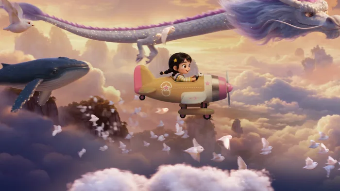</a>

▶ [Watch the full video on ofox.ai](https://ofox.ai/seedance-2-5-prompts?utm_source=github&utm_medium=case&utm_campaign=awesome-seedance-2-5#case-43)

**输入素材**（1 段白模参考视频 + 9 张关键帧参考图，视频只取首帧）

| | | | |
|:---:|:---:|:---:|:---:|
| <br><sub>&lt;video1&gt; 白模首帧</sub> | <br><sub>&lt;2pic&gt;</sub> | <br><sub>&lt;3pic&gt;</sub> | <br><sub>&lt;4pic&gt;</sub> |
| <br><sub>&lt;5pic&gt;</sub> | <br><sub>&lt;6pic&gt;</sub> | <br><sub>&lt;7pic&gt;</sub> | <br><sub>&lt;8pic&gt;</sub> |
| 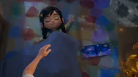<br><sub>&lt;9pic&gt;</sub> | <br><sub>&lt;10pic&gt;</sub> |  |  |

<details>
<summary><strong>Prompt</strong> — 以白模参考视频 &lt;video1&gt; 作为整支视频唯一的运镜、镜头节奏、景别变化、主体运动轨迹和镜头调度参考，严格保持白模视频的镜头顺序、机位变化、运动方式和节奏，不改变镜头结构，不新增镜头，不改变主体运动逻辑。结合各阶段关键帧参考图，生成一部 30 秒电影级 3D 动画短片，整体风格梦幻、童话、温暖，…</summary>

~~~~text
以白模参考视频 <video1> 作为整支视频唯一的运镜、镜头节奏、景别变化、主体运动轨迹和镜头调度参考，严格保持白模视频的镜头顺序、机位变化、运动方式和节奏，不改变镜头结构，不新增镜头，不改变主体运动逻辑。结合各阶段关键帧参考图，生成一部 30 秒电影级 3D 动画短片，整体风格梦幻、童话、温暖，具有儿童幻想色彩，角色外形与各阶段的关键帧保持一致，不要改变角色形象，人物表情情绪随场景变化而改变。
0-3s（首帧参考 <2pic>）镜头由全景俯视缓缓推向地上的小女孩，小女孩坐在房间的地毯上玩飞机，小女孩起身左转，右手使劲一挥将手里的飞机放飞。
3-5s（参考 <3pic>）飞机从左至右穿过房间悬挂的星星挂件，小女孩乘坐飞机进入幻想的天空。
5-8s（参考 <4pic>）镜头继续侧跟，以小女孩为中心的环绕。
8-10s（参考 <5pic>）镜头环绕到小女孩驾驶的飞机背面、飞机开始缓缓俯冲海面。
10-19s（参考 <6pic>、参考 <7pic>）小女孩继续向海底游去，一条鳐鱼游过来入画。
19-23s（参考 <8pic>）小女孩从时空裂缝冲出来到幻想宇宙。
23-24s（参考 <9pic>）前景小女孩和星球开始前翻转并，逐渐幻化消失。
24-28s（参考 <9pic>）俯视镜头持续推进，小女孩躺在地的毯上熟睡。
28-30s（参考 <10pic>）镜头继续推进绘本，随后爸爸进入画面。
整体要求：所有画面均参考对应关键帧，白模视频仅作为运镜、镜头运动和角色动画参考，不参考画面内容。最终输出 30 秒 16:9 横构图宽屏视频。
~~~~

</details>

**参数**：Seedance 2.5 · 火山方舟 · r2v · 30s · 未标注 · 16:9 · 未标注
**来源**：火山方舟官方文档 · [中文](https://docs.volcengine.com/docs/82379/2607689?lang=zh) · [English](https://docs.byteplus.com/en/docs/ModelArk/2607689)

<sub>Preview frame © 2026 ByteDance, from the official demo video · Prompt by ByteDance · <a href="https://docs.volcengine.com/docs/82379/2607689?lang=zh">source</a></sub>

[Back to top](#table-of-contents)

<a id="case-44"></a>
### Case 44: PYONA school corridor fight, part 2 (PYONA 校园走廊格斗·下集) — by @pyona_ai

<a href="https://ofox.ai/seedance-2-5-prompts?utm_source=github&utm_medium=case&utm_campaign=awesome-seedance-2-5#case-44">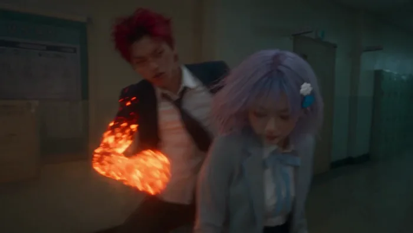</a>

▶ [Watch the full video on ofox.ai](https://ofox.ai/seedance-2-5-prompts?utm_source=github&utm_medium=case&utm_campaign=awesome-seedance-2-5#case-44)

**输入素材**：未公开 —— 原作者只发布了成片，未提供输入素材

<details>
<summary><strong>Prompt</strong> — Use exactly 2 uploaded image assets. image1 = PYONA唯一且最高优先级人物身份与服装参考。严格保持她可辨识的脸部、五官比例、肤色、体型、发型、发色、所有可见配件与image1服装一致。必须像PART 1中同一个真实韩国女性继续战斗。禁止换脸、AI塑料皮…</summary>

~~~~text
Use exactly 2 uploaded image assets. image1 = PYONA唯一且最高优先级人物身份与服装参考。严格保持她可辨识的脸部、五官比例、肤色、体型、发型、发色、所有可见配件与image1服装一致。必须像PART 1中同一个真实韩国女性继续战斗。禁止换脸、AI塑料皮肤、3D、游戏CG。 image2 = 男性火属性对手唯一且最高优先级人物身份与服装参考。严格保持他的可辨识脸部、五官比例、肤色、发型、体型、服装与所有可见特征一致。必须与PART 1为完全同一个真实韩国男性。 生成严格30秒、16:9横屏、原生4K、24fps、one continuous generation的超写实真人韩国校园超自然动作短片。REAL LIVE-ACTION + EXTREMELY FAST CONTINUOUS ELEMENTAL COMBAT。无BGM、无字幕、无旁白、无台词。 【连续性】 严格延续PART 1最终画面。同一条深夜韩国学校走廊。第一帧两人已经处于近距离正面碰撞：男性右拳与前臂被高密度橙红火焰包裹，正在压向PYONA；PYONA双臂前方已有大量透明水形成高速旋转水盾，火与水接触产生白色蒸汽。 禁止重新站位、禁止重新对峙、禁止慢慢准备。第一帧立刻继续战斗。 【能力规则】 PYONA可直接从自身能力持续生成大量真实透明水，完全不依赖环境水源。她不仅使用水强化拳脚，还必须主动使用明显、强力、不同形态的水系技能。 男性直接生成火焰和高热，以近身火焰格斗为主。 禁止巨大海啸、火龙、魔法阵、游戏能量球。水与火必须保持真实液体、蒸汽、热压、惯性和重量感。 【PHYSICAL CONTACT LOCK — 最高优先级】 所有近身动作必须遵循： VISIBLE TARGET → BODY ENTRY → REAL STRIKE MOTION → CLEAR CONTACT → IMMEDIATE BODY REACTION → BALANCE CHANGE / DISPLACEMENT → NEXT ACTION. 禁止接触前提前出现受击反应。 禁止水火VFX代替真实人体动作。 双方都必须成功命中对方。 防御后必须立即反击。 NO CAUTIOUS ACTION. NO HESITATION. NO LIGHT SPARRING. NO WAITING. NO LONG RESET. FULL COMMITMENT ON EVERY ATTACK. 【00:00–00:05 — VORTEX REDIRECT + HYDRAULIC BURST】 第一帧直接爆发。 FIRE FIST PRESSURE → ROTATING WATER SHIELD COMPRESSES → DENSE STEAM BURST。 PYONA不后退。她猛然改变水盾旋转方向，形成WATER VORTEX REDIRECT，真实推动男性右臂向外偏离，男性肩膀和上身随力量转开。 PYONA立即切入： LEFT ELBOW CONTACT → RIGHT BODY PUNCH → KNEE STRIKE。 三次近身攻击连续发生，不能停顿。 最后PYONA双掌真实接触男性胸前后立即发动： HYDRAULIC BURST。 PALM CONTACT FIRST → WATER RAPIDLY COMPRESSES BETWEEN HANDS → POINT-BLANK HIGH-PRESSURE WATER BURST。 短促但极强的透明水压从接触点爆发，男性明显被推退数步。 【00:05–00:10 — FIRE RUSH vs WATER WHIP】 男性后退过程中立即稳住重心，脚后短促火焰辅助真实前冲，FIRE RUSH高速返回。 LEFT FIRE HOOK → PYONA低头闪过； RIGHT FIRE ELBOW实际连接PYONA肩侧 → PYONA上身明显受力并横移一步。 PYONA没有继续退。右手猛然挥出并直接生成一条高速粗水流： WATER WHIP。 水鞭准确缠住男性攻击前臂，PYONA用全身旋转力量猛拉，使男性上身与攻击线被强制带向侧方。 她沿着拉扯方向直接冲入： KNEE CONTACT → WATER-ASSISTED SIDE KICK。 男性被再次逼离，但立刻重新进入战斗。 【00:10–00:15 — PRESSURE WAVE】 男性用高热快速蒸散Water Whip并直接再次前冲。 PYONA不等待，双手向前快速推开，同时从自身瞬间生成大量透明水： PRESSURE WAVE。 不是海啸。是一道填满局部走廊宽度、短距离、高密度、高压的厚重水墙，猛烈向前推进。 男性双臂交叉，以高密度FIRE PRESSURE正面顶住。 PRESSURE WAVE → FIRE CONTACT → VIOLENT STEAM GENERATION。 男性被推动但没有倒下，竟然顶着水压强行穿过逐渐蒸散的水墙。 他从蒸汽中冲出并立即以FIRE FOREARM实际连接PYONA上身，PYONA被强行推开。 【00:15–00:20 — VORTEX BREAK + 强力反攻】 男性继续追击： FIRE BODY HOOK实际命中 → PYONA明确受力； 紧接FIRE KNEE继续前压。 第三次攻击即将进入时，PYONA双臂从下向上猛烈展开。 VORTEX BREAK。 大量水从她身体周围瞬间形成短暂高速螺旋水压场。 不是保护罩，不持续防守。 ROTATING WATER PRESSURE EXPANDS OUTWARD → 男性的攻击手臂、肩部与重心被短暂强制打开。 PYONA立刻从旋涡内部冲出： HYDRO STEP ENTRY → ELBOW CONTACT → BODY KICK → HYDRAULIC PALM。 最后手掌接触后短促水压爆发，把男性再次推离。 【00:20–00:25 — HYDRO DRILL】 男性落脚后立刻再次FIRE RUSH，右前臂形成极高密度火焰层。 PYONA同时右臂后拉，大量透明水瞬间沿手掌、前臂、上臂高速螺旋压缩。 HYDRO DRILL。 水不是魔法光束，而是围绕真实手臂高速旋转的厚重高压水流。 双方正面快速进入： FIRE FOREARM vs ROTATING HYDRO DRILL。 真实前臂距离接近 → 水火正面碰撞 → 高温蒸汽猛烈爆发。 短暂力量对抗后，PYONA猛然将Hydro Drill向外旋转，把男性火焰手臂和肩线一起带偏。 禁止停下来摆Pose。 【00:25–00:30 — MAXIMUM HYDRO FINISH】 男性立即用另一只火拳进行最后一次高速反击。 PYONA左前臂生成短促ROTATING WATER LAYER，将火拳真实接触后向外redirect。 男性因自身高速前进惯性导致躯干打开。 PYONA立即追击，最后一击决定性攻击。
~~~~

</details>

**参数**：Seedance 2.5 · 未标注 · i2v · 30s · 未标注 · 16:9 · 未标注
**来源**：[@pyona_ai](https://x.com/pyona_ai) · [原帖](https://x.com/pyona_ai/status/2093334200112091428)

<sub>Preview © 2026 <a href="https://x.com/pyona_ai/status/2093334200112091428">@pyona_ai</a> · Prompt by <a href="https://x.com/pyona_ai/status/2093334200112091428">@pyona_ai</a></sub>

[Back to top](#table-of-contents)

<a id="video-extend-edit"></a>
### Video Extend & Edit (视频延长和编辑)

<a id="case-45"></a>
### Case 45: Bee pollination macro, +5s extend (蜜蜂授粉微距 · 视频延长) — by ByteDance

<a href="https://ofox.ai/seedance-2-5-prompts?utm_source=github&utm_medium=case&utm_campaign=awesome-seedance-2-5#case-45"></a>

▶ [Watch the full video on ofox.ai](https://ofox.ai/seedance-2-5-prompts?utm_source=github&utm_medium=case&utm_campaign=awesome-seedance-2-5#case-45)

**输入素材**（1 段官方原视频，只取首帧）

| |
|:---:|
| <br><sub>@视频 1 首帧</sub> |

**Prompt**

~~~~text
在 @视频 1 的基础上续写 5 秒的视频，讲一只蜜蜂飞来落在画上，接着微距特写蜜蜂腿部和腹部沾满金黄色花粉颗粒，蜜蜂振翅起飞，镜头跟随它飞向另一朵同种花上，慢镜头中，花粉从蜜蜂绒毛上抖落，精准落入花蕊——授粉瞬间被放大。
~~~~

**参数**：Seedance 2.5 · 火山方舟 · extend · +5s · 720p · 锁定输入 · 未标注
**来源**：火山方舟官方文档 · [中文](https://docs.volcengine.com/docs/82379/2607689?lang=zh) · [English](https://docs.byteplus.com/en/docs/ModelArk/2607689)

<sub>Preview frame © 2026 ByteDance, from the official demo video · Prompt by ByteDance · <a href="https://docs.volcengine.com/docs/82379/2607689?lang=zh">source</a></sub>

[Back to top](#table-of-contents)

<a id="case-46"></a>
### Case 46: Subway chase, video extend (地铁追逐 · 视频延长) — by ByteDance

<a href="https://ofox.ai/seedance-2-5-prompts?utm_source=github&utm_medium=case&utm_campaign=awesome-seedance-2-5#case-46">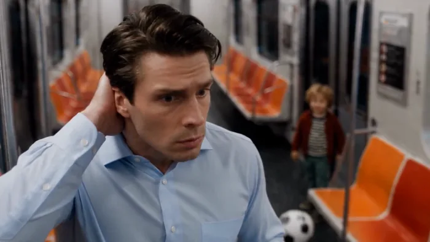</a>

▶ [Watch the full video on ofox.ai](https://ofox.ai/seedance-2-5-prompts?utm_source=github&utm_medium=case&utm_campaign=awesome-seedance-2-5#case-46)

**输入素材**：未公开 —— ByteDance Seed 博客只发布了成片，未随文发布输入素材

**Prompt**

~~~~text
延长视频，衔接 @视频 1 画面内容和主体继续生成一个 30 秒的视频，保持人物主体、场景、画面风格、声音音效一致。小男孩抱着足球沿车厢跑，地铁停稳后侧边门打开，他立刻冲出，男主紧追。两人一路穿过站台跑到街上，惊动街边路人，男主最终追上并抓住他，小男孩委屈抬头，男主慢慢消气，摸摸他的头，露出无奈笑容。
~~~~

**参数**：Seedance 2.5 · 未标注 · extend · 30s · 未标注 · 锁定源视频 · 带音频
**来源**：ByteDance Seed 官方博客 · [中文](https://seed.bytedance.com/zh/blog/one-take-creation-flexible-referencing-introducing-seedance-2-5) · [English](https://seed.bytedance.com/en/blog/one-take-creation-flexible-referencing-introducing-seedance-2-5)

<sub>Preview frame © 2026 ByteDance, from the official demo video · Prompt by ByteDance · <a href="https://seed.bytedance.com/zh/blog/one-take-creation-flexible-referencing-introducing-seedance-2-5">source</a></sub>

[Back to top](#table-of-contents)

<a id="case-47"></a>
### Case 47: Green-screen replacement, three-act football story (绿幕编辑 · 足球励志三段式) — by ByteDance

<a href="https://ofox.ai/seedance-2-5-prompts?utm_source=github&utm_medium=case&utm_campaign=awesome-seedance-2-5#case-47">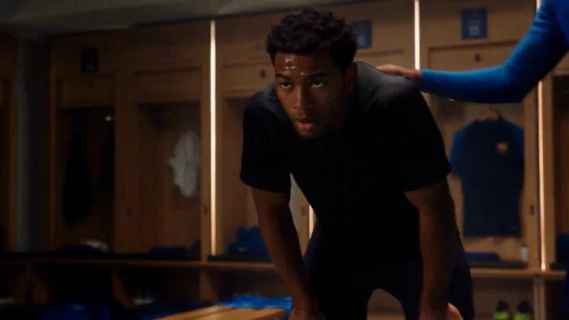</a>

▶ [Watch the full video on ofox.ai](https://ofox.ai/seedance-2-5-prompts?utm_source=github&utm_medium=case&utm_campaign=awesome-seedance-2-5#case-47)

**输入素材**：未公开 —— ByteDance Seed 博客只发布了成片，未随文发布输入素材

**Prompt**

~~~~text
把 @视频 1 绿幕背景渲染场景、障碍、服装和配角：0-4 秒：户外训练，障碍换石头、砖块、轮胎、木箱；4-10 秒：休息室，朋友鼓励；10-15 秒：国际赛场，训练杆换原创防守球员和门将，主角进球。整体写实电影级。
~~~~

**参数**：Seedance 2.5 · 未标注 · edit · 15s（由分段隐含）· 未标注 · 锁定源视频 · 未标注
**来源**：ByteDance Seed 官方博客 · [中文](https://seed.bytedance.com/zh/blog/one-take-creation-flexible-referencing-introducing-seedance-2-5) · [English](https://seed.bytedance.com/en/blog/one-take-creation-flexible-referencing-introducing-seedance-2-5)

<sub>Preview frame © 2026 ByteDance, from the official demo video · Prompt by ByteDance · <a href="https://seed.bytedance.com/zh/blog/one-take-creation-flexible-referencing-introducing-seedance-2-5">source</a></sub>

[Back to top](#table-of-contents)

<a id="case-48"></a>
### Case 48: Remove unwanted people from a clip (视频编辑 · 删除多余人物) — by ByteDance

<a href="https://ofox.ai/seedance-2-5-prompts?utm_source=github&utm_medium=case&utm_campaign=awesome-seedance-2-5#case-48">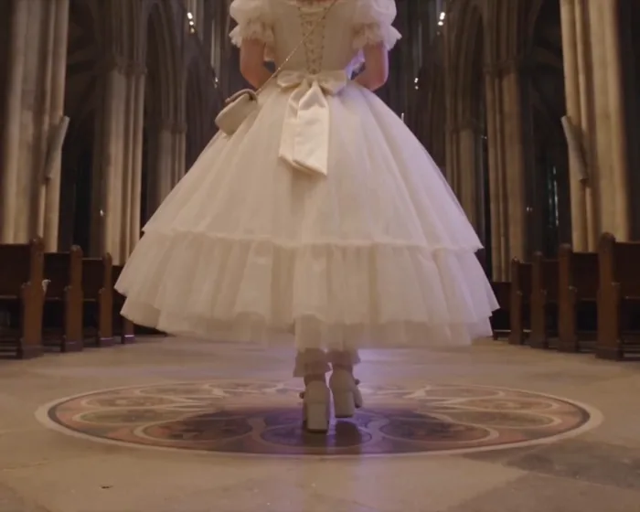</a>

▶ [Watch the full video on ofox.ai](https://ofox.ai/seedance-2-5-prompts?utm_source=github&utm_medium=case&utm_campaign=awesome-seedance-2-5#case-48)

**输入素材**（1 段官方原视频，只取首帧）

| |
|:---:|
| 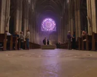<br><sub>@视频1 首帧</sub> |

**Prompt**

~~~~text
视频编辑：删除 @视频1中的所有人，除了主角。
~~~~

**参数**：Seedance 2.5 · 火山方舟 · edit · 锁定输入（`duration: -1`，成片约 16s）· 未标注 · adaptive（锁定输入，5:4）· 带音频
**来源**：火山方舟官方文档 · [中文](https://docs.volcengine.com/docs/82379/2607688?lang=zh) · [English](https://docs.byteplus.com/en/docs/ModelArk/2607688)

<sub>Preview frame © 2026 ByteDance, from the official demo video · Prompt by ByteDance · <a href="https://docs.volcengine.com/docs/82379/2607688?lang=zh">source</a></sub>

[Back to top](#table-of-contents)

<a id="case-49"></a>
### Case 49: Extend a clip through a window into a gallery (视频延长 · 穿窗进入美术馆) — by ByteDance

<a href="https://ofox.ai/seedance-2-5-prompts?utm_source=github&utm_medium=case&utm_campaign=awesome-seedance-2-5#case-49">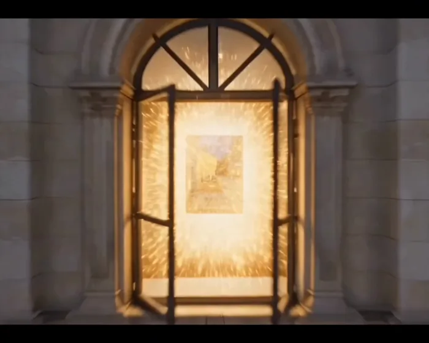</a>

▶ [Watch the full video on ofox.ai](https://ofox.ai/seedance-2-5-prompts?utm_source=github&utm_medium=case&utm_campaign=awesome-seedance-2-5#case-49)

**输入素材**（3 段官方参考视频，只取首帧）

| | | |
|:---:|:---:|:---:|
| 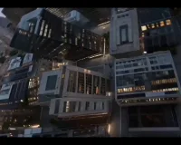<br><sub>@视频1 首帧</sub> | 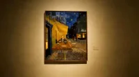<br><sub>@视频2 首帧</sub> | 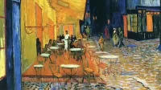<br><sub>@视频3 首帧</sub> |

**Prompt**

~~~~text
延长@视频1，窗户打开后进入@视频2的美术馆室内，最后镜头进入@视频3的画内
~~~~

**参数**：Seedance 2.5 · 火山方舟 · extend · 11s · 未标注 · adaptive（锁定 video1，7:5）· 带音频
**来源**：火山方舟官方文档 · [中文](https://docs.volcengine.com/docs/82379/2607688?lang=zh) · [English](https://docs.byteplus.com/en/docs/ModelArk/2607688)

<sub>Preview frame © 2026 ByteDance, from the official demo video · Prompt by ByteDance · <a href="https://docs.volcengine.com/docs/82379/2607688?lang=zh">source</a></sub>

[Back to top](#table-of-contents)

<a id="case-50"></a>
### Case 50: Fine clay-model re-render, cyberpunk rooftop raccoon (细粒度白模 · 赛博朋克屋顶小浣熊) — by ByteDance

<a href="https://ofox.ai/seedance-2-5-prompts?utm_source=github&utm_medium=case&utm_campaign=awesome-seedance-2-5#case-50">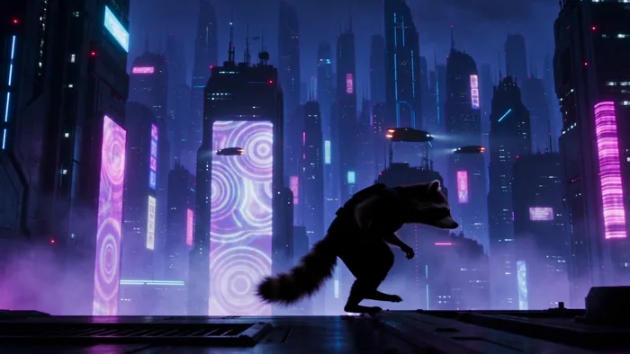</a>

▶ [Watch the full video on ofox.ai](https://ofox.ai/seedance-2-5-prompts?utm_source=github&utm_medium=case&utm_campaign=awesome-seedance-2-5#case-50)

**输入素材**（1 段官方白模参考视频，只取首帧）

| |
|:---:|
| 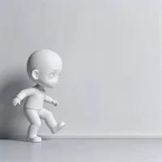<br><sub>视频 1 白模首帧</sub> |

**Prompt**

~~~~text
将视频 1 进行白模渲染，无 bgm，只生成环境音和动作音。
渲染要求：背景为深蓝与紫色色调的夜晚赛博朋克都市，密集的摩天大楼，楼宇间是巨大的全息广告牌与霓虹灯光，数个飞行器在空中穿梭，闪着微弱的灯光，发出微弱的机械声响；人物为一个身着黑色夜行衣的小浣熊，身影为一道剪影，脚步小心翼翼；人物移动的地点是摩天大楼中的一栋楼的屋顶。
~~~~

**参数**：Seedance 2.5 · 火山方舟 · r2v（白模重渲染）· 6s · 720p · 锁定输入 · 带音频（无 BGM，仅环境音与动作音效）
**来源**：火山方舟官方文档 · [中文](https://docs.volcengine.com/docs/82379/2607689?lang=zh) · [English](https://docs.byteplus.com/en/docs/ModelArk/2607689)

<sub>Preview frame © 2026 ByteDance, from the official demo video · Prompt by ByteDance · <a href="https://docs.volcengine.com/docs/82379/2607689?lang=zh">source</a></sub>

[Back to top](#table-of-contents)

<a id="case-51"></a>
### Case 51: Instruction edit, ageing a character from 20s to 60s (视频指令编辑 · 女主从二十多岁老去到六十岁) — by ByteDance

<a href="https://ofox.ai/seedance-2-5-prompts?utm_source=github&utm_medium=case&utm_campaign=awesome-seedance-2-5#case-51"></a>

▶ [Watch the full video on ofox.ai](https://ofox.ai/seedance-2-5-prompts?utm_source=github&utm_medium=case&utm_campaign=awesome-seedance-2-5#case-51)

**输入素材**（1 段官方原视频，只取首帧）

| |
|:---:|
| <br><sub>@视频 1 首帧</sub> |

**Prompt**

~~~~text
保留 @视频 1 的构图、机位、光线与表演节奏，只改写画面里女主的样貌与神情：让她从二十多岁自然地老去到六十岁，眼神里的隐忍慢慢化开，泪光滑过眼角，嘴角一点点扬起，最后破涕为笑。全程一镜到底，不跳切、不闪烁，五官随年龄渐变而不漂移。
~~~~

**参数**：Seedance 2.5 · 火山方舟 · edit · 锁定输入 · 未标注 · 锁定输入 · 未标注
**来源**：火山方舟官方文档 · [中文](https://docs.volcengine.com/docs/82379/2607689?lang=zh) · [English](https://docs.byteplus.com/en/docs/ModelArk/2607689)

<sub>Preview frame © 2026 ByteDance, from the official demo video · Prompt by ByteDance · <a href="https://docs.volcengine.com/docs/82379/2607689?lang=zh">source</a></sub>

[Back to top](#table-of-contents)

<a id="case-52"></a>
### Case 52: Reference-image edit, medieval duel (视频参考图编辑 · 中世纪冷兵器决斗) — by ByteDance

<a href="https://ofox.ai/seedance-2-5-prompts?utm_source=github&utm_medium=case&utm_campaign=awesome-seedance-2-5#case-52"></a>

▶ [Watch the full video on ofox.ai](https://ofox.ai/seedance-2-5-prompts?utm_source=github&utm_medium=case&utm_campaign=awesome-seedance-2-5#case-52)

**输入素材**（1 段官方原视频 + 3 张参考图，视频只取首帧）

| | | | |
|:---:|:---:|:---:|:---:|
| <br><sub>@视频 1 首帧</sub> | <br><sub>@图片 1 · 场景</sub> | <br><sub>@图片 2 · 深色衣服</sub> | <br><sub>@图片 3 · 浅色衣服</sub> |

<details>
<summary><strong>Prompt</strong> — 将两人武打素版视频 @视频 1 替换为冷兵器对决前的空手试探风。 场景替换为中世纪石堡平台、古老庭院平地、山间堡垒外平台或简洁石砖决斗场，背景为古堡墙体、风、雾、远处山线，地面平整石质 @图片 1。 视频中深色衣服的男子的服饰替换为 @图片 2，视频中浅色衣服的男子替换为 @图片 3。动作仍然保持不…</summary>

~~~~text
将两人武打素版视频 @视频 1 替换为冷兵器对决前的空手试探风。
场景替换为中世纪石堡平台、古老庭院平地、山间堡垒外平台或简洁石砖决斗场，背景为古堡墙体、风、雾、远处山线，地面平整石质 @图片 1。
视频中深色衣服的男子的服饰替换为 @图片 2，视频中浅色衣服的男子替换为 @图片 3。动作仍然保持不变，不改变原始节奏。
AI 特效仅做环境和质感强化：风吹衣摆、轻雾、接触点少量尘土、金属冷色反光质感、轻微颗粒和史诗感调色。整体风格为克制、真实、古典硬派决斗氛围。背景音乐卡点。
~~~~

</details>

**参数**：Seedance 2.5 · 火山方舟 · edit · 锁定输入 · 未标注 · 锁定输入 · 带音频
**来源**：火山方舟官方文档 · [中文](https://docs.volcengine.com/docs/82379/2607689?lang=zh) · [English](https://docs.byteplus.com/en/docs/ModelArk/2607689)

<sub>Preview frame © 2026 ByteDance, from the official demo video · Prompt by ByteDance · <a href="https://docs.volcengine.com/docs/82379/2607689?lang=zh">source</a></sub>

[Back to top](#table-of-contents)

<a id="case-53"></a>
### Case 53: Audio edit, redub and re-sync lip movement (视频音频编辑 · 台词翻译成中文并重对口型) — by ByteDance

<a href="https://ofox.ai/seedance-2-5-prompts?utm_source=github&utm_medium=case&utm_campaign=awesome-seedance-2-5#case-53"></a>

▶ [Watch the full video on ofox.ai](https://ofox.ai/seedance-2-5-prompts?utm_source=github&utm_medium=case&utm_campaign=awesome-seedance-2-5#case-53)

**输入素材**（1 段官方原视频，只取首帧）

| |
|:---:|
| <br><sub>原视频首帧</sub> |

**Prompt**

~~~~text
将视频中的人声台词，翻译成中文，无字幕，口型做出对应的精准改变，其余均保持不变。
~~~~

**参数**：Seedance 2.5 · 火山方舟 · edit（音轨）· 锁定输入 · 未标注 · 锁定输入 · 带音频（无字幕）
**来源**：火山方舟官方文档 · [中文](https://docs.volcengine.com/docs/82379/2607689?lang=zh) · [English](https://docs.byteplus.com/en/docs/ModelArk/2607689)

<sub>Preview frame © 2026 ByteDance, from the official demo video · Prompt by ByteDance · <a href="https://docs.volcengine.com/docs/82379/2607689?lang=zh">source</a></sub>

[Back to top](#table-of-contents)

<a id="case-54"></a>
### Case 54: Seamless transition, mahjong tiles into skyscrapers (视频无缝转场 · 麻将牌变高楼) — by ByteDance

<a href="https://ofox.ai/seedance-2-5-prompts?utm_source=github&utm_medium=case&utm_campaign=awesome-seedance-2-5#case-54"></a>

▶ [Watch the full video on ofox.ai](https://ofox.ai/seedance-2-5-prompts?utm_source=github&utm_medium=case&utm_campaign=awesome-seedance-2-5#case-54)

**输入素材**（2 段官方待衔接视频，只取首帧）

| | |
|:---:|:---:|
| <br><sub>视频 1 首帧</sub> | <br><sub>视频 2 首帧</sub> |

**Prompt**

~~~~text
将【视频 1】和【视频 2】衔接起来，【视频 1】的视角急需飞行至顶端快速折返，视角垂直向下俯冲，然后无缝自然地衔接转场到【视频 2】，在镜头切换的过程中麻将牌慢慢变成高楼。整个场景也对应变化，同时不要改变上传的两个视频。
~~~~

**参数**：Seedance 2.5 · 火山方舟 · 无缝转场 · 未标注 · 未标注 · 锁定输入 · 未标注
**来源**：火山方舟官方文档 · [中文](https://docs.volcengine.com/docs/82379/2607689?lang=zh) · [English](https://docs.byteplus.com/en/docs/ModelArk/2607689)

<sub>Preview frame © 2026 ByteDance, from the official demo video · Prompt by ByteDance · <a href="https://docs.volcengine.com/docs/82379/2607689?lang=zh">source</a></sub>

[Back to top](#table-of-contents)

<a id="image-edit"></a>
### Image Edit (图生图和修图)

<a id="case-55"></a>
### Case 55: Dubstep photo-animation edit (回响贝斯照片动画剪辑) — by @rahulnanda86

<a href="https://ofox.ai/seedance-2-5-prompts?utm_source=github&utm_medium=case&utm_campaign=awesome-seedance-2-5#case-55"></a>

▶ [Watch the full video on ofox.ai](https://ofox.ai/seedance-2-5-prompts?utm_source=github&utm_medium=case&utm_campaign=awesome-seedance-2-5#case-55)

**输入素材**：未公开 —— 原作者只发布了成片，未提供输入素材

<details>
<summary><strong>Prompt</strong> — Create a fast, trippy 30-second dubstep music video using all the uploaded photographs  (PLEASE FIND ATTACHED ALL 14 IMAGES + AUDIO IN THREAD).  Use t…</summary>

~~~~text
Create a fast, trippy 30-second dubstep music video using all the uploaded photographs

(PLEASE FIND ATTACHED ALL 14 IMAGES + AUDIO IN THREAD).

Use the uploaded 30-second audio as the only soundtrack. Make it a powerful dubstep edit: every movement, punch-in, transition and hard cut must hit the beat. Fully animate everything inside the photographs. Make the dancers perform, fabric and flames spin, painted eyes react, masks lunge, multiple arms ripple, the drummer strike his drum, sadhus dissolve into ash and black birds, motorcycles race aggressively, smoke creatures come alive, the underwater band actively play, boats move through the surreal landscape, and the flaming weapon create violent circles of fire. No photograph should remain static.Freely mix all the visuals in whatever order works best with the music. Let movement from one photograph naturally transform into the next: spinning fire becomes fabric, fabric becomes a painted eye, expanding arms become the drummer's arms, ash birds become racing motorcycles, motorcycle dust becomes dancing smoke, smoke becomes underwater bubbles, bubbles become water and boats, and the boats transform into circles of fire.Keep constant movement throughout. Use rapid punch-ins, speed ramps, bass-impact flashes, hard rhythmic cuts, brief freeze-frames and fluid psychedelic transitions. Add a separate graphic layer flashing ॐ, the trishul, damru, third eye, crescent moon and traditional Hindu sacred symbols precisely on the beat. Let them pulse, rotate, distort and dissolve without covering the performers.Make it stylish, colourful, strange and extremely high-energy—an edgy, award-winning Incredible India advertisement edited like a dubstep music video. No dialogue, no typography, no slideshow, no long static shots and no complicated story. Finish with the strongest collision of fire, ash, birds and sacred symbols on the final bass hit.

#capcutseedance25 #capcutcpp
~~~~

</details>

**参数**：Seedance 2.5 · CapCut · edit · 30s · 未标注 · 未标注 · 带音频
**来源**：[@rahulnanda86](https://x.com/rahulnanda86) · [原帖](https://x.com/rahulnanda86/status/2083355736479052209)

<sub>Preview © 2026 <a href="https://x.com/rahulnanda86/status/2083355736479052209">@rahulnanda86</a> · Prompt by <a href="https://x.com/rahulnanda86/status/2083355736479052209">@rahulnanda86</a></sub>

[Back to top](#table-of-contents)

<a id="case-56"></a>
### Case 56: Locked-illustration creature story (锁定原画的生物故事) — by @AiMeowing

<a href="https://ofox.ai/seedance-2-5-prompts?utm_source=github&utm_medium=case&utm_campaign=awesome-seedance-2-5#case-56"></a>

▶ [Watch the full video on ofox.ai](https://ofox.ai/seedance-2-5-prompts?utm_source=github&utm_medium=case&utm_campaign=awesome-seedance-2-5#case-56)

**输入素材**：未公开 —— 原作者只发布了成片，未提供输入素材

<details>
<summary><strong>Prompt</strong> — Lock the original illustration completely. Preserve the exact art style, brushwork, textures, material rendering, color palette, creature proportions,…</summary>

~~~~text
Lock the original illustration completely. Preserve the exact art style, brushwork, textures, material rendering, color palette, creature proportions, facial expressions, lighting, composition, and every character design exactly as shown. Never change the visual style. Every creature must remain identical in every shot. No text, watermark, logo, or signature. One continuous story. Motion always progresses forward. No creature moves backward. Use cinematic pacing with hard cuts, speed ramps, bullet time, dynamic tracking, volumetric water, realistic physics, motion blur, subtle film grain, dramatic lighting, lens droplets, cinematic depth of field, bold camera language, emotional facial animation, and seamless transitions.

0-3s

Without warning, the peaceful group suddenly notices every bird exploding into the sky. Tiny ripples appear beneath their feet. A deep rumble grows louder. Extreme close-up of frightened eyes. Fast push-in toward the rabbit. Hard cut to a gigantic wall of water rising behind them. Lightning-fast whip pan reveals the impossible tsunami racing toward the camera. Deep bass hit.

3-6s

The wave crashes over everyone. Water engulfs the frame. Camera tumbles underwater with bubbles, debris, flowers, leaves and sunlight cutting through the current. Every creature is separated naturally by the force. Slow-motion for one second before time accelerates again.

6-10s

Rapid cross-cut survival sequence. The rabbit paddles frantically with long ears floating behind. The lion powers through the waves with strong strokes. The rhino kicks heavily while struggling to stay above water. The giant blue triceratops swims like a massive whale. Frogs leap from floating debris. Tiny creatures cling to drifting branches. Cats desperately paddle while trying not to sink. Dynamic handheld water-level camera alternating with overhead drone shots.

10-15s

The current becomes more violent. Floating logs collide. The turtle spins helplessly in a whirlpool before escaping. The sheep nearly slips beneath the surface until the lion nudges it upward. The black cat loses its grip and disappears beneath a wave. Silence for half a second except muffled underwater sound.

15-20s

The gray kitten dives underwater searching. Cinematic underwater tracking follows the kitten weaving between drifting plants and bubbles. A frightened turtle struggles below. The kitten reaches it, grabs its shell with tiny paws and guides it upward toward sunlight breaking through the surface.

20-25s

Both burst above the water. The exhausted kitten climbs onto the turtle's shell. The turtle begins swimming steadily through the endless flood while the kitten balances carefully, soaked but relieved. Around them every animal continues fighting the current in its own unique way. Long aerial tracking shot follows their path.

25-28s

The current slowly weakens. One by one the surviving animals regroup behind the turtle. The rabbit swims beside it. Frogs hop onto floating wood. The lion keeps everyone together. The enormous blue triceratops shields the smaller creatures from remaining waves. Warm sunlight finally pierces the storm clouds.

28-30s

A majestic vertical drone shot rises high into the sky. The flood forms beautiful winding rivers across the landscape. At the center, the tiny kitten sits safely on the turtle's shell leading the group forward while every surviving creature follows behind. The music swells into an emotional orchestral finale. Hold the final frame like an animated movie poster as golden light reflects across the water.
~~~~

</details>

**参数**：Seedance 2.5 · 即梦 · edit · 30s · 未标注 · 未标注 · 带音频
**来源**：[@AiMeowing](https://x.com/AiMeowing) · [原帖](https://x.com/AiMeowing/status/2083332412558172377)

<sub>Preview © 2026 <a href="https://x.com/AiMeowing/status/2083332412558172377">@AiMeowing</a> · Prompt by <a href="https://x.com/AiMeowing/status/2083332412558172377">@AiMeowing</a></sub>

[Back to top](#table-of-contents)

<a id="product-image"></a>
### Product Image (电商主图和海报)

_No cases yet — [contribute one](CONTRIBUTING.md)._

[Back to top](#table-of-contents)

<a id="music-video"></a>
### Music Video (音乐可视化和MV)

<a id="case-57"></a>
### Case 57: Multilingual hip-hop MV, eight-language lip-sync (多语言 Hip-hop MV · 8 种语言口型) — by ByteDance

<a href="https://ofox.ai/seedance-2-5-prompts?utm_source=github&utm_medium=case&utm_campaign=awesome-seedance-2-5#case-57"></a>

▶ [Watch the full video on ofox.ai](https://ofox.ai/seedance-2-5-prompts?utm_source=github&utm_medium=case&utm_campaign=awesome-seedance-2-5#case-57)

**输入素材**（1 张官方参考图）

| |
|:---:|
| <br><sub>@图像1</sub> |

<details>
<summary><strong>Prompt</strong> — 电影级 hip-hop / 说唱音乐视频，真实照片级质感，高端调性，海边场景。以@图像1构建画面：一支乐队在金色沙滩、海浪拍岸的岸边表演 —— 一名主唱手握麦克风、麦架立于湿沙上激情演唱，一名吉他手立于画面左侧，一名吉他手立于画面右侧，一名鼓手坐在后方的架子鼓后敲击；辽阔的海岸线在身后展开，滚滚海浪…</summary>

~~~~text
电影级 hip-hop / 说唱音乐视频，真实照片级质感，高端调性，海边场景。以@图像1构建画面：一支乐队在金色沙滩、海浪拍岸的岸边表演 —— 一名主唱手握麦克风、麦架立于湿沙上激情演唱，一名吉他手立于画面左侧，一名吉他手立于画面右侧，一名鼓手坐在后方的架子鼓后敲击；辽阔的海岸线在身后展开，滚滚海浪层层涌来，巨大而温暖的黄金时刻夕阳斜掠过沙滩、在水面上粼粼闪耀，空气中漂浮着海雾与咸湿水汽。 红色运动服的主唱对着镜头充满节奏感地 RAP 演唱 —— 口型与下颌随每一个字精准对位，头随节拍用力点动，带动整段 flow。乐手们随节奏摇摆律动，身后海浪层层拍岸。这是一首明快带劲的说唱曲 —— 语速快、自信、节拍强劲。踩着节拍硬切（HARD CUT），每次切换双重反差（景别与镜头类型同时改变）。 歌词（主唱依次演唱以下每种语言的「你好」，精准对口型）： 英语："Hello" 中文："你好" 日语："こんにちは" 韩语："안녕하세요" 葡萄牙语："Olá" 泰语："สวัสดี" 西班牙语："Hola" 阿拉伯语："مرحبا" 镜头 1 [0:00–0:03] —— 低角度大远景定场，斯坦尼康在黄金夕照与海雾中缓缓推进，海浪在乐队身后翻涌。歌词第 1 句（英语「Hello」）。硬切。镜头 2 [0:03–0:05] —— 红运动服主唱对镜头 RAP 的特写，手持甩镜切入，身后海面虚焦粼粼波光。歌词第 2 句（中文「你好」）。硬切。镜头 3 [0:05–0:08] —— 微距插入镜头，固定机位，吉他手的手指在弦上快速拨动，沙粒与咸湿水雾从画面前掠过。歌词第 3 句（日语「こんにちは」）。硬切。镜头 4 [0:08–0:10] —— 对某位乐手的 3/4 侧中景，缓慢潜行环绕，乐器金属件与湿润高光映着海面低斜的夕阳。歌词第 4 句（韩语「안녕하세요」）。硬切。镜头 5 [0:10–0:13] —— 岸边一名乐手，快速横移轨道掠过他，他转向镜头，身后一道浪花破碎。歌词第 5 句（葡萄牙语「Olá」）。硬切。镜头 6 [0:13–0:15] —— 水边的鼓手，手持快速上摇，海风与水花吹动他的头发，他随节拍律动敲击。歌词第 6 句（泰语「สวัสดี」）。硬切。镜头 7 [0:15–0:18] —— 对红运动服主唱 flow 正酣时的紧凑猛推，富攻击性的手持，身后暮色海面衬着乐队剪影。歌词第 7 句（西班牙语「Hola」）。硬切。镜头 8 [0:18–0:20] —— 全乐队英雄式大远景，富攻击性的手持推进，主唱与乐手踩着节拍向镜头迈步，海浪拍碎、金色夕光在整支乐队身后炸开光晕。歌词第 8 句（阿拉伯语「مرحبا」）。 白平衡 4000K，青橙（teal-and-amber）调色，35mm，浅景深，胶片颗粒，弥漫的海雾，黄金时刻光晕。质感扎实、高级、高端。节奏感说唱表演，精准对口型，头随节拍点动。无字幕、无文字叠加、无叠化转场、无重复人物，仅用硬切。总时长 20 秒。
~~~~

</details>

**参数**：Seedance 2.5 · 火山方舟 · r2v · 20s · 未标注 · 16:9 · 带音频
**来源**：火山方舟官方文档 · [中文](https://docs.volcengine.com/docs/82379/2607688?lang=zh) · [English](https://docs.byteplus.com/en/docs/ModelArk/2607688)

<sub>Preview frame © 2026 ByteDance, from the official demo video · Prompt by ByteDance · <a href="https://docs.volcengine.com/docs/82379/2607688?lang=zh">source</a></sub>

[Back to top](#table-of-contents)

<a id="case-58"></a>
### Case 58: One-take concert entrance (一镜到底演唱会登台) — by ByteDance

<a href="https://ofox.ai/seedance-2-5-prompts?utm_source=github&utm_medium=case&utm_campaign=awesome-seedance-2-5#case-58"></a>

▶ [Watch the full video on ofox.ai](https://ofox.ai/seedance-2-5-prompts?utm_source=github&utm_medium=case&utm_campaign=awesome-seedance-2-5#case-58)

<details>
<summary><strong>Prompt</strong> — 一镜到底手持稳定器跟拍，镜头从红色厚重幕布缝隙缓缓推进，进入暖色后台化妆间。年轻女歌手背对镜头整理耳机，工作人员提醒她准备登台。她回头看向镜头，开始唱起 City Pop。镜头后退跟拍，歌手穿过幕布进后台通道，与舞伴自然互动，一位工作人员把麦克风递给她。随后歌手与舞伴登上舞台，镜头绕至背面，红黑舞美…</summary>

~~~~text
一镜到底手持稳定器跟拍，镜头从红色厚重幕布缝隙缓缓推进，进入暖色后台化妆间。年轻女歌手背对镜头整理耳机，工作人员提醒她准备登台。她回头看向镜头，开始唱起 City Pop。镜头后退跟拍，歌手穿过幕布进后台通道，与舞伴自然互动，一位工作人员把麦克风递给她。随后歌手与舞伴登上舞台，镜头绕至背面，红黑舞美、LED 屏、追光、烟雾与反光地板逐渐展开。镜头最终拉远至体育馆全景，呈现满场观众、灯牌、荧光棒与欢呼声，营造年轻自由的演唱会高潮氛围。
~~~~

</details>

**参数**：Seedance 2.5 · 未标注 · t2v · 30s · 未标注 · 未标注 · 带音频
**来源**：ByteDance Seed 官方博客 · [中文](https://seed.bytedance.com/zh/blog/one-take-creation-flexible-referencing-introducing-seedance-2-5) · [English](https://seed.bytedance.com/en/blog/one-take-creation-flexible-referencing-introducing-seedance-2-5)

<sub>Preview frame © 2026 ByteDance, from the official demo video · Prompt by ByteDance · <a href="https://seed.bytedance.com/zh/blog/one-take-creation-flexible-referencing-introducing-seedance-2-5">source</a></sub>

[Back to top](#table-of-contents)

<a id="case-59"></a>
### Case 59: 30-second classical concert (30 秒古典音乐会) — by ByteDance

<a href="https://ofox.ai/seedance-2-5-prompts?utm_source=github&utm_medium=case&utm_campaign=awesome-seedance-2-5#case-59"></a>

▶ [Watch the full video on ofox.ai](https://ofox.ai/seedance-2-5-prompts?utm_source=github&utm_medium=case&utm_campaign=awesome-seedance-2-5#case-59)

**输入素材**：未公开 —— ByteDance Seed 博客只发布了成片，未随文发布输入素材

<details>
<summary><strong>Prompt</strong> — 30 秒音乐会片段，16:9 横屏，电影感写实，真实音乐厅光影，暖金色舞台灯，正式古典音乐会氛围。场景@图一，钢琴家参考@图二，大提琴参考@图三，小提琴参考@图四，主唱参考@图五，管弦等其他乐队参考@图六到图十，合唱团参考图十一到图十四，观众席参考@图十五到图十八。主唱舞台中央走向前沿，钢琴家在钢琴…</summary>

~~~~text
30 秒音乐会片段，16:9 横屏，电影感写实，真实音乐厅光影，暖金色舞台灯，正式古典音乐会氛围。场景@图一，钢琴家参考@图二，大提琴参考@图三，小提琴参考@图四，主唱参考@图五，管弦等其他乐队参考@图六到图十，合唱团参考图十一到图十四，观众席参考@图十五到图十八。主唱舞台中央走向前沿，钢琴家在钢琴旁，乐队分布两侧与后方，合唱团在舞台后方。开场高位俯拍音乐厅全景，钢琴家落键，主唱进入追光演唱，镜头自然带过小提琴、大提琴与管弦乐队，小提琴明亮，大提琴温暖。后段合唱团加入，主唱与第一排观众短暂眼神交流，观众微笑点头。结尾镜头后移，演唱结束，观众跟随鼓掌。
~~~~

</details>

**参数**：Seedance 2.5 · 未标注 · r2v · 30s · 未标注 · 16:9 · 带音频
**来源**：ByteDance Seed 官方博客 · [中文](https://seed.bytedance.com/zh/blog/one-take-creation-flexible-referencing-introducing-seedance-2-5) · [English](https://seed.bytedance.com/en/blog/one-take-creation-flexible-referencing-introducing-seedance-2-5)

<sub>Preview frame © 2026 ByteDance, from the official demo video · Prompt by ByteDance · <a href="https://seed.bytedance.com/zh/blog/one-take-creation-flexible-referencing-introducing-seedance-2-5">source</a></sub>

[Back to top](#table-of-contents)

<a id="case-60"></a>
### Case 60: Idol pop performance, full lyrics & BPM (偶像流行音乐表演·完整歌词与节拍) — by @stocktrading0

<a href="https://ofox.ai/seedance-2-5-prompts?utm_source=github&utm_medium=case&utm_campaign=awesome-seedance-2-5#case-60"></a>

▶ [Watch the full video on ofox.ai](https://ofox.ai/seedance-2-5-prompts?utm_source=github&utm_medium=case&utm_campaign=awesome-seedance-2-5#case-60)

**输入素材**：未公开 —— 原作者只发布了成片，未提供输入素材

<details>
<summary><strong>Prompt</strong> — 16:9 aspect ratio. All lyrics sung in Japanese. Subject: Suzuko-chan from attached image. Scene: All-ages, live stage with no audience. Shooting strat…</summary>

~~~~text
16:9 aspect ratio. All lyrics sung in Japanese. Subject: Suzuko-chan from attached image. Scene: All-ages, live stage with no audience. Shooting strategy: 4-shot composition utilizing full screen, smooth tracking, suppress sudden jitter. Background music spec: Complete within 20 seconds. Genre: Fast-paced idol pop. Tempo: BPM 170. Characteristics: Fast-paced beat, clear synthesizer effects, fresh and vibrant major key melody.

Shot 1 (0:00-0:05) Camera: Large-scale tilting motion from bottom to top-left diagonal. Action: Lightly move from screen right to center and dance. Lyrics: Let it echo in the clear sky.

Shot 2 (0:05-0:10) Camera: Smooth diagonal pan from top-left to bottom-right. Action: Dynamic movement toward screen left while continuing rotation. Lyrics: Advance with unstoppable rhythm.

Shot 3 (0:10-0:15) Camera: Tracking shot pushing forward from behind subject. Action: Large jump from background toward foreground, rushing toward camera. Lyrics: Chase that shining light.

Shot 4 (0:15-0:20) Camera: Wide shot capturing overview from top diagonal angle, pulling further upward. Action: Spin at center background, reaching toward sky at conclusion. Lyrics: Touch the future I envision.
~~~~

</details>

**参数**：Seedance 2.5 · 未标注 · i2v · 未标注 · 未标注 · 未标注 · 未标注
**来源**：[@stocktrading0](https://x.com/stocktrading0) · [原帖](https://x.com/stocktrading0/status/2092593635380363512)

<sub>Preview © 2026 <a href="https://x.com/stocktrading0/status/2092593635380363512">@stocktrading0</a> · Prompt by <a href="https://x.com/stocktrading0/status/2092593635380363512">@stocktrading0</a></sub>

[Back to top](#table-of-contents)

<a id="case-61"></a>
### Case 61: 90s underground gangster-anime beatbox MV (90年代地下帮派动漫节奏口技MV) — by @Madhuribhai

<a href="https://ofox.ai/seedance-2-5-prompts?utm_source=github&utm_medium=case&utm_campaign=awesome-seedance-2-5#case-61"></a>

▶ [Watch the full video on ofox.ai](https://ofox.ai/seedance-2-5-prompts?utm_source=github&utm_medium=case&utm_campaign=awesome-seedance-2-5#case-61)

<details>
<summary><strong>Prompt</strong> — 创作一个 50 秒的电影级动漫音乐视频，采用 90 年代粗粝的地下黑帮美学，主角是一位冷酷、自信的 beatbox 表演者，身穿深色西装，佩戴黑色墨镜和金项链。 视觉风格：手绘日本动漫风格，具有高度细腻的墨线、传神的眼睛、戏剧性的阴影、微妙的胶片颗粒感、90 年代动画特有的轻微瑕疵质感、柔和的青橙色…</summary>

~~~~text
创作一个 50 秒的电影级动漫音乐视频，采用 90 年代粗粝的地下黑帮美学，主角是一位冷酷、自信的 beatbox 表演者，身穿深色西装，佩戴黑色墨镜和金项链。 视觉风格：手绘日本动漫风格，具有高度细腻的墨线、传神的眼睛、戏剧性的阴影、微妙的胶片颗粒感、90 年代动画特有的轻微瑕疵质感、柔和的青橙色调灯光、烟雾缭绕的氛围以及复古的城市色彩分级。 角色进行高强度的 beatbox 表演，嘴部动作精准，肢体语言自信。使用与节奏自然呼应的剪辑：墨镜后眼睛的极度特写、嘴部动作、手指敲击、点头、调整墨镜以及缓慢自信的手势。 场景设定在 90 年代阴暗的地下城市环境中，背景包括布满涂鸦的墙壁、烟雾弥漫的小巷、昏暗的霓虹灯、老式汽车、阴影中的黑帮人物和朦胧的路灯。保持环境在动漫世界观内的写实感与可信度。 镜头语言：缓慢推镜头、低角度黑帮视角、戏剧性特写、平滑的追踪镜头、偶尔的手持拍摄感，以及与重音完美契合的剪辑。添加微妙的 VHS 时代瑕疵、模拟噪点、光线闪烁和复古电影颗粒感，同时确保画面清晰。 节奏循序渐进。从神秘的慢镜头开始，引入 beatbox 表演者，随着节奏增强，剪辑速度加快。结尾处以一个强有力的特写镜头收尾，主角调整墨镜并直视镜头。 关键要求：在整个视频中保持角色身份、服装、发型、墨镜、面部比例和视觉风格的一致性。严禁角色随机变化。禁止出现未来科技、超级英雄、超能力或卡通物理效果。整体风格应如同遗失的 90 年代黑帮动漫音乐视频。 使其充满时尚感、压迫感、怀旧感、电影感且极具视觉冲击力，针对 X/Twitter 受众进行优化。
~~~~

</details>

**参数**：Seedance 2.5 · 未标注 · t2v · 未标注 · 未标注 · 未标注 · 未标注
**来源**：[@Madhuribhai](https://x.com/Madhuribhai) · [原帖](https://x.com/Madhuribhai/status/2092480744493134134)

<sub>Preview © 2026 <a href="https://x.com/Madhuribhai/status/2092480744493134134">@Madhuribhai</a> · Prompt by <a href="https://x.com/Madhuribhai/status/2092480744493134134">@Madhuribhai</a></sub>

[Back to top](#table-of-contents)

<a id="explainer"></a>
### Explainer (教学解说视频)

<a id="case-62"></a>
### Case 62: Classroom explainer, a Song dynasty poem (豆包课堂 · 辛弃疾《青玉案》) — by ByteDance

<a href="https://ofox.ai/seedance-2-5-prompts?utm_source=github&utm_medium=case&utm_campaign=awesome-seedance-2-5#case-62"></a>

▶ [Watch the full video on ofox.ai](https://ofox.ai/seedance-2-5-prompts?utm_source=github&utm_medium=case&utm_campaign=awesome-seedance-2-5#case-62)

**输入素材**：未公开 —— ByteDance Seed 博客只发布了成片，未随文发布输入素材

**Prompt**

~~~~text
东方写意风格。 南宋临安街景，热闹的街上几个孩子边跑边闹，孩子们嘴里张嘴念着“蓦然回首，那人却在，灯火阑珊处”。镜头始终跟随孩子们奔跑，带过热闹的街景。镜头上摇，此人正是 @图片 1 辛弃疾。辛弃疾回头，远处是在灯火阑珊中的男子，镜头连贯。
~~~~

**参数**：Seedance 2.5 · 未标注 · r2v · 未标注 · 未标注 · 未标注 · 带音频
**来源**：ByteDance Seed 官方博客 · [中文](https://seed.bytedance.com/zh/blog/one-take-creation-flexible-referencing-introducing-seedance-2-5) · [English](https://seed.bytedance.com/en/blog/one-take-creation-flexible-referencing-introducing-seedance-2-5)

<sub>Preview frame © 2026 ByteDance, from the official demo video · Prompt by ByteDance · <a href="https://seed.bytedance.com/zh/blog/one-take-creation-flexible-referencing-introducing-seedance-2-5">source</a></sub>

[Back to top](#table-of-contents)

<a id="case-63"></a>
### Case 63: Anime-style avocado toast, step by step (动漫风格牛油果吐司分步教程) — by @Sairah_0

<a href="https://ofox.ai/seedance-2-5-prompts?utm_source=github&utm_medium=case&utm_campaign=awesome-seedance-2-5#case-63"></a>

▶ [Watch the full video on ofox.ai](https://ofox.ai/seedance-2-5-prompts?utm_source=github&utm_medium=case&utm_campaign=awesome-seedance-2-5#case-63)

<details>
<summary><strong>Prompt</strong> — 动漫风格视频，描绘了在阳光明媚的厨房中制作牛油果吐司的过程。 • 场景 1 (0:00 - 0:01)：特写镜头，展示双手在木质项目上用刀将成熟的牛油果切成两半，然后用勺子挖出果核。 • 场景 2 (0:02 - 0:03)：将油从透明瓶中倒入正在燃气灶平底锅中煎烤的面包片上，随后用木勺搅拌锅中煮沸…</summary>

~~~~text
动漫风格视频，描绘了在阳光明媚的厨房中制作牛油果吐司的过程。 • 场景 1 (0:00 - 0:01)：特写镜头，展示双手在木质项目上用刀将成熟的牛油果切成两半，然后用勺子挖出果核。 • 场景 2 (0:02 - 0:03)：将油从透明瓶中倒入正在燃气灶平底锅中煎烤的面包片上，随后用木勺搅拌锅中煮沸的水以制作水波蛋。 • 场景 3 (0:04 - 0:06)：将调味后的牛油果泥涂抹在烤好的酸种面包上。轻轻放上两个水波蛋，并点缀以对半切开的圣女果、萝卜片、新鲜微型蔬菜和调味料。 • 场景 4 (0:07 - 0:08)：一位留着凌乱深色头发、戴着眼镜的年轻女性坐在阳光明媚的餐桌旁，享受着牛油果吐司，并喝了一口咖啡。
~~~~

</details>

**参数**：Seedance 2.5 · 未标注 · t2v · 未标注 · 未标注 · 未标注 · 未标注
**来源**：[@Sairah_0](https://x.com/Sairah_0) · [原帖](https://x.com/Sairah_0/status/2088827610902168020)

<sub>Preview © 2026 <a href="https://x.com/Sairah_0/status/2088827610902168020">@Sairah_0</a> · Prompt by <a href="https://x.com/Sairah_0/status/2088827610902168020">@Sairah_0</a></sub>

[Back to top](#table-of-contents)

## How to Contribute

PRs welcome. Every case needs: a complete, unedited prompt; a real output
preview (a static WebP frame at 700px, `≤2MB`, under `images/caseN/`) plus
the source image for image-to-video cases; and, for self-run cases, the job
id behind the cost line, so the amount traces to the API call that was
billed. Community and official cases must credit and link the original author
or first-party source. Full format,
rules, and the case-sourcing mix: see [`CONTRIBUTING.md`](CONTRIBUTING.md)
and copy [`CASE_TEMPLATE.md`](CASE_TEMPLATE.md) as your starting point.
Not comfortable opening a PR? Use the
[case submission form](../../issues/new?template=add_case.yml) instead.

## Related

- [ofoxai/skills](https://github.com/ofoxai/skills) — Ofox's agent-skill
  repo. Where this repo shows you the prompt, that repo's scenario skills
  let an AI agent (Claude Code, Codex, OpenCode) run it end to end: write
  the prompt, call this same API, download the video, and report the
  bill. *(Link goes live once that repo is published — not yet public as
  of this writing.)*

- **Official Seedance 2.5 material** — where this repo's official cases come
  from, and the right place to check a parameter before you trust ours:
  [ByteDance Seed launch post](https://seed.bytedance.com/en/blog/one-take-creation-flexible-referencing-introducing-seedance-2-5) ·
  [ModelArk tutorial](https://docs.byteplus.com/en/docs/ModelArk/2607688) ·
  [ModelArk prompt guide](https://docs.byteplus.com/en/docs/ModelArk/2607689)
  (Chinese originals: [火山方舟 2607688](https://docs.volcengine.com/docs/82379/2607688?lang=zh) ·
  [2607689](https://docs.volcengine.com/docs/82379/2607689?lang=zh))
- [jamez-bondos/awesome-gpt4o-images](https://github.com/jamez-bondos/awesome-gpt4o-images) —
  the same idea for image generation, and the format this repo's case layout
  learned from.

## Acknowledgements

This collection mixes three sources, credited differently on each case: 24
cases are official ByteDance material — prompts and demo footage published by
the Seed team and in the 火山方舟 / BytePlus ModelArk documentation. 46 cases
are community work, individually credited to their X/Twitter or bilibili
author on the case itself, sourced from public prompt libraries (YouMind,
EvoLink) and from bilibili creators' own uploads, and independently
re-verified against each author's original post before being included here.
The remaining 14 (Cases 1001-1014) are our own runs through the Ofox API,
marked `Ofox 实测` — the only ones carrying a `费用` line, each traceable to
the job id it was billed under.
Preview frames are mirrored under the credit line on each case; every prompt
is reproduced complete and unedited.

The numbering jumps from 70 to 1001 on purpose. `N` is the `#case-N` anchor on
`ofox.ai/seedance-2-5-prompts` as well as a heading here, and 1000+ is the
reserved block for Ofox's own runs — renumbering to close the gap would
silently repoint links that are already published.

If you authored something featured here and want it removed, open an issue
titled `Takedown: case-N`. No justification needed beyond identifying yourself.
