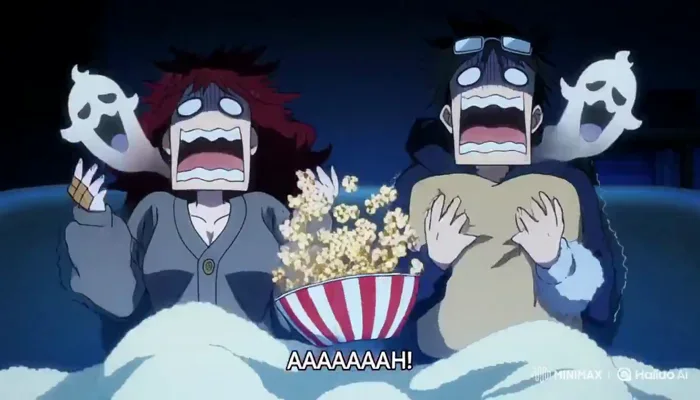
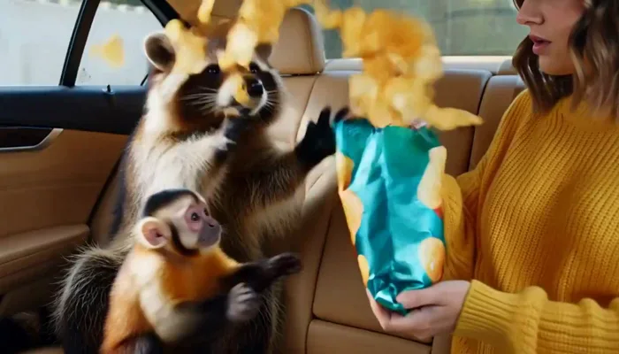

[← モデル一覧に戻る](../../README.ja.md) · [English](README.md) · [简体中文](README.zh-CN.md) · [日本語](README.ja.md)

# MiniMax Hailuo 3

MiniMax Hailuo 3 の事例 127 件。プロンプト全文と公開済みパラメータを掲載し、127 件に再生可能な出力を収録。[Ofox](https://ofox.ai) が収集・検証。モデル提供元は MiniMax。

▶ [MiniMax Hailuo 3 事例ページ](https://ofox.ai/hailuo-3-prompts?utm_source=github&utm_medium=readme&utm_campaign=awesome-ai-video-prompts) · [Ofox で試す](https://app.ofox.ai/playground?utm_source=github&utm_medium=readme&utm_campaign=awesome-ai-video-prompts)

| | カテゴリ | 事例数 |
|:---:|---|---:|
|  | [ショートドラマ Short Drama](cases/short-drama.ja.md) | 12 |
|  | [アニメドラマ Anime Drama](cases/anime-drama.ja.md) | 1 |
|  | [クリエイティブ広告 Ad Creative](cases/ad-creative.ja.md) | 19 |
|  | [ショート動画・リール Shorts & Reels](cases/shorts-reels.ja.md) | 1 |
|  | [開始・終了フレームアニメーション Keyframe Animation](cases/keyframe-animation.ja.md) | 9 |
|  | [動画延長・編集 Video Extend & Edit](cases/video-extend-edit.ja.md) | 8 |
|  | [ミュージックビデオ Music Video](cases/music-video.ja.md) | 14 |
|  | [セリフ・リップシンク Dialogue & Lip-Sync](cases/dialogue-lipsync.ja.md) | 12 |
|  | [シネマティック Cinematic](cases/cinematic.ja.md) | 12 |
|  | [アクション・VFX Action & VFX](cases/action-vfx.ja.md) | 13 |
|  | [アニメーション・スタイライズ Animation & Stylized](cases/animation-stylized.ja.md) | 16 |
|  | [UI・タイポグラフィ UI & Typography](cases/ui-typography.ja.md) | 10 |
