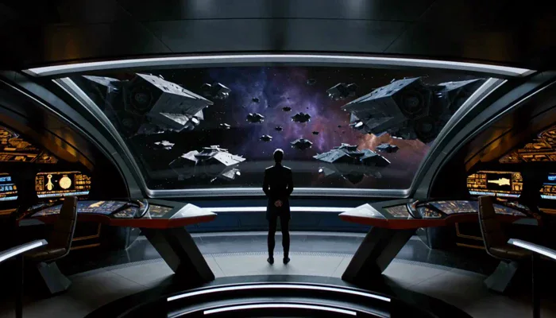
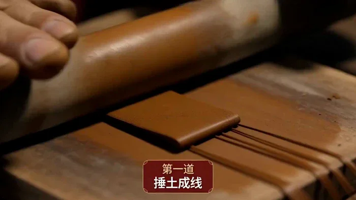
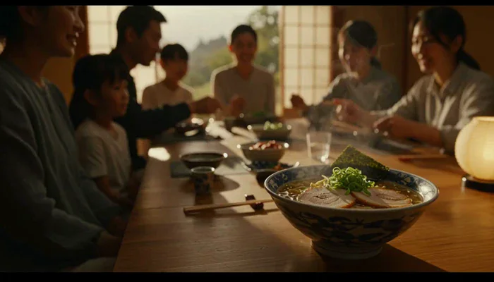
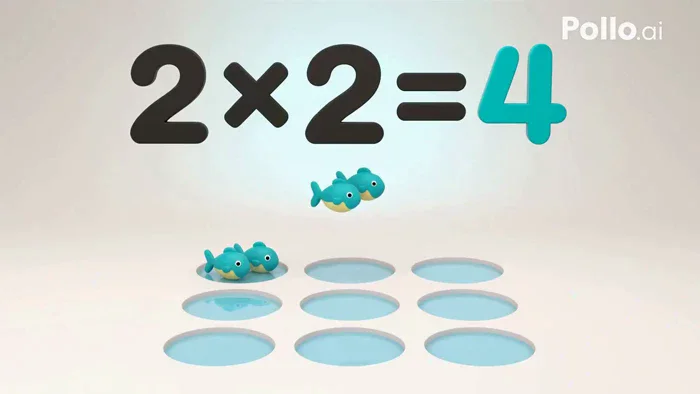
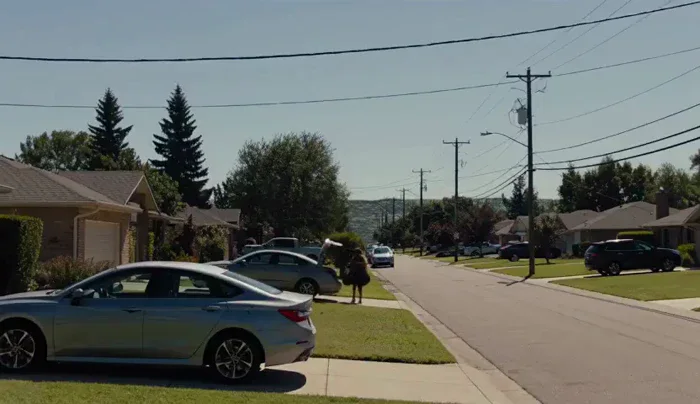
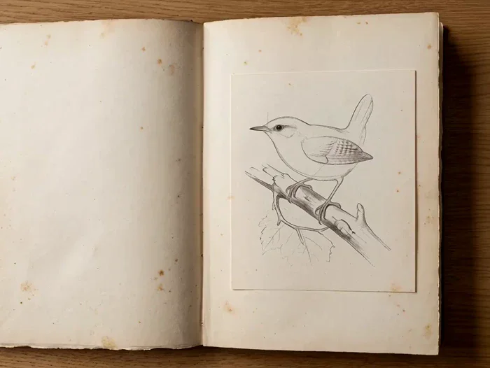

[← All models](../../README.md) · [English](README.md) · [简体中文](README.zh-CN.md) · [日本語](README.ja.md)

# MiniMax Hailuo 3

120 MiniMax Hailuo 3 cases with the complete prompt, the parameters, and a playable output — collected and verified by [Ofox](https://ofox.ai). Model by MiniMax.

▶ [MiniMax Hailuo 3 prompts page](https://ofox.ai/hailuo-3-prompts?utm_source=github&utm_medium=readme&utm_campaign=awesome-ai-video-prompts) · [Try it on Ofox](https://app.ofox.ai/playground?utm_source=github&utm_medium=readme&utm_campaign=awesome-ai-video-prompts)

| | Category | Cases |
|:---:|---|---:|
|  | [Short Drama (短剧)](cases/short-drama.md) | 12 |
|  | [Ad Creative (创意广告)](cases/ad-creative.md) | 18 |
|  | [Keyframe Animation (首尾帧动画)](cases/keyframe-animation.md) | 9 |
|  | [Video Extend & Edit (视频延长和编辑)](cases/video-extend-edit.md) | 8 |
|  | [Music Video (音乐可视化和 MV)](cases/music-video.md) | 14 |
|  | [Dialogue & Lip-Sync (对白与口播)](cases/dialogue-lipsync.md) | 12 |
|  | [Cinematic (电影感叙事)](cases/cinematic.md) | 10 |
|  | [Action & VFX (动作特效)](cases/action-vfx.md) | 12 |
|  | [Animation & Stylized (动画与风格化)](cases/animation-stylized.md) | 16 |
|  | [UI & Typography (界面与文字动效)](cases/ui-typography.md) | 9 |
