[← Back to the full index](../README.md#table-of-contents) · [English](action-vfx.md) · [简体中文](action-vfx.zh-CN.md) · [日本語](action-vfx.ja.md)

### Action & VFX (动作特效)

- [Case 8: The Sky Descends Like a Giant Wall over a Suburban Street (整片天空如巨墙压向郊区街道) — by @cocktailpeanut](#case-8)
- [Case 9: The Diner That Rewinds (餐厅时间冻结与逆向复原) — by @icreat_ai](#case-9)
- [Case 11: A Green Locomotive Mechanically Transforms into a Robot (绿皮机车机械变形为机器人) — by @EndFolding79421](#case-11)
- [Case 15: Human Cakes Collide on a Manhattan Street (曼哈顿街头的人形蛋糕碰撞) — by @sadlemonjuice](#case-15)
- [Case 27: Clouds Form the Word MORNING at Sunrise (云海凝成 MORNING) — by @CharaspowerAI](#case-27)
- [Case 28: A Warrior Walks Across a Mechanical Planet (在机械星球上行走的战士) — by @nonameoasis](#case-28)
- [Case 29: A Dragon Sweeps Over a Northern Fleet and Breathes Fire (巨龙掠过北海舰队并喷火袭船) — by @Diplomeme](#case-29)
- [Case 97: Gothic Dracula Horror Scene (哥特吸血鬼恐怖短片) — by @MonetizationDon](#case-97)
- [Case 98: Amber Perfume and a Model Amid Golden Smoke (琥珀香水与金色烟雾中的模特) — by @Lianaalane](#case-98)
- [Case 99: A Sword-Wielding Girl Faces a T. Rex (少女持剑对决霸王龙) — by @Lianaalane](#case-99)
- [Case 100: A Good-Morning Title Rises from the Lake (日出湖面的早安标题) — by @CharaspowerAI](#case-100)
- [Case 101: A Last-Second Rescue (最后一刻的极限救援) — by @aiwithaly](#case-101)
- [Case 139: Bat Cookie Takes Flight (蝙蝠饼干振翅飞走) — by @GlennHasABeard](#case-139)
- [Case 142: A Crystal Civilization Builds with Sound (以声音建造的水晶文明) — by @DeCat2025](#case-142)
- [Case 143: The Gravity Harvest (反重力采掘与地下巨手) — by @DeCat2025](#case-143)
- [Case 145: The Corgi Secret Agent (柯基特工的办公室任务) — by @ImaStudio_ai](#case-145)
- [Case 147: The Sky Is Being Replaced (被机械臂揭开的城市天空) — by @DeCat2025](#case-147)
- [Case 149: Black Mirror: Final Reflection (黑色镜面上的双人剑舞) — by @itxsarmadd](#case-149)
- [Case 150: The Cloaked Ranger Vanishes (披风游侠的暗影消失) — by @holagarciajavi](#case-150)
- [Case 152: The Beast and the Plasma Cannon (巨兽反咬等离子巨炮) — by @DeCat2025](#case-152)
- [Case 156: Unexpected Strength in the Garage (车库中觉醒的怪力) — by @chatgptpaglu](#case-156)
- [Case 167: The Mechanical Gunslinger (工业走廊中的机械枪手) — by @ou_zhen599](#case-167)
- [Case 169: The War of the Crimson Sky (绯红云层中的飞骑大战) — by @DeCat2025](#case-169)
- [Case 170: The Mountain Awakens (山岳化作燃焰守护者) — by @DeCat2025](#case-170)

### Case 8: The Sky Descends Like a Giant Wall over a Suburban Street (整片天空如巨墙压向郊区街道) — by @cocktailpeanut

<a href="https://ofox.ai/hailuo-3-prompts?utm_source=github&utm_medium=case&utm_campaign=awesome-ai-video-prompts#case-8">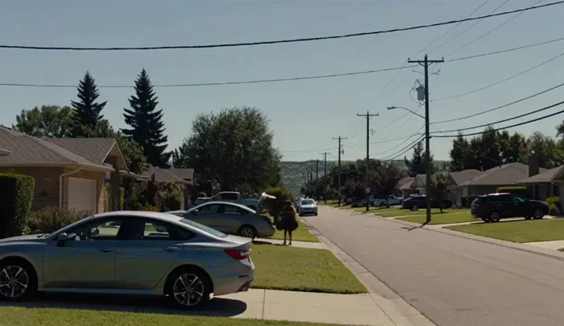</a>

▶ [Watch the full video on ofox.ai](https://ofox.ai/hailuo-3-prompts?utm_source=github&utm_medium=case&utm_campaign=awesome-ai-video-prompts#case-8)

**输入素材**：未公开 —— 本案例未收录可用的输入素材，请参阅来源

<strong>Prompt</strong> — A hyper-realistic handheld phone video of a quiet suburban backyard on a bright normal afternoon. A person casually waters plants near a fence while b…

~~~~text
A hyper-realistic handheld phone video of a quiet suburban backyard on a bright normal afternoon. A person casually waters plants near a fence while birds chirp, distant traffic hums, and everything feels completely ordinary and mundane. The camera drifts naturally like a real home video, capturing the lawn, patio furniture, and blue sky with soft white clouds. After several seconds of normal peaceful activity, a deep cracking sound suddenly comes from above. Without warning, the entire sky begins dropping straight downward like a gigantic solid ceiling, with the blue sky and clouds moving as one physical surface descending toward the yard. The person looks up in shock just as the sky rapidly fills the frame, swallowing the scene in a terrifying instant. The camera jerks and falls to the ground at the last moment. No cinematic buildup, no surreal visual style, it should feel like a totally normal real-life recording interrupted by one sudden impossible and visceral event.
~~~~

**参数**：MiniMax H3 · 未标注 · 未标注 · 14s · 未标注 · 未标注 · 带音频
**来源**：@cocktailpeanut · [原帖](https://x.com/cocktailpeanut/status/2086879654116495564)

Preview © 2026 @cocktailpeanut · Prompt by @cocktailpeanut

[Back to top](#table-of-contents)

### Case 9: The Diner That Rewinds (餐厅时间冻结与逆向复原) — by @icreat_ai

<a href="https://ofox.ai/hailuo-3-prompts?utm_source=github&utm_medium=case&utm_campaign=awesome-ai-video-prompts#case-9">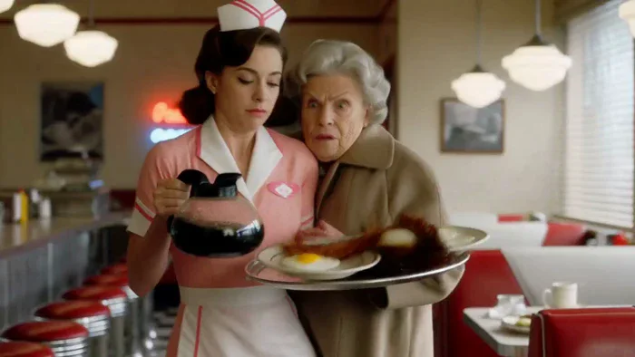</a>

▶ [Watch the full video on ofox.ai](https://ofox.ai/hailuo-3-prompts?utm_source=github&utm_medium=case&utm_campaign=awesome-ai-video-prompts#case-9)

**输入素材**：未公开 —— 本案例未收录可用的输入素材，请参阅来源

<strong>Prompt</strong> — Photorealistic cinematic 1950s American diner, chrome stools, red vinyl, neon glow and checkerboard floor, shot with modern lived-in realism and soft …

~~~~text
Photorealistic cinematic 1950s American diner, chrome stools, red vinyl, neon glow and checkerboard floor, shot with modern lived-in realism and soft natural window light. Subtle handheld texture, warm practicals, rich period detail, heavy film grain.

0-4s: [Medium Wide] A striking young woman in her early 20s sits alone at the counter, calm and slightly amused, slowly sipping a tall thick milkshake through a straw. Behind her a young waitress in classic uniform approaches with a tray of eggs and bacon in one hand and a full glass coffee pot in the other. An older lady starts rising from a nearby booth.

4-8s: [Dynamic Tracking] The older lady collides hard into the waitress. Tray, plate, eggs, bacon and coffee pot explode upward in chaotic slow motion. Coffee erupts into long liquid ribbons and perfect suspended droplets. Camera immediately begins a smooth continuous orbit around the impact. Time locks completely at the peak of the spill. Every face freezes in pure shock. Only the girl at the counter keeps moving, completely unfazed.

8-17s: [Slow 360° Orbital] Camera glides in a full elegant orbit through the frozen diner. Coffee hangs in mid-air as glassy ribbons and spheres with perfect volume and surface tension. Bacon strips, eggs and the spinning tray float weightlessly. Patrons and waitress remain locked in startled expressions. The girl at the counter takes one slow, deliberate sip, eyes half-lidded, almost bored, while the entire frozen world (except her) begins an elegant reverse: every droplet, every piece of food and every person rewinds smoothly back to the exact starting positions.

17-24s: [Medium Shot] Rewind lands perfectly. Waitress stands balanced again with tray and coffee pot. The girl lifts her eyes, raises two fingers in a small casual gesture and softly calls the waitress by name. The waitress turns toward her just before the older lady begins to stand, completely avoiding the collision. A tiny private smile crosses the girl’s face.

24-30s: [Extreme Close-Up] Hard cut to her face as she takes one last slow sip. Soft knowing smile, eyes almost closed in quiet satisfaction, like she has done this a hundred times. Shallow depth of field, creamy bokeh of the neon diner behind her.

Photorealistic, ultra-detailed fluid physics, perfect motion blur only on moving elements, stable characters, cinematic lighting, heavy natural film grain, no artifacts, movie-level temporal coherence, high rewatch value.
~~~~

**参数**：MiniMax H3 · 未标注 · 未标注 · 未标注 · 未标注 · 未标注 · 未标注
**来源**：@icreat_ai · [原帖](https://x.com/icreat_ai/status/2085297962977227011)

Preview © 2026 @icreat_ai · Prompt by @icreat_ai

[Back to top](#table-of-contents)

### Case 11: A Green Locomotive Mechanically Transforms into a Robot (绿皮机车机械变形为机器人) — by @EndFolding79421

<a href="https://ofox.ai/hailuo-3-prompts?utm_source=github&utm_medium=case&utm_campaign=awesome-ai-video-prompts#case-11">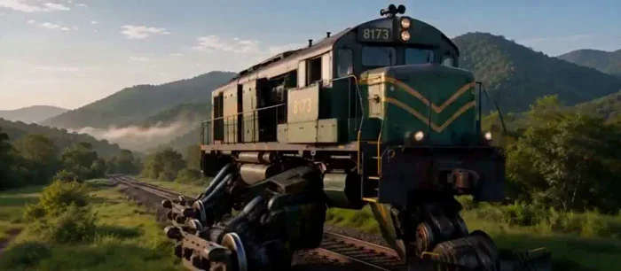</a>

▶ [Watch the full video on ofox.ai](https://ofox.ai/hailuo-3-prompts?utm_source=github&utm_medium=case&utm_campaign=awesome-ai-video-prompts#case-11)

**输入素材**：未公开 —— 本案例未收录可用的输入素材，请参阅来源

<strong>Prompt</strong> — Use &lt;Image 0&gt; the exact FIRST FRAME and &lt;Image 1&gt;as the exact LAST FRAME. Create one continuous 15-second photorealistic cinematic transformation conn…

~~~~text
Use <Image 0>  the exact FIRST FRAME and <Image 1>as the exact LAST FRAME. Create one continuous 15-second photorealistic cinematic transformation connecting these two states.  Maintain the EXACT same railroad location throughout: same curving track, green grass, surrounding trees, distant rolling forested hills and mountains, sky, morning atmosphere, perspective, and overall natural lighting. The environment does NOT transform, shift, regenerate, or change location. No additional people, vehicles, trains, or robots appear.  The locomotive itself physically transforms into the robot shown in <Image 1>. This must be a true complex mechanical transformation, NOT a dissolve, magical morph, liquid-metal effect, crossfade, replacement, or sudden character swap. Every major robot component originates visibly from physical locomotive components. Preserve the locomotive's recognizable green-and-yellow painted metal, weathering, markings, wheels, panels, vents, grilles, lights, and mechanical construction as they reorganize into the final robot.  [00:00–00:02.5] Begin exactly on <Image 0>. Hold the intact locomotive briefly. The engine idles subtly. Then small mechanical movements begin: suspension compresses, exterior panels unlock and separate along real seams, vents shift, internal gears engage, and heavy metal sections begin sliding apart. The camera makes a subtle cinematic adjustment to accommodate the increasing vertical scale.  [00:02.5–00:06] The transformation becomes larger and clearly mechanical. The locomotive's wheel assemblies separate and rotate downward, reorganizing into two enormous articulated legs while remaining visibly composed of train machinery. Axles rotate, wheel trucks pivot, steel panels telescope outward, internal pistons extend, and mechanical joints lock together. The locomotive remains physically planted over the same section of track.  The main locomotive body begins rising upward as the newly formed legs extend beneath it. No pieces float independently and nothing materializes from nowhere.  [00:06–00:10] The locomotive body folds and compacts into the robot torso. Large green exterior panels rotate inward and interlock across the chest while recognizable yellow locomotive markings remain incorporated into the armor.  Side machinery unfolds outward into shoulders. Long mechanical assemblies telescope and rotate downward into articulated arms. Hands assemble from smaller interlocking mechanical components at the ends of the forearms. Visible gears turn, pistons compress, cables tighten, panels slide across one another, and heavy locking mechanisms engage.  The camera smoothly pulls back and tilts upward only as necessary to keep the entire transformation readable while preserving the original environment and spatial orientation.  [00:10–00:13] The upper locomotive housing separates and folds inward. Smaller panels rapidly rotate, collapse and interlock around an emerging mechanical neck assembly. The robot head rises mechanically from inside the reorganized machinery; face plates slide into position, the final head structure locks together, and the eyes illuminate.  Remaining locomotive panels snap precisely into their final locations across the shoulders, chest, back, arms and legs. Final pistons compress and locking mechanisms engage with tremendous physical weight.  [00:13–00:15] The transformation completes. The enormous robot settles its weight onto the railway tracks with a heavy suspension-like compression through its legs. Tiny secondary panels finish closing and locking.  The camera settles naturally into the exact composition required by <Image 1>. The robot becomes the precise completed design, proportions, orientation and pose shown in <Image 1>, standing in the same landscape.  End EXACTLY on <Image 1> and hold the completed robot briefly. No further transformation.  overall_soundscape:  Sound ON. Highly detailed realistic mechanical transformation audio synchronized precisely to visible movement: deep diesel engine rumble, enormous steel panels sliding and rotating, gears grinding smoothly, hydraulic pistons releasing and compressing, servomotors, heavy hinges, wheel assemblies rotating, suspension groans, metal components telescoping, powerful mechanical locking CLUNKS and deep resonant impacts. Transformation sounds increase in scale as larger components move.  During the final assembly, several massive sequential mechanical locks culminate in one deep heavy final THUNK as the robot reaches full form. Afterward, quieter servo settling, cooling metal ticks and a low mechanical idle remain.  Maintain subtle natural countryside ambience underneath: light morning wind through grass and trees and distant birds.  No dialogue.  non_diegetic_music:  None. No score, no musical tones, no trailer music. Let the mechanical transformation and natural environment provide the entire soundtrack.
~~~~

**参数**：MiniMax H3 · 未标注 · fl2va · 15s · 未标注 · 未标注 · 带音频
**来源**：@EndFolding79421 · [原帖](https://x.com/EndFolding79421/status/2088815814736531596)

Preview © 2026 @EndFolding79421 · Prompt by @EndFolding79421

[Back to top](#table-of-contents)

### Case 15: Human Cakes Collide on a Manhattan Street (曼哈顿街头的人形蛋糕碰撞) — by @sadlemonjuice

<a href="https://ofox.ai/hailuo-3-prompts?utm_source=github&utm_medium=case&utm_campaign=awesome-ai-video-prompts#case-15">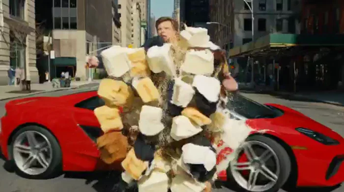</a>

▶ [Watch the full video on ofox.ai](https://ofox.ai/hailuo-3-prompts?utm_source=github&utm_medium=case&utm_campaign=awesome-ai-video-prompts#case-15)

**输入素材**：未公开 —— 本案例未收录可用的输入素材，请参阅来源

<strong>Prompt</strong> — Shaky handheld smartphone footage, pure first-person view, bright clear Manhattan street under shiny midday sun.The camera jerks, sways and shakes hea…

~~~~text
Shaky handheld smartphone footage, pure first-person view, bright clear Manhattan street under shiny midday sun.The camera jerks, sways and shakes heavily like a real phone held by someone walking backward in panic. Sharp sunlight, hard shadows, clean blue sky above brick buildings and dry asphalt. Strong natural motion blur and smartphone digital noise.
Continuous 20-second sequence (new subject + vehicle every 5 seconds):
[0s–5s] Operator walks backward from a white man in a black agent suit and sunglasses. The operator’s hand silently points urgently behind the man. The man turns his head, eyes widening in shock as he sees a bright red sports car drifting sideways at high speed toward him. The car slides in at an angle with screeching tires and physically slams into his body first — the impact throws him hard against the hood. Only after the physical hit does his body dissipate into a chaotic spray of tiny randomized fragments — almost pure thick cream mixed with very small irregular cake crumbs, no large pieces. The intricate cream explosion splatters in all directions, coating the red hood, windshield and street in messy streaks and droplets. The suit is ripped off by the force and either sticks to the car or drops to the ground. Cream heavily sprays across the lens.
[5s–10s] Camera keeps shaking and moving back. A Black woman in a business blazer. Operator silently points hard behind her. She turns, face reacting with sudden fear as a dark blue SUV drifts sharply toward her. The SUV locks brakes mid-drift and physically smashes into her body first. Immediately after the impact her body dissipates into an intricate burst of tiny randomized particles — mostly thick chocolate cream with only minuscule dark cake crumbs. The fine cream spray coats the blue SUV surface and asphalt in dense, chaotic patterns. The blazer and skirt are torn away, parts sticking to the vehicle mixed with cream, the rest dropping naturally. Chocolate cream heavily splatters the lens.
[10s–15s] Operator still walking backward, phone shaking. An Asian man in a hoodie. Operator silently points behind him. The man turns and freezes in panic seeing a white delivery van sliding into a wide drift. The van physically crashes into his body first. Right after the hit he dissipates into a highly randomized spray of tiny fragments — almost entirely cream with very small scattered sponge and fruit particles. The intricate cream explosion covers the van and pavement in messy droplets and streaks. The hoodie and jeans are stripped off, some cloth remaining on the van mixed with cream, the rest falling with natural physics. Cream hits the lens hard.
[15s–20s] Camera continues with heavy smartphone shake. A Latina woman in a trench coat. Operator silently points urgently behind her. She spins around, eyes wide in terror as a black pickup truck performs a long cinematic drift straight at her. The truck physically hits her body first. Only then does her body dissipate into a fine, chaotic spray of tiny randomized particles — mostly thick caramel cream with only minute golden crumbs. The intricate cream blast coats the truck hood, grille and ground in dense, irregular patterns. The trench coat is ripped off, sections sticking to the truck with cream, the rest falling realistically. Cream and tiny fragments cascade over the vehicle and street, heavily streaking the lens.
Throughout: constant heavy smartphone-style camera shake and jitter, natural motion blur, dense cream sprays and tiny randomized particles hitting the lens, realistic cloth physics, cinematic vehicle drifts, clear physical body impact first followed by dissipation into almost pure cream with only very small irregular cake crumbs (never large pieces or whole shapes), photorealistic, bright clear daylight, raw live smartphone footage look. No text, no logos, no stabilisation.
~~~~

**参数**：MiniMax H3 · 未标注 · t2va · 15s · 未标注 · 未标注 · 带音频
**来源**：@sadlemonjuice · [原帖](https://x.com/sadlemonjuice/status/2087131708223046088)

Preview © 2026 @sadlemonjuice · Prompt by @sadlemonjuice (frame re-selected by us — original clip mixed in a character-sheet composite)

[Back to top](#table-of-contents)

### Case 27: Clouds Form the Word MORNING at Sunrise (云海凝成 MORNING) — by @CharaspowerAI

<a href="https://ofox.ai/hailuo-3-prompts?utm_source=github&utm_medium=case&utm_campaign=awesome-ai-video-prompts#case-27">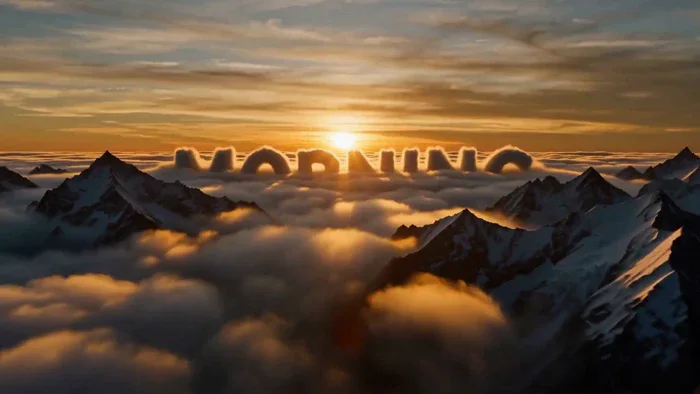</a>

▶ [Watch the full video on ofox.ai](https://ofox.ai/hailuo-3-prompts?utm_source=github&utm_medium=case&utm_campaign=awesome-ai-video-prompts#case-27)

**输入素材**：未公开 —— 本案例未收录可用的输入素材，请参阅来源

<strong>Prompt</strong> — Epic cinematic aerial shot: Endless rolling clouds flow across towering mountain peaks during sunrise. The golden light transforms the clouds into riv…

~~~~text
Epic cinematic aerial shot: Endless rolling clouds flow across towering mountain peaks during sunrise. The golden light transforms the clouds into rivers of glowing vapor. Air currents gradually sculpt the cloud formations into the gigantic word "MORNING", stretching naturally across the sky. As the sun rises higher, the cloud letters slowly dissolve into the atmosphere while brilliant light floods the frame. Interstellar meets National Geographic, majestic, emotionally powerful.
~~~~

**参数**：MiniMax H3 · 未标注 · t2va · 15s · 未标注 · 未标注 · 带音频
**来源**：@CharaspowerAI · [原帖](https://x.com/CharaspowerAI/status/2086754531698725200)

Preview © 2026 @CharaspowerAI · Prompt by @CharaspowerAI

[Back to top](#table-of-contents)

### Case 28: A Warrior Walks Across a Mechanical Planet (在机械星球上行走的战士) — by @nonameoasis

<a href="https://ofox.ai/hailuo-3-prompts?utm_source=github&utm_medium=case&utm_campaign=awesome-ai-video-prompts#case-28">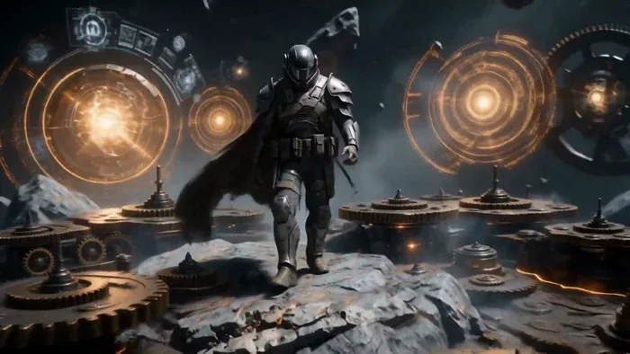</a>

▶ [Watch the full video on ofox.ai](https://ofox.ai/hailuo-3-prompts?utm_source=github&utm_medium=case&utm_campaign=awesome-ai-video-prompts#case-28)

**输入素材**：未公开 —— 本案例未收录可用的输入素材，请参阅来源

<strong>Prompt</strong> — Zero post-production cuts. Pure spatial awareness and temporal coherence from the engine. Using semantic motion design to make typography emerge from …

~~~~text
Zero post-production cuts. Pure spatial awareness and temporal coherence from the engine. Using semantic motion design to make typography emerge from the environment is the future of title sequences. 🎬🔥 

Use the provided image as the final state. Audio-driven motion sync.
[0s-6s] The space nomad walks forward with a heavy, confident stride. Procedural world assembly: the environment mechanically builds itself around him. Asteroid rock shifts, interlocking clockwork gears spin, and glowing amber holograms activate.
[6s-10s] The character halts, looking out over the horizon as the mechanical world construction completes behind him.
[10s-15s] CRITICAL SEQUENCE: The camera smoothly settles into a centered frame. Massive dark rusted metal and brass gears dynamically emerge from the foreground, interlocking and snapping into place to form the main title text. Satisfying kinetic pop-up motion, seamless structural transformation, cinematic finish.
~~~~

**参数**：MiniMax H3 · 未标注 · 未标注 · 15s · 未标注 · 未标注 · 带音频
**来源**：@nonameoasis · [原帖](https://x.com/nonameoasis/status/2085459203892576280)

Preview © 2026 @nonameoasis · Prompt by @nonameoasis

[Back to top](#table-of-contents)

### Case 29: A Dragon Sweeps Over a Northern Fleet and Breathes Fire (巨龙掠过北海舰队并喷火袭船) — by @Diplomeme

<a href="https://ofox.ai/hailuo-3-prompts?utm_source=github&utm_medium=case&utm_campaign=awesome-ai-video-prompts#case-29">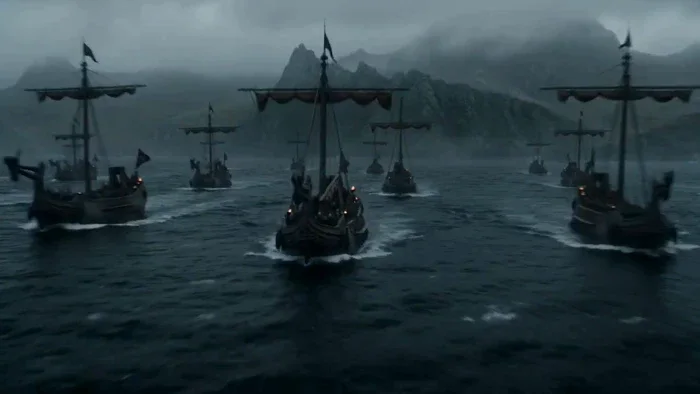</a>

▶ [Watch the full video on ofox.ai](https://ofox.ai/hailuo-3-prompts?utm_source=github&utm_medium=case&utm_campaign=awesome-ai-video-prompts#case-29)

**输入素材**：未公开 —— 本案例未收录可用的输入素材，请参阅来源

<strong>Prompt</strong> — Hyper-realistic cinematic fantasy action sequence, 15 seconds, aspect ratio 16:9. Daytime in a vast cold northern sea surrounded by jagged mountains a…

~~~~text
Hyper-realistic cinematic fantasy action sequence, 15 seconds, aspect ratio 16:9.

Daytime in a vast cold northern sea surrounded by jagged mountains and dark rocky cliffs. A fleet of large medieval wooden warships sails through rough black-blue water while armored soldiers prepare for battle on the decks. Massive sails snap violently in the wind. The ships carry burning braziers, ropes, shields, spears, banners, wooden siege weapons, and rows of armed warriors. Thick storm clouds hang low above the sea. Wind drives sea spray across the decks. The danger comes from the sky: a giant dragon approaches from behind the mountains, its enormous wings gradually emerging through the mist.

Begin with a high sweeping view of the entire fleet moving through the dangerous northern sea. Several warships sail in formation while smaller boats move between them. Soldiers look toward the distant mountains as a huge shadow passes across the water.
Shift to a low deck-level view among the warriors. Men raise shields and grab spears while officers shout commands. The camera moves toward the front of the ship as the wind suddenly becomes violent.
Cut to a distant view of the mountains. The dragon bursts through the clouds and flies directly toward the fleet, enormous wings beating through the storm mist. Its silhouette grows rapidly larger.

Return above the ships as the dragon dives toward the fleet. Sailors scramble across the decks while archers rush into position. Burning arrows are lit and giant ballistae are rotated toward the approaching creature.

Near the end, the dragon suddenly opens its jaws and releases a massive stream of fire toward the lead warship. The flames illuminate the dark sea as the crew raises shields and desperately attempts to turn the vessel.

End with the dragon flying directly above the fleet as the first fireball crashes into the lead ship, exploding across its wooden deck.

Style: hyper-realistic, cinematic, intense, fast-paced, suspenseful, fantasy atmosphere, strong sense of scale, warships, dragon battle, ocean storm, medieval warfare, fire, smoke, dynamic varied camera movement, no text, no logos, no cartoon style, no slow motion, no famous celebrity faces, no recognizable actors, no movie-star resemblance, no public-figure likenesses, no clear facial close-ups. Keep proportions. Keep style and features. Aspect ratio 16:9.
~~~~

**参数**：MiniMax H3 · 未标注 · 未标注 · 15s · 未标注 · 未标注 · 带音频
**来源**：@Diplomeme · [原帖](https://x.com/Diplomeme/status/2086833428713116099)

Preview © 2026 @Diplomeme · Prompt by @Diplomeme

[Back to top](#table-of-contents)

### Case 97: Gothic Dracula Horror Scene (哥特吸血鬼恐怖短片) — by @MonetizationDon

<a href="https://ofox.ai/hailuo-3-prompts?utm_source=github&utm_medium=case&utm_campaign=awesome-ai-video-prompts#case-97">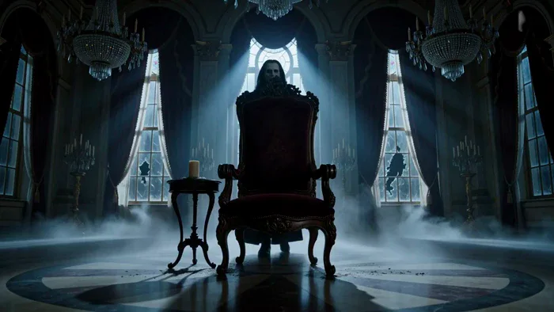</a>

▶ [Watch the full video on ofox.ai](https://ofox.ai/hailuo-3-prompts?utm_source=github&utm_medium=case&utm_campaign=awesome-ai-video-prompts#case-97)

**输入素材**：未公开 —— 本案例未收录可用的输入素材，请参阅来源

<strong>Prompt</strong> — DRACULA — CINEMATIC HORROR PROMPT A vast abandoned Victorian ballroom at midnight, completely different from a corridor. Broken chandeliers hang from …

~~~~text
DRACULA — CINEMATIC HORROR PROMPT

A vast abandoned Victorian ballroom at midnight, completely different from a corridor. Broken chandeliers hang from the ceiling, moonlight pours through enormous cracked stained-glass windows, and thick black mist drifts across the marble floor. Torn velvet curtains move slowly despite there being no wind. The camera begins with an extreme low-angle shot of an empty throne at the far end of the ballroom. A single candle beside it suddenly extinguishes. Dracula is already standing behind the throne. He slowly steps into the moonlight — an elegant, terrifying vampire wearing a long black Victorian coat with a high collar, dark waistcoat, polished boots, and subtle antique jewelry. Pale skin, long black hair, intense eyes, and unmistakable sharp fangs. His presence feels ancient and powerful rather than exaggerated. The camera slowly circles him as the ballroom begins behaving unnaturally. The chandelier swings violently. Hundreds of bats suddenly erupt from the darkness above, filling the room. Dracula doesn't move. He simply watches them pass. One bat lands on his shoulder. Dracula raises his hand. Every candle in the ballroom ignites simultaneously. The camera rapidly pushes toward his face. His eyes subtly change as he looks directly into the lens. He gives a restrained, sinister smile, revealing his fangs. Suddenly, the reflection of Dracula in the polished marble floor moves independently from him. The reflection turns its head toward the camera while Dracula remains perfectly still. The camera pulls backward rapidly as the reflection rises out of the marble like living smoke. Dracula finally spreads his arms, and a massive swarm of bats explodes outward behind him, transforming his silhouette into an enormous winged shadow across the ballroom walls. The chandelier crashes down in the background. CUT TO BLACK.
~~~~

**参数**：MiniMax H3 · 未标注 · t2va · 15s · 未标注 · 未标注 · 带音频
**来源**：@MonetizationDon · [原帖](https://x.com/MonetizationDon/status/2086603324086767952)

Preview © 2026 @MonetizationDon · Prompt by @MonetizationDon

[Back to top](#table-of-contents)

### Case 98: Amber Perfume and a Model Amid Golden Smoke (琥珀香水与金色烟雾中的模特) — by @Lianaalane

▶ [Watch the full video on ofox.ai](https://ofox.ai/hailuo-3-prompts?utm_source=github&utm_medium=case&utm_campaign=awesome-ai-video-prompts#case-98)

**输入素材**：未公开 —— 本案例未收录可用的输入素材，请参阅来源

<strong>Prompt</strong> — A Luxury perfume bottle on glossy black surface, warm amber lighting, golden smoke, dark elegant background, soft reflections, cinematic close-up, slo…

~~~~text
A Luxury perfume bottle on glossy black surface, warm amber lighting, golden smoke, dark elegant background, soft reflections, cinematic close-up, slow push-in, photorealistic 4K.
Confident woman in a burnt-orange satin dress, long dark hair, luxurious dark interior with golden lights, subtle smoke, cinematic medium shot, photorealistic 4K.
Close-up of the same woman spraying perfume on her neck. Visible fragrance mist, warm golden light, natural hair movement, shallow depth of field, cinematic beauty ad.
Same woman walking confidently toward camera in the luxury interior. Smooth tracking shot, reflective floor, warm golden lighting, subtle smoke, elegant cinematic look.
Same perfume bottle centered on glossy black surface with amber crystals and golden smoke. Dramatic spotlight, dark luxury background, slow push-in, photorealistic 4K.

Consistency:
Keep the same woman, face, hair, skin tone, outfit, and perfume bottle across all scenes. Warm amber lighting, realistic skin and movement. No extra people, distorted hands, duplicate objects, text, or logos.

Style: Luxury fragrance commercial, cinematic, photorealistic, 4K.
~~~~

**参数**：MiniMax H3 · 未标注 · 未标注 · 15s · 未标注 · 未标注 · 带音频
**来源**：@Lianaalane · [原帖](https://x.com/Lianaalane/status/2086730655161823597)

Preview © 2026 @Lianaalane · Prompt by @Lianaalane

[Back to top](#table-of-contents)

### Case 99: A Sword-Wielding Girl Faces a T. Rex (少女持剑对决霸王龙) — by @Lianaalane

<a href="https://ofox.ai/hailuo-3-prompts?utm_source=github&utm_medium=case&utm_campaign=awesome-ai-video-prompts#case-99">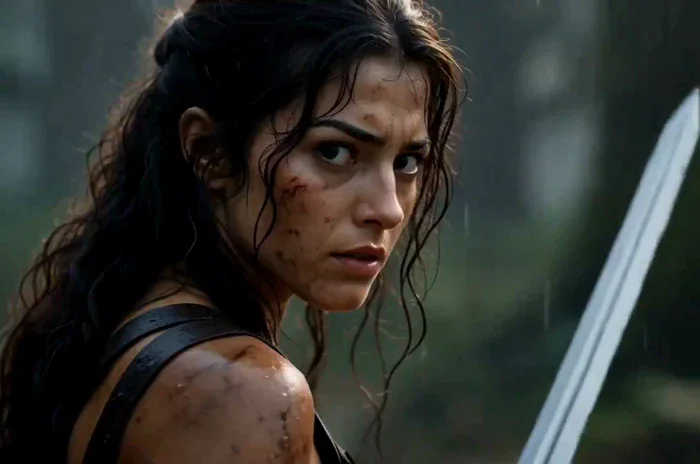</a>

▶ [Watch the full video on ofox.ai](https://ofox.ai/hailuo-3-prompts?utm_source=github&utm_medium=case&utm_campaign=awesome-ai-video-prompts#case-99)

**输入素材**：未公开 —— 本案例未收录可用的输入素材，请参阅来源

<strong>Prompt</strong> — Create a 14-second ultra-realistic Hollywood-style action fantasy film scene featuring a brave young female warrior battling a massive realistic Tyran…

~~~~text
Create a 14-second ultra-realistic Hollywood-style action fantasy film scene featuring a brave young female warrior battling a massive realistic Tyrannosaurus Rex inside an ancient jungle filled with ruined temples, giant trees, mist, mud, rain, smoke, and dramatic sunlight.

Visual Style: Premium Hollywood blockbuster, photorealistic, cinematic, epic scale, realistic human anatomy, realistic dinosaur skin and movement, dramatic lighting, detailed environment, natural physics, intense facial expressions, high-end VFX, ARRI Alexa 35 look, anamorphic lens, shallow depth of field, HDR, subtle film grain, 4K cinematic quality, dynamic camera movement, realistic motion blur.

0–2 seconds — Establishing Shot:
Wide cinematic shot of an ancient jungle temple in the middle of a mysterious rainforest. The female warrior stands alone in the ruins, holding a large sword in one hand. Her clothes are rugged fantasy-warrior clothing, slightly wet from the rain. Mist moves through the trees while birds fly in the distant sky. Slow camera push-in toward her.

2–3 seconds — Hero Close-Up:
Cut to a dramatic close-up of the girl's face. Her hair is slightly wet and moving in the wind. She looks determined and fearless. Small scratches and dirt are visible on her face. She slowly raises her sword and prepares for battle.

3–4 seconds — Dinosaur Reveal:
Suddenly, a massive realistic T-Rex emerges from behind the jungle trees and roars aggressively. Its enormous jaws open, sharp teeth visible, water and mud splashing around its feet. Low-angle camera makes the dinosaur look huge and terrifying.

4–6 seconds — First Attack:
The dinosaur charges toward the girl at full speed. She runs toward the side and performs a fast dodge at the last second. The dinosaur crashes through trees and debris behind her. Use handheld camera movement, fast tracking, realistic impact and flying dust.

6–8 seconds — Sword Counterattack:
The girl quickly turns around and attacks with her sword. Show a dramatic slow-motion moment as she swings the sword toward the dinosaur. The dinosaur moves its head aggressively while roaring. Strong cinematic camera movement follows the sword.

8–10 seconds — Epic Jump:
The dinosaur attacks again. The girl jumps onto a large fallen tree and then leaps into the air above the dinosaur. Her hair and clothing move naturally in slow motion. Camera rotates around her as she raises the sword for the final strike.

10–12 seconds — Final Strike:
She lands a powerful cinematic sword strike against the dinosaur's armored hide. Create a dramatic impact with dust, rainwater, debris and strong camera shake. Keep the action non-gory and suitable for a blockbuster fantasy film.

12–13.5 seconds — Dinosaur Falls Back:
The dinosaur loses balance and falls backward into the muddy ground with a huge impact. Water, dust and leaves fly into the air. The girl lands safely and stands ready, breathing heavily.

13.5–14 seconds — Hero Ending:
Slow cinematic push-in toward the girl. She lowers the sword slightly and looks directly toward the camera with a powerful, fearless expression. Behind her, the defeated dinosaur lies in the misty jungle. Golden sunlight breaks through the clouds, creating an epic silhouette and emotional Hollywood-style ending.
Camera & Cinematography:
Wide establishing shots, low-angle dinosaur shots, close-up facial shots, handheld action camera, tracking shots, 360-degree movement during the jump, dramatic slow motion during key action moments, shallow depth of field for close-ups, realistic motion blur, cinematic composition.
Lighting & Atmosphere:
Dark stormy jungle atmosphere mixed with warm golden sunlight, volumetric light rays, wet surfaces, realistic rain, mist, smoke, flying leaves, dust and water particles.
~~~~

**参数**：MiniMax H3 · 未标注 · 未标注 · 15s · 未标注 · 未标注 · 带音频
**来源**：@Lianaalane · [原帖](https://x.com/Lianaalane/status/2085625652829708458)

Preview © 2026 @Lianaalane · Prompt by @Lianaalane

[Back to top](#table-of-contents)

### Case 100: A Good-Morning Title Rises from the Lake (日出湖面的早安标题) — by @CharaspowerAI

▶ [Watch the full video on ofox.ai](https://ofox.ai/hailuo-3-prompts?utm_source=github&utm_medium=case&utm_campaign=awesome-ai-video-prompts#case-100)

**输入素材**：未公开 —— 本案例未收录可用的输入素材，请参阅来源

<strong>Prompt</strong> — Ultra cinematic macro shot: A calm mountain lake at dawn reflects the first golden rays of sunlight. Tiny ripples spread across the mirror-like surfac…

~~~~text
Ultra cinematic macro shot: A calm mountain lake at dawn reflects the first golden rays of sunlight. Tiny ripples spread across the mirror-like surface as morning mist drifts gracefully above the water. Billions of sparkling droplets slowly rise into the air, suspended as if gravity has stopped. They spiral together with incredible fluid realism, naturally sculpting the word "MORNING" entirely from crystal-clear water. The liquid letters shimmer with golden reflections before gently collapsing into a spectacular explosion of droplets illuminated by the sunrise. Hollywood title sequence, ultra-realistic fluid simulation, volumetric lighting, IMAX quality.

#MiniMaxH3
~~~~

**参数**：MiniMax H3 · 未标注 · 未标注 · 15s · 未标注 · 未标注 · 带音频
**来源**：@CharaspowerAI · [原帖](https://x.com/CharaspowerAI/status/2085622021812039920)

Preview © 2026 @CharaspowerAI · Prompt by @CharaspowerAI

[Back to top](#table-of-contents)

### Case 101: A Last-Second Rescue (最后一刻的极限救援) — by @aiwithaly

<a href="https://ofox.ai/hailuo-3-prompts?utm_source=github&utm_medium=case&utm_campaign=awesome-ai-video-prompts#case-101">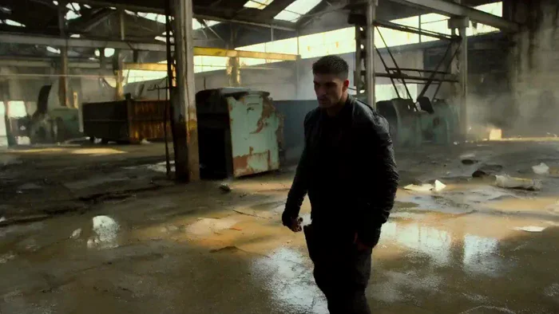</a>

▶ [Watch the full video on ofox.ai](https://ofox.ai/hailuo-3-prompts?utm_source=github&utm_medium=case&utm_campaign=awesome-ai-video-prompts#case-101)

**输入素材**：未公开 —— 本案例未收录可用的输入素材，请参阅来源

<strong>Prompt</strong> — A cinematic 15-second ultra-realistic Hollywood action sequence featuring a skilled fighter facing his final battle inside an abandoned industrial war…

~~~~text
A cinematic 15-second ultra-realistic Hollywood action sequence featuring a skilled fighter facing his final battle inside an abandoned industrial warehouse. Surrounded by three aggressive opponents, he uses precise martial arts movements to dodge attacks, counter strikes, and overcome every challenge with determination. Dust fills the air as sunlight breaks through shattered windows, creating a dramatic battlefield atmosphere. The scene builds toward a tense final confrontation as the fighter stands alone among smoke, rainwater, and debris. Dynamic handheld camera work, low-angle tracking shots, slow-motion action moments, realistic choreography, intense facial expressions, physically accurate movement, dramatic lighting, ARRI Alexa 35 aesthetic, anamorphic lens look, HDR, subtle film grain, premium Hollywood action style, 4K cinematic quality, no text, no logos.
~~~~

**参数**：MiniMax H3 · 未标注 · 未标注 · 15s · 未标注 · 未标注 · 带音频
**来源**：@aiwithaly · [原帖](https://x.com/aiwithaly/status/2085585698699243802)

Preview © 2026 @aiwithaly · Prompt by @aiwithaly

[Back to top](#table-of-contents)

### Case 139: Bat Cookie Takes Flight (蝙蝠饼干振翅飞走) — by @GlennHasABeard

<a href="https://ofox.ai/hailuo-3-prompts?utm_source=github&utm_medium=case&utm_campaign=awesome-ai-video-prompts#case-139">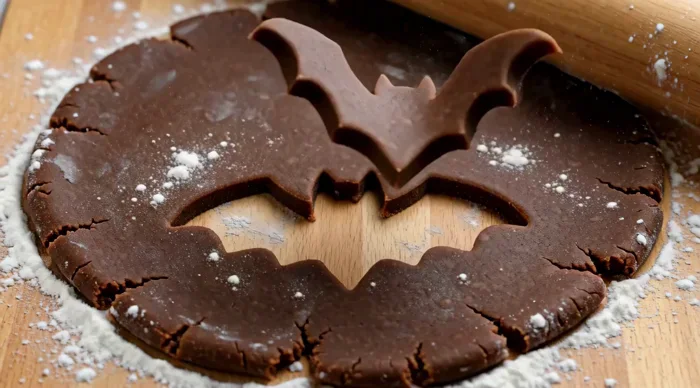</a>

▶ [Watch the full video on ofox.ai](https://ofox.ai/hailuo-3-prompts?utm_source=github&utm_medium=case&utm_campaign=awesome-ai-video-prompts#case-139)

**输入素材**：未公开 —— 本案例未收录可用的输入素材，请参阅来源

<strong>Prompt</strong> — the cut-out bat flaps up off the board and flies away

~~~~text
the cut-out bat flaps up off the board and flies away
~~~~

**参数**：MiniMax H3 · 未标注 · 未标注 · 15s · 未标注 · 未标注 · 未标注
**来源**：@GlennHasABeard · [原帖](https://x.com/GlennHasABeard/status/2110370446268870911)

Preview © 2026 @GlennHasABeard · Prompt by @GlennHasABeard

[Back to top](#table-of-contents)

### Case 142: A Crystal Civilization Builds with Sound (以声音建造的水晶文明) — by @DeCat2025

<a href="https://ofox.ai/hailuo-3-prompts?utm_source=github&utm_medium=case&utm_campaign=awesome-ai-video-prompts#case-142">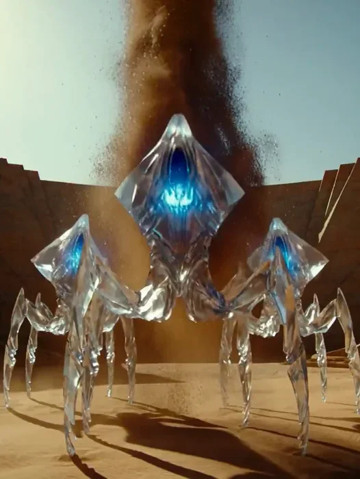</a>

▶ [Watch the full video on ofox.ai](https://ofox.ai/hailuo-3-prompts?utm_source=github&utm_medium=case&utm_campaign=awesome-ai-video-prompts#case-142)

**输入素材**：未公开 —— 本案例未收录可用的输入素材，请参阅来源

<strong>Prompt</strong> — Photorealistic alien science fiction. A civilization of towering six-legged crystalline beings inhabits a vast desert city constructed from floating m…

~~~~text
Photorealistic alien science fiction. A civilization of towering six-legged crystalline beings inhabits a vast desert city constructed from floating mineral particles.

SHOT 1 | 0–3s | LOW WIDE ANGLE
Three crystalline beings stand around an enormous plaza. Their glowing throat chambers vibrate, lifting millions of sand particles into the air to form a magnificent suspended tower.

SHOT 2 | 3–6s | AERIAL ANGLE
A gigantic black invading machine descends over the city, emitting a violent distortion pulse. The tower disintegrates into swirling particles.

SHOT 3 | 6–9s | GROUND LEVEL
The crystalline beings turn toward the intruder. Their throat chambers illuminate simultaneously. The scattered particles suddenly stop moving.

SHOT 4 | 9–12s | OVERHEAD
A circular shockwave erupts from the beings. Every suspended particle accelerates toward the invading machine, forming an enormous rotating mineral spear.

SHOT 5 | 12–15s | EXTREME WIDE
The spear strikes the machine, piercing its entire body. The machine crashes into the desert as the mineral spear instantly reshapes into a towering crystalline monument.

Awe-inspiring alien architecture, realistic particle motion, massive scale, powerful resonant sound, cinematic lighting. No dialogue, no text, no logos.
~~~~

**参数**：MiniMax H3 · 未标注 · 未标注 · 未标注 · 未标注 · 未标注 · 未标注
**来源**：@DeCat2025 · [原帖](https://x.com/DeCat2025/status/2111995868484096116)

Preview © 2026 @DeCat2025 · Prompt by @DeCat2025

[Back to top](#table-of-contents)

### Case 143: The Gravity Harvest (反重力采掘与地下巨手) — by @DeCat2025

<a href="https://ofox.ai/hailuo-3-prompts?utm_source=github&utm_medium=case&utm_campaign=awesome-ai-video-prompts#case-143">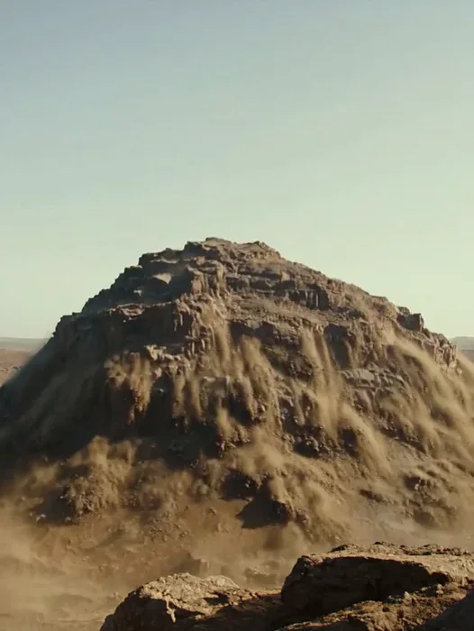</a>

▶ [Watch the full video on ofox.ai](https://ofox.ai/hailuo-3-prompts?utm_source=github&utm_medium=case&utm_campaign=awesome-ai-video-prompts#case-143)

**输入素材**：未公开 —— 本案例未收录可用的输入素材，请参阅来源

<strong>Prompt</strong> — Photorealistic epic science fiction. No dialogue. SHOT 1 | 0–3s | LOW ANGLE A colossal industrial harvesting machine crawls across a barren alien vall…

~~~~text
Photorealistic epic science fiction. No dialogue.

SHOT 1 | 0–3s | LOW ANGLE
A colossal industrial harvesting machine crawls across a barren alien valley, its massive rotating drums pressing into the ground. Gravity distortion bends the dust around it.

SHOT 2 | 3–6s | OVERHEAD
One drum jams. Concentric shockwaves spread through the earth. Rocks, vehicles and debris begin rising vertically.

SHOT 3 | 6–10s | EXTREME WIDE
An entire mountain tears free from the landscape, slowly ascending as waterfalls of soil cascade from its underside.

SHOT 4 | 10–13s | VERTICAL DROP
Camera plunges toward the enormous cavity beneath the floating mountain. A gigantic ancient mechanical hand lies buried in the exposed bedrock.

SHOT 5 | 13–15s | LOW WIDE
The mechanical fingers suddenly close around the harvesting machine, crushing it as the mountain hangs overhead.

Heavy industrial sound, deep gravitational pulses, immense scale, physically convincing debris. No text, no logos.
~~~~

**参数**：MiniMax H3 · 未标注 · 未标注 · 未标注 · 未标注 · 未标注 · 未标注
**来源**：@DeCat2025 · [原帖](https://x.com/DeCat2025/status/2111879991663423755)

Preview © 2026 @DeCat2025 · Prompt by @DeCat2025

[Back to top](#table-of-contents)

### Case 145: The Corgi Secret Agent (柯基特工的办公室任务) — by @ImaStudio_ai

<a href="https://ofox.ai/hailuo-3-prompts?utm_source=github&utm_medium=case&utm_campaign=awesome-ai-video-prompts#case-145">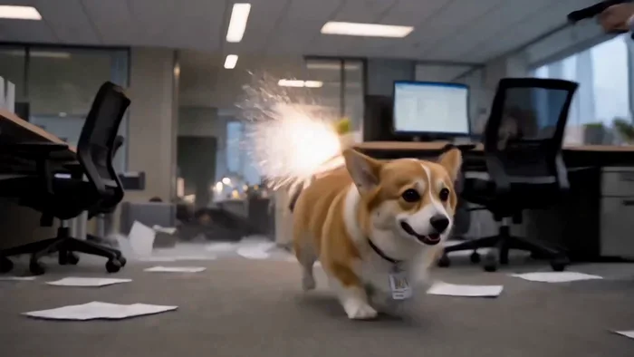</a>

▶ [Watch the full video on ofox.ai](https://ofox.ai/hailuo-3-prompts?utm_source=github&utm_medium=case&utm_campaign=awesome-ai-video-prompts#case-145)

**输入素材**：未公开 —— 本案例未收录可用的输入素材，请参阅来源

<strong>Prompt</strong> — 15s, 16:9 photorealistic cinematic action-comedy. A determined adult orange-and-white corgi secret agent exits an elevator carrying one sealed kraft-p…

~~~~text
15s, 16:9 photorealistic cinematic action-comedy. A determined adult orange-and-white corgi secret agent exits an elevator carrying one sealed kraft-paper confidential file envelope in its mouth and runs through a modern high-rise corporate office. Low-angle tracking camera follows the same corgi throughout. Several adult male agents in black business suits notice the dog and try to intercept it. The corgi dodges between desks and legs while the office erupts into a stylized non-graphic action sequence: glass partitions crack, papers fly, chairs move and agents take cover. The corgi briefly hides beneath a desk, then emerges in an absurd but cinematic spy-movie counterattack using a dropped movie-prop weapon, with brief muzzle flashes and smoke, no blood or injury detail. It then races through the chaotic office, still protecting the exact same envelope. One final suited agent blocks the path; the corgi leaps into him, knocks him backward, lands safely and keeps running. Final shot: sudden calm. The corgi reaches a wooden executive desk and places the same confidential envelope neatly on the tabletop. Behind it, the office is chaotic with scattered papers and fallen chairs while the corgi calmly looks toward camera. Hold the final frame for 0.5s. Hollywood spy action × office comedy, realistic dog anatomy, real fur, physical object weight, cinematic daylight, subtle handheld movement, 24–35mm low-angle tracking, fast pacing, consistent office geography. Same corgi, same collar and ID badge, same envelope throughout. No second dog, no anthropomorphic standing, no human arms on dog, no gore, no cartoon look, no text, no logos, no watermark.
~~~~

**参数**：MiniMax H3 · 未标注 · 未标注 · 未标注 · 未标注 · 未标注 · 未标注
**来源**：@ImaStudio_ai · [原帖](https://x.com/ImaStudio_ai/status/2110575753461149848)

Preview © 2026 @ImaStudio_ai · Prompt by @ImaStudio_ai

[Back to top](#table-of-contents)

### Case 147: The Sky Is Being Replaced (被机械臂揭开的城市天空) — by @DeCat2025

<a href="https://ofox.ai/hailuo-3-prompts?utm_source=github&utm_medium=case&utm_campaign=awesome-ai-video-prompts#case-147">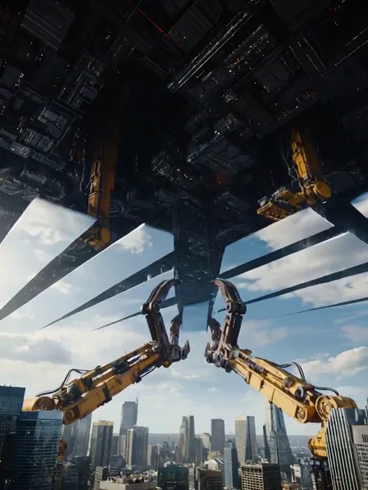</a>

▶ [Watch the full video on ofox.ai](https://ofox.ai/hailuo-3-prompts?utm_source=github&utm_medium=case&utm_campaign=awesome-ai-video-prompts#case-147)

**输入素材**：未公开 —— 本案例未收录可用的输入素材，请参阅来源

<strong>Prompt</strong> — Photorealistic science fiction, enormous cinematic scale. SHOT 1 | 0–3s | STREET LEVEL A busy futuristic city under a beautiful blue sky. Suddenly an …

~~~~text
Photorealistic science fiction, enormous cinematic scale.

SHOT 1 | 0–3s | STREET LEVEL
A busy futuristic city under a beautiful blue sky. Suddenly an enormous rectangular shadow slides across the skyscrapers.

SHOT 2 | 3–6s | UPWARD POV
Gigantic mechanical claws descend from above the clouds and grip an invisible rectangular section of the sky.

SHOT 3 | 6–9s | WIDE ANGLE
The claws pull downward. The blue sky tears away as a massive rigid panel, revealing black industrial machinery behind it.

SHOT 4 | 9–12s | ROOFTOP CAMERA
Multiple sky panels detach in succession. Their enormous shadows race across the city while giant maintenance arms move between the exposed sections.

SHOT 5 | 12–15s | EXTREME WIDE
The camera rises above the city, revealing its entire horizon enclosed inside an unimaginably large mechanical sphere. A vast central mechanism begins rotating.

Grounded scale, immense machinery, realistic shadows and atmospheric perspective, thunderous metallic sound. No dialogue, no text.
~~~~

**参数**：MiniMax H3 · 未标注 · 未标注 · 未标注 · 未标注 · 未标注 · 未标注
**来源**：@DeCat2025 · [原帖](https://x.com/DeCat2025/status/2111799484069847266)

Preview © 2026 @DeCat2025 · Prompt by @DeCat2025

[Back to top](#table-of-contents)

### Case 149: Black Mirror: Final Reflection (黑色镜面上的双人剑舞) — by @itxsarmadd

<a href="https://ofox.ai/hailuo-3-prompts?utm_source=github&utm_medium=case&utm_campaign=awesome-ai-video-prompts#case-149">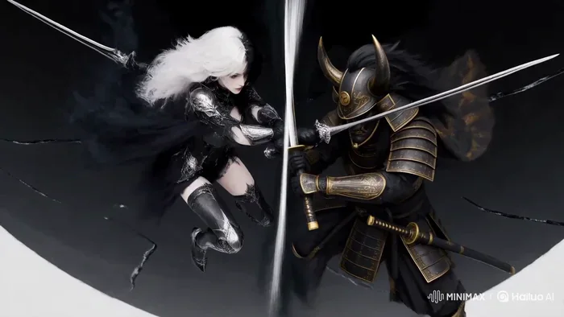</a>

▶ [Watch the full video on ofox.ai](https://ofox.ai/hailuo-3-prompts?utm_source=github&utm_medium=case&utm_campaign=awesome-ai-video-prompts#case-149)

**输入素材**：未公开 —— 本案例未收录可用的输入素材，请参阅来源

<strong>Prompt</strong> — MINIMAX H3 — 15-SECOND CINEMATIC FIGHT “BLACK MIRROR: FINAL REFLECTION” 16:9 widescreen, premium dark-fantasy fashion-action. Obsidian Ronin vs Inksha…

~~~~text
MINIMAX H3 — 15-SECOND CINEMATIC FIGHT
“BLACK MIRROR: FINAL REFLECTION”
16:9 widescreen, premium dark-fantasy fashion-action.

Obsidian Ronin vs Inkshade Valkyrie inside a gigantic floating liquid-black obsidian mirror surrounded by an endless white void. Preserve exact established character designs, faces, hair, armor, weapons, proportions and silhouettes. No redesigns.

Constant movement. No idle poses, hard cuts, teleportation, freeze frames, blood or gore.

The mirror behaves like liquid glass: every sword strike creates ripples, cracks and independent reflections that briefly attack before snapping back.

0–3s: Mirror forms from liquid black glass. Ronin emerges with a katana strike as Valkyrie attacks from the opposite reflection. Blades collide, creating a huge circular ripple.

3–6s: Ronin's heavy cut meets Valkyrie's agile twin-blade counter. Reflections attack from opposite directions. Black cracks race across the mirror. Smoke briefly forms “REAL OR REFLECTION?”

6–9s: Mirror tilts vertical. Both fighters sprint across its surface, exchanging rapid sword strikes. The glass bends around them like liquid.

9–12s: Mirror explodes into floating black fragments. Fighters leap between reflections, destroying them. Fragments align into a giant blade shape. Smoke forms “BREAK THE IMAGE”, then shatters.

12–15s: Final charge. Ronin's massive diagonal katana strike collides with Valkyrie's spinning twin-blade cross attack. The entire mirror shatters into thousands of black particles. Silence. Final smoke typography: “ONLY ONE REMAINS.”

Elegant black-and-white luxury aesthetic, glossy reflections, silver highlights, charcoal smoke, cinematic motion blur, precise camera orbiting, low mirror tracking, rotating blade shots and dramatic final push.

15s | 16:9 | continuous action | premium cinematic dark fantasy | exact character consistency
~~~~

**参数**：MiniMax H3 · 未标注 · 未标注 · 未标注 · 未标注 · 未标注 · 未标注
**来源**：@itxsarmadd · [原帖](https://x.com/itxsarmadd/status/2106698801604186579)

Preview © 2026 @itxsarmadd · Prompt by @itxsarmadd

[Back to top](#table-of-contents)

### Case 150: The Cloaked Ranger Vanishes (披风游侠的暗影消失) — by @holagarciajavi

<a href="https://ofox.ai/hailuo-3-prompts?utm_source=github&utm_medium=case&utm_campaign=awesome-ai-video-prompts#case-150">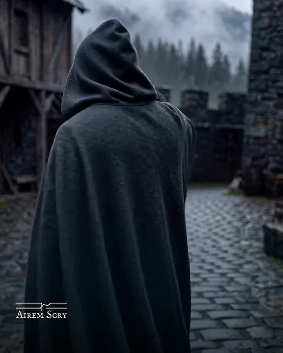</a>

▶ [Watch the full video on ofox.ai](https://ofox.ai/hailuo-3-prompts?utm_source=github&utm_medium=case&utm_campaign=awesome-ai-video-prompts#case-150)

**输入素材**：未公开 —— 本案例未收录可用的输入素材，请参阅来源

<strong>Prompt</strong> — f/2.8 lens, eye level, static camera in Ravenholdt courtyard. Damp stone courtyard, low mountain fog. From 0s to 2s, subject holds unblinking eye cont…

~~~~text
f/2.8 lens, eye level, static camera in Ravenholdt courtyard. Damp stone courtyard, low mountain fog. From 0s to 2s, subject holds unblinking eye contact. At 2s, he swiftly pulls his dark wool hood over his head and turns his back to camera. At 3.5s, as his cloak sweeps, his physical body rapidly dissolves and evaporates into a brief wisp of dark shadow-mist, vanishing completely by second 5, leaving the damp stone courtyard entirely empty for the final second.  TEXTURES AND VFX: Optical body dissolve, realistic dark mist evaporation, fluid wool physics, organic sensor grain. Quick cloth rustle, boot pivot, brief wind gust, fading rain ambience.
~~~~

**参数**：MiniMax H3 · 未标注 · 未标注 · 未标注 · 未标注 · 未标注 · 未标注
**来源**：@holagarciajavi · [原帖](https://x.com/holagarciajavi/status/2106409582222262478)

Preview © 2026 @holagarciajavi · Prompt by @holagarciajavi

[Back to top](#table-of-contents)

### Case 152: The Beast and the Plasma Cannon (巨兽反咬等离子巨炮) — by @DeCat2025

<a href="https://ofox.ai/hailuo-3-prompts?utm_source=github&utm_medium=case&utm_campaign=awesome-ai-video-prompts#case-152">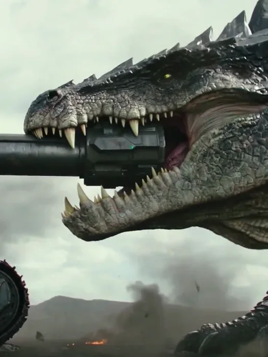</a>

▶ [Watch the full video on ofox.ai](https://ofox.ai/hailuo-3-prompts?utm_source=github&utm_medium=case&utm_campaign=awesome-ai-video-prompts#case-152)

**输入素材**：未公开 —— 本案例未收录可用的输入素材，请参阅来源

<strong>Prompt</strong> — Photorealistic epic science-fantasy. A colossal six-legged armored predator with a broad crocodilian head, muscular neck and black crystalline plates …

~~~~text
Photorealistic epic science-fantasy. A colossal six-legged armored predator with a broad crocodilian head, muscular neck and black crystalline plates charges a futuristic stationary plasma cannon mounted on a massive tracked siege platform. Barren volcanic plain.

SHOT 1 | 0–3s | LOW FRONTAL WIDE
The enormous beast charges straight toward the cannon. The weapon fires a concentrated blue plasma blast directly into its heavily armored chest, sending sparks and broken crystalline fragments flying.

SHOT 2 | 3–6s | LOW SIDE ANGLE
The creature crashes into the cannon's barrel, bends the long metal structure downward and bites onto its muzzle with enormous jaws.

SHOT 3 | 6–11s | THREE-QUARTER ACTION ANGLE
The cannon begins charging another shot while trapped between the beast's teeth. The creature violently twists its head sideways, bending the barrel backward toward the siege platform's own armored engine compartment.

SHOT 4 | 11–15s | EXTREME WIDE IMPACT
The cannon fires through its bent barrel, blasting directly into its own siege platform. A huge blue-white explosion tears the machine apart, throwing metal debris across the plain. The beast recoils, shakes its head and charges through the burning wreckage.

CAMERA AND PHYSICS:
Single beast, single cannon, consistent positioning. Clear muzzle contact, bent weapon geometry, physically readable redirection of the blast. Heavy creature movement and realistic debris.

AUDIO:
Thunderous charging footsteps, cannon discharge, grinding steel, heavy jaws, explosive final blast.

No dialogue. No text on screen.
~~~~

**参数**：MiniMax H3 · 未标注 · 未标注 · 未标注 · 未标注 · 未标注 · 未标注
**来源**：@DeCat2025 · [原帖](https://x.com/DeCat2025/status/2116979768302432302)

Preview © 2026 @DeCat2025 · Prompt by @DeCat2025

[Back to top](#table-of-contents)

### Case 156: Unexpected Strength in the Garage (车库中觉醒的怪力) — by @chatgptpaglu

<a href="https://ofox.ai/hailuo-3-prompts?utm_source=github&utm_medium=case&utm_campaign=awesome-ai-video-prompts#case-156">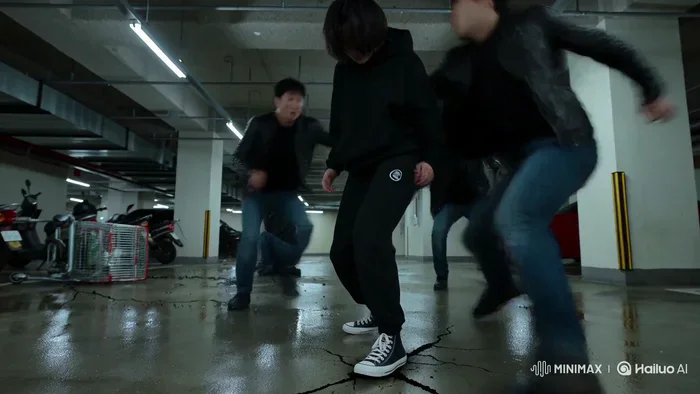</a>

▶ [Watch the full video on ofox.ai](https://ofox.ai/hailuo-3-prompts?utm_source=github&utm_medium=case&utm_campaign=awesome-ai-video-prompts#case-156)

**输入素材**：未公开 —— 本案例未收录可用的输入素材，请参阅来源

<strong>Prompt</strong> — 15 sec | 16:9 | One continuous generation | Korean dialogue | No BGM | No subtitles STYLE: Ultra-photorealistic live-action AAA supernatural martial a…

~~~~text
15 sec | 16:9 | One continuous generation | Korean dialogue | No BGM | No subtitles

STYLE:
Ultra-photorealistic live-action AAA supernatural martial arts. Real actors, real environment, grounded physical VFX.

CHARACTER LOCK:
SO-YEON, 160cm, messy black hair, black hoodie, sweatpants, Converse. Natural skin texture, sweat, pores, micro-expressions. Same actress throughout. One human only.

LOCATION:
Nighttime underground parking garage. Wet concrete, fluorescent lights, concrete pillars, scooters, shopping carts, puddles, exposed pipes.

SOUND:
Korean dialogue, footsteps, breathing, impacts, metal rattling, fluorescent hum. No music.

COMBAT:
Unarmed Sanda + Muay Thai clinch + Silat. Continuous flow: evade → redirect → knee → elbow → sweep → pivot → throw. Six attackers engage simultaneously. Two bystanders react naturally.

FAULT-LINE PHYSICS:
Heavy foot plants and slams create realistic cracks from the exact impact point. Visible vibration, dust, debris movement. No glow, aura, particles, energy waves, speed trails, or magic.

00:00–03:00 — CORNERED
Six men surround So-Yeon beside a scooter. One grabs her hoodie. A delivery worker warns, "도망가요!" Terrified, So-Yeon whispers, "그만해..." The leader swings. She instinctively ducks.

03:00–07:00 — FIRST IMPACT
She catches his wrist, pivots, and knees his stomach. Her sneaker plants hard. A thin crack shoots across the wet concrete. The leader crashes into a shopping cart and knocks into two others. Everyone freezes. A thug shouts, "뭐야, 저년!" The remaining men rush her.

07:00–11:00 — CHAOS
She slips a punch and elbows one attacker into a pillar. Redirects another into a puddle. Sweeps a third to the ground. 0.2-second micro slow motion: cracks spread, water ripples, dust falls. Immediate speed return. Bystanders pull each other behind a parked car.

11:00–15:00 — THE LAST MAN
The final attacker grabs her from behind. She becomes completely still. Her foot plants hard. Concrete cracks sharply. She redirects and throws him onto a parking line. Dense fractures spread. The delivery worker cautiously asks, "괜찮아요?" She nods, still frightened, and walks away across the cracked concrete. Fluorescent lights flicker from the vibration.

CAMERA:
Close handheld pursuit, reactive movement, occasional wider shots during group combat. Low angles for impacts and fractures, natural focus hunting, slight operator mistakes. No impossible moves or heroic posing.

REALISM LOCK:
Attackers hesitate, collide, and react naturally. Bystanders panic and move. So-Yeon looks confused by her strength. Every piece of damage has a visible physical cause. No supernatural visual effects.
~~~~

**参数**：MiniMax H3 · Hailuo · 未标注 · 未标注 · 未标注 · 未标注 · 未标注
**来源**：@chatgptpaglu · [原帖](https://x.com/chatgptpaglu/status/2104518897424548018)

Preview © 2026 @chatgptpaglu · Prompt by @chatgptpaglu

[Back to top](#table-of-contents)

### Case 167: The Mechanical Gunslinger (工业走廊中的机械枪手) — by @ou_zhen599

<a href="https://ofox.ai/hailuo-3-prompts?utm_source=github&utm_medium=case&utm_campaign=awesome-ai-video-prompts#case-167">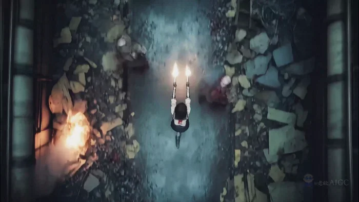</a>

▶ [Watch the full video on ofox.ai](https://ofox.ai/hailuo-3-prompts?utm_source=github&utm_medium=case&utm_campaign=awesome-ai-video-prompts#case-167)

**输入素材**（1 张图）

| | | | |
|:---:|:---:|:---:|:---:|
|  First frame |  |  |  |

<strong>Prompt</strong> — integrated_multimodal_description 15-second 16:9 I2VA cinematic action sequence. Use &lt;Picture 1&gt; as the only reference for the same adult mechanical f…

~~~~text
integrated_multimodal_description

15-second 16:9 I2VA cinematic action sequence. Use <Picture 1> as the only reference for the same adult mechanical female gunslinger A: exact face, short messy black hair, damaged beige sailor top, red neckerchief, dark pleated mini skirt, dual pistols, exposed mechanical torso, fluorescent green power lines, industrial assembly corridor, light direction, and opening composition. Do not repair costume, change hairstyle, reshape body, or replace weapons. One continuous industrial corridor only. A keeps advancing toward camera; camera retreats on the same axis or shifts to axis-right only, except neutral overhead shots. No scene jump, no axis crossing.

A begins center corridor advancing toward camera. B and C are rear armed teammates from <Picture 1>, always at least five meters behind A and only start following at the end. D enters from the foreground-right equipment gap. E attacks from the mid-left pipe shadow. F and G attack from front-left and front-right. Zombies remain blurred decayed silhouettes and never overtake A as the main subject.

Lighting: stable cold cyan-gray top light from upper-left, about 6200K, through damaged roof and smoke; weak green industrial fill stays on background metal only. Warm 2200K orange fire reflections move across legs, skirt, and mechanical edges. Muzzle flashes are brief 2800K warm-white impact lights on face, gloves, guns, blood mist, and smoke. Green power lines cast only local spill. Grade: restrained teal-orange with light bleach bypass, cyan-gray shadow #18383D, gunmetal #4B5554, muzzle orange #FF7A32, energy green #39E889, dark blood red #6F171B. Natural warm-neutral skin, deep detailed blacks, soft highlight roll-off, subtle film grain.

[00:00-00:01.8] Continue directly from <Picture 1> mid-fire. 24mm low medium shot, camera rapidly retreats on the corridor centerline. A fires the right pistol while launching forward with a heavy left step; the left pistol stays near her waist and hits D entering from the right. Her eyes lock D from the corner before her head follows. Brow tightens, upper lids lower, lower lids firm, nostrils open on a short inhale, jaw clenches, lips leave only a narrow breathing slit. A muzzle-flash wipe cuts into a 50mm chest-shoulder medium close. Acceleration pulls damaged fabric and neckerchief backward; short hair moves root-first, tips lag; skirt and cloth edges flare back then snap close with tight damping.

[00:01.8-00:03.5] Start from a close view of mechanical legs, then track low and slide to A’s right side into a 35mm full-body profile. A stays low and advances with a precise step-shoot-shift rhythm over bodies. Left pistol drops E; right pistol covers the front. Her eyes jump between targets before brows adjust. After hitting E, brow pressure releases for a fraction and one mouth corner almost rises, leaking a tiny hunting excitement before flattening again. Insert a 0.4-second bullet-follow from behind the right muzzle along the corridor axis: the bullet cuts through thin steam, hits a zombie near a steel rail, and throws blood and dust backward along force direction. A few droplets briefly wipe the lens. A graze on a steel beam dents metal, throws orange-white sparks, tiny chips, and gray oxide flakes downward; sparks follow short arcs and die fast.

[00:03.5-00:04.4] Blood-wipe into a 0.9-second vertical overhead shot. A remains center corridor moving forward. F and G close from front-left and front-right. Bodies, casings, and her coming diagonal slide path are clearly visible. Gunfire drops briefly; keep footsteps, breathing, small flame crackle, and approaching zombie sounds. A’s eyes snap upper-left to read F’s arm path; brow opens slightly because she has found the route. She enters a pipe-shadow band, naturally wiping into close action.

[00:04.4-00:06.4] 50mm right-side medium close, tight tracking. F swings an arm across her path. A does not stop. Her eyes lift to the forearm first, head follows; she folds at the waist and slips under the armpit. Left pistol presses under F’s jaw; right foot plants as pivot; right pistol fires upward into the rib side. Enter local bullet time with only a 70-degree short side arc, never full orbit. Her inner brows tighten from proximity, nose bridge wrinkles slightly. Once F loses balance, upper lids relax; gaze shifts into contempt. After the shot, her eyes glance down at falling F first; half a beat later the left mouth corner lifts slightly, lips still tight. Blood beads exit behind F in warm muzzle light; heavy droplets fall, mist is carried backward by corridor airflow. Hair, neckerchief, and torn cloth continue delayed rotation and settle as speed returns on the muzzle flash.

[00:06.4-00:09.7] 35mm high-speed side tracking matching A’s speed. A accelerates two steps, then deliberately drops her waist and slides diagonally right-front on mechanical knee pad and outer thigh. She leans back under G’s grab, left pistol fires upward into the near target; still sliding, right arm reaches overhead and fires backward at a replacement zombie. Insert a 0.6-second top-down cut confirming she threads between two zombies, then return to ground-level side tracking. On ground impact, her brow clamps, nostrils flare, teeth show a brief strain mark; next beat she suppresses pain, brow opens again, eyes keep leading the guns. Knee pad scrapes rough floor, throwing fan-shaped dust, grit, and metal specks. Heavy fragments roll briefly; light dust lifts and sinks behind her. Low sparks trail opposite the slide and die quickly. Muzzle gas becomes thin gray-white smoke pulled backward by motion. Skirt, cloth edges, and hair stretch with speed, then curl back before braking.

[00:09.7-00:12.0] Camera overshoots half a step with her braking, then rebounds into a 65mm frontal three-quarter medium close. A slows with outside foot and mechanical knee, pushing rubble forward. She folds into one-knee posture, ejects empty magazines, seats fresh magazines, and rises forward without posing. Eyes stay locked forward during braking; once magazines drop, gaze flicks down along the guns and lids narrow briefly. On magazine lock, eyes lift to camera first, head follows. Brow arches slightly, jaw relaxes from tension, lips soften into a controlled dominant half-smile. Clothing, harness, and mechanical torso settle under the hard stop and inhale. She steps close and says low, breath-heavy but controlled: <d>[English] Too slow. </d> “Too” is short and low; pause half a beat with a light exhale; “slow” is slower and falls downward. Eye contact never leaves camera.

[00:12.0-00:14.2] A suddenly fires left. Camera whip-pans left; a collapsing zombie creates a natural wipe. Whip back to corridor axis into a 24mm low frontal pullback. A walks toward camera while clearing the space in three beats: left pistol, right pistol, both pistols together. First shot removes the half-smile; upper lids lower, lips flatten. Second shot: eyes move sideways first and the head follows only slightly. Before both guns fire, she inhales sharply and locks the jaw; after the double shot, brow releases because the fight is decided. Each muzzle flash briefly becomes the warm key, lighting cheek, mechanical abdomen, flying casings, and smoke before decaying. Bullets hitting steel equipment create visible dents, chipped edges, directional fragments, and brief steam cavities that roll closed. No explosion.

[00:14.2-00:15.0] Camera suddenly locks. A does not stop; she steps over bodies and passes close along camera-right. B and C remain far back behind smoke, only now beginning to follow. Her eyes move past camera toward a new offscreen target before her head follows. Brow shifts from hard to calm control, and only then does a faint dangerous half-smile appear. As she brushes past, she says quietly: <d>[English] Keep up. </d> “Keep” is clear and low; “up” is light, short, and drops cleanly. End with the corridor still alive: muzzle smoke curling upward and pulled sideways, casings spinning to a stop, flame licking damaged metal, warm reflections trembling in dust. No fade, black screen, or freeze.

Maintain A’s exact adult identity, face, mechanical anatomy, costume damage, dual-pistol design, left-right gun relationship, five-finger hands, and corridor structure. No extra undefined people, zombie duplication, axis reversal, forward-direction reversal, teleporting, weapon fusion, deformed hands, cartoon rage, overwide mouth, rubber body motion, fabric clipping, smoke covering the face for long, blood covering the full lens, subtitles, watermark, or logo.

overall_soundscape

Continuous industrial low-frequency rumble, ventilation airflow, fire crackle, and metal corridor resonance. Dual pistols have close explosive cracks with metallic tunnel reflections and short tails. Mechanical joints produce restrained servo sounds. Casings, grit, knee-pad scraping, steel impacts, and rubble movement are spatially precise. During bullet-time moments, ambience lowers and breathing, cloth strain, sparks, and metal friction stretch slightly, then snap back to normal speed. Dialogue stays clear but integrated into action: “Too slow.” and “Keep up.” No narration.

non_diegetic_music

No music. Preserve industrial rumble, gunshots, muzzle gas, sparks, body movement, mechanical servos, shell casings, sliding metal, controlled breathing, and the final corridor afterglow.
~~~~

**参数**：MiniMax H3 · 未标注 · 未标注 · 未标注 · 未标注 · 未标注 · 未标注
**来源**：@ou_zhen599 · [原帖](https://x.com/ou_zhen599/status/2117242971464638899)

Preview © 2026 @ou_zhen599 · Prompt by @ou_zhen599

[Back to top](#table-of-contents)

### Case 169: The War of the Crimson Sky (绯红云层中的飞骑大战) — by @DeCat2025

<a href="https://ofox.ai/hailuo-3-prompts?utm_source=github&utm_medium=case&utm_campaign=awesome-ai-video-prompts#case-169">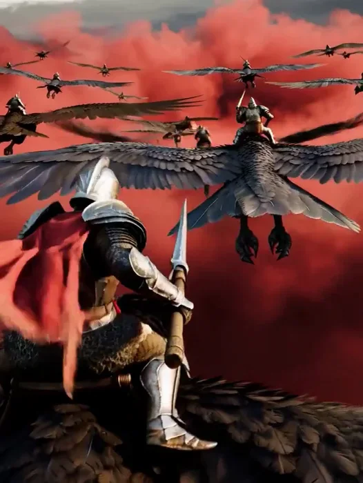</a>

▶ [Watch the full video on ofox.ai](https://ofox.ai/hailuo-3-prompts?utm_source=github&utm_medium=case&utm_campaign=awesome-ai-video-prompts#case-169)

**输入素材**：未公开 —— 本案例未收录可用的输入素材，请参阅来源

<strong>Prompt</strong> — Photorealistic epic fantasy. Hundreds of armored warriors ride gigantic four-winged predatory birds above a volcanic battlefield. SHOT 1 | 0–3s | AERI…

~~~~text
Photorealistic epic fantasy. Hundreds of armored warriors ride gigantic four-winged predatory birds above a volcanic battlefield.  

SHOT 1 | 0–3s | AERIAL WIDE Two massive aerial armies charge toward each other through crimson clouds, sunlight flashing across armor and outstretched wings.  

SHOT 2 | 3–6s | RIDER-MOUNTED CAMERA The lead warrior lowers a heavy lance. His beast dives beneath an incoming formation and strikes an enemy rider, knocking him from his mount.  

SHOT 3 | 6–11s | FAST REAR TRACKING A gigantic armored aerial beast bursts through the clouds and attacks the formation, smashing smaller mounts aside with its enormous wings.  

SHOT 4 | 11–15s | WIDE THREE-QUARTER The lead warrior dives directly toward the giant beast and drives his lance into its armored neck. The creature crashes onto a massive siege tower below, destroying the structure in a spectacular explosion of timber and stone.  

STYLE: Live-action aerial fantasy warfare, realistic wing physics, believable flight paths, massive altitude, volcanic atmosphere, spectacular physical impacts. No text on screen.
~~~~

**参数**：MiniMax H3 · 未标注 · 未标注 · 未标注 · 未标注 · 未标注 · 未标注
**来源**：@DeCat2025 · [原帖](https://x.com/DeCat2025/status/2111572012032205221)

Preview © 2026 @DeCat2025 · Prompt by @DeCat2025

[Back to top](#table-of-contents)

### Case 170: The Mountain Awakens (山岳化作燃焰守护者) — by @DeCat2025

<a href="https://ofox.ai/hailuo-3-prompts?utm_source=github&utm_medium=case&utm_campaign=awesome-ai-video-prompts#case-170">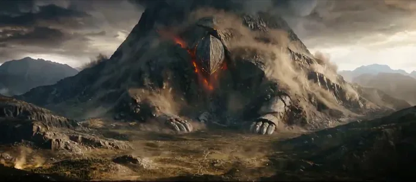</a>

▶ [Watch the full video on ofox.ai](https://ofox.ai/hailuo-3-prompts?utm_source=github&utm_medium=case&utm_campaign=awesome-ai-video-prompts#case-170)

**输入素材**：未公开 —— 本案例未收录可用的输入素材，请参阅来源

<strong>Prompt</strong> — Epic dark fantasy, ultra-cinematic realism, enormous scale, dramatic physical transformation. A lone knight in battered silver armor stands on a rocky…

~~~~text
Epic dark fantasy, ultra-cinematic realism, enormous scale, dramatic physical transformation. A lone knight in battered silver armor stands on a rocky ridge facing a massive cracked mountain. The mountain dominates the horizon. Glowing orange fissures run through its stone surface. Heavy storm clouds, airborne dust, powerful backlighting.

SHOT 1 | 0–3s | LOW WIDE ANGLE
The knight plants his sword into the rock as the ground shudders. Across the valley, enormous cracks tear through the mountain. A deep rumble shakes loose entire cliffs. The knight looks up as the mountain begins to move.

SHOT 2 | 3–6s | EXTREME WIDE AERIAL
The mountain splits along massive geometric fractures. Two gigantic stone arms emerge from its sides and push against the valley floor. Its summit rises into a broad, armored head and torso. The mountain unfolds into a colossal stone guardian, towering above the surrounding peaks.

SHOT 3 | 6–9s | GROUND-LEVEL UPWARD ANGLE
The giant extends one enormous open stone hand toward the knight, palm facing upward. Orange energy streams from the guardian's palm toward the knight. The knight's armor begins glowing white-hot, his body and planted sword merging into one brilliant vertical column of fire.

SHOT 4 | 9–12s | DYNAMIC THREE-QUARTER ANGLE
The column of fire contracts into a gigantic blazing sword hovering above the knight's now-empty position. The stone guardian closes its enormous fingers around the sword's hilt. Flames explode outward as the guardian lifts the weapon high above its head.

SHOT 5 | 12–15s | EXTREME LOW WIDE ANGLE
The awakened mountain guardian stands fully upright, gripping the immense burning sword. It swings the blade once across the storm clouds. 
A gigantic arc of fire tears through the sky, illuminating the entire mountain range. The guardian freezes in a monumental victorious pose as thunder rolls. 

CUT TO BLACK.
CAMERA, PHYSICS AND CONTINUITY
Five distinct cinematic shots. One knight, one mountain, one stone guardian. The guardian forms entirely from the original mountain. The knight transforms completely into the sword; no second knight remains. Maintain correct relative scale and coherent spatial positions. Every movement has massive weight and momentum. Clear transformation stages, readable silhouettes, natural rock displacement, dust and debris responding to impacts.

AUDIO AND RESTRICTIONS
Deep subterranean rumbles, cracking stone, thunder, rising orchestral strings, colossal metallic resonance as the sword forms, thunderous final impact. No dialogue. No on-screen text. No extra creatures, no duplicate limbs, no floating disconnected body parts, no eyes appearing in the landscape.
~~~~

**参数**：MiniMax H3 · 未标注 · 未标注 · 未标注 · 未标注 · 未标注 · 未标注
**来源**：@DeCat2025 · [原帖](https://x.com/DeCat2025/status/2111407726223843786)

Preview © 2026 @DeCat2025 · Prompt by @DeCat2025

[Back to top](#table-of-contents)
