[← 総目次に戻る](../README.ja.md#table-of-contents) · [English](ad-creative.md) · [简体中文](ad-creative.zh-CN.md) · [日本語](ad-creative.ja.md)

### クリエイティブ広告 Ad Creative

- [Case 6: A Lacquer-Thread Vase from Clay Rolling to Display (漆线雕花瓶从捻土盘线到上架) — by @derek_wall90176](#case-6)
- [Case 7: A Woven Handbag on the Riviera (里维埃拉海岸的编织手袋) — by @Dustfinger2077](#case-7)
- [Case 20: A Rushed Morning After Oversleeping (睡过头后的匆忙晨间流程) — by @noorlewisx](#case-20)
- [Case 21: An Architecture Board Assembles from Wireframes (从线框到成品的建筑展板) — by @vkuoo](#case-21)
- [Case 22: A Dawn Bakery Delivery Launch (黎明面包配送广告) — by @Dheepanratnam](#case-22)
- [Case 23: A Product Reveal with Animated Callouts (产品特性逐层标注) — by @LudovicCreator](#case-23)
- [Case 50: Another World Inside a Capsule Machine (扭蛋机里的另一个世界) — by @itxabdullaa](#case-50)
- [Case 51: A Futuristic Ad Made for Itself (为自己打造的未来广告) — by @abulu8](#case-51)
- [Case 52: A Colorful Montage of Blooming Flowers (花朵绽放的色彩蒙太奇) — by @Shinebynous](#case-52)
- [Case 53: A Product Spectacle on a Minimal Set (极简背景下的产品奇观) — by @guicastellanos1](#case-53)
- [Case 54: A Product Image Becomes a Premium Storefront (产品图变身高级电商界面) — by @ImaStudio_ai](#case-54)
- [Case 55: A High-Fashion Commercial in One Shot (一镜制作的高级时装广告) — by @lepadphone](#case-55)
- [Case 57: Turning an Educational Vision into an Experience (把教育愿景变成学习奇观) — by @umesh_ai](#case-57)
- [Case 58: A Low-Angle Fashion Tracking Film (低机位追踪的时尚短片) — by @Kiber_Alla](#case-58)
- [Case 59: An Eight-Shot Luxury Skincare Commercial (八镜头奢华护肤广告) — by @Maercihh](#case-59)
- [Case 130: Kinetic Typography Inside a Coffee Commercial (动态字体融入咖啡广告) — by @pewdenai](#case-130)
- [Case 131: Surreal Fashion Inside a Blue Studio (蓝色影棚里的超现实时装) — by @shikoba_86](#case-131)
- [Case 132: Strawberry Drink Transformation Commercial (草莓饮料变形广告) — by @GumVue](#case-132)

### Case 6: A Lacquer-Thread Vase from Clay Rolling to Display (漆线雕花瓶从捻土盘线到上架) — by @derek_wall90176

▶ [ofox.ai で動画をすべて見る](https://ofox.ai/hailuo-3-prompts?utm_source=github&utm_medium=case&utm_campaign=awesome-ai-video-prompts#case-6)

<strong>Prompt</strong> — 【参考图规则】 @图片1 是最终漆线雕作品的唯一权威参考。 必须严格保持图片1中的作品造型、主体比例、漆面颜色、金色漆线纹样、纹样走向、器型和整体气质。 不得随意增加龙、凤、佛像、文字或不存在的装饰。 @图片2 是包装盒、包装纸、品牌标识以及产品标签的唯一权威参考。 所有包装结构、颜色和标识均按照图…

~~~~text
【参考图规则】
@图片1 是最终漆线雕作品的唯一权威参考。 必须严格保持图片1中的作品造型、主体比例、漆面颜色、金色漆线纹样、纹样走向、器型和整体气质。 不得随意增加龙、凤、佛像、文字或不存在的装饰。
 @图片2 是包装盒、包装纸、品牌标识以及产品标签的唯一权威参考。 所有包装结构、颜色和标识均按照图片2执行。
@图片3 是厦门传统漆线雕工作室的环境与工匠服装参考。 保持真实闽南手工作坊质感，不做古装影视化处理，不制造虚假的“古代作坊”。

【目标】  制作一支15秒、9:16竖版的厦门漆线雕非遗工艺短片。  主题：  “一根线，走完三百年的手艺。”  影片完整呈现：  备料 → 舂打漆线土 → 搓线 → 盘线成纹 → 安金 → 贴金 → 清理完成 → 包装 → 上架  快速剪辑， 字幕驱动， 即使完全静音观看也能理解整个制作过程。  视觉采用真实高端人文纪录广告摄影：  35毫米胶片电影质感， 细腻颗粒， 浅景深， 大量微距， 自然手持， 运动非常克制， 不做旅游宣传片， 不做华丽国潮特效， 不做博物馆宣传片。  重点永远是：  手， 线， 漆， 金箔， 纹样， 时间。

【金色就是时间】  整支影片必须存在一条不可逆的视觉变化：  画面中的“金色”从无到有，并越来越多。  影片开始：  只有黑、 深褐、 砖灰、 暗红， 几乎看不到金色。  漆线开始盘绕以后， 画面出现第一点暖金。  贴金以后， 金色迅速扩大。  作品完成时， 精细金色纹样覆盖主体。  最后上架时， 整个作品被温暖自然光照亮。  每一个镜头都必须比前一个镜头拥有更多的金色。  这个变化不能倒退。  金色就是这支影片的时间。

【固定字幕牌】  整个影片始终只有一个字幕牌。  位置：  画面下方三分之一， 水平居中， 所有镜头完全相同的位置。  造型：  非常克制的小型圆角矩形， 深朱砂红底， 暖米白文字。  两行文字：  第一行： 较细字体， 显示“工序”。  第二行： 粗体， 显示一句极短的动作描述。  字幕牌：  不移动， 不放大， 不缩小， 不淡入淡出， 不跳动。  只在指定剪辑点瞬间更换文字。  字体必须清楚、正确。

【镜头序列】
 0—1.7秒  主镜头。  深夜般昏暗的传统工作台。  一盏暖色工作灯只照亮双手。  桌面上可以看到：  陈年砖粉质感的细粉、 深色大漆材料、 正在被反复捶打揉合的深褐色漆线土。  工匠双手将材料反复捶、压、揉， 逐渐形成柔软、富有韧性的泥团。  周围环境全部沉入黑暗。  没有金色。  字幕：  “第一道” “捶土成线”
1.7—3.3秒  极端微距。  一小块漆线土放在传统搓线板之间。  工匠双手稳定向前推动搓板。  原本粗厚的泥条逐渐被搓成长而均匀的细线。  摄影机贴得非常近。  能够清楚看到：  漆线轻微湿润的表面， 细小纹理， 手指压力， 线条被不断拉细。  背景完全虚化。  字幕保持：  “第一道” “捶土成线”
 3.3—5.0秒  主镜头。  朱红漆面的器物坯体第一次出现。  工匠用极细工具， 将刚刚搓好的柔软漆线轻轻落在器物表面。  第一根漆线贴上去。  只有一根。  然后第二根。  线条开始形成第一个小小的卷云纹。  画面第一次出现非常微弱的暖色高光。  字幕：  “第二道” “一线起纹”
 5.0—6.8秒  微距插入镜头。  镜头几乎贴着器物表面横向观察。  工匠用竹制细工具推动漆线：  盘， 绕， 结， 堆。  几根不足毫米级视觉尺度的柔软漆线， 逐渐形成具有明显高度差的浮凸纹样。  线条之间非常紧密。  卷云、缠枝、如意形态逐渐出现。  重点展示：  线并不是画上去的，  而是真正一根一根盘出来的。  字幕保持：  “第二道” “一线起纹”
6.8—8.6秒  主镜头。  器物已经完成大部分漆线纹样。  摄影机非常缓慢地向前推近。  工匠旋转器物。  光线擦过密集漆线表面。  能够看到：  高低起伏， 盘绕结构， 层层叠叠的线性浮雕。  这时依然没有真正的金箔。  只有漆线自身的暖棕色。  字幕：  “第三道” “盘线成雕”
8.6—10.2秒  全片最重要的声音与视觉高潮。  极端微距。  一张极薄金箔悬在空气里轻微颤动。  几乎没有重量。  工匠屏住动作， 用传统工具将金箔缓缓落向已经完成的漆线纹样。  金箔接触表面的瞬间，  贴住。  镜头保持。  不要快速切走。  细小金箔自然贴合漆线的高低起伏， 金色第一次大面积出现。  字幕：  “第四道” “一片金落下”
10.2—11.7秒  微距。  柔软毛刷轻轻扫过作品表面。  多余金箔碎屑被一点点扫开。  随着刷毛经过，  清晰、 锐利、 细密的金色漆线纹样从杂乱金箔中显现。  这是第二个视觉高潮。  镜头必须清楚表现：  杂乱金箔  变成  精确金色纹样。  字幕：  “第五道” “金纹醒来”
11.7—12.8秒  主镜头。  完成后的作品放在深色木质工作台上。  工匠用双手缓慢旋转检查。  没有任何戏剧表演。  只检查：  纹样， 漆面， 金箔， 边缘， 细节。  自然光已经明显进入工作室。  金色纹样被晨光照亮。  字幕：  “第六道” “最后一眼”
12.8—13.8秒  插入镜头。  作品被轻轻放入定制包装盒。  暖米色软布包裹器物。  盒盖缓慢合上。  手将包装盒推向画面前方。  纸张、 布料、 木盒均保持真实触感。  不要奢侈品浮夸包装。  字幕：  “第七道” “入盒”
13.8—15秒  最终镜头。  切到极简现代非遗精品店。  温暖自然晨光。  深色木制陈列架。  一只手将完成的漆线雕作品从画面侧面轻轻放到展示台中央。  手退出画面。  作品保持完全静止。  金色漆线在自然光中形成极精细的浮雕反光。  背景虚化。  最后0.6秒不再运动。  字幕：  “第八道” “上架”  画面中央仅允许出现一句极小的中文：  “厦门漆线雕”  下面更小：  “一线成雕”  最终画面必须像高端工艺品牌的静态产品摄影。  绝对不要继续运动。

【色彩】  整支影片限制在以下颜色：  陈年砖粉灰， 生漆深褐， 木质黑褐， 朱砂红， 暖米白， 金箔金。  影片前半段：  黑褐色占主导。  中段：  朱红逐渐出现。  后半段：  金色逐渐占据视觉中心。  禁止：  青蓝科技色， 霓虹， 紫色， 赛博朋克， 高饱和国潮配色。  金色必须来自真实金箔和真实光线。  不能使用发光特效制造金色。

【摄影】  全片使用真实人文纪录摄影语言。  大量：  100毫米微距镜头， 近距离手部特写， 极浅景深， 35毫米胶片颗粒。  摄影机运动非常少。  允许：  轻微呼吸感手持， 一次非常缓慢的轴向推进， 极细微的跟随动作。  禁止：  无人机， 环绕运镜， 快速推拉， 旋转镜头， 甩镜， 变焦冲击， 慢动作， 速度渐变， 镜头炫技。  镜头永远尊重手艺本身。

【声音】  全片没有任何音乐。  没有旁白。  没有人物对白。  没有广告配音。  只使用现场真实声音。
 0—3.3秒：  凌晨安静工作室。  远处非常轻的环境底噪。  漆线土落在木板上的闷响。  手掌揉压材料的湿润摩擦声。  搓板来回运动产生细密摩擦声。   3.3—8.6秒：  整体声音进一步降低。  细工具轻碰器物表面的声音。  手指移动。  漆线被放下时极轻微的黏连声音。  器物缓慢旋转时木架产生细小摩擦声。   8.6—10.2秒：  这是整支影片最重要的声音时刻。  其他环境声音全部压低。  只留下：  金箔极薄的纸张颤动声， 轻微呼吸， 工具触碰金箔的细小声音。  金箔落到漆线表面的瞬间，  接近安静。  让观众感觉自己离这张金箔只有几厘米。   10.2—12.8秒：  软毛刷扫过金箔。  细碎金箔摩擦。  器物在木架上轻轻旋转。   12.8—15秒：  包装纸折叠。  布料摩擦。  盒盖轻轻合上。  随后进入店铺：  作品底座接触木质展台，  “嗒”。  最后接近完全安静。  只保留非常微弱的室内环境声。

【核心视觉原则】  不要把它拍成：  “传统文化宣传片”。  要把它拍成：  “世界顶级手工艺品牌新品诞生纪录”。  传统来自材料和工艺，  高级感来自摄影、节奏和克制。

【禁止项】  不得出现任何与产品无关的文字。  不得出现旅游宣传标语。  不得出现：  “匠心传承” “非遗之美” “千年文化” “东方美学” 等泛化宣传口号。  不得出现不存在的历史年代。  不得出现虚假的皇宫或寺庙场景。  不得增加和尚、古装人物、舞狮、灯笼等所谓中国元素。  不得把漆线雕表现成木雕、石雕或刀刻。  重点必须明确表现：  搓线， 放线， 盘线， 绕线， 堆线， 贴金。  不得用三维特效让纹样自动生长。  不得让漆线自行移动。  所有纹样必须由人的手完成。  不得使用魔法粒子。  不得让金箔发光。  不得使用人工光晕。  不得使用慢动作。  不得加入速度渐变。  不得加入转场音效。  不得使用呼啸声。  不得出现手机界面。  不得出现电商界面。  不得出现价格。  不得出现二维码。  不得出现网站。  不得出现社交媒体账号。  不得出现水印。  不得增加第十个镜头。  最终画面完全静止。
~~~~

**参数**：MiniMax H3 · 未标注 · 未标注 · 15s · 未标注 · 未标注 · 带音频
**来源**：@derek_wall90176 · [原帖](https://x.com/derek_wall90176/status/2086464559439855938)

Preview © 2026 @derek_wall90176 · Prompt by @derek_wall90176

[目次に戻る](#table-of-contents)

### Case 7: A Woven Handbag on the Riviera (里维埃拉海岸的编织手袋) — by @Dustfinger2077

<a href="https://ofox.ai/hailuo-3-prompts?utm_source=github&utm_medium=case&utm_campaign=awesome-ai-video-prompts#case-7">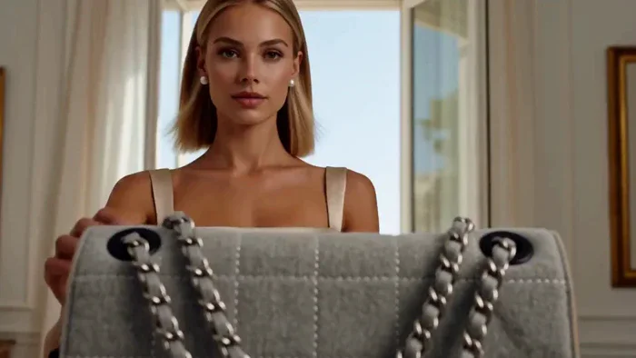</a>

▶ [ofox.ai で動画をすべて見る](https://ofox.ai/hailuo-3-prompts?utm_source=github&utm_medium=case&utm_campaign=awesome-ai-video-prompts#case-7)

<strong>Prompt</strong> — Create a 15 second, 16:9 luxury fashion commercial using @Image1@Image2 as exact visual references. @Image1 is the sole product reference. Preserve th…

~~~~text
Create a 15 second, 16:9 luxury fashion commercial using @Image1@Image2 as exact visual references. @Image1 is the sole product reference. Preserve the bag’s exact proportions, pale grey white woven textile, irregular rectangular stitching, soft structure, curved flap, silver clasp, four black eyelets, side construction, zipper details, and hardware. Do not reinterpret it as leather. The bag has two separate short straps made from silver chain woven with matching textile. Preserve their exact construction, attachment points, resting positions, and maximum lengths. The front strap connects only the two front eyelets. The rear strap connects only the two rear eyelets. They must never cross, merge, disappear, duplicate, lengthen, or be rerouted. @Image2 is the exact character reference. Preserve the woman’s face, green eyes, straight blonde bob, natural proportions, and understated makeup. Dress her consistently in a sophisticated beige silk summer mini dress with a square neckline, narrow shoulder straps, fitted waist, and softly moving skirt. Add ivory slingback heels and small pearl earrings. The bag is the visual anchor throughout. It must always be the largest, brightest, sharpest, or most prominently framed element. The woman, hotel, landscape, and car are supporting elements only.
0 to 1.75 seconds: Tight product shot of the bag alone on a sunlit limestone console beside a softly shimmering Riviera pool. Directional sunlight reveals the textile weave, stitching, two straps, four eyelets, side details, and clasp. 1.75 to 3.25 seconds: Keep the bag large and tack sharp in the foreground while the woman approaches through the bright hotel suite in soft focus. She has not touched it yet. 3.25 to 5 seconds: Extreme close up of her fingers lifting both straps together. Keep the front and rear straps visibly separate, correctly routed, and uncrossed. Show realistic chain tension, textile threaded through the links, and accurate hands. 5 to 7 seconds: She places both short straps together over one shoulder and wears the bag as a side shoulder bag. It hangs close beneath her arm, high against the side of her upper waist. It must never reach her hip or thigh. Both straps remain visibly separate, uncrossed, and at their true maximum length. 7 to 9 seconds: Close tracking shot through a sunlit hotel colonnade, composed mainly around the bag moving naturally against the beige silk dress. The straps respond realistically to her steps, shoulder movement, tension, and gravity. 9 to 11 seconds: The bag stands upright and tack sharp on a pale stone terrace table. Its two straps settle naturally and remain identifiable. The woman sits behind it in soft focus, looking toward the sea. 11 to 13 seconds: She carries the bag on one shoulder toward a cream vintage convertible. In a tight product focused montage, she opens the driver door, removes both straps from her shoulder, and carefully places the bag upright on the front passenger seat cushion. The bag’s entire base must rest directly on the horizontal cushion where a passenger sits. It is not on the backrest, headrest, seat edge, center console, or top of the seat. The passenger backrest rises behind it. Both straps settle naturally beside and partly behind the bag without disappearing. She enters the driver seat. Keep the car cropped and secondary. 13 to 15 seconds: The car moves along the Riviera coast. Keep the bag upright, large, and tack sharp on the passenger seat cushion while the woman holds steering wheel and drives in the soft background. The sea and road pass through the windows in gentle motion blur. Moving sunlight reveals the woven textile, stitching, eyelets, two distinct straps, and hardware. End with one controlled flash across the silver clasp.
Use bright, fashion forward European luxury cinematography inspired by a restored 1990s campaign film. Directional Mediterranean sunlight, dimensional shadows, layered reflections, warm 35 mm grain, gentle haliation, creamy highlights, subtle film weave, natural motion blur, and tactile textile detail. Use elegant editorial cuts, realistic movement, accurate hands, and consistent spatial logic. Add a sophisticated original fashion score with crisp percussion, warm bass, airy electronic textures, subtle chain sounds, clasp click, silk movement, footsteps, coastal ambience, car door movement, and quiet engine sound. No dialogue. No product redesign, leather texture, colour change, altered stitching, missing or merged straps, crossed straps, extra straps, extended straps, changed eyelet routing, crossbody carry, low hip placement, warped chains, changed hardware, duplicated bag, distorted hands, outfit changes, blue dress, car hero shot, wide vehicle profile, empty road shot, incorrect seat placement, text, or subtitles.
~~~~

**参数**：MiniMax H3 · 未标注 · ref2va · 15s · 未标注 · 未标注 · 带音频
**来源**：@Dustfinger2077 · [原帖](https://x.com/Dustfinger2077/status/2086086171117969702)

Preview © 2026 @Dustfinger2077 · Prompt by @Dustfinger2077

[目次に戻る](#table-of-contents)

### Case 20: A Rushed Morning After Oversleeping (睡过头后的匆忙晨间流程) — by @noorlewisx

<a href="https://ofox.ai/hailuo-3-prompts?utm_source=github&utm_medium=case&utm_campaign=awesome-ai-video-prompts#case-20">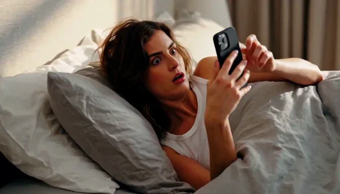</a>

▶ [ofox.ai で動画をすべて見る](https://ofox.ai/hailuo-3-prompts?utm_source=github&utm_medium=case&utm_campaign=awesome-ai-video-prompts#case-20)

<strong>Prompt</strong> — A cinematic realistic morning scene of a young adult woman suddenly waking up in a hurry. She quickly checks the time on her phone and realizes she is…

~~~~text
A cinematic realistic morning scene of a young adult woman suddenly waking up in a hurry. She quickly checks the time on her phone and realizes she is late. Looking stressed but determined, she immediately gets out of bed, quickly fixes the bedsheets, rushes to the bathroom and brushes her teeth. She then hurries into the kitchen, prepares a quick breakfast, packs the food into her bag, grabs her belongings, puts on her shoes, and rushes out of the apartment. Fast-paced natural movements, realistic expressions, smooth cinematic camera transitions, morning sunlight, detailed modern apartment, photorealistic, dynamic pacing, cinematic commercial quality, 4K.
~~~~

**参数**：MiniMax H3 · 未标注 · t2va · 15s · 未标注 · 未标注 · 带音频
**来源**：@noorlewisx · [原帖](https://x.com/noorlewisx/status/2088844629093601702)

Preview © 2026 @noorlewisx · Prompt by @noorlewisx

[目次に戻る](#table-of-contents)

### Case 21: An Architecture Board Assembles from Wireframes (从线框到成品的建筑展板) — by @vkuoo

<a href="https://ofox.ai/hailuo-3-prompts?utm_source=github&utm_medium=case&utm_campaign=awesome-ai-video-prompts#case-21">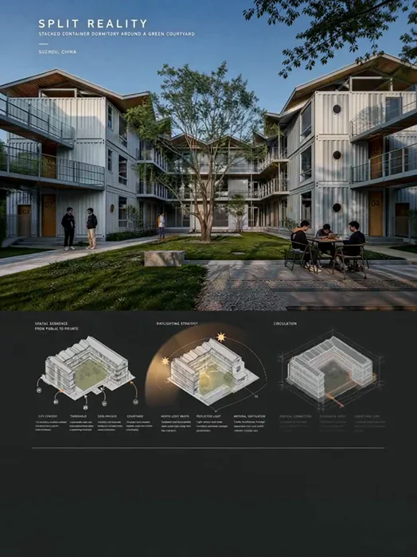</a>

▶ [ofox.ai で動画をすべて見る](https://ofox.ai/hailuo-3-prompts?utm_source=github&utm_medium=case&utm_campaign=awesome-ai-video-prompts#case-21)

<strong>Prompt</strong> — Use [img1] as the sole visual authority for the architecture, courtyard, container modules, roof geometry, facade openings, materials, landscape, peop…

~~~~text
Use [img1] as the sole visual authority for the architecture, courtyard, container modules, roof geometry, facade openings, materials, landscape, people, diagrams, site plan, typography, labels, colors, and final presentation-board composition.

Create a fast-paced 15-second architectural presentation reveal. Do not begin with the completed board. Start from a dark charcoal background and progressively assemble the board through point clouds, depth maps, wireframes, technical drawings, typography, diagrams, and finally the photorealistic architecture.

Preserve the architecture exactly. Do not redesign the building.

[0.0–1.5s — ARCHITECTURE EMERGES]

Start from near-black.

A faint point cloud flashes into existence in the upper portion of the frame, rapidly transforming:

point cloud → depth map → white architectural wireframe → shaded clay model.

Roof edges, container modules, balconies, windows, courtyard boundaries, and structural lines are traced in quick succession with sharp rhythmic flashes and scanning effects.

[1.5–3.2s — HERO IMAGE REVEAL]

The wireframe snaps into the photorealistic courtyard rendering.

Color and material flood into the image:
white container walls, timber roofs, glass reflections, grass, trees, and warm sunlight.

The hero image locks into its final upper-board position.

Subtle life begins immediately:
tree branches sway,
grass moves,
people make small gestures,
sunlight shifts across the facades.

[3.2–4.4s — TYPOGRAPHY]

The title appears letter-by-letter with elegant tracking expansion.

Subtitle and location follow.

Divider lines shoot into place.

Small labels reveal sequentially.

Keep all typography sharp, clean, and stable once revealed.

[4.4–6.4s — SPATIAL SEQUENCE]

The first analytical module flashes in as fragmented white linework.

Its layers rapidly assemble:
ground plane → building volumes → balconies → roofs → courtyard.

Orange arrows sweep through thresholds and semi-private zones toward the courtyard.

Labels appear one by one beneath the diagram.

[6.4–8.3s — DAYLIGHTING]

A lateral light sweep activates the second diagram.

Sun icons appear.

A curved solar path draws across the architecture.

Warm light rays move over the roofs and into the courtyard.

Reflected light and subtle airflow paths animate briefly.

The hero image above responds with changing sunlight and moving tree shadows.

[8.3–10.1s — CIRCULATION]

The third axonometric appears as a translucent technical model.

Orange circulation paths race around balconies and climb vertical connectors.

Small moving points suggest occupants traveling through the building.

The animation settles into the final circulation diagram.

[10.1–11.8s — SITE + DATA]

The lower section assembles rapidly from left to right.

Site context appears.

The site boundary traces itself.

The plan develops from thin drafting lines.

Project data appears row-by-row with precise editorial timing.

The full board is now nearly complete.

[11.8–13.5s — BUILDING COMES ALIVE]

Shift emphasis back to the large hero rendering.

A subtle push-in occurs only inside this image.

Existing people begin moving naturally.

Add several more occupants:
one person enters a ground-floor doorway,
another exits,
a student crosses the courtyard,
one person walks along an upper balcony.

Doors open and close softly.

Foliage moves more clearly.

Sunlight passes through leaves and shadows glide across the facades.

[13.5–15.0s — FINAL CLIMAX]

A final pulse travels from the hero rendering downward through the board.

Spatial sequence activates.
Daylighting activates.
Circulation activates.
Site plan activates.

Fine orange and white lines briefly connect the analytical systems, then settle.

Hold the complete final board while subtle life continues inside the hero rendering:
people walking,
people entering and leaving,
moving foliage,
soft reflections,
shifting sunlight.

[MOTION STYLE]

Fast, rhythmic architectural motion graphics.
Point-cloud reconstruction.
Depth-map transitions.
Wireframe-to-photoreal reveal.
Rapid drafting-line animation.
Masked typography.
Diagram assembly.
Circulation tracing.
Animated light paths.
Strong acceleration and clean easing.

The first 11 seconds should contain frequent visual events every 0.3–0.8 seconds.

Use the rhythm:
FLASH → DRAW → ASSEMBLE → LOCK.

Once revealed, each module remains in its final position.

[CRITICAL RULES]

Do not rotate the entire board.
Do not turn the board into a separate full-screen architectural flythrough.
Do not rearrange the layout.
Do not redesign the building.
Do not alter the container massing, roof geometry, facade rhythm, courtyard proportions, balconies, windows, or structural logic.
Do not replace the original diagrams.

Avoid neon HUDs, cyberpunk effects, random particles, excessive glow, or generic tech graphics.

Keep the visual language architectural, editorial, precise, and premium.

[AUDIO]

Deep opening impact, scanner pulses, drafting scratches, paper-like swishes, subtle mechanical clicks, soft transition whooshes.

As the hero image comes alive, introduce quiet courtyard ambience:
footsteps, distant conversation, doors opening, leaves moving in the breeze.

Finish with one clean low-frequency impact as the full board locks into place.

No dialogue.
~~~~

**参数**：MiniMax H3 · 未标注 · fl2va · 15s · 未标注 · 未标注 · 带音频
**来源**：@vkuoo · [原帖](https://x.com/vkuoo/status/2086254335021961590)

Preview © 2026 @vkuoo · Prompt by @vkuoo

[目次に戻る](#table-of-contents)

### Case 22: A Dawn Bakery Delivery Launch (黎明面包配送广告) — by @Dheepanratnam

<a href="https://ofox.ai/hailuo-3-prompts?utm_source=github&utm_medium=case&utm_campaign=awesome-ai-video-prompts#case-22">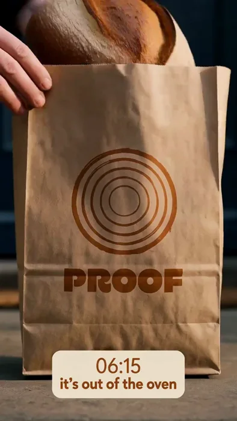</a>

▶ [ofox.ai で動画をすべて見る](https://ofox.ai/hailuo-3-prompts?utm_source=github&utm_medium=case&utm_campaign=awesome-ai-video-prompts#case-22)

<strong>Prompt</strong> — @ Image1 is the sole authority for the PROOF logo: the roundel of five concentric rings and the PROOF wordmark in heavy geometric rounded sans. Reprod…

~~~~text
@ Image1 is the sole authority for the PROOF logo: the roundel of five concentric rings
and the PROOF wordmark in heavy geometric rounded sans. Reproduce the mark and the
spelling P-R-O-O-F exactly and never alter, restyle or re-letter them. @ Image2 is the
authority for the branded kraft bakery bag. @ Image3 is the authority for the courier,
the canvas bread satchel and the dawn street.

[GOAL]
A 15-second vertical 9:16 social launch commercial for PROOF, a dawn bakery delivery
service. Fast-cut, caption-led, designed to be understood with the sound off. Photoreal
documentary commercial cinematography on 35mm, fine grain, shallow depth of field,
handheld with restrained movement.

[THE LIGHT IS THE CLOCK]
The film brightens continuously from beginning to end. It opens in near-darkness lit by
a single work lamp and finishes in full warm golden sunrise. Every shot is measurably
lighter than the one before it. This progression must be unbroken.

[CAPTION CHIPS]
Throughout, a single caption chip sits in the lower third, horizontally centred, in the
same position in every shot. It is a rounded rectangle in burnt ochre with warm cream
text, two lines: a lighter-weight top line and a bold bottom line. The chip changes
content on the cuts listed below and never moves, resizes or animates. Type must be
crisp and correctly spelled.

[SEQUENCE — cut on every timing, eight cuts]
0-1.9s    HERO. Interior of a small bakery at night, lit by one overhead work lamp.
          A baker's hands turn a large mass of wet dough on a floured steel bench.
          Everything else in the room is black.
          CHIP: "04:12" / "someone is already awake"
1.9-3.6s  INSERT. Extreme close-up, a handful of flour thrown across the bench, dust
          catching the single lamp.
          CHIP unchanged.
3.6-5.4s  HERO. A row of round dough balls resting in floured proving baskets on a rack.
          Slightly warmer, slightly brighter. One dough is visibly swollen and domed.
          CHIP: "05:30" / "it's proving"
5.4-7.1s  INSERT. An oven door swings open and a wall of steam rolls out toward camera,
          lit warm from inside.
          CHIP unchanged.
7.1-8.9s  HERO. A dark-crusted round sourdough loaf lands on a cooling rack. Hold on it.
          The crust is visibly crackling and ticking as it cools.
          CHIP: "06:15" / "it's out of the oven"
8.9-10.6s INSERT. The loaf is slid into the kraft PROOF bag from @ Image2, the top folded
          over once and taped. The ochre roundel and wordmark clearly readable.
          CHIP unchanged.
10.6-12.3s HERO. The courier from @ Image3 rides away down an empty terraced street in
          low golden sunrise, satchel on their back, PROOF mark readable, streetlights
          switching off behind them.
          CHIP: "06:52" / "it's moving"
12.3-13.6s INSERT. The kraft bag set down on a stone doorstep in full golden light,
          exactly as in @ Image2. A hand withdraws from frame. Steam rises from the fold.
          CHIP: "07:04" / "it's at your door"
13.6-15s  END FRAME. Cut to a clean flat warm cream background. The PROOF concentric
          ring mark and wordmark from @ Image1 sit centred, still, in burnt ochre and
          dark rye brown. Beneath them, small, in dark rye brown: "now delivering".
          CHIP for the final beat only: "bread younger than your alarm", single bold
          line, centred. Absolutely no motion on this frame — it is a still card.

[COLOUR]
Burnt ochre is a physical object in the world before it is ever an interface colour —
it is printed ink on the kraft bag and on the canvas satchel, lit by real light. The
caption chip is the only ochre graphic element. Palette: warm cream, kraft brown, burnt
ochre, dark rye brown, one cool blue-grey in the pre-dawn shadows.

[AUDIO]
Diegetic sound only, no music of any kind. The mix should feel close, warm and real.
0-3.6s    The dead quiet of a room at 4am: an extractor fan humming, wet dough slapping
          and stretching against steel, a scraper, the soft thud of flour.
3.6-7.1s  Quieter still. A rack wheeled a short distance. The heavy clunk of an oven
          latch and a deep roll of escaping steam.
7.1-8.9s  THIS IS THE MOMENT THE WHOLE FILM IS BUILT AROUND. A loaf on a wire rack, its
          crust crackling and ticking as it cools — a fine, irregular, delicate series
          of snaps and pops, close-miked and clearly audible above everything else.
          Bring the rest of the mix down under it.
8.9-12.3s Kraft paper crumpling and folding, tape torn. Then outdoors: a freewheel
          ticking, tyres on wet tarmac, one blackbird, distant early traffic.
12.3-15s  The bag setting down on stone. Footsteps leaving. Birdsong. Then near silence
          under the end card, with one last faint crust tick.
No music, no voiceover, no narration, no dialogue, no whoosh transitions, no sound
effects that are not physically present in the scene.

[NEGATIVE]
No text of any kind other than the caption chips, the PROOF wordmark, and "now
delivering". No other logos, no brand names, no shop signage, no readable street signs,
no house numbers, no phone screens, no app interfaces, no price, no website, no social
handles, no hashtags, no watermarks. Do not alter the PROOF mark's ring count or the
spelling of the wordmark. No music. No people speaking. No faces held in close-up for
longer than one second — this is about the bread, not a character. No slow motion, no
speed ramps, no lens flare, no colour grading toward teal or blue. The caption chip
never moves position. Do not add a ninth shot. Do not animate the end card.
~~~~

**参数**：MiniMax H3 · 未标注 · ref2va · 15s · 未标注 · 未标注 · 带音频
**来源**：@Dheepanratnam · [原帖](https://x.com/Dheepanratnam/status/2086199653922455917)

Preview © 2026 @Dheepanratnam · Prompt by @Dheepanratnam

[目次に戻る](#table-of-contents)

### Case 23: A Product Reveal with Animated Callouts (产品特性逐层标注) — by @LudovicCreator

<a href="https://ofox.ai/hailuo-3-prompts?utm_source=github&utm_medium=case&utm_campaign=awesome-ai-video-prompts#case-23">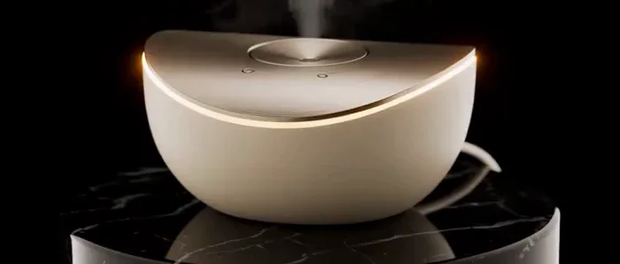</a>

▶ [ofox.ai で動画をすべて見る](https://ofox.ai/hailuo-3-prompts?utm_source=github&utm_medium=case&utm_campaign=awesome-ai-video-prompts#case-23)

<strong>Prompt</strong> — Create a 15-second luxury cinematic product showcase for a premium compact fragrance diffuser with a sculpted ceramic body and brushed-metal top. The …

~~~~text
Create a 15-second luxury cinematic product showcase for a premium compact fragrance diffuser with a sculpted ceramic body and brushed-metal top. The product has no visible branding, labels, logos or printed text.

0–4s: Begin with an extreme macro tracking shot gliding across the fine matte ceramic texture, seamless curved body, precision-machined metal rim and recessed control surface. A narrow band of warm light travels across the materials against a deep black studio background, revealing delicate surface detail and controlled highlights.

4–8s: Pull back into a three-quarter hero view. The diffuser rotates slowly above a glossy dark-stone pedestal. A subtle ambient light ring gradually illuminates beneath the metal top. A fine stream of mist rises naturally and disperses softly into the air. Maintain stable geometry, consistent proportions and elegant symmetry.

8–12s: Transition into an exploded-view reveal. The ceramic shell, fragrance reservoir, ultrasonic plate, airflow chamber and brushed-metal top separate smoothly in perfect vertical alignment. Delicate illuminated mist particles flow upward through the internal airflow channel while the camera performs a restrained side orbit.

At 9.2s, display a clean, partially transparent callout beside the ultrasonic plate. Connect it to the component with a fine pointer line. Use a thin champagne-gold border and minimal glass-like transparency. The callout title reads: “Silent Ultrasonic Diffusion”. Beneath it, in smaller text, display: “A refined mist without heat”. Keep the overlay sharp, readable, modern and premium without obscuring the internal construction.

12–15s: Every component reconnects seamlessly. The diffuser settles into a centered front-facing hero composition as warm rim lighting defines its silhouette. The callout fades away before the final lockup. Complete a gentle dolly-in while a controlled plume of mist rises from the top and the ambient light ring softly pulses once.

Premium wellness-commercial finish, photorealistic ceramic and metal, realistic mist simulation, controlled reflections, soft shadows, shallow depth of field, crisp surface detail, stable product shape, no liquid spills, no people, no hands, no logos, no writing on the product, no distortion, no duplicated components and no illegible overlay text.
2/2
~~~~

**参数**：MiniMax H3 · 未标注 · 未标注 · 15s · 未标注 · 未标注 · 带音频
**来源**：@LudovicCreator · [原帖](https://x.com/LudovicCreator/status/2085425839236096175)

Preview © 2026 @LudovicCreator · Prompt by @LudovicCreator

[目次に戻る](#table-of-contents)

### Case 50: Another World Inside a Capsule Machine (扭蛋机里的另一个世界) — by @itxabdullaa

<a href="https://ofox.ai/hailuo-3-prompts?utm_source=github&utm_medium=case&utm_campaign=awesome-ai-video-prompts#case-50">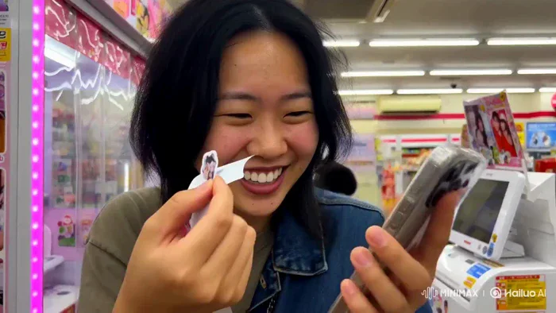</a>

▶ [ofox.ai で動画をすべて見る](https://ofox.ai/hailuo-3-prompts?utm_source=github&utm_medium=case&utm_campaign=awesome-ai-video-prompts#case-50)

<strong>Prompt</strong> — Subject: Person from Image1. Face and hairstyle must match Image1 completely; do not transform into a different person. Outfit: same casual everyday s…

~~~~text
Subject: Person from Image1. Face and hairstyle must match Image1 completely; do not transform into a different person. Outfit: same casual everyday streetwear as Part 1. Ignore the outfit, background, pose, and bottom text from Image. Even if image quality is rough, facial features must remain clearly defined. 16:9 horizontal. Entire video has an old iPhone low-quality everyday-video look. Constant heavy noise and compression artifacts throughout.
Setting: Same convenience store or arcade corner immediately after leaving the purikura booth. Sticker printer beside the booth, capsule toy machines, snack shelves, and bright fluorescent store lighting mixed with colorful purikura lights. Booth curtain still visible in the background. Any visible signs, packaging, and screen text remain completely illegible.
Timeline:
0–3s: Holds up the phone with the newly attached sticker, smiling proudly. Notices a tiny bonus sticker still attached to the backing sheet and laughs softly. "Wait... there's another one?"
3–6s: Peels off the tiny sticker and sticks it onto a reusable drink bottle or wallet. While pressing it down, a nearby capsule toy machine suddenly dispenses a capsule by itself with a loud clunk, making them jump in surprise.
6–9s: Picks up the unexpected capsule, shakes it curiously, opens it, and finds a tiny cute keychain inside. Holds it next to the purikura sticker, laughing. "No way... perfect timing!"
9–12s: Hooks the keychain onto their bag or phone strap, admires both the sticker and keychain together, then catches their reflection in the booth window and gives themselves an amused grin.
12–15s: Looks directly at the camera, holds up the phone and the new keychain together, gives a playful wink and thumbs-up while saying, "Best random stop ever." Freeze on the final frame.
Camera: Loose 1–1.5s cuts. Old iPhone, vertical, standard 1x lens (no distortion, standard field of view), handheld with slight natural shake while walking and reacting, steadier during close-up sticker and capsule moments. Slight autofocus hunting during close-ups. Mixed fluorescent and colorful booth lighting creates inconsistent white balance with a subtle magenta/pink cast. Natural exposure fluctuations throughout.
Sound: No BGM. Ambient convenience store and arcade background noise (faint chatter, vending machines, capsule toy machine sounds, footsteps), sticker peeling sound, plastic capsule opening, small keychain clink, natural laughter, close slightly muffled voice, subtle booth echo, phone handling sounds.
Style: Unedited low-quality phone video look. No color grading, no film look, no cinematic look, no beauty filter, no CG texture. No fisheye/ultra-wide (0.5x)/action-cam look, no barrel distortion, no vignette, no black lens-round at frame edges—flat standard field of view, frame filled edge to edge. Real skin texture maintained (pores, flyaway hairs, natural oil sheen). No cut consolidation, no scene skipping. No on-screen text (all store signs, product labels, booth screens, capsule contents, and sticker graphics/text remain illegible).
~~~~

**参数**：MiniMax H3 · 未标注 · 未标注 · 15s · 未标注 · 未标注 · 带音频
**来源**：@itxabdullaa · [原帖](https://x.com/itxabdullaa/status/2085656146363249079)

Preview © 2026 @itxabdullaa · Prompt by @itxabdullaa

[目次に戻る](#table-of-contents)

### Case 51: A Futuristic Ad Made for Itself (为自己打造的未来广告) — by @abulu8

<a href="https://ofox.ai/hailuo-3-prompts?utm_source=github&utm_medium=case&utm_campaign=awesome-ai-video-prompts#case-51">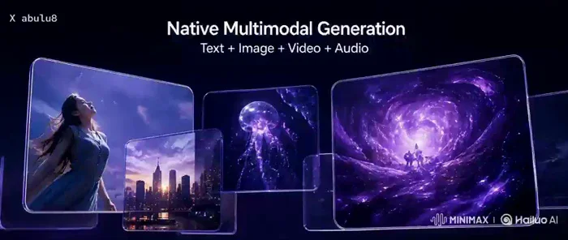</a>

▶ [ofox.ai で動画をすべて見る](https://ofox.ai/hailuo-3-prompts?utm_source=github&utm_medium=case&utm_campaign=awesome-ai-video-prompts#case-51)

<strong>Prompt</strong> — REFERENCE USAGE — nine cropped storyboard panels, in order: Image 1 — hook frame: the MiniMax H3 wordmark, the Create Beyond script line, the woman in…

~~~~text
REFERENCE USAGE — nine cropped storyboard panels, in order:
Image 1 — hook frame: the MiniMax H3 wordmark, the Create Beyond script line, the woman in violet light with jellyfish and particles.
Image 2 — multimodal frame: floating glass panels showing image, video and cosmic content, with its heading.
Image 3 — Hailuo frame: the MiniMax H3 x HailuoAI rounded glowing lockup on violet nebula.
Image 4 — editing frame: the floating glass editing timeline interface with its tool rail and clip thumbnails.
Image 5 — production frame: the woman with hair flying against violet speed streaks, with its heading.
Image 6 — live frame: the words LIVE RIGHT NOW in heavy white type over a violet horizon burst.
Image 7 — creators frame: the row of five vertical content cards and its heading.
Image 8 — possibilities frame: the four panel grid of marketing, film, music and games with its labels.
Image 9 — CTA frame: the MiniMax H3 x HailuoAI lockup with the AVAILABLE NOW glowing pill button.
Take every composition, subject, layout, wordmark and colour from these nine panels. Reproduce all typography, letterforms, weights, colours and positions exactly as they appear in the panels. Do not redraw, re-typeset, translate, correct or invent any text.

A 16:9 high energy sixty second style product launch commercial compressed into fifteen seconds, for an AI video generation platform. Palette locked to deep violet and near black with electric purple light, hot white type and bright particle energy. Every frame carries volumetric violet glow, drifting light particles, translucent glass surfaces with edge refraction, and soft bloom on every bright edge. Premium technology advertising in the language of a flagship device launch: confident, fast, expensive, futuristic. Never cheap, never cluttered, never retro.

Cutting: nine beats, hard cuts only, no dissolves or soft transitions. Hold every cut until its stated timecode and do not shorten any shot. Energy escalates continuously from the first frame to the last.

TEXT RENDERING: all on screen text is revealed by hard edged masks or lands complete on the cut, always fully sharp, at final size and full opacity, in its exact position. Never scale, fade, warp, letter space or motion blur any text. Never let text be soft, doubled or partially transparent at any point.

TEXT LOCK — only these strings appear, spelled exactly:
MiniMax H3 / Create Beyond. / Native Multimodal Generation / Text + Image + Video + Audio / Precise Multimodal Editing / Production-Ready Content Creation / For Creators. By Creators. / LIVE RIGHT NOW / Marketing / Film & TV / Music / Games / AVAILABLE NOW / HailuoAI
No numbers, captions, subtitles, credits or any other words appear anywhere.

[0-2s] Image 1. A violet shockwave detonates outward from frame centre through drifting particles and jellyfish, and the composition resolves out of it. The MiniMax H3 wordmark lands hard and complete. The Create Beyond script line writes on beneath it in one confident stroke as light traces the letterforms. HARD CUT.

[2-3.6s] Image 2. The glass panels fly in from depth and lock into their arrangement, each one settling with a soft refraction flare. The content inside each panel is live and moving. The heading lands complete above them. HARD CUT.

[3.6-4.8s] Image 3. The rounded lockup ignites, its glowing border drawing on around the corners in one continuous run of light. Jellyfish drift past in the violet nebula behind it. HARD CUT.

[4.8-6.4s] Image 4. The floating editing interface assembles in depth: the tool rail slides in from the left, the timeline extends to the right, clip thumbnails populate in sequence, and a selection highlight snaps onto one clip. The camera drifts subtly across the glass surface. HARD CUT.

[6.4-8.2s] Image 5. Full speed. Violet light streaks race past the lens at maximum velocity, her hair flying, particles tearing through frame. Camera [Push in] hard and fast. The heading lands mid motion. This is the peak of the film. HARD CUT.

[8.2-9.6s] Image 6. A burst of white light detonates on the horizon and LIVE RIGHT NOW lands enormous and complete, filling the frame. HARD CUT.

[9.6-11.2s] Image 7. The five vertical content cards fly in and lock into a row one after another in rapid succession, each landing with a violet edge flare, the content inside each card alive and moving. The heading lands above them. HARD CUT.

[11.2-12.8s] Image 8. The four panel grid snaps into place, each quadrant arriving on its own beat with its label landing complete. All four panels play live simultaneously. HARD CUT.

[12.8-15s] Image 9. Final lockup. Particles converge inward toward frame centre. The MiniMax H3 and HailuoAI marks land, then the AVAILABLE NOW pill ignites, its glowing border drawing around the button in one stroke and settling into a steady pulse. Everything holds still and sharp for the final second.

Score: an original high energy cinematic technology launch score drives the whole film. Instrumentation is a deep sub bass drone, hard synthetic percussion, rising synth arpeggios, wide detuned brass style stabs, granular risers and one enormous impact hit. Modern, confident, cinematic and expensive, in the language of a flagship product launch. No vocals, no lyrics, no orchestral strings, no retro synthwave.

The score opens at 0 seconds on one enormous impact hit and a low sub drone under the shockwave. From 2 seconds a hard percussive pulse enters and locks in, one hit per cut. From 4.8 seconds the arpeggios enter and begin climbing. From 6.4 seconds a granular riser builds hard under the speed streaks and peaks at 8.2 seconds, where the brass stabs and the full arrangement slam in at maximum weight for the LIVE RIGHT NOW frame. It drives at full power through 12.8 seconds. At 12.8 seconds everything resolves into one wide sustained chord over the final lockup, decaying gently to the end.

Sound design sits under the score: a deep whoosh and glass chime as each panel or card locks into place, a rising electrical charge as each glowing border draws on, a hard transient on every hard cut, and one clean synthetic confirmation tone as the AVAILABLE NOW button ignites. Keep all of it tight and low in the mix. No voiceover, no narrator, no dialogue, no library stock music. The score must be an original composition and must not imitate any existing track.

Do not add subtitles, captions, credits, watermarks, panel numbers, section labels or any word outside the TEXT LOCK list. Do not reproduce the storyboard grid, its white caption strips or its numbered headings. Do not alter any wordmark or logo. Do not change the woman's face between shots. No lens flare streaks across the whole frame, no glitch RGB split, no film grain, no letterboxing.
~~~~

**参数**：MiniMax H3 · 未标注 · ref2va · 15s · 未标注 · 未标注 · 带音频
**来源**：@abulu8 · [原帖](https://x.com/abulu8/status/2085626141759709286)

Preview © 2026 @abulu8 · Prompt by @abulu8

[目次に戻る](#table-of-contents)

### Case 52: A Colorful Montage of Blooming Flowers (花朵绽放的色彩蒙太奇) — by @Shinebynous

▶ [ofox.ai で動画をすべて見る](https://ofox.ai/hailuo-3-prompts?utm_source=github&utm_medium=case&utm_campaign=awesome-ai-video-prompts#case-52)

<strong>Prompt</strong> — Create a breathtaking 15-second cinematic flower-morph sequence using the seven uploaded flower images as consecutive visual references: Image 1: whit…

~~~~text
Create a breathtaking 15-second cinematic flower-morph sequence using the seven uploaded flower images as consecutive visual references:

Image 1: white calla lily
Image 2: coral hibiscus
Image 3: burgundy dahlia
Image 4: orange and cobalt-blue bird of paradise
Image 5: neon-yellow orchid
Image 6: deep-purple iris
Image 7: electric-blue Himalayan poppy

MOTION:
One continuous cinematic macro shot. The camera performs a slow, controlled push toward the center of the flower while every transformation happens clearly in full view. The flower remains centered against a deep, pure black background. Petals rotate, flutter, stretch, divide, multiply, fold, and physically reorganize into each new botanical form. Translucent long-exposure trails follow the movement like illuminated silk ribbons. The single stem remains visually anchored throughout the sequence.

ACTION AND TIMING:

0–2 seconds:
A white calla lily rotates gracefully. Its sculptural trumpet petal unfurls, creating sweeping trails of pearl white, silver, and champagne.

2–4 seconds:
The calla lily’s curved petal organically divides into five broad petals, becoming a coral hibiscus. The golden spadix elongates into the hibiscus stamen while coral, peach, and white trails spiral outward.

4–6 seconds:
The hibiscus petals rapidly multiply from the center and fold into hundreds of geometric burgundy and raspberry petals. The flower becomes a richly layered dahlia, forming a hypnotic rotating vortex.

6–8 seconds:
The dahlia petals sharpen, extend, and reorganize into the architectural form of a bird of paradise. Burgundy and magenta ignite into fiery orange while cobalt-blue and turquoise structures burst outward like exotic wings.

8–10 seconds:
The bird of paradise curls inward. Its orange structures soften and divide into the broad neon-yellow petals of an orchid. The cobalt-blue structures transform into the intricate orchid center, accented with crimson and gold. Yellow, chartreuse, and luminous-white trails pulse outward.

10–12 seconds:
The orchid petals stretch and twist, transitioning from neon yellow through electric violet into deep royal purple. Golden markings expand into the textured beard of a majestic iris. The iris opens dramatically as violet, lavender, and golden trails circle around it.

12–15 seconds:
At the visual climax, the deep-purple iris spins faster. Its sculptural petals soften into delicate translucent fabric while the violet color shifts through indigo into intense electric blue. The iris beard separates into hundreds of tiny golden particles that spiral around the flower’s center.

The flowing petals broaden and physically transform into the delicate, paper-thin petals of an electric-blue Himalayan poppy. Its intricate golden-yellow stamens and pale-green pistil assemble from the swirling particles and snap into razor-sharp focus.

The poppy opens fully as a final wave of cobalt-blue, turquoise, icy-white, and silvery long-exposure trails expands outward like luminous wings. The trails gently return into the petals, leaving the electric-blue Himalayan poppy completely still, perfectly formed, and razor-sharp in the final frame.

RHYTHM:
Begin elegant and controlled, then progressively increase the speed, scale, and complexity of each transformation. Build through strong color contrasts and reach maximum energy during the purple-iris-to-electric-blue-poppy transformation. End with a brief moment of complete stillness so the final flower can be clearly admired.

STYLE:
Photo-realistic premium macro cinematography, extreme botanical detail, physically believable organic morphing, dramatic side-lighting, deep cinematic contrast, translucent petals, luminous long-exposure trails, controlled volumetric particles, elegant motion blur, luxurious fine-art photography, pure black background, clean centered composition, rich natural colors, high-end commercial quality, 4K.

IMPORTANT:
Create genuine continuous anatomical flower transformations. No cuts, crossfades, dissolves, overlays, double exposure, image blending, or separate flower shots. Every flower must physically grow from the petals, center, and botanical structures of the previous flower. Preserve one continuous stem, stable central positioning, consistent scale, coherent lighting, and uninterrupted forward camera movement. Every flower must remain clearly recognizable before transforming. No additional flowers, bouquet, vase, hands, insects, text, borders, or background objects.
~~~~

**参数**：MiniMax H3 · 未标注 · ref2va · 15s · 未标注 · 未标注 · 带音频
**来源**：@Shinebynous · [原帖](https://x.com/Shinebynous/status/2085505725149622337)

Preview © 2026 @Shinebynous · Prompt by @Shinebynous

[目次に戻る](#table-of-contents)

### Case 53: A Product Spectacle on a Minimal Set (极简背景下的产品奇观) — by @guicastellanos1

<a href="https://ofox.ai/hailuo-3-prompts?utm_source=github&utm_medium=case&utm_campaign=awesome-ai-video-prompts#case-53">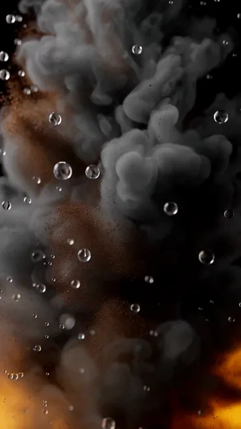</a>

▶ [ofox.ai で動画をすべて見る](https://ofox.ai/hailuo-3-prompts?utm_source=github&utm_medium=case&utm_campaign=awesome-ai-video-prompts#case-53)

<strong>Prompt</strong> — cinematic commercial Begin with peat smoke, rain droplets, and oak wood dust floating deliberately in mid-air. These materials compact into amber liqu…

~~~~text
cinematic commercial Begin with peat smoke, rain droplets, and oak wood dust floating deliberately in mid-air.  These materials compact into amber liquid and glass, forming the iconic Macallan bottle. Mist drifts as the label embosses and the liquid settles with slow viscosity.  End with the completed Macallan bottle centered, logo present, and the 3-word slogan: “Time Finds Depth”  Dark smoke-to-amber lighting, warm cinematic reflections, premium heritage tone.
~~~~

**参数**：MiniMax H3 · 未标注 · 未标注 · 10s · 未标注 · 未标注 · 带音频
**来源**：@guicastellanos1 · [原帖](https://x.com/guicastellanos1/status/2085418202457129035)

Preview © 2026 @guicastellanos1 · Prompt by @guicastellanos1

[目次に戻る](#table-of-contents)

### Case 54: A Product Image Becomes a Premium Storefront (产品图变身高级电商界面) — by @ImaStudio_ai

<a href="https://ofox.ai/hailuo-3-prompts?utm_source=github&utm_medium=case&utm_campaign=awesome-ai-video-prompts#case-54">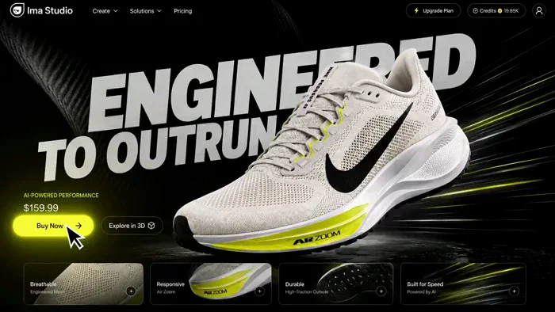</a>

▶ [ofox.ai で動画をすべて見る](https://ofox.ai/hailuo-3-prompts?utm_source=github&utm_medium=case&utm_campaign=awesome-ai-video-prompts#case-54)

<strong>Prompt</strong> — Create a 16:9 premium ecommerce landing page UI/UX demo built around the product in Image 1. Use a luxurious, futuristic sports-performance aesthetic …

~~~~text
Create a 16:9 premium ecommerce landing page UI/UX demo built around the product in Image 1. Use a luxurious, futuristic sports-performance aesthetic with oversized bold italic sans-serif typography, dark glossy backgrounds, carbon fiber and performance-mesh textures, metallic highlights, and speed-driven light streaks. Show a smooth high-speed page scroll, premium product sections, sleek feature cards, gallery modules, tech-spec areas, and strong CTA zones. Include high-impact hover interactions like scale-up, color inversion, glow effects, card expansion, and animated typography. Make the motion cinematic, expensive, and ultra-polished, like a world-class product launch website demo.

💰 Generation cost: under $3
🖼 Input: one product image
🧩 Output: a polished website concept video

Try MiniMax H3 → https://bit.ly/4fES5pl

#MiniMaxH3 #EcommerceDesign #UIDesign #ProductMarketing #ImaStudio
~~~~

**参数**：MiniMax H3 · 未标注 · 未标注 · 15s · 未标注 · 未标注 · 带音频
**来源**：@ImaStudio_ai · [原帖](https://x.com/ImaStudio_ai/status/2085211946815758841)

Preview © 2026 @ImaStudio_ai · Prompt by @ImaStudio_ai

[目次に戻る](#table-of-contents)

### Case 55: A High-Fashion Commercial in One Shot (一镜制作的高级时装广告) — by @lepadphone

<a href="https://ofox.ai/hailuo-3-prompts?utm_source=github&utm_medium=case&utm_campaign=awesome-ai-video-prompts#case-55">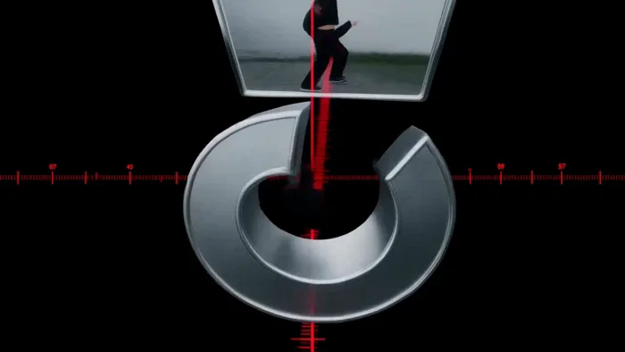</a>

▶ [ofox.ai で動画をすべて見る](https://ofox.ai/hailuo-3-prompts?utm_source=github&utm_medium=case&utm_campaign=awesome-ai-video-prompts#case-55)

<strong>Prompt</strong> — Prompts: [Core Concept] 15s, 160 BPM, 4/4, 40 beats. Industrial Hyperpop × Deconstructed Club: hard kicks, metallic snares, glitch hi-hats, distorted …

~~~~text
Prompts: 
[Core Concept]
15s, 160 BPM, 4/4, 40 beats. Industrial Hyperpop × Deconstructed Club: hard kicks, metallic snares, glitch hi-hats, distorted bass, sliced vocals. A timeline-based reality where rhythm controls space and motion.

[Character Identity]
Single androgynous dancer with short black hair, silver eyebrow mark, asymmetric black jacket, wide pants, red stitching. Maintain identical face, body, hairstyle and outfit. Multiple figures are only past-frame projections.

[World Logic]
Each kick compresses the timeline toward the dancer. Each snare duplicates previous movements into adjacent frames. Moving against the timeline transforms the 2D interface into a foldable 3D structure. The dancer escapes the repetition loop.

[Visual Language]
Black, cold white, warning red. Glass timelines, metal rails, glowing frame lines, scanning grids. Extreme wide-angle, low angles, top-down shots, Dutch angles, dolly moves, impossible perspective. 3D words COPY, SAME, TREND, OUTSIDE exist as physical architecture, not subtitles.

[Motion Rules]
Use anticipation → attack → overshoot → settle. Kick drives spatial compression, snare breaks frames, hi-hats animate cursors and fragments, bass bends time. Build with glitch cuts, then explode into an impossible continuous long take during the drop.

[Restrictions]
No character changes, extra people, random text, subtitles, logos, outfit changes, bad anatomy, flat camera angles, or meaningless flashes.
~~~~

**参数**：MiniMax H3 · 未标注 · 未标注 · 15s · 未标注 · 未标注 · 带音频
**来源**：@lepadphone · [原帖](https://x.com/lepadphone/status/2084637679254376793)

Preview © 2026 @lepadphone · Prompt by @lepadphone

[目次に戻る](#table-of-contents)

### Case 57: Turning an Educational Vision into an Experience (把教育愿景变成学习奇观) — by @umesh_ai

▶ [ofox.ai で動画をすべて見る](https://ofox.ai/hailuo-3-prompts?utm_source=github&utm_medium=case&utm_campaign=awesome-ai-video-prompts#case-57)

<strong>Prompt</strong> — Create a 15-second animated educational video that teaches young children the letters A, B, C, and D. The learning pattern for every letter must be: L…

~~~~text
Create a 15-second animated educational video that teaches young children the letters A, B, C, and D.

The learning pattern for every letter must be:

LETTER → SOUND → OBJECT → PLAYFUL ACTION → OBJECT NAME

Target audience: children ages 3 to 6.

Visual style:
Use adorable rounded 3D characters, soft pastel colors, gentle facial expressions, and simple recognizable objects. Combine this with a premium minimalist technology aesthetic featuring clean white space, elegant composition, soft studio lighting, subtle reflections, smooth gradients, rounded geometry, crisp typography, and extremely polished transitions.

The animation should feel playful and child-friendly while remaining calm, uncluttered, and beautifully designed.

Use a clean off-white background with a different soft color glow behind each letter.

0:00–0:01 | Introduction
A small smiling star mascot bounces into the center of the screen.

Colorful letters briefly float around it.

Display the text:

“Let’s learn!”

The mascot taps the screen, creating a soft ripple that reveals the first letter.

0:01–0:04 | A is for Apple

Show a large uppercase “A” and smaller lowercase “a” beside it.
Use thick, rounded, highly readable typography.

The narrator says:

“A. A says ah. A is for Apple.”

The uppercase A gently inflates and transforms into a shiny red apple.

Its top point becomes the apple stem, and a small green leaf unfolds from the side.

The apple gains a cute smiling face and performs one soft bounce.

Display the word:

“APPLE”

Highlight the first letter A in red.

Add a soft pop and a tiny crunchy sound.

0:04–0:07 | B is for Ball

The apple rolls across the screen and leaves behind a curved red trail.

The trail loops twice and forms a large uppercase “B,” with a lowercase “b” appearing beside it.
The narrator says:

“B. B says buh. B is for Ball.”

The two rounded sections of the B expand and merge into a colorful striped ball.

The ball bounces twice with playful squash-and-stretch animation.

Display the word:

“BALL”

Highlight the first letter B in blue.

Synchronize each bounce with a soft musical note.

0:07–0:10 | C is for Cat

On its final bounce, the ball stretches into a curved shape and becomes a large uppercase “C.”

A lowercase “c” slides gently into place beside it.

The narrator says:
“C. C says kuh. C is for Cat.”

The C rotates and becomes the curled tail of a cute orange cat.

The rest of the cat forms from soft rounded shapes.

The cat stretches, blinks, and gives one gentle wave with its paw.

Display the word:

“CAT”

Highlight the first letter C in orange.

Add a quiet and friendly “meow.”

0:10–0:13 | D is for Duck

The cat’s tail uncurls and transforms into the curved side of a large uppercase “D.”

A lowercase “d” pops up beside it.

The narrator says:

“D. D says duh. D is for Duck.”
The straight line of the D becomes the duck’s neck.

The curved section becomes its round yellow body.

A small orange beak and two tiny wings pop into place.

The duck waddles forward, flaps its wings, and gives one cheerful quack.

Display the word:

“DUCK”

Highlight the first letter D in yellow.

Add tiny water ripples beneath its feet.

0:13–0:15 | Recap

The apple, ball, cat, and duck slide into four clean rounded tiles.

Place their letters above them:

“A  B  C  D”

The mascot returns and points to each object as they bounce once in sequence.

Narrator:
“A, B, C, D. Great job!”

Finish with the text:

“Great job!”

Use a small sparkle animation and a warm musical chime.

Animation requirements:

Keep each letter fully visible for a moment before it transforms.

Show uppercase and lowercase versions clearly.

Make every object instantly recognizable.

Use smooth shape morphing so children can visually understand how the letter becomes the object.

Maintain stable spelling, clean letterforms, accurate object shapes, and consistent character design.

Use gentle squash-and-stretch, soft motion blur, subtle shadows, polished lighting, and precisely synchronized sound effects.
Avoid fast camera movement, cluttered backgrounds, harsh colors, tiny text, warped letters, random symbols, duplicated objects, scary expressions, or overly complex transformations.

The final video should feel cute, educational, memorable, calming, and exceptionally polished.
~~~~

**参数**：MiniMax H3 · 未标注 · 未标注 · 15s · 未标注 · 未标注 · 带音频
**来源**：@umesh_ai · [原帖](https://x.com/umesh_ai/status/2084227244533411987)

Preview © 2026 @umesh_ai · Prompt by @umesh_ai

[目次に戻る](#table-of-contents)

### Case 58: A Low-Angle Fashion Tracking Film (低机位追踪的时尚短片) — by @Kiber_Alla

<a href="https://ofox.ai/hailuo-3-prompts?utm_source=github&utm_medium=case&utm_campaign=awesome-ai-video-prompts#case-58">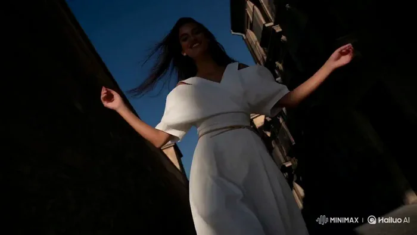</a>

▶ [ofox.ai で動画をすべて見る](https://ofox.ai/hailuo-3-prompts?utm_source=github&utm_medium=case&utm_campaign=awesome-ai-video-prompts#case-58)

<strong>Prompt</strong> — Ultra realistic cinematic video, shot on ARRI Alexa 35 with spherical lens, natural daylight, photorealistic, looks like real footage filmed on locati…

~~~~text
Ultra realistic cinematic video, shot on ARRI Alexa 35 with spherical lens, natural daylight, photorealistic, looks like real footage filmed on location, high-end fashion film aesthetic, extreme detail, realistic skin texture, real fabric physics, subtle film grain. Continuous low angle tracking shot, camera smoothly moving backward as a beautiful young woman with long dark wind-blown hair walks and performs down a narrow sun-drenched urban alley between old textured stone buildings under deep blue sky. She wears a flowing milky white asymmetrical off-shoulder top and high-waist wide-leg technical cotton culottes with a thin rope belt. The wide pants and fabric move naturally and dramatically with the wind and her body. She sings with genuine joy, smiling and softly laughing, maintaining strong eye contact with the camera, while performing free, light dance elements — fluid arm gestures, body swaying, and elegant full turns around herself as she continues walking forward. Her movement is energetic yet effortless, full of lightness and positive energy. Cinematic natural lighting with strong sunlight and deep shadows, realistic motion blur, high dynamic range, masterpiece, best quality, no artificial look.
~~~~

**参数**：MiniMax H3 · 未标注 · 未标注 · 15s · 未标注 · 未标注 · 带音频
**来源**：@Kiber_Alla · [原帖](https://x.com/Kiber_Alla/status/2083583963512062019)

Preview © 2026 @Kiber_Alla · Prompt by @Kiber_Alla

[目次に戻る](#table-of-contents)

### Case 59: An Eight-Shot Luxury Skincare Commercial (八镜头奢华护肤广告) — by @Maercihh

<a href="https://ofox.ai/hailuo-3-prompts?utm_source=github&utm_medium=case&utm_campaign=awesome-ai-video-prompts#case-59">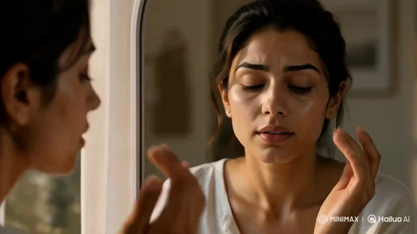</a>

▶ [ofox.ai で動画をすべて見る](https://ofox.ai/hailuo-3-prompts?utm_source=github&utm_medium=case&utm_campaign=awesome-ai-video-prompts#case-59)

<strong>Prompt</strong> — Use the uploaded storyboard as the camera guide. Follow all 8 frames in order with smooth cinematic continuity. The same woman, outfit, hairstyle, mak…

~~~~text
Use the uploaded storyboard as the camera guide. Follow all 8 frames in order with smooth cinematic continuity. The same woman, outfit, hairstyle, makeup, room and product must remain perfectly consistent throughout the entire 15-second commercial. Every shot must begin where the previous shot ends with seamless match cuts and natural camera movement.

Shot 1 (0-1.8s)
A slow push in as morning sunlight enters through the window. The woman looks outside and gently turns toward the mirror. The camera continues moving without stopping.

Transition:
The camera keeps pushing forward until her face fills the frame.

Shot 2 (1.8-3.6s)
Without cutting, the shot becomes a close-up of her face in the mirror. She notices dull skin and lightly touches her cheek. The camera slowly circles around her as she reaches toward the vanity.

Transition:
Follow her hand naturally to the serum bottle.

Shot 3 (3.6-5.4s)
Macro shot as she picks up the serum bottle. The bottle rotates slightly in her hand while natural sunlight reflects across the glass. The camera smoothly follows the bottle upward.

Transition:
Continue tracking into an extreme macro of the dropper.

Shot 4 (5.4-7.2s)
Extreme macro of the dropper lifting from the bottle. A single drop forms and falls in slow motion. The camera follows the drop as it lands on her fingertips.

Transition:
The camera continues following her fingertips toward her face.

Shot 5 (7.2-9.0s)
Close-up as she gently applies the serum across her cheeks using smooth circular motions. Skin catches soft natural highlights. Hair moves slightly in the breeze.

Transition:
The camera slowly rotates around her face while maintaining eye level.

Shot 6 (9.0-11.1s)
The lighting naturally becomes warmer as her skin appears healthier and more radiant. The transformation happens gradually, not instantly. She smiles softly while looking into the mirror.

Transition:
She turns away from the mirror and walks toward the window as the camera follows.

Shot 7 (11.1-13.2s)
Medium shot as she confidently walks into warm sunlight. She smiles naturally at the camera while the background softly blurs. The camera slowly arcs around her.

Transition:
She lowers the product toward the camera until it fills the frame.

Shot 8 (13.2-15.0s)
Hero product shot. The serum bottle stands on a clean surface with warm natural daylight. Soft reflections move across the glass. Premium end card with elegant typography and subtle camera push in. End on the product with "Shop Now."

Overall style:
Ultra photorealistic luxury skincare commercial, Apple-style cinematography, ARRI Alexa 65, 50mm and 85mm lenses, soft natural daylight, realistic skin texture, premium color grading, physically accurate lighting, smooth cinematic camera movement, seamless match cuts, invisible transitions, no jump cuts, no frame skipping, no character changes, no outfit changes, no background changes, premium beauty ad quality.

#MiniMaxH3 @Hailuo_AI
~~~~

**参数**：MiniMax H3 · 未标注 · ref2va · 15s · 未标注 · 未标注 · 带音频
**来源**：@Maercihh · [原帖](https://x.com/Maercihh/status/2083407991114805571)

Preview © 2026 @Maercihh · Prompt by @Maercihh

[目次に戻る](#table-of-contents)

### Case 130: Kinetic Typography Inside a Coffee Commercial (动态字体融入咖啡广告) — by @pewdenai

<a href="https://ofox.ai/hailuo-3-prompts?utm_source=github&utm_medium=case&utm_campaign=awesome-ai-video-prompts#case-130">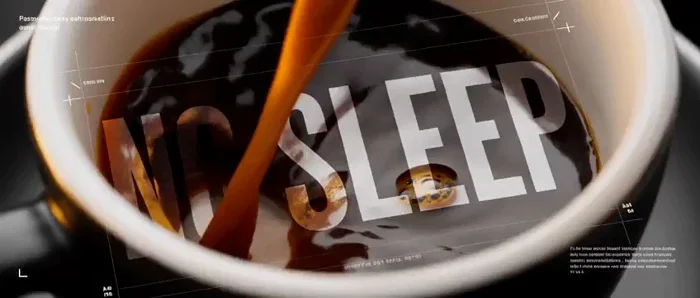</a>

▶ [ofox.ai で動画をすべて見る](https://ofox.ai/hailuo-3-prompts?utm_source=github&utm_medium=case&utm_campaign=awesome-ai-video-prompts#case-130)

<strong>Prompt</strong> — 15-second premium luxury coffee commercial for the coffee brand "INSOMNIA". Create a cinematic editorial film, not a traditional advertisement. The vi…

~~~~text
15-second premium luxury coffee commercial for the coffee brand "INSOMNIA". Create a cinematic editorial film, not a traditional advertisement. The visual language blends high-end fashion campaigns, premium product films, and modern graphic design. Every shot feels intentionally art-directed and professionally edited. Deep matte black, espresso brown, warm amber highlights, soft volumetric lighting, glossy reflections, subtle film grain, rich contrast, and an expensive cinematic color grade. Fast editorial rhythm using only crisp hard cuts synchronized with the soundtrack. No dissolves or soft transitions. Integrate bold typography naturally into the scene instead of placing it like subtitles. Massive words such as "INSOMNIA", "NO SLEEP", "STAY AWAKE", and "STAY INSPIRED" appear as architectural elements, illuminated walls, floating design layers, reflections on glass, or oversized background graphics while the camera moves around the product. Typography should remain clean, sharp, readable, and premium. Mix typography styles including giant bold headlines, thin technical labels, vertical text, rotated captions, editorial annotations, product specifications, registration marks, minimal grid lines, and stylish barcode-inspired graphic elements used only as design features, not functional barcodes. Use smooth masking reveals, frame drawing animations, split layouts, sliding typography, geometric wipes, and magazine-style collage compositions while maintaining realistic live-action footage. Show premium roasted coffee beans, aromatic steam, rich espresso pouring in macro detail, a matte black luxury coffee cup, dramatic close-ups, elegant camera movement, and refined product beauty shots. The entire film should feel like an international luxury fashion campaign directed by a top creative agency, combining cinematic realism with sophisticated editorial motion graphics. Finish with the INSOMNIA logo centered on a black background with the tagline "Stay Awake. Stay Inspired." in elegant minimal typography.

Created using MiniMax H3 on @openart_ai
~~~~

**参数**：MiniMax H3 · 未标注 · 未标注 · 15s · 未标注 · 未标注 · 带音频
**来源**：@pewdenai · [原帖](https://x.com/pewdenai/status/2083298802413555943)

Preview © 2026 @pewdenai · Prompt by @pewdenai

[目次に戻る](#table-of-contents)

### Case 131: Surreal Fashion Inside a Blue Studio (蓝色影棚里的超现实时装) — by @shikoba_86

<a href="https://ofox.ai/hailuo-3-prompts?utm_source=github&utm_medium=case&utm_campaign=awesome-ai-video-prompts#case-131">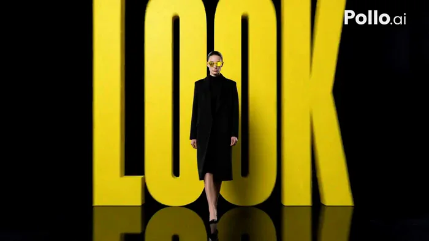</a>

▶ [ofox.ai で動画をすべて見る](https://ofox.ai/hailuo-3-prompts?utm_source=github&utm_medium=case&utm_campaign=awesome-ai-video-prompts#case-131)

<strong>Prompt</strong> — [Upload reference ] + Use la ragazza in reference as a strict identity reference for the model and her yellow sunglasses. Preserve face, hair, and the…

~~~~text
[Upload reference ] + Use la ragazza in reference  as a strict identity reference for the model and her yellow sunglasses.

Preserve face, hair, and the exact frame shape and colour throughout.

15 seconds, 16:9. Premium fashion commercial, photoreal live action.

Infinite black void, polished black floor. She is the only lit element: hard key from

one side, second hard light from the other, deep shadow between, strong speculars on

the yellow frame and lenses.

She walks slowly toward the camera in a black high-neck top and long black coat, chin

level, eyes on the lens. Camera tracks backward at her pace, holding her size in frame.

All type is heavy condensed uppercase sans-serif in vivid yellow, rendered as physical

objects in 3D perspective with real thickness, catching the same light as she does and

casting faint shadows on the floor.

[0-4s] LOOK rises out of the floor ahead of her in deep perspective, grows as she

approaches, and sweeps past on both sides out of frame.

[4-7s] SEE enters from the right at high speed, streaks behind her with heavy motion

blur, exits left.

[7-10s] FOCUS appears large and fully out of focus, resolves into razor sharpness over

half a second, holds, breaks apart.

[10-12s] Four thin yellow lines draw a rectangle around her and FRAME assembles along

its lower edge.

Throughout, passing type reflects across the glossy lenses as it moves near her.

[12-15s] She stops. All type collapses inward and vanishes into black. The camera

continues into a tight close-up on her face and the yellow sunglasses. She holds

completely still, eyes on the lens. On the black beneath her the title composes in the

same yellow type: "SHIOBA LENS", and below it, smaller: "MADE TO BE SEEN". Hold.

All text clean, legible, correctly spelled English capitals, each word once only. No

garbled or duplicated letters, misspellings, subtitles, watermarks, or other text or

logos.

Audio: low sustained bass,

Composition: model centered, all type within the central third of the frame
~~~~

**参数**：MiniMax H3 · 未标注 · 未标注 · 15s · 未标注 · 未标注 · 带音频
**来源**：@shikoba_86 · [原帖](https://x.com/shikoba_86/status/2083225662316265763)

Preview © 2026 @shikoba_86 · Prompt by @shikoba_86

[目次に戻る](#table-of-contents)

### Case 132: Strawberry Drink Transformation Commercial (草莓饮料变形广告) — by @GumVue

<a href="https://ofox.ai/hailuo-3-prompts?utm_source=github&utm_medium=case&utm_campaign=awesome-ai-video-prompts#case-132">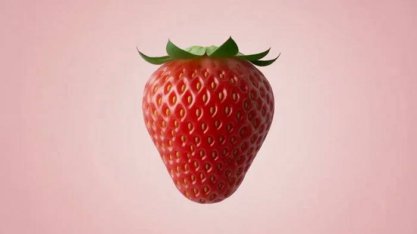</a>

▶ [ofox.ai で動画をすべて見る](https://ofox.ai/hailuo-3-prompts?utm_source=github&utm_medium=case&utm_campaign=awesome-ai-video-prompts#case-132)

<strong>Prompt</strong> — { "shots": [ { "shot_id": "1", "start_time": "00:00", "end_time": "00:02", "camera_angle": "Close-up", "subject": "Strawberry", "action": "A single, d…

~~~~text
{   "shots": [     {       "shot_id": "1",       "start_time": "00:00",       "end_time": "00:02",       "camera_angle": "Close-up",       "subject": "Strawberry",       "action": "A single, dull strawberry transforms into a vibrant, ripe strawberry, floating against a pink background.",       "visual_details": "Initial strawberry is muted, then becomes intensely red with visible seeds; pink background; subtle glow effect.",       "audio_cues": "Light, subtle, almost magical sound effect."     },     {       "shot_id": "2",       "start_time": "00:02",       "end_time": "00:05",       "camera_angle": "Medium shot",       "subject": "Strawberry and beverage can",       "action": "The vibrant strawberry transforms into a white and pink beverage can with 'STRAWBERRY CREAM' text. Liquid pours into the can from above, and strawberries/water droplets float around it.",       "visual_details": "Can is sleek, covered in condensation; red liquid splashing into the can; numerous floating strawberries (whole and sliced) and water droplets; pink background.",       "audio_cues": "Sound of liquid pouring, bubbling, and light splashes; upbeat, commercial-style music."     },     {       "shot_id": "3",       "start_time": "00:06",       "end_time": "00:10",       "camera_angle": "Close-up",       "subject": "Top of the beverage can",       "action": "Focus on the top of the can as the liquid continues to pour and splash, with droplets and strawberries in motion.",       "visual_details": "Intricate details of the can's opening and condensation; dynamic splashes of liquid; close-up of floating strawberry pieces.",       "audio_cues": "Enhanced sounds of liquid splashing and bubbling; continued music."     },   ] }
~~~~

**参数**：MiniMax H3 · 未标注 · t2va · 7s · 未标注 · 未标注 · 带音频
**来源**：@GumVue · [原帖](https://x.com/GumVue/status/2083189719827878083)

Preview © 2026 @GumVue · Prompt by @GumVue

[目次に戻る](#table-of-contents)
