[← 返回总目录](../README.zh-CN.md#table-of-contents) · [English](animation-stylized.md) · [简体中文](animation-stylized.zh-CN.md) · [日本語](animation-stylized.ja.md)

### 动画与风格化 Animation & Stylized

- [Case 12: An 1890s Bird Plate Draws Itself (自动绘成的 1890 年代鸟类图鉴) — by @Dheepanratnam](#case-12)
- [Case 34: Circle, Square, Triangle, and Star (圆形、方形、三角形与星形) — by @Strength04_X](#case-34)
- [Case 35: Learning the Days of the Week (用一周七天学英语) — by @Strength04_X](#case-35)
- [Case 36: A Poster Comes Alive (海报在镜头中苏醒) — by @LudovicCreator](#case-36)
- [Case 103: Japanese Captions in Motion (日文字幕的动画练习) — by @su_nagomi](#case-103)
- [Case 105: Cairn Munro Arrives in Motion Type (凯恩·门罗的动态字体登场) — by @Dheepanratnam](#case-105)
- [Case 106: A Surreal Vision Inside a Laundromat (洗衣店里的超现实想象) — by @opener_ai](#case-106)
- [Case 107: The Last Bubble Before Closing · Part 2 (打烊前最后一个气泡 · 下篇) — by @ManuAGI01](#case-107)
- [Case 108: The Last Bubble Before Closing · Part 1 (打烊前最后一个气泡 · 上篇) — by @ManuAGI01](#case-108)
- [Case 109: Ari and Bruno’s Croissant Bloom · Part 1 (阿里与布鲁诺的羊角包花 · 上篇) — by @ManuAGI01](#case-109)
- [Case 110: The Gentleman Cat and Little Mouse Surprise · Part 2 (绅士猫与小老鼠的惊喜 · 下篇) — by @ManuAGI01](#case-110)
- [Case 111: The Gentleman Cat and Little Mouse Surprise · Part 1 (绅士猫与小老鼠的惊喜 · 上篇) — by @ManuAGI01](#case-111)
- [Case 126: The Little Strawberry Wakes the Pineapple King · Part 2 (小草莓唤醒菠萝王 · 下篇) — by @ManuAGI01](#case-126)
- [Case 127: Hand-Drawn Ginger Pork Cooking Anime (手绘姜烧猪肉料理动画) — by @ozuozuai99](#case-127)
- [Case 128: Watercolor anime fetish montage rapid cuts (水彩动画感官蒙太奇快切) — by @yachimat_manga](#case-128)
- [Case 129: Greenhouse tea isekai anime (温室红茶异世界动画) — by @haruuraeadss](#case-129)

### Case 12: An 1890s Bird Plate Draws Itself (自动绘成的 1890 年代鸟类图鉴) — by @Dheepanratnam

▶ [在 ofox.ai 观看完整视频](https://ofox.ai/hailuo-3-prompts?utm_source=github&utm_medium=case&utm_campaign=awesome-ai-video-prompts#case-12)

<strong>Prompt</strong> — @ Image1 is the sole visual authority for the folio spread, the wren, the hazel twig, the egg study, the foot sketch, the handwriting, the printed typ…

~~~~text
@ Image1 is the sole visual authority for the folio spread, the wren, the hazel twig, the egg study, the foot sketch, the handwriting, the printed type, the paper, the foxing, the lighting, the palette, the layout and the horizontal composition. 

Animate this exact page without redesigning it. Preserve every existing mark, letter and colour in its final state.  

[Goal] Create a 15-second sequence in which this plate makes itself, and then the bird inside it comes quietly alive. One continuous, locked, straight-on overhead composition. No camera movement, no cuts, no cropping, no perspective change, no page turning.  

[Sequence]  0-2.4 seconds: Begin on blank aged ivory paper — the empty spread, correct in paper texture, chain lines, foxing and lighting, but carrying no image, no writing and no type. A faint graphite underdrawing appears across the right page in light searching strokes, finding the wren's posture and the line of the twig. 
A few construction marks overshoot and are left uncorrected.  

2.4-6 seconds: Engraved ink linework draws itself over the pencil, following the exact contours of the finished plate — outline first, then hatching building the shadow under the wing, the barring of the tail, the texture of the twig. The rectangular plate mark presses into the paper around the image with a soft physical impression, lifting the paper very slightly at its edge.  

6-10.5 seconds: Watercolour floods in. Washes enter the printed outlines and settle into them, warm russet across the back, buff along the eyebrow stripe, muted olive on the twig, each wash landing exactly within the shapes of the finished plate and overrunning the line in the same few places the reference does. 

The colour blooms wet and then visibly dries, darkening slightly at the edges. On the left page, the sepia handwriting writes itself line by line from the top, in a period cursive hand that is elegant, cramped and only partly legible. The small egg study fills with colour and the pencil foot sketch appears faintly beside it.  
10.5-13 seconds: The printed type impresses into the right page — TROGLODYTES TROGLODYTES, then The Common Wren beneath it, then PLATE XVII in the top right corner. Foxing spots deepen. The last details resolve: the highlight in the bird's eye, the fine barring on the flank. The page settles. Everything on the spread is now exactly as in @[ref img].  13-15 seconds: The page stays completely still and completely flat 

— it is paper and it behaves like paper. But the printed bird begins to breathe. Its flank rises and falls very slightly. It blinks once. It turns its head a few degrees and holds, alert, looking past the viewer at something outside the page. The cocked tail gives one small twitch. It does not fly, it does not leave the plate, it does not become three-dimensional, and it does not look at the viewer. Settle into a living idle: the bird breathing, one more slow blink, the paper still.  Render as photoreal archival photography of a real object under warm north-window light. Keep the printed page flat and matte with no glow, no emission, no glint and no digital sheen. 

Keep the two motion layers distinct: the page is a made thing being made, the bird is alive. Keep all type, handwriting, marks and geometry fixed once they appear.  Do not introduce any new text, letters, numerals, marks, birds, objects, hands, tools, logos, captions, borders, watermarks or page numbers. Do not turn or lift the page. Do not move, rotate or scale the camera. Do not zoom. Do not add glow, neon, coloured light, lens flare, bokeh or shallow-focus racking. 

Do not make the bird photoreal or three-dimensional — it must remain a hand-coloured engraving that happens to be alive. Do not have it fly, hop, open its beak wide, or leave the plate.  

Audio: fine graphite scratching on rough paper; the dry precise scrape of a steel nib; the deep soft compression of a plate press; a sable brush loaded with water moving across paper; paper fibres settling; the quiet room tone of a study with a slow long-case clock ticking somewhere behind. 
At 13 seconds, one Eurasian wren song — sudden, intricate and far louder than anything that small should produce — then the room tone returns and the clock keeps going. No music, no dialogue, no narration, no electronic tones.
~~~~

**参数**：MiniMax H3 · 未标注 · fl2va · 15s · 未标注 · 未标注 · 带音频
**来源**：@Dheepanratnam · [原帖](https://x.com/Dheepanratnam/status/2086312209919963371)

Preview © 2026 @Dheepanratnam · Prompt by @Dheepanratnam

[回到目录](#table-of-contents)

### Case 34: Circle, Square, Triangle, and Star (圆形、方形、三角形与星形) — by @Strength04_X

<a href="https://ofox.ai/hailuo-3-prompts?utm_source=github&utm_medium=case&utm_campaign=awesome-ai-video-prompts#case-34">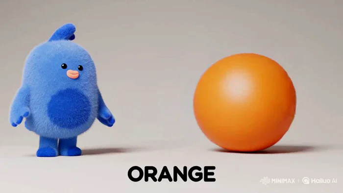</a>

▶ [在 ofox.ai 观看完整视频](https://ofox.ai/hailuo-3-prompts?utm_source=github&utm_medium=case&utm_campaign=awesome-ai-video-prompts#case-34)

<strong>Prompt</strong> — Create a 15-second animated educational video that teaches young children the shapes Circle, Square, Triangle, and Star. Learning pattern for every sh…

~~~~text
Create a 15-second animated educational video that teaches young children the shapes Circle, Square, Triangle, and Star.

Learning pattern for every shape:
SHAPE → NAME SOUND → OBJECT → PLAYFUL ACTION → OBJECT NAME
Target audience: children ages 3 to 6

Visual style: Same premium-cute aesthetic pastel colors, rounded 3D forms, soft lighting, minimalist off-white background, unique glow color per shape, crisp bold typography, polished smooth morphing transitions.

0:00–0:01 Intro: Mascot bounces in, shapes float briefly, text "Let's learn shapes!", tap reveals first shape with a ripple.

0:01–0:04 | Circle is for Orange: A perfect circle appears. Narrator: "Circle. Round and round. Circle is for Orange." Circle gains texture and a tiny stem, becomes a smiling orange, bounces once. Word "ORANGE," highlight shape outline in orange.

0:04–0:07 | Square is for Gift Box: The orange rolls and reshapes into a square. Narrator: "Square. Four equal sides. Square is for Gift Box." Square gains a ribbon and bow, wiggles playfully. Word "GIFT BOX," highlight in purple.

0:07–0:10 | Triangle is for Mountain: The ribbon folds into a triangle. Narrator: "Triangle. Three sides. Triangle is for Mountain." Triangle grows a snowy peak and a small smiling sun beside it. Word "MOUNTAIN," highlight in brown/teal.

0:10–0:13 | Star is for Sky: The mountain peak stretches into a star. Narrator: "Star. Star is for Sky." Star twinkles softly with tiny sparkles floating around it, gentle glow pulse. Word "STAR," highlight in golden yellow.

0:13–0:15 Recap: Orange, gift box, mountain, star line up in four tiles with shape outlines above. Mascot points to each in sequence.

Narrator: "Circle, Square, Triangle, Star. Great job!" Sparkle + warm chime.

Requirements: Each shape fully visible before morph, uppercase-clarity level precision on shape edges, no warped or duplicated forms, gentle motion only, synced sound cues, calm and beautifully polished finish.
~~~~

**参数**：MiniMax H3 · 未标注 · 未标注 · 15s · 未标注 · 未标注 · 带音频
**来源**：@Strength04_X · [原帖](https://x.com/Strength04_X/status/2084586713205317678)

Preview © 2026 @Strength04_X · Prompt by @Strength04_X

[回到目录](#table-of-contents)

### Case 35: Learning the Days of the Week (用一周七天学英语) — by @Strength04_X

<a href="https://ofox.ai/hailuo-3-prompts?utm_source=github&utm_medium=case&utm_campaign=awesome-ai-video-prompts#case-35">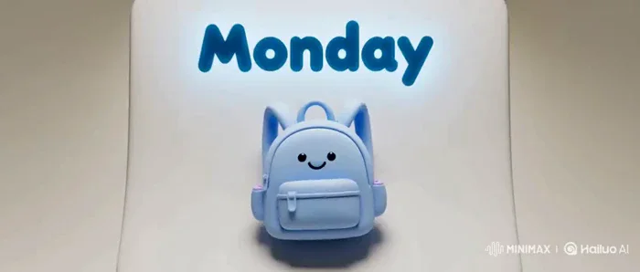</a>

▶ [在 ofox.ai 观看完整视频](https://ofox.ai/hailuo-3-prompts?utm_source=github&utm_medium=case&utm_campaign=awesome-ai-video-prompts#case-35)

<strong>Prompt</strong> — Create a 15-second animated educational video that introduces young children to the first four days of the week: Monday, Tuesday, Wednesday, Thursday.…

~~~~text
Create a 15-second animated educational video that introduces young children to the first four days of the week: Monday, Tuesday, Wednesday, Thursday.
Learning pattern: DAY NAME → SOUND → FUN ACTIVITY ICON → PLAYFUL ACTION → DAY NAME REPEAT
Target audience: children ages 3 to 6.
Visual style: Same premium-cute aesthetic — pastel tones, rounded 3D icons, soft lighting, off-white background, unique glow per day, clean bold typography, gentle calendar-page-flip style transitions.
0:00–0:01 Intro: Mascot bounces onto a soft floating calendar page, text "Let's learn the days!", tap flips to reveal Monday.

▪️0:01–0:04 | Monday — School Day: Calendar page shows "Monday" in big rounded text. Narrator: "Monday. Time for school!" A tiny backpack icon bounces onto the page and wiggles happily. Word "MONDAY" highlighted in soft blue.

▪️0:04–0:07 | Tuesday — Park Day: Page flips gently to Tuesday. Narrator: "Tuesday. Time to play!" A small swing icon appears and swings back and forth once. Word "TUESDAY" highlighted in soft orange.

▪️0:07–0:10 | Wednesday — Art Day: Page flips to Wednesday. Narrator: "Wednesday. Time to paint!" A tiny paintbrush icon appears and draws one curved rainbow line. Word "WEDNESDAY" highlighted in soft purple.

▪️0:10–0:13 | Thursday — Story Day: Page flips to Thursday. Narrator: "Thursday. Time for stories!" A small open book icon appears, pages gently flutter. Word "THURSDAY" highlighted in soft green.

▪️0:13–0:15 Recap: Backpack, swing, paintbrush, book appear in four tiles with day names above. Mascot points to each; Narrator: "Monday, Tuesday, Wednesday, Thursday. Great job!" Sparkle + chime.
~~~~

**参数**：MiniMax H3 · 未标注 · 未标注 · 15s · 未标注 · 未标注 · 带音频
**来源**：@Strength04_X · [原帖](https://x.com/Strength04_X/status/2084874623825723522)

Preview © 2026 @Strength04_X · Prompt by @Strength04_X

[回到目录](#table-of-contents)

### Case 36: A Poster Comes Alive (海报在镜头中苏醒) — by @LudovicCreator

<a href="https://ofox.ai/hailuo-3-prompts?utm_source=github&utm_medium=case&utm_campaign=awesome-ai-video-prompts#case-36">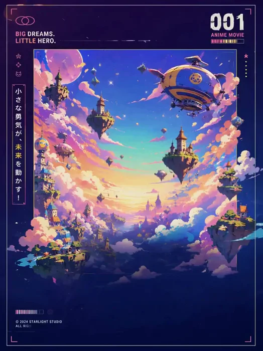</a>

▶ [在 ofox.ai 观看完整视频](https://ofox.ai/hailuo-3-prompts?utm_source=github&utm_medium=case&utm_campaign=awesome-ai-video-prompts#case-36)

<strong>Prompt</strong> — Animate the source artwork as a **10-second energetic chibi anime poster assembly**, preserving the deep indigo-purple background, neon pink, cyan and…

~~~~text
Animate the source artwork as a **10-second energetic chibi anime poster assembly**, preserving the deep indigo-purple background, neon pink, cyan and yellow palette, glossy anime illustration, characters, typography, decorative border and exact original layout. Begin on the empty purple background, then draw the outer border and corner markers with quick glowing strokes; introduce the small labels, Japanese text, numbering and interface graphics through playful pop-ins, slides and type-on animation, each paired with light arcade clicks, bubbly typing sounds and soft digital chimes.

Build the central world in layers: floating islands rise into position, clouds expand outward, the moon fades in, towers and airships drift into place, and sparkles scatter across the scene. Assemble the chibi robot and flying cat with quick bouncy entrances, then launch the main hero from deep inside the poster toward the camera with strong 3D parallax, allowing his shoe, hand and hair to briefly extend beyond the inner frame before settling into the original composition.

Reveal the Japanese title with a bold elastic impact, followed by the English labels, release date, IMAX line and footer icons appearing sequentially. Add subtle looping life after assembly: blinking eyes, gently moving hair and clothing, small robot antenna motion, the cat’s tail bouncing, airships floating, clouds drifting and stars twinkling. Finish with a soft camera push-in, one bright starburst behind the title and a clean hold on the completed poster, keeping every element sharp and readable. No redesign, no distorted faces, no changing text, no full scene transformation, no aggressive camera rotation.
2/2
~~~~

**参数**：MiniMax H3 · 未标注 · 未标注 · 15s · 未标注 · 未标注 · 带音频
**来源**：@LudovicCreator · [原帖](https://x.com/LudovicCreator/status/2084519725405483220)

Preview © 2026 @LudovicCreator · Prompt by @LudovicCreator

[回到目录](#table-of-contents)

### Case 103: Japanese Captions in Motion (日文字幕的动画练习) — by @su_nagomi

<a href="https://ofox.ai/hailuo-3-prompts?utm_source=github&utm_medium=case&utm_campaign=awesome-ai-video-prompts#case-103">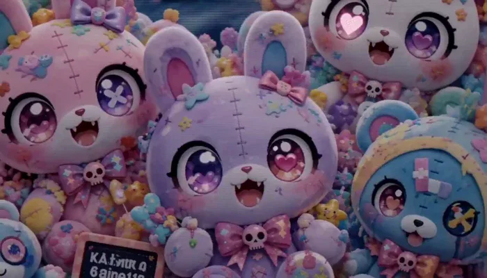</a>

▶ [在 ofox.ai 观看完整视频](https://ofox.ai/hailuo-3-prompts?utm_source=github&utm_medium=case&utm_campaign=awesome-ai-video-prompts#case-103)

<strong>Prompt</strong> — KAWAII HORRORミュージックビデオを完成させる。これは映像とキネティック・タイポグラフィを一括生成する実験である。歌詞テロップは後処理に回さず、生成動画の中へ直接描画する。Picture 1はぬいぐるみのフルフレーム映像の主画像として使う。Picture 2は、デザインされたテロップの形と…

~~~~text
KAWAII HORRORミュージックビデオを完成させる。これは映像とキネティック・タイポグラフィを一括生成する実験である。歌詞テロップは後処理に回さず、生成動画の中へ直接描画する。Picture 1はぬいぐるみのフルフレーム映像の主画像として使う。Picture 2は、デザインされたテロップの形とモーション言語だけを参考にする。Picture 2そのもの、絵コンテのグリッド、グリーンバック、CUTラベル、時間表示、サイドパネル、サイドバー、黒いレール、固定されたテキスト枠は映像内に表示しない。  ぬいぐるみのキャラクター、顔の特徴、縫い目、リボン、ボタン、ドクロチャーム、CRT画面、ピンク・ラベンダー・シアンの色、各キャラクターの位置関係を正確に保つ。ぬいぐるみには、呼吸、瞬き、小さな首の傾き、耳の動き、リボンの揺れ、手の動き、目の中のハートの発光、カットごとの小さなポーズ変化を必ず付ける。顔は最後まで認識可能にする。カメラは、ゆっくりしたプッシュイン、短い横移動、小さな弧の移動、引きの動き、ハードなグラフィックカットを使う。ランダムな手ブレ、顔の変形、溶解、ゴア、新キャラクター、物体のランダムな置き換えは禁止。  アップロードした音源だけをマスター音源として使う。新しい音楽を生成しない。歌い直さない。自動字幕のタイミングを使わない。以下の歌詞タイムラインをハードロックする。歌詞を早く出さない。後半の歌詞イベントを前半へ詰め込まない。字幕が前倒しされて最後の0.360秒が空白になることも禁止する。  テロップは普通の字幕ではなく、大きなデザイン文字によるモーショングラフィックにする。手描きで少し不規則な文字形、文字ごとに異なる大きさ、ベースラインのずれ、意図的な傾き、太い白文字、不規則な黒い抜き形、ホットピンクの縁、シアンとマゼンタのRGB残像、尖った終端、斜めの軌跡、インク片、ピクセル片を使う。各フレーズは、カットごとに違う侵入、移動、読みやすい保持、退場を持たせる。指定した場合は、文字単位または2〜3文字の小グループ単位で時間差をつける。メインの白文字は保持中に完全に読める状態にし、綴りを変えない。  【文字の完全固定】使用できる歌詞は次の8フレーズだけ。順番も固定する。"Sweet Error"、"愛して"、"こわれた分だけ"、"可愛くして"、"Sweet Error"、"消さないで"、"私はここだよ"、"ここだよ"。漢字の"壊れた"は絶対に使わず、必ず"こわれた"と表示する。翻訳、言い換え、追加、削除、結合、順番変更、重複、文字の入れ替え、文字化け、別の文字の発明は禁止。Shot 4だけは指定した2行表示を許可する。  [Shot 1] 00.000〜01.520秒。Picture 1のぬいぐるみ全体を見せ、中央のラベンダーのぬいぐるみへ小さな振幅でゆっくりプッシュインする。中央のぬいぐるみが呼吸し、1回瞬きをし、リボンを少し揺らす。左のピンクのぬいぐるみは首を少し傾け、青いぬいぐるみは片手を少し動かし、右上の白いぬいぐるみの目のハートが小さく光る。CRT画面は弱くちらつく。歌詞、文字の一部、残像、文字の侵入も一切表示しない。  [Shot 2] 00:01.520秒でハードカット。右側の固定パネルではなく、画面左上の空いた空間に"Sweet Error"だけを表示する。モーションパターンA＋F＋Dを使う。単語グループごとに別々の画面外から侵入させ、最初の単語は右上から、次の単語は右下から入れる。2つの単語を反対方向へ約12度ずつ回転させ、不規則な斜めのベースラインへスナップさせる。4フレームのシアン・マゼンタ分離と曲線状のカラートレイルを付ける。文字列全体を1回だけ小さく弾ませ、完全に読める状態で保持する。03.050秒で残像だけを水平に引き裂き、03.260秒までに文字と残像をすべて消す。  [Shot 3] 00:03.260秒でハードカット。少し寄った新しいポーズにする。ピンクのぬいぐるみが文字の方向へ首を傾け、青いぬいぐるみが片手を上げ、中央のぬいぐるみが瞬きをする。画面中央右に"愛して"だけを表示する。モーションパターンC＋Fを使う。文字を1文字ずつ下から出し、それぞれ少し異なる曲線軌道で上昇させる。隣り合う文字を時計回り・反時計回りで交互に約16度回転させ、2フレームずつ時間差をつける。フレーズ全体を4分の1円弧に沿って移動させ、上方向へ1回オーバーシュートし、回転を戻して整列させる。シアンの細い軌跡を付ける。04.600秒から斜めに退場させ、04.840秒までに完全に消す。  [Shot 4] 00:04.840秒でハードカット。新しい集合ポーズにし、カメラをゆっくり右へ横移動させる。中央のぬいぐるみが顎を上げ、ピンクのリボンが1回揺れ、青いぬいぐるみが少し顔を向け、右上の白いぬいぐるみが瞬きをする。画面右下の空いた空間に、1つのデザインブロックとして2行を表示する。1行目は"こわれた分だけ"、2行目は"可愛くして"。モーションパターンA＋J＋Hを使う。1行目は右上から斜めに落とし、文字ごとにマイナス14度・プラス14度を交互に付ける。2行目は右下から上昇させ、反対方向の傾きを使う。文字を一度に全部出さず、2〜3文字ずつ時間差を付ける。05.250秒で2行を3フレームだけ衝突・圧縮させ、その後ばねのように跳ね戻して2行の最終配置にする。05.400〜07.300秒は2行とも完全に読みやすく保持する。07.300秒で黒い抜き形を磁気粒子へ分解し、前の位置の薄い残像を左へにじませ、シアンとマゼンタの残りを散らす。08.000秒までに両方の行を完全に消す。"壊れた"は表示しない。  [Shot 5] 00:08.000秒で強いパステル・グリッチブリッジを作り、新しい読みやすいぬいぐるみポーズへ切り替える。中央の目のハートが1回発光し、ピンクのぬいぐるみが耳を動かし、青いぬいぐるみが少し顔を向ける。画面左下の空間に2回目の"Sweet Error"だけを表示する。モーションパターンB＋D＋Iを使う。1フレームの白・シアン衝撃フラッシュで文字をテレポートさせ、文字列全体を時計回りに18度回転させながら横方向へ伸ばす。文字を3つのRGBコピーに分離し、3方向へ短く飛ばし、白いメイン文字を鋭く再構成する。短いCRTスキャンラインの裂け目を1回だけ入れる。08.350〜09.200秒は完全に読める状態で保持する。09.200秒で残像を反時計回りに回転させ、左下の画面外へ排出し、09.580秒までにすべて消す。08.000秒より前に始めない。  [Shot 6] 00:09.580秒で安定した新しいポーズへハードカット。中央のぬいぐるみが口を少し開くが、顔を変形させない。青いぬいぐるみが瞬きをし、全体がカメラへ少し傾く。カメラは小さくゆっくり引く。画面右上の空間に"消さないで"だけを表示する。モーションパターンC＋Fを使う。文字を左から右へ速い斜めの波として移動させ、各文字を3フレームずつ遅らせて出す。時計回り10度・反時計回り10度を交互に付け、1回だけ行き過ぎてから小さく上下に跳ねて止める。シアンとマゼンタの軌跡は顔の上ではなく文字のベースラインに沿わせる。10.050〜10.850秒は読みやすく保持する。10.850秒から左から右への斜めスライスで消し、11.160秒までに完全に消す。  [Shot 7] 00:11.160秒で中央のラベンダーのぬいぐるみの周囲をカメラが小さく滑らかな弧を描く。ぬいぐるみを左から右へ順番に瞬きさせ、中央のぬいぐるみが少し前へ傾き、目のハートを1回明るくする。固定サイドレールではなく、画面中央左の空間に"私はここだよ"だけを表示する。モーションパターンG＋Hを使う。まず各文字を細いシアンのワイヤーフレーム線で描き、2フレーム後に白いデザイン文字として塗り込む。隣り合う文字の大きさとベースラインを少し変え、約8度の穏やかな揺れ回転を付ける。前の線の残像を薄く残し、単語の間でハートを1回だけ脈動させ、最後にフレーズ全体を固定する。12.700秒から文字をずれた輪郭片へゆるめ、左上へ漂わせる。13.020秒までに文字と残像をすべて消す。  [Shot 8] 00:13.020秒で独立した最後の歌詞イベントを作る。中央のラベンダーのぬいぐるみがカメラへ少し傾き、目を合わせる。ピンクのぬいぐるみがリボンを1回動かし、青いぬいぐるみが片手を上げる。画面右下の空間に"ここだよ"だけを表示し、文字全体を画面内へ収める。モーションパターンK＋Eを使う。文字を1文字ずつ3フレーム間隔で出し、各文字を内側へ12度回転させて、少し異なるベースラインへスナップさせる。歌声のアクセントでフレーズ全体を約12パーセント拡大し、背後に2フレームだけシアン・白のフルフィールドフラッシュを入れ、最後の文字を1回だけ跳ねさせる。14.350秒まで完全に読みやすく保持する。14.350秒から文字を曲線状のカラートレイルに乗せて右下へ退場させ、14.640秒までにすべて消す。"私はここだよ"と結合しない。  [Shot 9] 14.640〜15.000秒は、きれいなぬいぐるみ全体だけを表示する。歌詞、文字の一部、残像、パネル、黒いレール、フェードアウトは一切使わない。中央のポーズを安定させ、目の中のハートを小さく光らせ、CRTを1回だけ控えめにちらつかせて終了する。  禁止事項: 普通の字幕バー、中央のカラオケ字幕、固定右側パネル、サイドバー、黒いレール、グリーンバック、絵コンテのコラージュ、CUTラベル、時間表示、文字の変形、文字化け、漢字への置き換え、余計な単語、歌詞の重複、歌詞の重なり、動かないぬいぐるみ、制御不能な手ブレ、顔の変形、追加BGM、フェードトランジション。  overall_soundscape: アップロードしたマスター音源をそのまま使う。新しい台詞、歌声、BGM、環境音、効果音は追加しない。ぬいぐるみの動きとテロップの衝撃を音源に合わせる。ただし、歌詞の開始・終了は上記の固定タイムラインを最優先する。  non_diegetic_music: アップロードしたマスター曲だけを使う。追加の音楽は使わない。
~~~~

**参数**：MiniMax H3 · 未标注 · 未标注 · 15s · 未标注 · 未标注 · 带音频
**来源**：@su_nagomi · [原帖](https://x.com/su_nagomi/status/2085594060384010351)

Preview © 2026 @su_nagomi · Prompt by @su_nagomi

[回到目录](#table-of-contents)

### Case 105: Cairn Munro Arrives in Motion Type (凯恩·门罗的动态字体登场) — by @Dheepanratnam

<a href="https://ofox.ai/hailuo-3-prompts?utm_source=github&utm_medium=case&utm_campaign=awesome-ai-video-prompts#case-105">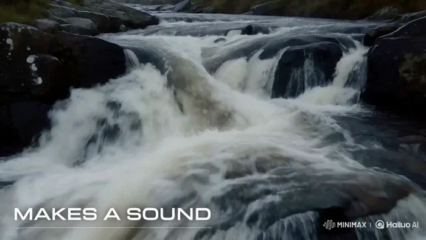</a>

▶ [在 ofox.ai 观看完整视频](https://ofox.ai/hailuo-3-prompts?utm_source=github&utm_medium=case&utm_campaign=awesome-ai-video-prompts#case-105)

<strong>Prompt</strong> — CAIRN MUNRO — "ARRIVE UNHEARD" — 14 CUTS · 15s · 2K · 24fps REFERENCES: the attached PRODUCT SHEET@Image1 is the exact vehicle — match its proportion,…

~~~~text
CAIRN MUNRO — "ARRIVE UNHEARD" — 14 CUTS · 15s · 2K · 24fps  REFERENCES: the attached PRODUCT SHEET@Image1 is the exact vehicle — match its proportion, stance, glasshouse angle, cladding, rack and light signature exactly, invent nothing. The attached TYPE SHEET@Image2 is the exact typeface, weight, tracking and scale for every overlay. Match it.  AUDIO LAW — HIGHEST PRIORITY. NO MUSIC ANYWHERE. Do not generate score, soundtrack, background music, beat, drums, percussion, bassline, synth pad, drone, melody, chord, ambient bed, riser, braam, trailer hit, stinger, swell, or any tonal instrument. Where music would normally be scored, render SILENCE. NO VOICE — no narration, dialogue, vocals, breath. ONLY PERMITTED AUDIO, all of it environmental: rain striking wet granite; rain drumming on metal and glass; wind over ridge grass; a burn running hard over rock; gravel shifting; distant thunder; and true silence. All of it recorded-real, close, dry, no reverb wash. Nothing sustains musically.  SILENCE LAW — the engine of the film. The landscape is loud. The vehicle adds nothing to it. No engine, no exhaust, no motor whine, no transmission, no tyre roar, no wind noise off the body, no door, no suspension. Rain striking its panels is permitted — that is the world touching the car, not the car making sound. Whenever the vehicle fills frame and nothing is striking it, the mix drops to near-silence. If an engine or tyre sound would normally be added to a moving vehicle, render silence instead. An engine sound anywhere in this film is a failure.  EDIT METRONOME — SILENT: cuts locked to 96 BPM, 1 beat = 0.625s, 24 beats. A timing grid for cutting ONLY. Do not generate audio to this tempo.  BRAND: CAIRN. PRODUCT: CAIRN MUNRO, a fully electric expedition overlander. It is silent because it is electric — the claim is literal.  SUBJECT: per the sheet — boxy full-size SUV, upright glasshouse, flat vertical sides, squared arches, short overhangs, high clearance. Matte peat green-black body, charcoal composite cladding and sliders, raw anodised aluminium rack and skid plate, bone-white roof, signal-orange recovery hooks, full-width thin white LED signature front and rear, no grille, all-terrain tyres on flat-faced aluminium wheels. No badging.  WORLD: the Scottish Highlands in heavy weather. Wet granite, peat, ridge grass and heather. Low cloud moving fast across the tops. Constant rain. A single unmade stone track. No road markings, no buildings, no fences.  PALETTE: peat #1B2320, granite #4A4E4B, mist #D9DDDB, aluminium #8E9490, heather #6B5470. Signal orange #E24E1B on the recovery hooks only, never more than a few pixels. Cold northern light, overcast, no sun, no warmth anywhere. Desaturated but never graded grey — these are true wet colours.  MIST LAW: mist is real volume. It moves, thins, and parts to reveal. It never becomes a soft filter — everything outside the mist stays razor sharp. It never glows, never catches a god ray, never becomes smoke.  TYPE LAW: every overlay uses the TYPE SHEET face, CAIRN EXTENDED — wide uppercase, medium weight, wide tracking, pure white, with the hairline contour rule beneath each line. Two positions only: body lines lower-left on the safe-area grid, the lockup dead centre. Type is revealed by a hard-edged horizontal wipe travelling left to right. It never fades, scales, rotates, skews, glows or casts a shadow. It cuts on with the cut and holds absolutely still until the next cut takes it. Always pure white.  TEXT ACCURACY: every overlay word is spelled exactly as written and appears exactly once. No extra letters, no duplicated lines, no garbled glyphs, no invented words. No text of any kind on the vehicle.  CAMERA: motion-control smooth and heavy, no handheld, no drift. Long-lens tracking and slow cranes. Clean digital, no grain. Directional blur in transit; everything arrives sharp and holds still.  RHYTHM: cuts 01–02 hold two beats. Cuts 03–10 are one beat apart, the spec run. Cuts 11–12 hold two beats. Cuts 13 and 14 hold four beats each.  01 · 0.000 · Wide. A granite ridge under fast-moving low cloud, rain falling hard across frame. No vehicle. SOUND: rain on stone and wind, loud.  02 · 1.250 · Macro. Rain hammering a wet granite face, water sheeting down the fractures. TYPE: EVERYTHING HERE  03 · 2.500 · A burn crashing white over black rock. TYPE: MAKES A SOUND  04 · 3.125 · Wind flattening ridge grass and heather in one long gust.  05 · 3.750 · The vehicle enters, low and wide, emerging from mist on the stone track. The mix drops away to rain only. TYPE: ONE THING DOESN'T  06 · 4.375 · Macro. A tyre rolling through standing water, the water throwing up hard. SOUND: water only, no tyre noise. TYPE: 800 VOLT  07 · 5.000 · Macro. Rain drumming on the bone-white roof panel. TYPE: 710 KM  08 · 5.625 · Macro. Water running off the anodised aluminium rack. TYPE: 900 NM  09 · 6.250 · Low long-lens track alongside the flat body side, mist parting off the panel. TYPE: 1050MM WADING  10 · 6.875 · Macro. The thin white LED signature cutting through mist. TYPE: 3.5T TOWING  11 · 7.500 · High wide. The vehicle small on a vast stone plateau, cloud dragging over it. SOUND: wind, distant thunder.  12 · 8.750 · Front three-quarter, wading a burn, water pushing up over the sills and breaking white. SOUND: water only.  13 · 10.000 · THE SHOT. A single mature red deer stag stands side-on on the ridge above the track, wet coat, broad antlers, head turned to camera. The vehicle passes below him in the same frame. The stag does not flinch, does not run, does not move at all. Hold on him. SOUND: rain and wind only — no vehicle sound whatsoever.  14 · 12.500 · The vehicle static on the ridge in moving mist, dead frontal. TYPE: CAIRN, dead centre. Two beats later MUNRO wipes on beneath it, then ARRIVE UNHEARD. beneath that. Hold, cut to black. SOUND: rain and wind, then hard silence on the cut. No end cue, no final hit.  NEGATIVE: no music, score, beat, instruments, narration, voice, engine noise, tyre noise. No people, hands, faces, drivers, passengers. No other vehicles, no roads, no road markings, no signage, no buildings, no fences, no power lines. No text other than the specified overlays — no captions, subtitles, watermarks, UI, timecode. No badging or lettering on the vehicle. No sun, no warm light, no golden hour, no lens flare, no god rays, no smoke, no snow. No glitch, scanlines, film burn, light leaks. The stag never runs. No colour outside the palette. No invented body parts.
~~~~

**参数**：MiniMax H3 · 未标注 · ref2va · 15s · 未标注 · 未标注 · 带音频
**来源**：@Dheepanratnam · [原帖](https://x.com/Dheepanratnam/status/2084201268977844521)

Preview © 2026 @Dheepanratnam · Prompt by @Dheepanratnam

[回到目录](#table-of-contents)

### Case 106: A Surreal Vision Inside a Laundromat (洗衣店里的超现实想象) — by @opener_ai

<a href="https://ofox.ai/hailuo-3-prompts?utm_source=github&utm_medium=case&utm_campaign=awesome-ai-video-prompts#case-106">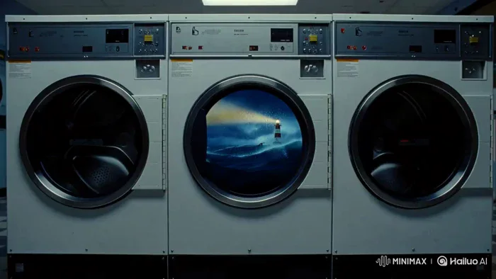</a>

▶ [在 ofox.ai 观看完整视频](https://ofox.ai/hailuo-3-prompts?utm_source=github&utm_medium=case&utm_campaign=awesome-ai-video-prompts#case-106)

<strong>Prompt</strong> — [1] FORMAT Create a 15-second, 16:9 surreal live-action scene inside a quiet laundromat at night. [4] BEATS [0–3s] Slow handheld push toward a running…

~~~~text
[1] FORMAT
Create a 15-second, 16:9 surreal live-action scene inside a quiet laundromat at night.

[4] BEATS
[0–3s] Slow handheld push toward a running front-loading washing machine.
[3–6s] Inside the drum, the water becomes a miniature stormy ocean with waves, lightning, and a tiny lighthouse.
[6–11s]The lighthouse beam shines through the glass as the storm grows stronger.
[11-15s]The door suddenly opens. Only ordinary wet laundry falls onto the floor.

[5] CAMERA
One continuous handheld push-in, ending on the falling laundry.

[6] LIGHT
Cold flickering fluorescent lights, wet glass reflections, deep blue storm light inside the washer, realistic phone-camera texture.

[8] AUDIO
Audio: washing-machine rumble, water splashes, distant thunder, one door click, and wet laundry hitting the floor.
BGM: a subtle 15-second mystery drone, building from 4 seconds and stopping abruptly when the door opens.

[9] NEGATIVE
Keep the laundromat fully photorealistic. The miniature ocean exists only inside the washing machine.
No people, text, subtitles, logos, watermarks, monsters, or cartoon styling.

#minimaxh3 #hailuoai
~~~~

**参数**：MiniMax H3 · 未标注 · 未标注 · 15s · 未标注 · 未标注 · 带音频
**来源**：@opener_ai · [原帖](https://x.com/opener_ai/status/2084075915706052621)

Preview © 2026 @opener_ai · Prompt by @opener_ai

[回到目录](#table-of-contents)

### Case 107: The Last Bubble Before Closing · Part 2 (打烊前最后一个气泡 · 下篇) — by @ManuAGI01

<a href="https://ofox.ai/hailuo-3-prompts?utm_source=github&utm_medium=case&utm_campaign=awesome-ai-video-prompts#case-107">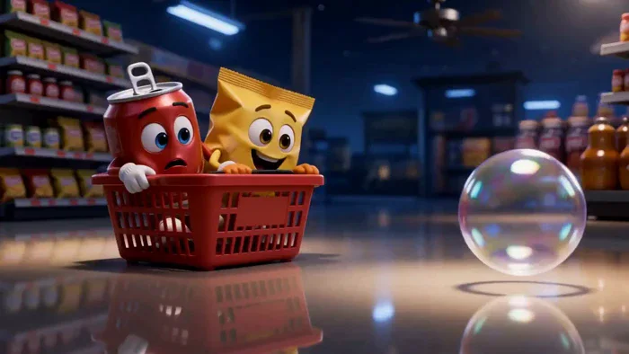</a>

▶ [在 ofox.ai 观看完整视频](https://ofox.ai/hailuo-3-prompts?utm_source=github&utm_medium=case&utm_campaign=awesome-ai-video-prompts#case-107)

<strong>Prompt</strong> — "[REFERENCE CONTROL] Use the uploaded PART 2 storyboard image for: “THE LAST POP BEFORE CLOSING” as the STRICT PRIMARY visual and narrative reference.…

~~~~text
"[REFERENCE CONTROL]

Use the uploaded PART 2 storyboard image for:

“THE LAST POP BEFORE CLOSING”

as the STRICT PRIMARY visual and narrative reference.

This video continues DIRECTLY from PART 1.

PART 1 ended with:

- Fizz’s final carbonation bubble drifting toward the ceiling fan
- Fizz and Crunch failing to reach it
- Chill calmly studying the situation
- Chill noticing his silver spoon tool
- Chill removing the spoon from his back
- Chill saying:

<d>[English] I have an idea.</d>

PART 2 begins at that EXACT story moment.

Use the storyboard to lock:

- Fizz’s exact glossy red soda-can design
- Crunch’s exact bright-yellow snack-bag design
- Chill’s exact blue ice-cream-cup design
- their faces, shoes, gloves and proportions
- Chill’s spoon
- the ONE surviving bubble
- shopping basket
- snack bowl / tray
- freezer
- cold mist
- hanging price tags
- ceiling fan
- same convenience-store architecture
- same nighttime lighting
- same tiny-mascot scale
- Part 2 rescue progression
- final three-character payoff

Generate a FINISHED cinematic 3D animated sequence.

DO NOT animate or reproduce the storyboard sheet itself.

The final video must NOT contain:

- storyboard borders
- panel numbers
- timestamps
- captions
- storyboard headers
- production notes
- prop/reference sheets
- character turnaround drawings
- page background
- watermarks
- brand logos
- unnecessary text overlays

Translate the storyboard’s 15 one-second panels into approximately:

# 8 COHERENT CINEMATIC SHOTS

Do NOT use fifteen frantic one-second cuts.

Story progression:

Chill reveals the plan
→ trio races ahead of bubble
→ Chill uses freezer air
→ bubble changes direction
→ Crunch catches it temporarily
→ bubble escapes again
→ Chill triggers price-tag chain reaction
→ bubble descends
→ Fizz makes one perfect jump
→ bubble returns
→ Fizz recharges
→ friends celebrate
→ warm final shelf payoff.

==================================================
VIDEO GOAL
==================================================

Duration:

# EXACTLY 15 SECONDS

Story range:

PART 2 — 0:15 to 0:30

Aspect ratio:
16:9 landscape

Frame-rate feeling:
cinematic 24 fps

Visual medium:
premium stylized 3D product-mascot animation

Genre:

- miniature adventure
- product mascot comedy
- friendship story
- playful rescue mission

Tone:

- energetic
- clever
- cute
- visually satisfying
- comedic
- wholesome
- heartwarming
- triumphant

Dialogue:
short natural synchronized English

Audio:
native dialogue + store ambience + physical comedy SFX + original playful cinematic score

CORE PAYOFF:

Fizz thinks his “spark” depends on one final bubble.

But what actually saves that spark is:

# teamwork.

Chill supplies the idea.
Crunch supplies chaotic effort.
Fizz supplies the final leap.

==================================================
PART 2 START / END
==================================================

START:

Chill stands beneath the drifting bubble holding his silver spoon.

Fizz and Crunch look toward him.

Chill immediately begins executing his plan.

END:

Fizz has successfully regained his carbonation.

Fizz, Crunch, and Chill stand together in a warm celebratory final pose.

The story must feel COMPLETE.

No cliffhanger.

==================================================
CHARACTER IDENTITY LOCK — FIZZ
==================================================

Match PART 1 and the uploaded PART 2 storyboard EXACTLY.

FIZZ — RED SODA CAN MASCOT

Appearance:

- small glossy red aluminum soda can
- cylindrical body
- metallic silver top and bottom rims
- silver pull tab
- original fictional graphics only
- large expressive blue/dark cartoon eyes
- flexible eyebrows
- expressive mouth
- tiny arms
- white mascot gloves
- small legs
- red-and-white sneakers

Material:

- glossy aluminum
- strong store-light reflections
- subtle metallic highlights
- optional tiny condensation beads
- body remains mostly rigid

Do NOT redesign him.

PART 2 PERFORMANCE ARC:

0–3 sec:
desperate hope

3–6 sec:
excited as Chill’s plan works

6–8 sec:
celebrates too early

8–11 sec:
focused determination

11–13 sec:
heroic relief

13–15 sec:
full joyful Fizz energy

MOTION:

Fizz is:

- springy
- quick
- dramatic
- highly expressive

But his can body should not behave like rubber.

==================================================
CHARACTER IDENTITY LOCK — CRUNCH
==================================================

CRUNCH — YELLOW SNACK BAG MASCOT

Appearance:

- bright yellow flexible snack bag
- sealed ridged top
- crinkled packaging material
- original fictional package graphics
- large expressive eyes
- small expressive mouth
- thin arms
- white gloves
- tiny legs
- oversized orange sneakers

Personality:

- loyal
- excitable
- chaotic
- lovable
- desperate to help
- occasionally useful by accident

PART 2 PERFORMANCE ARC:

0–3 sec:
hopeful and ready

3–6 sec:
heroic enthusiasm

6–8 sec:
brief victory

8–10 sec:
immediate panic when bubble escapes

10–13 sec:
cheering Fizz

13–15 sec:
happy friend celebration

PACKAGING MOTION:

Use:

- small crinkles
- squash
- puffing
- top-edge wobble

Do not deform him beyond recognition.

==================================================
CHARACTER IDENTITY LOCK — CHILL
==================================================

CHILL — BLUE ICE-CREAM CUP MASCOT

Appearance:

- small mint-blue / cool-blue cylindrical ice cream cup
- white lid like a flat cap
- original minimal fictional graphics
- relaxed half-lidded eyes
- small mouth
- tiny arms
- white gloves
- tiny white shoes
- silver spoon normally attached on back

Personality:

- calm
- intelligent
- deadpan
- observant
- precise
- quietly confident

PART 2 PERFORMANCE ARC:

0–4 sec:
plan execution

4–8 sec:
calm supervision

8–11 sec:
second tactical idea

11–13 sec:
watches Fizz finish plan

13–15 sec:
small proud smile

Chill should NEVER become hyperactive.

His calmness is the joke.

==================================================
KEY PROP LOCK — THE LAST BUBBLE
==================================================

There is:

# ONE SINGLE BUBBLE.

No duplicates.

Appearance:

- transparent
- iridescent
- subtle rainbow edge
- about the size of Fizz’s head
- reflects store lights
- delicate and lightweight

Bubble trajectory for Part 2 must remain easy to follow:

ceiling fan area
→ redirected by freezer airflow
→ descends toward Crunch
→ briefly rests in bowl
→ escapes
→ drifts toward hanging price tags
→ price-tag chain reaction guides it downward
→ Fizz jumps
→ bubble enters through slightly opened pull-tab area
→ carbonation returns.

Never teleport the bubble.

Never spawn extra copies.

==================================================
KEY PROP LOCK — CHILL’S SPOON
==================================================

Use exactly one small silver spoon.

It begins in Chill’s hand because he removed it at the end of Part 1.

Uses:

1. operating / assisting with freezer opening safely
2. precisely flicking the price-tag string later

The spoon is a clever tool.

It is NOT a weapon.

No dangerous swinging.

No sharp-object action.

==================================================
KEY PROP — SHOPPING BASKET
==================================================

Small red convenience-store shopping basket relative to human scale, but large enough for the mascots to ride in.

Use it only as a comic transport device.

Safe movement.

No crashes.

No dangerous speed.

==================================================
ENVIRONMENT LOCK
==================================================

Same convenience store from Part 1.

Maintain:

- glossy tile floor
- large aisles
- soda shelf
- snack aisle
- freezers
- candy displays
- fruit display
- hanging price cards
- ceiling fan
- warm overhead practical lights
- cool freezer illumination
- midnight darkness beyond storefront windows

The store should feel enormous compared with the mascots.

Keep miniature cinematography throughout.

==================================================
WORLD / PHYSICS RULES
==================================================

Bubble:

extremely light.

It responds to:

- airflow
- small impacts
- movement
- gentle rebounds

Freezer:

cold air pushes bubble away from fan.

Snack bowl:

bubble can rest briefly without popping.

Price tags:

small hanging cardboard tags swing like pendulums and redirect the bubble through gentle contact / airflow.

Fizz’s recovery:

bubble enters Fizz through his slightly opened pull-tab opening.

Then carbonation visibly rebuilds INSIDE the can through:

- subtle internal fizz
- a few tiny external bubbles
- brighter expression
- energetic body language

Do NOT show explosive pressure.

No dangerous soda burst.

==================================================
INTEGRATED_MULTIMODAL_DESCRIPTION
==================================================

[SHOT 1 — 0:00–0:01.7]
CHILL’S PLAN BEGINS

Continue EXACTLY from Part 1.

Bubble floats high in the background near the ceiling airflow.

Fizz and Crunch turn toward Chill.

Chill holds the silver spoon.

Chill looks toward:

bubble
→ freezer aisle.

He points the spoon forward like a tiny conductor.

Chill:

<d>[English] Freezer.</d>

Fizz:

<d>[English] The freezer?</d>

Chill gives a tiny confident nod.

Crunch:

<d>[English] I love plans I don’t understand!</d>

Chill starts moving.

CAMERA:

close Chill hero angle
→ rack focus to bubble
→ fast low-angle follow as trio starts moving.

Music immediately restarts with clever playful momentum.

==================================================
[SHOT 2 — 0:01.7–0:03.3]
THE SHOPPING-BASKET DASH

Fizz and Crunch jump into / grab a small red shopping basket.

Chill pushes / steers it from behind or rides at the edge while controlling direction.

The basket rolls/slides smoothly across the polished store floor.

Use a low mascot-height tracking shot.

Bubble remains visible above and ahead.

Crunch points upward.

Crunch:

<d>[English] Faster!</d>

Fizz:

<d>[English] It’s getting away!</d>

Chill:

<d>[English] Relax.</d>

They pass:

- oversized product shelves
- cool refrigerator reflections
- hanging price tags

No collision.

No store destruction.

==================================================
[SHOT 3 — 0:03.3–0:05.1]
COLD AIR CHANGES THE GAME

They arrive at the freezer.

Chill safely uses the spoon as a tiny lever/tool to pull the freezer-door edge enough to open it.

Door opens.

# FWHOOSH.

A beautiful plume of cold mist rolls outward.

Blue-white freezer light contrasts with the warm store.

Fizz and Crunch brace themselves behind the basket.

The cold airflow reaches the drifting bubble.

The bubble slows.

Then gently curves AWAY from the ceiling fan.

Fizz’s expression instantly changes.

Fizz:

<d>[English] It’s working!</d>

Chill, completely calm:

<d>[English] Obviously.</d>

CAMERA:

freezer close-up
→ cold mist
→ follow airflow visually
→ bubble changing trajectory.

SFX:

- freezer seal opening
- gentle cold-air whoosh
- faint icy shimmer
- bubble wobble

==================================================
[SHOT 4 — 0:05.1–0:06.8]
CRUNCH GETS HIS HERO MOMENT

Bubble now floats downward through the aisle.

Crunch spots the snack bowl / tray.

His eyes widen.

Crunch:

<d>[English] My turn!</d>

He grabs the bowl.

Runs underneath the bubble.

Fizz guides him:

<d>[English] Left! Left! No—your other left!</d>

Crunch shifts.

The bubble gently drops—

# into the bowl.

Perfect catch.

Crunch freezes.

Looks down.

His eyes become huge with joy.

Crunch:

<d>[English] I GOT IT!</d>

Fizz throws both arms up.

==================================================
[SHOT 5 — 0:06.8–0:08.4]
CELEBRATED TOO EARLY

Fizz and Crunch start celebrating immediately.

Crunch lifts the bowl proudly.

Bad idea.

The movement tilts it.

The bubble gently floats back out.

All three characters track it.

Fizz and Crunch’s smiles disappear at the exact same time.

Crunch:

<d>[English] ...I don’t got it.</d>

Fizz:

<d>[English] CRUNCH!</d>

The bubble continues toward a row of hanging price tags.

Chill does not panic.

He simply turns his eyes upward.

Camera pushes in on Chill.

He notices the tags.

Then the spoon in his hand.

Second idea.

Tiny eyebrow raise.

==================================================
[SHOT 6 — 0:08.4–0:10.4]
THE PRICE-TAG CHAIN REACTION

Chill steps into position beneath the first hanging price tag.

Precisely:

he taps the hanging string with the spoon.

# tik.

First price tag swings.

It gently nudges the next hanging tag.

Second swings.

Then third.

Create a clean satisfying cascading motion:

TAG 1
→ TAG 2
→ TAG 3
→ TAG 4.

The bubble moves through this chain.

Each swinging tag / tiny air current guides it slightly lower.

No hard impact.

No popping.

Use highly satisfying visual rhythm.

Fizz watches.

His eyes widen.

Crunch:

<d>[English] He planned THAT?!</d>

Chill:

<d>[English] Mostly.</d>

Music syncs each tag movement to percussion:

tik
tik
tik
tik.

==================================================
[SHOT 7 — 0:10.4–0:12.6]
ONE PERFECT JUMP

The bubble is finally descending.

Fizz runs underneath it.

Crunch runs behind him cheering.

Chill watches calmly.

Fizz’s expression becomes focused.

No more panic.

Camera drops to dramatic low angle.

Fizz accelerates.

He jumps.

Use a brief cinematic slow-down—not full slow motion.

His arms spread.

Bubble directly above him.

Fizz opens his silver pull tab just slightly.

Fizz:

<d>[English] Come on...</d>

The bubble descends.

Closer.

Closer.

Then—

# PLOOP / FIZZ.

It slips neatly through the opening.

Fizz’s eyes widen.

Pause for one beat.

==================================================
[SHOT 8 — 0:12.6–0:15.0]
FIZZ GETS HIS SPARK BACK — FINAL PAYOFF

Immediately after the bubble enters:

# FSSSSHHH!

A playful carbonation pulse moves through Fizz.

NOT an explosion.

His red aluminum surface becomes bright and lively.

Tiny fizzy bubbles swirl around him.

His eyes light up.

His posture pops back into full confidence.

Fizz lands safely.

Fizz:

<d>[English] I’M BACK!</d>

Crunch cheers wildly.

Crunch:

<d>[English] WE SAVED THE FIZZ!</d>

Chill walks up calmly.

Fizz looks toward both friends.

For one sincere beat:

Fizz:

<d>[English] You guys saved me.</d>

Crunch immediately poses proudly.

Chill:

<d>[English] Technically, the bubble did.</d>

Small comedy beat.

Fizz laughs.

A few harmless tiny carbonation bubbles float around all three.

One bubble lands perfectly on Chill’s white lid.

Chill slowly looks upward at it.

Tiny smile.

FINAL COMPOSITION:

Fizz in the center, fully recharged.

Crunch beside him, excited and proud.

Chill beside them, calm and satisfied.

Store shelves glow warmly behind.

Small bubbles drift around them.

Optional quick match transition / cut:

the three mascots back near their product shelf, posing together like the night’s adventure is their secret.

Camera gently pulls backward.

Warm practical lights.

Cool midnight shadows.

Playful final musical chord.

FADE TO BLACK.

END STORY.

==================================================
AUDIO DESCRIPTION
==================================================

Generate synchronized native stereo audio.

Audio tone:

- playful
- tactile
- energetic
- miniature
- cinematic
- satisfying
- wholesome

==================================================
FIZZ VOICE
==================================================

Energetic youthful masculine mascot voice.

Qualities:

- charismatic
- dramatic
- quick
- lovable
- expressive

Part 2 progression:

hopeful urgency
→ premature celebration
→ focused determination
→ huge relief
→ grateful friendship.

Priority lines:

<d>[English] It’s working!</d>

<d>[English] CRUNCH!</d>

<d>[English] Come on...</d>

<d>[English] I’M BACK!</d>

<d>[English] You guys saved me.</d>

Final sincere line should be warmer and quieter than his usual show-off delivery.

==================================================
CRUNCH VOICE
==================================================

Excitable comedic mascot voice.

Qualities:

- enthusiastic
- slightly squeaky
- dramatic
- lovable
- fast reaction timing

Priority:

<d>[English] My turn!</d>

<d>[English] I GOT IT!</d>

<d>[English] ...I don’t got it.</d>

<d>[English] He planned THAT?!</d>

<d>[English] WE SAVED THE FIZZ!</d>

Use tiny packaging crinkles with body motion.

==================================================
CHILL VOICE
==================================================

Calm, understated, low-energy mascot voice.

Qualities:

- dry humor
- relaxed
- intelligent
- confident
- slightly sleepy

Priority lines:

<d>[English] Freezer.</d>

<d>[English] Obviously.</d>

<d>[English] Mostly.</d>

Final:

<d>[English] Technically, the bubble did.</d>

Deliver completely deadpan.

==================================================
STORE SOUND DESIGN
==================================================

Maintain subtle closed-store ambience:

- refrigerator hum
- freezer compressor
- ventilation
- faint building hum
- soft sneaker taps
- packaging crinkles
- shopping basket wheel/slide sounds
- tiny metal spoon clicks
- hanging card flutter
- distant night ambience

Do not introduce humans.

==================================================
FREEZER SOUND DESIGN
==================================================

When freezer opens:

- soft magnetic seal release
- cold air whoosh
- compressor hum slightly louder
- gentle mist movement

Do NOT use giant icy explosion SFX.

==================================================
PRICE TAG CHAIN SFX
==================================================

Make this extremely satisfying.

Use four slightly different light sounds:

tik
tap
tik
tap

Each synchronized to a swinging tag.

Add gentle cardboard flutter.

Music percussion should sync perfectly.

==================================================
BUBBLE SOUND DESIGN
==================================================

Bubble signature:

- tiny glassy shimmer
- fizzy air texture
- delicate elastic wobble

Bowl landing:

soft:

“plip.”

Leaving bowl:

tiny airy:

“woop.”

Returning to Fizz:

small:

“ploop”
→ immediately followed by carbonation:

“fsssshhhh.”

==================================================
NON-DIEGETIC MUSIC
==================================================

Continue the ORIGINAL miniature adventure score from Part 1.

Instrumentation:

- pizzicato strings
- marimba
- woodblocks
- brushed percussion
- muted brass
- upright bass
- tiny synth plucks
- glockenspiel
- warm orchestral accents

MUSIC ARC:

0:00–0:03
clever plan / movement energy.

0:03–0:05
freezer solution reveal.

0:05–0:07
comic triumph.

0:07–0:08.5
comedic drop after bubble escapes.

0:08.5–0:10.5
precise rhythmic chain-reaction sequence.

0:10.5–0:12.5
heroic but playful Fizz build.

0:12.5–0:15
warm celebratory theme combining motifs associated with all three mascots.

Final chord:

bright,
satisfying,
complete.

==================================================
CAMERA LANGUAGE
==================================================

PART 2 should feel slightly more cinematic and energetic than Part 1.

Use:

- floor-level tracking
- macro bubble shots
- low mascot-scale lensing
- freezer push-ins
- dramatic cool/warm lighting contrast
- overhead shot for bowl catch
- rhythmic insert shots during price-tag chain
- low-angle Fizz hero jump
- expressive reaction close-ups
- final slow pull-back

Camera progression:

0–3 sec:
quick planning/action.

3–5 sec:
cold-air spectacle.

5–8 sec:
physical comedy.

8–10 sec:
precise chain-reaction rhythm.

10–13 sec:
heroic focus.

13–15 sec:
warm emotional resolution.

Avoid:

- shaky handheld
- extreme motion blur
- chaotic whip pans
- fisheye distortion
- unreadable fast cutting
- action-movie explosions

==================================================
VISUAL STYLE
==================================================

Premium high-end stylized 3D animation.

Material quality:

Fizz:
glossy reflective aluminum.

Crunch:
soft flexible crinkly snack-film packaging.

Chill:
semi-matte coated paper/plastic ice-cream cup.

Spoon:
clean brushed silver.

Bubble:
transparent iridescent membrane.

Store:

- realistic enough product shelves
- stylized family-animation proportions
- polished floor
- soft global illumination
- cinematic depth of field
- beautiful reflections
- highly readable character silhouettes

The final result should feel like:

A PREMIUM 3D PRODUCT-MASCOT COMMERCIAL
+
A MINIATURE ANIMATED ADVENTURE FILM.

==================================================
COLOR / LIGHTING ARC
==================================================

OPENING:

warm store lighting + cool midnight shadows.

FREEZER SEQUENCE:

increase:

- cyan
- icy white
- cool blue

but keep characters’ faces readable.

PRICE-TAG SEQUENCE:

return to mixed warm/cool store tones.

FIZZ HERO JUMP:

bubble receives brightest highlight.

RECHARGE:

Fizz becomes visual focal point through:

- stronger red reflections
- small sparkling bubbles
- warm rim light

FINAL:

slightly warmer than Part 1.

Use:

- amber practicals
- rich red Fizz
- yellow Crunch
- mint-blue Chill
- subtle blue night shadows

The final shot should visually communicate:

# problem solved.

==================================================
MOTION RULES — FIZZ
==================================================

Before recovery:

quick,
slightly frantic,
high-energy.

During hero jump:

movement becomes focused and precise.

After recovery:

- chest/body held proudly
- big expressive arm gestures
- springy landing
- happy tiny hops
- playful bubbles

Keep can body rigid enough to preserve product identity.

==================================================
MOTION RULES — CRUNCH
==================================================

Use:

- energetic running
- bowl held with both hands
- packaging bounce
- little bag crinkles
- exaggerated celebration
- embarrassed deflation after bubble escapes
- proud cheering at ending

Keep him cute.

No chaotic deformation.

==================================================
MOTION RULES — CHILL
==================================================

Use controlled precision.

Actions:

- point spoon
- safely open freezer
- watch bubble path
- precise tag flick
- small eyebrow response
- quiet final approach
- understated smile

Chill must visually appear to think BEFORE acting.

==================================================
CONTINUITY RULES
==================================================

Maintain exactly:

ONE Fizz.
ONE Crunch.
ONE Chill.
ONE final bubble.
ONE spoon.

Same:

- mascot packaging designs
- facial features
- shoe colors
- glove designs
- relative heights
- store layout
- freezer
- bubble appearance
- shopping basket
- bowl
- hanging price cards

Bubble progression:

fan
→ cold-air redirect
→ bowl
→ escape
→ price tags
→ Fizz
→ inside Fizz.

Once bubble enters Fizz:

do NOT show the original giant bubble outside him again.

Small NEW carbonation bubbles may appear only AFTER Fizz has recovered.

==================================================
EMOTIONAL PRIORITY
==================================================

Although this is comedy, the ending needs one brief emotional beat.

Fizz has spent both parts obsessed with getting his sparkle back.

After he succeeds:

he looks at Crunch and Chill.

Realizes:

he could not have done it alone.

Use a tiny pause before:

<d>[English] You guys saved me.</d>

That brief sincerity makes the comedic ending feel earned.

Then immediately let Chill release tension with:

<d>[English] Technically, the bubble did.</d>

==================================================
DIALOGUE TIMING PRIORITY
==================================================

15 seconds is short.

Natural voice timing is more important than including every line.

HIGHEST PRIORITY:

1.
Chill:
<d>[English] Freezer.</d>

2.
Fizz:
<d>[English] It’s working!</d>

3.
Crunch:
<d>[English] I GOT IT!</d>

4.
Crunch:
<d>[English] ...I don’t got it.</d>

5.
Chill:
<d>[English] Mostly.</d>

6.
Fizz:
<d>[English] Come on...</d>

7.
Fizz:
<d>[English] I’M BACK!</d>

8.
Fizz:
<d>[English] You guys saved me.</d>

9.
Chill:
<d>[English] Technically, the bubble did.</d>

If timing becomes crowded:

REMOVE secondary lines.

Do NOT make dialogue unnaturally fast.

Let:

- expressions
- movement
- sound effects
- music

tell much of the story.

==================================================
SAFETY / CONTENT RULES
==================================================

Everything remains cute and family-friendly.

No injury.
No violence.
No weapons.
No broken glass.
No sharp attacks.
No dangerous ceiling fan interaction.
No exploding cans.
No destructive store damage.
No falling from dangerous heights.
No freezer entrapment.
No food contamination.
No humans stepping on characters.

...
~~~~

**参数**：MiniMax H3 · 未标注 · ref2va · 15s · 未标注 · 未标注 · 带音频
**来源**：@ManuAGI01 · [原帖](https://x.com/ManuAGI01/status/2087066113775665414)

Preview © 2026 @ManuAGI01 · Prompt by @ManuAGI01

[回到目录](#table-of-contents)

### Case 108: The Last Bubble Before Closing · Part 1 (打烊前最后一个气泡 · 上篇) — by @ManuAGI01

<a href="https://ofox.ai/hailuo-3-prompts?utm_source=github&utm_medium=case&utm_campaign=awesome-ai-video-prompts#case-108">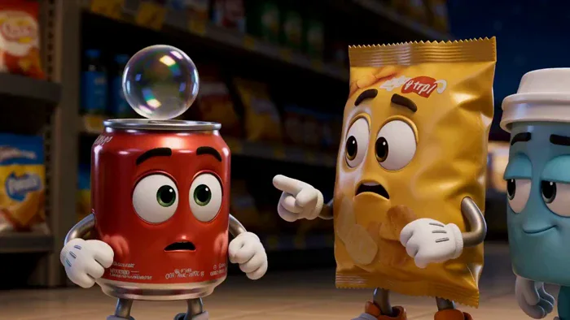</a>

▶ [在 ofox.ai 观看完整视频](https://ofox.ai/hailuo-3-prompts?utm_source=github&utm_medium=case&utm_campaign=awesome-ai-video-prompts#case-108)

<strong>Prompt</strong> — "[REFERENCE CONTROL] Use the uploaded PART 1 storyboard image for: “THE LAST POP BEFORE CLOSING” as the STRICT PRIMARY reference for: - Fizz’s exact r…

~~~~text
"[REFERENCE CONTROL]

Use the uploaded PART 1 storyboard image for:

“THE LAST POP BEFORE CLOSING”

as the STRICT PRIMARY reference for:

- Fizz’s exact red soda-can design
- Crunch’s exact yellow snack-bag design
- Chill’s exact blue ice-cream-cup design
- character proportions
- facial features
- arms, legs, gloves and footwear
- packaging materials
- relative mascot scale
- convenience-store environment
- soda shelves
- snack aisle
- fruit display
- shopping basket
- ceiling ventilation fan
- hanging price tags
- Chill’s spoon tool
- bubble design
- midnight lighting
- Part 1 story progression

Generate a FINISHED cinematic 3D animated sequence from the storyboard.

DO NOT animate the storyboard sheet itself.

The final video must NOT contain:

- storyboard borders
- panel numbers
- timestamps
- captions
- production notes
- character reference drawings
- prop reference drawings
- page background
- storyboard labels
- watermark
- unnecessary subtitles

Translate the 15 storyboard panels into approximately:

# 8 COHERENT CINEMATIC SHOTS

Do NOT make fifteen separate one-second cuts.

The story progression must read clearly as:

Fizz makes a flashy entrance
→ discovers only one bubble remains
→ the final bubble escapes
→ Fizz and Crunch chase it
→ repeated funny near-misses
→ bubble reaches ceiling fan
→ Fizz and Crunch cannot reach it
→ Chill quietly discovers the solution
→ cliffhanger.

==================================================
VIDEO GOAL
==================================================

Duration:

# EXACTLY 15 SECONDS

Story range:

PART 1 — 0:00 to 0:15

Aspect ratio:
16:9 landscape

Frame-rate feeling:
cinematic 24 fps

Visual medium:
premium stylized 3D animated product-mascot film

Genre:

- miniature adventure
- product mascot comedy
- friendship story
- playful rescue mission

Tone:

- energetic
- cute
- funny
- visually satisfying
- slightly suspenseful
- heartwarming
- family-friendly

Dialogue:
short synchronized English dialogue

Audio:
native dialogue + convenience-store ambience + physical comedy SFX + playful cinematic music

CORE PART 1 IDEA:

Fizz thinks he is still the fizziest product in the store...

until he discovers he has only ONE bubble left.

When that final bubble escapes, his friends launch a tiny midnight rescue mission.

==================================================
PART 1 STORY LIMIT
==================================================

START:

A quiet convenience store after closing.

Fizz suddenly makes a ridiculous heroic entrance riding a giant bubble.

END:

The final bubble is almost lost near the ceiling ventilation fan.

Fizz and Crunch are helplessly too short.

Chill studies the situation, removes the spoon from his back, smiles slightly and says:

<d>[English] I have an idea.</d>

CUT TO BLACK.

DO NOT show:

- Chill executing the solution
- freezer rescue
- shopping-basket rescue tower
- bubble returning to Fizz
- Fizz becoming fully carbonated again
- final celebration
- morning customer
- shelf ending

Save ALL successful rescue payoff for PART 2.

==================================================
CHARACTER IDENTITY LOCK — FIZZ
==================================================

Match the storyboard EXACTLY.

FIZZ — RED SODA CAN MASCOT

Appearance:

- small glossy cylindrical red aluminum soda can
- metallic silver top and bottom rims
- silver pull tab
- original fictional red label graphics
- NO recognizable real-world soda branding
- large expressive cartoon eyes integrated naturally into can body
- flexible black eyebrows
- tiny expressive mouth
- thin cartoon arms
- white four-finger-style mascot gloves
- tiny legs
- red-and-white sneakers

Surface:

- glossy lacquered aluminum
- crisp reflections
- slightly cool metal highlights
- subtle condensation if appropriate

Personality:

- energetic
- dramatic
- overconfident
- loves showing off
- easily panics
- lovable rather than annoying

PART 1 EMOTIONAL ARC:

0–2 sec:
maximum confidence

2–4 sec:
confusion

4–6 sec:
panic

6–11 sec:
desperate comic determination

11–13 sec:
fear of losing the bubble

13–15 sec:
confused hope as Chill gets an idea

IMPORTANT:

Fizz must remain clearly identifiable as the SAME red can in every shot.

Do not alter:

- shape
- height
- face placement
- silver top
- shoes
- glove style
- red color

==================================================
CHARACTER IDENTITY LOCK — CRUNCH
==================================================

CRUNCH — YELLOW SNACK BAG MASCOT

Appearance:

- small puffy rectangular snack bag
- bright warm yellow packaging
- crinkled foil/plastic texture
- sealed ridged top edge
- original fictional package graphics only
- large expressive eyes
- tiny mouth
- short flexible arms
- white gloves
- tiny legs
- oversized orange sneakers

Personality:

- enthusiastic
- loyal
- easily alarmed
- physically comedic
- wants to be heroic
- often makes things more chaotic

PART 1 PERFORMANCE:

0–2 sec:
Fizz fanboy / applause

2–4 sec:
instant concern

4–6 sec:
dramatic panic

6–10 sec:
overenthusiastic rescue attempts

10–13 sec:
full comic emergency mode

13–15 sec:
confused by Chill’s calmness

Packaging motion:

Crunch’s bag should lightly crinkle, squash and puff with emotion.

Do NOT deform him so much that his identity changes.

==================================================
CHARACTER IDENTITY LOCK — CHILL
==================================================

CHILL — BLUE ICE-CREAM CUP MASCOT

Appearance:

- compact cylindrical mint-blue / cool-blue ice cream cup
- white plastic lid resembling a flat cap
- clean original fictional cup graphics
- relaxed half-lidded expressive eyes
- small understated mouth
- tiny flexible arms
- white gloves
- small legs
- white sneakers
- one silver spoon attached vertically/diagonally to his back like a tiny tool

Personality:

- extremely calm
- intelligent
- observant
- dry sense of humor
- speaks rarely
- never panics

PART 1 PERFORMANCE:

0–5 sec:
unimpressed observer

5–10 sec:
quietly follows and studies

10–13 sec:
analyzes fan + bubble trajectory

13–15 sec:
solution clicks into place

His comedy comes from contrast:

Fizz and Crunch = chaos.

Chill = almost completely calm.

==================================================
KEY PROP LOCK — LAST BUBBLE
==================================================

The final bubble is the MAIN STORY OBJECT.

Appearance:

- one transparent soap-like carbonation bubble
- roughly the size of Fizz’s head or slightly smaller
- subtle rainbow iridescence
- reflective convenience-store lights on surface
- transparent center
- physically delicate
- readable against dark backgrounds

The bubble must remain:

# ONE SINGLE BUBBLE

Never duplicate it.

Trajectory must be physically understandable.

It moves through the story:

Fizz
→ floats upward
→ drifts into aisle
→ passes candy / price tags
→ Crunch misses it
→ bounces gently from shiny apple
→ rises toward ceiling
→ ventilation airflow begins drawing it upward.

The audience must always understand where the bubble is going.

==================================================
“1 BUBBLE LEFT” VISUAL
==================================================

At the discovery beat, briefly show a simple ORIGINAL diegetic graphic beside or reflected near Fizz:

“1 BUBBLE LEFT”

Style:

- tiny red/orange digital indicator
- simple iconography
- readable for less than one second
- not a permanent HUD
- not a video-game interface

It should feel like a comedic internal soda-status visualization.

Do NOT cover the whole frame with UI.

==================================================
ENVIRONMENT LOCK — MIDNIGHT CONVENIENCE STORE
==================================================

Maintain the uploaded storyboard environment.

Store:

- closed for the night
- organized aisles
- soda shelves
- snack shelves
- candy section
- fruit display
- shopping baskets
- small paper price tags
- refrigerators/freezers
- ceiling ventilation fans
- glossy tile floor
- large storefront windows
- shelves dramatically oversized compared with the tiny mascots

Lighting:

- warm practical ceiling lights
- soft orange shelf illumination
- cool midnight blue shadows
- occasional moonlight from storefront windows
- reflections on polished floor
- subtle refrigerator cyan light

The store should feel huge from mascot scale.

Use miniature cinematography.

==================================================
WORLD / PHYSICS RULES
==================================================

The characters are tiny product mascots living secretly inside a normal convenience store.

Maintain believable miniature scale.

Fizz jumping:
lightweight metal-can motion.

Crunch:
soft bag bounce and packaging crinkle.

Chill:
small solid cup motion with slightly heavier stable footing.

Bubble physics:

- extremely lightweight
- slow upward drift
- reacts to air currents
- gently rebounds from objects
- never behaves like a heavy ball
- never explodes in Part 1

CAUSE → EFFECT must remain readable.

Fizz releases last bubble
→ bubble rises.

Characters chase
→ air movement causes slight drift.

Crunch misses
→ bubble continues.

Bubble touches apple
→ gently redirects upward.

Ceiling fan airflow
→ bubble starts being pulled toward fan.

==================================================
INTEGRATED_MULTIMODAL_DESCRIPTION
==================================================

[SHOT 1 — 0:00–0:01.8]
MIDNIGHT — THE GREAT FIZZ ENTRANCE

Open outside / just inside the convenience store at midnight.

Establish:

- dark blue night sky
- quiet storefront
- warm store lights glowing inside

Move quickly into the soda aisle.

Suddenly—

# POP!

Fizz shoots upward from the soda shelf riding on top of a large fizzy bubble.

He balances dramatically like a tiny action hero.

Several tiny harmless carbonation bubbles trail around him.

He lands perfectly on the front edge of the shelf.

Crunch immediately applauds enthusiastically.

Chill stands nearby with half-lidded eyes and almost no reaction.

Fizz opens his arms proudly.

Fizz:

<d>[English] Still got it.</d>

Crunch:

<d>[English] That was AMAZING!</d>

Chill gives a tiny unimpressed:

<d>[English] Mm-hm.</d>

CAMERA:

wide store establish
→ fast push toward soda shelf
→ low-angle Fizz entrance
→ medium three-character reaction.

SFX:

- fizzy POP
- bubble wobble
- tiny sneaker landing
- Crunch package crinkle
- small celebratory sparkle sound

MUSIC:

playful miniature heist/adventure theme begins.

==================================================
[SHOT 2 — 0:01.8–0:03.6]
ONE BUBBLE LEFT

Medium close-up on Fizz.

He continues posing proudly.

Then—

a tiny pathetic bubble emerges from near his pull tab.

SFX:

# “pip.”

Fizz slowly looks upward.

The bubble floats beside him.

A tiny diegetic indicator flashes:

# 1 BUBBLE LEFT

Fizz’s smile disappears.

Crunch stops applauding.

Chill raises one eyebrow.

Fizz:

<d>[English] Wait...</d>

Fizz gently shakes himself.

No bubbles.

He shakes again.

Nothing.

Fizz:

<d>[English] That can’t be right.</d>

Crunch:

<d>[English] ONE?!</d>

Chill remains calm.

Camera:

Fizz hero close-up
→ tiny bubble
→ status indicator
→ reaction three-shot.

Music drops into a comic suspense note.

==================================================
[SHOT 3 — 0:03.6–0:05.4]
THE FINAL BUBBLE ESCAPES

Fizz tries increasingly silly but safe methods to make more carbonation:

tiny bounce,
small shake,
quick spin.

Nothing.

Then—

the ONE remaining bubble slowly drifts away from him.

Fizz freezes.

His pupils track it.

Fizz:

<d>[English] No no no no...</d>

Bubble clears the edge of the shelf.

Fizz reaches forward.

Too late.

Fizz:

<d>[English] MY BUBBLE!</d>

Crunch gasps dramatically.

Chill turns his eyes toward the bubble’s trajectory.

Camera follows the bubble over the shelf edge.

==================================================
[SHOT 4 — 0:05.4–0:07.5]
THE STORE-WIDE CHASE

Fizz leaps safely down from the low product display and runs after the floating bubble.

Crunch runs immediately behind him, bag bouncing and crinkling wildly.

Chill calmly climbs/slides down and follows at an efficient pace.

The camera tracks low at mascot height.

The bubble floats through the giant store aisle.

Pass:

- candy displays
- hanging price cards
- colorful product shelves
- oversized boxes
- polished tiles

Fizz stretches both hands upward while running.

Fizz:

<d>[English] Don’t let it get away!</d>

Crunch:

<d>[English] I GOT IT!</d>

Chill, quietly:

<d>[English] You don’t.</d>

Strong visual scale:

tiny mascots below,
huge supermarket aisle above.

==================================================
[SHOT 5 — 0:07.5–0:09.4]
CRUNCH’S GREAT RESCUE ATTEMPT

Crunch spots an empty decorative snack bowl / tray.

His eyes light up.

He grabs it with both hands.

Crunch:

<d>[English] Stand back!</d>

He runs underneath the bubble.

Moves bowl left.

Bubble moves right.

He moves right.

Bubble moves left.

Crunch finally jumps and thrusts the bowl upward.

MISS.

Fizz also makes a tiny dive beneath it.

MISS.

Crunch lands seated inside / behind the bowl, stunned but unharmed.

Fizz:

<d>[English] Great plan!</d>

Crunch:

<d>[English] Thank you!</d>

Beat.

Fizz:

<d>[English] I was being sarcastic!</d>

If dialogue timing is crowded, prioritize:
“Stand back!” + visual comedy.

Bubble continues forward.

==================================================
[SHOT 6 — 0:09.4–0:11.0]
THE APPLE BOUNCE

The last bubble drifts toward the fruit display.

Close macro shot:

a shiny red apple reflects the bubble and tiny running mascots.

Bubble gently touches the apple.

# boop.

It redirects upward.

Fizz arrives just beneath it.

His eyes widen.

Fizz:

<d>[English] Uh-oh.</d>

Camera tilts vertically following the bubble.

Reveal:

a ceiling ventilation fan high above.

The bubble begins drifting toward it.

Music shifts from playful chase to light suspense.

Chill stops running.

He studies the situation.

==================================================
[SHOT 7 — 0:11.0–0:13.3]
TOO SHORT

The ventilation fan rotates above.

IMPORTANT:

Do not make it threatening or dangerous-looking.

It is simply creating airflow.

The bubble begins moving upward faster.

Fizz jumps repeatedly.

Too short.

Crunch rushes behind him.

Fizz grabs a safe shelf lip / hanging display support.

Crunch holds Fizz around the legs.

They stretch upward in a ridiculous mascot chain.

Fizz:

<d>[English] Almost...</d>

Crunch:

<d>[English] I can’t stretch anymore!</d>

Fizz:

<d>[English] You’re a BAG!</d>

Crunch:

<d>[English] EXACTLY!</d>

The bubble remains just beyond reach.

Wide low-angle composition:

Fizz + Crunch foreground
→ bubble above
→ fan far overhead.

Chill watches from below.

Do NOT show either character falling dangerously.

==================================================
[SHOT 8 — 0:13.3–0:15.0]
CHILL GETS AN IDEA — CLIFFHANGER

Cut away from the chaos.

Close-up on Chill.

He calmly looks upward.

His eyes track:

bubble
→ ventilation fan
→ nearby store environment
→ spoon attached to his back.

Use a subtle visual thought sequence.

No literal thought bubble required.

His half-lidded expression changes.

One eyebrow rises.

Then—

the smallest confident smile.

Chill reaches behind himself.

Slowly removes his silver spoon.

Fizz and Crunch turn toward him.

Fizz:

<d>[English] Chill?!</d>

Crunch:

<d>[English] Why are you smiling?!</d>

Chill looks at the spoon.

Then at the bubble.

Chill:

<d>[English] I have an idea.</d>

Hold on:

Chill foreground with spoon,
Fizz and Crunch staring,
bubble suspended high in background,
fan visible above.

Music stops on a clever suspense sting.

CUT TO BLACK.

END PART 1.

==================================================
AUDIO DESCRIPTION
==================================================

Generate synchronized native stereo audio.

Soundscape should feel:

- playful
- tactile
- miniature
- energetic
- clean
- cinematic
- family-friendly

==================================================
FIZZ VOICE
==================================================

Young energetic masculine cartoon voice.

Qualities:

- quick
- confident
- charismatic
- expressive
- slightly dramatic
- high energy without becoming shrill

Emotional progression:

show-off
→ disbelief
→ panic
→ desperate determination.

Priority lines:

<d>[English] Still got it.</d>

<d>[English] Wait...</d>

<d>[English] MY BUBBLE!</d>

<d>[English] Don’t let it get away!</d>

<d>[English] Uh-oh.</d>

==================================================
CRUNCH VOICE
==================================================

Energetic comedic masculine/androgynous mascot voice.

Qualities:

- excitable
- earnest
- slightly squeaky
- lovable
- nervous

Use packaging crinkle underneath body movement.

Priority lines:

<d>[English] That was AMAZING!</d>

<d>[English] ONE?!</d>

<d>[English] Stand back!</d>

<d>[English] I can’t stretch anymore!</d>

<d>[English] Why are you smiling?!</d>

==================================================
CHILL VOICE
==================================================

Low-energy calm mascot voice.

Qualities:

- dry
- relaxed
- understated
- clever
- almost sleepy

Do NOT make him emotionless.

His minimalism is the joke.

Priority:

<d>[English] Mm-hm.</d>

Optional:

<d>[English] You don’t.</d>

Final line MUST be clear:

<d>[English] I have an idea.</d>

==================================================
STORE AMBIENCE
==================================================

Use:

- quiet refrigerator hum
- fluorescent / practical store ambience
- subtle ventilation
- distant compressor
- small shelf creaks
- soft floor squeaks
- tiny packaging rustles
- very faint outdoor night ambience

Because the store is closed:

no human voices,
no shopping crowd,
no cashier sounds.

==================================================
BUBBLE SOUND DESIGN
==================================================

Bubble gets a very subtle signature sound.

Use:

- tiny glassy shimmer
- soft fizzy sparkle
- gentle elastic “boop” on apple
- airy upward whoosh near fan

Do NOT make it sound magical or supernatural.

It is stylized carbonation.

==================================================
NON-DIEGETIC MUSIC
==================================================

Create an ORIGINAL playful miniature-adventure score.

Instrumentation:

- pizzicato strings
- muted marimba
- light bass
- tiny brass accents
- brushed percussion
- woodblocks
- playful synth plucks
- occasional glockenspiel

Music arc:

0:00–0:02
heroic-comedy entrance.

0:02–0:04
sudden “something is wrong” motif.

0:04–0:06
bubble escape acceleration.

0:06–0:10
fast playful chase rhythm.

0:10–0:13
rising light suspense.

0:13–0:15
music strips back for Chill’s realization.

Finish with:

short clever unresolved sting.

==================================================
CAMERA LANGUAGE
==================================================

The camera should emphasize the mascots’ TINY SCALE.

Use:

- low floor-level tracking
- macro product close-ups
- wide oversized aisle shots
- shelf-edge perspective
- dynamic but readable pans
- bubble-follow camera
- rack focus between characters and bubble
- low-angle ceiling reveal
- intimate reaction close-ups

Camera energy progression:

0–3 sec:
confident and playful.

3–6 sec:
tighter reactions.

6–10 sec:
faster chase.

10–13 sec:
vertical tension.

13–15 sec:
slow down for Chill’s idea.

Avoid:

- excessive handheld shake
- giant action-movie camera spins
- extreme fisheye
- incomprehensible rapid cuts
- heavy motion blur

==================================================
VISUAL STYLE
==================================================

Premium stylized 3D animated product-mascot short.

Use:

- polished CGI
- expressive cartoon animation
- glossy packaging materials
- realistic-enough product reflections
- soft global illumination
- detailed miniature environments
- cinematic depth of field
- playful squash-and-stretch
- clean readable silhouettes
- premium commercial-quality rendering
- subtle filmic motion blur
- tactile packaging surfaces

Fizz:
hard glossy aluminum.

Crunch:
soft crinkled flexible bag.

Chill:
semi-matte paper/plastic ice-cream cup.

This material contrast must remain visible.

==================================================
COLOR / LIGHTING
==================================================

Primary mascot colors:

Fizz:
bright glossy red + silver + white.

Crunch:
saturated yellow + orange.

Chill:
cool mint blue + white + silver spoon.

Environment:

- dark navy shadows
- warm amber practical lighting
- muted shelf colors
- warm wood/brown accents
- cool freezer cyan

Lighting should keep all faces readable.

No horror lighting.

No flashing emergency lights.

==================================================
MOTION RULES — FIZZ
==================================================

Fizz is lightweight and energetic.

Movement:

- springy jumps
- fast arm gestures
- exaggerated facial acting
- metallic body stays mostly rigid
- slight cartoon body squash only
- fast sneaker movement
- pull tab remains attached

Do NOT bend the can like rubber.

==================================================
MOTION RULES — CRUNCH
==================================================

Crunch can deform more than Fizz because he is flexible packaging.

Use:

- little crinkles
- puffing
- squash
- bounce
- flappy top edge
- oversized sneaker motion

Do not flatten him completely.

==================================================
MOTION RULES — CHILL
==================================================

Chill is the calmest.

Movement:

- minimal head turns
- slow eye movement
- controlled walking
- small eyebrow raises
- careful spoon removal

His final slow action should contrast strongly against the chaotic chase.

==================================================
CONTINUITY RULES
==================================================

Maintain exactly:

ONE Fizz.
ONE Crunch.
ONE Chill.
ONE final bubble.

No duplicate mascots.

No bubble duplication.

Same:

- character colors
- footwear
- glove designs
- facial layouts
- packaging shapes
- spoon
- bubble size
- store environment

Bubble trajectory must remain continuous across shots.

Fizz does NOT regain carbonation in Part 1.

Chill does NOT execute the rescue before cut to black.

==================================================
DIALOGUE TIMING PRIORITY
==================================================

15 seconds is very short.

Natural pacing is MORE important than using every optional line.

Highest-priority dialogue:

1.
Fizz:
<d>[English] Still got it.</d>

2.
Crunch:
<d>[English] ONE?!</d>

3.
Fizz:
<d>[English] MY BUBBLE!</d>

4.
Crunch:
<d>[English] Stand back!</d>

5.
Fizz:
<d>[English] Uh-oh.</d>

6.
Crunch:
<d>[English] Why are you smiling?!</d>

7.
Chill:
<d>[English] I have an idea.</d>

If needed, remove secondary dialogue.

Do NOT speed voices unnaturally.

Use facial acting and SFX to carry comedy.

==================================================
SAFETY / CONTENT RULES
==================================================

All action is playful and safe.

No injury.
No violence.
No weapons.
No dangerous machinery contact.
No character gets pulled into the fan.
No sharp-object threat.
No crashing glass.
No broken products.
No food contamination.
No human conflict.

The ventilation fan remains high and distant.

The bubble is the only object being affected by its airflow.

==================================================
NEGATIVE CONSTRAINTS
==================================================

No storyboard sheet.
No borders.
No captions.
No timestamps.
No production notes.
No reference drawings.
No watermark.
No brand logos.

No real soda brands.
No real snack brands.
No real ice-cream brands.

No duplicate Fizz.
No duplicate Crunch.
No duplicate Chill.
No duplicate bubble.

No character identity drift.
No color changes.
No shoe changes.
No glove changes.
No missing spoon.
No disappearing pull tab.

No humanoid humans joining the chase.
No customers.
No morning scene.

No bubble returning to Fizz yet.
No Part 2 resolution.

No dangerous ceiling fan contact.
No crushed mascots.
No exploding products.
No soda explosion.

No malformed hands.
No extra arms.
No extra legs.
No face distortion.
No label flicker.
No packaging morphing.

==================================================
FINAL 3-SECOND PRIORITY
==================================================

The final three seconds must create a STRONG Part 2 hook.

Bubble rises toward ceiling ventilation.

Fizz and Crunch form a ridiculous stretched chain beneath it.

They are still too short.

Fizz reaches desperately.

Crunch struggles below.

Then—

CUT TO CHILL.

...
~~~~

**参数**：MiniMax H3 · 未标注 · ref2va · 15s · 未标注 · 未标注 · 带音频
**来源**：@ManuAGI01 · [原帖](https://x.com/ManuAGI01/status/2087065646903517354)

Preview © 2026 @ManuAGI01 · Prompt by @ManuAGI01

[回到目录](#table-of-contents)

### Case 109: Ari and Bruno’s Croissant Bloom · Part 1 (阿里与布鲁诺的羊角包花 · 上篇) — by @ManuAGI01

<a href="https://ofox.ai/hailuo-3-prompts?utm_source=github&utm_medium=case&utm_campaign=awesome-ai-video-prompts#case-109">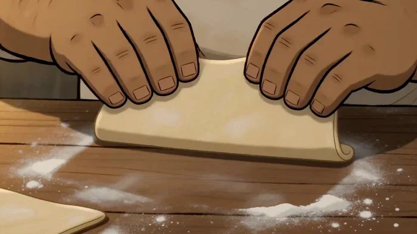</a>

▶ [在 ofox.ai 观看完整视频](https://ofox.ai/hailuo-3-prompts?utm_source=github&utm_medium=case&utm_campaign=awesome-ai-video-prompts#case-109)

<strong>Prompt</strong> — [REFERENCE CONTROL] Use the uploaded PART 1 storyboard image for: “ARI &amp; BRUNO — THE CROISSANT THAT BLOOMED” as the STRICT PRIMARY visual, character, …

~~~~text
[REFERENCE CONTROL]

Use the uploaded PART 1 storyboard image for:

“ARI & BRUNO — THE CROISSANT THAT BLOOMED”

as the STRICT PRIMARY visual, character, environment, prop, lighting, scale, performance, and narrative reference.

Generate a FINISHED cinematic animated sequence based on this storyboard.

DO NOT animate the storyboard sheet itself.

The finished video must NOT contain:

- storyboard borders
- panel numbers
- timestamps
- handwritten captions
- production notes
- character reference drawings
- prop reference drawings
- color swatches
- title/header
- page background
- annotations
- subtitles
- logos
- watermarks

The uploaded storyboard locks:

1. Ari’s exact face
2. Ari’s short messy brown hair
3. Ari’s slim teenage proportions
4. Ari’s cream/white baker shirt
5. Ari’s rolled sleeves
6. Ari’s light apron
7. Ari’s expressive large eyes
8. Bruno’s exact face
9. Bruno’s curly dark hair
10. Bruno’s short full beard
11. Bruno’s large heavyset build
12. Bruno’s light baker shirt and cream apron
13. cozy artisan bakery environment
14. warm sunrise lighting
15. wooden worktable
16. bowls, flour, rolling pin and baking tray
17. original croissant dough design
18. squashed dough design
19. first flower-shaped dough concept
20. Ari and Bruno’s mentor/apprentice relationship

Translate the storyboard’s 15 one-second panels into approximately:

# 8 COHERENT CINEMATIC SHOTS

Do NOT create fifteen frantic one-second cuts.

Story progression:

warm bakery morning
→ Bruno teaches
→ Ari succeeds
→ confidence grows
→ small tray accident
→ Ari believes he failed
→ Bruno responds calmly
→ mistake becomes a creative idea
→ hopeful Part 1 cliffhanger.

==================================================
VIDEO GOAL
==================================================

Duration:

# EXACTLY 15 SECONDS

Story range:

PART 1 — 0:00 to 0:15

Aspect ratio:
16:9 landscape

Frame-rate feeling:
cinematic 24 fps

Visual medium:
premium hand-painted 2D animated-film style

Genre:
cozy bakery story / mentor-apprentice friendship

Tone:

- warm
- tactile
- charming
- gentle
- lightly comedic
- emotionally sincere
- hopeful
- family-friendly

Dialogue:
natural synchronized English

Audio:
native character dialogue + bakery ambience + baking sounds + original warm score

CORE STORY IDEA:

Ari wants to make everything perfectly.

A small mistake makes him think he has failed.

Bruno sees something else:

a chance to create something new.

==================================================
PART 1 STORY LIMIT
==================================================

PART 1 ONLY.

START:

Morning begins inside the cozy bakery.

Bruno teaches Ari how to shape croissants.

END:

Bruno reshapes ONE squashed pastry into a flower.

Ari realizes the ruined batch might become something completely new.

The remaining pastries are only BEGINNING to be reshaped.

CUT TO BLACK.

DO NOT show:

- fully finished croissant bloom
- baked flower pastries
- berries added to finished bloom
- powdered sugar finishing
- final cake stand
- customer reaction
- customers entering bakery
- Ari presenting final pastry
- bakery crowd
- final success

All of those belong to PART 2.

==================================================
CHARACTER IDENTITY LOCK — ARI
==================================================

Match the uploaded storyboard EXACTLY.

ARI — APPRENTICE BAKER

Young teenage baker apprentice.

Appearance:

- warm light skin
- youthful soft face
- large expressive brown/dark eyes
- short tousled medium-brown hair
- slim build
- narrow shoulders
- youthful proportions
- cream/white baker shirt
- sleeves rolled to forearms
- light beige/cream apron
- simple work trousers
- practical bakery shoes

Do NOT redesign him.

Do NOT change:

- hairstyle
- age
- body proportions
- apron
- shirt
- facial structure

PERSONALITY:

- hopeful
- hardworking
- eager
- careful
- slightly nervous
- wants to impress Bruno
- learns through doing

PART 1 PERFORMANCE ARC:

0–4 sec:
focused learner

4–6 sec:
small success and growing confidence

6–8 sec:
careful but slightly rushed

8–10 sec:
sudden worry

10–12 sec:
expects disappointment

12–15 sec:
surprise → curiosity → renewed hope

IMPORTANT:

Ari is NOT terrified.

His reaction to the mistake should be:

“Oh no, I ruined our work.”

Not:

panic,
trauma,
extreme fear,
crying.

Use subtle emotional acting.

==================================================
CHARACTER IDENTITY LOCK — BRUNO
==================================================

Match uploaded storyboard EXACTLY.

BRUNO — HEAD BAKER

Appearance:

- large broad heavyset build
- warm medium/light-olive skin
- curly dark-brown hair
- short full beard
- thick eyebrows
- kind expressive eyes
- large friendly hands
- light baker shirt
- cream apron
- sturdy practical bakery clothing

PERSONALITY:

- grounded
- cheerful
- experienced
- patient
- reassuring
- playful
- mentor/fatherly energy

Movement style:

- broad
- calm
- confident
- fluid
- never rushed unnecessarily

PART 1 PERFORMANCE ARC:

0–4 sec:
enthusiastic teacher

4–7 sec:
quietly proud of Ari

7–10 sec:
occupied nearby

10–12 sec:
notices mistake calmly

12–15 sec:
thinking → inspired → encouraging

CRITICAL:

Bruno must NEVER look angry.

When he sees the squashed pastries:

no yelling,
no disappointment,
no aggressive gestures.

His first reaction should be:

observe
→ think
→ smile slightly
→ find possibility.

==================================================
ENVIRONMENT LOCK — MORNING BAKERY
==================================================

Maintain the exact bakery world from the storyboard.

Environment:

- artisan bakery kitchen
- rustic wooden work counters
- warm wooden shelves
- flour jars
- ceramic bowls
- mixing bowls
- rolling pins
- baking trays
- berries
- butter
- utensils
- hanging cookware
- old-fashioned oven
- bread/pastry preparation surfaces
- warm morning window
- subtle flour particles floating in sunlight

Lighting:

warm sunrise entering from windows.

Secondary lighting:

soft amber oven glow.

Color palette:

- pastry gold
- butter cream
- flour white
- berry red
- wood brown
- honey orange
- muted sage accents

The bakery should feel:

handmade,
lived-in,
warm,
inviting,
delicious.

==================================================
KEY PROP LOCK — CROISSANT DOUGH
==================================================

Maintain clear physical progression.

STAGE 1:
flat triangular croissant dough.

STAGE 2:
rolled crescent-shaped raw croissants.

STAGE 3:
several neat croissants arranged on tray.

STAGE 4:
tray accidentally tilts.

STAGE 5:
some dough pieces become softly squashed / flattened.

STAGE 6:
Bruno uses the flattened shape as material for a flower pastry.

IMPORTANT:

The pastries are RAW DOUGH in Part 1.

Do NOT suddenly turn them golden-baked before Part 2.

Do not duplicate pastries unnaturally.

==================================================
FLOWER-SHAPED PASTRY IDEA LOCK
==================================================

The Part 1 ending reveals only the INITIAL IDEA.

Bruno takes ONE squashed dough piece.

He carefully:

pinches one edge
→ folds another section
→ curves the layers
→ forms overlapping dough petals.

The result should resemble a simple raw pastry rose / flower.

It is still:

- pale dough
- unbaked
- soft
- lightly floured

The transformation must happen through Bruno’s HANDS.

No magical transformation.

No glowing magic.

No instant morph.

The creativity itself is the magic.

==================================================
WORLD / ACTION LOGIC
==================================================

Bruno demonstrates
→ Ari copies.

Ari copies correctly
→ croissants look good.

Success
→ Ari gains confidence.

Ari moves tray
→ edge catches / tray tilts slightly.

Tray tilts
→ several soft raw pastries slide together.

Soft pastries collide
→ shapes become flattened.

Ari sees damaged shapes
→ thinks he failed.

Bruno notices
→ stays calm.

Bruno studies flattened dough
→ recognizes flower-like possibility.

Bruno reshapes one pastry
→ Ari understands the new idea.

Everything must follow readable physical cause-and-effect.

==================================================
INTEGRATED_MULTIMODAL_DESCRIPTION
==================================================

[SHOT 1 — 0:00–0:01.8]
MORNING IN THE LITTLE BAKERY

Open with a warm cinematic establishing shot.

Golden sunrise streams through the bakery window.

Flour dust floats softly through light beams.

Wooden counters are covered with:

- bowls
- butter
- flour
- dough
- berries
- rolling pins
- baking tools

Ari and Bruno work together at the center table.

Camera glides slowly toward them.

Bruno happily places a smooth sheet of dough on the floured work surface.

Ari stands beside him, attentive.

Bruno:

<d>[English] Ready?</d>

Ari nods enthusiastically.

Ari:

<d>[English] Ready.</d>

Bruno smiles.

MUSIC:

soft morning bakery theme begins.

Use:

- acoustic guitar
- pizzicato strings
- piano
- clarinet
- subtle brushed percussion

AUDIO:

- quiet room tone
- wooden counter sounds
- soft bowl clinks
- distant oven fire
- flour brushing
- morning birds outside

==================================================
[SHOT 2 — 0:01.8–0:03.6]
BRUNO SHOWS THE FIRST STEP

Move closer to the worktable.

Bruno cuts / presents a triangle of laminated dough.

Macro close-up of his large hands.

He gently rolls from the wide end toward the point.

One smooth motion.

The layers curl into a neat croissant.

Bruno:

<d>[English] Gentle hands.</d>

He lightly taps the finished shape.

<d>[English] Let the dough do the work.</d>

Ari watches closely.

Use tactile food detail:

- soft flour
- buttery layers
- subtle dough elasticity
- hand pressure
- flour fingerprints

CAMERA:

medium mentor/apprentice
→ close dough triangle
→ macro rolling hands
→ finished raw croissant.

==================================================
[SHOT 3 — 0:03.6–0:05.4]
ARI TRIES

Bruno slides another dough triangle toward Ari.

Ari inhales quietly.

He places both hands carefully.

He imitates Bruno.

First fold.

Small pause.

Second roll.

Final curl.

The croissant holds its shape.

Ari’s eyes widen.

Ari:

<d>[English] I did it.</d>

Bruno smiles behind him.

Bruno:

<d>[English] You did.</d>

Quick reveal of the tray:

several neat raw croissants lined beautifully.

Ari smiles.

Bruno gives him a warm thumbs-up.

Music becomes slightly brighter.

==================================================
[SHOT 4 — 0:05.4–0:07.0]
CONFIDENCE GROWS

Create a short flowing preparation sequence.

Ari shapes another croissant.

Then another.

His movements become slightly faster and more natural.

Bruno prepares something at the neighboring station.

Ari places the final neat piece onto the baking tray.

He proudly looks at the complete row.

Ari:

<d>[English] Not bad.</d>

From nearby Bruno replies:

<d>[English] Not bad?</d>

Bruno glances toward the tray.

Smiles.

<d>[English] Very good.</d>

Ari’s smile becomes bigger.

Do not linger too long.

==================================================
[SHOT 5 — 0:07.0–0:08.8]
ONE SMALL MISTAKE

Ari reaches for the baking tray.

Use clear physical movement.

He grips both sides.

Begins lifting it from the work surface.

As he turns:

one tray edge gently catches the corner of a folded cloth / wooden board.

The tray tips several degrees.

NOT a dramatic fall.

The tray remains in Ari’s hands.

The soft croissants slide toward one side.

Ari:

<d>[English] Whoa—!</d>

He quickly levels the tray.

Nothing falls onto the floor.

No dangerous action.

But several pastries have pressed softly into one another.

A tiny puff of flour rises.

Music stops on a gentle comic “oops” beat.

SFX:

- tray scrape
- dough sliding
- soft flour PUFF
- light metal wobble

==================================================
[SHOT 6 — 0:08.8–0:10.4]
ARI THINKS HE RUINED IT

Close-up on the tray.

Several once-perfect croissants are now:

- flattened
- pressed together
- irregular
- soft and misshapen

Not disgusting.

Not destroyed.

Just imperfect.

Rack focus to Ari.

His eyes widen.

Shoulders drop.

Ari:

<d>[English] Oh no...</d>

He carefully sets the tray back down.

Looks at the pastries.

Ari, quietly:

<d>[English] I ruined them.</d>

Hold briefly on his worried expression.

No crying.

No melodrama.

==================================================
[SHOT 7 — 0:10.4–0:12.3]
BRUNO DOESN’T GET UPSET

Bruno enters the composition.

Ari looks toward him nervously.

Ari:

<d>[English] Bruno... I’m sorry.</d>

Bruno looks at:

Ari
→ tray
→ squashed dough.

He does NOT frown angrily.

He simply leans closer.

Studies one flattened piece.

Tilts his head.

Touches his beard thoughtfully.

Ari waits.

Silence for a small emotional beat.

Then Bruno’s eyebrow rises.

His expression becomes curious.

A tiny smile begins.

Bruno:

<d>[English] Hmm...</d>

Ari looks confused.

Bruno:

<d>[English] Maybe you didn’t.</d>

Music introduces a soft playful “idea” motif.

==================================================
[SHOT 8 — 0:12.3–0:15.0]
THE CROISSANT BEGINS TO BLOOM

Bruno gently picks up ONE squashed raw pastry.

Place it on the floured work surface.

Ari leans closer.

Bruno uses both hands.

CLEAR ACTION:

he pinches one edge inward
→ folds a soft dough section
→ curls another layer around it
→ rotates it slightly
→ gently opens the outer layers.

The flattened pastry begins looking like a little flower / rose.

Ari’s worried face transforms.

Concern
→ confusion
→ surprise
→ hope.

Ari:

<d>[English] A flower?</d>

Bruno smiles.

<d>[English] Why not?</d>

He places the raw flower pastry onto the tray.

Camera reveals several remaining squashed pieces beside it.

Bruno looks at Ari.

Bruno:

<d>[English] Mistakes can become ideas.</d>

Ari looks from the little flower pastry to the rest of the tray.

His eyes brighten.

Ari reaches toward another flattened piece.

Ari:

<d>[English] Then let’s make them bloom.</d>

IMPORTANT:

Do NOT show all pastries completed.

Only:
- ONE clear finished raw flower
- perhaps ONE second pastry just beginning to be reshaped.

End on:

Ari and Bruno leaning over the tray together.

The raw flower pastry sits between them.

Warm sunlight catches the flour.

Ari smiles with renewed confidence.

Music lifts into hopeful cliffhanger chord.

CUT TO BLACK.

END PART 1.

==================================================
AUDIO DESCRIPTION
==================================================

Generate synchronized native stereo audio.

Audio should be:

- intimate
- warm
- tactile
- cozy
- emotionally clear
- lightly playful

==================================================
ARI VOICE
==================================================

Young teenage male voice.

Qualities:

- sincere
- gentle
- slightly nervous
- curious
- eager
- natural
- not overly childish

Performance progression:

beginning:
focused excitement

success:
proud but modest

mistake:
embarrassed and worried

ending:
surprised and inspired

Important lines:

<d>[English] I did it.</d>

should feel like small genuine pride.

<d>[English] I ruined them.</d>

soft disappointment, not dramatic despair.

Final:

<d>[English] Then let’s make them bloom.</d>

should carry renewed excitement.

==================================================
BRUNO VOICE
==================================================

Warm adult male voice.

Qualities:

- broad
- relaxed
- cheerful
- grounded
- reassuring
- mentor-like
- slightly playful

Never harsh.

Important dialogue:

<d>[English] Gentle hands.</d>

instructional and warm.

<d>[English] Maybe you didn’t.</d>

spoken calmly, creating curiosity.

<d>[English] Mistakes can become ideas.</d>

simple, natural, not overly inspirational or preachy.

==================================================
BAKERY SOUND DESIGN
==================================================

Use detailed but subtle sounds:

- flour brush
- soft dough pressing
- rolling dough
- metal bowl clinks
- tray sliding
- rolling pin on wood
- apron fabric movement
- oven crackle
- distant kitchen ambience
- gentle footsteps

TRAY ACCIDENT:

Keep sounds light.

Use:

small metal scrape
→ dough slide
→ flour puff.

No loud crash.

No smashing.

==================================================
NON-DIEGETIC MUSIC
==================================================

Create an ORIGINAL cozy bakery score.

Instrumentation:

- warm piano
- acoustic guitar
- pizzicato strings
- clarinet
- upright bass
- brushed percussion
- subtle accordion texture
- tiny glockenspiel for inspiration moment

MUSIC ARC:

0:00–0:02
warm morning introduction.

0:02–0:05
gentle learning rhythm.

0:05–0:07
small confidence lift.

0:07–0:09
brief playful “oops” punctuation.

0:09–0:11
soft emotional uncertainty.

0:11–0:13
curious pause.

0:13–0:15
hopeful creative motif.

End unresolved enough to invite Part 2, but emotionally positive.

==================================================
CAMERA LANGUAGE
==================================================

Use a tactile cinematic food-storytelling approach.

Start:

wide environment.

Then progressively move into:

- hands
- dough
- facial reactions
- food texture

Preferred camera:

- gentle dolly
- medium two-shot
- overhead preparation detail
- macro dough close-ups
- rack focus
- subtle side tracking
- eye-level emotional close-ups
- final slow push-in on flower pastry

The mistake should NOT use action-movie camera language.

No shaky camera.

No aggressive whip pan.

No dramatic Dutch angle.

No huge slow motion.

Keep everything readable and intimate.

==================================================
FOOD CINEMATOGRAPHY
==================================================

Make the food visually satisfying.

Show:

- flour texture
- laminated dough layers
- soft butter sheen
- gentle hand pressure
- subtle elasticity
- raw croissant curves
- flour particles
- flower-petal dough layers

IMPORTANT:

Part 1 pastries remain RAW.

Use pale:

- butter cream
- flour beige
- soft dough yellow

Do NOT make them baked golden brown yet.

Golden baked pastries belong to Part 2.

==================================================
VISUAL STYLE
==================================================

Premium finished hand-painted 2D animated short.

Match the uploaded storyboard.

Use:

- clean expressive ink linework
- watercolor/gouache inspired rendering
- soft painterly shadows
- warm textured wood
- expressive stylized faces
- detailed hand-painted food
- subtle atmospheric depth
- gentle cinematic bloom
- warm morning light
- tactile materials
- tasteful squash-and-stretch

The final animation should feel like:

THE STORYBOARD ILLUSTRATIONS HAVE COME TO LIFE.

NOT:

- storyboard animatic
- motion comic
- slideshow
- photorealistic live action
- generic 3D CGI
- flat vector cartoon
- anime
- hyperreal food commercial

==================================================
COLOR / LIGHTING
==================================================

Primary palette:

- warm cream
- butter yellow
- pastry beige
- flour white
- wood brown
- soft berry red
- honey orange
- muted sage

LIGHTING:

strong but soft sunrise through window.

Use warm rim lighting on:

- Ari’s brown hair
- Bruno’s curly hair/beard
- hands
- flour particles
- dough edges

Oven provides subtle secondary amber glow.

During Ari’s mistake:

do NOT suddenly darken the scene.

Maintain visual warmth.

During Bruno’s idea:

let sunlight gently highlight the newly formed flower pastry.

No magical glow required.

==================================================
MOTION RULES — ARI
==================================================

Use:

- careful hand movements
- slightly hesitant shaping
- focused eye movements
- small proud smile
- faster confidence after success
- safe tray lift
- small startled body recoil
- lowered shoulders after mistake
- leaning forward with curiosity
- renewed energy at ending

No exaggerated panic.

==================================================
MOTION RULES — BRUNO
==================================================

Use:

- broad demonstration gestures
- steady hand movements
- relaxed posture
- expressive eyebrows
- thoughtful beard-touch
- gentle dough reshaping
- warm smile
- subtle nods

He is an experienced baker.

His movements should feel effortless.

==================================================
CONTINUITY RULES
==================================================

Maintain exactly:

ONE Ari.
ONE Bruno.

Same:

- faces
- hairstyles
- clothing
- aprons
- body proportions
- bakery layout
- morning light
- worktable
- utensils
- tray
- dough appearance

Raw croissant progression must stay continuous.

Once the tray is squashed:

do NOT show perfect original croissants again.

Once Bruno creates the flower:

that flower stays on the tray.

No instant baked transformation.

No berries or powdered sugar added to the flower pastries yet unless already incidental in the environment.

==================================================
EMOTIONAL PERFORMANCE PRIORITY
==================================================

The most important emotional transition is:

ARI:

“I ruined them.”

BRUNO:

does NOT react negatively.

He studies the dough.

Then:

“Maybe you didn’t.”

That small reaction teaches Ari that mistakes do not automatically equal failure.

The final flower idea should feel earned through:

observation
+
craft
+
creativity.

Not magic.

==================================================
DIALOGUE TIMING PRIORITY
==================================================

Because the sequence is only 15 seconds, DO NOT force every optional line.

Highest-priority spoken dialogue:

1.
Bruno:
<d>[English] Gentle hands.</d>

2.
Ari:
<d>[English] I did it.</d>

3.
Ari:
<d>[English] Oh no...</d>

4.
Ari:
<d>[English] I ruined them.</d>

5.
Bruno:
<d>[English] Maybe you didn’t.</d>

6.
Ari:
<d>[English] A flower?</d>

7.
Bruno:
<d>[English] Why not?</d>

8.
Ari:
<d>[English] Then let’s make them bloom.</d>

If timing becomes tight:

remove secondary dialogue rather than speeding up voices.

==================================================
SAFETY / CONTENT RULES
==================================================

Keep the entire video safe and family-friendly.

No injury.
No dangerous oven interaction.
No burns.
No fire accident.
No knives used dangerously.
No yelling.
No conflict.
No bullying.
No harsh discipline.

When oven appears:

Bruno handles it safely.

Ari stays at safe distance unless supervised.

Tray accident occurs at the WORKTABLE, not near a dangerous hot oven.

==================================================
NEGATIVE CONSTRAINTS
==================================================

No storyboard sheet.
No panels.
No timestamps.
No captions.
No production notes.
No reference drawings.
No typography.
No subtitle text.
No logo.
No watermark.

No duplicate Ari.
No duplicate Bruno.

No character identity drift.
No hairstyle changes.
No apron changes.
No costume changes.
No sudden age changes.

No angry Bruno.
No crying Ari.
No screaming.
No dangerous accident.
No food falling onto floor.
No burning food.
No fire emergency.

No baked golden flower bloom yet.
No customer.
No bakery crowd.
No finished presentation stand.
No Part 2 payoff.

No magical dough transformation.
No levitating pastries.
No glowing supernatural food.

No malformed hands.
No extra fingers.
No warped faces.
No flickering props.
No disappearing tray.
No inconsistent pastry count.

==================================================
FINAL 4-SECOND PRIORITY
==================================================

The final four seconds must create the Part 2 hook.

Ari looks down sadly at the squashed raw croissants.

Bruno studies them calmly.

Bruno touches his beard.

His eyes brighten with an idea.

Bruno:

<d>[English] Maybe you didn’t.</d>

He takes ONE flattened pastry.

Using his hands:

pinch
→ fold
→ curl
→ open the layers.

It becomes a simple RAW flower-shaped pastry.

Ari leans closer.

His eyes widen.

Ari:

<d>[English] A flower?</d>

Bruno smiles:

<d>[English] Why not?</d>

Bruno places the flower on the tray.

Ari looks at the remaining flattened pastries.

Then at Bruno.

Ari smiles.

<d>[English] Then let’s make them bloom.</d>

Ari reaches toward the next pastry.

STOP BEFORE THE FULL TRANSFORMATION.

Slow camera push toward:

one flower pastry
+
several squashed pastries
+
Ari’s hopeful face
+
Bruno’s encouraging smile.

Warm sunrise illuminates the flour particles.

CUT TO BLACK.

END PART 1.

The viewer should immediately want to see:

# “What will their mistake become?”
~~~~

**参数**：MiniMax H3 · 未标注 · ref2va · 15s · 未标注 · 未标注 · 带音频
**来源**：@ManuAGI01 · [原帖](https://x.com/ManuAGI01/status/2086667268700995928)

Preview © 2026 @ManuAGI01 · Prompt by @ManuAGI01

[回到目录](#table-of-contents)

### Case 110: The Gentleman Cat and Little Mouse Surprise · Part 2 (绅士猫与小老鼠的惊喜 · 下篇) — by @ManuAGI01

<a href="https://ofox.ai/hailuo-3-prompts?utm_source=github&utm_medium=case&utm_campaign=awesome-ai-video-prompts#case-110">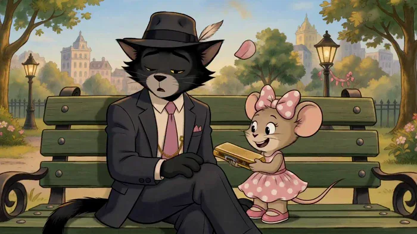</a>

▶ [在 ofox.ai 观看完整视频](https://ofox.ai/hailuo-3-prompts?utm_source=github&utm_medium=case&utm_campaign=awesome-ai-video-prompts#case-110)

<strong>Prompt</strong> — "[REFERENCE CONTROL] Use the uploaded PART 2 storyboard image for: “THE GENTLEMAN CAT AND THE LITTLE MOUSE’S BIG SURPRISE” as the STRICT PRIMARY visua…

~~~~text
"[REFERENCE CONTROL]

Use the uploaded PART 2 storyboard image for:

“THE GENTLEMAN CAT AND THE LITTLE MOUSE’S BIG SURPRISE”

as the STRICT PRIMARY visual, character, environment, prop, lighting, performance, scale, and narrative reference.

This video continues DIRECTLY from PART 1.

PART 1 ended with:

- Theo still sitting alone on the green City Park bench
- Theo’s golden harmonica still in his possession
- Theo believing he may not perform at the Sunset Music Festival
- Millie secretly gathering the blue bird, yellow bird, squirrel, pigeons, and friendly violinist
- the helpers quietly moving into position
- Theo remaining completely unaware
- Millie standing on the CITY PARK lamp-post base like a tiny conductor
- Millie raising one paw
- Millie whispering:
  <d>[English] Ready?</d>

PART 2 begins at that EXACT moment.

Generate a FINISHED cinematic animated sequence from the uploaded storyboard.

DO NOT animate or reproduce the storyboard sheet itself.

The finished video must NOT contain:

- storyboard borders
- panel numbers
- timestamps
- handwritten captions
- speech bubbles
- production notes
- reference drawings
- color swatches
- title/header
- page number
- storyboard paper texture
- labels
- subtitles

The uploaded storyboard locks:

1. Theo’s exact black-cat identity
2. Theo’s golden-yellow eyes
3. Theo’s elegant black fedora
4. fedora feather detail
5. charcoal gentleman suit
6. cream shirt
7. bright pink tie
8. matching pink pocket square
9. gold pocket chain
10. black-and-cream shoes
11. Theo’s lean gentleman proportions
12. Millie’s exact mouse identity
13. Millie’s beige/taupe fur
14. Millie’s large rounded ears
15. pink polka-dot bow
16. matching pink polka-dot dress
17. pink shoes
18. Theo/Millie size contrast
19. golden harmonica
20. green City Park bench
21. CITY PARK lamp post
22. festival poster
23. birds, squirrel and pigeons
24. friendly violinist
25. handmade surprise decoration
26. golden-hour park lighting
27. pastel city skyline
28. Part 2 harmonica-performance payoff
29. Theo inviting Millie to dance
30. final warm bench callback

Translate the storyboard’s fifteen 1-second panels into approximately:

# 8 COHERENT CINEMATIC SHOTS

Do NOT make 15 frantic one-second cuts.

Use this progression:

Millie gives signal
→ helpers reveal surprise
→ Theo realizes it is for him
→ Millie presents harmonica
→ Theo hesitates
→ Millie reassures him
→ Theo chooses to perform
→ first note
→ confidence grows
→ park begins listening
→ Theo invites Millie
→ tiny joyful dance
→ emotional bench ending.

==================================================
VIDEO GOAL
==================================================

Duration:

# EXACTLY 15 SECONDS

Story range:

PART 2 — 0:15 to 0:30

Aspect ratio:
16:9 landscape

Frame-rate feeling:
cinematic 24 fps

Visual medium:
premium hand-painted 2D storybook animation

Genre:
heartwarming musical friendship short

Tone:

- charming
- elegant
- funny
- sincere
- uplifting
- warm
- emotionally satisfying
- family-friendly

Dialogue:
natural synchronized English

Audio:
native dialogue + harmonica + violin + park ambience + cinematic music

CORE PAYOFF:

Theo does not suddenly become fearless.

Millie creates a place where he feels safe enough to TRY.

Theo plays one note.

Then another.

And slowly discovers that people actually want to hear him.

==================================================
PART 2 START / END
==================================================

START:

Millie lowers her conductor paw and launches her surprise.

Theo is still unaware.

END:

Theo and Millie are sitting together on the same green bench at sunset.

Theo’s harmonica is now proudly visible instead of hidden.

Theo tips his fedora toward Millie with a genuine smile.

Millie smiles back.

The story must feel COMPLETE.

No cliffhanger.

==================================================
CHARACTER IDENTITY LOCK — THEO
==================================================

Match PART 1 and the uploaded PART 2 storyboard EXACTLY.

THEO — THE GENTLEMAN CAT

Appearance:

- sleek charcoal-black / deep black fur
- soft gray muzzle
- small black feline nose
- clear whiskers
- triangular cat ears
- expressive golden-yellow eyes
- long black tail
- tall lean anthropomorphic proportions

CLOTHING:

- tailored charcoal suit jacket
- matching dark trousers
- cream dress shirt
- bright pink tie
- matching pink pocket square
- black fedora
- small feather tucked into hat
- subtle gold pocket chain
- polished black-and-cream shoes

Never change his clothes.

Never remove his fedora permanently.

PERSONALITY:

- refined
- charming
- dryly witty
- musically talented
- emotionally gentle
- outwardly composed
- secretly nervous

PART 2 PERFORMANCE ARC:

0–3 sec:
confused by sudden activity

3–5 sec:
surprised and emotionally touched

5–7 sec:
fear returns when he sees harmonica

7–9 sec:
decides to try

9–12 sec:
nervous musician → genuine confidence

12–14 sec:
open happiness

14–15 sec:
peaceful gratitude

CRITICAL:

Theo’s body language must tell the story.

At first:

tight shoulders,
ears slightly lowered,
harmonica held carefully.

As he plays:

shoulders loosen,
ears rise,
tail begins moving with rhythm,
eyes brighten,
smile becomes genuine.

==================================================
CHARACTER IDENTITY LOCK — MILLIE
==================================================

Match PART 1 EXACTLY.

MILLIE — THE LITTLE MOUSE

Appearance:

- tiny warm beige/taupe mouse
- very large circular ears
- soft pink inner ears
- large expressive dark eyes
- long eyelashes
- tiny black nose
- delicate whiskers
- thin mouse tail
- petite proportions

CLOTHING:

- large pink bow with white polka dots
- pink sleeveless polka-dot dress
- softly flared skirt
- pink Mary Jane shoes

Personality:

- cheerful
- observant
- supportive
- emotionally intelligent
- playful
- determined
- affectionate
- brave on behalf of her friend

PART 2 PERFORMANCE:

0–3 sec:
confident little organizer

3–5 sec:
excited surprise reveal

5–7 sec:
gentle reassurance

7–11 sec:
quiet supportive witness

11–14 sec:
pure joy

14–15 sec:
warmly satisfied

IMPORTANT:

Millie NEVER pressures Theo.

Her encouragement communicates:

“You don’t have to be perfect. We’re staying either way.”

==================================================
GOLDEN HARMONICA LOCK
==================================================

Match the storyboard EXACTLY.

Theo’s golden harmonica:

- small vintage rectangular harmonica
- warm polished brass
- fine engraved lines
- slightly worn sentimental edges
- metallic golden reflections

Only ONE harmonica exists.

Story continuity:

Start:
Theo still owns/holds it after Part 1.

Millie’s “giving it back” should be interpreted as her gently presenting/returning it into Theo’s hands after he has set it down or allowed her to hold it during the surprise setup.

Do NOT duplicate it.

It should move clearly:

Theo / nearby bench
→ Millie
→ Theo’s paws
→ Theo plays it
→ Theo keeps it at ending.

The harmonica symbolizes:

# confidence he had hidden.

==================================================
HELPER CHARACTER LOCK
==================================================

Use exactly the same supporting helpers established in Part 1.

BLUE BIRD:
small rounded blue bird.

YELLOW BIRD:
small yellow songbird.

SQUIRREL:
friendly brown squirrel with large fluffy tail.

PIGEONS:
small friendly gray park pigeons.

VIOLINIST:
friendly human park musician with warm approachable expression, violin and bow.

They support Theo.

They do NOT become main characters.

==================================================
SURPRISE SETUP
==================================================

The helpers transform the immediate bench area into a tiny homemade performance space.

Include:

- a small ribbon garland
- flower decorations
- modest bunting
- festival poster positioned clearly
- birds on branches / ribbons
- squirrel near flowers
- pigeons near path
- violinist nearby
- warm string lights beginning to glow

The setup should feel:

small,
handmade,
personal,
heartfelt.

NOT:

a giant stage,
arena,
concert venue,
expensive production.

The emotional idea is:

“A few people made one safe little place for Theo to try.”

==================================================
ENVIRONMENT CONTINUITY — CITY PARK
==================================================

Maintain the same City Park.

Use:

- green bench
- CITY PARK lamp post
- black iron fence
- large leafy trees
- flowers
- fountain
- pastel skyline
- park path
- Sunset Music Festival poster

LIGHTING PROGRESSION:

Part 1:
late afternoon.

Part 2:
late afternoon gradually becomes beautiful golden sunset.

By final shot:

- sky is peach-gold
- city windows softly glow
- lamp/park lights begin to illuminate
- leaves receive warm rim light
- Theo and Millie receive soft golden edge lighting

==================================================
WORLD / STORY LOGIC
==================================================

Millie gives signal
→ helpers begin setup.

Movement catches Theo’s attention
→ Theo turns.

Theo sees surprise
→ Millie reveals it is for him.

Millie presents harmonica
→ Theo becomes nervous.

Theo admits fear
→ Millie reassures him.

Theo chooses to try
→ prepares himself.

Theo takes breath
→ first note.

First note succeeds
→ confidence increases.

Music attracts park listeners
→ Theo realizes people enjoy hearing him.

Theo finishes phrase
→ invites Millie to celebrate.

They dance
→ story resolves.

==================================================
INTEGRATED_MULTIMODAL_DESCRIPTION
==================================================

[SHOT 1 — 0:00–0:01.8]
MILLIE GIVES THE SIGNAL

Continue EXACTLY from Part 1.

Millie stands on the safe low base of the CITY PARK lamp post.

One tiny paw is raised like a conductor.

Theo sits on the green bench with his back partly turned, still unaware.

Millie looks:

blue bird
→ yellow bird
→ squirrel
→ pigeons
→ violinist.

Everyone is waiting.

Millie whispers:

<d>[English] Now.</d>

She lowers her paw.

Immediately—but gently—

the helper plan begins.

The blue and yellow birds fly across frame carrying a small ribbon.

The squirrel places flowers beside the bench.

Two pigeons help pull open / reveal the handmade festival banner.

The violinist quietly moves into position.

CAMERA:

Millie low-angle hero close-up
→ follow lowering paw
→ smooth wide reveal of helpers beginning work.

SFX:

- wing flutters
- tiny squirrel footsteps
- fabric ribbon flutter
- gentle pigeon coos
- violin bow being readied

MUSIC:

Part 1 secret-mission motif begins resolving into warmer music.

==================================================
[SHOT 2 — 0:01.8–0:03.4]
THEO FINALLY NOTICES

Theo’s ear twitches.

He hears:

flutter,
tiny footsteps,
soft violin tuning.

He slowly turns his head.

A single pink flower petal lands on the brim of his black fedora.

Theo looks up at it.

Confused.

He turns fully around.

Camera follows his gaze.

Reveal:

Millie standing proudly in front of the handmade surprise.

Small decorations surround the bench.

Birds perched above.

Squirrel holding a flower.

Pigeons nearby.

Violinist smiling in the background.

Millie opens both arms.

Millie:

<d>[English] Surprise!</d>

Small pause.

<d>[English] This is for you.</d>

Theo’s golden eyes widen.

His usual composed expression disappears.

==================================================
[SHOT 3 — 0:03.4–0:05.0]
THE GOLDEN HARMONICA

Move into an intimate close composition.

Millie carefully holds the golden harmonica with BOTH tiny paws.

Because she is so small, the harmonica looks large in her hands.

She lifts it toward Theo.

Theo slowly bends/lower himself enough to receive it.

He looks:

Millie
→ harmonica
→ little surprise setup.

His ears lower slightly.

His expression becomes vulnerable.

Theo takes the harmonica gently.

Dialogue:

Theo:
<d>[English] Millie...</d>

Millie smiles.

Theo:
<d>[English] You did all this?</d>

Millie gives tiny proud nod.

<d>[English] We did.</d>

The squirrel gives a tiny wave behind her.

Small warm comedy beat.

==================================================
[SHOT 4 — 0:05.0–0:06.8]
“WHAT IF I MESS UP?”

Theo looks down at the harmonica.

His thumb / paw lightly traces its worn edge.

The park ambience softens.

Camera moves closer.

Theo glances toward the small group watching.

He becomes nervous again.

Dialogue:

Theo:
<d>[English] What if I mess up?</d>

Millie looks genuinely surprised by the question.

Then smiles softly.

She steps closer.

Millie:

<d>[English] Then we’ll still be here.</d>

HOLD the two-character eye contact for a fraction of a second.

This is the emotional heart of Part 2.

Theo’s golden eyes soften.

No melodrama.

No crying.

Just understanding.

==================================================
[SHOT 5 — 0:06.8–0:08.4]
THEO DECIDES TO TRY

Theo slowly stands.

His posture is still slightly nervous.

Then his familiar gentleman ritual returns:

he straightens his pink tie.

Smooths the front of his suit.

Adjusts his jacket.

Tips the brim of his fedora.

Deep breath.

Millie watches from below with a giant proud smile.

The violinist raises the violin into playing position.

Theo looks at Millie.

Millie nods once.

Theo:

<d>[English] All right.</d>

Tiny pause.

<d>[English] One song.</d>

Millie immediately:

<d>[English] One song.</d>

Her smile says she knows this will be enough.

==================================================
[SHOT 6 — 0:08.4–0:10.4]
ONE BREATH — THE FIRST NOTE

CLOSE-UP.

Theo raises the golden harmonica.

His eyes close.

One visible slow breath.

The whole soundtrack briefly becomes quiet.

Then—

Theo plays ONE soft harmonica note.

Warm, clean, slightly jazzy.

A subtle golden musical line curls through the air.

The violinist joins with one gentle supporting note.

Theo opens one eye.

The note sounded good.

Millie’s face lights up.

Theo plays a second phrase.

Longer.

Smoother.

His shoulders begin relaxing.

His ears lift.

His tail starts moving subtly with the beat.

CAMERA:

harmonica close-up
→ Theo face
→ Millie reaction
→ slow widening as violin joins.

No flashy magical effects.

Musical notes can be subtle stylized visual accents only.

==================================================
[SHOT 7 — 0:10.4–0:12.6]
EVERY NOTE BRINGS CONFIDENCE BACK

The music builds into a warm playful jazz melody.

Theo now plays with genuine rhythm.

His posture transforms naturally.

Before:
stiff.

Now:
comfortable.

His eyes become expressive.

Tail lightly sways.

One shoe taps the rhythm.

Millie sways happily.

Birds bob their heads.

The squirrel gently moves with the beat.

Pigeons listen.

Nearby park visitors begin stopping.

Do NOT suddenly create a huge crowd.

Just a few warm smiling listeners.

The golden sunset becomes richer.

Camera performs a gentle side track around Theo and Millie.

Music carries the scene.

No dialogue necessary.

The visual should communicate:

Theo has forgotten to worry about being judged.

==================================================
[SHOT 8 — 0:12.6–0:15.0]
THEO’S SURPRISE — DANCE + FINAL BENCH CALLBACK

Theo finishes a short satisfying harmonica phrase.

Soft applause begins.

He lowers the harmonica.

For the first time:

Theo gives a completely genuine, open smile.

He looks down at Millie.

Extends one elegant paw.

Theo:

<d>[English] May I?</d>

Millie’s eyes widen.

She grins.

<d>[English] Absolutely!</d>

Theo gently lowers his paw.

Millie places her tiny hand in it.

Theo guides her into ONE small playful spin.

Millie’s pink polka-dot skirt flares beautifully.

Theo laughs.

Not his stylish gentleman chuckle—

a real laugh.

The helper team applauds.

The violinist finishes with a warm flourish.

Use a fast but elegant MATCH TRANSITION into the final emotional composition.

SAME GREEN BENCH.

Now golden sunset / early evening.

Theo and Millie are sitting together again.

Theo’s posture is relaxed.

His golden harmonica rests visibly in one paw / beside him rather than hidden in his suit.

Millie sits close enough to feel like a trusted friend.

Warm park lights glow.

The pastel skyline catches sunset.

Blue bird and squirrel remain nearby.

Theo looks toward Millie.

He tips his fedora gently.

Theo:

<d>[English] Thank you.</d>

Millie:

<d>[English] Same time tomorrow?</d>

Theo looks at the harmonica.

Then smiles.

<d>[English] Maybe two songs.</d>

Millie beams.

Camera slowly pulls backward.

The two become smaller against the warm City Park.

A few soft musical notes linger.

FADE TO BLACK.

END STORY.

==================================================
AUDIO DESCRIPTION
==================================================

Generate synchronized native stereo audio.

Audio should feel:

- warm
- elegant
- musical
- playful
- natural
- emotionally sincere
- cinematic

==================================================
THEO VOICE
==================================================

Adult male anthropomorphic-cat voice.

Qualities:

- smooth
- refined
- warm
- calm
- soft vintage-jazz personality
- understated emotion
- never theatrical or threatening

Beginning:
confused and touched.

Middle:
quietly vulnerable.

Performance:
focused.

Ending:
genuinely relaxed.

Important lines:

<d>[English] You did all this?</d>

Deliver with surprise and emotion.

<d>[English] What if I mess up?</d>

Do NOT sound childish.

It should feel like a sincere admission from someone who usually hides uncertainty.

Final:

<d>[English] Maybe two songs.</d>

Use warm dry humor.

==================================================
MILLIE VOICE
==================================================

Young feminine mouse voice.

Qualities:

- bright
- gentle
- cheerful
- warm
- encouraging
- emotionally sincere
- energetic but not shrill

Critical line:

<d>[English] Then we’ll still be here.</d>

Deliver calmly.

Do NOT oversell emotion.

That simple certainty is what affects Theo.

Final:

<d>[English] Same time tomorrow?</d>

playful and optimistic.

==================================================
VIOLIN AUDIO
==================================================

The violinist should support Theo.

Do NOT overpower the harmonica.

Progression:

first harmonica note
→ gentle violin sustained note

second phrase
→ soft countermelody

main performance
→ warm supportive accompaniment

dance
→ slightly brighter flourish

Ending:
soft resolved violin note.

==================================================
HARMONICA PERFORMANCE
==================================================

The harmonica is the central musical instrument.

Sound:

- warm
- jazzy
- melodic
- expressive
- intimate
- slightly vintage

First note:
tentative but clean.

Second phrase:
more confident.

By main performance:
rich, playful melody.

Do NOT make Theo instantly sound like a massive concert virtuoso.

The emotional point is:

he starts cautiously and grows into it.

==================================================
PARK HELPER AUDIO
==================================================

Birds:
soft cheerful chirping.

Squirrel:
small happy chatter.

Pigeons:
gentle coos.

Applause:
warm and modest.

No screaming crowd.

No massive cheering stadium.

==================================================
ENVIRONMENT AUDIO
==================================================

Maintain City Park atmosphere:

- gentle wind
- leaves
- distant fountain
- quiet city background
- footsteps
- birds
- subtle park ambience

As music begins:

reduce ambient distractions slightly.

At ending:

restore:
fountain,
wind,
night birds,
soft city ambience.

==================================================
NON-DIEGETIC MUSIC
==================================================

Create an ORIGINAL warm cinematic jazz-storybook score.

Instrumentation:

- piano
- upright bass
- brushed drums
- clarinet
- pizzicato strings
- vibraphone
- subtle acoustic guitar
- warm strings
- harmonica integrated diegetically
- violin integrated diegetically

MUSIC ARC:

0:00–0:02
secret plan resolves into surprise motif.

0:02–0:04
warm emotional reveal.

0:04–0:06.8
music becomes sparse during Theo’s vulnerability.

0:06.8–0:08.4
gentle hopeful rise.

0:08.4–0:10.4
music nearly disappears for first harmonica note.

0:10.4–0:12.6
full warm jazz groove develops.

0:12.6–0:14
joyful dance flourish.

0:14–0:15
return to the SAME melody from Part 1 opening, now fuller and emotionally resolved.

No giant orchestral trailer music.

==================================================
CAMERA LANGUAGE
==================================================

PART 2 camera should evolve from:

playful preparation
→ intimate emotional close-ups
→ musical freedom
→ peaceful final closure.

Use:

- gentle tracking
- eye-level character coverage
- over-the-shoulder compositions
- close harmonica inserts
- rack focus
- slow push-ins
- subtle orbit during performance
- clean wide sunset park views
- low scale framing for Millie
- final slow pull-back

Avoid:

- shaky handheld
- crash zoom
- chaotic whip-pan
- excessive motion blur
- extreme fisheye
- Dutch angles
- 360-degree camera spins

The camera becomes MORE relaxed as Theo becomes more confident.

==================================================
VISUAL STYLE
==================================================

Premium finished hand-painted 2D storybook animation.

MATCH PART 1 EXACTLY.

Use:

- clean hand-drawn ink contours
- watercolor / gouache-inspired fills
- expressive faces
- softly stylized fur
- hand-painted city backgrounds
- gentle vintage cartoon charm
- subtle cinematic depth
- warm sunset lighting
- natural cloth animation
- controlled squash-and-stretch
- painterly shadows
- soft film texture

The result should look like:

THE UPLOADED STORYBOARD ART CAME TO LIFE.

NOT:

- storyboard animatic
- slideshow
- motion comic
- live-action animals
- photorealistic cat/mouse
- generic 3D CGI
- hyper-real fur
- anime
- horror

==================================================
COLOR / LIGHTING ARC
==================================================

OPENING:

late afternoon.

Colors:

- spring green
- sky blue
- pastel beige
- light city pink
- flower colors

THEO:

- deep charcoal
- cream
- bright pink tie
- golden eyes

MILLIE:

- warm beige
- soft pink
- white polka dots

HARMONICA:

warm polished gold.

As Theo begins playing:

transition lighting toward:

- honey gold
- amber
- peach
- soft sunset orange

FINAL SHOT:

- golden sunset
- warm park lamps
- soft amber skyline windows
- cool green shadows
- subtle pink sky accents

Faces remain bright and readable.

==================================================
MOTION RULES — THEO
==================================================

Before playing:

- small ear movements
- slightly tense shoulders
- controlled paw gestures
- careful harmonica handling

Preparing:

tie straightening
→ suit adjustment
→ fedora tip
→ breath.

Playing:

hands stable,
head gently moves with melody,
tail gains rhythm,
shoulders loosen.

Dance invitation:

slow elegant paw extension.

Final:

fully relaxed seated posture.

==================================================
MOTION RULES — MILLIE
==================================================

Use:

- energetic conductor motion
- tiny proud steps
- careful two-paw harmonica presentation
- gentle reassuring expression
- excited sway to music
- believable small spin during dance
- dress/skirt secondary movement
- bow remains stable

Millie must remain tiny relative to Theo.

==================================================
DANCE SAFETY / MOTION
==================================================

Keep the dance:

- gentle
- wholesome
- brief
- playful
- family-friendly

Theo extends one paw.

Millie takes it.

Theo gently raises his hand enough for Millie to turn once beneath it.

No lifting Millie high into the air.

No throwing.

No acrobatics.

No romantic kiss.

The moment should read as:

celebratory friendship.

==================================================
CONTINUITY RULES
==================================================

Maintain exactly:

ONE Theo.
ONE Millie.
ONE golden harmonica.

Same:

- Theo face
- Theo black fur
- golden eyes
- black fedora
- pink tie
- suit
- Millie face
- bow
- dress
- shoes
- relative scale
- park bench
- CITY PARK lamp post
- skyline
- helper designs
- festival poster
- violinist

Harmonica progression must remain physically logical.

Do NOT duplicate it.

Once Theo begins playing:
keep harmonica with Theo.

Final bench:
harmonica must remain visible.

==================================================
...
~~~~

**参数**：MiniMax H3 · 未标注 · ref2va · 15s · 未标注 · 未标注 · 带音频
**来源**：@ManuAGI01 · [原帖](https://x.com/ManuAGI01/status/2086426551114215889)

Preview © 2026 @ManuAGI01 · Prompt by @ManuAGI01

[回到目录](#table-of-contents)

### Case 111: The Gentleman Cat and Little Mouse Surprise · Part 1 (绅士猫与小老鼠的惊喜 · 上篇) — by @ManuAGI01

<a href="https://ofox.ai/hailuo-3-prompts?utm_source=github&utm_medium=case&utm_campaign=awesome-ai-video-prompts#case-111">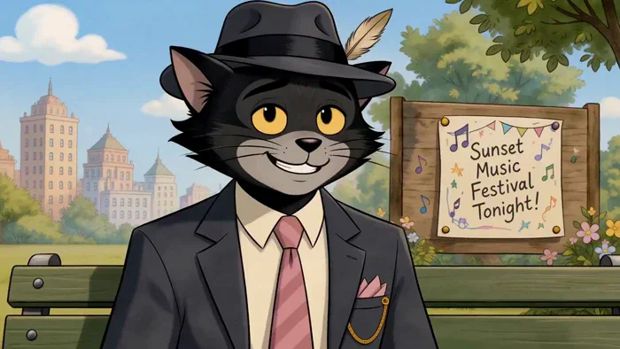</a>

▶ [在 ofox.ai 观看完整视频](https://ofox.ai/hailuo-3-prompts?utm_source=github&utm_medium=case&utm_campaign=awesome-ai-video-prompts#case-111)

<strong>Prompt</strong> — "[REFERENCE CONTROL] Use the uploaded PART 1 storyboard image for: “THE GENTLEMAN CAT AND THE LITTLE MOUSE’S BIG SURPRISE” as the STRICT PRIMARY visua…

~~~~text
"[REFERENCE CONTROL]

Use the uploaded PART 1 storyboard image for:

“THE GENTLEMAN CAT AND THE LITTLE MOUSE’S BIG SURPRISE”

as the STRICT PRIMARY visual reference for the finished video.

The uploaded storyboard controls:

- Theo’s exact face and body identity
- Theo’s black fur
- Theo’s yellow-gold eyes
- Theo’s black fedora and feather detail
- Theo’s charcoal gentleman suit
- Theo’s cream shirt
- Theo’s bright pink tie and pocket square
- Theo’s black tail
- Theo’s black-and-cream dress shoes
- Millie’s exact mouse identity
- Millie’s warm beige fur
- Millie’s large round ears
- Millie’s pink polka-dot bow
- Millie’s pink polka-dot dress
- Millie’s pink shoes
- Theo/Millie size relationship
- golden harmonica design
- green park bench
- CITY PARK lamp post
- Sunset Music Festival poster
- blue and yellow birds
- squirrel
- pigeons
- friendly violinist
- flowerbeds
- pastel city skyline
- park lighting
- entire Part 1 story progression

Generate a FINISHED cinematic animation from the storyboard.

DO NOT animate the storyboard page itself.

The final video must NOT contain:

- storyboard borders
- numbered panels
- timestamps
- handwritten captions
- production notes
- reference drawings
- title/header
- page number
- white storyboard-paper background
- color swatches
- annotation boxes
- subtitles
- speech bubbles

Translate the 15 storyboard panels into approximately:

# 8 COHERENT CINEMATIC SHOTS

Do NOT create 15 rapid one-second cuts.

The cinematic progression should feel like:

peaceful park introduction
→ Theo’s hidden nervousness
→ harmonica reveal
→ Millie understands
→ big idea
→ secret mission
→ helper recruitment
→ Theo remains unaware
→ Millie gives the signal
→ cliffhanger.

==================================================
VIDEO GOAL
==================================================

Duration:
EXACTLY 15 seconds

Story range:
PART 1 — 0:00 to 0:15

Aspect ratio:
16:9 landscape

Frame-rate feeling:
cinematic 24 fps

Visual medium:
premium polished 2D storybook animation

Genre:
heartwarming city-park comedy / friendship story

Tone:

- charming
- stylish
- sweet
- warm
- lightly funny
- emotionally sincere
- wholesome

Audience:
family-friendly

Dialogue:
native synchronized English dialogue

Audio:
native character dialogue + park ambience + harmonica motif + original cinematic music

CORE PART 1 IDEA:

Theo looks like the coolest gentleman in the park...

but he is secretly afraid to perform.

Millie notices.

And decides to do something about it.

==================================================
PART 1 STORY LIMIT
==================================================

PART 1 ONLY.

START:

Theo and Millie sit together on the green City Park bench during a beautiful late afternoon.

END:

Millie raises one tiny paw and silently signals her secret helper team.

Theo is still turned away and has NO IDEA what is about to happen.

CUT TO BLACK.

DO NOT show:

- finished surprise stage
- Theo receiving the harmonica from Millie
- Theo accepting the surprise
- evening festival performance
- Theo actually playing the harmonica publicly
- audience gathering
- Millie dancing with Theo
- applause
- emotional final bench scene

Save ALL payoff for PART 2.

==================================================
CHARACTER IDENTITY LOCK — THEO
==================================================

Match the uploaded storyboard EXACTLY.

THEO — THE GENTLEMAN CAT

Anthropomorphic adult black cat gentleman.

Appearance:

- sleek charcoal-black / black fur
- lighter gray muzzle area
- small rounded black nose
- long feline whiskers
- triangular black ears with subtle warm inner-ear tones
- expressive golden-yellow eyes
- elegant eyelids
- soft cheek fur
- long black tail
- tall, lean, sophisticated proportions

OUTFIT:

- fitted charcoal-black suit jacket
- matching dark trousers
- cream / ivory dress shirt
- bright pink necktie
- matching pink pocket square
- black fedora
- small feather tucked into fedora band
- black-and-cream polished dress shoes
- subtle gold waist / pocket chain

DO NOT change:

- suit
- hat
- tie color
- fur color
- eye color
- proportions
- facial structure

PERSONALITY:

Outwardly:

- stylish
- smooth
- controlled
- gentlemanly
- confident-looking

Internally:

- shy
- thoughtful
- nervous about performing
- emotionally guarded
- sensitive

PART 1 PERFORMANCE ARC:

0–3 sec:
relaxed gentleman exterior

3–6 sec:
festival poster triggers nervousness

6–8 sec:
brief harmonica hesitation

8–10 sec:
quietly withdrawn

10–15 sec:
still unaware that Millie is organizing help

CRITICAL:

Theo should never become melodramatically sad.

His emotion is subtle:

a small sigh,
lowered eyelids,
hesitation,
looking away,
hiding the harmonica.

==================================================
CHARACTER IDENTITY LOCK — MILLIE
==================================================

Match storyboard EXACTLY.

MILLIE — THE LITTLE MOUSE

Appearance:

- tiny anthropomorphic mouse girl
- warm beige / light taupe fur
- very large rounded mouse ears
- soft pink inner ears
- large expressive dark eyes
- long eyelashes
- tiny black nose
- fine whiskers
- thin mouse tail
- petite cute proportions

OUTFIT:

- large pink bow with white polka dots
- sleeveless pink dress
- white polka-dot pattern
- gently flared skirt
- pink Mary Jane-style shoes

Scale:

Millie is considerably smaller than Theo.

Maintain this exact scale in every shot.

PERSONALITY:

- cheerful
- observant
- imaginative
- compassionate
- enthusiastic
- playful
- determined
- quietly clever

PART 1 PERFORMANCE ARC:

0–3 sec:
happy admiration

3–6 sec:
notices Theo is distracted

6–8 sec:
realizes his secret

8–10 sec:
big idea

10–14 sec:
energetic secret organizer

14–15 sec:
tiny confident conductor / mission leader

==================================================
KEY PROP LOCK — GOLDEN HARMONICA
==================================================

Match storyboard exactly.

Appearance:

- small vintage golden harmonica
- polished brass/gold finish
- subtle engraved lines
- compact rectangular shape
- sentimental appearance

It belongs to Theo.

PART 1 use:

Theo carefully pulls it halfway from inside his suit.

He looks at it.

Hesitates.

Then quietly holds / hides it again.

IMPORTANT:

Millie may SEE the harmonica.

She does NOT take it during Part 1.

It remains Theo’s possession.

No public harmonica playing yet.

==================================================
ENVIRONMENT LOCK — CITY PARK
==================================================

Match storyboard closely.

Beautiful classic urban park in warm late afternoon.

Include:

- green wooden park bench
- black iron armrests / frame
- black vintage lamp post
- readable small CITY PARK sign
- black iron fence
- large leafy green trees
- flowerbeds with pink, yellow and white flowers
- park path
- distant fountain area
- pastel city skyline
- soft blue sky
- fluffy white clouds

Architecture:

soft pastel beige,
pale yellow,
pink,
muted city colors.

No modern advertising.

No vehicles dominating the composition.

No gloomy weather.

==================================================
SUNSET MUSIC FESTIVAL POSTER LOCK
==================================================

Match storyboard.

A handmade cheerful poster located near the park.

Readable central wording:

“SUNSET MUSIC FESTIVAL TONIGHT!”

Decoration:

- music notes
- small stars
- colorful bunting
- hand-painted festival style

The poster is an important story clue.

Do not make it look like a commercial advertisement.

==================================================
TINY HELPER LOCK
==================================================

Use the same helper designs shown in the storyboard.

Helpers include:

BLUE BIRD:
small round blue songbird,
orange/yellow beak.

YELLOW BIRD:
small warm yellow songbird.

SQUIRREL:
friendly brown squirrel,
large fluffy tail.

PIGEONS:
small gray city pigeons.

VIOLINIST:
friendly adult park musician,
simple neutral clothing,
holding violin and bow.

The helpers are friendly and supportive.

No dialogue required from animals.

The violinist can acknowledge Millie with a smile/nod.

==================================================
PART 1 SURPRISE LOGIC
==================================================

Millie must keep the surprise hidden from Theo.

Theo should NOT notice the helpers gathering.

Visual logic:

Theo looks toward festival poster
→ reveals harmonica
→ hesitates
→ Millie understands

Millie gets idea
→ quietly leaves bench

Millie recruits birds
→ squirrel
→ pigeons
→ violinist

helpers understand her plan
→ move into position

Theo still believes he is alone with his problem

Millie gives signal

CUT.

==================================================
INTEGRATED_MULTIMODAL_DESCRIPTION
==================================================

[SHOT 1 — 0:00–0:02]
A STYLISH AFTERNOON IN CITY PARK

Open with a beautiful wide cinematic view matching Storyboard Panel 1.

Bright blue sky.

Soft white clouds.

Green trees frame the image.

Pastel city buildings rise behind the park.

Flowers line the walkway.

The camera glides gently toward the familiar green bench.

THEO sits elegantly on the left side.

His legs are crossed.

One elbow rests against the bench.

His fedora sits perfectly angled.

MILLIE sits beside him on the right.

She faces Theo with an excited smile.

Theo subtly adjusts his bright pink tie.

Millie beams at him.

Dialogue:

Millie:
<d>[English] You look very fancy today.</d>

Theo gives a smooth little smile.

Theo:
<d>[English] Naturally.</d>

He lightly touches the brim of his fedora.

Millie giggles.

CAMERA:

wide park establishing
→ gentle dolly toward bench
→ medium two-shot.

AUDIO:

- soft park birds
- distant city ambience
- leaves moving
- quiet footsteps in distance
- faint fountain
- flower/grass breeze

MUSIC:

light original jazz-storybook theme:

- upright bass
- brushed percussion
- clarinet
- gentle piano
- pizzicato strings

The scene should initially feel carefree.

==================================================
[SHOT 2 — 0:02–0:03.8]
SOMETHING FEELS OFF

Move into a closer Theo/Millie composition.

Theo maintains his confident smile.

Then his golden eyes drift away from Millie.

Rack focus toward the nearby festival poster.

“SUNSET MUSIC FESTIVAL TONIGHT!”

Theo’s expression changes very subtly.

His eyelids lower.

His smile fades just a little.

Millie continues talking for a beat...

then notices he is no longer listening.

Millie:

<d>[English] Theo?</d>

Theo quickly looks back.

Theo:

<d>[English] Hmm?</d>

He forces his small gentleman smile again.

Camera:

Theo close-up
→ eye direction
→ rack focus to poster
→ return to Theo.

Music removes some playful notes.

A small unresolved piano chord enters.

==================================================
[SHOT 3 — 0:03.8–0:05.8]
THE GOLDEN HARMONICA

Close on Theo’s suit.

His black paw slowly reaches inside his jacket.

He pulls out the small GOLDEN HARMONICA.

Warm sunlight glints across its brass surface.

Theo looks at it.

For a tiny moment:

he imagines performing.

His ears lift slightly.

Then distant festival music / rehearsal sound reaches him.

Theo becomes nervous.

His ears lower slightly.

He begins putting the harmonica away.

Millie sees everything.

Dialogue:

Millie, softly:
<d>[English] You were going to play tonight?</d>

Theo pauses.

He avoids her gaze.

Theo:

<d>[English] I was thinking about it.</d>

He slips the harmonica carefully back toward his pocket.

Theo, quieter:

<d>[English] Maybe another time.</d>

IMPORTANT:

No big sad performance.

Keep it restrained and sincere.

==================================================
[SHOT 4 — 0:05.8–0:07.4]
MILLIE UNDERSTANDS

Close-up on Millie.

She looks:

Theo
→ harmonica pocket
→ festival poster
→ Theo again.

Her happy expression becomes concerned.

Then thoughtful.

One finger touches her chin.

Theo looks away toward the city, trying to seem casual.

Millie’s eyes suddenly brighten.

Tiny visual idea sparkle beside her bow.

She smiles.

Dialogue:

Millie, almost whispering:
<d>[English] Hmm...</d>

Tiny pause.

<d>[English] I have an idea.</d>

Theo is still looking away.

He does NOT hear her clearly.

Music introduces a mischievous tiny plucked-string motif.

==================================================
[SHOT 5 — 0:07.4–0:09.0]
THE SECRET MISSION BEGINS

Theo remains seated on the bench.

His chin rests lightly against one paw.

He looks toward the distant festival area.

Behind him:

Millie quietly climbs down from the bench.

She puts one finger to her lips:

“shhh.”

She tiptoes past the flowers.

Her polka-dot skirt bounces gently.

Her tail follows naturally.

Theo remains unaware.

CAMERA:

medium Theo foreground
→ Millie slipping down behind him
→ low tiny tracking shot following Millie.

Millie whispers to herself:

<d>[English] Quietly...</d>

Sound:

- tiny shoe taps
- dress rustle
- leaves
- park ambience

==================================================
[SHOT 6 — 0:09.0–0:11.0]
FIRST, THE TINY HELPERS

Millie reaches a tree.

A BLUE BIRD and YELLOW BIRD sit together on a branch.

She waves them closer.

Millie gestures toward Theo.

Then mimics:

playing music.

Then points toward the festival poster.

The birds tilt their heads.

Millie clasps her paws:

please?

The blue bird chirps.

The yellow bird chirps back.

Both nod enthusiastically.

Millie smiles.

Then she turns and finds the friendly SQUIRREL in the flowerbed.

She whispers:

<d>[English] I need your help too.</d>

The squirrel looks toward Theo.

Then back to Millie.

He salutes with one tiny paw.

Use cute visual comedy.

CAMERA:

Millie with birds
→ bird reaction close-ups
→ quick flowing transition to squirrel
→ Millie delighted reaction.

No frantic cutting.

==================================================
[SHOT 7 — 0:11.0–0:13.2]
THE PLAN GETS BIGGER

Create one flowing helper-gathering sequence.

Millie walks briskly toward the fountain.

Two / three pigeons turn toward her.

She makes a tiny directing gesture.

They follow.

Then she notices the friendly VIOLINIST nearby.

He is casually practicing.

Millie approaches.

She points:

toward Theo,
toward harmonica pocket area,
toward festival poster.

Then presses her paws together hopefully.

The violinist understands.

He looks toward Theo.

Smiles warmly.

Nods.

Millie turns around.

Behind her:

birds,
squirrel,
pigeons,
violinist

are now a tiny secret team.

Millie’s eyes widen with happy surprise at how many helpers she has gathered.

Dialogue:

Millie, whispered:
<d>[English] Okay... this got bigger.</d>

Small humorous music accent.

==================================================
[SHOT 8 — 0:13.2–0:15.0]
THE SURPRISE IS READY — CLIFFHANGER

Intercut emotional contrast smoothly.

THEO:

still sits on the bench.

His posture is elegant but slightly slumped.

He looks down toward his pocket.

One paw rests over the hidden harmonica.

He quietly sighs.

Theo murmurs:

<d>[English] Maybe next year.</d>

DO NOT make him cry.

CUT / FLOW BEHIND HIM:

Millie and the helpers quietly move into position.

- birds perch above
- squirrel waits beside flowers
- pigeons line up near the path
- violinist stands ready
- everyone watches Millie

Millie climbs onto the low base of the CITY PARK lamp post / safe bench edge.

She becomes a tiny conductor.

She looks at every helper.

They become still.

Millie glances toward Theo.

He is turned away.

Perfect.

Millie raises one tiny paw dramatically.

Hold.

Her expression:

determined
+
excited
+
loving.

Music reduces to a playful suspense pulse.

No one starts the surprise yet.

Millie whispers:

<d>[English] Ready?</d>

The blue bird gives a tiny nod.

The squirrel nods.

The violinist raises his bow slightly.

Millie begins lowering her paw—

CUT TO BLACK BEFORE THE SURPRISE STARTS.

END PART 1.

==================================================
AUDIO DESCRIPTION
==================================================

Generate synchronized native stereo audio.

The soundscape should feel:

- warm
- natural
- whimsical
- cinematic
- heartfelt
- lightly jazzy

==================================================
THEO VOICE
==================================================

Adult male voice.

Qualities:

- warm
- smooth
- refined
- understated
- charming
- gentle
- slightly jazzy/vintage personality
- never threatening

His confidence early should sound natural.

His nervousness should be subtle.

Important emotional dialogue:

<d>[English] I was thinking about it.</d>

Then:

<d>[English] Maybe another time.</d>

Final:

<d>[English] Maybe next year.</d>

These should sound reflective, not dramatically depressed.

==================================================
MILLIE VOICE
==================================================

Young feminine mouse voice.

Qualities:

- bright
- warm
- cheerful
- energetic
- sincere
- expressive
- slightly higher pitch than Theo

Do NOT make it shrill.

Her emotional progression:

happy
→ curious
→ concerned
→ thoughtful
→ inspired
→ playful secret organizer.

Important:

<d>[English] I have an idea.</d>

should be soft but excited.

Final:

<d>[English] Ready?</d>

should be whispered with delighted anticipation.

==================================================
HELPER AUDIO
==================================================

BIRDS:

soft cheerful chirps.

SQUIRREL:

tiny harmless squeaks / chatter.

PIGEONS:

gentle coos.

VIOLINIST:

very short natural violin warm-up tones.

No speaking dialogue required.

==================================================
PARK AMBIENCE
==================================================

Use:

- soft breeze
- leaves
- distant fountain
- birds
- subtle city ambience
- occasional distant footstep
- light iron-fence / bench environmental resonance
- flowerbed insects if subtle

No loud traffic.

No horns.

No urban noise dominating the story.

==================================================
HARMONICA SOUND
==================================================

IMPORTANT:

Theo does NOT perform publicly during Part 1.

When the harmonica is revealed:

use only a very small metallic handling sound.

Optionally:

a single extremely faint memory-like harmonica note can appear NON-DIEGETICALLY in the score.

Do NOT show Theo playing it.

==================================================
NON-DIEGETIC MUSIC
==================================================

Create an ORIGINAL warm jazz-storybook score.

Instrumentation:

- soft upright bass
- brushed snare
- gentle piano
- clarinet
- muted trumpet used very lightly
- pizzicato strings
- acoustic guitar
- subtle vibraphone
- tiny glockenspiel for Millie’s idea

MUSIC ARC:

0:00–0:02
charming city-park jazz.

0:02–0:04
slight uncertainty as Theo looks at poster.

0:04–0:06
soft emotional harmonica motif.

0:06–0:08
gentle emotional pause.

0:08–0:10
Millie’s playful idea motif.

0:10–0:13
light sneaky/helper rhythm.

0:13–0:15
warm suspense build.

CUT music just before surprise begins.

No sad orchestral melodrama.

No huge trailer music.

==================================================
CAMERA LANGUAGE
==================================================

PART 1 camera should evolve from:

relaxed
→ intimate
→ emotionally observant
→ playful secret-mission energy.

Use:

- wide park establishment
- gentle dolly
- medium two-shots
- close facial acting
- rack focus
- prop insert
- low tiny-character tracking with Millie
- helper reaction close-ups
- shallow depth emphasis
- final wide bench + helper composition

Avoid:

- handheld shake
- crash zoom
- frantic editing
- excessive whip pans
- extreme fisheye
- 360 camera
- action-style camera

The overall camera should remain graceful.

==================================================
VISUAL STYLE
==================================================

Premium finished hand-painted 2D storybook/cartoon animation.

Match the uploaded storyboard in spirit.

Use:

- clean expressive ink contours
- watercolor / gouache-inspired fills
- subtle textured shading
- beautiful park background painting
- soft sunlight
- stylized animal fur
- expressive eyes
- controlled squash-and-stretch
- cinematic atmospheric depth
- elegant vintage styling
- subtle film grain / paper-paint texture if appropriate

The animation should feel like:

THE STORYBOARD ART HAS COME TO LIFE.

NOT:

- storyboard animatic
- motion comic
- slideshow
- photorealistic animals
- live-action animals
- generic 3D CGI
- horror
- hyperreal fur simulation

==================================================
COLOR / LIGHTING
==================================================

Primary palette:

THEO:
- charcoal black
- warm gray muzzle
- cream shirt
- pink tie
- pink pocket square
- golden-yellow eyes

MILLIE:
- beige / taupe
- soft pink
- white polka dots
- warm ear pink

PARK:
- spring green
- sky blue
- pastel city beige/pink/yellow
- flower pink/yellow/white
- black lamp/fence accents

Lighting:

warm late afternoon sunlight.

Use:

- soft golden side light
- gentle cool sky fill
- natural shadow under bench
- bright readable faces

By final shot:

introduce slightly warmer golden tones to foreshadow the sunset festival.

==================================================
MOTION RULES — THEO
==================================================

Theo’s movements are refined.

Use:

- slow tie adjustment
- relaxed leg crossing
- tiny fedora touch
- subtle eye movement
- controlled harmonica reveal
- small ear changes
- gentle tail movement
- restrained sigh

Avoid exaggerated cartoon nervousness.

The emotion is in:

eyes,
ears,
hands,
posture.

==================================================
MOTION RULES — MILLIE
==================================================

Millie is energetic but believable.

Use:

- small enthusiastic hand gestures
- light bouncing steps
- gentle skirt secondary motion
- tiny tiptoeing
- expressive ear movement
- quick turns
- thoughtful chin-touch
- subtle “idea” pose
- conductor-like final signal

Her bow must stay attached and maintain exact shape.

==================================================
SIZE / SCALE RULES
==================================================

Theo is substantially larger than Millie.

Maintain consistent relative scale.

When seated:

Millie occupies a much smaller portion of the bench.

Theo’s harmonica is comfortable in Theo’s paw but looks large relative to Millie.

Birds and squirrel should be approximately around Millie’s scale or somewhat smaller.

Do not make Millie suddenly human-sized.

==================================================
CONTINUITY RULES
==================================================

Maintain exactly:

ONE Theo.
ONE Millie.

Same:

- Theo face
- Theo hat
- Theo suit
- Theo pink tie
- Theo eye color
- Millie face
- Millie bow
- Millie dress
- Millie shoes
- relative scale
- green bench
- CITY PARK lamp
- festival poster
- city skyline
- flowerbeds
- golden harmonica

Helper characters should remain visually consistent once introduced.

Theo remains around the bench through Part 1.

Millie physically moves through the park to gather helpers.

No teleportation.

==================================================
EMOTIONAL PERFORMANCE PRIORITY
==================================================

This story works because Theo’s problem is SMALL and HUMAN:

He can play music.

He simply lacks confidence to share it publicly.

Millie does NOT mock him.

She does NOT steal the harmonica.

She does NOT force him to perform.

She notices his hesitation and quietly creates support.

Part 1 should make the audience think:

“Oh... she’s going to help him.”

without showing HOW yet.

==================================================
DIALOGUE TIMING PRIORITY
==================================================

15 seconds is short.

Use natural pacing.

If some dialogue must be removed, PRIORITIZE:

1.
Millie:
<d>[English] Theo?</d>

2.
Millie:
<d>[English] You were going to play tonight?</d>

3.
Theo:
<d>[English] Maybe another time.</d>

4.
Millie:
<d>[English] I have an idea.</d>

5.
Theo:
<d>[English] Maybe next year.</d>

6.
Millie:
<d>[English] Ready?</d>

Secondary lines may be omitted rather than spoken unnaturally fast.

==================================================
SAFETY / CONTENT RULES
==================================================

Keep all action safe and wholesome.

No violence.

No threatening behavior.

No weapons.

No fighting.

No dangerous park activity.

No romantic kissing.

No sexual behavior.

No disturbing imagery.

No bullying.

Theo’s suit and fedora represent an elegant gentleman musician only.

No crime/gangster framing.

==================================================
...
~~~~

**参数**：MiniMax H3 · 未标注 · ref2va · 15s · 未标注 · 未标注 · 带音频
**来源**：@ManuAGI01 · [原帖](https://x.com/ManuAGI01/status/2086426143612440739)

Preview © 2026 @ManuAGI01 · Prompt by @ManuAGI01

[回到目录](#table-of-contents)

### Case 126: The Little Strawberry Wakes the Pineapple King · Part 2 (小草莓唤醒菠萝王 · 下篇) — by @ManuAGI01

<a href="https://ofox.ai/hailuo-3-prompts?utm_source=github&utm_medium=case&utm_campaign=awesome-ai-video-prompts#case-126">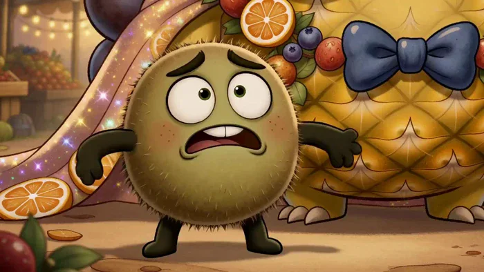</a>

▶ [在 ofox.ai 观看完整视频](https://ofox.ai/hailuo-3-prompts?utm_source=github&utm_medium=case&utm_campaign=awesome-ai-video-prompts#case-126)

<strong>Prompt</strong> — [REFERENCE CONTROL] Use the uploaded PART 2 storyboard image for: “THE LITTLE STRAWBERRY AND THE SLEEPY PINEAPPLE KING” as the PRIMARY visual referenc…

~~~~text
[REFERENCE CONTROL]

Use the uploaded PART 2 storyboard image for:

“THE LITTLE STRAWBERRY AND THE SLEEPY PINEAPPLE KING”

as the PRIMARY visual reference for:

- exact character identities
- proportions
- fruit textures
- facial features
- costume/accessory design
- scale relationships
- fruit-market environment
- throne design
- mirror design
- makeover props
- lighting
- colors
- emotional performances
- Part 2 story progression

This sequence continues DIRECTLY from PART 1.

PART 1 ended with:

- King Pine still peacefully asleep
- grape monocle already attached
- orange-peel mustache already attached
- blueberry bow tie already attached
- citrus crown jewel already attached
- fruit garlands and decorations already covering him
- Berry holding the FINAL sparkling fruit cape
- Kiwi staring at Berry in complete disbelief
- Berry saying:
  <d>[English] One last thing!</d>
- Kiwi reacting:
  <d>[English] ONE MORE?!</d>

Generate a FINISHED cinematic animated sequence from the uploaded storyboard.

DO NOT reproduce or animate the storyboard sheet itself.

The final video must NOT contain:

- storyboard borders
- panel numbers
- timestamps
- handwritten captions
- speech bubbles
- production notes
- character-reference drawings
- prop-reference drawings
- title/header
- page number
- white storyboard-paper background
- layout boxes
- color notes

The uploaded storyboard locks:

1. Berry’s exact strawberry-girl identity
2. Berry’s strawberry-red body
3. Berry’s green leafy crown/top
4. Berry’s expressive large eyes
5. Berry’s tiny scale
6. King Pine’s exact giant pineapple identity
7. King Pine’s golden pineapple texture
8. King Pine’s giant leafy crown
9. King Pine’s gentle facial design
10. Kiwi’s exact small fuzzy kiwi design
11. Kiwi’s comic facial language
12. grape monocle
13. orange-peel mustache
14. blueberry bow tie
15. citrus crown jewel
16. fruit garlands
17. sparkling fruit cape
18. purple fruit throne
19. ornate standing mirror
20. warm fruit-market environment
21. festival string lights
22. final fruit crowd celebration
23. warm golden-orange lighting
24. Part 2 reveal and payoff

Translate the storyboard’s 15 one-second panels into approximately:

8 COHERENT CINEMATIC SHOTS.

DO NOT create fifteen frantic cuts.

Use clear progression:

final decoration
→ Kiwi panic
→ King Pine stirs
→ nervous wake-up
→ Berry presents makeover
→ mirror suspense
→ delighted approval
→ festival celebration.

==================================================
VIDEO GOAL
==================================================

Duration:
EXACTLY 15 seconds

Story range:
0:15–0:30 of the complete 30-second story

Aspect ratio:
16:9 landscape

Frame-rate feeling:
cinematic 24 fps

Visual medium:
premium painterly 2D storybook animation

Genre:
cozy fruit fantasy comedy

Tone:
warm,
playful,
adorable,
festive,
heartwarming.

Audience:
family-friendly

Dialogue:
natural synchronized English

Audio:
native dialogue + character sounds + market ambience + fruit-decoration sounds + festival music

EMOTIONAL ARC:

Berry confidently finishes masterpiece
→ Kiwi panics
→ King Pine wakes
→ awkward suspense
→ mirror reveal
→ possible disaster
→ King Pine LOVES it
→ Berry receives approval
→ fruit-market celebration
→ warm comedy ending.

CORE PART 2 PAYOFF:

Everyone expects King Pine to dislike Berry’s ridiculous makeover.

Instead...

he absolutely LOVES it.

==================================================
PART 2 START / END
==================================================

START:

Berry is holding the sparkling fruit cape from the end of Part 1.

King Pine remains asleep.

Kiwi is already panicking.

END:

King Pine proudly wears the complete fruit makeover.

Berry stands proudly beside him.

Kiwi remains comically baffled.

Fruit-market characters celebrate around them.

The ending must feel COMPLETE.

No cliffhanger.

==================================================
CHARACTER IDENTITY LOCK — BERRY
==================================================

Match the uploaded storyboard and Part 1 EXACTLY.

BERRY:

Tiny anthropomorphic strawberry girl.

Appearance:

- bright strawberry-red fruit body
- visible tiny strawberry-seed details
- rounded adorable face
- very large expressive dark eyes
- tiny mouth
- rosy cheek feeling
- green leafy crown/top
- tiny arms
- tiny legs
- red dress-like lower silhouette
- petite childlike proportions

Scale:

VERY SMALL compared with King Pine.

King Pine’s head and torso should remain dramatically larger than Berry.

Personality:

- imaginative
- cheerful
- fearless about her creative choices
- proud
- playful
- affectionate
- slightly mischievous

PART 2 PERFORMANCE ARC:

0–2 sec:
focused final styling

2–4 sec:
brief nervousness as King wakes

4–7 sec:
proud presentation

7–9 sec:
nervous mirror suspense

9–12 sec:
explosive joy when he approves

12–15 sec:
proud tiny stylist / festival hero.

Berry should never appear afraid of King Pine.

She trusts that her creation is wonderful.

==================================================
CHARACTER IDENTITY LOCK — KING PINE
==================================================

Match Part 1 and the uploaded Part 2 storyboard EXACTLY.

KING PINE:

Huge gentle pineapple king.

Appearance:

- enormous rounded pineapple body
- warm golden-yellow pineapple skin
- recognizable diamond-pattern texture
- giant green leafy crown
- expressive eyebrows
- large gentle eyes once awake
- soft cheeks
- warm friendly mouth
- lovable king-like proportions

MAKEOVER CONTINUITY:

At Part 2 start he already wears:

- grape monocle
- orange-peel mustache
- blueberry bow tie
- fruit garlands
- flowers
- berry decorations
- citrus crown jewel

Berry now adds:

- FINAL sparkling fruit cape

Once cape is installed:

ALL decorations remain.

Do not remove anything.

PERFORMANCE ARC:

0–2 sec:
still asleep

2–4 sec:
slow sleepy awakening

4–6 sec:
confused

6–8 sec:
careful inspection

8–10 sec:
mirror suspense

10–12 sec:
delighted realization

12–15 sec:
proud royal confidence + joyful laughter

CRITICAL:

King Pine must NEVER become:

- angry
- threatening
- scary
- aggressive

His suspenseful reaction should only be:

sleepy confusion
+
processing what he sees.

==================================================
CHARACTER IDENTITY LOCK — KIWI
==================================================

Match Part 1 exactly.

KIWI:

Tiny fuzzy kiwi companion.

Appearance:

- round fuzzy green-brown fruit body
- large expressive eyes
- small mouth
- tiny dark arms/legs
- simple adorable proportions

Personality:

- cautious
- dramatic
- nervous
- practical
- loyal
- unintentionally funny

PART 2 PERFORMANCE ARC:

0–2 sec:
maximum panic

2–5 sec:
“we are doomed”

5–8 sec:
bracing for King’s reaction

8–10 sec:
absolute dread during mirror pause

10–12 sec:
shock that King loves it

12–15 sec:
confused acceptance / exhausted disbelief.

Kiwi remains the PRIMARY comedy reaction character.

==================================================
FINAL SPARKLING FRUIT CAPE LOCK
==================================================

Use the exact cape design established in Part 1 and Part 2 storyboard.

Appearance:

- translucent rosy-pink / citrus-gold storybook fabric
- warm glittering highlights
- orange-slice medallions
- tiny grapes / berries
- fruit-bead trim
- subtle hanging decorations
- elegant royal silhouette

At the beginning:

Berry places the cape around King Pine.

After placement:

cape remains on King Pine throughout Part 2.

When King Pine spreads it later:

the fabric should open elegantly like a royal festival cloak.

No costume transformation.

==================================================
GRAPE MONOCLE LOCK
==================================================

Circular purple-grape ornament around one eye.

Once King Pine wakes:

he may touch or inspect it.

It stays attached.

Do not replace it with normal eyeglasses.

==================================================
ORANGE-PEEL MUSTACHE LOCK
==================================================

Curled orange-peel royal mustache under King Pine’s nose.

It stays attached.

When King Pine wakes:

he may gently touch / twirl one side while confused.

Keep it cute.

==================================================
BLUEBERRY BOW TIE LOCK
==================================================

Dark blueberry-purple bow tie beneath King Pine’s face.

Clearly visible in:

- wake-up shot
- mirror reveal
- approval
- final celebration.

==================================================
MIRROR LOCK
==================================================

Use the tall ornate mirror from the storyboard.

Design:

- tall full-body standing mirror
- elegant carved golden/wooden frame
- fruit-market fantasy aesthetic
- clean reflective surface

Mirror must clearly show King Pine’s FULL decorated look.

Do not create a separate duplicate King Pine outside normal reflection logic.

==================================================
ENVIRONMENT LOCK — FRUIT FESTIVAL MARKET
==================================================

Maintain exact environment continuity from Part 1.

Include:

- cozy wooden market stalls
- fruit baskets
- fruit crates
- citrus garlands
- warm hanging lanterns
- string lights
- bunting
- wooden shelving
- baskets of grapes, oranges, berries and apples
- warm sunset / early evening light

Part 2 should gradually become brighter and more festive.

Beginning:
warm market light.

Ending:
lanterns and string lights sparkle more strongly as crowd celebrates.

No modern humans.

No modern technology.

No brands.

==================================================
FRUIT CROWD DESIGN
==================================================

The festival crowd appears ONLY near the ending.

Create a small cheerful group of original anthropomorphic fruits such as:

- apple characters
- orange characters
- grape cluster character
- banana character
- cherry pair
- pear
- watermelon slice / small watermelon
- berry characters

Keep them:

cute,
simple,
family-friendly,
supporting background personalities.

Do not introduce them too early.

Their role:

witness
→ surprise
→ applause
→ celebration.

==================================================
WORLD / STORY LOGIC
==================================================

Berry places final cape
→ makeover becomes complete.

Kiwi panics
→ King Pine begins waking.

King Pine notices decorations
→ confusion.

Berry proudly presents him
→ King Pine investigates.

King Pine looks into mirror
→ suspense.

King Pine understands how spectacular he looks
→ delight.

King Pine approves Berry
→ nearby fruit crowd gathers.

Crowd celebrates
→ Berry’s makeover becomes festival hit.

==================================================
INTEGRATED_MULTIMODAL_DESCRIPTION
==================================================

[SHOT 1 — 0:00–0:01.7]
THE FINAL ROYAL LAYER

Continue DIRECTLY from Part 1.

Berry stands beside still-sleeping King Pine holding the sparkling fruit cape.

Kiwi stares in panic.

Berry gently swings the cape around King Pine’s shoulders/body.

The cape settles beautifully over the existing decorations.

Show close detail:

- glittering fruit beads
- orange-slice medallions
- rosy translucent fabric
- berries catching warm light

Berry steps back.

Hands together proudly.

Dialogue:

Berry, softly:
<d>[English] There.</d>

Tiny pause.

<d>[English] Perfect.</d>

Kiwi:

<d>[English] Berry...</d>

Berry smiles.

King Pine continues sleeping.

CAMERA:

cape detail
→ smooth fabric placement
→ Berry proud close-up
→ Kiwi reaction.

SFX:

- soft fabric unfurl
- fruit bead chimes
- gentle glitter shimmer
- King Pine snore

MUSIC:

continue Part 1 playful motif,
but add a tiny “masterpiece complete” flourish.

==================================================
[SHOT 2 — 0:01.7–0:03.2]
KIWI’S FINAL RESCUE MISSION

Kiwi looks at Berry.

Looks at King Pine.

Looks at the outrageous makeover.

His eyes widen.

Kiwi rushes toward King Pine.

He gently calls:

<d>[English] Your Majesty?</d>

No response.

A little louder:

<d>[English] Your Majesty!</d>

Suddenly:

King Pine’s giant leafy crown TWITCHES.

Kiwi freezes.

Berry freezes.

One side of the orange-peel mustache moves slightly with King Pine’s sleepy breath.

The grape monocle shifts a tiny amount.

King Pine:

<d>[English] Mmm...?</d>

Kiwi slowly backs away.

Kiwi whispers:

<d>[English] Oh no.</d>

Music briefly reduces.

==================================================
[SHOT 3 — 0:03.2–0:05.0]
THE SLEEPY KING AWAKENS

Close on King Pine.

One eye opens slowly.

Then the other.

Huge sleepy blink.

He sits slightly more upright in the purple throne.

The sparkling cape slides naturally into place around his shoulders.

King Pine yawns gently.

No aggression.

He notices the grape monocle.

Touches it.

Then notices his orange-peel mustache.

Touches one curled end.

He looks at Berry.

Then Kiwi.

Dialogue:

King Pine, sleepy:
<d>[English] Did I miss something?</d>

Berry immediately lights up.

Kiwi braces himself.

CAMERA:

eye opening close-up
→ medium King Pine
→ monocle touch
→ mustache touch
→ three-character reaction shot.

SFX:

- sleepy yawn
- soft pineapple texture rustle
- leafy crown movement
- fruit decorations jingling gently.

==================================================
[SHOT 4 — 0:05.0–0:06.7]
BERRY PRESENTS HER MASTERPIECE

Berry steps dramatically into open space in front of King Pine.

She throws both tiny arms outward like a professional stylist revealing a masterpiece.

Dialogue:

Berry:
<d>[English] Your festival look!</d>

King Pine looks down at himself.

Grape chains.

Blueberry bow tie.

Orange peel mustache.

Sparkling cape.

Fruit jewels.

Berry gestures proudly from one decoration to another.

Berry:

<d>[English] Royal. Festive. Magnificent.</d>

Kiwi slowly covers his face with both tiny hands.

King Pine blinks.

Dialogue:

King Pine:
<d>[English] I see...</d>

Use a tiny suspenseful musical note.

==================================================
[SHOT 5 — 0:06.7–0:08.6]
THE ROYAL WALK TO THE MIRROR

King Pine slowly rises from the throne.

Keep scale large and movement gentle.

The cape hangs beautifully.

Berry leads him toward the tall ornate mirror.

Kiwi follows reluctantly.

Berry walks with proud stylist confidence.

King Pine carefully adjusts the cape while walking.

Camera tracks sideways.

Then move behind them toward mirror.

In the reflection:

first reveal partial silhouette of the decorated King.

Berry:

<d>[English] Ready?</d>

King Pine:
<d>[English] I think so.</d>

Kiwi quietly:

<d>[English] I’m not.</d>

Small comedic music accent.

==================================================
[SHOT 6 — 0:08.6–0:10.5]
THE MIRROR REVEAL

King Pine reaches the mirror.

Camera shifts so the audience sees his FULL reflection.

This is the MAIN visual reveal.

He wears:

- grape monocle
- orange-peel mustache
- blueberry bow tie
- citrus crown jewel
- flower decorations
- berry medallions
- fruit garlands
- sparkling fruit cape

The look is:

glorious,
colorful,
regal,
ridiculous,
adorable.

King Pine stares.

Silence.

Berry stands beside him with hopeful smile.

Kiwi hides partly behind Berry.

King Pine slowly touches his mustache.

Then adjusts his monocle.

Still silent.

Berry’s confident smile becomes slightly nervous.

Dialogue:

Berry:
<d>[English] Well?</d>

HOLD.

Kiwi shuts his eyes.

Music almost completely stops.

==================================================
[SHOT 7 — 0:10.5–0:12.5]
DISASTER TURNS INTO DELIGHT

King Pine’s serious expression breaks.

First:

tiny smile.

Then:

bigger smile.

Then:

warm, delighted laughter.

King Pine:

<d>[English] I LOVE IT!</d>

Music bursts into joyful festival melody.

Berry jumps with happiness.

Kiwi opens one eye.

Completely confused.

King Pine turns dramatically away from mirror.

He spreads the sparkling fruit cape wide.

The fruit ornaments shimmer.

King Pine proudly poses.

Dialogue:

King Pine:
<d>[English] Look at me!</d>

Berry:

<d>[English] I knew it!</d>

Kiwi:

<d>[English] You did?</d>

King Pine laughs.

CAMERA:

serious King close-up
→ smile progression
→ Berry reaction
→ wide cape-spread hero shot.

==================================================
[SHOT 8 — 0:12.5–0:15]
ROYAL APPROVAL + FESTIVAL PAYOFF

King Pine gently kneels / lowers himself enough to reach tiny Berry safely.

He gives Berry a huge gentle thumbs-up or places one hand over his heart.

Dialogue:

King Pine:
<d>[English] Brilliant work, little stylist.</d>

Berry beams.

She performs a tiny proud bow.

Nearby fruit-market characters notice.

One apple gasps happily.

An orange points.

A grape cluster cheers.

More fruit characters gather.

Warm festival lights brighten.

The crowd begins applauding and celebrating.

King Pine stands proudly in full makeover.

He spreads the sparkling cape one final time.

Berry stands beside him with hands proudly on hips.

Kiwi stands on Berry’s other side.

Kiwi looks:

King Pine
→ cheering crowd
→ Berry.

He cannot believe this worked.

Kiwi:

<d>[English] I understand nothing.</d>

Berry giggles.

King Pine laughs warmly.

FINAL HERO COMPOSITION:

- giant King Pine centered
- full fruit makeover visible
- sparkling cape spread
- Berry proudly beside him
- Kiwi baffled beside Berry
- cheerful fruit crowd surrounding them
- lanterns glowing overhead
- fruit garlands framing image
- warm festival market behind
- golden-orange light
- tiny sparkling fruit highlights

Camera slowly pulls backward.

Hold the celebratory composition.

FADE TO BLACK.

END STORY.

==================================================
AUDIO DESCRIPTION
==================================================

Generate synchronized native stereo audio.

Audio should feel:

- warm
- playful
- family-friendly
- festive
- expressive
- storybook cinematic

==================================================
BERRY VOICE
==================================================

Cute youthful girl voice.

Qualities:

- bright
- creative
- confident
- playful
- sincere
- energetic

Do not make her overly baby-like.

Performance:

beginning:
proud stylist.

King wakes:
brief nervous anticipation.

Mirror:
hopeful.

Approval:
joyful.

Important lines:

<d>[English] Your festival look!</d>

<d>[English] Royal. Festive. Magnificent.</d>

<d>[English] Well?</d>

<d>[English] I knew it!</d>

==================================================
KING PINE VOICE
==================================================

Warm gentle adult male fantasy voice.

Qualities:

- deep but soft
- sleepy at first
- kind
- regal
- lovable
- warm laugh
- never intimidating

Voice progression:

wake-up:
slow and sleepy.

mirror:
quiet curiosity.

approval:
big warm delight.

Critical line:

<d>[English] I LOVE IT!</d>

Deliver with genuine childlike delight despite his deep voice.

Not shouted aggressively.

Final approval:

<d>[English] Brilliant work, little stylist.</d>

should feel affectionate and sincere.

==================================================
KIWI VOICE
==================================================

Small high-energy companion voice.

Qualities:

- nervous
- fast
- expressive
- lovable
- slightly dramatic
- excellent comic timing

Performance:

beginning:
pure panic.

wake-up:
fearful whisper.

mirror:
bracing for disaster.

approval:
complete disbelief.

Final:

<d>[English] I understand nothing.</d>

Deliver slowly, exhausted and baffled.

==================================================
FRUIT CROWD AUDIO
==================================================

Keep supporting voices simple.

Use:

- cheerful gasps
- little laughs
- soft applause
- celebratory “wow!”
- happy fruit chatter

Do not let crowd dialogue overpower main characters.

==================================================
MARKET AUDIO
==================================================

Maintain from Part 1:

- gentle market ambience
- breeze
- wooden stall creaks
- basket movement
- leaves
- hanging lantern chimes
- fruit-garland movements

During ending:

increase:

- applause
- festival bells
- cheerful chatter
- tiny tambourine-like fruit sounds

==================================================
MAKEOVER PROP SOUND DESIGN
==================================================

Cape placement:

soft fabric SWISH
+
tiny berry-bead chimes.

Monocle touch:

small grape click.

Orange-peel mustache touch:

gentle peel rustle.

Cape hero spread:

larger elegant fabric SWOOSH
+
soft glitter shimmer.

Mirror:

tiny clean glass sparkle when full reveal appears.

==================================================
NON-DIEGETIC MUSIC
==================================================

Create an ORIGINAL whimsical festival score.

Instrumentation:

- pizzicato strings
- marimba
- clarinet
- flute
- soft xylophone
- tiny bells
- hand percussion
- acoustic plucks
- warm strings
- light accordion-style texture if subtle
- festive tambourine near ending

MUSIC ARC:

0:00–0:02
“finishing masterpiece” motif.

0:02–0:04
comic suspense as King wakes.

0:04–0:07
curious sleepy motif.

0:07–0:09
slow royal mirror walk.

0:09–0:10.5
almost complete silence / tension.

0:10.5–0:12.5
big joyful comedy release.

0:12.5–0:15
warm fruit-festival celebration.

End on a happy resolved chord.

==================================================
CAMERA LANGUAGE
==================================================

PART 2 camera progression:

0–2 sec:
close finishing-detail coverage.

2–5 sec:
wake-up reaction close-ups.

5–7 sec:
character presentation.

7–9 sec:
slow royal tracking toward mirror.

9–10.5 sec:
mirror reveal + reaction stillness.

10.5–12.5 sec:
wider energetic comedy payoff.

12.5–15 sec:
large celebratory hero composition.

Use:

- macro cape details
- gentle push-in
- eye-level reaction close-ups
- over-the-shoulder mirror view
- reflection composition
- scale-revealing wide shots
- slow pull-back
- subtle rack focus
- gentle cinematic parallax

Avoid:

- shaky handheld
- crash zoom
- spinning camera
- extreme fisheye
- frantic editing
- excessive motion blur

==================================================
VISUAL STYLE
==================================================

Premium finished painterly 2D storybook animation.

MATCH PART 1 EXACTLY.

Use:

- charming hand-drawn ink contours
- watercolor / gouache-inspired rendering
- soft painterly shading
- warm fruit textures
- expressive rounded faces
- beautiful wooden market details
- soft glow from lanterns
- subtle cinematic depth
- natural fabric movement
- tasteful sparkle effects
- gentle squash and stretch
- premium family-animation finish

The final video should feel like:

THE UPLOADED STORYBOARD ILLUSTRATIONS CAME TO LIFE.

NOT:

- storyboard animatic
- motion comic
- slideshow
- photoreal food
- realistic fruit photography
- live action
- generic CGI
- flat vector animation
- horror

==================================================
COLOR / LIGHTING ARC
==================================================

PART 2 palette:

BERRY:
strawberry red + leafy green.

KING PINE:
warm pineapple gold + leafy green.

KIWI:
olive green / fuzzy brown-green.

MAKEOVER:
purple grapes,
blueberry violet,
orange citrus,
soft flower pink,
berry red,
warm gold.

ENVIRONMENT:
warm honey gold,
amber,
soft brown,
muted green.

LIGHTING PROGRESSION:

0–5 sec:
same warm late-afternoon glow from Part 1.

5–9 sec:
introduce more visible festival lanterns.

9–10.5 sec:
mirror scene slightly calmer and more focused.

10.5–12.5 sec:
increase sparkling fruit highlights after King smiles.

12.5–15 sec:
brightest, richest, warmest lighting of the entire story.

Final shot should feel like:

the festival officially started because King Pine loved the makeover.

==================================================
MOTION RULES — BERRY
==================================================

Use:

- tiny energetic steps
- careful cape placement
- expressive hand movements
- proud presentation stance
- tiny nervous pause
- joyful hop when King approves
- proud final bow
- hands-on-hips hero pose

Berry must remain physically tiny relative to King Pine.

==================================================
MOTION RULES — KING PINE
==================================================

King Pine is enormous and gentle.

Wake-up:

leaf crown twitch
→ eyelid movement
→ slow eyes opening
→ big sleepy blink
→ slow sit-up.

Walking:

heavy but soft,
slow,
friendly.

Mirror:

subtle facial acting.

Approval:

large warm smile,
gentle laugh,
cape spread.

Never make his motion aggressive.

==================================================
MOTION RULES — KIWI
==================================================

...
~~~~

**参数**：MiniMax H3 · 未标注 · ref2va · 15s · 未标注 · 未标注 · 带音频
**来源**：@ManuAGI01 · [原帖](https://x.com/ManuAGI01/status/2086360699505451093)

Preview © 2026 @ManuAGI01 · Prompt by @ManuAGI01

[回到目录](#table-of-contents)

### Case 127: Hand-Drawn Ginger Pork Cooking Anime (手绘姜烧猪肉料理动画) — by @ozuozuai99

<a href="https://ofox.ai/hailuo-3-prompts?utm_source=github&utm_medium=case&utm_campaign=awesome-ai-video-prompts#case-127">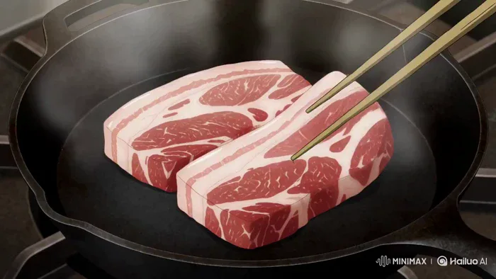</a>

▶ [在 ofox.ai 观看完整视频](https://ofox.ai/hailuo-3-prompts?utm_source=github&utm_medium=case&utm_campaign=awesome-ai-video-prompts#case-127)

<strong>Prompt</strong> — 手描きの日本の2Dアニメ、温かみのあるセルシェーディング、居心地のいい町の定食屋の厨房。15秒、ゆっくり見せる6カット、各約2.5秒。寄りのクローズアップ中心で、食欲をそそる濃厚な演出：脂、照り、湯気、たっぷりの量。 1 まな板を真上から：包丁が厚切りの豚ロースを切る、白い脂の霜降り。 2 斜め45…

~~~~text
手描きの日本の2Dアニメ、温かみのあるセルシェーディング、居心地のいい町の定食屋の厨房。15秒、ゆっくり見せる6カット、各約2.5秒。寄りのクローズアップ中心で、食欲をそそる濃厚な演出：脂、照り、湯気、たっぷりの量。
1 まな板を真上から：包丁が厚切りの豚ロースを切る、白い脂の霜降り。
2 斜め45度：熱々の鉄のフライパンに肉を並べ入れる、油が弾け、縁が反り返る。
3 マクロ：脂が溶け出し、深い焼き色の焦げ目が広がる。
4 寄り：濃い生姜醤油ダレを回し入れる、ぐつぐつと煮立って濃厚な照りのタレになり、肉に絡みつく。
5 横から：フライパンを揺すり、すべての肉に鏡のような照りがまとわり、湯気が立ち上る。
6 ラスト：湯気の立つ白ご飯の丼に生姜焼きを山盛りにのせ、タレが米粒の間へ垂れていく。
料理と手元のみ。顔なし、食べるシーンなし、文字なし、BGMなし、ナレーションなし。実写風なし、3Dなし。
~~~~

**参数**：MiniMax H3 · 未标注 · t2va · 15s · 未标注 · 未标注 · 带音频
**来源**：@ozuozuai99 · [原帖](https://x.com/ozuozuai99/status/2082828444484960451)

Preview © 2026 @ozuozuai99 · Prompt by @ozuozuai99

[回到目录](#table-of-contents)

### Case 128: Watercolor anime fetish montage rapid cuts (水彩动画感官蒙太奇快切) — by @yachimat_manga

<a href="https://ofox.ai/hailuo-3-prompts?utm_source=github&utm_medium=case&utm_campaign=awesome-ai-video-prompts#case-128">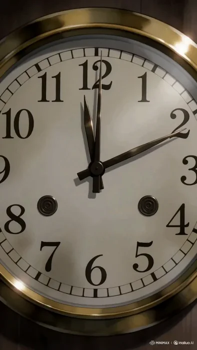</a>

▶ [在 ofox.ai 观看完整视频](https://ofox.ai/hailuo-3-prompts?utm_source=github&utm_medium=case&utm_campaign=awesome-ai-video-prompts#case-128)

<strong>Prompt</strong> — style: visual: "日本の水彩画風フルカラーアニメ" editing: "0.5秒おきの高速カット割り" animation: "作画枚数多め、滑らかな24fps" tone: "官能的だが直接的にはせず、温度・湿度・心拍を映像化する" project: id: "fetish_mont…

~~~~text
style:
  visual: "日本の水彩画風フルカラーアニメ"
  editing: "0.5秒おきの高速カット割り"
  animation: "作画枚数多め、滑らかな24fps"
  tone: "官能的だが直接的にはせず、温度・湿度・心拍を映像化する"

project:
  id: "fetish_montage_v3_with_broll"
  format: "vertical_9x16"
  fps: 24
  shot_duration: "0.5s"
  total_shots: 28
  total_duration: "14s"
  ratio: "fetish 22 : b-roll 6（約3.5:1）"

broll_philosophy:
  role: "呼吸・象徴・感情の外部化"
  placement: "フェチ的なカットが連続した直後、または感情の転換点"
  rule: "直接的な性的表現は避け、心拍・温度・湿度・緊張を伝える"

broll_categories:
  nature_micro:
    - "雨粒が窓を一筋伝う"
    - "蝋燭の炎が揺れる。息で消えそうな瞬間"
    - "氷が割れる音と共に、ひびが走る"
    - "花弁が一枚、テーブルへ落ちる"
    - "蜘蛛の巣の水滴が揺れる"
    - "煙草の灰が静かに落ちる"
    - "湯気が立ち上り、消える"
    - "夜の街灯の周りを虫が一匹飛ぶ"

  object_symbol:
    - "壁時計の秒針のアップ。止まりそうに見える"
    - "コーヒーの黒い表面に天井が映る"
    - "床に脱ぎ捨てられた靴。片方だけ"
    - "誰もいないベッドの皺"
    - "鳴り続ける電話。誰も出ない"
    - "灰皿の吸い殻が二本。片方には口紅"
    - "ドアの隙間から漏れる光"
    - "鏡に映る空の椅子"

  texture_landscape:
    - "夜の濡れた路面。ヘッドライトが滲む"
    - "ネオンサインのフリッカー"
    - "シーシャの炭が赤く脈打つ"
    - "金属表面に映る歪んだ顔"
    - "革張りソファに沈む手の跡"
    - "湯船の水面が揺れる"

  body_abstract:
    - "心臓の鼓動に合わせ、布団が微かに上下する"
    - "人物の影だけが壁を伝う"
    - "ガラス越しの人物の輪郭。ピントがずれる"
    - "水滴の中に顔が映り込む"

sequence:
  - id: 01
    type: "fetish"
    action: "髪を持ち上げ、うなじを晒す"
    scale: "macro"

  - id: 02
    type: "fetish"
    action: "下唇を噛み、ゆっくり離す"
    scale: "extreme_macro"

  - id: 03
    type: "b-roll"
    category: "object_symbol"
    action: "壁時計の秒針が、カチッと一秒進む"
    intent: "時間の伸縮を意識させる"

  - id: 04
    type: "fetish"
    action: "袖口のボタンを外し、袖を一度まくる"
    scale: "macro"

  - id: 05
    type: "fetish"
    action: "襟がわずかにずれ、鎖骨に影が落ちる"
    scale: "macro"

  - id: 06
    type: "fetish"
    action: "グラスの縁を指先でなぞる。結露が一滴落ちる"
    scale: "extreme_macro"

  - id: 07
    type: "b-roll"
    category: "nature_micro"
    action: "蝋燭の炎が、一度だけ大きく揺れる"
    intent: "呼吸の比喩。緊張のピーク"

  - id: 08
    type: "fetish"
    action: "イヤリングを外す。直後に髪が肩へ落ちる"
    scale: "macro"

  - id: 09
    type: "fetish"
    action: "ヒールから足が抜ける"
    scale: "macro"

  - id: 10
    type: "fetish"
    action: "喉が小さく動く。嚥下"
    scale: "extreme_macro"

  - id: 11
    type: "b-roll"
    category: "texture_landscape"
    action: "シーシャの炭が、脈打つように赤く光る"
    intent: "心拍の外部化"

  - id: 12
    type: "fetish"
    action: "口元から煙をゆっくり吐く"
    scale: "macro_side"

  - id: 13
    type: "fetish"
    action: "薄手の布越しに、肩甲骨が静かに動く"
    scale: "macro_back"

  - id: 14
    type: "fetish"
    action: "ペンのキャップを歯で咥え、ゆっくり引き抜く"
    scale: "extreme_macro"

  - id: 15
    type: "b-roll"
    category: "body_abstract"
    action: "布団が呼吸に合わせて微かに上下する"
    intent: "緊張の小休止。まだ続くという予告"
~~~~

**参数**：MiniMax H3 · 未标注 · t2va · 15s · 未标注 · 未标注 · 带音频
**来源**：@yachimat_manga · [原帖](https://x.com/yachimat_manga/status/2082799648528335119)

Preview © 2026 @yachimat_manga · Prompt by @yachimat_manga

[回到目录](#table-of-contents)

### Case 129: Greenhouse tea isekai anime (温室红茶异世界动画) — by @haruuraeadss

<a href="https://ofox.ai/hailuo-3-prompts?utm_source=github&utm_medium=case&utm_campaign=awesome-ai-video-prompts#case-129">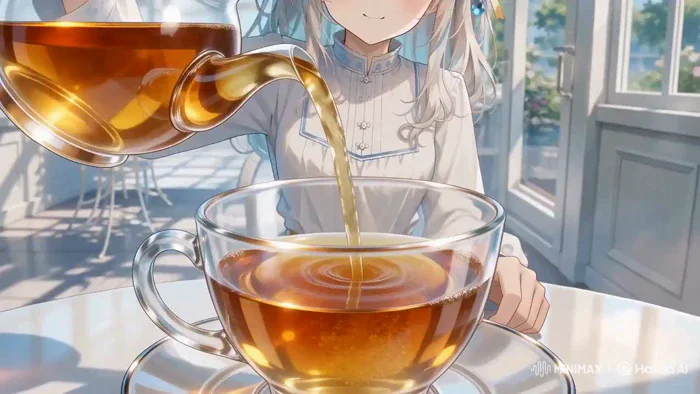</a>

▶ [在 ofox.ai 观看完整视频](https://ofox.ai/hailuo-3-prompts?utm_source=github&utm_medium=case&utm_campaign=awesome-ai-video-prompts#case-129)

<strong>Prompt</strong> — 高品質アニメ映像。 作品トーンと世界観は、透明感のある夏のガラス温室から、紅茶の渦の内側に存在するオリジナルの小さな不思議の国へ連続する、上品で夢幻的な叙情ファンタジー。澄んだ白、水色、琥珀色、淡い金色を主役にし、怖さや混沌ではなく、好奇心、浮遊感、静かな高揚を描く。今回は1枚のソース参照画像ima…

~~~~text
高品質アニメ映像。

作品トーンと世界観は、透明感のある夏のガラス温室から、紅茶の渦の内側に存在するオリジナルの小さな不思議の国へ連続する、上品で夢幻的な叙情ファンタジー。澄んだ白、水色、琥珀色、淡い金色を主役にし、怖さや混沌ではなく、好奇心、浮遊感、静かな高揚を描く。今回は1枚のソース参照画像image1のみを使用し、image1をキャラクター、衣装、2D手描き画風、配色、現実側のガラス温室背景の唯一の参照として扱う。

【同一人物固定】
image1と完全に同じ一人の少女を全編で維持する。小さく繊細な同じ顔立ち、大きな青緑色の宝石のような瞳、同じ目の形、多層の虹彩と白いキャッチライト、淡い頬、細いまつ毛、真珠のような白銀髪、柔らかな長いウェーブ、編み込みを含むまとめ髪、淡い金色のリボン、青い雫形の髪飾りを固定する。表情変化でも目、眉、まぶた、口、視線の順を守る。白い長袖のハイネックドレス、淡い水色の刺繍と縁取り、淡い金色の腰リボン、華奢で上品な体格、白・水色・淡い金色の人物固有配色を変えない。現実の温室と不思議の国に同時に複数の少女を存在させず、光学トランジションの前後で同じ一人の少女として連続させる。変えてよいのは表情、視線、呼吸、歩行、手の動き、髪と袖とスカート裾の自然な揺れだけ。別人化、顔の平均化、衣装変更、装飾欠落、分身、余分な人物、既存作品を想起させる有名キャラクターを出さない。
【2D hand-drawn／2D手描き画風固定】
image1の細く淡い青灰色と暖灰色の線、透明感のある二層以上の色影、柔らかなグラデーション、白・ミルキーブルー・澄んだ空色・琥珀色・淡い金色の明るい配色を全編で維持する。白銀髪の真珠質ハイライト、瞳の多層反射、肌の淡い発光感、ドレスの皺と刺繍、花、葉、ガラス、白い家具、床タイル、紅茶まで高密度の手描き筆致で描く。布は柔らかく、ガラスは透明で硬質、紅茶は澄んだ琥珀色、異世界の道と建築は半透明の白いガラス質として素材を描き分ける。太い輪郭にしない。簡略TVアニメにしない。平坦な単層セル影にしない。低密度背景にしない。滑らかなCG・3Dにしない。半写実にしない。実写にしない。くすんだ色や画風混合にしない。

【舞台と小物固定】
現実側はimage1と同じ明るいガラス温室。白い窓枠と屋根骨格、青空と白い雲、外の緑と白い花、白い丸テーブル、白い金属椅子、淡い青灰色の床タイルを維持する。開始時はimage1の少女の顔、目、髪、衣装、温室背景、白・水色・淡い金色の配色、明るさ、柔らかなコントラストを維持し、追加される小物はティーポットだけ。小物の所有者はimage1の少女一人だけ。透明なガラスのティーポット一つ、透明なティーカップ一つ、透明なソーサー一つだけを使う。開始状態ではティーカップはソーサー中央に置かれ、底に浅い琥珀色の紅茶が入っている。少女は右手でティーポットの取っ手を持ち、左手はソーサーの横へ軽く添える。ティーポット、カップ、ソーサーを増殖、交換、変形させない。不思議の国ではこれらを人物や巨大な小道具として複製しない。
少女の表情は、目→眉→まぶた→口→視線の順に変化させる。まず左右の目の中にある小さなキャッチライトがわずかに明るくなり、次に眉が少し上がり、その後まぶたが柔らかく開き、口元に小さな驚きと微笑みが生まれ、最後に視線が渦の中心へ下がる。反射線、窓枠、光点を顔中央へ重ねず、顔と両目を常に明瞭に保つ。

最初のカメラ高は白い丸テーブルと同じ低い位置。少女の斜め前から、手前にティーカップとソーサーを大きく、奥に少女の胸上と顔を明瞭に置く。背景消失軸は床タイルと右側の窓枠が温室奥へ斜めに伸びる方向へ揃える。この構図の目的は、少女、ポット先端、カップ中央の着水点を最初の一画で同時に読ませること。
少女が右手首だけをゆっくり傾けると、ティーポットの先端から一筋だけの琥珀色の紅茶がカップ中央へ落ちる。ポット先端、液体の筋、着水点を一画で読み取れるようにし、紅茶はテーブル外へこぼれない。この着水点を変化の起点とする。着水点から一つの時計回りの渦が生まれ、青空の反射と淡い金色の日差しを巻き込みながら、琥珀、青、白の三色の螺旋へ育つ。

カメラはテーブルと同じ低い位置からカップの斜め上へ滑らかに上がり、人物サイズを胸上の中景から背景の顔が読める近景へ保ったまま、紅茶面へ近づく。背景消失軸は温室奥から円形のカップ中央へ収束させる。この移動の目的は、現実の着水点を異世界への案内線へ変えること。

螺旋の半分がまだ琥珀色の紅茶、もう半分が細い光の道になっている形成中の中間状態を短く明瞭に見せる。続いて螺旋が画面全体を満たした瞬間、その同じ回転方向、曲率、色の並びを保ったまま、一本の光の道へ完成する。暗転、瞬間移動、破裂、液体の中を溺れる表現にせず、紅茶面から異世界の俯瞰へ連続する光学的な形状一致として接続する。

変化後の完成状態である不思議の国は、傾いた白いガラスの庭道、空中でゆっくり反転する白い花壇、輪のように連なる温室アーチ、上下が穏やかに入れ替わる空色の庭で構成する。文字盤、数字、看板、動物、人型住民は出さない。

カメラ高は少女の胸より少し低い位置へ移り、同じ少女の斜め前を後退しながら、胸から膝までの中景で追従する。背景消失軸は琥珀と青の光の道が円形アーチの奥へ伸びる方向へ揃える。この移動の目的は、紅茶の渦だった曲線が少女を導く冒険路へ変わったことを読ませること。

少女は光の道に沿って軽やかに三歩進み、第一歩で傾いた庭道へ乗り、第二歩で浮かぶ白い床片を渡り、第三歩で円形のガラスアーチをくぐる。各足裏を順に接地させ、髪、袖、スカート裾は歩みより少し遅れて同じ風向きへ揺れる。滑走、飛行、急回転に見せない。

少女がアーチをくぐると、周囲の白い花が外側から順に淡い水色へ染まり、頭上のガラス骨格がゆっくり四分の一回転して上下の庭をつなぐ。少女自身は直立を保ち、重力方向を急変させない。

カメラは胸より少し低い位置を保って少女の肩越しへ短く回り込み、人物サイズを胸上に寄せる。背景消失軸は前方の光の道が作る一つの円へ収束させる。この移動の目的は、少女の冒険の先に帰還路が生まれることを示すこと。光の道は再び一つの時計回りの螺旋となり、その円周が現実のティーカップの縁と同じ形、大きさ、角度へ整列する。

カメラは螺旋の中心を通り、琥珀色の紅茶面の極近景から現実の温室へ滑らかに引く。カメラ高はテーブルと同じ低い位置へ戻り、人物サイズを奥の胸上へ戻す。背景消失軸は円形のカップ中央から床タイルと窓枠が温室奥へ伸びる開始方向へ戻す。この移動の目的は、異世界の冒険を一杯の紅茶の中へ回収し、少女の感情へ報酬を返すこと。同じ少女が帰還した連続性を保つ。

終端では少女が右手のティーポットを垂直へ戻し、紅茶の筋をきれいに止め、ティーポットを胸より低い高さで保持する。左手はソーサー横に添えたまま。カップ内の最後の渦がゆっくり縮み、中心に青と淡い金の小さな反射一つだけを残して静止する。

カメラはテーブル高さの斜め前で、手前の静かな紅茶面、奥の少女の三分の四顔と穏やかな微笑みを同時に読ませる。紅茶面の反射が完全に止まり、少女の両目、ティーポット、カップ、渦の名残が一画で明瞭になった瞬間に切る。

液体を黒く濁らせない。渦を黒い穴、荒れた水面、別形状の物体へ変えない。顔を歪ませない。手指を増やさない。余分な人物や余分な食器を出さない。ストロボ、激しい明滅、強い水平フレア、白飛びなし。文字、字幕、ロゴ、透かしなし。BGMなし、音楽なし、環境音なし、フォーリーなし、音響生成なし。
~~~~

**参数**：MiniMax H3 · 未标注 · ref2va · 15s · 未标注 · 未标注 · 带音频
**来源**：@haruuraeadss · [原帖](https://x.com/haruuraeadss/status/2082798959014064531)

Preview © 2026 @haruuraeadss · Prompt by @haruuraeadss

[回到目录](#table-of-contents)
