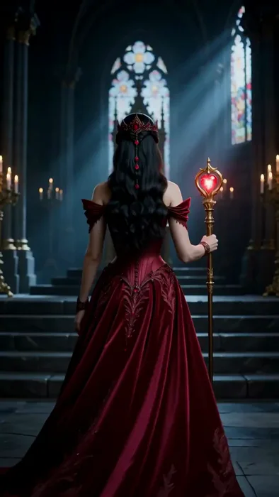
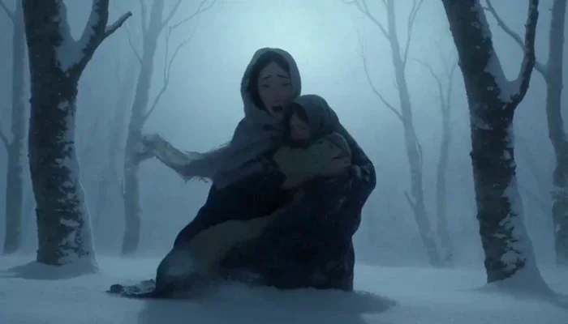
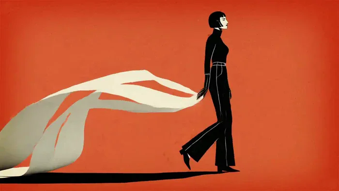
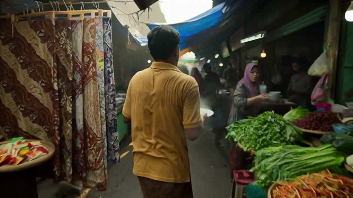
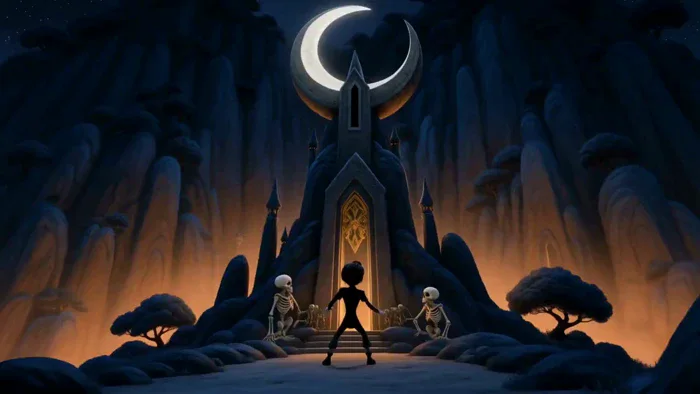
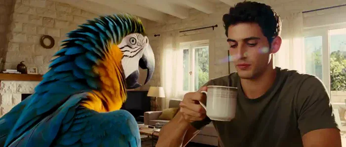
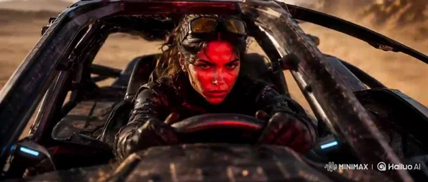
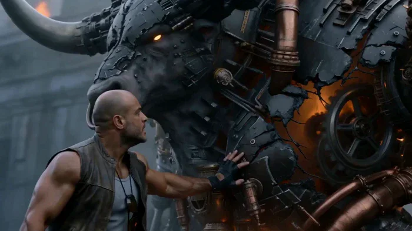
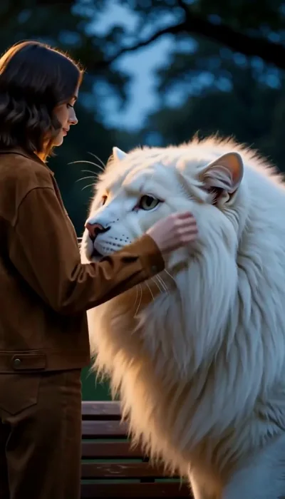
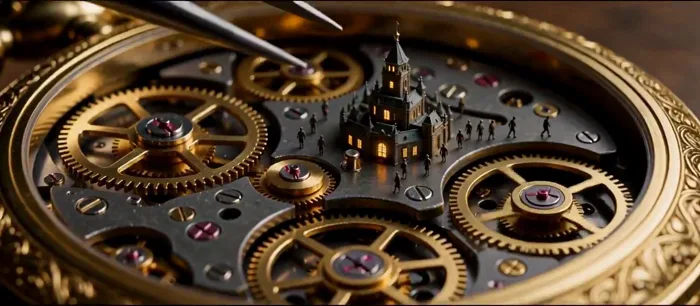

[← 総目次に戻る](../README.ja.md#table-of-contents) · [English](cinematic.md) · [简体中文](cinematic.zh-CN.md) · [日本語](cinematic.ja.md)

### シネマティック Cinematic

- [Case 10: A Vintage 1947 Town Under Fire (1947 小镇的复古战地纪实) — by @RuzainaMeer](#case-10)
- [Case 14: Ruby Queen Transforms Into a Warrior (红宝石女王变身战士) — by @TaliaAariz](#case-14)
- [Case 24: Hand-Painted Blizzard Survival (手绘暴风雪求生) — by @sada_ai](#case-24)
- [Case 25: INK AFTER DARK in Pulp-Noir Motion (《INK AFTER DARK》黑色电影片头) — by @opener_ai](#case-25)
- [Case 26: Morning at a Traditional Javanese Market (日惹传统市场的清晨) — by @junwatu](#case-26)
- [Case 91: The Boy Who Returned the Moon · Chapter 4 (归还月亮的少年 · 第四幕) — by @ManuAGI01](#case-91)
- [Case 94: Macaw Scream in Extreme Slow Motion (金刚鹦鹉极慢速鸣叫) — by @yuvalav](#case-94)
- [Case 95: Korean Idol VHS Beauty Vlog (韩国偶像 VHS 美妆 Vlog) — by @saniaspeaks_](#case-95)
- [Case 96: Desert Buggy Combat Chase (沙漠越野车战斗追逐) — by @beginnersblog1](#case-96)
- [Case 133: Mechanical bull charge The Beasts Are Coming (机械公牛冲锋·野兽将至) — by @rahulnanda86](#case-133)
- [Case 137: A White Lion in the Lamplit Park (灯下公园里的白狮同行) — by @JohnSmith5912](#case-137)
- [Case 138: A Tiny City Inside a Pocket Watch (怀表齿轮里的微缩晨城) — by @DeCat2025](#case-138)
- [Case 144: A Living Portrait Among Statues (雕塑工作室里的珠宝肖像) — by @TaliaAariz](#case-144)

### Case 10: A Vintage 1947 Town Under Fire (1947 小镇的复古战地纪实) — by @RuzainaMeer

▶ [ofox.ai で動画をすべて見る](https://ofox.ai/hailuo-3-prompts?utm_source=github&utm_medium=case&utm_campaign=awesome-ai-video-prompts#case-10)

**输入素材**：未公开 —— 本案例未收录可用的输入素材，请参阅来源

<strong>Prompt</strong> — Create a 15-second ultra-photorealistic live-action war sequence set in the United States in 1947, designed to look like authentic historical footage …

~~~~text
Create a 15-second ultra-photorealistic live-action war sequence set in the United States in 1947, designed to look like authentic historical footage captured on a 1940s film camera. The entire scene must feel grounded, documentary-like, raw, and physically realistic.
Environment: A rural American town in 1947 with wooden houses, old brick buildings, telephone poles, dirt roads, vintage American cars from the 1940s, wooden fences, farmland, and period-accurate street details. Overcast afternoon light, light fog, drifting smoke, dust in the air, damaged buildings, scattered debris, and a tense wartime atmosphere.
Characters: American soldiers wearing historically accurate late-1940s military uniforms, helmets, boots, and equipment. Civilians wear authentic 1940s American clothing. Natural faces, realistic skin texture, sweat, dirt, fatigue, and believable body movements.
0–3s — Establishing Shot:
Wide handheld shot of a quiet rural American street suddenly filled with smoke and confusion. Vintage 1940s vehicles are parked along the road while soldiers move quickly between wooden buildings. Civilians rush toward safer areas.
3–6s — Tension:
Camera moves through the street at shoulder height, following several soldiers as distant gunfire is heard. They immediately react and take cover behind a vintage vehicle and a brick wall. Their movements are cautious and realistic.
6–10s — Combat:
Fast handheld tracking shot as the soldiers move between cover while distant gunfire impacts the environment. Small pieces of wood, dust, and debris fall naturally from nearby impacts. Weapon recoil, movement, and body weight must be physically accurate. Keep the violence realistic and restrained.
10–13s — Human Moment:
Camera briefly focuses on a soldier helping an injured civilian move behind cover. Their breathing, facial expressions, body language, and movement should feel natural and unscripted.
13–15s — Final Shot:
Camera pulls back into a wide shot of the American town as smoke slowly moves through the street. Soldiers remain behind cover while vintage vehicles and damaged buildings fill the background. The scene ends with an authentic, tense 1940s documentary feeling.
Visual Style: Ultra-photorealistic live-action, authentic 1940s American environment, vintage 35mm film texture, subtle film grain, natural imperfections, realistic exposure, handheld documentary cinematography, muted historical color palette, realistic smoke and dust, natural shadows, accurate depth of field.
Physics: Strictly obey real-world gravity, momentum, inertia, friction, recoil, weight, collision physics, and human biomechanics. No exaggerated explosions, impossible movements, superhero behavior, or choreographed-looking combat.
Negative Prompt: modern buildings, modern cars, smartphones, modern clothing, modern weapons, futuristic technology, CGI appearance, video-game graphics, fantasy, superhero action, excessive explosions, excessive blood, gore, impossible physics, unrealistic recoil, slow-motion physics, distorted faces, extra limbs, floating objects, plastic skin, artificial-looking environments.
~~~~

**参数**：MiniMax H3 · 未标注 · t2va · 15s · 未标注 · 未标注 · 带音频
**来源**：@RuzainaMeer · [原帖](https://x.com/RuzainaMeer/status/2087117707816714552)

Preview © 2026 @RuzainaMeer · Prompt by @RuzainaMeer

[目次に戻る](#table-of-contents)

### Case 14: Ruby Queen Transforms Into a Warrior (红宝石女王变身战士) — by @TaliaAariz

▶ [ofox.ai で動画をすべて見る](https://ofox.ai/hailuo-3-prompts?utm_source=github&utm_medium=case&utm_campaign=awesome-ai-video-prompts#case-14)

**输入素材**：未公开 —— 本案例未收录可用的输入素材，请参阅来源

<strong>Prompt</strong> — A cinematic fantasy transformation beginning with a majestic queen wearing an intricate ruby-embroidered corset gown, matching crown, and holding a gl…

~~~~text
A cinematic fantasy transformation beginning with a majestic queen wearing an intricate ruby-embroidered corset gown, matching crown, and holding a glowing heart-topped scepter inside a gothic cathedral throne room. The camera zooms out to show her full attire as she turns and walks toward a grand staircase, where a burst of glowing red magical light erupts around her. Enveloped in the crimson energy, her gown transforms into sleek, ornate metallic warrior armor, while her scepter morphs into a longsword and an embossed shield. She turns back toward the camera in a powerful battle stance, positioned before a glowing red arcane circle on the cathedral steps.
~~~~

**参数**：MiniMax H3 · 未标注 · t2va · 15s · 未标注 · 未标注 · 带音频
**来源**：@TaliaAariz · [原帖](https://x.com/TaliaAariz/status/2090330350668947525)

Preview © 2026 @TaliaAariz · Prompt by @TaliaAariz (frame re-selected by us — original clip cut together a comparison against another model)

[目次に戻る](#table-of-contents)

### Case 24: Hand-Painted Blizzard Survival (手绘暴风雪求生) — by @sada_ai

▶ [ofox.ai で動画をすべて見る](https://ofox.ai/hailuo-3-prompts?utm_source=github&utm_medium=case&utm_campaign=awesome-ai-video-prompts#case-24)

**输入素材**：未公开 —— 本案例未收录可用的输入素材，请参阅来源

<strong>Prompt</strong> — Visual Medium &amp; Craft: Traditional frame-by-frame hand-painted oil-on-paper animation, physical 12 fps stop-motion cadence with deliberate frame holds…

~~~~text
Visual Medium & Craft: Traditional frame-by-frame hand-painted oil-on-paper animation, physical 12 fps stop-motion cadence with deliberate frame holds and natural line jitter between frames. Raw brushstroke textures, strictly zero CGI, no 3D rendering, no digital interpolation, no game engine aesthetics. Cinematography & Lighting: Masterful cinematography in the style of Emmanuel Lubezki and Roger Deakins, shot with physical cine lenses and a classic 180° shutter blur. Lit exclusively by a single overhead light source: pale, freezing moonlight cutting through dense atmospheric haze. Strong contre-jour backlighting with the camera positioned on the shadow side. Uniform cold blue moonlight washes over skin, clothing, snow, and tree trunks, casting sharp cold rim lights on shoulders and hoods while keeping faces in soft shadow. Atmosphere & Environment: A violent, blinding blizzard with near-zero visibility (3 meters maximum), dissolving the background into a solid white fog wall. Gale-force horizontal winds whip thick snow and freezing fog through the frame. Deep snow quickly accumulates on garments. Exhaled breath instantly vaporizes and tears away in the wind. Characters & Emotion: A desperate mother and her frightened young child battling for survival, lost in the storm at the absolute limit of their endurance. The mother conceals her panic to protect her child, while the child cries openly in fear. Both lean heavily into the gale, squinting against the biting wind, shielding their faces with forearms and ducking into their collars. Technical Details: Color palette dominated by 60% snow-blue, 30% deep trunk-black, and 10% cold highlight accents. Strict physical realism with grounded weight, true inertia, and accurate contact shadows on snow. Dynamic compositional balance using the rule of thirds and golden ratio. Uncompromising continuity across all character designs, garments, and environmental assets. 8K IMAX aesthetic.
~~~~

**参数**：MiniMax H3 · 未标注 · t2va · 15s · 未标注 · 未标注 · 带音频
**来源**：@sada_ai · [原帖](https://x.com/sada_ai/status/2085547332880503134)

Preview © 2026 @sada_ai · Prompt by @sada_ai

[目次に戻る](#table-of-contents)

### Case 25: INK AFTER DARK in Pulp-Noir Motion (《INK AFTER DARK》黑色电影片头) — by @opener_ai

▶ [ofox.ai で動画をすべて見る](https://ofox.ai/hailuo-3-prompts?utm_source=github&utm_medium=case&utm_campaign=awesome-ai-video-prompts#case-25)

**输入素材**：未公开 —— 本案例未收录可用的输入素材，请参阅来源

<strong>Prompt</strong> — [FORMAT] Create a 15-second, 16:9 retro graphic opening-title sequence titled "INK AFTER DARK". A stylish 1960s pulp-noir animation about a mysterious…

~~~~text
[FORMAT]
Create a 15-second, 16:9 retro graphic opening-title sequence titled "INK AFTER DARK".
A stylish 1960s pulp-noir animation about a mysterious night writer. Bold, minimal, elegant, slightly dangerous, with dry visual wit.

[IDENTITY]
Keep one female writer visually consistent throughout: sharp angular bob haircut, narrow almond-shaped eyes, long black turtleneck, high-waisted trousers, slim silhouette, black leather gloves, calm expression, upright self-assured posture, and hard graphic highlights along one side of her face.
Use flat hand-inked 2D illustration with rough screen-print texture, imperfect paper grain, and slightly uneven ink edges.

[BEATS]
[0–3 seconds] Extreme close-up of the writer's face emerging from near-total black. A narrow cream-colored strip of light slides across her eyes. The frame abruptly opens sideways like torn paper, revealing her full silhouette walking across a burnt-red background while loose sheets of paper trail behind her like a long ribbon.

[3–6 seconds] The paper ribbon sweeps across frame and becomes a graphic wipe. Reveal her in profile at a desk. She strikes one typewriter key. On impact, the screen fractures into three bold rectangular panels: her gloved fingers, the metal typebar snapping forward, and a giant black ink letter striking paper.

[6–9 seconds] Rapid rhythmic close-ups: spinning typewriter ribbon spool, carriage return lever snapping sideways, black ink spreading through rough paper fibers. Thin cream lines cut diagonally across the screen and reorganize the images into an asymmetric editorial collage.

[9–12 seconds] Pull wide. The writer stands alone beside an enormous abstract typewriter rendered as a black geometric silhouette. She pulls one endless page upward. The rising page becomes a full-frame cream vertical wipe while scattered black letters tumble downward like physical debris.

[12–15 seconds] The letters rapidly assemble into the exact title "INK AFTER DARK" centered large on a burnt-red paper field. The writer's small black silhouette crosses beneath the title and exits frame. The title appears through sharp letter-by-letter mechanical impacts over 0.5 seconds, holds completely still through the ending. No bouncing, spinning, stretching, or fly-in typography.

[CAMERA]
Use aggressive graphic changes in scale: extreme facial close-up → full-body silhouette → macro mechanical inserts → monumental wide composition.
Camera movement should feel designed rather than realistic: fast lateral pushes, sudden graphic crops, one rapid pull-out, and precise locked compositions. Avoid conventional cinematic orbit shots.

[LIGHT]
Limited palette only: burnt red, aged cream, deep black, with tiny muted silver highlights on typewriter metal.
Hard noir side-lighting translated into flat graphic shapes. Rough vintage print stock, subtle paper scratches, coarse ink grain, slight registration offsets, and occasional frame jitter.

[EDIT]
Fast editorial rhythm with hard cuts, paper wipes, diagonal panel slices, oversized object masks, and split-screen recompositions.
Transitions must be motivated by paper, ink, typewriter mechanisms, or moving silhouettes. No soft dissolves.
Make every shot feel newly composed rather than simply zooming into the previous image.

[AUDIO]
Audio: dry typewriter key strikes, paper slides, ribbon-spool clicks, carriage-return snaps, faint room hum, and one heavy mechanical impact when the final title locks.
BGM: an original 15-second cue, 65% noir suspense and 35% cool jazz. Upright bass, brushed snare, muted vibraphone, sparse low piano, and short clipped brass accents. Begin almost empty, introduce bass at 3 seconds, rhythmic percussion at 6 seconds, a brief brass accent at 10 seconds, then freeze the final 2 seconds on one bass note and the mechanical title hit. Do not imitate an existing melody.

[NEGATIVE]
No subtitles, extra on-screen text, watermarks, platform logos, or stickers.
Do not introduce Chinese text, garbled characters, misspellings, or additional title variations. Render "INK AFTER DARK" once only.
No 3D CGI, photorealism, anime styling, glossy modern motion graphics, neon cyberpunk aesthetics, or smooth vector-clean surfaces.
Never a slideshow. Maintain active graphic motion, physical visual transitions, and continuously evolving compositions.
~~~~

**参数**：MiniMax H3 · 未标注 · t2va · 15s · 未标注 · 未标注 · 带音频
**来源**：@opener_ai · [原帖](https://x.com/opener_ai/status/2087042643369099381)

Preview © 2026 @opener_ai · Prompt by @opener_ai

[目次に戻る](#table-of-contents)

### Case 26: Morning at a Traditional Javanese Market (日惹传统市场的清晨) — by @junwatu

▶ [ofox.ai で動画をすべて見る](https://ofox.ai/hailuo-3-prompts?utm_source=github&utm_medium=case&utm_campaign=awesome-ai-video-prompts#case-26)

**输入素材**：未公开 —— 本案例未收录可用的输入素材，请参阅来源

<strong>Prompt</strong> — Traditional Javanese market in Yogyakarta, early morning, present day, ultra-realistic handheld one-take. A bakso vendor hurries through impossibly na…

~~~~text
Traditional Javanese market in Yogyakarta, early morning, present day, ultra-realistic handheld one-take. A bakso vendor hurries through impossibly narrow, crowded market aisles carrying a large steaming bowl of freshly prepared bakso. Shoppers and vendors step aside to let him pass. He weaves between vegetable stalls overflowing with chilies, shallots, and leafy greens, ducks beneath low-hanging tarps, squeezes past batik merchants and baskets of traditional snacks, and carefully avoids children running through the market. The market feels dense, humid, noisy, and full of life. He passes porters carrying heavy sacks on their shoulders, women bargaining in Javanese, and motorcycles slowly pushing through the narrow lane. He finally reaches a tiny food stall at the back of the market and serves the steaming bowl just as the power briefly flickers, leaving the market dim for a moment before the bustle continues. Oppressive realism, natural morning light mixed with fluorescent bulbs, worn concrete floors, damp walls, wooden stalls, hanging plastic signs, Javanese conversations, vendors calling out prices, clattering bowls, footsteps echoing through the covered market, immersive cinematic pacing. No cyberpunk, no stylization, documentary-like realism.
~~~~

**参数**：MiniMax H3 · 未标注 · t2va · 15s · 未标注 · 未标注 · 带音频
**来源**：@junwatu · [原帖](https://x.com/junwatu/status/2084840152715911311)

Preview © 2026 @junwatu · Prompt by @junwatu

[目次に戻る](#table-of-contents)

### Case 91: The Boy Who Returned the Moon · Chapter 4 (归还月亮的少年 · 第四幕) — by @ManuAGI01

▶ [ofox.ai で動画をすべて見る](https://ofox.ai/hailuo-3-prompts?utm_source=github&utm_medium=case&utm_campaign=awesome-ai-video-prompts#case-91)

**输入素材**：未公开 —— 本案例未收录可用的输入素材，请参阅来源

<strong>Prompt</strong> — [REFERENCE CONTROL] Use the uploaded PART 4 storyboard image for “THE BOY WHO RETURNED THE MOON” as the PRIMARY visual, character, environment, scale,…

~~~~text
[REFERENCE CONTROL]

Use the uploaded PART 4 storyboard image for “THE BOY WHO RETURNED THE MOON” as the PRIMARY visual, character, environment, scale, costume, prop, lighting, cinematography, emotional-performance, and narrative reference.

This sequence continues IMMEDIATELY from PART 3.

PART 3 ended with:
- the moon almost completely dark
- only a faint silver rim remaining
- the Living Bone Bridge still spanning the canyon
- Nyx magically exhausted but physically unharmed
- Zara pointing toward the Moon Shrine
- Kael holding the ONLY glowing moon fragment securely in both hands
- Zara shouting:
  <d>[English] KAEL! GO!</d>

Generate a FINISHED cinematic animated sequence from the uploaded storyboard.

DO NOT reproduce or animate the storyboard sheet itself.

The final video must NOT contain:
- storyboard borders
- panel numbers
- timestamps
- handwritten captions
- speech bubbles
- production notes
- reference drawings
- activation diagrams
- paper background
- storyboard header/footer
- color swatches
- annotation text

The uploaded storyboard locks:

1. Kael’s exact face, hair, costume and proportions
2. Zara’s exact face, enormous curly hairstyle and blue rib-pattern shirt
3. Nyx’s exact black dragon anatomy
4. Nyx’s enormous amber eyes and luminous grin
5. the ONLY silver moon fragment
6. the almost-dark damaged moon
7. the Living Bone Bridge
8. the Moon Shrine architecture
9. the impossibly high fragment receptacle
10. Nyx giving Kael the final lift
11. Kael inserting the fragment
12. silver-blue shrine activation
13. moonlight wave crossing the valley
14. gradual moon restoration
15. restored Noctara
16. skeleton guardian → moon-firefly transformation
17. Zara’s emotional reaction
18. Kael and Nyx reconciliation
19. final lakeside callback
20. final Kael + Zara + Nyx friendship composition

Translate the storyboard’s 15 one-second panels into approximately **9 coherent cinematic shots**.

DO NOT create fifteen frantic one-second cuts.

Use:

urgent action
→ obstacle
→ trust
→ sacred activation
→ enormous magical payoff
→ emotional release
→ reconciliation
→ quiet final comedy.

--------------------------------------------------

[VIDEO GOAL]

Duration:
EXACTLY 15 seconds

Story range:
0:45–1:00 of the complete 1-minute film

Aspect ratio:
16:9 landscape

Frame-rate feeling:
cinematic 24 fps

Visual medium:
premium hand-painted 2D dark-fantasy animation

Genre:
fantasy adventure finale / emotional magical payoff

Dialogue:
native synchronized English

Audio:
native dialogue + environmental sound + moon magic + guardian transformation + original cinematic score

EMOTIONAL ARC:

desperate urgency
→ frustration
→ unexpected help
→ complete trust
→ sacred wonder
→ triumphant restoration
→ emotional release
→ realization
→ friendship
→ gentle comedy

CORE MESSAGE:

Kael began the story believing Nyx was stealing the light.

He ends the story understanding that Nyx was protecting it.

And Kael began the story watching the moon alone.

He ends it watching with friends.

--------------------------------------------------

[PART 4 STORY LIMIT]

This is the FINAL CHAPTER.

START:

Kael has just caught the moon fragment.

Zara tells him to go.

END:

The moon is fully restored.

The guardians have peacefully become silver-blue moon-fireflies.

Kael, Zara and Nyx sit together beside the moonlit lake.

The story must feel COMPLETELY resolved.

No cliffhanger.

--------------------------------------------------

[CHARACTER IDENTITY LOCK — KAEL]

Match Parts 1–3 and the uploaded PART 4 storyboard EXACTLY.

KAEL:

Slim teenage moon-watcher.

Appearance:
- pale-to-medium cool-toned skin
- youthful angular face
- large expressive dark eyes
- thick dark eyebrows
- swept-back tousled black hair
- recognizable pointed windswept silhouette
- lean narrow build
- long thin limbs

Clothing:
- simple charcoal-black tunic
- dark fitted trousers
- dark practical boots
- subtle belt
- no armor
- no cape
- no weapon

PART 4 PERFORMANCE ARC:

0–3 sec:
urgent, breathless, carrying huge responsibility

3–5 sec:
frustrated by unreachable shrine slot

5–7 sec:
surprised by Nyx’s help → chooses trust

7–10 sec:
focused → overwhelmed by sacred magic

10–12 sec:
wonder and relief

12–14 sec:
humbled, apologetic, playful reconciliation

14–15 sec:
peaceful belonging

CRITICAL:

Kael’s trust moment must be visible.

When Nyx lowers his head:

Kael looks at Nyx’s face.

Tiny hesitation.

Then he willingly climbs onto him.

No fear.

No argument.

Their action completes the relationship arc.

--------------------------------------------------

[CHARACTER IDENTITY LOCK — ZARA]

Match Parts 2–3 exactly.

ZARA — THE BONEKEEPER

Appearance:
- deep warm-brown skin
- enormous dense black curly hair
- cool blue highlights along curls
- very large expressive brown eyes
- strong dark eyebrows
- blue distressed top
- stylized pale ribcage design printed on fabric
- brown utility belt
- practical fantasy trousers / waist layers
- wrapped forearms
- practical boots
- compact athletic build

PART 4 PERFORMANCE:

urgent leader
→ shrine awe
→ emotional concern for guardians
→ realization that their ancient duty is fulfilled
→ quiet happiness
→ warm laughter with Kael and Nyx

Do not make Zara dramatically cry.

A tiny glossy eye / soft teary smile is enough.

--------------------------------------------------

[CHARACTER IDENTITY LOCK — NYX]

Match Parts 1–3 exactly.

NYX — THE MIDNIGHT DRAGON

Appearance:
- enormous elongated black dragon
- long serpentine neck
- feather-like layered black-blue scales
- backward wild head spines
- huge pointed ears
- enormous glowing amber-orange eyes
- vertical slit pupils
- exaggerated luminous toothy grin
- long flexible body
- dark wings

BEGINNING STATE:

Nyx is magically exhausted.

Show:
- slightly lowered head
- slower breathing
- dimmer amber eyes
- tired posture

He is NOT injured.

As the moon returns:
- amber eyes regain brightness
- scales regain moonlit highlights
- posture rises
- energy returns

PART 4 ROLE:

Nyx provides the physical reach Kael lacks.

He does not solve the final action himself.

He enables Kael to finish it.

This reinforces teamwork.

--------------------------------------------------

[MOON FRAGMENT LOCK]

Only ONE moon fragment exists.

Same fragment from Parts 1–3.

Appearance:
- irregular crescent/crystalline shard
- bright silver-white core
- translucent pale cyan edges
- small floating particles
- powerful cool illumination

Timeline:

Start:
Kael holds fragment with both hands.

Mid:
Kael carries it up shrine.

Then:
Kael inserts it into exact receptacle.

After insertion:
it becomes integrated into shrine energy.

It must NOT remain simultaneously in Kael’s hands.

No duplicates.

--------------------------------------------------

[MOON SHRINE LOCK]

Match the storyboard exactly.

Ancient lunar shrine on cliff summit.

Design:
- tall weathered dark-stone structure
- giant crescent / circular lunar arch
- narrow vertical receptacle near upper center
- ancient crescent carvings
- geometric silver rune channels
- stone staircase
- central pedestal
- cliff-top silhouette

BEGINNING:
completely inactive.

ACTIVATION:

fragment inserted
→ central rune ignites
→ nearby runes illuminate
→ light traces upward and outward
→ entire lunar arch glows
→ brilliant silver-blue pulse travels into valley
→ moon reacts

No explosion.

No structural destruction.

--------------------------------------------------

[MOON RESTORATION LOCK]

At beginning:
moon is almost black.

Only:
- faint silver rim
- subtle crack lines.

Restoration must be gradual and readable:

silver pulse reaches sky
→ one lunar edge brightens
→ cracks illuminate
→ silver light spreads across surface
→ missing fragment area reforms
→ cracks close
→ full moon becomes brilliant again.

Final moon must visually match the enormous perfect moon from PART 1.

No second moon.

No explosion.

--------------------------------------------------

[SKELETON GUARDIAN TRANSFORMATION LOCK]

The skeleton guardians’ transformation is peaceful and magical.

They have completed their ancient purpose.

Use:

blue runes glow
→ ivory bodies become silver translucent
→ edges dissolve gently into particles
→ forms turn into dozens of tiny silver-blue lights
→ lights become moon-fireflies
→ thousands of fireflies rise through valley

IMPORTANT:

This is NOT death.

This is NOT destruction.

Their consciousness / personality is implied to continue in the lights.

One guardian should give Zara a final little wave BEFORE transforming.

Zara recognizes the gesture.

Make it tender.

--------------------------------------------------

[LIVING BONE BRIDGE CONTINUITY]

The Living Bone Bridge from Part 3 remains visible early in Part 4.

As the guardians transform later:

the bridge itself may gently dissolve into silver-blue fireflies from far end toward near end.

Characters are already safely OFF the bridge before this happens.

No collapsing.

No falling.

No violent disassembly.

--------------------------------------------------

[RESTORED NOCTARA LOCK]

After the moon returns:

show the same world established in Part 1:

- giant gothic castles
- amber-orange windows
- reflective lake
- dark blue forest
- gigantic restored silver moon
- calm night sky

Silver light travels over architecture.

Warm castle lights become more vivid.

Lake reflects:
silver moon
+
amber city
+
silver-blue moon-fireflies.

--------------------------------------------------

[FINAL LOCATION CALLBACK]

The final scene must visually echo PART 1.

PART 1 OPENING:

Kael sits alone on rock
+
lake
+
huge moon
+
Noctara castles.

PART 4 ENDING:

Kael sits on same or visually matching rock,
but now:

Zara sits beside him.

Nyx’s giant head squeezes awkwardly beside/between them.

Silver-blue fireflies drift across the lake.

The visual meaning must read even without dialogue:

Kael is no longer alone.

--------------------------------------------------

[WORLD / STORY LOGIC]

Kael catches fragment
→ runs toward shrine.

Shrine receptacle too high
→ Kael cannot reach.

Nyx sees problem
→ lowers head.

Kael trusts Nyx
→ climbs onto dragon.

Nyx raises him
→ Kael reaches receptacle.

Kael inserts fragment
→ shrine activates.

Shrine activates
→ moonlight crosses valley.

Moon receives energy
→ moon restores.

Moon restored
→ guardians’ duty is complete.

Guardians transform
→ Zara realizes they are free.

Kael understands Nyx
→ friendship resolves.

No unexplained jumps.

--------------------------------------------------

integrated_multimodal_description:

[SHOT 1] — 0.00s–1.70s
THE LAST RUN

Continue DIRECTLY from Part 3.

Kael rises from his safe slide on the Living Bone Bridge.

The glowing moon fragment is secured in BOTH hands.

Its silver light illuminates his face.

Zara points toward the shrine.

Zara:
<d>[English] GO!</d>

Kael runs.

He leaves the Bone Bridge and sprints up the ancient shrine approach.

Nyx follows behind more slowly, visibly exhausted but determined.

Camera:
low tracking beside Kael
→ front-facing running shot
→ tilt up revealing enormous inactive shrine ahead.

Sound:
- fast footsteps
- Kael breathing
- fragment hum
- cold wind
- distant bridge rune tone

Music:
urgent strings + low percussion.

--------------------------------------------------

[SHOT 2] — 1.70s–3.20s
ONE FINAL PROBLEM

Kael races up the stone steps.

The shard’s light briefly reflects off dormant shrine runes.

He reaches the center.

Stops.

Looks upward.

Camera follows his gaze.

The receptacle is extremely high above him inside the giant lunar arch.

Kael’s expression drops.

He tries one quick safe jump while lifting the fragment.

Not even close.

He lands.

Looks up again.

Dialogue:

Kael:
<d>[English] Seriously?!</d>

Brief comedy beat.

Camera:
medium Kael
→ huge vertical tilt showing impossible height
→ close frustrated expression.

Music pauses for one tiny comic note.

--------------------------------------------------

[SHOT 3] — 3.20s–4.70s
THE DRAGON OFFERS THE FINAL LIFT

A huge black shape moves behind Kael.

Kael turns quickly.

Nyx lowers his enormous tired head beside him.

Amber eyes meet Kael’s.

Nyx gives his familiar terrifying luminous grin.

But the emotional meaning is completely different now.

Kael understands.

Hold eye contact.

Kael glances:
Nyx
→ high receptacle
→ Nyx again.

Tiny hesitation.

Then Kael smiles faintly.

Dialogue:

Kael:
<d>[English] Okay.</d>

Nyx lowers his head even further.

Kael carefully climbs between his large ears/head spines while holding the shard securely.

Zara watches from below.

Camera:
Kael close
→ Nyx face
→ intimate eye contact
→ wide scale composition.

Music:
urgent score softens into trust motif.

--------------------------------------------------

[SHOT 4] — 4.70s–6.20s
THE MISSING PIECE COMES HOME

Nyx slowly stretches his long neck upward.

No sudden movement.

Kael rises toward the receptacle.

The almost-dark moon hangs behind the shrine.

Kael reaches forward.

The silver shard aligns with the exact missing slot.

For one breath:

Kael stares at it.

Then inserts the fragment.

CLICK / soft magical lock.

The shard fits perfectly.

A single thin silver rune illuminates beneath Kael’s hand.

Kael whispers:

<d>[English] Come on...</d>

Camera:
side silhouette of Nyx raising Kael
→ close hand/shard
→ macro alignment
→ shard insertion
→ rune ignition.

Sound:
- crystalline alignment
- soft stone resonance
- deep lunar tone

--------------------------------------------------

[SHOT 5] — 6.20s–8.10s
THE MOON SHRINE REMEMBERS

The first rune becomes brighter.

Then light races elegantly through nearby carvings.

One line.

Then another.

Then dozens.

The entire crescent arch activates in glowing silver-blue geometry.

WHOOOM.

Not an explosion.

Kael shields his eyes slightly.

Nyx’s black scales become beautifully rim-lit in silver.

His amber eyes begin regaining brightness.

Zara looks upward in awe.

A controlled wave of moonlight launches outward from the shrine along ancient rune paths.

Dialogue:

Zara, breathlessly:
<d>[English] It worked...</d>

Camera:
rune close-up
→ tracing lines
→ giant shrine-wide activation
→ silver wave leaving shrine.

Music:
full magical orchestra begins opening upward.

--------------------------------------------------

[SHOT 6] — 8.10s–10.10s
AND THE MOON RETURNS

Follow the silver wave.

It travels:

across cliff
→ along Living Bone Bridge
→ through Valley of Bones
→ into distant Noctara
→ upward toward the sky.

Cut to the almost-dark moon.

Silver light touches one edge.

Then restoration begins:

thin silver rim brightens
→ fracture lines glow
→ pale light spreads inward
→ missing lunar section reforms
→ cracks seal
→ full giant silver moon returns.

Give the moon reveal enough time to register.

Nyx, Kael and Zara stare upward.

Nyx’s amber eyes become bright again.

Dialogue:

Kael, quietly:
<d>[English] We did it.</d>

Zara:
<d>[English] We did.</d>

Sound:
- deep celestial harmonic swell
- layered crystalline resonance
- gentle wave
- distant castle bells beginning

Music reaches emotional peak.

--------------------------------------------------

[SHOT 7] — 10.10s–11.80s
NOCTARA SEES ITS LIGHT AGAIN

Very wide cinematic reveal.

The restored enormous moon illuminates:

- Valley of Bones
- distant gothic Noctara
- castle towers
- calm lake
- dark forest

Amber castle windows glow against silver moonlight.

The lake becomes a silver-blue mirror.

Kael’s face relaxes.

Zara smiles.

Nyx lifts his head proudly.

Do not rush.

Use this as the grand visual payoff.

Camera:
huge moon
→ tilt downward through city
→ reflective lake
→ heroes silhouetted against restored world.

Sound:
- distant bells
- soft wind
- lake
- gentle magical resonance

--------------------------------------------------

[SHOT 8] — 11.80s–13.20s
THE VALLEY OF STARS

Back near Zara.

The skeleton guardians begin glowing.

Zara notices.

One familiar guardian turns toward her.

It slowly lifts one skeletal hand.

Waves.

Zara’s expression softens immediately.

She raises her hand slightly in return.

The guardian’s ivory form becomes translucent.

Blue runes become silver-white.

Then—

the guardian gently dissolves into dozens of tiny silver-blue moon-fireflies.

Other guardians follow.

Across the bridge and valley:

hundreds of guardians become thousands of beautiful lights.

No destruction.

No pain.

The Living Bone Bridge itself transforms gracefully into rising luminous fireflies.

The valley fills with stars.

A few tiny fireflies circle Zara’s curls and settle briefly near her open palm.

Zara smiles with glossy emotional eyes.

Dialogue:

Zara, soft:
<d>[English] You’re free.</d>

Sound:
- delicate bone/rune chime
- thousands of soft magical wing sparkles
- airy silver shimmer

Music:
shift from triumph into warm emotional release.

--------------------------------------------------

[SHOT 9] — 13.20s–15.00s
FIRST IMPRESSIONS — FINAL FRIENDSHIP

Use a VERY efficient flowing transition.

Kael stands beside recovered Nyx.

Zara joins them.

Silver-blue fireflies surround the trio.

Kael looks up at Nyx.

Dialogue:

Kael:
<d>[English] You weren’t stealing it.</d>

Nyx gives his enormous ridiculous grin.

Nyx:
<d>[English] Obviously.</d>

Kael:
<d>[English] You could’ve told me.</d>

Nyx:
<d>[English] You screamed and ran away.</d>

Zara laughs.

MATCH CUT / elegant visual transition into final lakeside callback.

Same visual language as Part 1 opening:

- gigantic restored moon
- glowing Noctara castles
- still lake
- silver reflection
- same lakeside rock

But now:

Kael sits in the middle.

Zara sits beside him.

Nyx’s enormous head is squeezed awkwardly between/next to them, trying to fit.

Moon-fireflies drift everywhere.

Kael looks toward the moon.

Kael:
<d>[English] Same time tomorrow?</d>

Nyx:
<d>[English] Only if the moon behaves.</d>

Zara, dry:
<d>[English] It won’t.</d>

Nyx’s amber eyes widen.

Kael gives a tired little sigh.

Zara smiles.

IMPORTANT TIMING:

Because 15 seconds is short, if all final dialogue cannot fit naturally, PRIORITIZE:

1. <d>[English] You weren’t stealing it.</d>
2. <d>[English] Obviously.</d>
3. <d>[English] Same time tomorrow?</d>
4. <d>[English] Only if the moon behaves.</d>
5. Zara’s final:
   <d>[English] It won’t.</d>

Do NOT rush voices unnaturally.

The “You could’ve told me / You screamed and ran away” exchange may be conveyed partly through facial performance if needed.

Camera slowly pulls backward across the moonlit lake.

The three friends become small against the huge restored world.

Silver-blue moon-fireflies float through foreground.

HOLD final composition.

FADE TO BLACK.

END.

--------------------------------------------------

[AUDIO DESCRIPTION]

Generate synchronized native stereo audio.

--------------------------------------------------

[KAEL VOICE]

Natural teenage-boy voice.

Qualities:
- youthful
- expressive
- sincere
- thoughtful
- not overly heroic
- clear English

Performance progression:

0–3 sec:
breathless urgency

3–5 sec:
comic frustration → trust

5–8 sec:
focused

8–11 sec:
quiet wonder and relief

11–13 sec:
emotionally softened

13–15 sec:
comfortable playful friendship

Important:

<d>[English] We did it.</d>

should be spoken softly in disbelief rather than shouted.

Final dialogue should feel relaxed.

--------------------------------------------------

[ZARA VOICE]

Natural teenage-girl voice.

Qualities:
- grounded
- confident
- dry humor
- warm
- clear English

Part 4:

opening:
urgent.

restoration:
awed.

guardian transformation:
soft and emotional.

ending:
dry comedic confidence.

Critical line:

<d>[English] You’re free.</d>

should be nearly whispered.

Final:

<d>[English] It won’t.</d>

should be perfectly deadpan.

--------------------------------------------------

[NYX VOICE]

For the first time, Nyx may speak clearly in this finale.

Voice:
- deep but surprisingly articulate
- warm
- dry
- slightly theatrical
- not monstrous
- no evil resonance

Keep speech concise.

Most important comedy line:

<d>[English] Obviously.</d>

Deliver as though Nyx cannot believe Kael needed an explanation.

Final:

<d>[English] Only if the moon behaves.</d>

warm, playful.

--------------------------------------------------

[MOON SHRINE SOUND DESIGN]

Inactive shrine:
very faint stone resonance.

Shard insertion:
- crystal alignment
- soft magnetic/stone lock
- one pure silver bell tone

Rune activation:
- harmonic layers awakening sequentially
- gentle low-frequency resonance
- glassy silver overtones

Full shrine:
rich sacred “WHOOOM.”

No explosion.

--------------------------------------------------

[MOON RESTORATION SOUND]

Use a distinctive celestial progression:

faint lunar hum
→ silver harmonic grows
→ crack lines resonate
→ rich glass/choir tone
→ warm resolved celestial chord.

No thunder.
No boom.
No destruction.

--------------------------------------------------

[MOON-FIREFLY SOUND DESIGN]

Guardian rune glow:
delicate cyan chimes.

Transformation:
- soft sparkling release
- airy wing shimmer
- tiny individual bells

Thousands rising:
layered soft shimmering atmosphere.

No ghost sounds.
No mourning wails.

--------------------------------------------------

[ENVIRONMENT AUDIO]

Beginning:
- cold canyon wind
- fast footsteps
- distant bridge rune hum

Shrine:
- stone resonance
- magical rune energy

Moon restoration:
- valley wind softens
- distant castle bells
- lake ambience gradually returns
- distant night insects return

Final lakeside:
- gentle water
- quiet night wind
- soft firefly shimmer
- distant Noctara bells

Use sound to communicate that the world itself has recovered.

--------------------------------------------------

[NON-DIEGETIC MUSIC]

Create an ORIGINAL cinematic fantasy finale score.

Instrumentation:
- urgent strings
- piano
- French horn
- harp
- celesta
- glass harmonics
- warm sustained strings
- low cello
- airy choir without lyrics
- light flute
- subtle frame drum

MUSIC ARC:

0.00–1.70
urgent final run.

1.70–3.20
tension + brief comedy pause.

3.20–4.70
quiet trust motif.

4.70–6.20
sacred anticipation.

6.20–8.10
large magical activation build.

8.10–10.10
major emotional climax during moon restoration.

10.10–11.80
triumphant but warm release.

11.80–13.20
soft emotional guardian farewell.

13.20–15.00
gentle friendship theme + tiny comedy cadence.

End with the SAME melodic idea used in the Part 1 opening, but now harmonically fuller and warmer.

This creates musical closure.

--------------------------------------------------

[CAMERA LANGUAGE]

PART 4 camera progression:

0–3 sec:
urgent forward motion + vertical shrine scale.

3–5 sec:
intimate Kael/Nyx trust coverage.

5–8 sec:
close sacred action → giant activation reveal.

8–11 sec:
largest environmental / celestial wides.

11–13 sec:
slow graceful guardian transformation.

13–15 sec:
intimate reconciliation → huge calm final callback.

Use:
- forward tracking
- dramatic upward tilt
- eye-level emotional close-ups
- slow crane
- macro shard insertion
- large shrine pull-back
- huge moon composition
- environmental traveling wave
- slow orbit around Zara/fireflies
- final lakeside pull-back

Avoid:
- handheld shake
- crash zoom
- extreme Dutch angles
- frantic editing
- 360 spins
- action-movie camera after moon restoration

The camera should become CALMER as the story resolves.

--------------------------------------------------

[VISUAL STYLE]

Premium finished hand-painted 2D dark-fantasy animation.

MATCH PARTS 1–3 EXACTLY.

Use:
- expressive dark ink contours
- watercolor/gouache painterly backgrounds
- rich midnight blues
- silver moon illumination
- expressive stylized faces
- detailed black-blue dragon scales
- warm amber eyes
- ancient stone textures
- luminous cyan/silver runes
- elegant magic
- atmospheric depth
- subtle cinematic bloom
- restrained squash/stretch

The final animation should feel like the uploaded storyboard art has come alive.

NOT:
- storyboard animatic
- motion comic
- slideshow
- photorealism
- live action
- 3D CGI
- anime
- flat vector

--------------------------------------------------

[COLOR / LIGHTING ARC]

0–3 sec:

Almost-dark world.

Palette:
- charcoal
- deep navy
- black-blue
- faint cyan

PRIMARY LIGHT SOURCE:
moon fragment in Kael’s hands.

3–5 sec:

Introduce:
- Nyx’s amber eyes
- silver shard light
- faint shrine reflected light.

5–8 sec:

Silver/cyan rune illumination expands rapidly.

8–10 sec:

Moon restoration becomes brightest sequence.

Use:
- brilliant silver-white
- cool lunar blue
- subtle cyan
- deep navy contrast.

10–13 sec:

Restored night palette:
- silver moon
- amber castle lights
- blue-black environment
- silver-blue moon-fireflies.

13–15 sec:

...
~~~~

**参数**：MiniMax H3 · 未标注 · ref2va · 15s · 未标注 · 未标注 · 带音频
**来源**：@ManuAGI01 · [原帖](https://x.com/ManuAGI01/status/2086323087092470161)

Preview © 2026 @ManuAGI01 · Prompt by @ManuAGI01

[目次に戻る](#table-of-contents)

### Case 94: Macaw Scream in Extreme Slow Motion (金刚鹦鹉极慢速鸣叫) — by @yuvalav

▶ [ofox.ai で動画をすべて見る](https://ofox.ai/hailuo-3-prompts?utm_source=github&utm_medium=case&utm_campaign=awesome-ai-video-prompts#case-94)

**输入素材**：未公开 —— 本案例未收录可用的输入素材，请参阅来源

<strong>Prompt</strong> — /gen prompt: Cinematic wildlife documentary, vertical framing, subject centered, National Geographic award-winning cinematography, anamorphic lens, ri…

~~~~text
/gen prompt: Cinematic wildlife documentary, vertical framing, subject centered, National Geographic award-winning cinematography, anamorphic lens, rich natural color, natural sunlight, natural motion blur. States: the scream never stops, the camera always rises, every touched object reacts. Characters: a blue-and-gold macaw, cobalt wings, golden chest, green crown, white face patch, black beak; a young man, short dark curly hair, olive t-shirt. Israeli white stone apartment building, living room. 0-2s macro: silence, the macaw inhales, chest swelling, throat feathers rising, the man mid-sip. 2-5s the beak opens, the world slams into extreme slow motion: a ripple of distorted air expands from the beak, rings race across his coffee, the mug shattering into countable shards, coffee hanging in ropes, his cheeks rippling back. 5-9s time snaps back; the wave blows the shutters open, the camera rides it out, straight up the facade. 9-14s rising floor by floor: laundry lines whipping, a dog howling in one window; crawl on pigeons detonating off a ledge, feathers suspended, the ripple passing them; snap back. 14-17s the roof: solar heaters trembling, tank water rippling, car alarms flashing far below; bold 3D text "105 DB" slams centered mid-frame. 17-20s hard cut to the room: the macaw fluffs, tilts its head, one tiny chirp; the man frozen with the mug handle. Audio: silence, a heartbeat on the inhale; a sub-bass shockwave, one raw macaw screech Doppler shifting as the camera climbs, glass shatter, dogs and alarms join, biggest boom on the text, ringing silence, a tiny chirp. Photorealistic, no deformation, every feather barb visible, crisp letter edges, smooth fluid motion, 8k, extreme details. , resolution:720p, duration:20s, aspect_ratio:9:16
~~~~

**参数**：MiniMax H3 · 未标注 · t2va · 15s · 未标注 · 未标注 · 带音频
**来源**：@yuvalav · [原帖](https://x.com/yuvalav/status/2083143771508592938)

Preview © 2026 @yuvalav · Prompt by @yuvalav

[目次に戻る](#table-of-contents)

### Case 95: Korean Idol VHS Beauty Vlog (韩国偶像 VHS 美妆 Vlog) — by @saniaspeaks_

▶ [ofox.ai で動画をすべて見る](https://ofox.ai/hailuo-3-prompts?utm_source=github&utm_medium=case&utm_campaign=awesome-ai-video-prompts#case-95)

**输入素材**：未公开 —— 本案例未收录可用的输入素材，请参阅来源

<strong>Prompt</strong> — DV 16mm camcorder vlog with soft VHS tape quality, handheld POV by CHASE and mirror-mounted vanity shots. CHASE, a Korean idol in her 20s with long bl…

~~~~text
DV 16mm camcorder vlog with soft VHS tape quality, handheld POV by CHASE and mirror-mounted vanity shots. CHASE, a Korean idol in her 20s with long black hair and dewy skin, casually picks up the fictional Lumina Velvet Lip Tint (frosted pink tube, gold cap) at a mall beauty store, saying, "Okay, everyone's talking about this shade." She heads home, opens and swatches the lipstick, applies it smoothly in warm vanity lighting, admires the glossy finish, smiles at the mirror, then looks into the camera for a glowing close-up reveal and says, "Okay wow... Lumina Velvet Lip Tint, you've got a new fan."
~~~~

**参数**：MiniMax H3 · 未标注 · t2va · 15s · 未标注 · 未标注 · 带音频
**来源**：@saniaspeaks_ · [原帖](https://x.com/saniaspeaks_/status/2083043197937209852)

Preview © 2026 @saniaspeaks_ · Prompt by @saniaspeaks_

[目次に戻る](#table-of-contents)

### Case 96: Desert Buggy Combat Chase (沙漠越野车战斗追逐) — by @beginnersblog1

▶ [ofox.ai で動画をすべて見る](https://ofox.ai/hailuo-3-prompts?utm_source=github&utm_medium=case&utm_campaign=awesome-ai-video-prompts#case-96)

**输入素材**：未公开 —— 本案例未收录可用的输入素材，请参阅来源

<strong>Prompt</strong> — Create a 15-second, 16:9 photoreal cinematic action sequence with native stereo audio. Treat the five images as coordinated multimodal references for …

~~~~text
Create a 15-second, 16:9 photoreal cinematic action sequence with native stereo audio. Treat the five images as coordinated multimodal references for identity, vehicle design, environment, performance, action, cinematography, and sound.

Use Image 1 as the strict facial-identity reference for the female racer. Preserve her exact face, dark tied-back hair, amber goggles, dusty skin, black tactical suit, shoulder armor, gloves, and focused expression.

Use Image 2 as the strict reference for her full costume, body proportions, armored black dune buggy, tire scale, exposed suspension, cyan headlights, roll cage, desert lighting, and industrial-outpost background.

Use Image 3 as the action reference for the pursuing drones, vehicle speed, dust trails, fire, debris, chase intensity, and camera proximity.

Use Image 4 as the location reference for Outpost 07, including its rusted towers, pipelines, bridges, rocky terrain, distant mountains, warm sunset atmosphere, and industrial scale.

Use Image 5 as the cockpit and performance reference. Preserve the same steering wheel, open roll cage, goggles, gloves, facial identity, driving posture, and vehicle interior.

Sequence
[0–2.5 seconds]

Open on Image 4 with an extreme-wide aerial establishing shot of Outpost 07 at sunset. The industrial complex fills the right side of frame while an empty desert route curves through the rocky foreground.

The camera dives rapidly toward the road as a small black dune buggy bursts from beneath an elevated pipeline, throwing a long dust plume behind it.

Keep the vehicle moving consistently from left to right toward the outpost. No direction reversal.

Audio begins with dry desert wind, distant industrial machinery, a low cinematic pulse, and the buggy engine approaching rapidly.

[2.5–5 seconds]

Cut at peak engine sound to Image 5.

Tight frontal cockpit shot mounted just ahead of the driver. The vehicle shakes naturally over rough ground. Her hands hold the steering wheel firmly while she makes small, physically accurate corrections.

Her amber goggles remain on top of her head. Loose strands of hair and fabric straps react to wind and vibration. Her eyes briefly check the left mirror, then return immediately to the road.

A red warning light reflects across her face as a targeting alarm begins.

Do not make her turn the steering wheel excessively. Her body, wheel movement, and vehicle direction must remain mechanically connected.

[5–8 seconds]

Cut to a low front three-quarter tracking shot based on Image 3.

Three pursuit drones descend behind the buggy in a triangular formation. Their rotors, stabilizers, and body movement respond realistically to speed and turbulence.

The lead drone fires into the sand beside the buggy. The impact creates a narrow eruption of dirt, sparks, and fragmented rock rather than an oversized fireball.

The racer steers sharply around the impact. The buggy’s front wheels turn first, the suspension compresses, the body leans, and the rear tires slide outward before regaining traction.

The camera tracks beside the vehicle without spinning or overtaking it.

[8–11 seconds]
Continue the same drift into a rear three-quarter shot.

The buggy races toward a narrowing passage between a rock wall and the outer structures of Outpost 07. The racer pulls a mechanical handbrake lever for one brief moment, rotating the vehicle through the opening.

One drone follows too closely and clips a rusted overhead pipe. Its wing breaks, sending the drone tumbling into the sand behind her.

Show the collision in the background while keeping the buggy dominant and moving forward. No slow motion.

Audio: tire scrape, suspension impact, metal tearing, drone rotors failing, engine rev rising.

[11–13 seconds]

Cut to a wheel-level macro shot.

The right rear tire bites into loose sand. Stones fire backward while the suspension rebounds. The camera rises naturally along the buggy’s side and reveals the two remaining drones closing in.

The racer presses a guarded switch beside the steering wheel.

A compact rear-mounted electromagnetic pulse discharges as a restrained blue-white distortion wave, briefly disrupting the drones’ lights and stabilizers.

No magical energy, lightning storm, or giant explosion.

[13–15 seconds]
Cut to a low frontal hero shot as the buggy clears the outpost gate at full speed.

The two disabled drones fall into the dust behind it while the vehicle launches from a shallow ridge. Keep the jump low, heavy, and physically believable.

During the brief airborne moment, cut to Image 1 for a tight close-up of the racer. Preserve her exact identity as warm firelight and cool dashboard light cross her face. Her expression remains controlled and determined.

The buggy lands hard beyond the gate. The suspension compresses, the engine roars, and the vehicle continues directly into the desert.

End with a sharp cut to black on the landing impact.

Visual Direction
Premium live-action science-fiction action trailer with realistic CGI integration, warm orange sunset light, restrained steel-blue technology accents, dusty atmosphere, hard surface detail, cinematic contrast, subtle film grain, realistic motion blur, and 24 FPS movement.

Use wide shots to establish scale, cockpit close-ups for tension, low tracking shots for speed, and mechanical macro shots for physical detail.

Keep the editing fast but readable. Every shot must begin from the physical state established by the previous shot.

Audio Direction
Native stereo sound with:
Aggressive combustion engine
Tire friction over sand and rock
Suspension rattles and chassis vibration
Drone rotors and targeting alarms
Sand impacts, metal collisions, and falling debris
Low percussion and rising electronic tension
One heavy bass impact on the final landing

Keep music underneath the vehicle and environmental sounds. No dialogue or voice-over.

Restrictions
No subtitles, titles, logos, watermarks, additional racers, pedestrians, creatures, motorcycles, futuristic city skyline, nighttime transition, costume changes, facial changes, vehicle redesign, additional wheels, floating vehicle parts, distorted hands, incorrect steering, reversed wheel rotation, teleportation, random explosions, oversized fireballs, weightless motion, impossible jumps, camera spins, circular camera moves, rapid zooms, fluid morphs, soft dissolves, or changes in travel direction.
~~~~

**参数**：MiniMax H3 · 未标注 · ref2va · 21s · 未标注 · 未标注 · 带音频
**来源**：@beginnersblog1 · [原帖](https://x.com/beginnersblog1/status/2083039412506743096)

Preview © 2026 @beginnersblog1 · Prompt by @beginnersblog1

[目次に戻る](#table-of-contents)

### Case 133: Mechanical bull charge The Beasts Are Coming (机械公牛冲锋·野兽将至) — by @rahulnanda86

▶ [ofox.ai で動画をすべて見る](https://ofox.ai/hailuo-3-prompts?utm_source=github&utm_medium=case&utm_campaign=awesome-ai-video-prompts#case-133)

**输入素材**：未公开 —— 本案例未收录可用的输入素材，请参阅来源

<strong>Prompt</strong> — Use the uploaded mechanical bull image as the primary reference for the bull, and use Rahul’s image as the character reference for the rider. Create a…

~~~~text
Use the uploaded mechanical bull image as the primary reference for the bull, and use Rahul’s image as the character reference for the rider.

Create a 15-second ultra-realistic cinematic fantasy-sci-fi sequence set in The Harvester universe. The setting is a foggy ruined industrial lane at dawn or overcast light, with drifting smoke, hanging wires, broken stone and metal structures, wet ground, ash in the air, and distant furnace glow. The giant mechanical bull is ancient, battle-scarred, and alive with furnace energy inside its cracked armor.

0–3s — Hook: Start with Rahul stumbling backward into frame, breathing hard, turning to face danger in the smoke behind him. The giant mechanical bull stands in front of him like a wall, half-silhouetted in steam, protecting him.

3–6s: Close on Rahul placing one hand on the bull’s armored side, steadying himself. He looks at it with trust, not fear. The bull turns its head slightly toward Rahul. Its eye glows brighter, and its internal furnace begins to pulse.

6–9s: A loud metallic roar echoes from somewhere in the fog ahead. The bull reacts instantly — it lowers its head, paws the ground, steam blasts from its vents, gears lock into place, and sparks spit from its chest cavity. Rahul pulls himself up and mounts the bull in one fast motion.

9–12s: The bull rears slightly, then slams down hard. Rahul leans forward, gripping tight. Through the smoke ahead, we briefly see threatening silhouettes moving toward them, just enough to imply incoming enemies.

12–15s — Payoff: The bull explodes forward into a full charge with Rahul riding it, smashing through smoke and embers. End on a powerful low-angle tracking shot as both disappear into the haze, charging straight toward the unseen threat.

Sound: deep metal groans, steam bursts, furnace rumble, distant enemy roar, hoof impact, sparks, low cinematic score.

Cinematography / Color Brief

Use the same signature look: desaturated steel blue, charcoal grey, mist white, weathered bronze, and restrained furnace orange accents. Soft overcast light, smoky atmosphere, wet surfaces, and strong depth. Cinematography should feel premium and mythic: low angles, slow dramatic push-ins, tactile detail, subtle shake, sharp realism, and heavy scale.
~~~~

**参数**：MiniMax H3 · 未标注 · ref2va · 15s · 未标注 · 未标注 · 带音频
**来源**：@rahulnanda86 · [原帖](https://x.com/rahulnanda86/status/2083033635364720815)

Preview © 2026 @rahulnanda86 · Prompt by @rahulnanda86

[目次に戻る](#table-of-contents)

### Case 137: A White Lion in the Lamplit Park (灯下公园里的白狮同行) — by @JohnSmith5912

▶ [ofox.ai で動画をすべて見る](https://ofox.ai/hailuo-3-prompts?utm_source=github&utm_medium=case&utm_campaign=awesome-ai-video-prompts#case-137)

**输入素材**：未公开 —— 本案例未收录可用的输入素材，请参阅来源

<strong>Prompt</strong> — A Cinematic video of a young woman wearing a brown jacket walking in a peaceful park during dusk She walks along a path lined with glowing warm street…

~~~~text
A Cinematic video of a young woman wearing a brown jacket walking in a peaceful park during dusk She walks along a path lined with glowing warm streetlamps On a wooden park bench, a giant, majestic white lion with glowing fur is calmly sitting The woman approaches the white lion and gently pets its mane and face. Close-up shot showing a warm connection between her and the gentle white lion with the lion nuzzling against her cheek lovingly Finally they are sitting together peacefully on the grass under a warm streetlamp at night Cinematic lighting, realistic, soft shadows 4k resolution, emotional and magical vibe.
~~~~

**参数**：MiniMax H3 · 未标注 · 未标注 · 未标注 · 未标注 · 未标注 · 未标注
**来源**：@JohnSmith5912 · [原帖](https://x.com/JohnSmith5912/status/2108389785329127633)

Preview © 2026 @JohnSmith5912 · Prompt by @JohnSmith5912

[目次に戻る](#table-of-contents)

### Case 138: A Tiny City Inside a Pocket Watch (怀表齿轮里的微缩晨城) — by @DeCat2025

▶ [ofox.ai で動画をすべて見る](https://ofox.ai/hailuo-3-prompts?utm_source=github&utm_medium=case&utm_campaign=awesome-ai-video-prompts#case-138)

**输入素材**：未公开 —— 本案例未收录可用的输入素材，请参阅来源

<strong>Prompt</strong> — Style: cinematic macro fantasy, warm amber workshop lamp light, brass and glass textures, extreme close-ups, shallow depth of field, film grain. 0-5s:…

~~~~text
Style: cinematic macro fantasy, warm amber workshop lamp light, brass and glass textures, extreme close-ups, shallow depth of field, film grain.

0-5s: One old watchmaker with a magnifying loupe over one eye opens a gold pocket watch on his wooden workbench at night, the dark window behind him showing a sleeping city, the viewer over his shoulder.

5-10s: The viewer pushes into the open watch and reveals a tiny city built among the brass gears, with tiny lit windows and tiny people walking across the turning cogs in darkness, the watchmaker's tweezers lowering in and tightening one small screw.

10-15s: A tiny sun rises over the gears inside the watch, the tiny city fills with morning light, and at the same moment real sunrise floods through the workshop window behind him, the watchmaker slowly looks up at the window, the viewer pulling back.

Negative prompt: more than one watchmaker, digital watch, cartoon style, modern electronics, text, numbers, watermark, slow motion
~~~~

**参数**：MiniMax H3 · 未标注 · 未标注 · 未标注 · 未标注 · 未标注 · 未标注
**来源**：@DeCat2025 · [原帖](https://x.com/DeCat2025/status/2108914789665604069)

Preview © 2026 @DeCat2025 · Prompt by @DeCat2025

[目次に戻る](#table-of-contents)

### Case 144: A Living Portrait Among Statues (雕塑工作室里的珠宝肖像) — by @TaliaAariz

▶ [ofox.ai で動画をすべて見る](https://ofox.ai/hailuo-3-prompts?utm_source=github&utm_medium=case&utm_campaign=awesome-ai-video-prompts#case-144)

**输入素材**：未公开 —— 本案例未收录可用的输入素材，请参阅来源

<strong>Prompt</strong> — A cinematic fashion video set in a dusty sculpture studio filled with white plaster classical busts and statues: a beautiful young woman with long dar…

~~~~text
A cinematic fashion video set in a dusty sculpture studio filled with white plaster classical busts and statues: a beautiful young woman with long dark wet-look wavy hair sits on a white pedestal in a sheer teal off-shoulder draped dress with midriff cutouts, wearing a large silver pendant and chunky dark red jewelry, slowly shifting between elegant poses—looking down in profile, turning toward the camera with a soft gaze, close-ups of her face and manicured hands touching her shoulder and cheek—while Italian voiceover gently admires her beauty and presence.
~~~~

**参数**：MiniMax H3 · 未标注 · 未标注 · 未标注 · 未标注 · 未标注 · 未标注
**来源**：@TaliaAariz · [原帖](https://x.com/TaliaAariz/status/2111479729819652111)

Preview © 2026 @TaliaAariz · Prompt by @TaliaAariz

[目次に戻る](#table-of-contents)
