[← Back to the full index](../README.md#table-of-contents) · [English](cinematic.md) · [简体中文](cinematic.zh-CN.md) · [日本語](cinematic.ja.md)

### Cinematic (电影感叙事)

- [Case 10: A Vintage 1947 Town Under Fire (1947 小镇的复古战地纪实) — by @RuzainaMeer](#case-10)
- [Case 14: Ruby Queen Transforms Into a Warrior (红宝石女王变身战士) — by @TaliaAariz](#case-14)
- [Case 24: Hand-Painted Blizzard Survival (手绘暴风雪求生) — by @sada_ai](#case-24)
- [Case 25: INK AFTER DARK in Pulp-Noir Motion (《INK AFTER DARK》黑色电影片头) — by @opener_ai](#case-25)
- [Case 26: Morning at a Traditional Javanese Market (日惹传统市场的清晨) — by @junwatu](#case-26)
- [Case 91: The Boy Who Returned the Moon · Chapter 4 (归还月亮的少年 · 第四幕) — by @ManuAGI01](#case-91)
- [Case 94: Macaw Scream in Extreme Slow Motion (金刚鹦鹉极慢速鸣叫) — by @yuvalav](#case-94)
- [Case 95: Korean Idol VHS Beauty Vlog (韩国偶像 VHS 美妆 Vlog) — by @saniaspeaks_](#case-95)
- [Case 96: Desert Buggy Combat Chase (沙漠越野车战斗追逐) — by @beginnersblog1](#case-96)
- [Case 133: Mechanical bull charge The Beasts Are Coming (机械公牛冲锋·野兽将至) — by @rahulnanda86](#case-133)
- [Case 137: A White Lion in the Lamplit Park (灯下公园里的白狮同行) — by @JohnSmith5912](#case-137)
- [Case 138: A Tiny City Inside a Pocket Watch (怀表齿轮里的微缩晨城) — by @DeCat2025](#case-138)
- [Case 144: A Living Portrait Among Statues (雕塑工作室里的珠宝肖像) — by @TaliaAariz](#case-144)
- [Case 153: A Universe Inside an Eye (宇宙藏在一只眼睛里) — by @DeCat2025](#case-153)
- [Case 154: Black Couture in Golden Light (黑色礼服与建筑光影) — by @DaniaSafvi](#case-154)
- [Case 155: The Exit Was Never an Exit (停车场出口的丧尸反转) — by @Just_Anika_Here](#case-155)
- [Case 160: A Coastal Fashion Moment (海岸时装与独白) — by @CaliraVal](#case-160)
- [Case 164: The Witch’s Orb in the Ruins (废墟女巫凝聚魔法光球) — by @ou_zhen599](#case-164)
- [Case 165: A Sunset Beach Vlog (夕阳海滩的情侣视角) — by @ou_zhen599](#case-165)
- [Case 166: The Warrior and the Ginger Cat (蓝门前的战士与橘猫) — by @ou_zhen599](#case-166)

### Case 10: A Vintage 1947 Town Under Fire (1947 小镇的复古战地纪实) — by @RuzainaMeer

<a href="https://ofox.ai/hailuo-3-prompts?utm_source=github&utm_medium=case&utm_campaign=awesome-ai-video-prompts#case-10">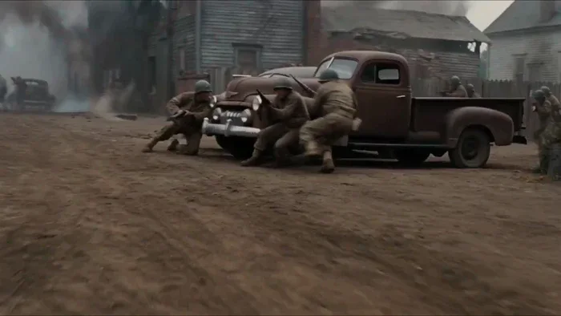</a>

▶ [Watch the full video on ofox.ai](https://ofox.ai/hailuo-3-prompts?utm_source=github&utm_medium=case&utm_campaign=awesome-ai-video-prompts#case-10)

**输入素材**：未公开 —— 本案例未收录可用的输入素材，请参阅来源

<strong>Prompt</strong> — Create a 15-second ultra-photorealistic live-action war sequence set in the United States in 1947, designed to look like authentic historical footage …

~~~~text
Create a 15-second ultra-photorealistic live-action war sequence set in the United States in 1947, designed to look like authentic historical footage captured on a 1940s film camera. The entire scene must feel grounded, documentary-like, raw, and physically realistic.
Environment: A rural American town in 1947 with wooden houses, old brick buildings, telephone poles, dirt roads, vintage American cars from the 1940s, wooden fences, farmland, and period-accurate street details. Overcast afternoon light, light fog, drifting smoke, dust in the air, damaged buildings, scattered debris, and a tense wartime atmosphere.
Characters: American soldiers wearing historically accurate late-1940s military uniforms, helmets, boots, and equipment. Civilians wear authentic 1940s American clothing. Natural faces, realistic skin texture, sweat, dirt, fatigue, and believable body movements.
0–3s — Establishing Shot:
Wide handheld shot of a quiet rural American street suddenly filled with smoke and confusion. Vintage 1940s vehicles are parked along the road while soldiers move quickly between wooden buildings. Civilians rush toward safer areas.
3–6s — Tension:
Camera moves through the street at shoulder height, following several soldiers as distant gunfire is heard. They immediately react and take cover behind a vintage vehicle and a brick wall. Their movements are cautious and realistic.
6–10s — Combat:
Fast handheld tracking shot as the soldiers move between cover while distant gunfire impacts the environment. Small pieces of wood, dust, and debris fall naturally from nearby impacts. Weapon recoil, movement, and body weight must be physically accurate. Keep the violence realistic and restrained.
10–13s — Human Moment:
Camera briefly focuses on a soldier helping an injured civilian move behind cover. Their breathing, facial expressions, body language, and movement should feel natural and unscripted.
13–15s — Final Shot:
Camera pulls back into a wide shot of the American town as smoke slowly moves through the street. Soldiers remain behind cover while vintage vehicles and damaged buildings fill the background. The scene ends with an authentic, tense 1940s documentary feeling.
Visual Style: Ultra-photorealistic live-action, authentic 1940s American environment, vintage 35mm film texture, subtle film grain, natural imperfections, realistic exposure, handheld documentary cinematography, muted historical color palette, realistic smoke and dust, natural shadows, accurate depth of field.
Physics: Strictly obey real-world gravity, momentum, inertia, friction, recoil, weight, collision physics, and human biomechanics. No exaggerated explosions, impossible movements, superhero behavior, or choreographed-looking combat.
Negative Prompt: modern buildings, modern cars, smartphones, modern clothing, modern weapons, futuristic technology, CGI appearance, video-game graphics, fantasy, superhero action, excessive explosions, excessive blood, gore, impossible physics, unrealistic recoil, slow-motion physics, distorted faces, extra limbs, floating objects, plastic skin, artificial-looking environments.
~~~~

**参数**：MiniMax H3 · 未标注 · t2va · 15s · 未标注 · 未标注 · 带音频
**来源**：@RuzainaMeer · [原帖](https://x.com/RuzainaMeer/status/2087117707816714552)

Preview © 2026 @RuzainaMeer · Prompt by @RuzainaMeer

[Back to top](#table-of-contents)

### Case 14: Ruby Queen Transforms Into a Warrior (红宝石女王变身战士) — by @TaliaAariz

<a href="https://ofox.ai/hailuo-3-prompts?utm_source=github&utm_medium=case&utm_campaign=awesome-ai-video-prompts#case-14">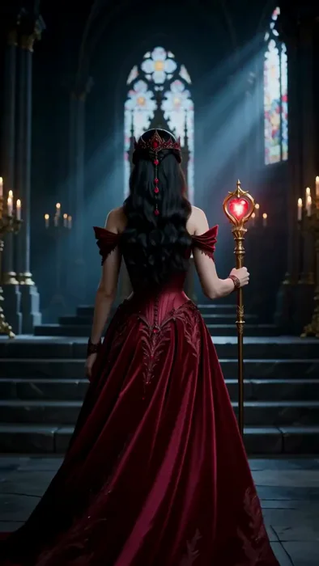</a>

▶ [Watch the full video on ofox.ai](https://ofox.ai/hailuo-3-prompts?utm_source=github&utm_medium=case&utm_campaign=awesome-ai-video-prompts#case-14)

**输入素材**：未公开 —— 本案例未收录可用的输入素材，请参阅来源

<strong>Prompt</strong> — A cinematic fantasy transformation beginning with a majestic queen wearing an intricate ruby-embroidered corset gown, matching crown, and holding a gl…

~~~~text
A cinematic fantasy transformation beginning with a majestic queen wearing an intricate ruby-embroidered corset gown, matching crown, and holding a glowing heart-topped scepter inside a gothic cathedral throne room. The camera zooms out to show her full attire as she turns and walks toward a grand staircase, where a burst of glowing red magical light erupts around her. Enveloped in the crimson energy, her gown transforms into sleek, ornate metallic warrior armor, while her scepter morphs into a longsword and an embossed shield. She turns back toward the camera in a powerful battle stance, positioned before a glowing red arcane circle on the cathedral steps.
~~~~

**参数**：MiniMax H3 · 未标注 · t2va · 15s · 未标注 · 未标注 · 带音频
**来源**：@TaliaAariz · [原帖](https://x.com/TaliaAariz/status/2090330350668947525)

Preview © 2026 @TaliaAariz · Prompt by @TaliaAariz (frame re-selected by us — original clip cut together a comparison against another model)

[Back to top](#table-of-contents)

### Case 24: Hand-Painted Blizzard Survival (手绘暴风雪求生) — by @sada_ai

<a href="https://ofox.ai/hailuo-3-prompts?utm_source=github&utm_medium=case&utm_campaign=awesome-ai-video-prompts#case-24">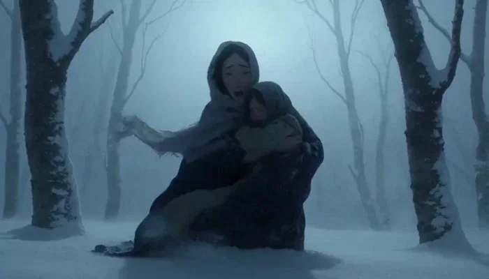</a>

▶ [Watch the full video on ofox.ai](https://ofox.ai/hailuo-3-prompts?utm_source=github&utm_medium=case&utm_campaign=awesome-ai-video-prompts#case-24)

**输入素材**：未公开 —— 本案例未收录可用的输入素材，请参阅来源

<strong>Prompt</strong> — Visual Medium &amp; Craft: Traditional frame-by-frame hand-painted oil-on-paper animation, physical 12 fps stop-motion cadence with deliberate frame holds…

~~~~text
Visual Medium & Craft: Traditional frame-by-frame hand-painted oil-on-paper animation, physical 12 fps stop-motion cadence with deliberate frame holds and natural line jitter between frames. Raw brushstroke textures, strictly zero CGI, no 3D rendering, no digital interpolation, no game engine aesthetics. Cinematography & Lighting: Masterful cinematography in the style of Emmanuel Lubezki and Roger Deakins, shot with physical cine lenses and a classic 180° shutter blur. Lit exclusively by a single overhead light source: pale, freezing moonlight cutting through dense atmospheric haze. Strong contre-jour backlighting with the camera positioned on the shadow side. Uniform cold blue moonlight washes over skin, clothing, snow, and tree trunks, casting sharp cold rim lights on shoulders and hoods while keeping faces in soft shadow. Atmosphere & Environment: A violent, blinding blizzard with near-zero visibility (3 meters maximum), dissolving the background into a solid white fog wall. Gale-force horizontal winds whip thick snow and freezing fog through the frame. Deep snow quickly accumulates on garments. Exhaled breath instantly vaporizes and tears away in the wind. Characters & Emotion: A desperate mother and her frightened young child battling for survival, lost in the storm at the absolute limit of their endurance. The mother conceals her panic to protect her child, while the child cries openly in fear. Both lean heavily into the gale, squinting against the biting wind, shielding their faces with forearms and ducking into their collars. Technical Details: Color palette dominated by 60% snow-blue, 30% deep trunk-black, and 10% cold highlight accents. Strict physical realism with grounded weight, true inertia, and accurate contact shadows on snow. Dynamic compositional balance using the rule of thirds and golden ratio. Uncompromising continuity across all character designs, garments, and environmental assets. 8K IMAX aesthetic.
~~~~

**参数**：MiniMax H3 · 未标注 · t2va · 15s · 未标注 · 未标注 · 带音频
**来源**：@sada_ai · [原帖](https://x.com/sada_ai/status/2085547332880503134)

Preview © 2026 @sada_ai · Prompt by @sada_ai

[Back to top](#table-of-contents)

### Case 25: INK AFTER DARK in Pulp-Noir Motion (《INK AFTER DARK》黑色电影片头) — by @opener_ai

<a href="https://ofox.ai/hailuo-3-prompts?utm_source=github&utm_medium=case&utm_campaign=awesome-ai-video-prompts#case-25">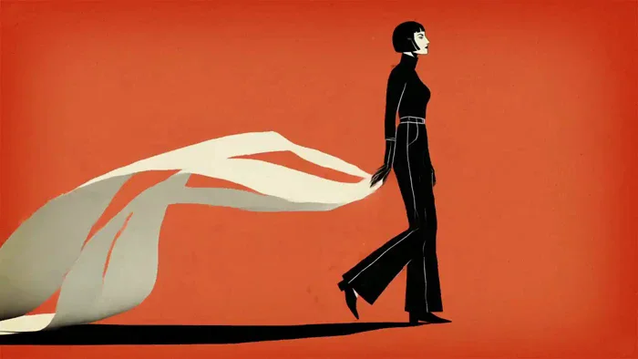</a>

▶ [Watch the full video on ofox.ai](https://ofox.ai/hailuo-3-prompts?utm_source=github&utm_medium=case&utm_campaign=awesome-ai-video-prompts#case-25)

**输入素材**：未公开 —— 本案例未收录可用的输入素材，请参阅来源

<strong>Prompt</strong> — [FORMAT] Create a 15-second, 16:9 retro graphic opening-title sequence titled "INK AFTER DARK". A stylish 1960s pulp-noir animation about a mysterious…

~~~~text
[FORMAT]
Create a 15-second, 16:9 retro graphic opening-title sequence titled "INK AFTER DARK".
A stylish 1960s pulp-noir animation about a mysterious night writer. Bold, minimal, elegant, slightly dangerous, with dry visual wit.

[IDENTITY]
Keep one female writer visually consistent throughout: sharp angular bob haircut, narrow almond-shaped eyes, long black turtleneck, high-waisted trousers, slim silhouette, black leather gloves, calm expression, upright self-assured posture, and hard graphic highlights along one side of her face.
Use flat hand-inked 2D illustration with rough screen-print texture, imperfect paper grain, and slightly uneven ink edges.

[BEATS]
[0–3 seconds] Extreme close-up of the writer's face emerging from near-total black. A narrow cream-colored strip of light slides across her eyes. The frame abruptly opens sideways like torn paper, revealing her full silhouette walking across a burnt-red background while loose sheets of paper trail behind her like a long ribbon.

[3–6 seconds] The paper ribbon sweeps across frame and becomes a graphic wipe. Reveal her in profile at a desk. She strikes one typewriter key. On impact, the screen fractures into three bold rectangular panels: her gloved fingers, the metal typebar snapping forward, and a giant black ink letter striking paper.

[6–9 seconds] Rapid rhythmic close-ups: spinning typewriter ribbon spool, carriage return lever snapping sideways, black ink spreading through rough paper fibers. Thin cream lines cut diagonally across the screen and reorganize the images into an asymmetric editorial collage.

[9–12 seconds] Pull wide. The writer stands alone beside an enormous abstract typewriter rendered as a black geometric silhouette. She pulls one endless page upward. The rising page becomes a full-frame cream vertical wipe while scattered black letters tumble downward like physical debris.

[12–15 seconds] The letters rapidly assemble into the exact title "INK AFTER DARK" centered large on a burnt-red paper field. The writer's small black silhouette crosses beneath the title and exits frame. The title appears through sharp letter-by-letter mechanical impacts over 0.5 seconds, holds completely still through the ending. No bouncing, spinning, stretching, or fly-in typography.

[CAMERA]
Use aggressive graphic changes in scale: extreme facial close-up → full-body silhouette → macro mechanical inserts → monumental wide composition.
Camera movement should feel designed rather than realistic: fast lateral pushes, sudden graphic crops, one rapid pull-out, and precise locked compositions. Avoid conventional cinematic orbit shots.

[LIGHT]
Limited palette only: burnt red, aged cream, deep black, with tiny muted silver highlights on typewriter metal.
Hard noir side-lighting translated into flat graphic shapes. Rough vintage print stock, subtle paper scratches, coarse ink grain, slight registration offsets, and occasional frame jitter.

[EDIT]
Fast editorial rhythm with hard cuts, paper wipes, diagonal panel slices, oversized object masks, and split-screen recompositions.
Transitions must be motivated by paper, ink, typewriter mechanisms, or moving silhouettes. No soft dissolves.
Make every shot feel newly composed rather than simply zooming into the previous image.

[AUDIO]
Audio: dry typewriter key strikes, paper slides, ribbon-spool clicks, carriage-return snaps, faint room hum, and one heavy mechanical impact when the final title locks.
BGM: an original 15-second cue, 65% noir suspense and 35% cool jazz. Upright bass, brushed snare, muted vibraphone, sparse low piano, and short clipped brass accents. Begin almost empty, introduce bass at 3 seconds, rhythmic percussion at 6 seconds, a brief brass accent at 10 seconds, then freeze the final 2 seconds on one bass note and the mechanical title hit. Do not imitate an existing melody.

[NEGATIVE]
No subtitles, extra on-screen text, watermarks, platform logos, or stickers.
Do not introduce Chinese text, garbled characters, misspellings, or additional title variations. Render "INK AFTER DARK" once only.
No 3D CGI, photorealism, anime styling, glossy modern motion graphics, neon cyberpunk aesthetics, or smooth vector-clean surfaces.
Never a slideshow. Maintain active graphic motion, physical visual transitions, and continuously evolving compositions.
~~~~

**参数**：MiniMax H3 · 未标注 · t2va · 15s · 未标注 · 未标注 · 带音频
**来源**：@opener_ai · [原帖](https://x.com/opener_ai/status/2087042643369099381)

Preview © 2026 @opener_ai · Prompt by @opener_ai

[Back to top](#table-of-contents)

### Case 26: Morning at a Traditional Javanese Market (日惹传统市场的清晨) — by @junwatu

<a href="https://ofox.ai/hailuo-3-prompts?utm_source=github&utm_medium=case&utm_campaign=awesome-ai-video-prompts#case-26">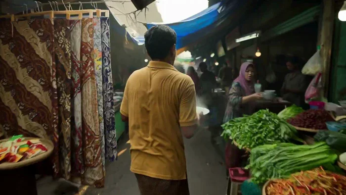</a>

▶ [Watch the full video on ofox.ai](https://ofox.ai/hailuo-3-prompts?utm_source=github&utm_medium=case&utm_campaign=awesome-ai-video-prompts#case-26)

**输入素材**：未公开 —— 本案例未收录可用的输入素材，请参阅来源

<strong>Prompt</strong> — Traditional Javanese market in Yogyakarta, early morning, present day, ultra-realistic handheld one-take. A bakso vendor hurries through impossibly na…

~~~~text
Traditional Javanese market in Yogyakarta, early morning, present day, ultra-realistic handheld one-take. A bakso vendor hurries through impossibly narrow, crowded market aisles carrying a large steaming bowl of freshly prepared bakso. Shoppers and vendors step aside to let him pass. He weaves between vegetable stalls overflowing with chilies, shallots, and leafy greens, ducks beneath low-hanging tarps, squeezes past batik merchants and baskets of traditional snacks, and carefully avoids children running through the market. The market feels dense, humid, noisy, and full of life. He passes porters carrying heavy sacks on their shoulders, women bargaining in Javanese, and motorcycles slowly pushing through the narrow lane. He finally reaches a tiny food stall at the back of the market and serves the steaming bowl just as the power briefly flickers, leaving the market dim for a moment before the bustle continues. Oppressive realism, natural morning light mixed with fluorescent bulbs, worn concrete floors, damp walls, wooden stalls, hanging plastic signs, Javanese conversations, vendors calling out prices, clattering bowls, footsteps echoing through the covered market, immersive cinematic pacing. No cyberpunk, no stylization, documentary-like realism.
~~~~

**参数**：MiniMax H3 · 未标注 · t2va · 15s · 未标注 · 未标注 · 带音频
**来源**：@junwatu · [原帖](https://x.com/junwatu/status/2084840152715911311)

Preview © 2026 @junwatu · Prompt by @junwatu

[Back to top](#table-of-contents)

### Case 91: The Boy Who Returned the Moon · Chapter 4 (归还月亮的少年 · 第四幕) — by @ManuAGI01

<a href="https://ofox.ai/hailuo-3-prompts?utm_source=github&utm_medium=case&utm_campaign=awesome-ai-video-prompts#case-91">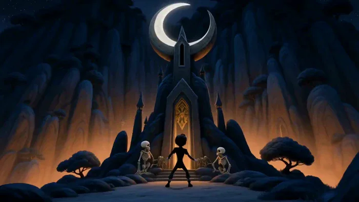</a>

▶ [Watch the full video on ofox.ai](https://ofox.ai/hailuo-3-prompts?utm_source=github&utm_medium=case&utm_campaign=awesome-ai-video-prompts#case-91)

**输入素材**：未公开 —— 本案例未收录可用的输入素材，请参阅来源

<strong>Prompt</strong> — [REFERENCE CONTROL] Use the uploaded PART 4 storyboard image for “THE BOY WHO RETURNED THE MOON” as the PRIMARY visual, character, environment, scale,…

~~~~text
[REFERENCE CONTROL]

Use the uploaded PART 4 storyboard image for “THE BOY WHO RETURNED THE MOON” as the PRIMARY visual, character, environment, scale, costume, prop, lighting, cinematography, emotional-performance, and narrative reference.

This sequence continues IMMEDIATELY from PART 3.

PART 3 ended with:
- the moon almost completely dark
- only a faint silver rim remaining
- the Living Bone Bridge still spanning the canyon
- Nyx magically exhausted but physically unharmed
- Zara pointing toward the Moon Shrine
- Kael holding the ONLY glowing moon fragment securely in both hands
- Zara shouting:
  <d>[English] KAEL! GO!</d>

Generate a FINISHED cinematic animated sequence from the uploaded storyboard.

DO NOT reproduce or animate the storyboard sheet itself.

The final video must NOT contain:
- storyboard borders
- panel numbers
- timestamps
- handwritten captions
- speech bubbles
- production notes
- reference drawings
- activation diagrams
- paper background
- storyboard header/footer
- color swatches
- annotation text

The uploaded storyboard locks:

1. Kael’s exact face, hair, costume and proportions
2. Zara’s exact face, enormous curly hairstyle and blue rib-pattern shirt
3. Nyx’s exact black dragon anatomy
4. Nyx’s enormous amber eyes and luminous grin
5. the ONLY silver moon fragment
6. the almost-dark damaged moon
7. the Living Bone Bridge
8. the Moon Shrine architecture
9. the impossibly high fragment receptacle
10. Nyx giving Kael the final lift
11. Kael inserting the fragment
12. silver-blue shrine activation
13. moonlight wave crossing the valley
14. gradual moon restoration
15. restored Noctara
16. skeleton guardian → moon-firefly transformation
17. Zara’s emotional reaction
18. Kael and Nyx reconciliation
19. final lakeside callback
20. final Kael + Zara + Nyx friendship composition

Translate the storyboard’s 15 one-second panels into approximately **9 coherent cinematic shots**.

DO NOT create fifteen frantic one-second cuts.

Use:

urgent action
→ obstacle
→ trust
→ sacred activation
→ enormous magical payoff
→ emotional release
→ reconciliation
→ quiet final comedy.

--------------------------------------------------

[VIDEO GOAL]

Duration:
EXACTLY 15 seconds

Story range:
0:45–1:00 of the complete 1-minute film

Aspect ratio:
16:9 landscape

Frame-rate feeling:
cinematic 24 fps

Visual medium:
premium hand-painted 2D dark-fantasy animation

Genre:
fantasy adventure finale / emotional magical payoff

Dialogue:
native synchronized English

Audio:
native dialogue + environmental sound + moon magic + guardian transformation + original cinematic score

EMOTIONAL ARC:

desperate urgency
→ frustration
→ unexpected help
→ complete trust
→ sacred wonder
→ triumphant restoration
→ emotional release
→ realization
→ friendship
→ gentle comedy

CORE MESSAGE:

Kael began the story believing Nyx was stealing the light.

He ends the story understanding that Nyx was protecting it.

And Kael began the story watching the moon alone.

He ends it watching with friends.

--------------------------------------------------

[PART 4 STORY LIMIT]

This is the FINAL CHAPTER.

START:

Kael has just caught the moon fragment.

Zara tells him to go.

END:

The moon is fully restored.

The guardians have peacefully become silver-blue moon-fireflies.

Kael, Zara and Nyx sit together beside the moonlit lake.

The story must feel COMPLETELY resolved.

No cliffhanger.

--------------------------------------------------

[CHARACTER IDENTITY LOCK — KAEL]

Match Parts 1–3 and the uploaded PART 4 storyboard EXACTLY.

KAEL:

Slim teenage moon-watcher.

Appearance:
- pale-to-medium cool-toned skin
- youthful angular face
- large expressive dark eyes
- thick dark eyebrows
- swept-back tousled black hair
- recognizable pointed windswept silhouette
- lean narrow build
- long thin limbs

Clothing:
- simple charcoal-black tunic
- dark fitted trousers
- dark practical boots
- subtle belt
- no armor
- no cape
- no weapon

PART 4 PERFORMANCE ARC:

0–3 sec:
urgent, breathless, carrying huge responsibility

3–5 sec:
frustrated by unreachable shrine slot

5–7 sec:
surprised by Nyx’s help → chooses trust

7–10 sec:
focused → overwhelmed by sacred magic

10–12 sec:
wonder and relief

12–14 sec:
humbled, apologetic, playful reconciliation

14–15 sec:
peaceful belonging

CRITICAL:

Kael’s trust moment must be visible.

When Nyx lowers his head:

Kael looks at Nyx’s face.

Tiny hesitation.

Then he willingly climbs onto him.

No fear.

No argument.

Their action completes the relationship arc.

--------------------------------------------------

[CHARACTER IDENTITY LOCK — ZARA]

Match Parts 2–3 exactly.

ZARA — THE BONEKEEPER

Appearance:
- deep warm-brown skin
- enormous dense black curly hair
- cool blue highlights along curls
- very large expressive brown eyes
- strong dark eyebrows
- blue distressed top
- stylized pale ribcage design printed on fabric
- brown utility belt
- practical fantasy trousers / waist layers
- wrapped forearms
- practical boots
- compact athletic build

PART 4 PERFORMANCE:

urgent leader
→ shrine awe
→ emotional concern for guardians
→ realization that their ancient duty is fulfilled
→ quiet happiness
→ warm laughter with Kael and Nyx

Do not make Zara dramatically cry.

A tiny glossy eye / soft teary smile is enough.

--------------------------------------------------

[CHARACTER IDENTITY LOCK — NYX]

Match Parts 1–3 exactly.

NYX — THE MIDNIGHT DRAGON

Appearance:
- enormous elongated black dragon
- long serpentine neck
- feather-like layered black-blue scales
- backward wild head spines
- huge pointed ears
- enormous glowing amber-orange eyes
- vertical slit pupils
- exaggerated luminous toothy grin
- long flexible body
- dark wings

BEGINNING STATE:

Nyx is magically exhausted.

Show:
- slightly lowered head
- slower breathing
- dimmer amber eyes
- tired posture

He is NOT injured.

As the moon returns:
- amber eyes regain brightness
- scales regain moonlit highlights
- posture rises
- energy returns

PART 4 ROLE:

Nyx provides the physical reach Kael lacks.

He does not solve the final action himself.

He enables Kael to finish it.

This reinforces teamwork.

--------------------------------------------------

[MOON FRAGMENT LOCK]

Only ONE moon fragment exists.

Same fragment from Parts 1–3.

Appearance:
- irregular crescent/crystalline shard
- bright silver-white core
- translucent pale cyan edges
- small floating particles
- powerful cool illumination

Timeline:

Start:
Kael holds fragment with both hands.

Mid:
Kael carries it up shrine.

Then:
Kael inserts it into exact receptacle.

After insertion:
it becomes integrated into shrine energy.

It must NOT remain simultaneously in Kael’s hands.

No duplicates.

--------------------------------------------------

[MOON SHRINE LOCK]

Match the storyboard exactly.

Ancient lunar shrine on cliff summit.

Design:
- tall weathered dark-stone structure
- giant crescent / circular lunar arch
- narrow vertical receptacle near upper center
- ancient crescent carvings
- geometric silver rune channels
- stone staircase
- central pedestal
- cliff-top silhouette

BEGINNING:
completely inactive.

ACTIVATION:

fragment inserted
→ central rune ignites
→ nearby runes illuminate
→ light traces upward and outward
→ entire lunar arch glows
→ brilliant silver-blue pulse travels into valley
→ moon reacts

No explosion.

No structural destruction.

--------------------------------------------------

[MOON RESTORATION LOCK]

At beginning:
moon is almost black.

Only:
- faint silver rim
- subtle crack lines.

Restoration must be gradual and readable:

silver pulse reaches sky
→ one lunar edge brightens
→ cracks illuminate
→ silver light spreads across surface
→ missing fragment area reforms
→ cracks close
→ full moon becomes brilliant again.

Final moon must visually match the enormous perfect moon from PART 1.

No second moon.

No explosion.

--------------------------------------------------

[SKELETON GUARDIAN TRANSFORMATION LOCK]

The skeleton guardians’ transformation is peaceful and magical.

They have completed their ancient purpose.

Use:

blue runes glow
→ ivory bodies become silver translucent
→ edges dissolve gently into particles
→ forms turn into dozens of tiny silver-blue lights
→ lights become moon-fireflies
→ thousands of fireflies rise through valley

IMPORTANT:

This is NOT death.

This is NOT destruction.

Their consciousness / personality is implied to continue in the lights.

One guardian should give Zara a final little wave BEFORE transforming.

Zara recognizes the gesture.

Make it tender.

--------------------------------------------------

[LIVING BONE BRIDGE CONTINUITY]

The Living Bone Bridge from Part 3 remains visible early in Part 4.

As the guardians transform later:

the bridge itself may gently dissolve into silver-blue fireflies from far end toward near end.

Characters are already safely OFF the bridge before this happens.

No collapsing.

No falling.

No violent disassembly.

--------------------------------------------------

[RESTORED NOCTARA LOCK]

After the moon returns:

show the same world established in Part 1:

- giant gothic castles
- amber-orange windows
- reflective lake
- dark blue forest
- gigantic restored silver moon
- calm night sky

Silver light travels over architecture.

Warm castle lights become more vivid.

Lake reflects:
silver moon
+
amber city
+
silver-blue moon-fireflies.

--------------------------------------------------

[FINAL LOCATION CALLBACK]

The final scene must visually echo PART 1.

PART 1 OPENING:

Kael sits alone on rock
+
lake
+
huge moon
+
Noctara castles.

PART 4 ENDING:

Kael sits on same or visually matching rock,
but now:

Zara sits beside him.

Nyx’s giant head squeezes awkwardly beside/between them.

Silver-blue fireflies drift across the lake.

The visual meaning must read even without dialogue:

Kael is no longer alone.

--------------------------------------------------

[WORLD / STORY LOGIC]

Kael catches fragment
→ runs toward shrine.

Shrine receptacle too high
→ Kael cannot reach.

Nyx sees problem
→ lowers head.

Kael trusts Nyx
→ climbs onto dragon.

Nyx raises him
→ Kael reaches receptacle.

Kael inserts fragment
→ shrine activates.

Shrine activates
→ moonlight crosses valley.

Moon receives energy
→ moon restores.

Moon restored
→ guardians’ duty is complete.

Guardians transform
→ Zara realizes they are free.

Kael understands Nyx
→ friendship resolves.

No unexplained jumps.

--------------------------------------------------

integrated_multimodal_description:

[SHOT 1] — 0.00s–1.70s
THE LAST RUN

Continue DIRECTLY from Part 3.

Kael rises from his safe slide on the Living Bone Bridge.

The glowing moon fragment is secured in BOTH hands.

Its silver light illuminates his face.

Zara points toward the shrine.

Zara:
<d>[English] GO!</d>

Kael runs.

He leaves the Bone Bridge and sprints up the ancient shrine approach.

Nyx follows behind more slowly, visibly exhausted but determined.

Camera:
low tracking beside Kael
→ front-facing running shot
→ tilt up revealing enormous inactive shrine ahead.

Sound:
- fast footsteps
- Kael breathing
- fragment hum
- cold wind
- distant bridge rune tone

Music:
urgent strings + low percussion.

--------------------------------------------------

[SHOT 2] — 1.70s–3.20s
ONE FINAL PROBLEM

Kael races up the stone steps.

The shard’s light briefly reflects off dormant shrine runes.

He reaches the center.

Stops.

Looks upward.

Camera follows his gaze.

The receptacle is extremely high above him inside the giant lunar arch.

Kael’s expression drops.

He tries one quick safe jump while lifting the fragment.

Not even close.

He lands.

Looks up again.

Dialogue:

Kael:
<d>[English] Seriously?!</d>

Brief comedy beat.

Camera:
medium Kael
→ huge vertical tilt showing impossible height
→ close frustrated expression.

Music pauses for one tiny comic note.

--------------------------------------------------

[SHOT 3] — 3.20s–4.70s
THE DRAGON OFFERS THE FINAL LIFT

A huge black shape moves behind Kael.

Kael turns quickly.

Nyx lowers his enormous tired head beside him.

Amber eyes meet Kael’s.

Nyx gives his familiar terrifying luminous grin.

But the emotional meaning is completely different now.

Kael understands.

Hold eye contact.

Kael glances:
Nyx
→ high receptacle
→ Nyx again.

Tiny hesitation.

Then Kael smiles faintly.

Dialogue:

Kael:
<d>[English] Okay.</d>

Nyx lowers his head even further.

Kael carefully climbs between his large ears/head spines while holding the shard securely.

Zara watches from below.

Camera:
Kael close
→ Nyx face
→ intimate eye contact
→ wide scale composition.

Music:
urgent score softens into trust motif.

--------------------------------------------------

[SHOT 4] — 4.70s–6.20s
THE MISSING PIECE COMES HOME

Nyx slowly stretches his long neck upward.

No sudden movement.

Kael rises toward the receptacle.

The almost-dark moon hangs behind the shrine.

Kael reaches forward.

The silver shard aligns with the exact missing slot.

For one breath:

Kael stares at it.

Then inserts the fragment.

CLICK / soft magical lock.

The shard fits perfectly.

A single thin silver rune illuminates beneath Kael’s hand.

Kael whispers:

<d>[English] Come on...</d>

Camera:
side silhouette of Nyx raising Kael
→ close hand/shard
→ macro alignment
→ shard insertion
→ rune ignition.

Sound:
- crystalline alignment
- soft stone resonance
- deep lunar tone

--------------------------------------------------

[SHOT 5] — 6.20s–8.10s
THE MOON SHRINE REMEMBERS

The first rune becomes brighter.

Then light races elegantly through nearby carvings.

One line.

Then another.

Then dozens.

The entire crescent arch activates in glowing silver-blue geometry.

WHOOOM.

Not an explosion.

Kael shields his eyes slightly.

Nyx’s black scales become beautifully rim-lit in silver.

His amber eyes begin regaining brightness.

Zara looks upward in awe.

A controlled wave of moonlight launches outward from the shrine along ancient rune paths.

Dialogue:

Zara, breathlessly:
<d>[English] It worked...</d>

Camera:
rune close-up
→ tracing lines
→ giant shrine-wide activation
→ silver wave leaving shrine.

Music:
full magical orchestra begins opening upward.

--------------------------------------------------

[SHOT 6] — 8.10s–10.10s
AND THE MOON RETURNS

Follow the silver wave.

It travels:

across cliff
→ along Living Bone Bridge
→ through Valley of Bones
→ into distant Noctara
→ upward toward the sky.

Cut to the almost-dark moon.

Silver light touches one edge.

Then restoration begins:

thin silver rim brightens
→ fracture lines glow
→ pale light spreads inward
→ missing lunar section reforms
→ cracks seal
→ full giant silver moon returns.

Give the moon reveal enough time to register.

Nyx, Kael and Zara stare upward.

Nyx’s amber eyes become bright again.

Dialogue:

Kael, quietly:
<d>[English] We did it.</d>

Zara:
<d>[English] We did.</d>

Sound:
- deep celestial harmonic swell
- layered crystalline resonance
- gentle wave
- distant castle bells beginning

Music reaches emotional peak.

--------------------------------------------------

[SHOT 7] — 10.10s–11.80s
NOCTARA SEES ITS LIGHT AGAIN

Very wide cinematic reveal.

The restored enormous moon illuminates:

- Valley of Bones
- distant gothic Noctara
- castle towers
- calm lake
- dark forest

Amber castle windows glow against silver moonlight.

The lake becomes a silver-blue mirror.

Kael’s face relaxes.

Zara smiles.

Nyx lifts his head proudly.

Do not rush.

Use this as the grand visual payoff.

Camera:
huge moon
→ tilt downward through city
→ reflective lake
→ heroes silhouetted against restored world.

Sound:
- distant bells
- soft wind
- lake
- gentle magical resonance

--------------------------------------------------

[SHOT 8] — 11.80s–13.20s
THE VALLEY OF STARS

Back near Zara.

The skeleton guardians begin glowing.

Zara notices.

One familiar guardian turns toward her.

It slowly lifts one skeletal hand.

Waves.

Zara’s expression softens immediately.

She raises her hand slightly in return.

The guardian’s ivory form becomes translucent.

Blue runes become silver-white.

Then—

the guardian gently dissolves into dozens of tiny silver-blue moon-fireflies.

Other guardians follow.

Across the bridge and valley:

hundreds of guardians become thousands of beautiful lights.

No destruction.

No pain.

The Living Bone Bridge itself transforms gracefully into rising luminous fireflies.

The valley fills with stars.

A few tiny fireflies circle Zara’s curls and settle briefly near her open palm.

Zara smiles with glossy emotional eyes.

Dialogue:

Zara, soft:
<d>[English] You’re free.</d>

Sound:
- delicate bone/rune chime
- thousands of soft magical wing sparkles
- airy silver shimmer

Music:
shift from triumph into warm emotional release.

--------------------------------------------------

[SHOT 9] — 13.20s–15.00s
FIRST IMPRESSIONS — FINAL FRIENDSHIP

Use a VERY efficient flowing transition.

Kael stands beside recovered Nyx.

Zara joins them.

Silver-blue fireflies surround the trio.

Kael looks up at Nyx.

Dialogue:

Kael:
<d>[English] You weren’t stealing it.</d>

Nyx gives his enormous ridiculous grin.

Nyx:
<d>[English] Obviously.</d>

Kael:
<d>[English] You could’ve told me.</d>

Nyx:
<d>[English] You screamed and ran away.</d>

Zara laughs.

MATCH CUT / elegant visual transition into final lakeside callback.

Same visual language as Part 1 opening:

- gigantic restored moon
- glowing Noctara castles
- still lake
- silver reflection
- same lakeside rock

But now:

Kael sits in the middle.

Zara sits beside him.

Nyx’s enormous head is squeezed awkwardly between/next to them, trying to fit.

Moon-fireflies drift everywhere.

Kael looks toward the moon.

Kael:
<d>[English] Same time tomorrow?</d>

Nyx:
<d>[English] Only if the moon behaves.</d>

Zara, dry:
<d>[English] It won’t.</d>

Nyx’s amber eyes widen.

Kael gives a tired little sigh.

Zara smiles.

IMPORTANT TIMING:

Because 15 seconds is short, if all final dialogue cannot fit naturally, PRIORITIZE:

1. <d>[English] You weren’t stealing it.</d>
2. <d>[English] Obviously.</d>
3. <d>[English] Same time tomorrow?</d>
4. <d>[English] Only if the moon behaves.</d>
5. Zara’s final:
   <d>[English] It won’t.</d>

Do NOT rush voices unnaturally.

The “You could’ve told me / You screamed and ran away” exchange may be conveyed partly through facial performance if needed.

Camera slowly pulls backward across the moonlit lake.

The three friends become small against the huge restored world.

Silver-blue moon-fireflies float through foreground.

HOLD final composition.

FADE TO BLACK.

END.

--------------------------------------------------

[AUDIO DESCRIPTION]

Generate synchronized native stereo audio.

--------------------------------------------------

[KAEL VOICE]

Natural teenage-boy voice.

Qualities:
- youthful
- expressive
- sincere
- thoughtful
- not overly heroic
- clear English

Performance progression:

0–3 sec:
breathless urgency

3–5 sec:
comic frustration → trust

5–8 sec:
focused

8–11 sec:
quiet wonder and relief

11–13 sec:
emotionally softened

13–15 sec:
comfortable playful friendship

Important:

<d>[English] We did it.</d>

should be spoken softly in disbelief rather than shouted.

Final dialogue should feel relaxed.

--------------------------------------------------

[ZARA VOICE]

Natural teenage-girl voice.

Qualities:
- grounded
- confident
- dry humor
- warm
- clear English

Part 4:

opening:
urgent.

restoration:
awed.

guardian transformation:
soft and emotional.

ending:
dry comedic confidence.

Critical line:

<d>[English] You’re free.</d>

should be nearly whispered.

Final:

<d>[English] It won’t.</d>

should be perfectly deadpan.

--------------------------------------------------

[NYX VOICE]

For the first time, Nyx may speak clearly in this finale.

Voice:
- deep but surprisingly articulate
- warm
- dry
- slightly theatrical
- not monstrous
- no evil resonance

Keep speech concise.

Most important comedy line:

<d>[English] Obviously.</d>

Deliver as though Nyx cannot believe Kael needed an explanation.

Final:

<d>[English] Only if the moon behaves.</d>

warm, playful.

--------------------------------------------------

[MOON SHRINE SOUND DESIGN]

Inactive shrine:
very faint stone resonance.

Shard insertion:
- crystal alignment
- soft magnetic/stone lock
- one pure silver bell tone

Rune activation:
- harmonic layers awakening sequentially
- gentle low-frequency resonance
- glassy silver overtones

Full shrine:
rich sacred “WHOOOM.”

No explosion.

--------------------------------------------------

[MOON RESTORATION SOUND]

Use a distinctive celestial progression:

faint lunar hum
→ silver harmonic grows
→ crack lines resonate
→ rich glass/choir tone
→ warm resolved celestial chord.

No thunder.
No boom.
No destruction.

--------------------------------------------------

[MOON-FIREFLY SOUND DESIGN]

Guardian rune glow:
delicate cyan chimes.

Transformation:
- soft sparkling release
- airy wing shimmer
- tiny individual bells

Thousands rising:
layered soft shimmering atmosphere.

No ghost sounds.
No mourning wails.

--------------------------------------------------

[ENVIRONMENT AUDIO]

Beginning:
- cold canyon wind
- fast footsteps
- distant bridge rune hum

Shrine:
- stone resonance
- magical rune energy

Moon restoration:
- valley wind softens
- distant castle bells
- lake ambience gradually returns
- distant night insects return

Final lakeside:
- gentle water
- quiet night wind
- soft firefly shimmer
- distant Noctara bells

Use sound to communicate that the world itself has recovered.

--------------------------------------------------

[NON-DIEGETIC MUSIC]

Create an ORIGINAL cinematic fantasy finale score.

Instrumentation:
- urgent strings
- piano
- French horn
- harp
- celesta
- glass harmonics
- warm sustained strings
- low cello
- airy choir without lyrics
- light flute
- subtle frame drum

MUSIC ARC:

0.00–1.70
urgent final run.

1.70–3.20
tension + brief comedy pause.

3.20–4.70
quiet trust motif.

4.70–6.20
sacred anticipation.

6.20–8.10
large magical activation build.

8.10–10.10
major emotional climax during moon restoration.

10.10–11.80
triumphant but warm release.

11.80–13.20
soft emotional guardian farewell.

13.20–15.00
gentle friendship theme + tiny comedy cadence.

End with the SAME melodic idea used in the Part 1 opening, but now harmonically fuller and warmer.

This creates musical closure.

--------------------------------------------------

[CAMERA LANGUAGE]

PART 4 camera progression:

0–3 sec:
urgent forward motion + vertical shrine scale.

3–5 sec:
intimate Kael/Nyx trust coverage.

5–8 sec:
close sacred action → giant activation reveal.

8–11 sec:
largest environmental / celestial wides.

11–13 sec:
slow graceful guardian transformation.

13–15 sec:
intimate reconciliation → huge calm final callback.

Use:
- forward tracking
- dramatic upward tilt
- eye-level emotional close-ups
- slow crane
- macro shard insertion
- large shrine pull-back
- huge moon composition
- environmental traveling wave
- slow orbit around Zara/fireflies
- final lakeside pull-back

Avoid:
- handheld shake
- crash zoom
- extreme Dutch angles
- frantic editing
- 360 spins
- action-movie camera after moon restoration

The camera should become CALMER as the story resolves.

--------------------------------------------------

[VISUAL STYLE]

Premium finished hand-painted 2D dark-fantasy animation.

MATCH PARTS 1–3 EXACTLY.

Use:
- expressive dark ink contours
- watercolor/gouache painterly backgrounds
- rich midnight blues
- silver moon illumination
- expressive stylized faces
- detailed black-blue dragon scales
- warm amber eyes
- ancient stone textures
- luminous cyan/silver runes
- elegant magic
- atmospheric depth
- subtle cinematic bloom
- restrained squash/stretch

The final animation should feel like the uploaded storyboard art has come alive.

NOT:
- storyboard animatic
- motion comic
- slideshow
- photorealism
- live action
- 3D CGI
- anime
- flat vector

--------------------------------------------------

[COLOR / LIGHTING ARC]

0–3 sec:

Almost-dark world.

Palette:
- charcoal
- deep navy
- black-blue
- faint cyan

PRIMARY LIGHT SOURCE:
moon fragment in Kael’s hands.

3–5 sec:

Introduce:
- Nyx’s amber eyes
- silver shard light
- faint shrine reflected light.

5–8 sec:

Silver/cyan rune illumination expands rapidly.

8–10 sec:

Moon restoration becomes brightest sequence.

Use:
- brilliant silver-white
- cool lunar blue
- subtle cyan
- deep navy contrast.

10–13 sec:

Restored night palette:
- silver moon
- amber castle lights
- blue-black environment
- silver-blue moon-fireflies.

13–15 sec:

...
~~~~

**参数**：MiniMax H3 · 未标注 · ref2va · 15s · 未标注 · 未标注 · 带音频
**来源**：@ManuAGI01 · [原帖](https://x.com/ManuAGI01/status/2086323087092470161)

Preview © 2026 @ManuAGI01 · Prompt by @ManuAGI01

[Back to top](#table-of-contents)

### Case 94: Macaw Scream in Extreme Slow Motion (金刚鹦鹉极慢速鸣叫) — by @yuvalav

<a href="https://ofox.ai/hailuo-3-prompts?utm_source=github&utm_medium=case&utm_campaign=awesome-ai-video-prompts#case-94">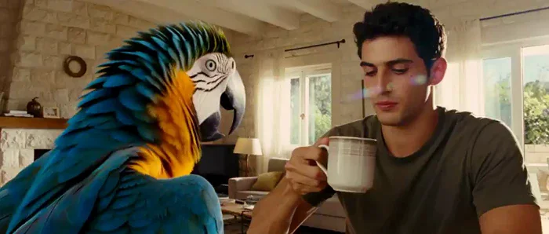</a>

▶ [Watch the full video on ofox.ai](https://ofox.ai/hailuo-3-prompts?utm_source=github&utm_medium=case&utm_campaign=awesome-ai-video-prompts#case-94)

**输入素材**：未公开 —— 本案例未收录可用的输入素材，请参阅来源

<strong>Prompt</strong> — /gen prompt: Cinematic wildlife documentary, vertical framing, subject centered, National Geographic award-winning cinematography, anamorphic lens, ri…

~~~~text
/gen prompt: Cinematic wildlife documentary, vertical framing, subject centered, National Geographic award-winning cinematography, anamorphic lens, rich natural color, natural sunlight, natural motion blur. States: the scream never stops, the camera always rises, every touched object reacts. Characters: a blue-and-gold macaw, cobalt wings, golden chest, green crown, white face patch, black beak; a young man, short dark curly hair, olive t-shirt. Israeli white stone apartment building, living room. 0-2s macro: silence, the macaw inhales, chest swelling, throat feathers rising, the man mid-sip. 2-5s the beak opens, the world slams into extreme slow motion: a ripple of distorted air expands from the beak, rings race across his coffee, the mug shattering into countable shards, coffee hanging in ropes, his cheeks rippling back. 5-9s time snaps back; the wave blows the shutters open, the camera rides it out, straight up the facade. 9-14s rising floor by floor: laundry lines whipping, a dog howling in one window; crawl on pigeons detonating off a ledge, feathers suspended, the ripple passing them; snap back. 14-17s the roof: solar heaters trembling, tank water rippling, car alarms flashing far below; bold 3D text "105 DB" slams centered mid-frame. 17-20s hard cut to the room: the macaw fluffs, tilts its head, one tiny chirp; the man frozen with the mug handle. Audio: silence, a heartbeat on the inhale; a sub-bass shockwave, one raw macaw screech Doppler shifting as the camera climbs, glass shatter, dogs and alarms join, biggest boom on the text, ringing silence, a tiny chirp. Photorealistic, no deformation, every feather barb visible, crisp letter edges, smooth fluid motion, 8k, extreme details. , resolution:720p, duration:20s, aspect_ratio:9:16
~~~~

**参数**：MiniMax H3 · 未标注 · t2va · 15s · 未标注 · 未标注 · 带音频
**来源**：@yuvalav · [原帖](https://x.com/yuvalav/status/2083143771508592938)

Preview © 2026 @yuvalav · Prompt by @yuvalav

[Back to top](#table-of-contents)

### Case 95: Korean Idol VHS Beauty Vlog (韩国偶像 VHS 美妆 Vlog) — by @saniaspeaks_

▶ [Watch the full video on ofox.ai](https://ofox.ai/hailuo-3-prompts?utm_source=github&utm_medium=case&utm_campaign=awesome-ai-video-prompts#case-95)

**输入素材**：未公开 —— 本案例未收录可用的输入素材，请参阅来源

<strong>Prompt</strong> — DV 16mm camcorder vlog with soft VHS tape quality, handheld POV by CHASE and mirror-mounted vanity shots. CHASE, a Korean idol in her 20s with long bl…

~~~~text
DV 16mm camcorder vlog with soft VHS tape quality, handheld POV by CHASE and mirror-mounted vanity shots. CHASE, a Korean idol in her 20s with long black hair and dewy skin, casually picks up the fictional Lumina Velvet Lip Tint (frosted pink tube, gold cap) at a mall beauty store, saying, "Okay, everyone's talking about this shade." She heads home, opens and swatches the lipstick, applies it smoothly in warm vanity lighting, admires the glossy finish, smiles at the mirror, then looks into the camera for a glowing close-up reveal and says, "Okay wow... Lumina Velvet Lip Tint, you've got a new fan."
~~~~

**参数**：MiniMax H3 · 未标注 · t2va · 15s · 未标注 · 未标注 · 带音频
**来源**：@saniaspeaks_ · [原帖](https://x.com/saniaspeaks_/status/2083043197937209852)

Preview © 2026 @saniaspeaks_ · Prompt by @saniaspeaks_

[Back to top](#table-of-contents)

### Case 96: Desert Buggy Combat Chase (沙漠越野车战斗追逐) — by @beginnersblog1

<a href="https://ofox.ai/hailuo-3-prompts?utm_source=github&utm_medium=case&utm_campaign=awesome-ai-video-prompts#case-96">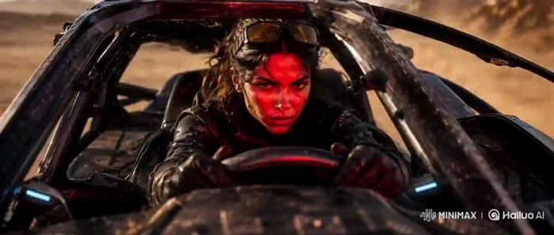</a>

▶ [Watch the full video on ofox.ai](https://ofox.ai/hailuo-3-prompts?utm_source=github&utm_medium=case&utm_campaign=awesome-ai-video-prompts#case-96)

**输入素材**：未公开 —— 本案例未收录可用的输入素材，请参阅来源

<strong>Prompt</strong> — Create a 15-second, 16:9 photoreal cinematic action sequence with native stereo audio. Treat the five images as coordinated multimodal references for …

~~~~text
Create a 15-second, 16:9 photoreal cinematic action sequence with native stereo audio. Treat the five images as coordinated multimodal references for identity, vehicle design, environment, performance, action, cinematography, and sound.

Use Image 1 as the strict facial-identity reference for the female racer. Preserve her exact face, dark tied-back hair, amber goggles, dusty skin, black tactical suit, shoulder armor, gloves, and focused expression.

Use Image 2 as the strict reference for her full costume, body proportions, armored black dune buggy, tire scale, exposed suspension, cyan headlights, roll cage, desert lighting, and industrial-outpost background.

Use Image 3 as the action reference for the pursuing drones, vehicle speed, dust trails, fire, debris, chase intensity, and camera proximity.

Use Image 4 as the location reference for Outpost 07, including its rusted towers, pipelines, bridges, rocky terrain, distant mountains, warm sunset atmosphere, and industrial scale.

Use Image 5 as the cockpit and performance reference. Preserve the same steering wheel, open roll cage, goggles, gloves, facial identity, driving posture, and vehicle interior.

Sequence
[0–2.5 seconds]

Open on Image 4 with an extreme-wide aerial establishing shot of Outpost 07 at sunset. The industrial complex fills the right side of frame while an empty desert route curves through the rocky foreground.

The camera dives rapidly toward the road as a small black dune buggy bursts from beneath an elevated pipeline, throwing a long dust plume behind it.

Keep the vehicle moving consistently from left to right toward the outpost. No direction reversal.

Audio begins with dry desert wind, distant industrial machinery, a low cinematic pulse, and the buggy engine approaching rapidly.

[2.5–5 seconds]

Cut at peak engine sound to Image 5.

Tight frontal cockpit shot mounted just ahead of the driver. The vehicle shakes naturally over rough ground. Her hands hold the steering wheel firmly while she makes small, physically accurate corrections.

Her amber goggles remain on top of her head. Loose strands of hair and fabric straps react to wind and vibration. Her eyes briefly check the left mirror, then return immediately to the road.

A red warning light reflects across her face as a targeting alarm begins.

Do not make her turn the steering wheel excessively. Her body, wheel movement, and vehicle direction must remain mechanically connected.

[5–8 seconds]

Cut to a low front three-quarter tracking shot based on Image 3.

Three pursuit drones descend behind the buggy in a triangular formation. Their rotors, stabilizers, and body movement respond realistically to speed and turbulence.

The lead drone fires into the sand beside the buggy. The impact creates a narrow eruption of dirt, sparks, and fragmented rock rather than an oversized fireball.

The racer steers sharply around the impact. The buggy’s front wheels turn first, the suspension compresses, the body leans, and the rear tires slide outward before regaining traction.

The camera tracks beside the vehicle without spinning or overtaking it.

[8–11 seconds]
Continue the same drift into a rear three-quarter shot.

The buggy races toward a narrowing passage between a rock wall and the outer structures of Outpost 07. The racer pulls a mechanical handbrake lever for one brief moment, rotating the vehicle through the opening.

One drone follows too closely and clips a rusted overhead pipe. Its wing breaks, sending the drone tumbling into the sand behind her.

Show the collision in the background while keeping the buggy dominant and moving forward. No slow motion.

Audio: tire scrape, suspension impact, metal tearing, drone rotors failing, engine rev rising.

[11–13 seconds]

Cut to a wheel-level macro shot.

The right rear tire bites into loose sand. Stones fire backward while the suspension rebounds. The camera rises naturally along the buggy’s side and reveals the two remaining drones closing in.

The racer presses a guarded switch beside the steering wheel.

A compact rear-mounted electromagnetic pulse discharges as a restrained blue-white distortion wave, briefly disrupting the drones’ lights and stabilizers.

No magical energy, lightning storm, or giant explosion.

[13–15 seconds]
Cut to a low frontal hero shot as the buggy clears the outpost gate at full speed.

The two disabled drones fall into the dust behind it while the vehicle launches from a shallow ridge. Keep the jump low, heavy, and physically believable.

During the brief airborne moment, cut to Image 1 for a tight close-up of the racer. Preserve her exact identity as warm firelight and cool dashboard light cross her face. Her expression remains controlled and determined.

The buggy lands hard beyond the gate. The suspension compresses, the engine roars, and the vehicle continues directly into the desert.

End with a sharp cut to black on the landing impact.

Visual Direction
Premium live-action science-fiction action trailer with realistic CGI integration, warm orange sunset light, restrained steel-blue technology accents, dusty atmosphere, hard surface detail, cinematic contrast, subtle film grain, realistic motion blur, and 24 FPS movement.

Use wide shots to establish scale, cockpit close-ups for tension, low tracking shots for speed, and mechanical macro shots for physical detail.

Keep the editing fast but readable. Every shot must begin from the physical state established by the previous shot.

Audio Direction
Native stereo sound with:
Aggressive combustion engine
Tire friction over sand and rock
Suspension rattles and chassis vibration
Drone rotors and targeting alarms
Sand impacts, metal collisions, and falling debris
Low percussion and rising electronic tension
One heavy bass impact on the final landing

Keep music underneath the vehicle and environmental sounds. No dialogue or voice-over.

Restrictions
No subtitles, titles, logos, watermarks, additional racers, pedestrians, creatures, motorcycles, futuristic city skyline, nighttime transition, costume changes, facial changes, vehicle redesign, additional wheels, floating vehicle parts, distorted hands, incorrect steering, reversed wheel rotation, teleportation, random explosions, oversized fireballs, weightless motion, impossible jumps, camera spins, circular camera moves, rapid zooms, fluid morphs, soft dissolves, or changes in travel direction.
~~~~

**参数**：MiniMax H3 · 未标注 · ref2va · 21s · 未标注 · 未标注 · 带音频
**来源**：@beginnersblog1 · [原帖](https://x.com/beginnersblog1/status/2083039412506743096)

Preview © 2026 @beginnersblog1 · Prompt by @beginnersblog1

[Back to top](#table-of-contents)

### Case 133: Mechanical bull charge The Beasts Are Coming (机械公牛冲锋·野兽将至) — by @rahulnanda86

<a href="https://ofox.ai/hailuo-3-prompts?utm_source=github&utm_medium=case&utm_campaign=awesome-ai-video-prompts#case-133">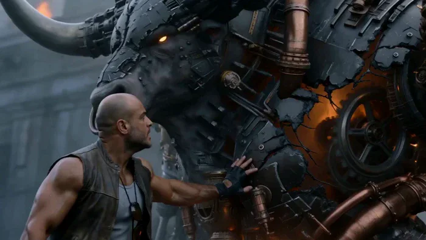</a>

▶ [Watch the full video on ofox.ai](https://ofox.ai/hailuo-3-prompts?utm_source=github&utm_medium=case&utm_campaign=awesome-ai-video-prompts#case-133)

**输入素材**：未公开 —— 本案例未收录可用的输入素材，请参阅来源

<strong>Prompt</strong> — Use the uploaded mechanical bull image as the primary reference for the bull, and use Rahul’s image as the character reference for the rider. Create a…

~~~~text
Use the uploaded mechanical bull image as the primary reference for the bull, and use Rahul’s image as the character reference for the rider.

Create a 15-second ultra-realistic cinematic fantasy-sci-fi sequence set in The Harvester universe. The setting is a foggy ruined industrial lane at dawn or overcast light, with drifting smoke, hanging wires, broken stone and metal structures, wet ground, ash in the air, and distant furnace glow. The giant mechanical bull is ancient, battle-scarred, and alive with furnace energy inside its cracked armor.

0–3s — Hook: Start with Rahul stumbling backward into frame, breathing hard, turning to face danger in the smoke behind him. The giant mechanical bull stands in front of him like a wall, half-silhouetted in steam, protecting him.

3–6s: Close on Rahul placing one hand on the bull’s armored side, steadying himself. He looks at it with trust, not fear. The bull turns its head slightly toward Rahul. Its eye glows brighter, and its internal furnace begins to pulse.

6–9s: A loud metallic roar echoes from somewhere in the fog ahead. The bull reacts instantly — it lowers its head, paws the ground, steam blasts from its vents, gears lock into place, and sparks spit from its chest cavity. Rahul pulls himself up and mounts the bull in one fast motion.

9–12s: The bull rears slightly, then slams down hard. Rahul leans forward, gripping tight. Through the smoke ahead, we briefly see threatening silhouettes moving toward them, just enough to imply incoming enemies.

12–15s — Payoff: The bull explodes forward into a full charge with Rahul riding it, smashing through smoke and embers. End on a powerful low-angle tracking shot as both disappear into the haze, charging straight toward the unseen threat.

Sound: deep metal groans, steam bursts, furnace rumble, distant enemy roar, hoof impact, sparks, low cinematic score.

Cinematography / Color Brief

Use the same signature look: desaturated steel blue, charcoal grey, mist white, weathered bronze, and restrained furnace orange accents. Soft overcast light, smoky atmosphere, wet surfaces, and strong depth. Cinematography should feel premium and mythic: low angles, slow dramatic push-ins, tactile detail, subtle shake, sharp realism, and heavy scale.
~~~~

**参数**：MiniMax H3 · 未标注 · ref2va · 15s · 未标注 · 未标注 · 带音频
**来源**：@rahulnanda86 · [原帖](https://x.com/rahulnanda86/status/2083033635364720815)

Preview © 2026 @rahulnanda86 · Prompt by @rahulnanda86

[Back to top](#table-of-contents)

### Case 137: A White Lion in the Lamplit Park (灯下公园里的白狮同行) — by @JohnSmith5912

<a href="https://ofox.ai/hailuo-3-prompts?utm_source=github&utm_medium=case&utm_campaign=awesome-ai-video-prompts#case-137">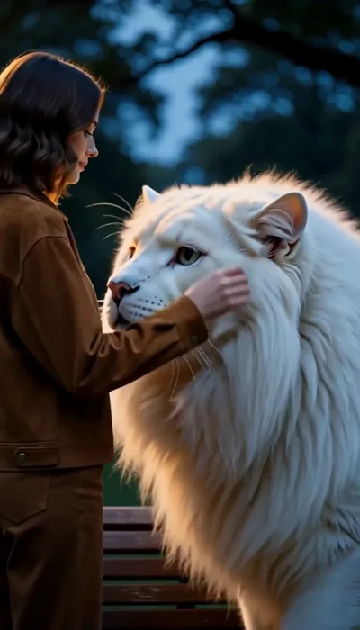</a>

▶ [Watch the full video on ofox.ai](https://ofox.ai/hailuo-3-prompts?utm_source=github&utm_medium=case&utm_campaign=awesome-ai-video-prompts#case-137)

**输入素材**：未公开 —— 本案例未收录可用的输入素材，请参阅来源

<strong>Prompt</strong> — A Cinematic video of a young woman wearing a brown jacket walking in a peaceful park during dusk She walks along a path lined with glowing warm street…

~~~~text
A Cinematic video of a young woman wearing a brown jacket walking in a peaceful park during dusk She walks along a path lined with glowing warm streetlamps On a wooden park bench, a giant, majestic white lion with glowing fur is calmly sitting The woman approaches the white lion and gently pets its mane and face. Close-up shot showing a warm connection between her and the gentle white lion with the lion nuzzling against her cheek lovingly Finally they are sitting together peacefully on the grass under a warm streetlamp at night Cinematic lighting, realistic, soft shadows 4k resolution, emotional and magical vibe.
~~~~

**参数**：MiniMax H3 · 未标注 · 未标注 · 未标注 · 未标注 · 未标注 · 未标注
**来源**：@JohnSmith5912 · [原帖](https://x.com/JohnSmith5912/status/2108389785329127633)

Preview © 2026 @JohnSmith5912 · Prompt by @JohnSmith5912

[Back to top](#table-of-contents)

### Case 138: A Tiny City Inside a Pocket Watch (怀表齿轮里的微缩晨城) — by @DeCat2025

<a href="https://ofox.ai/hailuo-3-prompts?utm_source=github&utm_medium=case&utm_campaign=awesome-ai-video-prompts#case-138">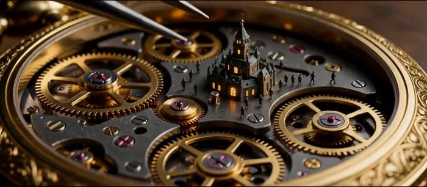</a>

▶ [Watch the full video on ofox.ai](https://ofox.ai/hailuo-3-prompts?utm_source=github&utm_medium=case&utm_campaign=awesome-ai-video-prompts#case-138)

**输入素材**：未公开 —— 本案例未收录可用的输入素材，请参阅来源

<strong>Prompt</strong> — Style: cinematic macro fantasy, warm amber workshop lamp light, brass and glass textures, extreme close-ups, shallow depth of field, film grain. 0-5s:…

~~~~text
Style: cinematic macro fantasy, warm amber workshop lamp light, brass and glass textures, extreme close-ups, shallow depth of field, film grain.

0-5s: One old watchmaker with a magnifying loupe over one eye opens a gold pocket watch on his wooden workbench at night, the dark window behind him showing a sleeping city, the viewer over his shoulder.

5-10s: The viewer pushes into the open watch and reveals a tiny city built among the brass gears, with tiny lit windows and tiny people walking across the turning cogs in darkness, the watchmaker's tweezers lowering in and tightening one small screw.

10-15s: A tiny sun rises over the gears inside the watch, the tiny city fills with morning light, and at the same moment real sunrise floods through the workshop window behind him, the watchmaker slowly looks up at the window, the viewer pulling back.

Negative prompt: more than one watchmaker, digital watch, cartoon style, modern electronics, text, numbers, watermark, slow motion
~~~~

**参数**：MiniMax H3 · 未标注 · 未标注 · 未标注 · 未标注 · 未标注 · 未标注
**来源**：@DeCat2025 · [原帖](https://x.com/DeCat2025/status/2108914789665604069)

Preview © 2026 @DeCat2025 · Prompt by @DeCat2025

[Back to top](#table-of-contents)

### Case 144: A Living Portrait Among Statues (雕塑工作室里的珠宝肖像) — by @TaliaAariz

▶ [Watch the full video on ofox.ai](https://ofox.ai/hailuo-3-prompts?utm_source=github&utm_medium=case&utm_campaign=awesome-ai-video-prompts#case-144)

**输入素材**：未公开 —— 本案例未收录可用的输入素材，请参阅来源

<strong>Prompt</strong> — A cinematic fashion video set in a dusty sculpture studio filled with white plaster classical busts and statues: a beautiful young woman with long dar…

~~~~text
A cinematic fashion video set in a dusty sculpture studio filled with white plaster classical busts and statues: a beautiful young woman with long dark wet-look wavy hair sits on a white pedestal in a sheer teal off-shoulder draped dress with midriff cutouts, wearing a large silver pendant and chunky dark red jewelry, slowly shifting between elegant poses—looking down in profile, turning toward the camera with a soft gaze, close-ups of her face and manicured hands touching her shoulder and cheek—while Italian voiceover gently admires her beauty and presence.
~~~~

**参数**：MiniMax H3 · 未标注 · 未标注 · 未标注 · 未标注 · 未标注 · 未标注
**来源**：@TaliaAariz · [原帖](https://x.com/TaliaAariz/status/2111479729819652111)

Preview © 2026 @TaliaAariz · Prompt by @TaliaAariz

[Back to top](#table-of-contents)

### Case 153: A Universe Inside an Eye (宇宙藏在一只眼睛里) — by @DeCat2025

<a href="https://ofox.ai/hailuo-3-prompts?utm_source=github&utm_medium=case&utm_campaign=awesome-ai-video-prompts#case-153">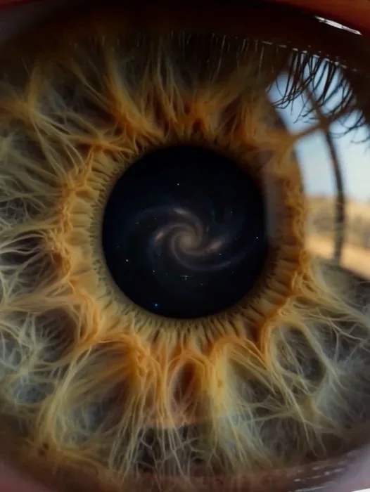</a>

▶ [Watch the full video on ofox.ai](https://ofox.ai/hailuo-3-prompts?utm_source=github&utm_medium=case&utm_campaign=awesome-ai-video-prompts#case-153)

**输入素材**：未公开 —— 本案例未收录可用的输入素材，请参阅来源

<strong>Prompt</strong> — 15 seconds STYLE: Ultra-photorealistic cinematic sci-fi, IMAX-scale visuals, dramatic volumetric lighting, realistic VFX, anamorphic lens, deep cosmic…

~~~~text
15 seconds  STYLE: Ultra-photorealistic cinematic sci-fi, IMAX-scale visuals, dramatic volumetric lighting, realistic VFX, anamorphic lens, deep cosmic blacks, cyan and golden highlights.    

SCENE 1 (0–2s): A lone female astronaut in a graphite-white futuristic spacesuit stands on a colossal metallic platform floating in deep space. Galaxies extinguish behind her. The last blue star collapses. Extreme wide shot, slow camera push-in, overwhelming cosmic scale.    

SCENE 2 (2–4s): The astronaut runs toward an ancient stellar machine and presses a glowing golden activation core. Warning lights flash across her visor. Dynamic tracking shot transitioning to extreme close-up of her hand.    

SCENE 3 (4–7s): The dying star erupts into a magnificent golden energy spiral. A cosmic shockwave spreads across the darkness, reigniting galaxies. The astronaut braces against the blast. Spectacular photorealistic cosmic VFX, wide cinematic pullback.    

SCENE 4 (7–10s): WITHOUT CUTTING, the camera continues pulling back. The golden spiral transforms seamlessly into the intricate iris of a human eye. The entire universe is revealed as a tiny reflection inside a pupil. Surreal macro realism, seamless scale transformation.    

SCENE 5 (10–12s): The camera reveals a sleeping child in a warm bedroom at sunrise. The child's eye opens. The galaxy reflection slowly fades. Intimate cinematic close-up, warm sunlight, sudden quiet.    

SCENE 6 (12–15s): The child blinks, smiles, and raises an open palm. A miniature newborn galaxy materializes above the hand, spinning with billions of tiny stars. The child whispers: 'Again.' Gentle camera push-in. Cut to black.    

NARRATION: 'The last star was dying. One final chance to save everything. She brought the universe back. But it was never ours. We were only a dream.' Child whispers: 'Again.'    

SOUND: Deep cosmic rumble, escalating orchestral tension, enormous bass impact at the star ignition, reverse swell during the eye reveal, sudden silence, soft piano and ethereal chime at the ending.    

CONTINUITY: Same female astronaut and graphite-white suit throughout space scenes. Same golden spiral shape across star, eye reflection, and newborn galaxy. Maintain consistent photorealism and smooth cinematic transitions. No subtitles, no watermarks, no unwanted text.
~~~~

**参数**：MiniMax H3 · 未标注 · 未标注 · 未标注 · 未标注 · 未标注 · 未标注
**来源**：@DeCat2025 · [原帖](https://x.com/DeCat2025/status/2116894957726253228)

Preview © 2026 @DeCat2025 · Prompt by @DeCat2025

[Back to top](#table-of-contents)

### Case 154: Black Couture in Golden Light (黑色礼服与建筑光影) — by @DaniaSafvi

<a href="https://ofox.ai/hailuo-3-prompts?utm_source=github&utm_medium=case&utm_campaign=awesome-ai-video-prompts#case-154">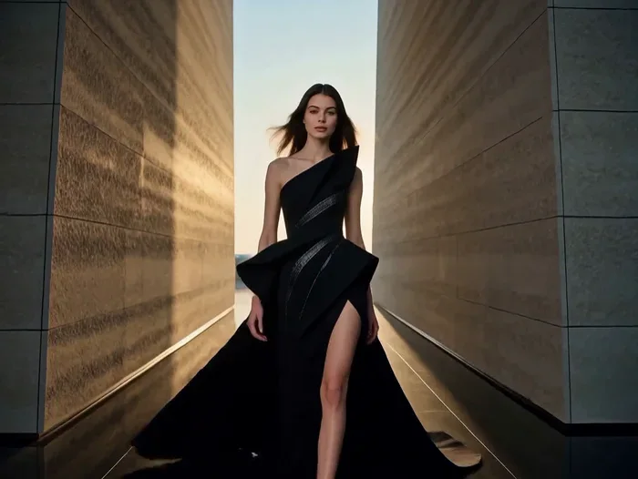</a>

▶ [Watch the full video on ofox.ai](https://ofox.ai/hailuo-3-prompts?utm_source=github&utm_medium=case&utm_campaign=awesome-ai-video-prompts#case-154)

**输入素材**：未公开 —— 本案例未收录可用的输入素材，请参阅来源

<strong>Prompt</strong> — Create a 15-second cinematic luxury fashion video in 9:16 vertical format. A tall American female model with long dark hair wears a dramatic black cou…

~~~~text
Create a 15-second cinematic luxury fashion video in 9:16 vertical format. A tall American female model with long dark hair wears a dramatic black couture gown with silver details and a flowing train.

0–3 sec: Close-up of red satin fabric moving through darkness before revealing the model under dramatic spotlights.

3–6 sec: The model walks confidently toward the camera. A stylish whip-pan captures her turning as the gown flows naturally.

6–10 sec: Seamless transition to a modern architectural courtyard with towering stone walls and golden sunlight. The model walks gracefully as the wind moves her hair and gown.

10–13 sec: The camera circles around her as she strikes a powerful high-fashion pose.

13–15 sec: Symmetrical hero shot with dramatic golden rim lighting, fading into black.

Style: Ultra-realistic luxury fashion campaign, cinematic lighting, natural fabric physics, elegant camera movements, deep shadows, black and gold color palette, 4K quality.

Audio: Deep cinematic bass, subtle percussion, and soft fabric sounds. No dialogue or subtitles.

Text at the end: “BEYOND THE ORDINARY”

Maintain consistent facial features, hairstyle, outfit, and body proportions throughout. No distortion, flickering, watermarks, or random text.
~~~~

**参数**：MiniMax H3 · 未标注 · 未标注 · 未标注 · 未标注 · 未标注 · 未标注
**来源**：@DaniaSafvi · [原帖](https://x.com/DaniaSafvi/status/2109884479619682650)

Preview © 2026 @DaniaSafvi · Prompt by @DaniaSafvi

[Back to top](#table-of-contents)

### Case 155: The Exit Was Never an Exit (停车场出口的丧尸反转) — by @Just_Anika_Here

<a href="https://ofox.ai/hailuo-3-prompts?utm_source=github&utm_medium=case&utm_campaign=awesome-ai-video-prompts#case-155">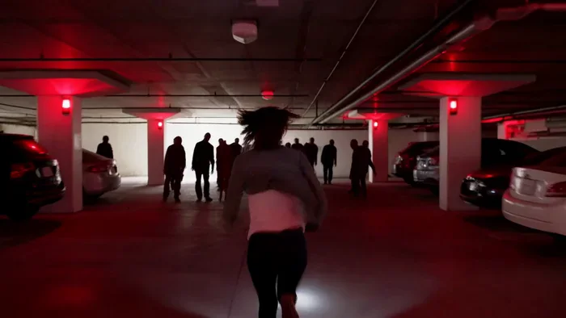</a>

▶ [Watch the full video on ofox.ai](https://ofox.ai/hailuo-3-prompts?utm_source=github&utm_medium=case&utm_campaign=awesome-ai-video-prompts#case-155)

**输入素材**：未公开 —— 本案例未收录可用的输入素材，请参阅来源

<strong>Prompt</strong> — Create a 15-second ultra-photorealistic live-action zombie horror movie sequence in 16:9 widescreen. Make it feel like a professionally shot theatrica…

~~~~text
Create a 15-second ultra-photorealistic live-action zombie horror movie sequence in 16:9 widescreen. Make it feel like a professionally shot theatrical horror film, with 5 connected shots, escalating tension, strong cinematic sound design and music. Realistic human movement, realistic environments, grounded physics, no comedy, no text, no subtitles, no dialogue.  SHOT 1 — 0–3 sec: Night. A deserted underground parking garage. A frightened young woman walks quickly between parked cars, holding a small flashlight. The camera tracks backward in front of her. Suddenly, the flashlight beam catches a motionless person standing far behind her. Deep bass hit.  SHOT 2 — 3–6 sec: Close-up of the woman's face as she stops breathing for a moment and looks behind her. The parking space is empty. The music drops almost completely silent. She slowly turns back toward the camera.  SHOT 3 — 6–9 sec: A zombie suddenly appears extremely close behind her in the background — pale dirty skin, torn everyday clothing, blood around the mouth, unnatural posture. It moves toward her with a sudden violent burst. Hard music impact.  SHOT 4 — 9–12 sec: She runs through the parking garage. Camera follows handheld from behind. Multiple distant zombie silhouettes suddenly emerge between the cars, blocking the exit. Emergency lights begin flashing red.  SHOT 5 — 12–15 sec: She reaches the exit door and desperately pulls it open. Bright daylight floods into the dark garage. She looks relieved for half a second — then the camera moves slightly past her shoulder and reveals dozens of zombies already standing silently outside, completely blocking the exit.  On the final bass hit, one zombie suddenly looks directly into the camera.  CUT TO BLACK.  VISUAL STYLE: ultra-photorealistic live-action theatrical zombie horror, cinematic 16:9 composition, realistic human anatomy, realistic zombie makeup and skin texture, physically believable movement, dark atmospheric lighting, practical-looking effects, subtle film grain, dramatic contrast, natural handheld camera movement, high-end horror cinematography.  CONSISTENCY & QUALITY: keep the same woman, same clothing, same hairstyle and same underground parking garage throughout the sequence. Zombies must have consistent realistic anatomy. No extra limbs, extra fingers, duplicated people, warped faces, melting bodies, floating objects, cartoon appearance, video-game look, excessive gore, text, subtitles, logos or watermark.  EDITING: each shot must have a clear visual purpose and connect naturally to the next. Fast pacing, no dead time. The first shot must immediately create curiosity. Build tension from mystery → realization → zombie reveal → chase → final shocking reveal.
~~~~

**参数**：MiniMax H3 · Hailuo · 未标注 · 未标注 · 未标注 · 未标注 · 未标注
**来源**：@Just_Anika_Here · [原帖](https://x.com/Just_Anika_Here/status/2107342788178407680)

Preview © 2026 @Just_Anika_Here · Prompt by @Just_Anika_Here

[Back to top](#table-of-contents)

### Case 160: A Coastal Fashion Moment (海岸时装与独白) — by @CaliraVal

<a href="https://ofox.ai/hailuo-3-prompts?utm_source=github&utm_medium=case&utm_campaign=awesome-ai-video-prompts#case-160">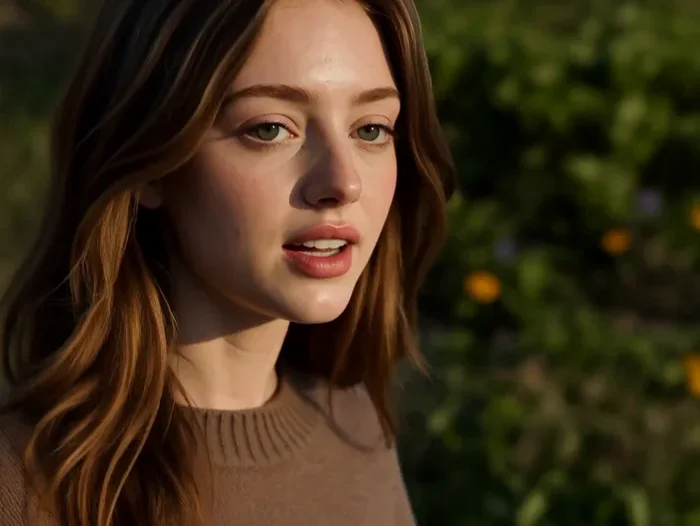</a>

▶ [Watch the full video on ofox.ai](https://ofox.ai/hailuo-3-prompts?utm_source=github&utm_medium=case&utm_campaign=awesome-ai-video-prompts#case-160)

**输入素材**：未公开 —— 本案例未收录可用的输入素材，请参阅来源

<strong>Prompt</strong> — A cinematic fashion film set on a breathtaking coastal landscape. A stylish young woman walks naturally along a rugged seaside path, surrounded by wil…

~~~~text
A cinematic fashion film set on a breathtaking coastal landscape. A stylish young woman walks naturally along a rugged seaside path, surrounded by wild greenery and delicate flowers. She wears a relaxed oversized brown knit sweater with elegant ivory trousers. Behind her, crystal-blue ocean waters stretch toward a towering lush green mountain rising from the sea.

Soft golden-hour sunlight creates a warm, dreamy atmosphere. A gentle ocean breeze naturally moves her hair and sweater. Start with a wide cinematic establishing shot of the coastline, then smoothly track alongside her as she walks, transitioning into elegant close-ups of her outfit, hair, and subtle facial expressions.

Spoken Voice / Dialogue: The woman speaks naturally while walking, in a soft, calm, confident female voice. Her delivery should feel spontaneous and conversational, with realistic breathing and subtle pauses. She says:

“Sometimes, all you need is a quiet place, a little fresh air, and a moment to simply slow down and enjoy where you are.”

Her lip movements must accurately synchronize with every spoken word. Natural facial expressions, realistic mouth movement, and subtle head gestures while speaking. No exaggerated acting.

Ambient Audio: Gentle ocean waves crashing against the rocks, soft coastal wind, subtle rustling of flowers and leaves, quiet footsteps, and distant seabirds. Keep the environmental sounds natural and cinematic underneath the dialogue. No background music and no additional voices.

Photorealistic, natural skin and hair, realistic fabric movement, cinematic lighting, smooth camera movement, shallow depth of field, soft bokeh, subtle film grain, premium fashion-commercial aesthetic, atmospheric color grading, 4K cinematic quality. No text, no logos, no watermark.
~~~~

**参数**：MiniMax H3 · 未标注 · 未标注 · 未标注 · 未标注 · 未标注 · 未标注
**来源**：@CaliraVal · [原帖](https://x.com/CaliraVal/status/2096833346555023816)

Preview © 2026 @CaliraVal · Prompt by @CaliraVal

[Back to top](#table-of-contents)

### Case 164: The Witch’s Orb in the Ruins (废墟女巫凝聚魔法光球) — by @ou_zhen599

<a href="https://ofox.ai/hailuo-3-prompts?utm_source=github&utm_medium=case&utm_campaign=awesome-ai-video-prompts#case-164">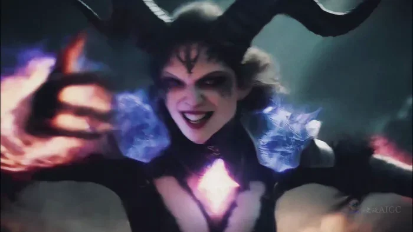</a>

▶ [Watch the full video on ofox.ai](https://ofox.ai/hailuo-3-prompts?utm_source=github&utm_medium=case&utm_campaign=awesome-ai-video-prompts#case-164)

**输入素材**（1 张图）

| | | | |
|:---:|:---:|:---:|:---:|
|  First frame |  |  |  |

<strong>Prompt</strong> — integrated_multimodal_description 15-second, 2.39:1 widescreen I2VA cinematic dark-fantasy sequence. Use &lt;Picture 1&gt; as the sole first-frame reference…

~~~~text
integrated_multimodal_description

15-second, 2.39:1 widescreen I2VA cinematic dark-fantasy sequence. Use <Picture 1> as the sole first-frame reference for the same adult witch, ruined rock field, black horned leather armor, huge curved horns, pointed ears, long black hair, metal shoulder armor, long claws, waist metal rings, torn cloth drapery, orange-violet magic flame, cold smoky ruins, and opening composition. One continuous ruined rock arena only. No scene change, added characters, modern objects, subtitles, text, watermark, fade, or black ending.

A begins center-left, body angled toward frame-right/front, right hand holding orange-violet flame, left claw lowered. Her path is fixed: start in place -> step toward frame-right/front -> spin left back to center -> open both arms and summon a huge magic crown -> step forward and compress the magic into a palm sigil-core. Camera stays tied to A’s motion and preserves the same rock walls, sparks, cracks, smoke direction, and ruin geography.

Lighting and grade: cold ruin base with violet-orange magic as the primary dynamic light. Background shadows are cold blue-charcoal #111820. Magic highlights are orange ember #FF6A2A, violet arc #8A4DFF, and hot white core #FFF0D0. Skin remains naturally warm, not plastic purple. Black leather armor has low-saturation metal shine; shoulder armor catches violet electric rim light; chest metal details catch orange fire highlights. Smoke, sparks, rock cracks, and dust receive real light, occlusion, and shadow. High contrast, detailed blacks, restrained saturation, soft highlight roll-off, subtle film grain.

[00:00-00:01.6] Low ground-level tracking. A steps toward frame-right/front holding orange-violet fire in her right palm. Her left claw scrapes rock, throwing real sparks. Long black hair is pulled left-back by magic pressure; torn cloth and waist rings jitter with the step. Camera tracks from leg armor, torn hem, claw sparks, waistline, and right-hand flame upward. Her eyes lock on the palm first; pupils catch the fire; brow rises slightly; a suppressed smile begins to split open as if the power finally responds. Fire behaves fluidly: orange tongues stretch into a tail behind her wrist, lick across stone, and leave brief red embers and thin smoke. She whispers: <d>[English] It answers me... </d>

[00:01.6-00:03.2] Fast push-in to face, shoulders, chest armor, and right hand. A presses forward half a step and sharply flips her right wrist. Orange fire twists into violet-blue arcs crawling from claw roots over the hand, arm armor, shoulder spikes, and chest metal ornament. Her eyes widen briefly from magical pain; brow tightens; then upper lids relax and the mouth opens into barely contained ecstatic joy. The magic surge triggers one restrained body response through breath, leather, metal rings, and armor details, then stabilizes. Electric light sweeps from chest ornament to her eyes. She says with rising pleasure: <d>[English] Higher... yes. </d>

[00:03.2-00:05.1] Whip-pan following the left claw. A spins left back to center; her left shoulder cuts toward camera and the claw slashes through air. Hair, torn cloth, and waist rings flare from inertia. Camera follows the claw in a sharp whip, then resolves into a short arc around her in the same ruin center. Her laugh sharpens; brows lift; nostrils open slightly; gaze shifts from palm to the space before her, as if showing the whole ruin what obeys her. A black smoke-rune slit opens from the claw tip. Runes coil like chain links around her waist, passing behind metal rings with correct occlusion and violet edge light. Smoke spirals from the rotation. She says with pressure: <d>[English] Mine. All of it. </d>

[00:05.1-00:07.8] Slow-motion bullet-time half-orbit, 85mm compressed close view from palm to side face, collarbone, chest armor, and rune flow. A stops center, feet braced front-back, body slightly forward. Right hand draws inward as if pulling invisible chains. Orange fire wraps the wrist; violet electricity crawls over shoulder armor; black rune-shadow hugs the chest metalwork. Her eyes lower toward the gathered power; outer eye corners tremble slightly; lips part with suppressed laughter. Then she looks toward camera side-front, expression turning from rapture into possession. Her breath expands the torso under rigid leather and metal support; straps, medallions, and armor details react with small realistic vibration. Fire, electricity, and shadow travel along armor surfaces and metal edges only, never covering the face. She murmurs: <d>[English] You know who owns you. </d>

[00:07.8-00:10.9] Grand spell display. A stomps forward, cracking the rock. Both arms open wide: right hand sweeps upward, left claw presses down. She throws her head back and laughs. Camera first cuts to the foot and glowing cracks, then drops into a low-angle pullback revealing A and a huge half-ring crown sigil rising behind her. Her eyebrows lift fully; eyes blaze; mouth opens in wild laughter without distortion. Then her gaze locks upward, commanding the crown to form. Purple-orange light erupts through ground cracks. Pebbles lift and fall back. Near-layer sparks reverse; mid-layer violet arcs circle horns and shoulder armor; far-layer black smoke-runes roll from rock fissures. The three layers merge into a vast violet-orange magical crown. Smoke rises from heat; flames curl fluidly; rock cracks crumble slightly. Orange underlight lifts her face; horns and shoulder edges gain violet rim light. She shouts: <d>[English] Look at me now! </d>

[00:10.9-00:12.5] Rapid push-pull impact shot. A cuts off the laugh, leans forward, and yanks her right hand inward. The huge crown collapses in layers: outer black smoke is sucked inward first, violet arcs twist into a ring, then orange fire compresses into a rotating palm sigil-core. Camera is pushed back by the crown brightness, then pulled toward her face, shoulders, chest armor, and palm by the core’s suction. Her eyes narrow against the light; outer eye corners tighten; the smile shifts into a cold victorious smirk. Hair, shoulder armor, and cloth are first blown outward, then drawn subtly back toward the palm. Leather straps and metal clasps flash twice and settle. She says coldly: <d>[English] Good... </d>

[00:12.5-00:15.0] Fixed low-angle medium close. A takes one final step toward camera. The sigil-core floats near her face in the right palm; the left claw hangs near the lower frame. Her fingers slowly close, locking fire, electricity, and shadow into the core. Frame holds horns, half-profile face, palm core, chest reflections, and fading crown residue behind her. She studies the core first, eyelids lowering like she is admiring prey. Then her eyes move toward camera side-front; the smile narrows into calm dangerous triumph. The crown remnant fades behind her; sparks still drift slightly backward; rock-crack glow dims but never cuts to black. Purple-orange core light illuminates half her face. She commands softly: <d>[English] Kneel. </d> Hold the living ruin, smoke, embers, and palm light.

Maintain exact face, horns, ears, hair, armor, claws, costume damage, body proportions, rock field, and magic color logic. No face collapse, overwide mouth, wrong fingers, added characters, modern objects, detached magic noise, unmotivated particles, light flicker, body distortion, isolated body framing, subtitles, watermark, scene jump, fade, or black ending.

overall_soundscape

Continuous cold ruin wind, distant rock groan, drifting ash, leather creak, metal ring movement, and low magical pressure. [00:00-00:01.6] claw scraping rock, sparks, flame drag, whispered “It answers me...” [00:01.6-00:03.2] flame twisting into electricity, metal ornament crackle, breath intake, “Higher... yes.” [00:03.2-00:05.1] whip air, smoke-rune tear, metal ring clinks, “Mine. All of it.” [00:05.1-00:07.8] slowed fire, violet arcs, shadow-rune coil, intimate “You know who owns you.” [00:07.8-00:10.9] rock crack, stones lifting and falling, crown formation, huge magical swell, “Look at me now!” [00:10.9-00:12.5] crown collapse, suction rush, compressed core hum, “Good...” [00:12.5-00:15.0] locked sigil rotation, fading crown residue, ash and smoke, quiet command “Kneel.”

non_diegetic_music

No music. Preserve magic layers, fire, electricity, smoke-runes, rock fracture, breath, metal armor detail, and the final charged silence.
~~~~

**参数**：MiniMax H3 · 未标注 · 未标注 · 未标注 · 未标注 · 未标注 · 未标注
**来源**：@ou_zhen599 · [原帖](https://x.com/ou_zhen599/status/2117660859992543677)

Preview © 2026 @ou_zhen599 · Prompt by @ou_zhen599

[Back to top](#table-of-contents)

### Case 165: A Sunset Beach Vlog (夕阳海滩的情侣视角) — by @ou_zhen599

▶ [Watch the full video on ofox.ai](https://ofox.ai/hailuo-3-prompts?utm_source=github&utm_medium=case&utm_campaign=awesome-ai-video-prompts#case-165)

**输入素材**（1 张图）

| | | | |
|:---:|:---:|:---:|:---:|
|  First frame |  |  |  |

<strong>Prompt</strong> — integrated_multimodal_description 15-second 16:9 I2VA cinematic seaside couples-vlog sequence. Use &lt;Picture 1&gt; as the only first-frame reference for t…

~~~~text
integrated_multimodal_description

15-second 16:9 I2VA cinematic seaside couples-vlog sequence. Use <Picture 1> as the only first-frame reference for the same adult woman A: exact face proportions, pink wavy long hair, glossy burgundy deep-V one-piece swimsuit, palm trees, beach hut, wet sand, shoreline, sunset side-backlight, and tropical beach atmosphere. The boyfriend never appears; he exists only as camera POV, offscreen English voice, retreating handheld movement, close distance, and a partial orbit around A. One continuous beach space only: palm-shadow edge -> wet sand shoreline -> close camera foreground. No new location, outfit change, hair change, subtitles, text, logo, watermark, fade, or black ending.

A begins in the right-mid foreground at the palm-shadow edge, facing left-front toward the water. She walks diagonally along wet sand toward the waterline, then lightly runs two or three steps toward the camera, stops close to the lens, follows the camera through a half-turn, and finally approaches close enough to partially block the lens edge with one hand. B, the boyfriend camera, starts about 2.5 meters left-front of A, films while walking backward, then shifts 70-90 degrees toward the sea side, ending about 0.6 meters in front of A. Spatial continuity stays fixed: shallow ocean and foam on the left, palms and beach hut on the right, sunset from left-rear.

Lighting: golden sunset side-backlight from low frame-left/rear, 4300K-4800K, tracing pink hair edges, shoulders, collarbones, and glossy burgundy swimsuit curves. Ocean reflection gives low cool cyan fill under jaw, lower chest edge, legs, and wet sand. Palm and hut shadows stay soft deep green-brown. Warm tropical golden-hour grade: amber-gold highlights, protected peach-warm skin, deep palm-green shadows, cyan-turquoise ocean reflections, burgundy swimsuit as the saturated accent. Clean premium commercial look, controlled saturation, soft highlight roll-off, slight film grain, no plastic skin.

Water physics: shallow waves push white foam from frame-left onto wet sand, thin around A’s feet, break, then recede. Footsteps leave real wet-sand impressions; thin water layers displace into small splashes and circular ripples. Droplets on legs and swimsuit edges slide downward with gravity. Pink hair responds to wind and running: roots follow head motion first, tips lag, then sea wind pulls strands backward. Swimsuit fabric stays glossy and supportive, with highlight shifts caused by walking, running, stopping, turning, and breath.

[00:00-00:01.60] Continue from <Picture 1>. A is already walking diagonally along wet sand toward the waterline. Her right hand brushes pink hair away from her face; left shoulder catches warm rim light. B’s POV lightly pushes in while retreating, keeping her from half-body to thigh in frame. She looks toward the sea first, avoiding the lens, suppressing a smile as if refusing to give him the perfect face immediately. Offscreen boyfriend says softly with a laugh: <d>[English] Don’t hide from me. </d>

[00:01.60-00:03.80] Slow push into a chest-up medium close. Focus begins on the glossy burgundy swimsuit highlight, then racks smoothly to her eyes. A walks and inhales through a smile; her eyes test the lens edge first, then meet the camera. Upper eyelids soften, brow tail lifts subtly, and a small pleased smile replaces restraint. Breath, shoulders, swimsuit reflections, and hair settle naturally with each step. A says playfully: <d>[English] Then make me look good. </d>

[00:03.80-00:06.70] B retreats two steps into a clearer handheld boyfriend follow shot. Offscreen boyfriend says: <d>[English] Come here. Run to me. </d> A pauses half a beat, checking whether the camera is still rolling; her expression says “you really want this shot?” Then she laughs open and lightly runs two or three steps toward the lens. Her feet enter a thin wave; white foam splits around her insteps and splashes low to both sides. Pink hair streams back, shoulders relax, torso stays balanced, and burgundy highlights bounce with her stride. Camera stays low-angle and retreating, preserving believable POV.

[00:06.70-00:08.60] Moving close-up from chest to face, never losing expression. A runs nearer, eyes fixed on the boyfriend behind the camera. Smile spreads from mouth to eyes; under-eye muscles lift, brow center relaxed, playful challenge visible. Breath quickens. Swimsuit highlights shift with step rhythm and supported body motion; hair brushes her cheek and is pulled away by wind. Water droplets flash at her legs and swimsuit edge. A laughs while running: <d>[English] You better keep up. </d>

[00:08.60-00:10.50] A reaches the lens. B backs up slightly with rebound-speed motion: fast approach suddenly slows. A stops sharply on wet sand, body carried forward for a fraction before legs and core regain balance. Her eyes sweep from lens edge back to center; lips part with bright breath and laughter. The stop creates a brief natural settling response through posture, swimsuit highlights, hair, and breath, then stabilizes. She laughs low: <d>[English] Stop moving back. </d>

[00:10.50-00:12.80] B half-orbits 70-90 degrees around A from the sea side in a slow-motion boyfriend-POV move, never drone or third-person. A follows the lens with a half-turn, one hand holding windblown pink hair, the far shoulder drawing slightly back. Her expression shifts from open laughter into a more deliberate intimate check: eyes follow the camera first, then settle on the person behind it; upper lids lower a little, smile narrows. Breath slows. The burgundy highlight glides across chest curve, waistline, and hip as she turns. Offscreen boyfriend says: <d>[English] That’s the shot. </d> A answers softly with a lifted ending: <d>[English] Is it? </d>

[00:12.80-00:14.00] B raises the camera briefly into a short high-angle cut. First show A’s feet at the shallow foam edge: wet sand opens under her step, water curls around the ankles and pulls back. Camera then rises along the body to her upper body and eyes. A steps half a pace closer. Her breathing is still gently elevated, but calm. Her gaze returns from the sea to the lens; brow tail softens and the smile becomes intimate, as if only for the person filming.

[00:14.00-00:15.00] Close handheld POV. A reaches out and gently covers only part of the lens edge, leaving sunset flare and pink hair rim light through her fingers. Camera remains close with subtle hand-breath movement. She leans in, eyes soft but pleased, smile lowered and confident. Offscreen boyfriend asks: <d>[English] Can I post this one? </d> A says quietly: <d>[English] Don’t delete this one. </d> End on her close smile, partial hand occlusion, glittering ocean, palm shadows, wet sand reflection, and wave ambience. No fade or black.

Maintain the same adult identity, face, pink hair, burgundy swimsuit, tropical beach, palm trees, hut, shoreline, wet sand, sunset direction, and boyfriend POV logic. The boyfriend never appears. No extra people, drone angle, third-party camera reveal, phone interface, subtitles, text, watermark, scene jump, pool, boat, nightclub, city street, face drift, empty stare, fake frozen smile, wrong fingers, distorted body proportions, impossible water, floating splash, random light change, over-smoothed skin, or cheap oversaturated color.

overall_soundscape

Continuous close beach ambience: soft surf, thin foam over wet sand, palm leaves, distant tropical air, and handheld movement. [00:00-00:01.60] wet steps, hair brushing, boyfriend line: “Don’t hide from me.” [00:01.60-00:03.80] soft footfalls, breath-smile, A: “Then make me look good.” [00:03.80-00:06.70] retreating handheld steps, boyfriend: “Come here. Run to me,” shallow splashes, A starting to laugh. [00:06.70-00:08.60] light running through foam, quick breath, A: “You better keep up.” [00:08.60-00:10.50] sudden stop on wet sand, small water displacement, A: “Stop moving back.” [00:10.50-00:12.80] slow orbit wind, hair movement, boyfriend: “That’s the shot,” A: “Is it?” [00:12.80-00:15.00] water curling around ankles, close breath, boyfriend: “Can I post this one?” A: “Don’t delete this one,” waves continuing.

non_diegetic_music

No music. Preserve surf, wet sand, breath, laughter, handheld intimacy, and the final sunset shoreline afterglow.
~~~~

**参数**：MiniMax H3 · 未标注 · 未标注 · 未标注 · 未标注 · 未标注 · 未标注
**来源**：@ou_zhen599 · [原帖](https://x.com/ou_zhen599/status/2117636363751444547)

Preview © 2026 @ou_zhen599 · Prompt by @ou_zhen599

[Back to top](#table-of-contents)

### Case 166: The Warrior and the Ginger Cat (蓝门前的战士与橘猫) — by @ou_zhen599

<a href="https://ofox.ai/hailuo-3-prompts?utm_source=github&utm_medium=case&utm_campaign=awesome-ai-video-prompts#case-166">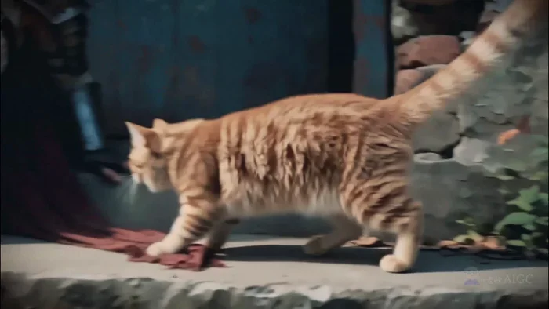</a>

▶ [Watch the full video on ofox.ai](https://ofox.ai/hailuo-3-prompts?utm_source=github&utm_medium=case&utm_campaign=awesome-ai-video-prompts#case-166)

**输入素材**（1 张图）

| | | | |
|:---:|:---:|:---:|:---:|
| 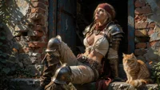 First frame |  |  |  |

<strong>Prompt</strong> — integrated_multimodal_description 15-second 16:9 I2VA live-action cinematic scene. Use &lt;Picture 1&gt; as the only first-frame and visual reference for th…

~~~~text
integrated_multimodal_description

15-second 16:9 I2VA live-action cinematic scene. Use <Picture 1> as the only first-frame and visual reference for the same ruined porch, broken brick wall, weathered blue door, stone steps, dark red scarf, metal shoulder armor, circular chest medallion, orange cat, warm afternoon light, and quiet post-battle mood. One continuous space only: porch, steps, blue door, and broken wall. No scene change, added enemies, added animals, new weapons, subtitles, narration, text, watermark, fade, or black ending.

A is the adult female warrior, beginning frame-center-right, seated against the threshold where the blue door meets the stone step, body angled toward frame-left/front. Her right hand supports her on the step, left knee raised, shoulder armor and medallion catching light. The dark red scarf drapes from her side onto the stone. B is the orange cat, beginning on the right foreground step near the scarf edge, facing the broken brick wall. B leads the interaction: foreground step -> A’s knee armor and scarf -> reflected light across wall, door, and knee armor. A stays near the threshold, only rising slightly, leaning forward, turning shoulder to move the medallion reflection, making room for the cat, and settling back against the door.

Afternoon hard sunlight enters from upper-left, striking broken brick, A’s cheek, shoulder armor, circular medallion, and cat fur edges. The blue door interior remains deep cool shadow, creating warm-gold vs cold-blue contrast. Palette: warm gold #D8A65A, dry red brick #9A553B, oxidized blue door #1F5F6E, cold blue-gray shadow #24313A, dark wine-red scarf #6E2023. Low saturation, protected natural skin, clean but not clipped metal reflections, preserved shadow detail, soft highlight roll-off, subtle film grain.

Physical effects stay realistic only: dust, tiny grit, cloth folds, metal taps, cat fur rim light, fine hair movement, and medallion reflections. Dust comes only from stone friction, cat tail, and dragging scarf; particles appear only in sunbeams, fall under gravity, then settle or vanish into shadow. No fire, explosion, magic smoke, energy effects, or floating particle wall.

[00:00-00:02.00] Ground-level tracking begins beside B’s tail, sliding over stone dust, scarf edge, and A’s right hand braced on the step. B’s tail sweeps the ground and raises a small dust ring. A is already moving: right palm presses down, core engages, and her body rises half an inch from the blue door. Left knee armor scrapes stone with a tiny metal sound. Her face remains slightly tilted upward, gaze distant; eyelids half open, brow calm, lips parted as if returning from far away. Low angle lifts to A’s upper body. As she props up and then pauses at the cat’s movement, shoulder armor, straps, cloth, medallion, and posture show one brief natural settling response, then stabilize.

[00:02.00-00:04.50] Slow push with smooth focus transition. B stands and places one front paw on the corner of A’s scarf, eyes fixed on the warm reflection from A’s circular medallion on the broken wall. Camera moves from A’s side face to the medallion, then racks into B’s pupils. A’s eyes move down first; her head follows half a beat later. Brow softens and the distant expression returns to the present. She does not pull the scarf away; her bracing fingers relax, letting B keep its paw there. Her lips close into a tiny restrained curve. The medallion reflection forms a small sharp gold spot on the wall and trembles slightly with her breathing.

[00:04.50-00:06.30] B suddenly pounces left toward the wall light. Camera whip-follows B, then tracks laterally to the broken brick. B’s paws land at the lower wall edge, scattering a few grains. The scarf catches under B’s feet and pulls A gently forward. A stabilizes with her left leg; knee armor taps the stone with a clear small ring. Her right hand slides to the blue door edge and fingers hook into the chipped frame. A’s eyes fully land on B; upper lids lift, pupils track the pounce. A brief crease appears between the brows, then dissolves as she suppresses a smile. Stone powder rises at the knee impact and falls. The scarf edge forms one dragged wrinkle wave across the step.

[00:06.30-00:09.50] Restrained slow-motion 120-degree partial orbit, never full circle, around B’s forepaws, A’s medallion, and A’s forward-leaning upper body. Keep porch, broken wall, and blue door locked in place. B misses the light. A understands and deliberately turns her right shoulder and medallion, moving the reflection from the brick wall toward the blue door edge. She is now actively feeding the game to the cat. B’s eyes follow the light; whiskers tremble in sunlight. A lowers her lashes toward B, outer eyes softening. The smile grows slightly, then she presses it back. One soft inhale opens the nostrils, jaw releases, and her gaze shifts from alertness to playful indulgence. Shoulder armor limits the turn; straps, fabric, medallion, hair, and posture respond with small delayed motion. Dust in the sunbeam bends into a faint arc from her shoulder turn, then fades near the door shadow.

[00:09.50-00:11.80] Overhead cut to the stone steps: B’s paws, red scarf, moving light spot, and A’s knee armor form a small chase path. A turns her shoulder again, sliding the light from the blue door onto her knee armor. B immediately follows to her leg and raises one paw onto the bright spot. Camera pushes quickly toward B’s paw, then pulls back slightly to include A’s side waist, scarf, knee armor, and door edge. A turns aside half an inch to give B space. Her eyes follow the paw, then the light, then B’s face; the emotion softens step by step. The paw on metal breaks the reflection into short flashes. The scarf compresses under B’s paw, wrinkles spreading outward once and stopping.

[00:11.80-00:13.20] Focus-rack pause. B pins the light spot on the scarf. A stops turning the medallion and holds the forward lean. Focus moves from B’s paw to the circular medallion, then to A’s face. The space falls quiet: dust descending, fabric under paw, last metal vibration, and A’s breathing. A lifts her gaze to the sky for half a second, then lowers it back to B, as if deciding the cat matters more than the distance. Brow smooths with post-battle fatigue; when looking back to B, eyelids soften and one mouth corner tilts with quiet surrender.

[00:13.20-00:15.00] Return to a stable porch composition close to the first-frame layout and slowly pull back. B sits in the foreground center, paw pressing the scarf where the light lands, claiming it like a prize. A settles back against the blue door. Her right hand hangs near B without touching, waiting for permission. As her back meets the doorframe, shoulders release with one silent breath-laugh; fabric, leather strap, medallion, and hair make a final small delayed settling motion. A looks down at B, eyes soft, lips closed with a faint curve. She completes the relationship by stopping her hand and letting B own the light. End with B clear in the foreground, A softly behind, sunlit dust falling, cat fur rim-lit, blue door shadow alive. No fade or black.

Maintain A’s exact identity, face, hair, armor, clothing, scarf, medallion, body proportions, normal five-finger hands, orange cat color and size, porch geometry, blue door, broken wall, and light direction. No extra characters, extra animals, face drift, deformed features, exaggerated mouth, cartoon expression, erotic posing, isolated body-part framing, clothing failure, impossible dust, overexposed magic-like reflection, subtitles, watermark, text, black screen, or fade.

overall_soundscape

No dialogue or narration. Quiet ruined-porch ambience: soft afternoon air, tiny stone grit, fabric dragging on steps, cat paws on cloth and stone, metal knee armor tap, medallion micro-swing, A’s low breathing. [00:00-00:02.00] tail brushing dust, palm on stone, knee armor scrape. [00:02.00-00:04.50] cat paw pressing scarf, faint medallion movement, soft breath. [00:04.50-00:06.30] cat pounce, stone grains, knee armor ring, scarf drag. [00:06.30-00:09.50] slowed cloth tension, whisker movement, barely audible metal sway. [00:09.50-00:11.80] paw on knee armor, broken light reflection, scarf compression. [00:11.80-00:15.00] quiet dust settling, breathing, fabric release, still porch air.

non_diegetic_music

No music. Preserve the intimacy of cat movement, stone texture, small metal sounds, cloth friction, breathing, and the final sunlit stillness.
~~~~

**参数**：MiniMax H3 · 未标注 · 未标注 · 未标注 · 未标注 · 未标注 · 未标注
**来源**：@ou_zhen599 · [原帖](https://x.com/ou_zhen599/status/2117277923589976215)

Preview © 2026 @ou_zhen599 · Prompt by @ou_zhen599

[Back to top](#table-of-contents)
