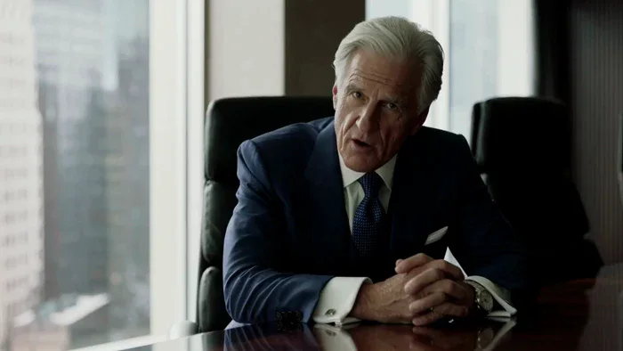
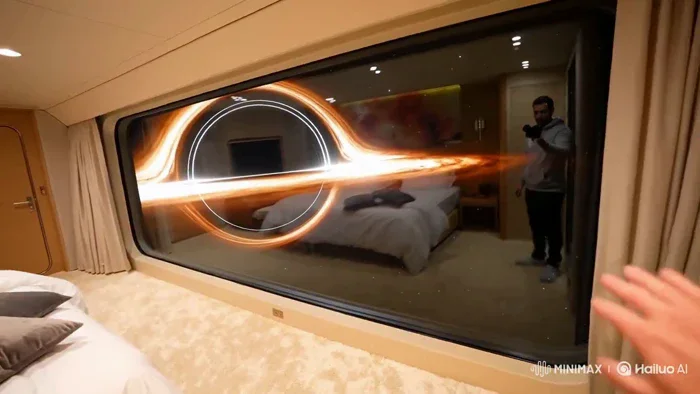
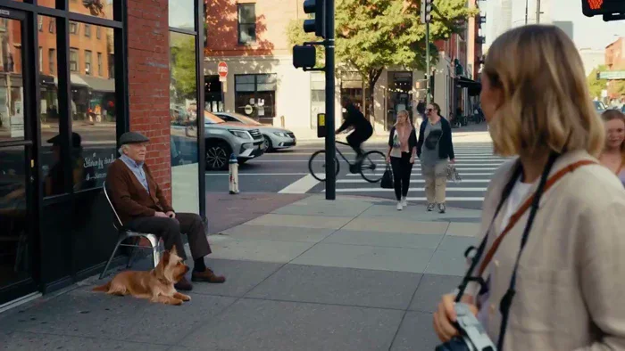
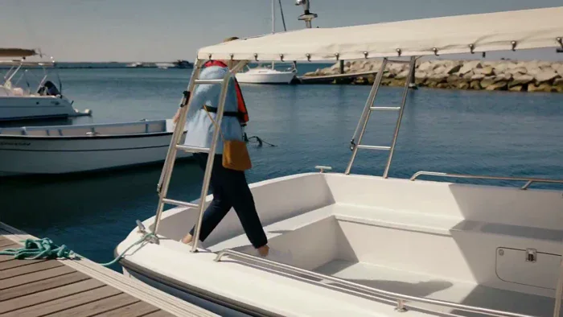
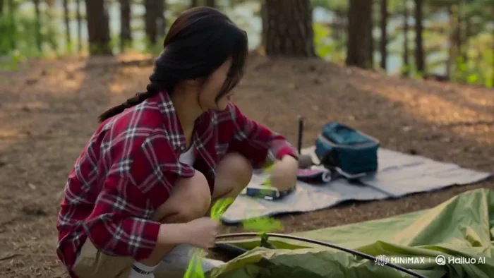
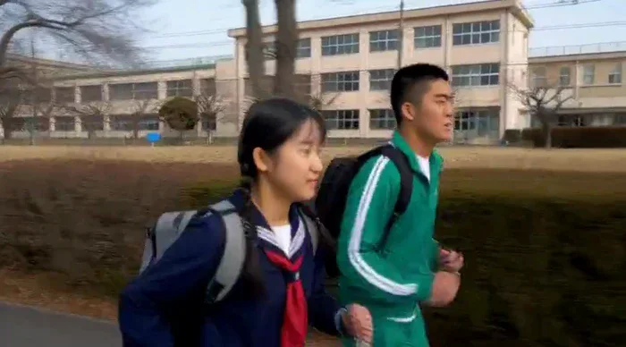
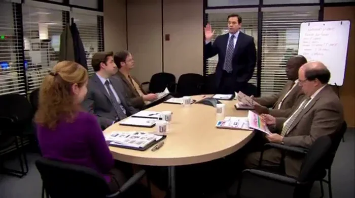
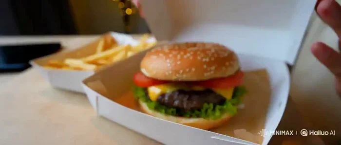
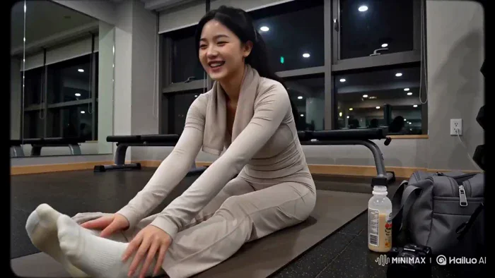

[← Back to the full index](../README.md#table-of-contents) · [English](dialogue-lipsync.md) · [简体中文](dialogue-lipsync.zh-CN.md) · [日本語](dialogue-lipsync.ja.md)

### Dialogue & Lip-Sync (对白与口播)

- [Case 4: Punchline Timing in an AI Stand-up Special (AI 脱口秀的精准笑点节奏) — by @azed_ai](#case-4)
- [Case 5: A High-Stakes Acquisition in the Boardroom (董事会收购谈判) — by @adithatipalli](#case-5)
- [Case 16: Handheld Space-Cruise POV at a Black Hole (黑洞邮轮客房手持 POV) — by @ivanfioravanti](#case-16)
- [Case 17: A Street Photographer Meets an Old Man and His Dog (摄影师偶遇老人和小狗) — by @aiwithaly](#case-17)
- [Case 18: Dolphins Appear Beside a Sightseeing Boat (游船途中遇见海豚) — by @nawalsehar](#case-18)
- [Case 19: Setting Up Camp beside a Mountain Stream (山溪营地的搭帐篷时刻) — by @Strength04_X](#case-19)
- [Case 84: A Taste of Bangkok Street Food (曼谷街头美食之旅) — by @nawalsehar](#case-84)
- [Case 86: Japanese Dialogue During a Schoolyard Run (校园奔跑中的日语对话) — by @MireilleDartois](#case-86)
- [Case 87: A Seven-Second Scene on an RTX 4090 (消费级显卡上的七秒场景) — by @uniqornate](#case-87)
- [Case 123: Tasting Ramen in Authentic UGC Style (拉面试吃的真实 UGC 质感) — by @Taaruk_](#case-123)
- [Case 124: Tasting a Burger from a First-Person View (汉堡试吃的第一视角短片) — by @oggii_0](#case-124)
- [Case 125: Post-workout gym vlog (训练后健身房 Vlog) — by @doctorwasif](#case-125)

### Case 4: Punchline Timing in an AI Stand-up Special (AI 脱口秀的精准笑点节奏) — by @azed_ai

▶ [Watch the full video on ofox.ai](https://ofox.ai/hailuo-3-prompts?utm_source=github&utm_medium=case&utm_campaign=awesome-ai-video-prompts#case-4)

**输入素材**：未公开 —— 本案例未收录可用的输入素材，请参阅来源

<strong>Prompt</strong> — Style: Live stand-up comedy special, intimate comedy club, professional multi-camera production, warm stage lighting, packed audience around small tab…

~~~~text
Style: Live stand-up comedy special, intimate comedy club, professional multi-camera production, warm stage lighting, packed audience around small tables, sharp HD broadcast look, natural facial expressions, authentic comedic timing, clean microphone audio, realistic audience reactions, subtle handheld audience camera, 15-second video, 5 cinematic cuts

0–3s: [Wide Establishing → Medium Push-In]
A comedian stands center stage holding a microphone as the audience settles. The comedian smiles and says:

Comedian: “I asked AI to organize my life yesterday”

Brief beat

3–6s: [Medium Close-Up]
The comedian maintains a completely serious expression

Comedian: “It looked at my schedule and said, ‘Actually... I’m just a language model.’”

Audience immediately laughs

6–9s: [Side Angle + Audience Reaction]
The comedian waits for the laughter, then slowly nods

Comedian: “Even artificial intelligence has boundaries”

Quick cut to the front row laughing and clapping

9–12s: [Tight Close-Up]
The comedian leans toward the microphone

Comedian: “My mom thinks AI is listening to everything we say”

Beat

Comedian: “Mom... nobody wants that podcast”

Audience erupts into louder laughter

12–15s: [Medium → Wide Ending]
The comedian waits for silence, then delivers the final line:

Comedian: “AI isn't replacing us. It saw our search history and declined the position”

Big audience laugh. The comedian smiles and lowers the microphone as the camera pulls out to reveal the applauding club

Production details: Keep the same comedian, outfit, microphone, stage and audience throughout. Prioritize precise comedic timing, short pauses before punchlines, believable facial expressions and natural audience reactions. Never cut during a punchline. Audience laughter starts only after the punchline lands. No canned laughter, no overlapping dialogue, coherent eyelines, realistic club acoustics, professional live comedy special editing
~~~~

**参数**：MiniMax H3 · 未标注 · t2va · 15s · 未标注 · 未标注 · 带音频
**来源**：@azed_ai · [原帖](https://x.com/azed_ai/status/2087208466264076759)

Preview © 2026 @azed_ai · Prompt by @azed_ai

[Back to top](#table-of-contents)

### Case 5: A High-Stakes Acquisition in the Boardroom (董事会收购谈判) — by @adithatipalli

▶ [Watch the full video on ofox.ai](https://ofox.ai/hailuo-3-prompts?utm_source=github&utm_medium=case&utm_campaign=awesome-ai-video-prompts#case-5)

**输入素材**：未公开 —— 本案例未收录可用的输入素材，请参阅来源

<strong>Prompt</strong> — cinematic 15-second ultra-realistic sequence inside a luxurious modern boardroom during daytime. Soft natural light enters through large glass windows…

~~~~text
cinematic 15-second ultra-realistic sequence inside a luxurious modern boardroom during daytime. Soft natural light enters through large glass windows. Four powerful industrialists in expensive tailored suits sit around a long polished dark wooden table. The atmosphere is tense and high-stakes.

The senior industrialist at the head of the table leans forward slightly and says firmly:
“This acquisition will change the entire market. Either we move now, or someone else will.”

Another industrialist across the table adjusts his cufflinks and replies calmly:
“Moving now is risky. The numbers still don’t support a full takeover.”A third industrialist places both hands on the table and speaks with intensity:
“Risk is the price of control. 

The investors are already waiting for our decision.”The camera slowly pushes in as the most powerful industrialist leans back, looks at everyone, and delivers the final line with quiet authority:
“Then we take it. No more delays.”

Cinematic lighting, sharp details on suits and the wooden table, subtle tension in their faces, realistic skin textures, high-end corporate atmosphere, shallow depth of field, filmic look.
~~~~

**参数**：MiniMax H3 · 未标注 · t2va · 15s · 未标注 · 未标注 · 带音频
**来源**：@adithatipalli · [原帖](https://x.com/adithatipalli/status/2086698076325253323)

Preview © 2026 @adithatipalli · Prompt by @adithatipalli

[Back to top](#table-of-contents)

### Case 16: Handheld Space-Cruise POV at a Black Hole (黑洞邮轮客房手持 POV) — by @ivanfioravanti

▶ [Watch the full video on ofox.ai](https://ofox.ai/hailuo-3-prompts?utm_source=github&utm_medium=case&utm_campaign=awesome-ai-video-prompts#case-16)

**输入素材**：未公开 —— 本案例未收录可用的输入素材，请参阅来源

<strong>Prompt</strong> — amateur handheld pov footage of a tourist in their plush and comfortable room of a space cruise, carpeted floor and comfy bed, large window shows a vi…

~~~~text
amateur handheld pov footage of a tourist in their plush and comfortable room of a space cruise, carpeted floor and comfy bed, large window shows a view of Gargantua blackhole, you can see their reflection in the window, they turn off the light half way through so we can see outside better and say: "Wow look at that!", then they show back the room
~~~~

**参数**：MiniMax H3 · 未标注 · t2va · 10s · 未标注 · 未标注 · 带音频
**来源**：@ivanfioravanti · [原帖](https://x.com/ivanfioravanti/status/2086553101029290296)

Preview © 2026 @ivanfioravanti · Prompt by @ivanfioravanti

[Back to top](#table-of-contents)

### Case 17: A Street Photographer Meets an Old Man and His Dog (摄影师偶遇老人和小狗) — by @aiwithaly

▶ [Watch the full video on ofox.ai](https://ofox.ai/hailuo-3-prompts?utm_source=github&utm_medium=case&utm_campaign=awesome-ai-video-prompts#case-17)

**输入素材**：未公开 —— 本案例未收录可用的输入素材，请参阅来源

<strong>Prompt</strong> — A young Western female street photographer walks through a lively downtown street and notices an elderly man sitting outside a café with his small dog…

~~~~text
A young Western female street photographer walks through a lively downtown street and notices an elderly man sitting outside a café with his small dog. She carefully composes the candid moment through her camera, captures the photo, then turns the camera toward the viewer to proudly show the shot she just took. She smiles, says “Look at that,” then continues walking through the city. Ultra-photorealistic visuals, natural handheld documentary movement, realistic camera interaction, authentic facial expressions, accurate hand movements, realistic dog behavior, natural daylight, cinematic depth of field, continuous character consistency, immersive city ambience, premium documentary realism.
~~~~

**参数**：MiniMax H3 · 未标注 · t2va · 15s · 未标注 · 未标注 · 带音频
**来源**：@aiwithaly · [原帖](https://x.com/aiwithaly/status/2087102541146522089)

Preview © 2026 @aiwithaly · Prompt by @aiwithaly

[Back to top](#table-of-contents)

### Case 18: Dolphins Appear Beside a Sightseeing Boat (游船途中遇见海豚) — by @nawalsehar

▶ [Watch the full video on ofox.ai](https://ofox.ai/hailuo-3-prompts?utm_source=github&utm_medium=case&utm_campaign=awesome-ai-video-prompts#case-18)

**输入素材**：未公开 —— 本案例未收录可用的输入素材，请参阅来源

<strong>Prompt</strong> — A young Western female traveler in her mid-20s walks naturally along a wooden marina dock toward a small white sightseeing boat. She wears a light blu…

~~~~text
A young Western female traveler in her mid-20s walks naturally along a wooden marina dock toward a small white sightseeing boat. She wears a light blue windbreaker, white shirt, dark trousers, comfortable sneakers, sunglasses, a properly fitted life jacket, and a small crossbody bag. She carefully steps from the dock onto the gently rocking boat while holding the handrail, naturally shifting her weight as the boat responds to her movement. She walks toward the rear passenger bench, sits down, adjusts her position, and looks toward the open water. The boat engine starts with a realistic low rumble and gradually leaves the marina, creating a small bow wave and narrow wake. As the boat moves into open water, she notices movement nearby, looks surprised, and naturally says, "Wait... are those dolphins?" Two dolphins surface several meters beside the moving boat, swimming parallel at a safe distance with realistic tail propulsion, surfacing, diving, breathing, and water displacement. She picks up her phone with both hands and records them while smiling with genuine excitement. One dolphin briefly surfaces near the rear side of the boat, exhales through its blowhole, creates a small burst of mist and droplets, then dives beneath the water and leaves expanding ripples behind. She lowers her phone and says, "That is incredible." Ultra-photorealistic marine wildlife travel documentary, cinematic realism, natural human behavior, realistic walking and sitting biomechanics, physically accurate boat buoyancy and acceleration, authentic ocean waves and wake, realistic dolphin anatomy and swimming behavior, natural water reflections and refraction, accurate English lip synchronization, bright neutral daytime lighting, realistic coastal wind, immersive marina and ocean ambience, smooth documentary camera movement, continuous visual consistency, seamless storytelling from walking to boarding, departure, dolphin encounter, recording, and final reaction, no narration, no CGI appearance, no plastic skin, no robotic movement, no exaggerated dolphin jumps, no impossible water behavior, no sudden camera transitions, no text overlays, logos, or watermarks.
~~~~

**参数**：MiniMax H3 · 未标注 · t2va · 15s · 未标注 · 未标注 · 带音频
**来源**：@nawalsehar · [原帖](https://x.com/nawalsehar/status/2090306968900784383)

Preview © 2026 @nawalsehar · Prompt by @nawalsehar

[Back to top](#table-of-contents)

### Case 19: Setting Up Camp beside a Mountain Stream (山溪营地的搭帐篷时刻) — by @Strength04_X

▶ [Watch the full video on ofox.ai](https://ofox.ai/hailuo-3-prompts?utm_source=github&utm_medium=case&utm_campaign=awesome-ai-video-prompts#case-19)

**输入素材**：未公开 —— 本案例未收录可用的输入素材，请参阅来源

<strong>Prompt</strong> — Main Subject : Young Korean woman, early 20s, oversized flannel over a tank top, cargo shorts, hair in a practical braid, focused cheerful energy. Loc…

~~~~text
Main Subject : Young Korean woman, early 20s, oversized flannel over a tank top, cargo shorts, hair in a practical braid, focused cheerful energy.
Location: Quiet forest campsite near a mountain stream, late afternoon. A half-set-up tent, camping gear scattered on a mat, tall pine trees, dappled sunlight. No other campers nearby.
Visual Style:
Ultra-realistic documentary realism, adventurous candid feeling, warm natural forest light.
Camera Style:
Early 2000s DV camcorder, handheld with natural outdoor shake, autofocus hunting in dappled light, soft grain, faded tones. No stabilization.
Timeline (15 sec, each slot = 2 compressed beats):
00:00–00:03 → She hammers a tent stake into the ground, then checks the tension of the rope.
00:03–00:06 → She struggles with a stubborn pole, then says to camera "이거 왜 이렇게 안 들어가" ("Why won't this go in").
00:06–00:09 → She finally gets it to click into place, laughing in relief.
00:09–00:12 → She steps back to admire the standing tent, hands on her hips.
00:12–00:15 → She looks at camera saying "다 됐다, 오늘 여기서 자자!" ("Done, let's sleep here tonight!"), smiling as it fades.
Audio:
Wind through trees, distant stream flowing, birds, fabric rustling. Her dialogue as noted above. No music.
Goal: An adventurous, cheerful camping setup moment grounded, warm, authentic.
~~~~

**参数**：MiniMax H3 · 未标注 · t2va · 15s · 未标注 · 未标注 · 带音频
**来源**：@Strength04_X · [原帖](https://x.com/Strength04_X/status/2085973447562162229)

Preview © 2026 @Strength04_X · Prompt by @Strength04_X

[Back to top](#table-of-contents)

### Case 84: A Taste of Bangkok Street Food (曼谷街头美食之旅) — by @nawalsehar

▶ [Watch the full video on ofox.ai](https://ofox.ai/hailuo-3-prompts?utm_source=github&utm_medium=case&utm_campaign=awesome-ai-video-prompts#case-84)

**输入素材**：未公开 —— 本案例未收录可用的输入素材，请参阅来源

<strong>Prompt</strong> — A cinematic 15-second ultra-realistic travel vlog following a young female creator exploring Bangkok's vibrant street food scene. She walks through a …

~~~~text
A cinematic 15-second ultra-realistic travel vlog following a young female creator exploring Bangkok's vibrant street food scene. She walks through a lively daytime market, introduces the legendary Pad Thai, watches a skilled street chef prepare the dish with fresh ingredients, and captures detailed close-ups of sizzling noodles, colorful toppings, and authentic cooking moments. She tastes the freshly made Pad Thai and shares her genuine reaction while surrounded by the energy of local vendors and travelers. Handheld vlog realism, natural lip-sync, expressive emotions, cinematic food close-ups, realistic market atmosphere, bright tropical daylight, ARRI Alexa 35 aesthetic, HDR, immersive street sounds, premium travel documentary style, 4K photorealistic quality, seamless character consistency, no text, no logos.
~~~~

**参数**：MiniMax H3 · 未标注 · 未标注 · 15s · 未标注 · 未标注 · 带音频
**来源**：@nawalsehar · [原帖](https://x.com/nawalsehar/status/2085233880353915217)

Preview © 2026 @nawalsehar · Prompt by @nawalsehar

[Back to top](#table-of-contents)

### Case 86: Japanese Dialogue During a Schoolyard Run (校园奔跑中的日语对话) — by @MireilleDartois

▶ [Watch the full video on ofox.ai](https://ofox.ai/hailuo-3-prompts?utm_source=github&utm_medium=case&utm_campaign=awesome-ai-video-prompts#case-86)

**输入素材**：未公开 —— 本案例未收录可用的输入素材，请参阅来源

<strong>Prompt</strong> — A scene showing a male student wearing a green tracksuit and a female student in a sailor uniform running together on the school path along s small ri…

~~~~text
A scene showing a male student wearing a green tracksuit and a female student in a sailor uniform running together on the school path along s small river.
A shot of the two people viewed from directly the side. They are running from the right side of the frame toward the left. The frame captures their upper bodies.
Several classmates on the way, walking to school.
Refer to <Picture 1> for the characters.
Voice 1(male):またワイら遅刻ちゃうか
Voice 2(female):あと30秒！あたしらの勝ちやな！
~~~~

**参数**：MiniMax H3 · 未标注 · 未标注 · 8s · 未标注 · 未标注 · 带音频
**来源**：@MireilleDartois · [原帖](https://x.com/MireilleDartois/status/2085168181648445763)

Preview © 2026 @MireilleDartois · Prompt by @MireilleDartois

[Back to top](#table-of-contents)

### Case 87: A Seven-Second Scene on an RTX 4090 (消费级显卡上的七秒场景) — by @uniqornate

▶ [Watch the full video on ofox.ai](https://ofox.ai/hailuo-3-prompts?utm_source=github&utm_medium=case&utm_campaign=awesome-ai-video-prompts#case-87)

**输入素材**：未公开 —— 本案例未收录可用的输入素材，请参阅来源

<strong>Prompt</strong> — 7-second video. The Office (US) mockumentary style, inside the Dunder Mifflin conference room in Scranton. Harsh fluorescent office lighting, beige wa…

~~~~text
7-second video. The Office (US) mockumentary style, inside the Dunder Mifflin conference room in Scranton. Harsh fluorescent office lighting, beige walls, cheap chairs, whiteboard, muted colors, slightly soft consumer-documentary camera quality. Michael Scott stands at the head of the table while Jim, Pam, Dwight, and Stanley sit around him. Handheld single-camera cinematography with subtle shake, sudden reframing, and fast reaction zooms.

Michael raises one hand with complete sincerity, defending an absurd opinion.

MICHAEL: “Everybody says Donald Trump’s fart smelled terrible. I was there. Honestly? Not that bad.”

Instant snap zoom to Dwight, who nods gravely.

DWIGHT: “Strong. Presidential.”

Jim slowly turns toward the documentary camera with a silent, deeply uncomfortable stare. Pam presses her lips together, trying not to laugh. Stanley keeps reading his crossword without looking up.

Natural English dialogue, precise lip synchronization, realistic overlapping office ambience, awkward silence after the punchline, no laugh track, no subtitles, no on-screen text, dry deadpan comedy, authentic mockumentary performances.
~~~~

**参数**：MiniMax H3 · 未标注 · ref2va · 7s · 未标注 · 未标注 · 带音频
**来源**：@uniqornate · [原帖](https://x.com/uniqornate/status/2085097057073709123)

Preview © 2026 @uniqornate · Prompt by @uniqornate

[Back to top](#table-of-contents)

### Case 123: Tasting Ramen in Authentic UGC Style (拉面试吃的真实 UGC 质感) — by @Taaruk_

▶ [Watch the full video on ofox.ai](https://ofox.ai/hailuo-3-prompts?utm_source=github&utm_medium=case&utm_campaign=awesome-ai-video-prompts#case-123)

**输入素材**：未公开 —— 本案例未收录可用的输入素材，请参阅来源

<strong>Prompt</strong> — Duration: 15 seconds | Aspect Ratio: 16:9 | Style: Authentic UGC / iPhone selfie-vlog, handheld, natural light, slight motion blur, TikTok/Reels energ…

~~~~text
Duration: 15 seconds | Aspect Ratio: 16:9 | Style: Authentic UGC / iPhone selfie-vlog, handheld, natural light, slight motion blur, TikTok/Reels energy — NOT cinematic.
Product Reference: Use the uploaded ramen bowl image as the only product reference. Keep the broth color, noodle thickness, toppings, egg placement, chashu slices, and bowl appearance identical throughout every shot.
Camera: iPhone 15 Pro handheld with front/back camera switching, realistic autofocus hunting, natural handheld movement, slight exposure shifts, warm apartment lighting.
Character Description
Name: Yuna
A young Japanese woman in her early 20s with soft natural beauty, shoulder-length dark hair tied loosely, subtle makeup, oversized gray hoodie, cheerful personality, filming casually inside a cozy apartment kitchen.
Shot Breakdown
SHOT 1 (0–2s) — Selfie holding the ramen bowl.
Dialogue: "Late-night ramen again."
SHOT 2 (2–4s) — Overhead reveal with steam rising.
SHOT 3 (4–6s) — Close-up autofocus on noodles and broth.
SHOT 4 (6–8s) — Chopsticks lifting noodles with a natural noodle stretch.
SHOT 5 (8–10s) — Selfie bite reaction.
Dialogue: "That's insanely good."
SHOT 6 (10–12s) — Casual b-roll of the bowl while she reaches for another bite.
SHOT 7 (12–14s) — Selfie holding noodles toward camera.
Dialogue: "Worth every bite."
SHOT 8 (14–15s) — Freeze frame with handwritten overlay: "ramen fix 🍜"
Look & Feel
Warm lighting, natural phone quality, authentic UGC pacing, jump cuts, realistic handheld movement.
Negative Prompt
cinematic look, luxury commercial, perfect framing, CGI noodles, unrealistic steam, plastic food, distorted chopsticks, extra fingers, warped hands, overprocessed HDR, text artifacts.
~~~~

**参数**：MiniMax H3 · 未标注 · 未标注 · 15s · 未标注 · 未标注 · 带音频
**来源**：@Taaruk_ · [原帖](https://x.com/Taaruk_/status/2083461207919612348)

Preview © 2026 @Taaruk_ · Prompt by @Taaruk_

[Back to top](#table-of-contents)

### Case 124: Tasting a Burger from a First-Person View (汉堡试吃的第一视角短片) — by @oggii_0

▶ [Watch the full video on ofox.ai](https://ofox.ai/hailuo-3-prompts?utm_source=github&utm_medium=case&utm_campaign=awesome-ai-video-prompts#case-124)

**输入素材**：未公开 —— 本案例未收录可用的输入素材，请参阅来源

<strong>Prompt</strong> — Duration: 15 seconds | Aspect Ratio: 16:9 | Style: Authentic UGC / iPhone selfie-vlog, handheld, natural light, TikTok/Reels aesthetic. Product Refere…

~~~~text
Duration: 15 seconds | Aspect Ratio: 16:9 | Style: Authentic UGC / iPhone selfie-vlog, handheld, natural light, TikTok/Reels aesthetic.
Product Reference: Use the uploaded gourmet burger image as the only product reference. Preserve the bun shape, patty thickness, cheese melt, lettuce, tomato, sauces, and proportions exactly in every shot.
Character Description
Name: Hana
A young Japanese woman in her early 20s with natural beauty, long dark hair in a loose ponytail, oversized cream sweatshirt, minimal makeup, bright smile, friendly lifestyle-vlogger personality.
Shot Breakdown
SHOT 1 (0–2s) — Selfie showing the burger box.
Dialogue: "Burger night!"
SHOT 2 (2–4s) — Opens the box.
SHOT 3 (4–6s) — Quick zoom on the burger.
SHOT 4 (6–8s) — Hands lifting the burger with cheese stretching naturally.
SHOT 5 (8–10s) — Bite reaction.
Dialogue: "Okay... that's incredible."
SHOT 6 (10–12s) — Casual close-up b-roll while reaching for fries.
SHOT 7 (12–14s) — Toasting the burger toward the camera.
Dialogue: "You need this."
SHOT 8 (14–15s) — Freeze frame with overlay: "burger cravings = solved 🍔"
Look & Feel
Warm apartment lighting, genuine phone footage, slight grain, natural autofocus breathing, handheld imperfections, fast jump cuts.
Negative Prompt
cinematic grading, commercial production, CGI burger, fake cheese, distorted hands, warped food, perfect stabilization, studio lighting, text glitches, logo distortion.
~~~~

**参数**：MiniMax H3 · 未标注 · 未标注 · 15s · 未标注 · 未标注 · 带音频
**来源**：@oggii_0 · [原帖](https://x.com/oggii_0/status/2083436822085165289)

Preview © 2026 @oggii_0 · Prompt by @oggii_0

[Back to top](#table-of-contents)

### Case 125: Post-workout gym vlog (训练后健身房 Vlog) — by @doctorwasif

▶ [Watch the full video on ofox.ai](https://ofox.ai/hailuo-3-prompts?utm_source=github&utm_medium=case&utm_campaign=awesome-ai-video-prompts#case-125)

**输入素材**：未公开 —— 本案例未收录可用的输入素材，请参阅来源

<strong>Prompt</strong> — CAMERA: DV 16mm tape camcorder POV. CHASE films herself, occasionally propping the camera on a wall or gym bag. Natural handheld shake, imperfect fram…

~~~~text
CAMERA: DV 16mm tape camcorder POV. CHASE films herself, occasionally propping the camera on a wall or gym bag. Natural handheld shake, imperfect framing, delayed focus, clumsy zooms, face occasionally cut off. Camcorder never visible.
LOOK: Soft blurry tape aesthetic, faint tape noise, bloomed gym lights, flickering auto-exposure, muted contrast, realistic skin.
STYLE: Calm post-workout gym vlog. Relaxed, reflective, slightly tired but happy. Slow pacing, natural laughs.
CHARACTER: CHASE, Korean idol (20s). Long black hair loosely tied, light post-workout glow, slim athletic build. Modest long-sleeve athletic top, loose joggers/leggings, socks or shoes off, towel around neck, no jewelry.
SETTING: Quiet evening gym. Stretching mat, mirror wall, gym bag, protein shake, soft lighting, mostly empty.
15s | 6 Cuts
Propped medium: sits on mat, exhales. "Okay, cool-down time."
Handheld stretch: hamstring stretch, laughs. "Yeah, that was a lot today."
Macro: picks up protein shake, condensation visible. Ambient sound only.
Medium: drinks shake, smiles. "Okay, that's actually really good."
Close: overhead stretch, rates workout. "I'd give today like an eight out of ten."
Selfie: grabs bag and shake, waves. "Alright, I'm heading out—see you guys."
~~~~

**参数**：MiniMax H3 · 未标注 · t2va · 15s · 未标注 · 未标注 · 带音频
**来源**：@doctorwasif · [原帖](https://x.com/doctorwasif/status/2083048782581858681)

Preview © 2026 @doctorwasif · Prompt by @doctorwasif

[Back to top](#table-of-contents)
