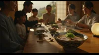
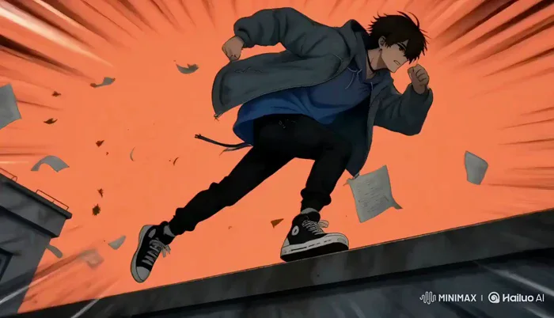
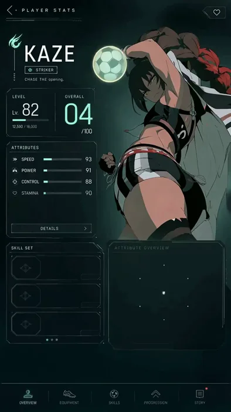
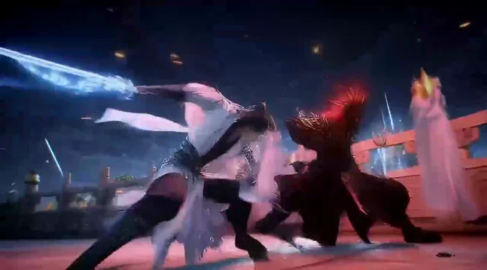
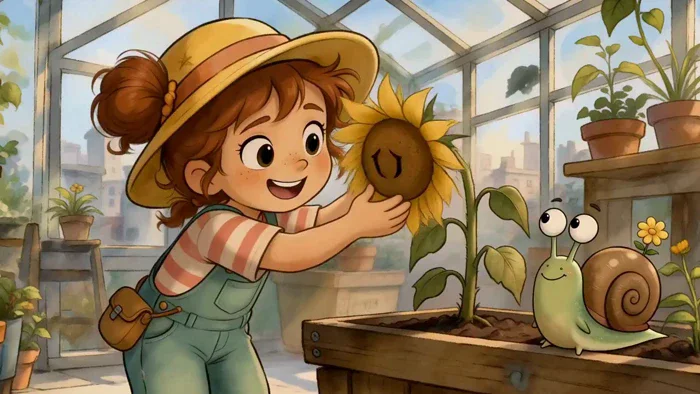
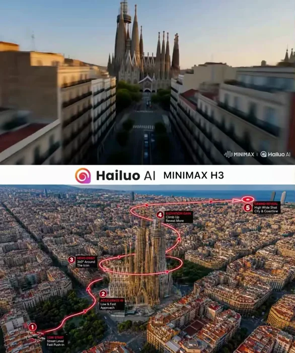

[← 総目次に戻る](../README.ja.md#table-of-contents) · [English](keyframe-animation.md) · [简体中文](keyframe-animation.zh-CN.md) · [日本語](keyframe-animation.ja.md)

### 開始・終了フレームアニメーション Keyframe Animation

- [Case 2: Ramen Dinner — Rack Focus to Family (拉面家宴·焦点转换) — by MiniMax](#case-2)
- [Case 60: Neon Mountain Hover-Bike Race (霓虹山路悬浮摩托竞速) — by @yourPlugAI](#case-60)
- [Case 61: A Drunken-Master Poster Comes Alive (醉拳海报苏醒后的动态擂台) — by @MonetizationDon](#case-61)
- [Case 62: Haru in a High-Contrast Anime Opening (Haru 的高对比动漫开场) — by @keneth_ai](#case-62)
- [Case 63: Kaze’s Player Stats Screen Powers Up (Kaze 球员属性界面启动) — by @aimikoda](#case-63)
- [Case 64: Sword Formations Above a Moonlit Immortal City (月下仙城的剑阵决战) — by @Stellakjbk](#case-64)
- [Case 65: A Shy Rain Cloud in the Greenhouse (温室里的害羞雨云) — by @ManuAGI01](#case-65)
- [Case 66: Balancing Photorealism and Synthetic Texture (真人质感与人工痕迹的对照) — by @tanabe_fragm](#case-66)
- [Case 67: Sagrada Família FPV flight (圣家堂 FPV 穿越) — by @Diplomeme](#case-67)

### Case 2: Ramen Dinner — Rack Focus to Family (拉面家宴·焦点转换) — by MiniMax

▶ [ofox.ai で動画をすべて見る](https://ofox.ai/hailuo-3-prompts?utm_source=github&utm_medium=case&utm_campaign=awesome-ai-video-prompts#case-2)

**输入素材**（1 张图）

| | | | |
|:---:|:---:|:---:|:---:|
|  picture1 ramen family dinner keyframe |  |  |  |

<strong>Prompt</strong> — For the target video, at 0.00 seconds into the target video, &lt;Picture 1&gt; (from [Shot 1]) is fully referenced. integrated_multimodal_description: [Shot…

~~~~text
For the target video, at 0.00 seconds into the target video, <Picture 1> (from [Shot 1]) is fully referenced.

integrated_multimodal_description: [Shot 1] This is a live-action, cinematic shot with a shallow depth of field. The camera holds a perfectly static shot throughout the entire eight-second duration, capturing a cozy family gathering in a traditional Japanese dining room. The scene opens with a large, intricately patterned blue and white ceramic bowl of ramen in the immediate foreground, rendered in crisp, sharp focus. The bowl sits on a smooth, polished long wooden table. Inside the bowl, a rich, oily golden-brown broth surrounds yellow wavy noodles, topped with two thick, round slices of chashu pork featuring visible fat marbling and a distinct spiral meat pattern. A generous mound of freshly chopped, bright green scallions rests in the center, and a crisp, dark green rectangular sheet of nori seaweed is tucked into the right edge. To the left of the bowl, a pair of light brown wooden chopsticks rests horizontally on a small, dark rectangular chopstick rest, near a small cylindrical ceramic teacup with blue painted patterns. On the right side of the table, a spherical paper lantern with a ribbed bamboo frame sits on a black wooden base. In the background, a large family of seven is gathered around the table, initially appearing as a soft, blurred presence. Behind them, traditional Japanese sliding shoji screens with wooden lattice frames are open, revealing a bright outdoor scene with lush green trees. Early in the clip, the thick, white steam rising from the hot ramen broth immediately intensifies, billowing upwards in thick, swirling clouds that dance continuously above the bowl. As the clip progresses into the middle seconds, the camera maintains its static position while the focus begins a deliberate, smooth shift deeper into the room. The foreground ramen bowl, its vibrant ingredients, and the rising steam gradually soften into a hazy, out-of-focus blur. Simultaneously, the family members in the background come into sharp, detailed clarity. The heavy steam continues to rise from the foreground, creating a dynamic, translucent veil between the camera and the family. With the focus now firmly locked on the background, the vibrant family dinner comes alive. The man in the dark navy blue long-sleeved shirt on the left leans forward, his mouth moving animatedly in a silent exchange. The young girl in the crisp white short-sleeved t-shirt beside him smiles brightly, looking toward the center of the table. The woman on the far left, wearing a soft light blue long-sleeved blouse, turns her head slightly, smiling gently. Across the table, the woman in the light grey button-down shirt smiles broadly, her eyes crinkling, as she rests her hands near her plate. The woman in the dark grey top further back uses her wooden chopsticks to pick up a small piece of food from a central ceramic dish filled with bright red pickled vegetables. The woman in the center back in the light grey sweater smiles gently, her hands clasped softly in front of her, observing the interaction. Throughout the remainder of the clip, the family continues their lively physical interaction, their mouths moving in continuous, silent cadences of conversation, while the thick, white steam from the blurred ramen bowl in the foreground never stops rising, adding a comforting atmosphere to the warm gathering.

overall_soundscape: The soundscape begins with a quiet room tone mixed with the faint, airy rustle of the thick steam billowing from the hot ramen bowl in the foreground, accompanied by the subtle, continuous hissing and bubbling of the rich broth. As the visual focus shifts deeper into the room, the physical sounds of the bustling family dinner become dominant in the foreground. The clear, sharp clinking of ceramic bowls and wooden chopsticks touching plates is clearly heard as the family members reach for food. This is followed by the faint, muffled thud of a cup being set down on the smooth wooden table, and the subtle, rhythmic rustle of cotton and wool clothing as the family members lean forward and gesture, perfectly capturing the lively, physical atmosphere of the shared meal.

non_diegetic_music: A gentle, heartwarming acoustic guitar melody plays softly in the background, accompanied by the subtle, resonant notes of a traditional Japanese koto. The music maintains a slow, comforting tempo that enhances the cozy, nostalgic, and joyful atmosphere of the family gathering.
~~~~

**参数**：MiniMax H3 · MiniMax（HuggingFace 官方仓库 H3-Base 768p 复现脚本自跑） · fl2va（仅首帧，未提供尾帧） · 8s · 768p · auto · 带音频
**来源**：MiniMax 官方 HuggingFace 模型卡 · [source](https://huggingface.co/MiniMaxAI/MiniMax-H3/blob/main/scripts/readme/reproducible-768p-fl2va-request.sh)

MiniMax 官方示例 · HuggingFace MiniMax-H3 模型卡 FL2VA 复现脚本 · 首帧素材来自 MiniMax 官方素材库 cdn.hailuoai.com

[目次に戻る](#table-of-contents)

### Case 60: Neon Mountain Hover-Bike Race (霓虹山路悬浮摩托竞速) — by @yourPlugAI

▶ [ofox.ai で動画をすべて見る](https://ofox.ai/hailuo-3-prompts?utm_source=github&utm_medium=case&utm_campaign=awesome-ai-video-prompts#case-60)

<strong>Prompt</strong> — Cinematic Anime Video Scene Generate a 15-second horizontal 16:9 original high-speed hover-bike racing anime video from the provided first frame. CRIT…

~~~~text
Cinematic Anime Video Scene

Generate a 15-second horizontal 16:9 original high-speed hover-bike racing anime video from the provided first frame.

CRITICAL ENTITY LOCK:
There must be exactly 2 racers and 2 bikes in the entire video: RENJI on VALKYRIE-01 (cyan/black drift bike) and ELENA on AERO-X (crimson/white draft bike).
Do not add extra racers, drone support vehicles, spectators, or traffic.
Maintain total visual consistency for both bikes, helmet visors, suit patterns, repulsor spark colors, and bike liveries throughout the sequence.

Entity identity:
VALKYRIE-01: Matte-black and cyan angular hover-bike, exposed repulsor pads, lateral drift brakes, blue plasma exhaust trails, ridden by Renji (cyan trim suit).
AERO-X: Pearl-white and neon-crimson aerodynamic hover-bike, enclosed canopy, crimson energy draft aura, white-hot central booster, ridden by Elena (crimson/gold visor suit).

Video style:
High-budget modern sports anime, sakuga-level velocity animation, crisp line art, vibrant neon lighting contrast, high-speed camera tracking, hyper-realistic friction and energy particle effects. Set on a wet downhill mountain pass at dawn.

Camera and pacing:
Continuous forward velocity, zero slow-motion interruptions:
0.0s - 3.0s: High-speed rear-tracking shot diving into the first downhill hairpin curve; instant drift initiation.
3.0s - 7.5s: Tight side-parallel tracking shot as bikes navigate rock debris and trade positions through S-curves.
7.5s - 11.5s: Close camera lock on the draft-slingshot maneuver; high-energy particle displacement as booster ignition occurs.
11.5s - 15.0s: Low-angle front-facing camera lock on the final sprint to the finish line bridge, ending on a hyper-speed photo-finish freeze.

Action timing:
0.0s - 1.5s:
Sequence begins at speed. VALKYRIE-01 leads downhill; AERO-X locks onto its rear bumper. Anti-gravity repulsors spray road water and blue sparks into the frame.

1.5s - 4.0s:
First sharp hairpin. VALKYRIE-01 deploys lateral drift airbrakes with a burst of blue thruster fire, sliding sideways at 300 km/h. AERO-X stays glued inside its slipstream aura.

4.0s - 7.0s:
Mountain debris hazard. VALKYRIE-01 hops over a boulder using a repulsor burst. AERO-X ducks under it, scraping the neon magenta guardrail in a cloud of friction sparks.

7.0s - 10.0s:
S-Curve exchange. Bikes lean side-by-side; their repulsor fields collide, creating a bright electrical shockwave. ELENA pulls the overdrive lever; AERO-X's rear fins extend.

10.0s - 13.0s:
Slingshot maneuver. AERO-X bursts out of VALKYRIE-01's draft, igniting its central white plasma booster. Both bikes roar down the final straightaway side-by-side.

13.0s - 15.0s:
Final sprint toward the finish light gate. Water sprays violently behind them. Both nose cones cross the finish line simultaneously in a flash of light. Final freeze frame.

Motion quality:
Fluid 2D animation, extreme speed-line integration, stable bike geometry, flawless vehicle reflection rendering, zero limb or body clipping, high-frame-rate kinetic realism.

Environment:
Wet mountain pass asphalt, sheer cliff walls, neon cyan and magenta guardrail lights, early dawn sky with pink/purple clouds, water spray, floating spark particles.

Final output:
15 seconds, horizontal 16:9, original high-budget sports racing anime, exactly 2 racers, relentless kinetic pacing, dynamic cinematography, no subtitles, no watermarks, no logos.
~~~~

**参数**：MiniMax H3 · 未标注 · fl2va · 15s · 未标注 · 未标注 · 带音频
**来源**：@yourPlugAI · [原帖](https://x.com/yourPlugAI/status/2086528067019698388)

Preview © 2026 @yourPlugAI · Prompt by @yourPlugAI

[目次に戻る](#table-of-contents)

### Case 61: A Drunken-Master Poster Comes Alive (醉拳海报苏醒后的动态擂台) — by @MonetizationDon

▶ [ofox.ai で動画をすべて見る](https://ofox.ai/hailuo-3-prompts?utm_source=github&utm_medium=case&utm_campaign=awesome-ai-video-prompts#case-61)

<strong>Prompt</strong> — Animate the uploaded CHUNG LEE movie poster as a 10-second cinematic martial-arts motion poster while preserving the original artwork, characters, typ…

~~~~text
Animate the uploaded CHUNG LEE movie poster as a 10-second cinematic martial-arts motion poster while preserving the original artwork, characters, typography, composition and layout.

Bring the static poster to life with rich cinematic colors — crimson red, golden yellow, fiery orange, electric blue, emerald green and magenta. Animate the lanterns, drifting smoke, flying dust, sparks, debris and the surrounding crowd.

Give CHUNG LEE subtle drunken-master movement: shifting shoulders, flowing hair, a confident expression and a casual lift of the gourd with liquid splashing in slow motion.

Then make “CHUNG LEE” the ultimate visual flex — dramatic brush-stroke reveals, golden particles, energy trails and a powerful 3D pop-out effect that makes the title feel like it is breaking out of the poster.

Add glowing red energy around the Chinese characters, dynamic martial-arts impacts, moving background fighters, cinematic camera movement and bursts of colorful light.

Finish with a dramatic push toward the CHUNG LEE title, then pull back to reveal the complete poster before locking into the final frame.

No redesign. No new text. No distorted typography. Preserve the original poster — just make it move.

Animation made with Minimax H3
~~~~

**参数**：MiniMax H3 · 未标注 · fl2va · 23s · 未标注 · 未标注 · 带音频
**来源**：@MonetizationDon · [原帖](https://x.com/MonetizationDon/status/2087183007874453795)

Preview © 2026 @MonetizationDon · Prompt by @MonetizationDon

[目次に戻る](#table-of-contents)

### Case 62: Haru in a High-Contrast Anime Opening (Haru 的高对比动漫开场) — by @keneth_ai

▶ [ofox.ai で動画をすべて見る](https://ofox.ai/hailuo-3-prompts?utm_source=github&utm_medium=case&utm_campaign=awesome-ai-video-prompts#case-62)

<strong>Prompt</strong> — [CHARACTER LOCK — use attached reference sheet] Haru: teen boy, short messy dark-brown hair with warm amber rim-light on the edges, tired amber eyes, …

~~~~text
[CHARACTER LOCK — use attached reference sheet]
Haru: teen boy, short messy dark-brown hair with warm amber rim-light on the
edges, tired amber eyes, single silver earring on left ear, thin dark cord
choker, oversized grey-blue windbreaker open over a longline blue hoodie, black
joggers with dangling straps, scuffed black high-top sneakers. Face, hair
silhouette, and outfit identical in every shot.

[FORMAT]
Anime television opening, 2D cel-shaded, crisp linework, 16:9, high contrast,
film grain. Total runtime 15 seconds, 12 shots, beat-synced hard cuts.

[SHOT LIST — 15s]
00.0–01.2  Black. Hard white flash. Haru's silhouette snaps in, back to camera,
           jacket billowing. Background floods CYAN.
01.2–02.4  Whip-pan to profile close-up. Downcast eyes flick up, sharp.
           Flash. Background MAGENTA.
02.4–03.2  Low-angle wide: he sprints along a rooftop ledge, coat trailing,
           paper and leaves scattering. ORANGE-RED, speed lines.
03.2–03.9  Freeze-frame mid-leap between rooftops. Pure black silhouette
           against strobing YELLOW-to-LIME.
03.9–04.7  Top-down spin: lands, one hand on concrete, dust ring bursts out.
           Snap to DEEP PURPLE.
04.7–05.3  Extreme close-up: silver earring swings, catches a lens flare.
           White flash frame.
05.3–06.2  Split-screen triptych — three duotone copies of his face
           (blue / red / green) rotating, one per beat.
06.2–07.4  Back view, walking into wind, hood snapping, hair whipping.
           Background ELECTRIC BLUE with horizontal scan lines.
07.4–08.2  Hands-in-pockets front shot, camera orbits fast around him.
           Colors cycle GREEN → PINK → WHITE across the orbit.
08.2–09.4  Seated on the ledge, knees up, head down, city lights blooming
           behind. Muted TEAL. Brief calm — no flash on this cut.
09.4–10.6  He stands, turns to camera, hair lifting, single amber rim-light
           igniting along his edge. Background goes pure WHITE.
10.6–15.0  Pull-back wide: Haru walks away toward the sunset skyline, hands in
           pockets, clothes drifting. Color settles into the warm painted
           palette of the reference sheet. Camera dollies out, holds on
           centered title-card space.

[MOTION]
Simple punchy character animation on twos. Hair and fabric always drifting.
Camera: whip pans, snap zooms, one fast orbit, one final dolly-out.

[COLOR & FX]
Full-frame color swaps on every cut, synced to an implied beat. White
flash-frames between shots 1–9. Chromatic aberration on impacts, halftone dot
bursts, quick duotone inversions, floating leaf and paper debris throughout.
Warm amber rim-light preserved on the character in every shot.

[NEGATIVE]
photorealistic, 3D render, live action, extra characters, text or logos,
changing outfit, changing hair color, distorted face, extra fingers, watermark
~~~~

**参数**：MiniMax H3 · 未标注 · fl2va · 15s · 未标注 · 未标注 · 带音频
**来源**：@keneth_ai · [原帖](https://x.com/keneth_ai/status/2087039444146933942)

Preview © 2026 @keneth_ai · Prompt by @keneth_ai

[目次に戻る](#table-of-contents)

### Case 63: Kaze’s Player Stats Screen Powers Up (Kaze 球员属性界面启动) — by @aimikoda

▶ [ofox.ai で動画をすべて見る](https://ofox.ai/hailuo-3-prompts?utm_source=github&utm_medium=case&utm_campaign=awesome-ai-video-prompts#case-63)

<strong>Prompt</strong> — @[ref img] is the sole visual authority for Kaze, the football, the complete player-stats interface, typography, numbers, icons, colors, lighting, lay…

~~~~text
@[ref img] is the sole visual authority for Kaze, the football, the complete player-stats interface, typography, numbers, icons, colors, lighting, layout, and vertical composition. Animate this exact screen without redesigning it. Preserve all existing labels and final stat values.
[Goal]
Create a polished 15-second anime sports-game player stats screen opening. Use one continuous, locked, straight-on full-screen composition with no camera movement, cuts, cropping, or perspective distortion.

[Sequence]
0–2.2 seconds: Begin from near-black teal. A faint horizontal scanner passes downward, revealing Kaze’s silhouette and the outer edges of the interface. Fine particles and dim mint circuitry flicker awake.
2.2–5.5 seconds: The header, KAZE nameplate, role badge, level panel, and overall panel resolve through clean line-draw animations. Kaze emerges fully from shadow, takes a controlled breath, subtly shifts her shoulders and raised arm into the referenced pose, then fixes an intense gaze toward the viewer. Her hair, ribbons, and loose clothing react naturally to a growing current of wind. The football begins a slow, stable rotation beside her hand.

5.5–10.8 seconds: The large overall score counts rapidly upward and lands precisely on 92. The level settles on 46. Each attribute bar fills smoothly from left to right in sequence—Speed 93, Power 91, Control 88, Stamina 90, Agility 94, Technique 89—each landing with a restrained mint pulse. The radar chart draws outward from its center and locks into the exact final polygon. Skill cards activate from top to bottom; their icons flare briefly while the ACTIVE and ULTIMATE states illuminate.
10.8–13.3 seconds: The player ID strip and bottom navigation fade and slide into their exact final positions. The wind energy around Kaze accelerates clockwise, wrapping around the rotating ball and sweeping behind her body with layered luminous trails. Kaze tightens her hand, leans slightly into the current, and gives one natural blink; preserve her identity, anatomy, costume, and right-side placement.

13.3–15 seconds: The energy arc reaches a bright controlled crest, then settles into a living idle pulse. Hold the fully assembled screen matching @[ref img] exactly. Kaze continues subtle breathing; hair and ribbons drift, the football rotates slowly, particles shimmer, and all stats remain stable and readable.

Use crisp premium game-UI motion, clean 2D anime character animation, subtle depth between Kaze and the interface, and stable legible typography. Keep every panel, icon, label, number, and geometric boundary fixed once revealed. Do not introduce new text, extra characters, additional objects, logos, captions, or UI elements.

Audio: low electronic boot hum, delicate scanning ticks, short confirmation tones as values lock, rising airy wind around the ball, soft cloth movement, and one refined completion chime. No dialogue and no music.
~~~~

**参数**：MiniMax H3 · 未标注 · fl2va · 15s · 未标注 · 未标注 · 带音频
**来源**：@aimikoda · [原帖](https://x.com/aimikoda/status/2086122377633575169)

Preview © 2026 @aimikoda · Prompt by @aimikoda

[目次に戻る](#table-of-contents)

### Case 64: Sword Formations Above a Moonlit Immortal City (月下仙城的剑阵决战) — by @Stellakjbk

▶ [ofox.ai で動画をすべて見る](https://ofox.ai/hailuo-3-prompts?utm_source=github&utm_medium=case&utm_campaign=awesome-ai-video-prompts#case-64)

<strong>Prompt</strong> — 5秒，4:3，顶级东方仙侠3A游戏CG，电影级高端宣传片，严格参考图1的月下仙城场景与美术气质：巨大明月、云海天宫、环形仙城、悬浮仙山、瀑布、白玉仙桥、金顶楼阁、冷蓝月光。整体画面必须唯美、恢弘、神圣、危险、酷炫，像大厂正式游戏开场CG，不像普通AI视频。 双主角设定：男剑仙，黑色长发，白蓝战袍，冰…

~~~~text
5秒，4:3，顶级东方仙侠3A游戏CG，电影级高端宣传片，严格参考图1的月下仙城场景与美术气质：巨大明月、云海天宫、环形仙城、悬浮仙山、瀑布、白玉仙桥、金顶楼阁、冷蓝月光。整体画面必须唯美、恢弘、神圣、危险、酷炫，像大厂正式游戏开场CG，不像普通AI视频。

双主角设定：男剑仙，黑色长发，白蓝战袍，冰蓝雷光长剑，英俊冷峻，强大沉稳；女剑仙，黑色长发，白青仙裙，月白灵剑与月华法术，清冷绝美，高贵飘逸。反派为黑金重甲魔修，手持黑色巨剑，周身暗红黑色魔气，压迫感极强。人物脸和服装全程稳定统一，保持高级游戏角色建模质感。

开场镜头从巨大明月前高速穿越云海与浮空仙山，俯冲进入宏伟仙城，来到白玉高台，男女主背对镜头立于高台边缘，衣袍长发飞扬，英雄感极强。远处天空突然裂开暗红色空间裂缝，魔修高速坠落，轰然落地，引发碎石、冲击波和魔气爆发。

男剑仙瞬间拔剑冲出，与魔修在仙桥中央高速对撞，剑刃碰撞爆发蓝红双色能量冲击、空间波纹、火星与剑气。近战动作凌厉、清晰、有重量感，包含高速斩击、格挡、反击、短暂慢动作碰撞特写，镜头低机位跟拍与高速环绕，极具电影感。

随后女剑仙御剑升空，展开巨大蓝白仙阵，发动“万剑齐发”，数百柄发光飞剑如流星暴雨般射向魔修，夜空被剑光点亮。魔修爆发黑红魔气，凝聚巨大的魔龙反击，空中连续爆炸。男剑仙御剑穿梭爆炸火光与云海，一剑斩裂魔龙，空战场面华丽震撼。

最后魔修释放百米高的黑红魔神法相，遮蔽天空。男女主并肩悬空，男剑仙开启覆盖半个天空的金蓝剑阵，女剑仙召唤巨大的白蓝月华莲华法相，二人联手凝聚数百米长的金蓝神剑，与魔神巨剑正面碰撞。碰撞瞬间进入超级慢动作，蓝色雷电、金色符文、白色月华、红色魔焰与空间裂痕同时凝固，随后爆发毁天灭地的大爆炸，形成巨大的环形云洞与能量冲击波。

结尾爆炸光芒散去，巨大明月重现，男女主并肩立于悬空巨剑之上俯瞰整座仙城，周围灵剑环绕，远处天宫亮起金蓝光柱，镜头缓慢拉远，形成极强的高级游戏主视觉结尾，并预留后期添加Logo空间。

镜头要求：超广角航拍、俯冲推进、低机位英雄视角、高速跟拍、环绕镜头、御剑追踪、短暂升格慢动作、终极碰撞震动、史诗级拉远收尾。镜头必须流畅稳定，不乱晃，不跳轴。

视觉要求：特效炫丽但高级干净，不能廉价光污染。强调冰蓝雷电剑气、金色仙纹、月华粒子、飞剑阵、空间裂缝、黑红魔焰、魔龙、巨大法相、神剑、冲击波、体积云、瀑布水雾、发光碎片。人物主体始终清晰，画面精致通透，PBR材质，真实布料与长发动效，电影级光影与空间层次。

音效：原生立体声。包含高空风声、远处钟鸣、低沉鼓点、剑刃碰撞、破风声、雷电炸裂、万剑掠空、魔龙低吼、终极爆炸低频冲击。无对白，无字幕，无水印，无乱码。
~~~~

**参数**：MiniMax H3 · 未标注 · fl2va · 15s · 未标注 · 未标注 · 带音频
**来源**：@Stellakjbk · [原帖](https://x.com/Stellakjbk/status/2086021869040263455)

Preview © 2026 @Stellakjbk · Prompt by @Stellakjbk

[目次に戻る](#table-of-contents)

### Case 65: A Shy Rain Cloud in the Greenhouse (温室里的害羞雨云) — by @ManuAGI01

▶ [ofox.ai で動画をすべて見る](https://ofox.ai/hailuo-3-prompts?utm_source=github&utm_medium=case&utm_campaign=awesome-ai-video-prompts#case-65)

<strong>Prompt</strong> — [REFERENCE CONTROL] Use the uploaded PART 1 storyboard image for “The Little Gardener and the Runaway Rain Cloud” as the PRIMARY visual, character, en…

~~~~text
[REFERENCE CONTROL]

Use the uploaded PART 1 storyboard image for “The Little Gardener and the Runaway Rain Cloud” as the PRIMARY visual, character, environment, composition, and narrative reference.

Generate a FINISHED animated sequence from the storyboard.

DO NOT reproduce the storyboard sheet itself.

The final video must NOT contain:
- storyboard borders
- panel numbers
- panel captions
- timestamps
- production notes
- character reference sheets
- off-white storyboard paper
- storyboard title/header
- handwritten annotations

The uploaded storyboard controls and locks:

1. Luma’s exact character design
2. Nimbus’s exact cloud design
3. Sprout’s exact snail design
4. the rooftop greenhouse architecture
5. the wilted sunflower design
6. the old metal watering can
7. the gardening props
8. warm watercolor/painterly 2D visual style
9. character scale relationships
10. overall color palette
11. Part 1 story progression

Animate these designs naturally while maintaining extremely high identity consistency.

--------------------------------------------------

[VIDEO GOAL]

Create exactly:

Duration: 15 seconds
Aspect Ratio: 16:9 landscape
Frame rate feeling: cinematic 24 fps
Genre: magical garden comedy / heartwarming fantasy
Visual medium: premium hand-painted 2D animated short
Audience: family-friendly
Dialogue language: English
Native synchronized dialogue + sound effects + music

Emotional progression:

peaceful garden morning
→ concern
→ determination
→ mysterious sound
→ magical discovery
→ tiny comic surprise
→ hopeful miracle
→ BIG IDEA cliffhanger

The storytelling must be very easy to understand even without narration.

IMPORTANT:

Although the storyboard contains 15 individual panels, DO NOT turn the video into fifteen frantic one-second cuts.

Consolidate those beats into approximately 7–8 fluid cinematic shots.

Each shot should contain several connected storyboard actions so the animation feels like an actual polished animated short rather than a slideshow.

--------------------------------------------------

[CHARACTER IDENTITY LOCK — LUMA]

LUMA must match the uploaded storyboard exactly.

Character:
approximately 8-year-old little gardener.

Physical appearance:
- warm fair skin
- large expressive dark brown eyes
- soft round childlike face
- freckles across cheeks/nose if visible in reference
- fluffy auburn / reddish-brown hair
- hair gathered into two messy buns
- several loose curly strands around face

Signature clothing:
- oversized warm yellow gardening hat
- mint-green gardening overalls
- coral-and-cream horizontally striped shirt
- red gardening boots
- tiny brown gardening/seed pouch attached at waist

Character proportions:
- small child stature
- slightly oversized head
- expressive hands
- rounded appealing silhouette

Personality:
- caring
- cheerful
- imaginative
- curious
- determined when a plant needs help
- easily excited by magical discoveries

Performance should transition:

happy gardener
→ worried plant caretaker
→ determined problem solver
→ curious investigator
→ amazed child
→ excited inventor

CRITICAL:

Luma must remain visually identical in every shot.

Do not change:
- face
- age
- hairstyle
- hair color
- hat
- clothing
- boots
- proportions
- eye color

--------------------------------------------------

[CHARACTER IDENTITY LOCK — NIMBUS]

Nimbus must match the cloud discovered inside the watering can in the storyboard.

Nimbus is a tiny living rain cloud approximately pillow-sized.

Design:
- soft fluffy blue-white cloud body
- subtle watercolor edges
- very faint pale blue shadows
- large round expressive dark eyes
- tiny eyebrows
- small cute mouth
- slight rosy blush
- tiny dangling raindrop-shaped feet
- soft semi-translucent cloud fluff
- no arms unless naturally suggested by cloud shape

Personality:
- shy
- timid
- gentle
- easily embarrassed
- harmless
- sweet

Nimbus begins PART 1 hiding inside the watering can.

He must NOT appear in the greenhouse before the discovery sequence.

His first reveal should feel magical and surprising.

Nimbus should remain very small.

DO NOT:
- enlarge Nimbus
- darken Nimbus
- create storm powers
- add flower crown yet
- make him Super Cloud
- generate multiple Nimbus clouds
- create lightning

Those belong to later story beats.

--------------------------------------------------

[CHARACTER IDENTITY LOCK — SPROUT]

Sprout must match the storyboard exactly.

Design:
- tiny green garden snail
- soft rounded body
- large tall expressive eye stalks
- warm brown spiral shell
- tiny yellow flower growing beside/on shell
- same miniature scale throughout

Personality:
- slow
- observant
- dramatic
- suspicious
- comedic reaction character

Sprout has no human speech unless specified.

Use:
- tiny squeaks
- gasps
- nervous chirps
- eye-stalk reactions

Sprout should frequently understand the danger of Luma’s ideas before Luma does.

--------------------------------------------------

[PROP IDENTITY LOCK — WILTED SUNFLOWER]

Use the exact sunflower from the storyboard.

At the start:
- heavily drooping yellow petals
- bowed flower head
- wilted leaves
- weak stem
- planted in rectangular wooden planter
- still alive

After ONE drop from Nimbus:
the flower should perk up slightly.

IMPORTANT:

Do NOT magically transform it into a giant perfect sunflower yet.

Only show:
- stem becoming slightly stronger
- leaves lifting
- flower head rising a little
- color becoming slightly healthier

This is a small visual miracle.

--------------------------------------------------

[PROP IDENTITY LOCK — WATERING CAN]

Use the same old watering can from the storyboard.

Appearance:
- weathered gray/blue metal
- rounded main body
- curved metal handle
- long narrow spout
- slightly worn surface
- small painted flower decoration if visible
- large enough for tiny Nimbus to curl inside

It is an ordinary gardening can.

Do not transform it into a magical object.

Nimbus is simply hiding inside.

--------------------------------------------------

[ENVIRONMENT LOCK — ROOFTOP GREENHOUSE]

Maintain exactly the warm rooftop greenhouse established by the storyboard.

Environment:
- glass-paneled greenhouse walls
- glass roof
- wooden structural framing
- warm sunlight pouring through glass
- hanging vines
- multiple wooden planter boxes
- terracotta flower pots
- colorful flowers
- herbs
- leafy plants
- gardening shelves
- small ladder
- watering hose
- gardening tools
- seed packets
- old watering can
- pots and wooden crates
- distant soft city rooftop skyline through greenhouse glass

Visual feeling:
handmade,
lived-in,
cozy,
safe,
sunny,
lush,
magical without obvious fantasy effects at the beginning.

Maintain coherent geography throughout.

The sunflower planter, watering can area, shelves, and main walkway must not randomly move between shots.

--------------------------------------------------

[WORLD / MAGIC RULES]

The world begins mostly realistic.

Nimbus introduces the first visible magical element.

Magic should be:
- delicate
- soft
- believable within a children’s animated world
- visually elegant
- never explosive

Nimbus creates rain naturally.

Cause-and-effect must be clear:

sunflower is dry
→ Luma searches for water
→ watering can sneezes
→ Luma investigates
→ Nimbus is discovered
→ Nimbus nervously sneezes
→ one raindrop falls
→ sunflower responds
→ Luma realizes Nimbus can help
→ Luma gets a BIG IDEA

No unexplained magical events.

--------------------------------------------------

integrated_multimodal_description:

[SHOT 1] (0.00s–2.00s)
THE PEACEFUL ROOFTOP GARDEN

Open with a beautiful wide establishing shot of the rooftop greenhouse.

Warm morning sunlight enters through the glass ceiling.

Tiny dust particles float through the golden beams.

Leaves move gently in a rooftop breeze.

Luma happily walks between planter boxes carrying a small basket of seeds/gardening tools.

Sprout slowly crawls along the edge of a wooden planter beside her.

Use subtle environmental life:
- small leaves swaying
- hanging vines moving
- distant city haze
- butterflies or tiny garden insects only if subtle

Camera:

begin outside/near the glass roof
→ smooth gentle push through the greenhouse
→ settle into a medium-wide shot of Luma tending plants.

Luma hums quietly.

She pats soil around a healthy flower.

Dialogue:

Luma, cheerful:
<d>[English] Good morning, little guys!</d>

She notices Sprout.

Luma:
<d>[English] Morning, Sprout.</d>

Sprout gives a tiny cheerful squeak.

Sound:
- light morning breeze
- gentle birds outside
- leaves rustling
- gardening basket movement
- soft snail squeak
- quiet greenhouse ambience

Music:
delicate whimsical opening using pizzicato strings, gentle marimba, and soft flute.

--------------------------------------------------

[SHOT 2] (2.00s–4.20s)
THE WILTING SUNFLOWER

As Luma continues through the garden, her smile slowly fades.

Her gaze lands on the drooping sunflower.

Cut to a closer view:

the sunflower’s head hangs sadly downward.

Its leaves droop.

Sprout crawls beside the planter and slowly raises both eye stalks toward the flower.

One eye stalk leans sideways with concern.

Luma immediately kneels.

She gently lifts one wilted leaf between her fingers.

Camera:

medium tracking with Luma
→ rack focus from healthy flowers to wilted sunflower
→ close-up flower
→ intimate medium-close shot of Luma kneeling.

Dialogue:

Luma:
<d>[English] Oh no...</d>

She gently examines the plant.

Luma:
<d>[English] Sunny, what happened?</d>

She touches the dry soil.

Luma:
<d>[English] You’re thirsty.</d>

Sprout gives a worried tiny squeak.

Luma’s worried expression becomes determined.

Luma:
<d>[English] Don’t worry. I’ll find water.</d>

Sound:
- soft soil touch
- leaf rustle
- subtle worried musical note

Keep this emotionally sincere but brief.

--------------------------------------------------

[SHOT 3] (4.20s–6.30s)
THE SEARCH

Luma stands quickly and begins checking the greenhouse.

She looks at:
- empty small watering cup
- dry watering station
- hose
- gardening shelf

She trots along the walkway.

Sprout follows at an absurdly slow speed.

Use a brief visual comedy beat:

Luma rushes past frame.

A moment later...

Sprout is still only a few centimeters farther along.

Luma then notices the old metal watering can sitting among leafy pots.

Her eyes brighten.

Camera:

side tracking shot following Luma
→ small comedic static shot of slow Sprout
→ quick pan toward watering can as Luma notices it.

Dialogue:

Luma:
<d>[English] Water... water...</d>

She spots the can.

Luma:
<d>[English] Aha!</d>

Sound:
- light footsteps
- tool clinks
- leaves brushing clothes
- tiny Sprout effort squeak

Music becomes slightly more playful.

--------------------------------------------------

[SHOT 4] (6.30s–8.30s)
THE WATERING CAN SNEEZES

Luma approaches the old watering can.

Before she reaches it—

something inside shifts.

Very subtle.

Luma freezes.

The watering can gives a tiny wobble.

Then:

<d>[English] Ah... ah...</d>

Luma slowly leans closer.

Sprout’s eye stalks rise behind her.

Suddenly from inside:

<d>[English] ACHOO!</d>

A tiny puff of cool mist shoots gently from the watering-can spout.

The can rocks slightly.

Luma jumps backward only a few centimeters in surprise.

Sprout instantly retracts slightly into his shell.

No danger.

Camera:

slow push-in on watering can
→ close-up of its dark opening
→ Luma listening
→ mist puff from spout
→ reaction two-shot.

Dialogue:

Luma:
<d>[English] ...Did you just sneeze?</d>

Beat.

She looks toward Sprout.

Luma:
<d>[English] Watering cans don’t sneeze.</d>

Sprout gives a tiny uncertain squeak.

Sound:
- metal can creak
- tiny movement from inside
- adorable sneeze
- mist “pfft”
- light metallic wobble

Music:
brief curious plucked-string motif.

--------------------------------------------------

[SHOT 5] (8.30s–10.30s)
THE IMPOSSIBLE DISCOVERY

Luma carefully crouches beside the watering can.

She grips its edge gently.

Slowly...

she peers inside.

Camera moves over Luma’s shoulder toward the dark interior.

For one beat we see only darkness.

Then two tiny eyes blink.

Soft pale-blue cloud fluff emerges.

Nimbus is curled inside the watering can.

He looks up at Luma.

Nimbus immediately becomes embarrassed and tries to shrink deeper into the can.

Luma’s expression transforms from caution to pure wonder.

Sprout stretches upward from beside the can to see inside.

Camera:

over-shoulder POV
→ gradual focus transition revealing Nimbus
→ close-up Nimbus eyes
→ reaction close-up Luma
→ wider three-character composition.

Dialogue:

Luma, whispering:
<d>[English] Whoa...</d>

Nimbus nervously:
<d>[English] ...Hi.</d>

Luma:
<d>[English] You’re a cloud.</d>

Nimbus gives a shy tiny nod.

Luma, amazed:
<d>[English] A tiny cloud!</d>

Sound:
- subtle magical shimmer
- tiny cloud puff
- soft metal resonance from inside can
- Nimbus’s faint watery ambience

Music:
introduce delicate glockenspiel and airy flute.

--------------------------------------------------

[SHOT 6] (10.30s–12.20s)
THE TINY RAIN DROP

Nimbus slowly floats just above the watering-can opening.

He is nervous about being watched.

Luma leans closer with fascinated eyes.

Sprout watches from below.

Nimbus’s little face scrunches.

His cloud body briefly compresses.

Nimbus:

<d>[English] Ah... ah...</d>

Luma realizes another sneeze is coming.

Nimbus:

<d>[English] Achoo!</d>

A single sparkling raindrop pops from the underside of Nimbus.

IMPORTANT:

Only ONE meaningful raindrop.

Camera follows the droplet in a graceful macro tracking shot.

The droplet catches sunlight and briefly shows a subtle rainbow refraction.

It falls toward the sunflower planter.

Sound:
- cute cloud sneeze
- tiny watery “plink”
- soft magical shimmer

Luma:
<d>[English] Wait...!</d>

--------------------------------------------------

[SHOT 7] (12.20s–13.50s)
ONE DROP IS ENOUGH

Extreme close-up:

the raindrop lands in the dry soil near the sunflower stem.

A soft ring of moisture spreads through the soil.

Nothing explosive.

The sunflower responds gently.

Its stem firms.

One leaf slowly lifts.

The flower head rises a few centimeters.

Its yellow petals regain a little warmth.

Luma watches from the background.

Her mouth falls open.

Then she clasps her hands with delighted excitement.

Nimbus looks surprised by what he just did.

Sprout’s eyes become enormous.

Camera:

macro raindrop impact
→ tilt upward following sunflower
→ rack focus to Luma’s astonished face.

Dialogue:

Luma:
<d>[English] You did that?</d>

Nimbus, shy:
<d>[English] I... think so.</d>

Luma:
<d>[English] One drop!</d>

Sound:
- small water impact
- subtle plant movement
- soft magical chime
- leaf unfurl sound

Music:
warm hopeful melodic lift.

--------------------------------------------------

[SHOT 8] (13.50s–15.00s)
THE BIG IDEA — CLIFFHANGER

Luma looks from the revived sunflower...

to Nimbus...

then slowly around at the dozens of plants filling the greenhouse.

Her eyes widen.

A playful “idea” expression spreads across her face.

She turns toward Nimbus with a huge excited smile and raises one finger.

Nimbus immediately becomes slightly nervous.

Sprout looks at Luma.

Then at Nimbus.

Then at the enormous greenhouse.

Sprout’s eye stalks shoot upward in comic alarm.

Luma excitedly gestures toward all the plants.

Dialogue:

Luma:
<d>[English] Nimbus...</d>

Tiny pause.

Luma:
<d>[English] You can help ALL my flowers!</d>

Nimbus:
<d>[English] ...All?</d>

Sprout gives a loud alarmed:

<d>[English] Eep!</d>

Hold briefly on the three expressions:

Luma = thrilled

Nimbus = shy uncertainty

Sprout = “this is going to be a disaster”

Camera:

medium shot behind Luma looking across greenhouse
→ quick close-up on Luma’s excited realization
→ reaction close-up Nimbus
→ reaction close-up Sprout
→ final wide three-character composition.

End with a gentle comedic musical sting.

CUT TO BLACK.

DO NOT show Luma upgrading Nimbus.

DO NOT begin Part 2.

--------------------------------------------------

[AUDIO DESCRIPTION]

Generate synchronized native stereo audio.

LUMA VOICE:

Natural young girl voice, approximately 8 years old.

Voice qualities:
- warm
- bright
- playful
- emotionally expressive
- curious
- not overly cartoonish
- clear natural English

Her voice progression:

0–4 sec:
gentle and caring

4–8 sec:
determined then curious

8–12 sec:
soft wonder

12–15 sec:
high-energy excitement

--------------------------------------------------

NIMBUS VOICE:

Very soft youthful cloud voice.

Characteristics:
- shy
- slightly breathy
- adorable
- gentle
- innocent
- quiet
- slightly higher pitched than Luma but easily understandable

Do NOT make Nimbus sound robotic.

His sneezes should be small and cute.

--------------------------------------------------

SPROUT AUDIO:

No full normal dialogue.

Use:
- tiny squeaks
- nervous chirps
- tiny gasps
- comic “eep”

Do not give Sprout a human adult voice.

--------------------------------------------------

[ENVIRONMENT AUDIO]

Maintain a rich but soft greenhouse sound bed:

- distant rooftop birds
- very light city ambience far below
- glass greenhouse creaks
- subtle wind
- leaves rustling
- hanging plants moving
- gardening tools
- footsteps on stone/wood
- soil movement
- watering-can metal noises
- small water droplets
- Nimbus cloud puffs
- Sprout squeaks

Never overpower dialogue.

--------------------------------------------------

[NON-DIEGETIC MUSIC]

Create an original whimsical family-animation score.

Instrumentation:
- gentle pizzicato strings
- marimba
- soft acoustic plucks
- airy flute
- glockenspiel
- very subtle warm pads

Musical arc:

0.00–2.00
peaceful garden theme.

2.00–4.20
slightly concerned but still warm.

4.20–6.30
playful search rhythm.

6.30–8.30
curious comedic suspense.

8.30–10.30
magical discovery.

10.30–13.50
wonder and hopeful warmth.

13.50–15.00
playful “big idea” motif ending on light comedic suspense.

No epic music.
No scary music.
No dramatic disaster music.

--------------------------------------------------

[CAMERA LANGUAGE]

Use cinematic storybook camera work.

Overall camera rhythm:

Beginning:
wide, calm, observational.

Problem:
closer emotional coverage.

Mystery:
slow push-ins.

Discovery:
intimate close-ups.

Magic:
macro insert + graceful tracking.

Final idea:
reaction-driven comedy framing.

Preferred techniques:
- gentle dolly
- subtle parallax
- slow push-in
- rack focus
- over-the-shoulder composition
- macro raindrop shot
- reaction close-ups
- wide environmental establishing shot

Avoid:
- handheld shake
- crash zoom
- extreme Dutch angles
- fast action-camera motion
- excessive cuts
- 360-degree spins
- random camera movement

--------------------------------------------------

[VISUAL STYLE]

Premium finished painterly 2D animated short.

Match the storyboard’s exact aesthetic:

- delicate ink outlines
- watercolor-like painted fills
- warm children’s-book texture
- cinematic lighting
- painterly background detail
- softly textured paper-like brushwork without showing actual paper
- appealing rounded characters
- expressive facial animation
- subtle squash and stretch
- natural secondary hair/clothing motion
- charming hand-crafted environment

The final video should look like an animated film version of the storyboard artwork.

NOT:
- 3D CGI
- photorealism
- anime
- flat vector art
- cheap motion comic
- slideshow
- storyboard animation

--------------------------------------------------

[COLOR / LIGHTING]

Primary palette:

Warm golden sunlight
+
fresh leafy green
+
mint green
+
sunflower yellow
+
coral orange
+
soft sky blue

Luma:
warm sunlight on face and hair.

Nimbus:
cool pale-blue-white color providing subtle visual contrast.

Greenhouse:
bright, airy, naturally saturated.

Sunlight should create:
- leaf-shaped shadows
- soft rim lights
- reflections through glass
- golden dust particles
- subtle bloom

During Nimbus reveal:
slightly cooler soft blue fill from the watering can interior.

During raindrop:
tiny prism/rainbow highlight.

Do NOT darken the greenhouse dramatically.

--------------------------------------------------

[ANIMATION / MOTION RULES]

LUMA:

Use believable child motion.

Examples:
- small energetic steps
- expressive hands
- head tilts
- natural blinking
- loose auburn hair bouncing
- hat shifting subtly as she runs
- clothing following body movement

Avoid:
- rubber limbs
- extreme cartoon deformation
- unnatural running

NIMBUS:

Motion should feel buoyant.

Use:
- subtle floating
- soft vertical bob
- cloud edges gently expanding/contracting
- tiny squash when sneezing
- raindrop feet swaying
- slight drifting inertia

SPROUT:

Movement should be very slow.

Comedy comes from contrast with Luma.

Use:
- eye-stalk stretching
- tiny shell shifts
- slow sliding
- sudden eye reactions

PLANTS:

Use gentle natural motion:
- leaves bending
- flower head lifting
- vines swaying
- tiny response after water

--------------------------------------------------

[CONTINUITY RULES]

Maintain one consistent Luma.

Maintain one consistent Nimbus.

Maintain one consistent Sprout.

Do not duplicate characters.

The sunflower remains the same flower throughout.

The watering can remains spatially consistent.

Luma’s seed pouch remains visible.

Luma’s yellow hat remains on her head during Part 1.

Nimbus remains tiny throughout Part 1.

Sprout remains significantly smaller than Luma and Nimbus.

The greenhouse layout must remain coherent between shots.

Morning lighting direction must remain consistent.

--------------------------------------------------

[STORY RESTRICTIONS — PART 1 ONLY]

DO NOT show:

- Super Cloud mode
- flower crown on Nimbus
- hand fan upgrade
- wind chimes upgrade
- Nimbus drinking water
- Nimbus growing larger
- multiple rain showers
- greenhouse rain chaos
- puddle rafting
- overwhelmed Nimbus
- gray Nimbus
- magical greenhouse transformation
- rainbow-drop charm
- final ending

These belong to later parts.

Part 1 ends ONLY when Luma realizes Nimbus could help all her flowers.

--------------------------------------------------

[NEGATIVE CONSTRAINTS]

No storyboard borders.
No storyboard panels.
No captions.
No subtitles.
No timestamps.
No production notes.
No title card.
No watermark.
No brand logo.

No character identity drift.
No extra children.
No extra Nimbus clouds.
No duplicate Sprout.
No hairstyle changes.
No costume changes.
No missing hat.
No changing seed pouch.
No adult-looking Luma.

No dark storm.
No scary cloud.
No evil eyes.
No thunder.
No lightning.
No flooding.
No destructive rain.
No windstorm.
No danger.
No injury.
No broken plants.
No horror.

No random magical objects.
No visual teleportation.
No background redesign.

No excessive camera movement.
No frame interpolation artifacts.
No warped hands.
No extra fingers.
No malformed faces.
No melting character anatomy.
No inconsistent eye placement.

--------------------------------------------------

[FINAL 1.5-SECOND PRIORITY]

The ending must have crystal-clear storytelling.

Luma looks across the entire greenhouse.

She realizes Nimbus might be able to water every plant.

Her face fills with enormous excitement.

She turns to him and says:

<d>[English] Nimbus... you can help ALL my flowers!</d>

Nimbus becomes uncertain:

<d>[English] ...All?</d>

Sprout looks toward the huge greenhouse and reacts:

<d>[English] Eep!</d>

Final emotional composition:

Luma:
excited and confident.

Nimbus:
tiny, shy, slightly worried.

Sprout:
comic dread.

Warm beautiful greenhouse behind them.

Hold long enough for all three expressions to register.

Then:

CUT TO BLACK.

This cut should make the viewer immediately want to watch PART 2.
~~~~

**参数**：MiniMax H3 · 未标注 · fl2va · 15s · 未标注 · 未标注 · 带音频
**来源**：@ManuAGI01 · [原帖](https://x.com/ManuAGI01/status/2085986114800951530)

Preview © 2026 @ManuAGI01 · Prompt by @ManuAGI01

[目次に戻る](#table-of-contents)

### Case 66: Balancing Photorealism and Synthetic Texture (真人质感与人工痕迹的对照) — by @tanabe_fragm

▶ [ofox.ai で動画をすべて見る](https://ofox.ai/hailuo-3-prompts?utm_source=github&utm_medium=case&utm_campaign=awesome-ai-video-prompts#case-66)

<strong>Prompt</strong> — ---------------- integrated_multimodal_description: [Shot 1] Live-action, cinematic, photorealistic with true fine pores and real skin texture, no bea…

~~~~text
----------------
integrated_multimodal_description: [Shot 1] Live-action, cinematic, photorealistic with true fine pores and real skin texture, no beauty filter. A full-body side-on wide shot of a 25-year-old woman with cool fair skin, dark almond eyes and long straight black hair, walking steadily from left to right along a colonnade of stone columns on a city street. Her face is identical in every era of the film; only her clothing, her hair styling and the world behind her change. Her stride never changes speed and she never looks at the camera until the final moment. The camera trucks right with large amplitude at slow speed, travelling alongside her for the entire film with no other camera movement and no change of direction. Foreground columns sweep across the lens as the camera moves, and each time a column wipes the frame the world behind her changes to the next era.

The film opens in the 1920s: low-saturation sepia light, gas lamps, a horse-drawn carriage, a beaded drop-waist dress and a cloche hat. At 00:03.000 a column wipes past and the world becomes the 1950s: warm amber light, a pastel car at the kerb, a chrome diner sign, a full-skirted dress and red lipstick. At 00:06.000 the next column wipes past and the world becomes the 1980s: dense pink and cyan neon reflecting off wet asphalt, a padded-shoulder jacket, heavy dark night air. At 00:09.000 the next column wipes past and the world becomes the present day: cool white daylight, glass office towers, passers-by lit by phone screens, an oversized wool coat. At 00:12.000 the last column wipes past and the world becomes the near future: pale blue light, floating holographic advertisements drifting between the columns, a sleek structured coat with a faint luminous seam.

At 00:14.000 she stops walking. The camera comes to rest with her. She turns her head and looks straight into the lens for the final beat, holding still until the end. No on-screen text or subtitles at any point.

overall_soundscape: Her footsteps strike the stone at exactly the same steady pace from the first frame to the last, the one sound that never changes. Behind her the street swaps out at each era: horse hooves and a distant bell, then car horns and chattering pedestrians, then heavy rain on asphalt and a low traffic drone, then a modern city hum, then an almost silent electric whirr. Each column wipe is marked by a short dry rush of air across the lens.

non_diegetic_music: A steady four-beat pulse at a constant tempo runs from the first frame to the last, gaining one new instrument at every era change: a lone bass drum, then upright bass, then analogue synth, then layered electronic percussion, then a wide sustained synth chord. It reaches full volume as she stops and cuts off on her final look.
~~~~

**参数**：MiniMax H3 · 未标注 · fl2va · 15s · 未标注 · 未标注 · 带音频
**来源**：@tanabe_fragm · [原帖](https://x.com/tanabe_fragm/status/2084855587540795780)

Preview © 2026 @tanabe_fragm · Prompt by @tanabe_fragm

[目次に戻る](#table-of-contents)

### Case 67: Sagrada Família FPV flight (圣家堂 FPV 穿越) — by @Diplomeme

▶ [ofox.ai で動画をすべて見る](https://ofox.ai/hailuo-3-prompts?utm_source=github&utm_medium=case&utm_campaign=awesome-ai-video-prompts#case-67)

<strong>Prompt</strong> — Create a cinematic realistic high-speed drone video over Barcelona, Spain at golden hour, using the reference image as the exact location and flight-p…

~~~~text
Create a cinematic realistic high-speed drone video over Barcelona, Spain at golden hour, using the reference image as the exact location and flight-path guide. The drone starts very low above the Barcelona cityscape, almost skimming above the foreground rooftops and streets, facing La Sagrada Família. It accelerates quickly forward over the urban landscape, following the drawn path from the foreground toward the cathedral while maintaining a very low altitude. The drone then performs a dramatic climbing curve as La Sagrada Família fills the frame, executes a close cinematic orbit around the cathedral’s iconic spires, and after the orbit, pulls back while gaining altitude before tilting and opening toward the Barcelona skyline, Mediterranean Sea, Eixample grid, surrounding historic rooftops, golden-hour reflections, distant coastline, and glowing Barcelona atmosphere.

The red drawn line must not appear in the video; it is only a hidden flight-path reference. Add powerful emotional cinematic music: deep cello melody, dramatic percussion rhythm, orchestral strings, subtle choir texture, epic rising percussion, and a grand heroic crescendo as the drone completes its orbit around La Sagrada Família and reaches the final panoramic reveal. No text, no subtitles, no logos, no graphic overlays.@Image1
~~~~

**参数**：MiniMax H3 · 未标注 · fl2va · 15s · 未标注 · 未标注 · 带音频
**来源**：@Diplomeme · [原帖](https://x.com/Diplomeme/status/2083056488122380671)

Preview © 2026 @Diplomeme · Prompt by @Diplomeme

[目次に戻る](#table-of-contents)
