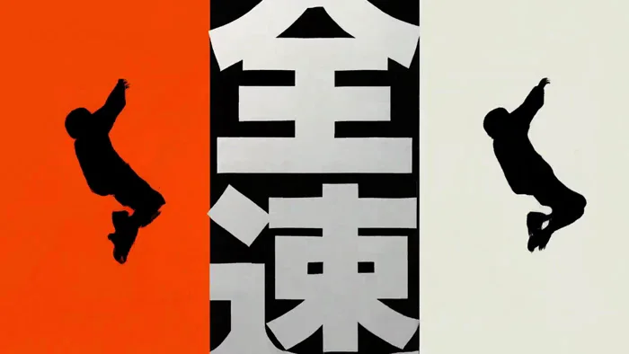
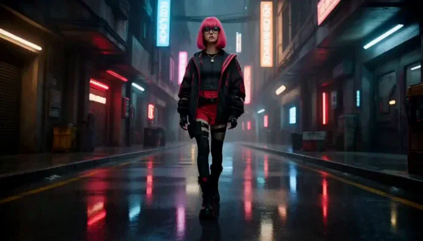
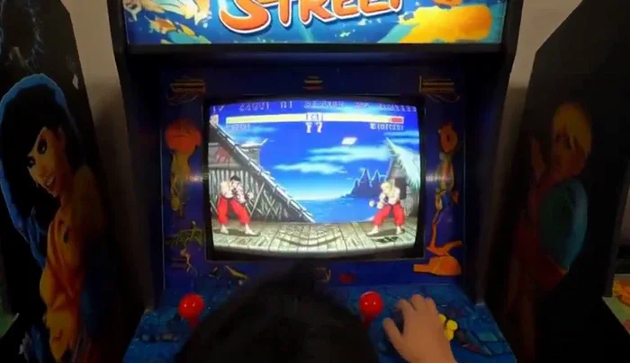
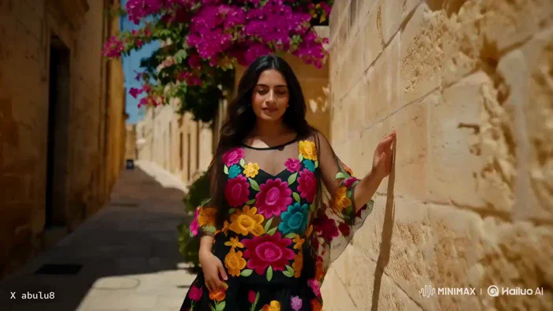
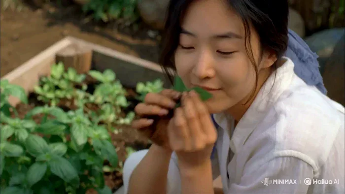
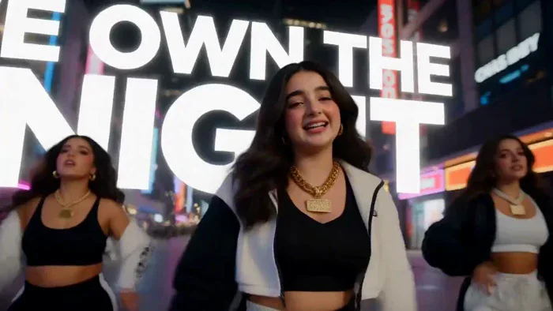
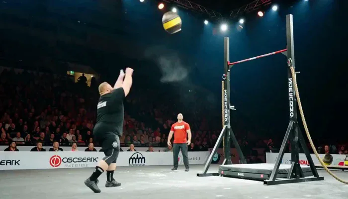
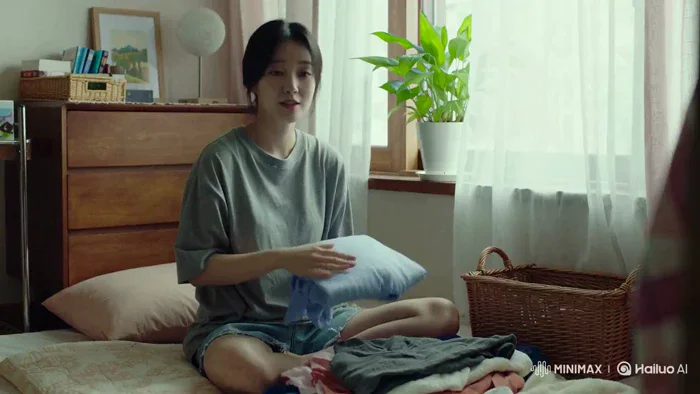
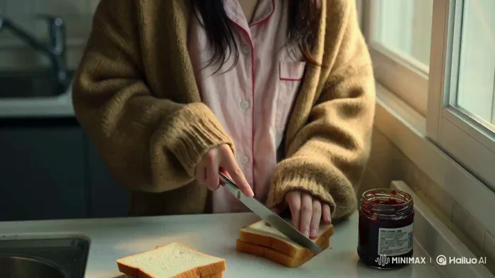
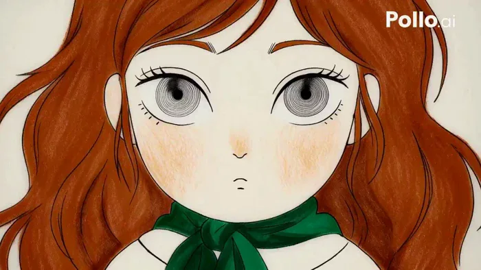

[← 返回总目录](../README.zh-CN.md#table-of-contents) · [English](music-video.md) · [简体中文](music-video.zh-CN.md) · [日本語](music-video.ja.md)

### 音乐可视化和 MV Music Video

- [Case 30: Multiplication Tables with Fish Pairs (乘法口诀的九宫格鱼群) — by @tanabe_fragm](#case-30)
- [Case 31: Two-Part Bedroom Dance (卧室里的连续舞步) — by @Haruka1425054](#case-31)
- [Case 32: Orange-and-Black Street Dance Commercial (橙黑街舞品牌快切广告) — by @tanabe_fragm](#case-32)
- [Case 33: Silver Earbuds in the City at Night (城市夜色里的银色耳机广告) — by @ayzalnooor24521](#case-33)
- [Case 74: Three Outfit Changes in a Bedroom (卧室里的三套穿搭切换) — by @codewithhajra](#case-74)
- [Case 75: NEON the Hacker Steps Into the Megacity (天才黑客 NEON 登场) — by @Nokosu_kansoku](#case-75)
- [Case 76: The Camera Breaks into an Arcade Game (镜头穿越街机屏幕) — by @cocktailpeanut](#case-76)
- [Case 77: Dancing Across the Magical Islands of Malta (马耳他魔法群岛舞蹈) — by @abulu8](#case-77)
- [Case 78: A Quiet Morning in the Backyard Herb Garden (后院药草园的宁静时光) — by @Strength04_X](#case-78)
- [Case 79: Rhythm, Performance, and Kinetic Type (节奏、表演与动态字体) — by @Inshrah_ali_](#case-79)
- [Case 80: He Wins the Strength Contest with Timing (他靠时机赢下力量赛) — by @bmx_ai13](#case-80)
- [Case 81: A Gentle Slice of Korean Daily Life (韩国女生的日常片刻) — by @Strength04_X](#case-81)
- [Case 82: A Sleepy Morning in an Oversized Cardigan (穿着开衫的慢早晨) — by @Strength04_X](#case-82)
- [Case 83: A Product in Psychedelic Hand-Drawn Motion (迷幻手绘动画中的产品) — by @tanabe_fragm](#case-83)

### Case 30: Multiplication Tables with Fish Pairs (乘法口诀的九宫格鱼群) — by @tanabe_fragm

▶ [在 ofox.ai 观看完整视频](https://ofox.ai/hailuo-3-prompts?utm_source=github&utm_medium=case&utm_campaign=awesome-ai-video-prompts#case-30)

<strong>Prompt</strong> — integrated_multimodal_description: [Shot 1] Adorable rounded 3D animation for preschool children, soft studio lighting, subtle contact shadows, smooth…

~~~~text
integrated_multimodal_description: [Shot 1] Adorable rounded 3D animation for preschool children, soft studio lighting, subtle contact shadows, smooth gradients, and a calm uncluttered vertical composition on a clean off-white background with a very soft pale-blue glow behind the center. Use a restrained palette of off-white, warm orange, cream, turquoise blue, and dark gray: orange is the cat, turquoise is the fish and every correct answer, dark gray is the equation. The camera is a Static Shot for the entire film. A small smiling cat mascot bounces gently into the upper area: a big rounded head on a short chubby body, warm orange fur, a cream muzzle, cream belly and cream paw tips, two small rounded triangle ears with pale pink inner lining, round full cheeks, simple black dot eyes, tiny whiskers, and a thick rounded tail. It lands with a soft squash-and-stretch, its tail curls up once behind it, and it taps the air with one front paw, creating a spreading circular pale-blue water ripple. The ripple opens outward and reveals a three-by-three grid of nine small empty pale-blue water pools in the lower half of the frame, with a clear empty space for one large equation above them. A warm young Japanese female narrator with a bright, soft voice (S1) chants in a steady rhythmic sing-song counting cadence, one line per beat, and begins: <d>[Japanese] にのだん!</d>

[Shot 2] At 00:01.200, one large thick rounded dark-gray equation appears in the upper space and is rewritten twice in place, holding each state clearly on its own beat: first "2 × 1 = 2", then "2 × 2 = 4", then "2 × 3 = 6". On each new equation, exactly one matching pair of two plump turquoise-blue fish drops together into the next empty water pool with a small splash. The two fish of a pair are identical, side by side, both facing right and slightly offset so both are clearly countable, each with a cream belly, a triangular tail, and one round black eye. The pairs fill the top row from left to right, and the answer numeral turns turquoise as each pair lands. At the end of this shot exactly three pools in the top row are filled, each holding exactly two fish, for six fish in total; six pools remain empty. (S1) chants on the beat: <d>[Japanese] にいちがに。ににんがし。にさんがろく。</d>

[Shot 3] At 00:04.700, a soft pale-blue water ripple wipes across the frame and the same large equation continues to be rewritten in place on each beat: "2 × 4 = 8", then "2 × 5 = 10", then "2 × 6 = 12". One matching pair of two fish drops into the next empty pool on each new equation, filling the middle row from left to right, and the answer numeral turns turquoise as each pair lands. Two-digit answers stay large, correctly formed, and fully readable. The three pairs already in the top row stay exactly where they are and do not move, change, or multiply. At the end of this shot exactly six pools are filled, each holding exactly two fish, for twelve fish in total; three pools remain empty. (S1) chants on the beat: <d>[Japanese] にしがはち。にごじゅう。にろくじゅうに。</d>

[Shot 4] At 00:08.100, a soft pale-blue water ripple wipes across the frame and the large equation is rewritten in place on each beat for the last time: "2 × 7 = 14", then "2 × 8 = 16", then "2 × 9 = 18". One matching pair of two fish drops into the next empty pool on each new equation, filling the bottom row from left to right, and the answer numeral turns turquoise as each pair lands. The six pairs already placed stay exactly where they are and do not move, change, or multiply. At the end of this shot all nine pools are filled, each holding exactly two fish, for eighteen fish in total. (S1) chants on the beat: <d>[Japanese] にしちじゅうし。にはちじゅうろく。にくじゅうはち。</d>

[Shot 5] At 00:12.100, the final equation "2 × 9 = 18" stays in the upper space and its turquoise answer numeral "18" gently enlarges once and settles. Below it, the nine pairs of fish gain small friendly smiles and their tails flick once, in a quick wave from the top-left pool to the bottom-right pool, each pair flicking together as one. The same warm-orange cat mascot from [Shot 1], unchanged in every detail, bounces in at the lower edge beside the grid and points up toward it with one front paw while its tail curls once and small pale-blue sparkles rise around it. Exactly nine pools remain, each still holding exactly two fish, and no new objects enter. (S1) says: <d>[Japanese] よく できました!</d> Hold the complete grid, the equation, and the cat clearly and without further motion until the film ends exactly at 00:15.000.

Throughout the entire film, keep the camera a Static Shot, keep the off-white background clean and empty, keep the single equation large, thick, rounded, correctly shaped, and centered in the upper space, and keep the fish design identical in every shot. Every filled pool always holds exactly two fish - never one, never three - and the two fish of a pair always arrive together, land together, and stay together as one unit. The cat must look exactly the same in [Shot 1] and [Shot 5], identical in fur color, head and body shape, ears, eyes, and tail, and it never appears in [Shot 2], [Shot 3], or [Shot 4]. Only one cat is ever on screen, it stays beside or above the grid, and it never stands on, reaches into, covers, or eats any fish. Only one equation is ever visible at a time. Display only numerals and the symbols × and =. Do not generate any hiragana, katakana, kanji, Latin words, or any other written characters anywhere on screen. Fish only ever accumulate, never disappear, never leave their pool once placed, and never overlap; the number of filled pools must exactly match the multiplier of the current equation, and the total fish count must exactly match the answer numeral, reaching exactly eighteen fish in nine pools at the end. Avoid fast camera movement, sudden cuts, cluttered backgrounds, tiny typography, warped or duplicated numerals, reversed two-digit numbers, wrong counts, extra or missing fish, unpaired single fish, fish appearing before their equation, fish swimming freely around the frame, realistic or scaly fish anatomy, scary expressions, harsh colors, heavy motion blur, and loud or distracting sound effects.

overall_soundscape: A soft double water plop sounds each time a pair of fish drops into a pool. A light padded paw tap sounds when the cat touches the air, and one single soft kitten meow occurs as the cat first bounces into frame. Gentle spreading water ripples mark the two transitions, and a small confirmation chime sounds each time an answer numeral turns turquoise. Tiny shimmer sparkles occur around the cat at the end.

non_diegetic_music: A light nursery jingle at a steady moderate tempo using marimba, soft celesta, and gently plucked strings, with a clear repeating beat that the chant lands on. Begin with a single marimba figure, add one instrument at each row of the grid, and thin back out for the final line. Resolve with a clean rising three-note chime landing at 15.000 seconds.
~~~~

**参数**：MiniMax H3 · 未标注 · t2va · 15s · 未标注 · 未标注 · 带音频
**来源**：@tanabe_fragm · [原帖](https://x.com/tanabe_fragm/status/2089141649503044017)

Preview © 2026 @tanabe_fragm · Prompt by @tanabe_fragm

[回到目录](#table-of-contents)

### Case 31: Two-Part Bedroom Dance (卧室里的连续舞步) — by @Haruka1425054

▶ [在 ofox.ai 观看完整视频](https://ofox.ai/hailuo-3-prompts?utm_source=github&utm_medium=case&utm_campaign=awesome-ai-video-prompts#case-31)

<strong>Prompt</strong> — 動画（MiniMax H3）1本目 The young anime woman with light blue hair and a white summer sailor uniform shown in &lt;Picture 1&gt; is dancing in place in her bedroom…

~~~~text
動画（MiniMax H3）1本目

The young anime woman with light blue hair and a white summer sailor uniform shown in <Picture 1> is dancing in place in her bedroom on a bright morning. She sways her hips from side to side and bounces lightly on her feet in rhythm, keeping both feet in the same spot on the wooden floor. Her long light blue hair and her navy pleated skirt swing with the motion, and she keeps looking back over her shoulder with a happy smile. She stays in the same position and does not walk anywhere. Static camera, fixed framing, full body visible, morning sunlight through the curtains. Quiet room ambience, no music.

動画（MiniMax H3）2本目

The young anime woman with light blue hair and a white summer sailor uniform shown in <Picture 1> keeps dancing in place in her bedroom. She slowly raises both arms above her head and then lowers them again, twisting her upper body gently from side to side as she does. Her long light blue hair sways with the motion and her navy pleated skirt turns a little with her hips. She keeps both feet in the same spot on the wooden floor and glances back over her shoulder with a happy smile. Static camera, fixed framing, full body visible, morning sunlight through the curtains. Quiet room ambience, no music.
~~~~

**参数**：MiniMax H3 · 未标注 · fl2va · 12s · 未标注 · 未标注 · 带音频
**来源**：@Haruka1425054 · [原帖](https://x.com/Haruka1425054/status/2089094854727119124)

Preview © 2026 @Haruka1425054 · Prompt by @Haruka1425054

[回到目录](#table-of-contents)

### Case 32: Orange-and-Black Street Dance Commercial (橙黑街舞品牌快切广告) — by @tanabe_fragm

▶ [在 ofox.ai 观看完整视频](https://ofox.ai/hailuo-3-prompts?utm_source=github&utm_medium=case&utm_campaign=awesome-ai-video-prompts#case-32)

<strong>Prompt</strong> — ---------------------- integrated_multimodal_description: 2D-animated, a bold graphic-design motion-graphics commercial in 16:9 with exactly 13 distin…

~~~~text
----------------------
integrated_multimodal_description:
2D-animated, a bold graphic-design motion-graphics commercial in 16:9 with exactly 13
distinct cuts at 24fps. This film is 85% kinetic graphic design and 15% character action:
giant kinetic Japanese typography, hard-edged flat shapes, split screens, halftone, speed
lines, torn-paper reveals and shutter flashes. Palette, strictly four colors: fluorescent
orange, deep black, off-white, silver grey. The recurring character is a young anime street
dancer with a black chin-length bob and blunt bangs, sharp confident eyes, an oversized
off-white track jacket with fluorescent-orange sleeve stripes, black cargo shorts, and
chunky white sneakers with fluorescent-orange lines. Preserve her exact face, proportions,
hairstyle, outfit, materials and colors throughout; never redesign her. Every graphic
element moves fast and snaps hard on the beat.

[Shot 1] On a deep black field, a massive off-white circle slams into frame left of center,
then two fluorescent-orange bars wipe across the upper and lower thirds, then the Japanese
kanji "烈" builds itself stroke by stroke in off-white at the center until it is complete.
The camera shakes slightly with small amplitude at fast speed on each impact.

[Shot 2] At 00:01.000, the camera cuts to an off-white field where four black squares
rotate into the center one at a time. The largest square opens as a porthole revealing an
extreme close-up of the dancer's ice-sharp eye glancing up, then a red-and-cyan split flash
tears across the edges and the squares shatter into flat shards. The camera pushes in with
small amplitude at fast speed.

[Shot 3] At 00:02.000, the camera cuts to an off-white field filled by an enormous black
kanji "烈". The dancer sprints in from frame left, power-slides along the baseline of the
typography, and fluorescent-orange ink splatter trails behind her as speed lines streak
past. The camera trucks left with large amplitude at fast speed. The kanji stays fully
readable before she crosses in front of it.

[Shot 4] At 00:03.100, the camera cuts to a vertical triptych of fluorescent-orange, deep
black and off-white panels. Her flat silhouette appears in each panel in stroboscopic
freeze, one after another — takeoff, mid-air tuck, landing — while giant vertical silver
text "全速" scrolls upward behind the panels. Static shot.

[Shot 5] At 00:04.000, the camera cuts to a black field where a giant tilted ring of
fluorescent-orange Japanese characters reading "止マルナ" rotates. The dancer leaps through
the center of the ring, spins once in mid-air, and the characters break off and scatter
outward as flat shards. The camera arcs with large amplitude at fast speed, then snap-zooms
onto her confident face.

[Shot 6] At 00:05.100, the camera cuts to a clean off-white editorial card holding a huge
black kanji "跳" with one orange diagonal slash. She vaults over the word itself, plants her
palm on its left radical, the character compresses like a spring under her hand, then
rebounds as her legs whip across the frame. Static shot.

[Shot 7] At 00:06.000, the camera cuts to a full fluorescent-orange field crossed by one
thick black diagonal stripe. She back-flips along the stripe in three stroboscopic ghost
frames tinted black, off-white and silver grey, while a large outlined kanji "回" rotates
180 degrees in sync with her rotation. The camera rolls clockwise with small amplitude at
fast speed.

[Shot 8] At 00:07.000, the camera cuts to an off-white field with a hard black band. Four
bold black kanji slam in one at a time at different scales and angles — "速", then "鋭",
then "静", then "烈" — each landing with a white shutter flash and an orange impact mark,
while she slides on her knees across the foreground, jacket flaring. The camera shakes
slightly with small amplitude at fast speed.

[Shot 9] At 00:08.000, the camera cuts to a black frame where a white wireframe grid tilts
away in 3D. She runs up the grid like a wall, kicks off it, and hangs frozen in mid-air as
a fluorescent-orange circle stamps around her pose like a target lock with silver UI
brackets and tick marks. The camera tilts up with small amplitude at slow speed.

[Shot 10] At 00:09.000, the freeze releases and the camera cuts to layered flat-color panes
stacked toward the lens. She dives straight at the camera, the panes tear open one at a
time like thick paper, and each tear reveals a larger portion of the black kanji "烈"
behind, before her sneaker wipes across the foreground. The camera pulls out with large
amplitude at fast speed.

[Shot 11] At 00:10.100, the camera cuts to a rapid-fire montage of four full-screen graphic
posters of her in different action poses — mid-flip, sliding, landing, hands in pockets —
snapping past with hard cuts, each with an oversized silver number 01 to 04, a black
barcode strip and thick diagonal slashes. Static shot.

[Shot 12] At 00:11.100, the camera cuts to a clean off-white cyclorama for the hero moment.
She lands a final backflip dead center in slow motion, straightens with both hands in her
pockets, and a shockwave of concentric fluorescent-orange rings blasts outward from her feet
carrying shattered fragments of the kanji "烈" with it, then the frame overexposes toward
white. The camera pushes in with small amplitude at slow speed.

[Shot 13] At 00:13.000, the camera cuts to the final identity card on a pale off-white
field. An enormous black kanji "烈" dominates the frame with translucent orange rings and
thin technical arcs behind it, the silver-grey word "RETSU" sits directly beneath the kanji,
and she stands relaxed at the lower center overlapping the bottom of the strokes with her
jacket rippling. One thin orange pulse sweeps horizontally through the typography and holds
cleanly until exactly 15.000 seconds. Static shot.

Editing: extremely aggressive rhythm — hard cuts on every beat, graphic matches, whip pans,
snap zooms, stroboscopic freezes, foreground wipes, split flashes and impact shakes. Every
cut must feel compositionally different. All Japanese typography is always fully readable
before the character overlaps it. No weapons, no combat, no fire, no explosions; all energy
comes from motion design, ink, torn paper, wind and her street-dance athleticism. No
photorealism, no 3D rendering, no gradients, no browser interface, no player controls, no
subtitles, no captions, and no text other than the Japanese characters named above.
Exactly 13 cuts.

overall_soundscape:
Sneaker impacts, knee slides and landings hit hard against a clean room tone. Ink splatters
burst, thick paper tears open, and flat panels shatter like glass. Sharp whooshes carry the
color wipes and typography slams, with small shutter clicks on each flash. No dialogue.

non_diegetic_music:
An original 15-second drum-heavy breakbeat with a deep sub bass, hard snare hits, risers and
glitch fills locked to every cut. Begin with a single impact, build tightly through the
middle, peak at the landing at 00:11.100, and end with a cold electronic logo sting that
resolves at 15.000 seconds.
~~~~

**参数**：MiniMax H3 · 未标注 · t2va · 15s · 未标注 · 未标注 · 带音频
**来源**：@tanabe_fragm · [原帖](https://x.com/tanabe_fragm/status/2090306302966919515)

Preview © 2026 @tanabe_fragm · Prompt by @tanabe_fragm

[回到目录](#table-of-contents)

### Case 33: Silver Earbuds in the City at Night (城市夜色里的银色耳机广告) — by @ayzalnooor24521

▶ [在 ofox.ai 观看完整视频](https://ofox.ai/hailuo-3-prompts?utm_source=github&utm_medium=case&utm_campaign=awesome-ai-video-prompts#case-33)

<strong>Prompt</strong> — Create a premium 15-second cinematic ad for Audionic Trance Airbud 850. Start with a close-up of the silver earbuds and case, then show a stylish Kore…

~~~~text
Create a premium 15-second cinematic ad for Audionic Trance Airbud 850. Start with a close-up of the silver earbuds and case, then show a stylish Korean girl wearing them and walking through a luxurious Korean shopping street while enjoying a modern Korean K-pop song. Use beautiful city lights, soft bokeh, elegant fashion, natural expressions and smooth cinematic camera movement. End with one clean hero shot of the silver earbuds and case only. No phone screen, Bluetooth connection, discount text, logo end card or extra ending scene.
~~~~

**参数**：MiniMax H3 · 未标注 · t2va · 15s · 未标注 · 未标注 · 带音频
**来源**：@ayzalnooor24521 · [原帖](https://x.com/ayzalnooor24521/status/2087042771257540945)

Preview © 2026 @ayzalnooor24521 · Prompt by @ayzalnooor24521

[回到目录](#table-of-contents)

### Case 74: Three Outfit Changes in a Bedroom (卧室里的三套穿搭切换) — by @codewithhajra

▶ [在 ofox.ai 观看完整视频](https://ofox.ai/hailuo-3-prompts?utm_source=github&utm_medium=case&utm_campaign=awesome-ai-video-prompts#case-74)

<strong>Prompt</strong> — Format: 15 seconds | 16:9 | 4K HDR | 24fps | photorealistic cinematic vlog Character: Use the girl from the uploaded reference image as the exact char…

~~~~text
Format: 15 seconds | 16:9 | 4K HDR | 24fps | photorealistic cinematic vlog

Character: Use the girl from the uploaded reference image as the exact character reference. Preserve her facial identity, eye color, skin tone, hairstyle, body proportions, and overall appearance consistently throughout every shot. No face changes or identity drift.

Scene & Story:
0–3 sec — The Mystery Package
The video opens with a handheld creator-vlog shot in her cozy bedroom during late afternoon. She walks into frame holding a stylish garment bag, looking genuinely curious. She places it on the bed and looks directly into the camera with a playful expression.

She says naturally: “Okay… I found something for tonight, but I have absolutely no clue if I can pull it off.”

She unzips the garment bag, revealing only a glimpse of the outfit.

3–6 sec — First Reveal
She quickly steps behind a nearby room divider. The camera follows with a fast handheld whip-pan.

She emerges wearing a chic fitted top, tailored trousers, and elegant heels. She looks at herself in the mirror, slightly surprised by how good it looks.

She turns toward the camera and says: “Wait… this might actually work.”

She gives a small confident pose.

6–9 sec — The Unexpected Switch
Instead of snapping her fingers, she grabs a jacket hanging beside her and dramatically throws it toward the camera.

As the jacket briefly covers the lens, the outfit seamlessly transforms underneath it.

When she pulls the jacket away, she is wearing a completely different fashion-forward look: a stylish mini dress with statement shoes and subtle accessories.

She looks down, raises one eyebrow, then laughs.

9–12 sec — The Wild Card
She walks toward the mirror while the camera circles around her. She notices a third outfit hanging on the wardrobe door.

Suddenly, she steps backward and spins.

During the spin, her outfit naturally morphs into a glamorous evening look with a sophisticated silhouette, elegant heels, and refined accessories.

The transformation happens continuously during the movement with realistic fabric motion — no jump cut.

12–15 sec — Final Decision
She walks toward the camera with confident energy, then stops very close to the lens.

She looks at the camera, points toward herself, then gestures toward the three outfits visible behind her.

With a playful smile, she says:

“Okay… you’re choosing. Which one?”

The camera quickly pushes in toward her face as she laughs, ending on a natural freeze-like moment.

Visual Direction:
Ultra-realistic fashion creator vlog, authentic handheld camera movement, natural body language, expressive facial reactions, realistic fabric physics, seamless outfit transitions, natural hair movement, subtle mirror reflections, cinematic depth of field, realistic skin texture, soft late-afternoon daylight mixed with warm practical bedroom lighting, detailed wardrobe and bedroom environment, premium fashion-film aesthetic while maintaining casual YouTube-vlog energy.

Camera:
Handheld selfie framing, medium shots, quick whip-pans, subtle camera shake, smooth tracking movements, one controlled orbit around the character, final slow push-in.

Audio:
Natural bedroom ambience, fabric and wardrobe sounds, footsteps, garment movement, subtle mirror-room reverb, upbeat modern fashion-vlog background music, natural spoken dialogue, soft whoosh effects during the outfit transitions. No subtitles, no logos, no watermark.

Consistency & Quality:
No jump cuts during transformations. No duplicated character. No distorted hands or fingers. No warped clothing. No inconsistent room layout. No facial identity changes. No unnatural skin smoothing. Keep the same character, bedroom, lighting logic, and visual realism throughout.
~~~~

**参数**：MiniMax H3 · 未标注 · ref2va · 16s · 未标注 · 未标注 · 带音频
**来源**：@codewithhajra · [原帖](https://x.com/codewithhajra/status/2090276653012287567)

Preview © 2026 @codewithhajra · Prompt by @codewithhajra

[回到目录](#table-of-contents)

### Case 75: NEON the Hacker Steps Into the Megacity (天才黑客 NEON 登场) — by @Nokosu_kansoku

▶ [在 ofox.ai 观看完整视频](https://ofox.ai/hailuo-3-prompts?utm_source=github&utm_medium=case&utm_campaign=awesome-ai-video-prompts#case-75)

<strong>Prompt</strong> — @[face ref] をNEONの顔、ピンクのボブヘア、黒い丸眼鏡の厳密な参照として使用します。 @[body ref] をNEONの体格、黒と赤のサイバーパンク衣装、装備、ブーツの厳密な参照として使用します。 @[audio ref] は映像のリズム、カットの強弱、主要な音楽アクセントの参照とし…

~~~~text
@[face ref] をNEONの顔、ピンクのボブヘア、黒い丸眼鏡の厳密な参照として使用します。
@[body ref] をNEONの体格、黒と赤のサイバーパンク衣装、装備、ブーツの厳密な参照として使用します。
@[audio ref] は映像のリズム、カットの強弱、主要な音楽アクセントの参照として使用します。

15秒のハイエンドなサイバーパンク・キャラクター紹介映像。
主役はNEONただ一人。
クールで知的、危険な雰囲気。動作は自信に満ち、抑制されている。

構成：

0–3秒：IDENTITY REVEAL
暗いネオン照明の空間。
ブーツ、赤いジャケットのディテール、眼鏡越しの目元を短いバーストカットで見せる。
最後に顔のクローズアップ。
カットを@[audio ref] の最初の強いアクセントに合わせる。

3–6秒：NEON ALLEY
雨に濡れた未来都市の路地。
NEONがゆっくりカメラ方向へ歩く。
ローアングル、横方向のトラッキング、濡れた路面に映る赤いネオン。
人物の動きよりもカメラワークを強調。

6–9秒：TECH UNDERGROUND
赤い警告灯が点滅する地下施設。
肩越しのショット、手袋と装備のクローズアップ、短いオービットショット。
NEONは静かに周囲を観察する。

9–12秒：MEGACITY ROOFTOP
巨大な未来都市を見下ろす夜の屋上。
風でピンクの髪とジャケットがわずかに揺れる。
ワイドショットからローアングルのヒーローフレームへ切り替える。

12–15秒：FINAL HERO REVEAL
赤とマゼンタの逆光。
カメラがNEONの周囲を短く回り込み、正面のミディアムクローズアップで止まる。
NEONが眼鏡越しにカメラを見る。
最後の音楽アクセントで力強い静止ヒーローフレーム。

編集：
合計12〜15ショット。
主要カットを@[audio ref] の強拍に合わせる。
環境変更は音楽フレーズの変化に合わせる。
細かい半拍すべてにカットを入れず、強いアクセントを優先する。

一貫性：
同じ顔、同じ髪型、同じ眼鏡、同じ体格、同じ衣装を全編で維持。
衣装の黒・赤・ゴールドの配色と装備位置を維持。
キャラクターは常に一人だけ。

禁止：
複数のNEON、分身、衣装変更、髪型変更、眼鏡の消失、
顔や身体のモーフィング、過剰なアクション、文字、ロゴ、字幕、UI、
キャラクターシート風レイアウト、分割画面、白背景。
-------------------------------------------------------
~~~~

**参数**：MiniMax H3 · 未标注 · ref2va · 15s · 未标注 · 未标注 · 带音频
**来源**：@Nokosu_kansoku · [原帖](https://x.com/Nokosu_kansoku/status/2086700416654594554)

Preview © 2026 @Nokosu_kansoku · Prompt by @Nokosu_kansoku

[回到目录](#table-of-contents)

### Case 76: The Camera Breaks into an Arcade Game (镜头穿越街机屏幕) — by @cocktailpeanut

▶ [在 ofox.ai 观看完整视频](https://ofox.ai/hailuo-3-prompts?utm_source=github&utm_medium=case&utm_campaign=awesome-ai-video-prompts#case-76)

<strong>Prompt</strong> — A handheld found-footage shot from behind a person playing an authentic Street Fighter II arcade cabinet in a dim 1990s arcade. Ryu and Ken begin a no…

~~~~text
A handheld found-footage shot from behind a person playing an authentic Street Fighter II arcade cabinet in a dim 1990s arcade. Ryu and Ken begin a normal match as the announcer shouts, “Fight!” The camera suddenly rushes toward the curved CRT screen in one continuous motion; reflections and scanlines expand into giant glowing red, green, and blue phosphor dots, then the camera passes through them and the image resolves into a clean full-screen 4:3 Street Fighter II game view with crisp 16-bit pixel art and subtle CRT scanlines. Chun-Li unexpectedly jumps into the match, followed by Blanka dropping from above, Dhalsim teleporting into the center, Zangief charging in, and several more fighters entering from both sides. The stage widens as the match becomes a chaotic but readable eight-player free-for-all: Sonic Booms cross the screen, Blanka’s electricity shocks multiple fighters, Zangief spins through a crowd, characters collide in midair, and health bars rapidly drain. Everyone unleashes a special move at once, filling the screen with pixel explosions and impact flashes. When the smoke clears, every fighter is knocked out except Dhalsim, calmly floating above the pile. The announcer declares, “Dhalsim wins. Perfect!” Authentic arcade sound effects, energetic chiptune music, no modern 3D graphics, no camera shake after entering the game.
~~~~

**参数**：MiniMax H3 · 未标注 · 未标注 · 14s · 未标注 · 未标注 · 带音频
**来源**：@cocktailpeanut · [原帖](https://x.com/cocktailpeanut/status/2085835546572800047)

Preview © 2026 @cocktailpeanut · Prompt by @cocktailpeanut

[回到目录](#table-of-contents)

### Case 77: Dancing Across the Magical Islands of Malta (马耳他魔法群岛舞蹈) — by @abulu8

▶ [在 ofox.ai 观看完整视频](https://ofox.ai/hailuo-3-prompts?utm_source=github&utm_medium=case&utm_campaign=awesome-ai-video-prompts#case-77)

<strong>Prompt</strong> — { "format": { "duration": "15s", "bpm": 92, "total_shots": 10, "sync_type": "Dance to Playback Song — No Lip-Sync" }, "style_reference": "Warm Mediter…

~~~~text
{
  "format": { "duration": "15s", "bpm": 92, "total_shots": 10, "sync_type": "Dance to Playback Song — No Lip-Sync" },
  "style_reference": "Warm Mediterranean daylight, 35mm, fine organic grain, gentle bloom. Honey-gold limestone against deep cobalt sea and white sky. Saturated embroidery popping against neutral stone. Shallow depth on close work, crisp wides, natural sun flare. Never cold or desaturated.",
  "subject": {
    "description": "A young Mexican woman, mid-twenties, long dark wavy hair loose and moving, warm brown skin, serene expressive face, small gold earrings. Traditional Chiapaneco dress — deep-toned fabric densely embroidered with large multicolored floral bursts in magenta, gold, turquoise and crimson, wide flowing skirt, sheer embroidered overlay that catches air. Bare feet.",
    "consistency_note": "The dress is the co-star — keep embroidery pattern, colors and skirt volume consistent. Fabric behavior matters as much as her body. Keep her face large in close work to avoid drift."
  },
  "environment": {
    "setting": "Malta in bright daylight — honey limestone architecture, a sunlit stone terrace above the sea, narrow old-town steps.",
    "background": "Limestone walls and arches, traditional Maltese wooden balconies, worn steps, bougainvillea, the deep blue Mediterranean to the horizon.",
    "lighting": "Hard Mediterranean afternoon sun, crisp shadows across stone, warm limestone bounce filling her face, occasional flare, glittering sea behind."
  },
  "mood": "graceful, elegant, joyful, free, radiant, flowing",
  "music": {
    "genre": "Warm Latin folk-pop ballad, 92 BPM, acoustic and organic.",
    "instrumentation": "Nylon-string guitar arpeggios, soft cajón and hand percussion, warm upright bass, distant accordion, light strings on the big moments, rich female vocal on top.",
    "arrangement": "Shots 1-2: guitar and voice alone, sparse. Shots 3-5: percussion enters, groove opens. Shot 6: strips to a single held guitar note. Shot 7: full arrangement blooms with strings. Shots 8-9: percussion punches back, then softens. Shot 10: resolves warm on guitar and a sustained vocal note.",
    "language": "Spanish",
    "lyrics": "Que baile el sol sobre la piedra dorada / que el viento me lleve donde nadie me llama / Mi falda florece, la mar me responde / Aquí soy de nadie, aquí soy del aire / Vuelo, vuelo, vuelo — y nunca me caigo",
    "mix": "Warm, natural, acoustic-forward. Vocal present but not overpowering. Round percussion. Sun-soaked."
  },
  "style": "Ultra-Realistic",
  "logic_rule": "The song plays audibly IN the clip while she dances to it. She does NOT sing and does NOT lip-sync — mouth relaxed and natural, expression serene and absorbed, occasionally a soft smile. THE BODY LEADS: each shot built around one quality of motion — stretch, spin, suspended pause, weightlessness, impact, inner rhythm. Movement is GRACEFUL and ELEGANT: long extended lines, controlled turns, soft shaped arms, fluid transitions, classical poise with folkloric footwork — never frantic. Vary camera to serve movement: low angles for elevation, tracking for travel, macro for fabric and feet, wide for full body against architecture. Mandatory SPEED CHANGE: extreme slow motion at the leap's apex so skirt bloom, hair suspension and embroidery are fully legible, then snap back on landing. Fabric physics essential — the skirt must swing, flare, ripple and settle with real weight. Effects: dust off stone, hair whipping, shadow raking walls, sun flare. ENDING: hold on a still breathing frame, then slow fade.",
  "storyboard": [
    { "shot": 1, "camera": "Low wide, sun behind her, limestone wall behind.", "action": "THE STRETCH — she rises onto the balls of her bare feet, extending both arms overhead in a long elegant line, spine lengthening, sleeve falling back. Eyes closed, serene.", "sfx": "Wind, gulls, fabric settling; guitar and voice alone." },
    { "shot": 2, "camera": "Macro on her bare feet on warm stone, shallow focus.", "action": "THE RHYTHM UNDER THE SKIN — heel and toe begin a soft precise pattern, dust lifting with each strike, ankles articulate and controlled.", "sfx": "Delicate foot taps, dust scuff; guitar continuing." },
    { "shot": 3, "camera": "Tracking alongside her down a narrow sunlit alley.", "action": "She travels in flowing rhythmic steps, skirt swinging gracefully side to side, one hand trailing the warm stone wall.", "sfx": "Footfalls, fabric swish, alley echo; percussion entering." },
    { "shot": 4, "camera": "Medium, camera orbiting with her turn.", "action": "THE SPIN — one controlled elegant rotation, the embroidered skirt opening into a wide circle of color, hair fanning, arms soft and shaped.", "sfx": "Fabric whoosh, foot pivot; groove opening." },
    { "shot": 5, "camera": "Close-up on her face, sun raking across it.", "action": "Eyes closed, head tilted back, absorbed with the faintest smile — lost in the music. Mouth relaxed and closed, NOT singing.", "sfx": "Breath, wind; vocal carrying over." },
    { "shot": 6, "camera": "Wide low angle on the terrace, sea behind.", "action": "THE PAUSE — everything stills. She sinks into a deep controlled coil, weight low, skirt pooling, held one suspended beat.", "sfx": "Music strips to one held guitar note; a deep breath." },
    { "shot": 7, "camera": "EXTREME SLOW MOTION, low angle, sky and sea behind.", "action": "THE WEIGHTLESSNESS — she launches upward, body arced in an extended line, arms open, skirt blooming outward like a flower, hair suspended, every stitch legible against the blue.", "sfx": "Stretched fabric bloom, deep swell; full arrangement with strings." },
    { "shot": 8, "camera": "Snap to full speed. Low, close on her landing.", "action": "THE LANDING — she meets the stone softly, knees absorbing, skirt collapsing around her legs, dust puffing, hair falling forward.", "sfx": "Foot impact, fabric slap, exhale; percussion punching back." },
    { "shot": 9, "camera": "Macro on the embroidery settling, rack up to her chest.", "action": "The floral stitching ripples and stills; her chest rises and falls, a bead of sweat at her collarbone. The body after force.", "sfx": "Breathing, fabric settling, sea; arrangement softening." },
    { "shot": 10, "camera": "Slow pull-back to a wide — small against limestone and sea. Held.", "action": "She lifts her head, sweeps her hair back and settles into a final open-armed shape against the Mediterranean light, breathing, a slow warm smile. Hold, then slow fade.", "sfx": "Wind, gulls, sea; guitar and sustained vocal resolving." }
  ]
}
~~~~

**参数**：MiniMax H3 · 未标注 · ref2va · 15s · 未标注 · 未标注 · 带音频
**来源**：@abulu8 · [原帖](https://x.com/abulu8/status/2085793101600428386)

Preview © 2026 @abulu8 · Prompt by @abulu8

[回到目录](#table-of-contents)

### Case 78: A Quiet Morning in the Backyard Herb Garden (后院药草园的宁静时光) — by @Strength04_X

▶ [在 ofox.ai 观看完整视频](https://ofox.ai/hailuo-3-prompts?utm_source=github&utm_medium=case&utm_campaign=awesome-ai-video-prompts#case-78)

<strong>Prompt</strong> — Main Subject: Young Korean woman, early 20s, loose linen shirt over shorts, hair tied back with a cloth, dirt-smudged fingers, gentle focused expressi…

~~~~text
Main Subject:
Young Korean woman, early 20s, loose linen shirt over shorts, hair tied back with a cloth, dirt-smudged fingers, gentle focused expression.
Location:
Small backyard herb garden beside the house, late morning. Wooden planter boxes, scattered gardening tools, soft natural sunlight, a low fence. No modern structures.
Visual Style:
Ultra-realistic documentary realism, candid hands-on feeling, bright natural daylight.
Camera Style:
Early 2000s DV camcorder, handheld close framing, autofocus adjusting between her hands and the plants, warm faded tones, soft grain. No stabilization.
Timeline (15 sec, each slot = 2 compressed beats):
00:00–00:03 → She kneels by the planter box, then snips a few basil leaves carefully.
00:03–00:06 → She smells the leaves, then says to camera "향 진짜 좋다" ("The smell is really nice"), smiling.
00:06–00:09 → She moves to another box, then pulls a small weed from the soil.
00:09–00:12 → She wipes her hands on her shirt, then gathers the herbs into a small basket.
00:12–00:15 → She looks at camera saying "오늘 저녁에 쓸 거야" ("I'll use these for dinner tonight"), standing up as it fades.
Audio:
Leaves rustling, soil shifting, faint birds, distant wind. Her dialogue as noted above. No music.
Goal: A small, grounded gardening moment warm, patient, authentic.
~~~~

**参数**：MiniMax H3 · 未标注 · 未标注 · 15s · 未标注 · 未标注 · 带音频
**来源**：@Strength04_X · [原帖](https://x.com/Strength04_X/status/2085786048521757074)

Preview © 2026 @Strength04_X · Prompt by @Strength04_X

[回到目录](#table-of-contents)

### Case 79: Rhythm, Performance, and Kinetic Type (节奏、表演与动态字体) — by @Inshrah_ali_

▶ [在 ofox.ai 观看完整视频](https://ofox.ai/hailuo-3-prompts?utm_source=github&utm_medium=case&utm_campaign=awesome-ai-video-prompts#case-79)

<strong>Prompt</strong> — Style: Premium music commercial, ultra-realistic, cinematic, 8K HDR, natural lighting, luxury fashion aesthetic, smooth professional camera work, vibr…

~~~~text
Style: Premium music commercial, ultra-realistic, cinematic, 8K HDR, natural lighting, luxury fashion aesthetic, smooth professional camera work, vibrant neon accents, realistic skin textures, high-end choreography, dynamic typography synced to the beat, music-video quality, no watermark.

Scene 1 (0–3s)

A stylish young female artist walks confidently through a modern city street at night, flanked by two equally fashionable dancers. They wear coordinated luxury streetwear with premium sneakers and jewelry. The beat drops as the camera circles them in slow motion. Giant animated typography appears behind them, displaying the lyrics in bold kinetic text synchronized perfectly with every word.

Scene 2 (3–8s)

The trio performs energetic hip-hop choreography in a neon-lit urban plaza. The camera switches between cinematic gimbal shots, low-angle tracking, drone passes, and close-ups of expressive faces. Every lyric appears on screen with premium motion graphics, glowing typography, smooth transitions, and rhythmic animations that pulse with the music.

Scene 3 (8–12s)

Fast-paced performance featuring synchronized dance moves, stylish hand gestures, confident attitude, realistic hair movement, natural fabric physics, and dynamic lighting. The lyrics continue appearing in large, eye-catching typography that interacts with the environment, wrapping around buildings and moving with the beat.

Scene 4 (12–15s)

The music reaches its climax. All three performers strike a powerful final pose as the camera cranes upward. Massive cinematic typography fills the background with the final lyric while city lights sparkle behind them. Premium commercial color grading, flawless visual effects, realistic crowd energy, luxury music-video finish.

Hip-Hop Lyrics (On-Screen Typography):

We rise, no limits, we own the night,
Dreams in motion, shining so bright.
Move with the rhythm, feel the fire,
We came to win—taking it higher!

Visual Style: Premium commercial production, Billboard music video aesthetic, luxury fashion campaign, realistic camera movement, cinematic lens flares, authentic facial expressions, smooth choreography, vibrant urban atmosphere, perfectly synchronized kinetic lyric typography.
~~~~

**参数**：MiniMax H3 · 未标注 · 未标注 · 15s · 未标注 · 未标注 · 带音频
**来源**：@Inshrah_ali_ · [原帖](https://x.com/Inshrah_ali_/status/2085595583927185447)

Preview © 2026 @Inshrah_ali_ · Prompt by @Inshrah_ali_

[回到目录](#table-of-contents)

### Case 80: He Wins the Strength Contest with Timing (他靠时机赢下力量赛) — by @bmx_ai13

▶ [在 ofox.ai 观看完整视频](https://ofox.ai/hailuo-3-prompts?utm_source=github&utm_medium=case&utm_campaign=awesome-ai-video-prompts#case-80)

<strong>Prompt</strong> — Create a 15 second cinematic sports video in 16:9 inside a real indoor strength competition arena packed with spectators. The story contrasts repeated…

~~~~text
Create a 15 second cinematic sports video in 16:9 inside a real indoor strength competition arena packed with spectators. The story contrasts repeated failure with one calm, unexpected success. It must feel like authentic live event footage captured by a professional broadcast crew, with natural human motion, believable weight, consistent anatomy, coherent crowd behavior, and physically accurate object movement.

0.00 to 2.70 seconds. Show three rapid failed keg toss attempts by three different heavyweight athletes. Use low sideline wide shots that include the athlete, tall steel throwing rig, red crossbar, and full keg arc. Each attempt lasts less than one second. One keg clips the bar and spins backward, one falls short, and one drifts sideways. The athletes show brief frustration while the crowd gives disappointed gasps. Use clean match cuts based on the circular keg shape.

2.70 to 4.40 seconds. Let the music soften. Cut to a medium wide shot of an unassuming compact middle aged competitor entering from the arena tunnel. He wears a plain black competition shirt, dark blue shorts, knee sleeves, lifting shoes, and a worn leather belt. He walks calmly toward the keg while larger athletes watch from the edge of frame.

4.40 to 7.20 seconds. Use three tactile close shots. Chalk pressing into his palms. Fingers locking around a cold dented steel rim. Shoes gripping the gray rubber floor as his knees bend. Show subtle breathing, sweat, fabric tension, skin compression, and a slight forearm tremor. Keep the same face, body, wardrobe, keg, and arena geography in every shot.

7.20 to 11.80 seconds. Continue in one unbroken low angle tracking shot with a natural 35 mm lens look. He swings the keg between his legs, drives through the hips, extends the knees, pulls upward, and releases at the correct moment. The camera makes a controlled upward tilt. The keg rotates with realistic inertia and follows a clean parabolic arc. Use natural motion blur at 30 frames per second with a 1 over 60 shutter feel. Hold a brief near silence before release.

11.80 to 13.40 seconds. The keg clears the red crossbar by only a few centimeters and lands heavily on the padded platform behind the rig without an unrealistic bounce. The crowd erupts on impact. A judge instinctively raises both arms to confirm success.

13.40 to 15.00 seconds. Cut to a medium close shot as the competitor raises one fist and gives a restrained relieved smile. Larger athletes behind him stare in disbelief, then applaud. Finish on a natural crowd reaction, not a freeze frame.

Use cool white overhead arena lighting, subtle blue haze, realistic warm skin tones, gentle lens bloom around practical lights, deep readable shadows, neutral cinematic color, controlled contrast, fine film grain, realistic sweat highlights, and no excessive sharpness.

Sound and music. Use an original 82 BPM cinematic percussion track with deep toms, restrained bass pulses, and a steady tension build. Layer authentic arena room tone, crowd murmur, chalk rubbing, metal scraping, shoe friction, breathing, a sharp air movement sound during release, a solid steel landing impact, and a powerful crowd swell after clearance. No dialogue.

Do not include text, captions, logos, watermarks, brand names, duplicated spectators, warped faces, extra fingers, changing clothing, inconsistent body size, floating objects, rubbery metal, impossible physics, sudden camera teleportation, or artificial slow motion. The final result must look photographic, grounded, spontaneous, and genuinely filmed at a live competition.
~~~~

**参数**：MiniMax H3 · 未标注 · 未标注 · 15s · 未标注 · 未标注 · 带音频
**来源**：@bmx_ai13 · [原帖](https://x.com/bmx_ai13/status/2085584972778229978)

Preview © 2026 @bmx_ai13 · Prompt by @bmx_ai13

[回到目录](#table-of-contents)

### Case 81: A Gentle Slice of Korean Daily Life (韩国女生的日常片刻) — by @Strength04_X

▶ [在 ofox.ai 观看完整视频](https://ofox.ai/hailuo-3-prompts?utm_source=github&utm_medium=case&utm_campaign=awesome-ai-video-prompts#case-81)

<strong>Prompt</strong> — Main Subject: Young Korean woman, early 20s, natural everyday appearance, oversized soft t-shirt over shorts, hair in a loose bun, minimal makeup, rea…

~~~~text
Main Subject:
Young Korean woman, early 20s, natural everyday appearance, oversized soft t-shirt over shorts, hair in a loose bun, minimal makeup, realistic skin texture, calm content personality.
Location:
Small bedroom with a pile of clean laundry on the bed, mid-morning. Soft light through curtains, a wicker basket nearby, potted plant on the windowsill. No modern clutter.
Visual Style:
Ultra-realistic documentary realism, unscripted domestic feeling, soft natural morning light.
Camera Style:
Early 2000s consumer DV camcorder aesthetic, handheld shake, autofocus hunting between her and the fabric, faded soft contrast, mild sensor noise. No stabilization.
Timeline (15 sec, each slot = 2 compressed beats):
00:00–00:03 → She picks up a shirt, then folds it neatly into a small square.
00:03–00:06 → She glances at camera saying "이거 진짜 지루한 일이야" ("This is such a boring task"), laughing softly.
00:06–00:09 → She stacks the folded clothes, then reaches for a pair of socks.
00:09–00:12 → She struggles to match the socks, then finally finds the pair, smiling.
00:12–00:15 → She looks at camera saying "거의 다 했다" ("Almost done"), placing the last item in the basket as it fades.
Audio:
Fabric rustling, faint birds, distant street sounds, soft breathing. Her dialogue as noted above. No music.
Goal: A quiet, ordinary household moment grounded, warm, believable.
~~~~

**参数**：MiniMax H3 · 未标注 · 未标注 · 15s · 未标注 · 未标注 · 带音频
**来源**：@Strength04_X · [原帖](https://x.com/Strength04_X/status/2085344414466281571)

Preview © 2026 @Strength04_X · Prompt by @Strength04_X

[回到目录](#table-of-contents)

### Case 82: A Sleepy Morning in an Oversized Cardigan (穿着开衫的慢早晨) — by @Strength04_X

▶ [在 ofox.ai 观看完整视频](https://ofox.ai/hailuo-3-prompts?utm_source=github&utm_medium=case&utm_campaign=awesome-ai-video-prompts#case-82)

<strong>Prompt</strong> — Main Subject: Young Korean woman, early 20s, oversized cardigan over pajamas, hair down and slightly messy, sleepy relaxed expression. Location: Small…

~~~~text
Main Subject:
Young Korean woman, early 20s, oversized cardigan over pajamas, hair down and slightly messy, sleepy relaxed expression.
Location:
Small kitchen counter, early morning. Sliced bread, a jar of jam, a butter knife, soft morning light through a window. No modern clutter.
Visual Style:
Ultra-realistic documentary realism, quiet intimate feeling, soft warm morning light.
Camera Style:
Early 2000s DV camcorder, handheld close framing, autofocus slow adjusting to morning light, warm faded tones, soft grain. No stabilization.
Timeline (15 sec, each slot = 2 compressed beats):
00:00–00:03 → She spreads jam onto a slice of bread, then places another slice on top.
00:03–00:06 → She cuts it diagonally, then says to camera "아침엔 이게 제일 편해" ("This is easiest in the morning").
00:06–00:09 → She takes a bite, then chews slowly, looking out the window.
00:09–00:12 → She wipes a crumb from her lip, then smiles at the taste.
00:12–00:15 → She looks at camera saying "맛있다, 진짜" ("It's really good"), taking another bite as it fades.
Audio:
Knife scraping softly, faint chewing, distant birds, quiet kitchen ambience. Her dialogue as noted above. No music.
Goal: A quiet, cozy breakfast moment calm, warm, deeply relatable.
~~~~

**参数**：MiniMax H3 · 未标注 · 未标注 · 15s · 未标注 · 未标注 · 带音频
**来源**：@Strength04_X · [原帖](https://x.com/Strength04_X/status/2085335642515603469)

Preview © 2026 @Strength04_X · Prompt by @Strength04_X

[回到目录](#table-of-contents)

### Case 83: A Product in Psychedelic Hand-Drawn Motion (迷幻手绘动画中的产品) — by @tanabe_fragm

▶ [在 ofox.ai 观看完整视频](https://ofox.ai/hailuo-3-prompts?utm_source=github&utm_medium=case&utm_campaign=awesome-ai-video-prompts#case-83)

<strong>Prompt</strong> — --------------- integrated_multimodal_description: [Shot 1] 2D hand-drawn animation in a psychedelic Japanese illustration style: heavy colored-pencil…

~~~~text
---------------
integrated_multimodal_description: [Shot 1] 2D hand-drawn animation in a psychedelic Japanese illustration style: heavy colored-pencil and crayon grain visible on every surface, thin uneven black ink outlines that wobble slightly, flat matte fills with no gradients, and a limited palette of cream off-white, muted rust-brown, deep forest green and pale peach. One single continuous unbroken take from start to finish, no cuts and no transitions. A frontal close-up at eye level frames a teenage girl drawn in this style: loose rust-brown wavy hair falling just past her shoulders, very large eyes whose irises are drawn as tight concentric pencil rings, a plain white round collar with a deep forest-green scarf knotted at her throat, cream-white skin with a faint peach shading on her cheeks. She is centered against a flat cream off-white background with no scenery, motionless and expressionless, looking straight into the lens without blinking. The camera pushes in with small amplitude at slow speed toward her face. The concentric rings inside her irises begin to rotate clockwise, slowly widening until each iris resolves into a spiral. At 00:04.000, still within the same continuous take, individual strands of her hair detach from her head and flow sideways like poured ink, stretching into long smooth curling ribbons that sweep across the frame while her face stays still. As the hair unspools, the cream background inverts to saturated fluorescent magenta and the black outlines invert to pale cyan, the colored-pencil grain remaining visible through the inverted colors. At 00:08.000, her facial contours dissolve: the hair ribbons, the green scarf and the peach cheek shading stretch and fold into one another until the entire frame is a slow marbled swirl of rust-brown, forest green and cream, still rendered with the same hand-drawn pencil texture. The swirl rotates clockwise at slow speed and fills the whole frame. At 00:12.000, the marbled swirl contracts inward toward the center, tightening steadily until it becomes a single small round black pupil ringed by a thin gold circle, resting on the flat cream off-white background that matches the opening frame so the video loops seamlessly. No human characters other than this single girl. No text, no captions, no subtitles, no lyrics, no logos and no watermark anywhere in the frame at any time.
overall_soundscape: A dry pencil-on-paper scratching runs quietly underneath the whole shot. As the hair unspools, a soft paper rustle spreads outward and drifts across the stereo field. When the frame dissolves, a low liquid whoosh rises and slowly rotates from left to right. The shot ends with one short inward suction sound as everything contracts to a point.
non_diegetic_music: A slow detuned analog synthesizer drone at roughly 70 BPM that bends gradually in pitch. A muted electric-piano figure repeats every two bars over a tape-delayed hi-hat keeping a half-time pulse. The drone swells across the final three seconds and cuts off abruptly on the last beat.
~~~~

**参数**：MiniMax H3 · 未标注 · 未标注 · 15s · 未标注 · 未标注 · 带音频
**来源**：@tanabe_fragm · [原帖](https://x.com/tanabe_fragm/status/2085323195301917120)

Preview © 2026 @tanabe_fragm · Prompt by @tanabe_fragm

[回到目录](#table-of-contents)
