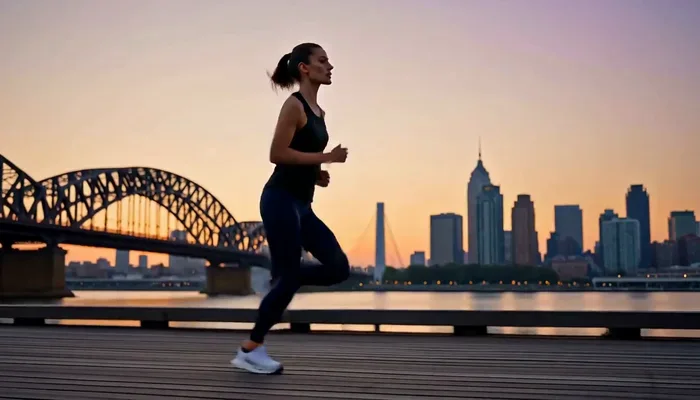

[← 総目次に戻る](../README.ja.md#table-of-contents) · [English](product-video.md) · [简体中文](product-video.zh-CN.md) · [日本語](product-video.ja.md)

### ECサイト商品動画 Product Video

- [Case 174: Running Shoes in Golden Light (金色夕阳里的跑鞋广告) — by @Zyrellix](#case-174)

### Case 174: Running Shoes in Golden Light (金色夕阳里的跑鞋广告) — by @Zyrellix

▶ [ofox.ai で動画をすべて見る](https://ofox.ai/hailuo-3-prompts?utm_source=github&utm_medium=case&utm_campaign=awesome-ai-video-prompts#case-174)

**输入素材**：未公开 —— 本案例未收录可用的输入素材，请参阅来源

<strong>Prompt</strong> — Cinematic 15-second luxury running-shoe commercial, golden-hour photorealism, 24fps, shallow depth of field, warm sunset color grade. Shot 1 (0–3s): E…

~~~~text
Cinematic 15-second luxury running-shoe commercial, golden-hour photorealism, 24fps, shallow depth of field, warm sunset color grade.
Shot 1 (0–3s): Extreme close-up of a woman’s hands tying white On Cloud running shoes with visible Cloudtec pods on the midsole. Soft golden sunlight, wooden boardwalk texture, navy heel collar, mesh upper. Slow, tactile motion. Whispered VO: “This is how it feels.”
Shot 2 (3–7s): Medium-wide tracking shot of an athletic woman with dark ponytail, black tank and navy tights, running left-to-right on a wooden waterfront promenade. Background: steel arch bridge and Manhattan-style skyline at sunset, river reflecting orange and pink light. Fluid, powerful stride, slight motion blur on hair and shoes.
Shot 3 (7–10s): Front-on tracking shot as she runs toward camera through a long, repeating concrete arched underpass. Strong side lighting creates rhythmic stripes of light and shadow across the floor. Determined expression, ponytail swinging.
Shot 4 (10–13s): Tight facial close-up, golden rim light on cheekbones and hair, focused green-brown eyes, slight sheen of sweat, black tank straps visible. Subtle camera push-in.
Shot 5 (13–15s): Hero product shot — the same white On Cloud shoe floating and slowly rotating in mid-air against a blurred sunset city skyline. Cloudtec pods catch the light. Clean, premium, almost weightless.
~~~~

**参数**：MiniMax H3 · 未标注 · 未标注 · 未标注 · 未标注 · 未标注 · 未标注
**来源**：@Zyrellix · [原帖](https://x.com/Zyrellix/status/2102611185472614491)

Preview © 2026 @Zyrellix · Prompt by @Zyrellix

[目次に戻る](#table-of-contents)
