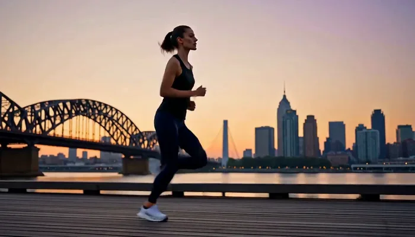
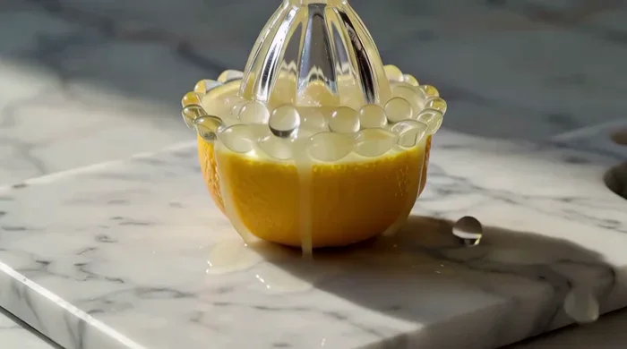
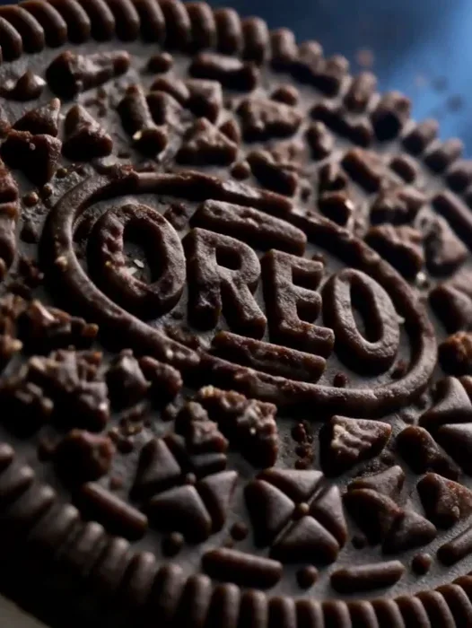
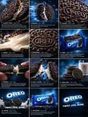

[← 返回总目录](../README.zh-CN.md#table-of-contents) · [English](product-video.md) · [简体中文](product-video.zh-CN.md) · [日本語](product-video.ja.md)

### 电商产品视频 Product Video

- [Case 174: Running Shoes in Golden Light (金色夕阳里的跑鞋广告) — by @Zyrellix](#case-174)
- [Case 184: A Lemon Squeezes Out Glass Beads (柠檬里挤出一串玻璃珠) — by @GlennHasABeard](#case-184)
- [Case 187: H3 Max · OREO Twist, Lick, Dunk (H3 Max · 奥利奥扭开、舔一舔、泡一泡) — by @itxabdullaa](#case-187)

### Case 174: Running Shoes in Golden Light (金色夕阳里的跑鞋广告) — by @Zyrellix

▶ [在 ofox.ai 观看完整视频](https://ofox.ai/hailuo-3-prompts?utm_source=github&utm_medium=case&utm_campaign=awesome-ai-video-prompts#case-174)

**输入素材**：未公开 —— 本案例未收录可用的输入素材，请参阅来源

<strong>Prompt</strong> — Cinematic 15-second luxury running-shoe commercial, golden-hour photorealism, 24fps, shallow depth of field, warm sunset color grade. Shot 1 (0–3s): E…

~~~~text
Cinematic 15-second luxury running-shoe commercial, golden-hour photorealism, 24fps, shallow depth of field, warm sunset color grade.
Shot 1 (0–3s): Extreme close-up of a woman’s hands tying white On Cloud running shoes with visible Cloudtec pods on the midsole. Soft golden sunlight, wooden boardwalk texture, navy heel collar, mesh upper. Slow, tactile motion. Whispered VO: “This is how it feels.”
Shot 2 (3–7s): Medium-wide tracking shot of an athletic woman with dark ponytail, black tank and navy tights, running left-to-right on a wooden waterfront promenade. Background: steel arch bridge and Manhattan-style skyline at sunset, river reflecting orange and pink light. Fluid, powerful stride, slight motion blur on hair and shoes.
Shot 3 (7–10s): Front-on tracking shot as she runs toward camera through a long, repeating concrete arched underpass. Strong side lighting creates rhythmic stripes of light and shadow across the floor. Determined expression, ponytail swinging.
Shot 4 (10–13s): Tight facial close-up, golden rim light on cheekbones and hair, focused green-brown eyes, slight sheen of sweat, black tank straps visible. Subtle camera push-in.
Shot 5 (13–15s): Hero product shot — the same white On Cloud shoe floating and slowly rotating in mid-air against a blurred sunset city skyline. Cloudtec pods catch the light. Clean, premium, almost weightless.
~~~~

**参数**：MiniMax H3 · 未标注 · 未标注 · 未标注 · 未标注 · 未标注 · 未标注
**来源**：@Zyrellix · [原帖](https://x.com/Zyrellix/status/2102611185472614491)

Preview © 2026 @Zyrellix · Prompt by @Zyrellix

[回到目录](#table-of-contents)

### Case 184: A Lemon Squeezes Out Glass Beads (柠檬里挤出一串玻璃珠) — by @GlennHasABeard

▶ [在 ofox.ai 观看完整视频](https://ofox.ai/hailuo-3-prompts?utm_source=github&utm_medium=case&utm_campaign=awesome-ai-video-prompts#case-184)

**输入素材**：未公开 —— 本案例未收录可用的输入素材，请参阅来源

<strong>Prompt</strong> — a stream of tiny clear glass beads pours out around the rim and spills onto the marble, bouncing, rolling, scattering

~~~~text
a stream of tiny clear glass beads pours out around the rim and spills onto the marble, bouncing, rolling, scattering
~~~~

**参数**：MiniMax H3 · ComfyUI · 未标注 · 15s · 未标注 · 未标注 · 未标注
**来源**：@GlennHasABeard · [原帖](https://x.com/GlennHasABeard/status/2103631313156673890)

Preview © 2026 @GlennHasABeard · Prompt by @GlennHasABeard

[回到目录](#table-of-contents)

### Case 187: H3 Max · OREO Twist, Lick, Dunk (H3 Max · 奥利奥扭开、舔一舔、泡一泡) — by @itxabdullaa

▶ [在 ofox.ai 观看完整视频](https://ofox.ai/hailuo-3-prompts?utm_source=github&utm_medium=case&utm_campaign=awesome-ai-video-prompts#case-187)

**输入素材**（1 张图）

| | | | |
|:---:|:---:|:---:|:---:|
|  Published storyboard |  |  |  |

<strong>Prompt</strong> — A premium 15-second 3:4 vertical commercial for OREO blending cinematic blockbuster action with extreme macro food photography. Hyper-realistic 8K, 12…

~~~~text
A premium 15-second 3:4 vertical commercial for OREO blending cinematic blockbuster action with extreme macro food photography. Hyper-realistic 8K, 120fps slow-motion, anamorphic lens flares, dynamic camera movements.

ALMOST TWIST: Extreme macro shot of an OREO cookie twisting at the climax of separation, the dark chocolate cookie surface micro-cracking, creamy vanilla filling stretching between both halves, tiny cookie particles suspended in mid-air.

REWIND: Time reverses instantly with a kinetic motion-blur rewind effect; crumbs fly back, cream reconnects, cracks seal, time resets.

COOKIE: Macro tracking shot diving across the razor-sharp ridges and embossed OREO pattern, pristine baked texture, rich cocoa tones, microscopic crumbs vibrating along the edges.

CREAM: A silky wave of brilliant white vanilla cream spreads dramatically between the two chocolate cookie halves in extreme slow-motion, smooth realistic food physics, glossy creamy texture contrasting against the dark cookie.

EMBOSSING:Camera sweeps vertically as the iconic OREO embossed logo and decorative pattern emerge in perfect detail across the chocolate cookie surface, dramatic highlights revealing every texture.

HERO:Low-angle cinematic hero shot of an iconic OREO package opening smoothly, revealing pristine OREO cookies glowing under dramatic studio lighting, rich blue packaging illuminated by cinematic rim light.

TENSION: Macro split-screen tension; hands holding the OREO cookie from both sides, extreme close-up on the cream stretching under rising twisting force, low-frequency sound rumble building anticipation.

 TWIST & PAYOFF: Iconic clean twist in ultra slow-motion, the cookie halves separating perfectly with a satisfying creamy stretch and crisp sound payoff, ending on a pristine hero product shot with bold text "TWIST, LICK, DUNK." Cinematic lighting, volumetric fog, photorealistic, 8K resolution, premium commercial aesthetic, 3:4 aspect ratio.
~~~~

**参数**：MiniMax H3 Max · ImagineArt · 未标注 · 未标注 · 未标注 · 未标注 · 未标注
**来源**：@itxabdullaa · [原帖](https://x.com/itxabdullaa/status/2097647954354160120)

Preview © 2026 @itxabdullaa · Prompt by @itxabdullaa

[回到目录](#table-of-contents)
