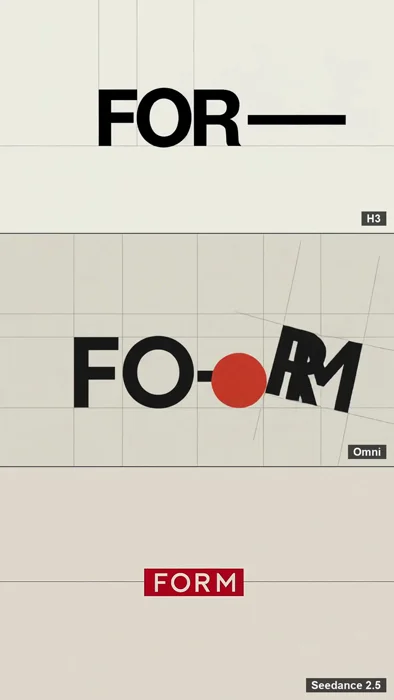
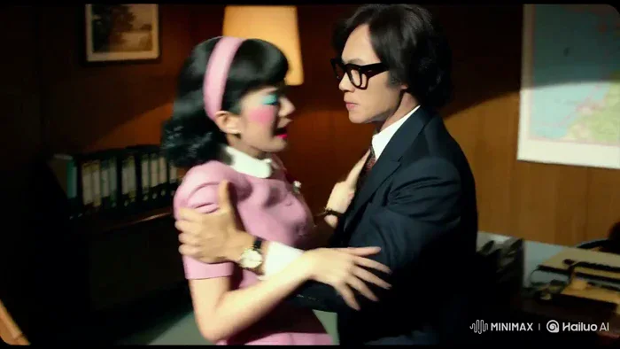
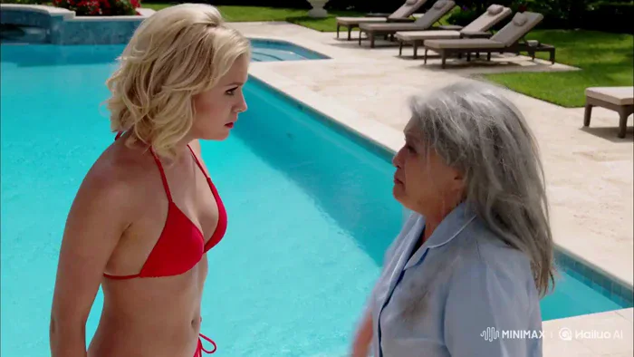
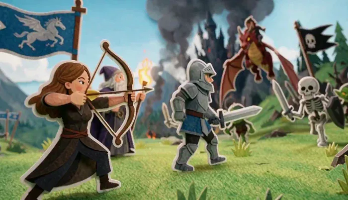
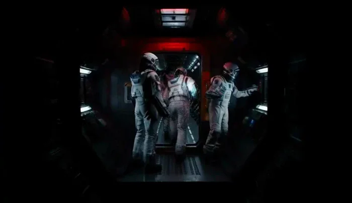
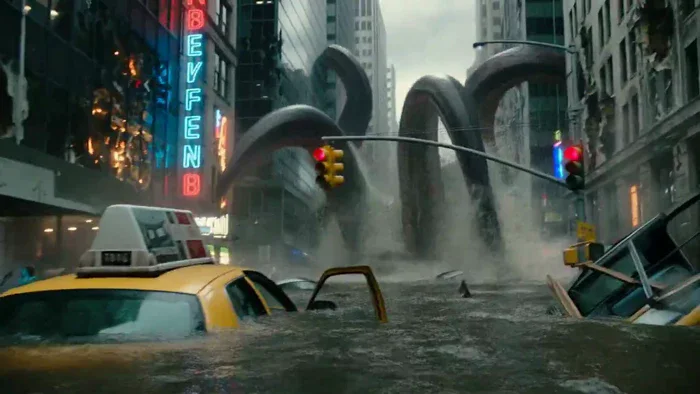
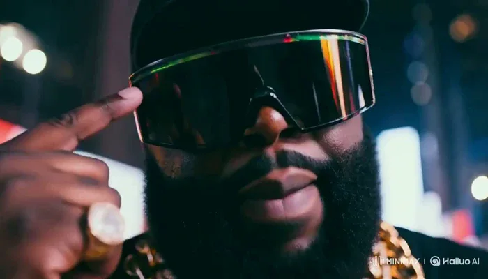
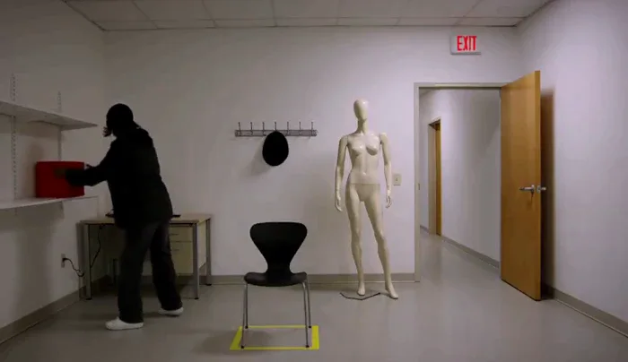
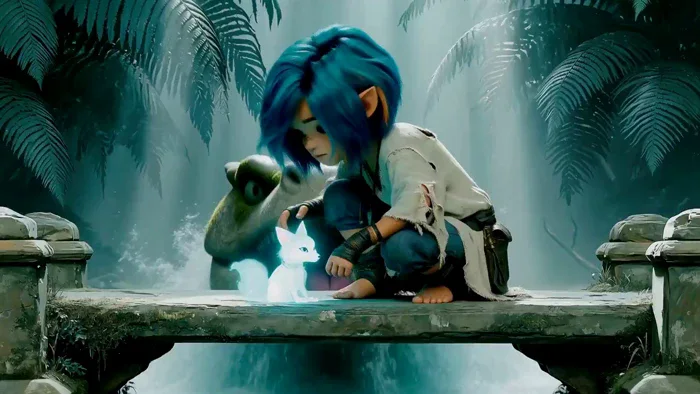

[← 返回总目录](../README.zh-CN.md#table-of-contents) · [English](short-drama.md) · [简体中文](short-drama.zh-CN.md) · [日本語](short-drama.ja.md)

### 短剧 Short Drama

- [Case 1: Starship Bridge — The Hyperspace Jump (星舰舰桥·跃迁瞬间) — by MiniMax](#case-1)
- [Case 42: A Morning Begins from Bed to a Seaside Terrace (晨起女子与海景露台的一日开场) — by @ayzalnooor24521](#case-42)
- [Case 43: Bauhaus Letterforms Recompose on Beat (包豪斯字形的节拍重组) — by @EZheng66099](#case-43)
- [Case 44: The Secretary’s Office-Scandal Trap (女秘书策划的办公室绯闻) — by @drjoetw](#case-44)
- [Case 45: A Fairy-Wand Role Reversal by the Pool (泳池边的仙女棒身份互换) — by @drjoetw](#case-45)
- [Case 46: A Papercraft Battle in a Fantasy Valley (纸艺山谷的幻想大战) — by @xianshi666123](#case-46)
- [Case 47: The Orange Cat Lets It Out (橘猫惊天一屁) — by @TheAwakenOne619](#case-47)
- [Case 48: A Two-Character Scene Driven by Exact Dialogue (精确台词驱动的双人戏) — by @cocktailpeanut](#case-48)
- [Case 49: A Cinematic Journey in One Flowing Take (一次贯穿全场的电影运镜) — by @guicastellanos1](#case-49)
- [Case 120: Automatic Lip-Sync for a High-Speed Rap Performance (自动对口型的高速说唱表演) — by @KEETY2591756](#case-120)
- [Case 121: A Reasoning Challenge Built from Traffic Rules (交通规则里的推理挑战) — by @cocktailpeanut](#case-121)
- [Case 122: A Blue-Haired Hero Escapes with a Spirit Fox (蓝发少年与灵狐逃生) — by @HBCoop_](#case-122)

### Case 1: Starship Bridge — The Hyperspace Jump (星舰舰桥·跃迁瞬间) — by MiniMax

▶ [在 ofox.ai 观看完整视频](https://ofox.ai/hailuo-3-prompts?utm_source=github&utm_medium=case&utm_campaign=awesome-ai-video-prompts#case-1)

<strong>Prompt</strong> — integrated_multimodal_description: [Shot 1] Cinematic, medium wide shot, pushing in slowly. In the cavernous, dimly lit bridge of a starship, sleek me…

~~~~text
integrated_multimodal_description: [Shot 1] Cinematic, medium wide shot, pushing in slowly. In the cavernous, dimly lit bridge of a starship, sleek metallic consoles with glowing amber displays flank a massive, curved observation window. A female captain, in her late 40s with an athletic build and short silver-streaked black hair, stands in the center midground. She wears a structured, high-collared dark navy military tunic with silver chest insignias. Her back is to the camera, silhouetted against the cool, ambient starlight pouring through the thick glass. She stands perfectly still with her hands clasped tightly behind her back. Outside the window, a massive armada of jagged, dark grey dreadnoughts hovers in tight formation against a deep purple space nebula. The fleet's massive rear thrusters begin to glow with an intense, escalating bright blue light. [Shot 2] At 00:04.500, the camera cuts to a close-up of the captain's face and shakes strongly. The brilliant blue-white light from the fleet's gathering energy reflects vividly in her dark eyes. Suddenly, a blinding white flash floods through the window, completely washing out the background as the fleet jumps to hyperspace. The sheer spatial force violently jolts the bridge, causing the captain from Shot 1 to stagger slightly forward, her shoulders tensing as she visibly braces herself against the physical tremors. As the intense white light fades abruptly, leaving only the dim, empty expanse of the purple nebula reflected on her starkly lit skin, her jaw clenches, and she slowly closes her eyes in the newly emptied space.
overall_soundscape: A low, resonant hum of the ship's ambient life support systems serves as the baseline, soon drowned out by an audible, escalating, high-pitched electronic whine as the fleet outside charges its hyperdrives. A massive, deafening, bass-heavy boom and sharp crackle erupts during the blinding flash, accompanied by the loud metallic creaking, rattling, and deep thuds of the bridge's bulkheads vibrating under immense physical stress. The intense roaring impact then cuts abruptly back to a hollow, echoing room tone, leaving only the faint, steady hum of the isolated bridge.
non_diegetic_music: Cinematic space-opera orchestral score, slow tempo, featuring a solitary, mournful French horn melody over deep, sustained string dissonances that build rapidly in volume and intensity, swelling to a massive orchestral peak before snapping immediately into silence right after the jump.
~~~~

**参数**：MiniMax H3 · MiniMax（HuggingFace 官方仓库 H3-Base 768p 复现脚本自跑） · t2v · 10s · 768p · 16:9 · 带音频
**来源**：MiniMax 官方 HuggingFace 模型卡 · [source](https://huggingface.co/MiniMaxAI/MiniMax-H3/blob/main/scripts/readme/reproducible-768p-t2va-request.sh)

MiniMax 官方示例 · HuggingFace MiniMax-H3 模型卡 T2VA 复现脚本

[回到目录](#table-of-contents)

### Case 42: A Morning Begins from Bed to a Seaside Terrace (晨起女子与海景露台的一日开场) — by @ayzalnooor24521

▶ [在 ofox.ai 观看完整视频](https://ofox.ai/hailuo-3-prompts?utm_source=github&utm_medium=case&utm_campaign=awesome-ai-video-prompts#case-42)

**输入素材**：未公开 —— 本案例未收录可用的输入素材，请参阅来源

<strong>Prompt</strong> — Create a 15-second ultra-realistic cinematic lifestyle vlog video, vertical 9:16, featuring the same young woman throughout the entire video. Preserve…

~~~~text
Create a 15-second ultra-realistic cinematic lifestyle vlog video, vertical 9:16, featuring the same young woman throughout the entire video. Preserve her facial identity, facial proportions, hairstyle, skin tone and overall appearance consistently in every shot. She wears the same outfit throughout: fitted white V-neck T-shirt with a small subtle logo, blue denim jeans, natural makeup, long softly wavy brown hair.

0:00–0:01 — Wake-up:
Close-up inside a beautiful bright bedroom. The woman is lying comfortably on the bed, slowly wakes up, stretches naturally and opens her eyes. She is NOT filming a vlog yet and does not hold a phone or camera. Soft morning sunlight enters through the curtains.

0:01–0:02 — Gets up:
Medium shot. She sits up on the bed, smiles softly, fixes her hair and gets ready to start her morning. Natural, effortless movement.

0:02–0:03 — Walks to window:
She walks toward the large glass balcony door/window. Camera follows her naturally from behind/side.

0:03–0:04 — Seaside reveal:
She opens the curtains/door and looks outside. Reveal a breathtaking blue ocean, coastal hills, flowers, balcony and beautiful morning sunlight. She smiles happily while taking in the view.

0:04–0:05 — Steps outside:
She walks out onto the seaside terrace. Gentle ocean breeze moves her hair naturally. Wide cinematic shot showing the beautiful surroundings.

0:05–0:06 — VLOG START:
Only now she starts filming herself in handheld selfie-vlog style. She looks into the camera with a bright natural smile and says:
“Good morning!”

0:06–0:07 — Show the view:
She turns the camera away from herself and slowly pans across the stunning ocean, coastal mountains, flowers and terrace. Smooth handheld vlog movement.

0:07–0:08 — Back to selfie:
Selfie shot. She looks into the camera and happily says:
“This place is just perfect!”

0:08–0:09 — Location reveal:
Wide cinematic shot of the cozy seaside terrace with wooden table, chairs, plants and flowers overlooking the ocean.

0:09–0:10 — Walk to table:
Medium tracking shot as she walks toward the table, enjoying the view. Her hair and T-shirt move gently in the sea breeze.

0:10–0:11 — Sit and relax:
She sits at the seaside table, smiling peacefully and enjoying the ocean view. A refreshing orange-colored juice is placed on the table.

0:11–0:12 — Juice close-up:
Cinematic close-up of her hand picking up the glass of fresh orange juice. Beautiful ocean bokeh in the background, natural sunlight reflecting through the glass.

0:12–0:13 — Vlog toast:
Selfie shot. She raises the juice toward the camera with a cheerful smile and says:
“Cheers to good days!”

0:13–0:14 — Happy close-up:
Beautiful close-up of her smiling naturally at the camera, ocean and warm sunlight softly blurred behind her.

0:14–0:15 — Ending:
Camera moves from her toward the sparkling ocean and peaceful coastal landscape. Warm sunlight, gentle waves and a relaxing cinematic ending.

Overall Style

Ultra-realistic, cinematic travel vlog, natural handheld camera movement, realistic human motion, smooth transitions, soft morning sunlight, realistic ocean waves, gentle wind in hair and clothes, beautiful coastal atmosphere, premium lifestyle aesthetic, natural expressions, authentic vlog feeling, shallow depth of field, cinematic composition, realistic skin texture, high detail, 4K quality.
~~~~

**参数**：MiniMax H3 · 未标注 · 未标注 · 15s · 未标注 · 未标注 · 带音频
**来源**：@ayzalnooor24521 · [原帖](https://x.com/ayzalnooor24521/status/2086671141998059973)

Preview © 2026 @ayzalnooor24521 · Prompt by @ayzalnooor24521

[回到目录](#table-of-contents)

### Case 43: Bauhaus Letterforms Recompose on Beat (包豪斯字形的节拍重组) — by @EZheng66099

▶ [在 ofox.ai 观看完整视频](https://ofox.ai/hailuo-3-prompts?utm_source=github&utm_medium=case&utm_campaign=awesome-ai-video-prompts#case-43)

**输入素材**：未公开 —— 本案例未收录可用的输入素材，请参阅来源

<strong>Prompt</strong> — Create an 8-cut kinetic-typography spot in 16:9, 24fps, exactly 12s. Style: Bauhaus / Swiss International — flat primary colors (red, yellow, blue, bl…

~~~~text
Create an 8-cut kinetic-typography spot in 16:9, 24fps, exactly 12s. Style: Bauhaus / Swiss International — flat primary colors (red, yellow, blue, black, off-white), strict grid, geometric sans-serif type.
This film is 90% typography and geometric shapes in motion, 10% texture accents.
CUT 01 | 0.0-1.5s - Off-white void. The word "FORM" drops letter by letter onto a baseline grid, each landing with a small bounce.
CUT 02 | 1.5-3.0s - A red circle rolls in from the left and knocks the "M" out of frame; "FOR—" holds one beat.
CUT 03 | 3.0-4.5s - Hard cut: full yellow frame, "FOLLOWS" stacked vertically, letters sliding in alternating directions.
CUT 04 | 4.5-6.0s - A blue diagonal wipes the frame; "FUNCTION" sits on the diagonal; the camera rotates until it reads horizontal.
CUT 05 | 6.0-7.5s - The three words swap positions on a strict 3-column grid, snapping on beat.
CUT 06 | 7.5-9.0s - All type shrinks into an 8pt grid texture; one black square scales up through center.
CUT 07 | 9.0-10.5s - The square splits into a Mondrian composition; one word per color field.
CUT 08 | 10.5-12.0s - End card: "FORM FOLLOWS FUNCTION — 1919" aligned bottom-left, the red circle as the full stop, hold.
Typography is fully readable before any shape overlaps it. Letters never distort or melt; kerning stays optically even.
Editing: hard cuts and snap moves locked to 120bpm.
Audio: minimal electronic clicks + bass pulse on every cut.
DO NOT: gradients, drop shadows, 3D extrusion, serif fonts, melted letters, added words.
~~~~

**参数**：MiniMax H3 · 未标注 · t2va · 12s · 未标注 · 未标注 · 带音频
**来源**：@EZheng66099 · [原帖](https://x.com/EZheng66099/status/2090185695641968736)

Preview © 2026 @EZheng66099 · Prompt by @EZheng66099

[回到目录](#table-of-contents)

### Case 44: The Secretary’s Office-Scandal Trap (女秘书策划的办公室绯闻) — by @drjoetw

▶ [在 ofox.ai 观看完整视频](https://ofox.ai/hailuo-3-prompts?utm_source=github&utm_medium=case&utm_campaign=awesome-ai-video-prompts#case-44)

**输入素材**：未公开 —— 本案例未收录可用的输入素材，请参阅来源

<strong>Prompt</strong> — 1960年代，香港邵氏復古電影風格：戴黑粗框眼鏡、頭髮微捲及肩的霸總生氣地按住女秘書(粉紅色廉價套裝、明顯腮紅、淡藍色眼影)的肩膀，質問女秘書道"昨晚，妳到底去了哪裡？"。女秘書開始眼眶泛淚，推開霸總的雙手，然後轉身拭淚哭泣著說"總裁這是我私人的事情，不用你管!"。總裁快步接近女秘書，然後將女秘書的…

~~~~text
1960年代，香港邵氏復古電影風格：戴黑粗框眼鏡、頭髮微捲及肩的霸總生氣地按住女秘書(粉紅色廉價套裝、明顯腮紅、淡藍色眼影)的肩膀，質問女秘書道"昨晚，妳到底去了哪裡？"。女秘書開始眼眶泛淚，推開霸總的雙手，然後轉身拭淚哭泣著說"總裁這是我私人的事情，不用你管!"。總裁快步接近女秘書，然後將女秘書的身體按壓在復古的竹製躺椅上，總裁認真地對女秘書說"對不起，我錯了。"然後總裁開始親吻女秘書的臉頰。女秘書一邊假裝喘氣，一邊從總裁的背後拿高了手機喀擦一聲拍照。下一個畫面是香港街道的路人，手中拿著報紙(上面有總裁親吻流淚女秘書的自拍照 新聞標題寫著"OFFICE SCANDAL")。下一個畫面是圍著時尚花頭巾的女秘書(改穿米色連身風衣、黑色高跟鞋)自信地"哼"一聲，從書報攤拿了一份有相同頭版照片的報紙，然後得意地看著鏡頭比了個"shh"的手勢。畫面fade into black.
~~~~

**参数**：MiniMax H3 · 未标注 · t2va · 15s · 未标注 · 未标注 · 带音频
**来源**：@drjoetw · [原帖](https://x.com/drjoetw/status/2086020747336761388)

Preview © 2026 @drjoetw · Prompt by @drjoetw

[回到目录](#table-of-contents)

### Case 45: A Fairy-Wand Role Reversal by the Pool (泳池边的仙女棒身份互换) — by @drjoetw

▶ [在 ofox.ai 观看完整视频](https://ofox.ai/hailuo-3-prompts?utm_source=github&utm_medium=case&utm_campaign=awesome-ai-video-prompts#case-45)

**输入素材**：未公开 —— 本案例未收录可用的输入素材，请参阅来源

<strong>Prompt</strong> — 美國喜劇reality show: 豪宅的泳池邊，20歲金髮藍眼的紅色比基尼美女與60歲灰髮憔悴的清潔婦正在激烈地爭吵，美女說"醜死了，你這死老太婆!"，清潔婦也不甘示弱說"整天只會換男人，不正經!"。這時畫誇張眼影妖后造型的drag queen飛過，便將手中的仙女棒往美女與清潔婦的頭上各點一下，結…

~~~~text
美國喜劇reality show: 豪宅的泳池邊，20歲金髮藍眼的紅色比基尼美女與60歲灰髮憔悴的清潔婦正在激烈地爭吵，美女說"醜死了，你這死老太婆!"，清潔婦也不甘示弱說"整天只會換男人，不正經!"。這時畫誇張眼影妖后造型的drag queen飛過，便將手中的仙女棒往美女與清潔婦的頭上各點一下，結果美女迅速老化變成70歲皮膚鬆垮的老女人，清潔婦則迅速變成年輕的20歲美麗模樣。變年輕的清潔婦自信地說"啊，我現在感覺好多了!"就脫掉制服，露出夏季連身華麗黑色窄裙與高跟鞋，然後自信地離去，留下崩潰且一臉錯愕的老女人無助地看著鏡頭哭著吶喊:"不!!!!!!"
~~~~

**参数**：MiniMax H3 · 未标注 · t2va · 15s · 未标注 · 未标注 · 带音频
**来源**：@drjoetw · [原帖](https://x.com/drjoetw/status/2085983430219895004)

Preview © 2026 @drjoetw · Prompt by @drjoetw

[回到目录](#table-of-contents)

### Case 46: A Papercraft Battle in a Fantasy Valley (纸艺山谷的幻想大战) — by @xianshi666123

▶ [在 ofox.ai 观看完整视频](https://ofox.ai/hailuo-3-prompts?utm_source=github&utm_medium=case&utm_campaign=awesome-ai-video-prompts#case-46)

**输入素材**：未公开 —— 本案例未收录可用的输入素材，请参阅来源

<strong>Prompt</strong> — 【核心创意】 12 秒，16:9 横屏视频。手工纸艺立体拼贴与奇幻故事书风格的二维动画。画面由多层纸片、裁切边缘、纸张纤维、柔和层叠阴影和轻微定格动画质感构成，色彩鲜明，具有微缩舞台空间感。 故事发生在一片绿色山谷战场。左侧是英雄阵营：一名棕色长发的女弓箭手，穿黑色轻甲；一名白色长胡须的老法师，穿深…

~~~~text
【核心创意】

12 秒，16:9 横屏视频。手工纸艺立体拼贴与奇幻故事书风格的二维动画。画面由多层纸片、裁切边缘、纸张纤维、柔和层叠阴影和轻微定格动画质感构成，色彩鲜明，具有微缩舞台空间感。

故事发生在一片绿色山谷战场。左侧是英雄阵营：一名棕色长发的女弓箭手，穿黑色轻甲；一名白色长胡须的老法师，穿深蓝长袍，手持燃烧法杖；一名穿银灰色盔甲的年轻骑士，手持长剑和盾牌；远处有一匹白色独角兽和一面带白色独角兽图案的蓝色旗帜。右侧是敌方阵营：骷髅士兵、绿色哥布林和一名骑乘棕红色飞龙的黑甲骑士，旁边竖立一面黑色骷髅旗帜。远处山脉、松树林和一座冒着黑烟的黑色尖塔城堡。

【画面过程说明】

0–2 秒｜大全景：
镜头从山谷战场大全景缓慢向前 Push In。蓝色独角兽旗帜和黑色骷髅旗帜在风中摆动，城堡上方的黑烟缓慢升起，草地和火焰轻微运动。英雄阵营与敌方阵营隔着战场对峙。

2–4 秒｜中景切换：
镜头切到左侧女弓箭手。她迅速拉满弓弦，瞄准右侧骷髅士兵并射出一支箭。箭矢沿清晰轨迹飞过战场，骷髅士兵举盾挡住箭矢，产生少量纸片火花，不出现受伤或死亡。

4–6 秒｜仰拍跟随：
镜头快速 Tilt Up 跟随棕红色飞龙。飞龙扇动翅膀俯冲，向英雄阵营喷出一股短暂的橙色火焰。老法师举起燃烧法杖，形成一面半透明金色魔法护盾。火焰撞上护盾后向两侧散开，不发生爆炸。

6–9 秒｜低机位中景：
年轻骑士举起长剑向前冲锋，与一名骷髅战士发生一次清晰的剑盾碰撞。绿色哥布林从侧面冲来，骑士侧身闪避。镜头进行短距离 Tracking Shot，跟随骑士向右移动，动作快速但保持人物比例、盔甲和武器稳定。

9–11 秒｜动作高潮：
镜头切到战场中央。骑士与骷髅战士再次交锋，女弓箭手继续射箭，老法师维持金色护盾，飞龙在上方喷出短暂火焰，哥布林举盾冲向前方。加入少量尘土、火星和纸片碎屑，表现激烈战斗，但不出现血腥画面。

11–12 秒｜大全景定格：
镜头快速 Pull Out，重新展示完整山谷战场。飞龙在空中盘旋，弓箭手保持射击姿势，法师举杖维持护盾，骑士与骷髅战士停留在交锋姿态，双方仍未分出胜负。火焰、烟雾和旗帜继续运动，最后定格在战斗高潮画面。

声音：风吹旗帜声、弓弦拉动声、箭矢破空声、飞龙翅膀声、火焰喷射声、魔法护盾低沉嗡鸣、剑盾碰撞声、哥布林脚步声和紧张的奇幻战斗配乐。无对白、无旁白。

不想要：写实摄影、普通3D游戏CG、塑料材质、角色换装、脸部变化、人物数量明显增加、武器消失、箭矢倒飞、火焰爆炸、血腥画面、断肢、角色死亡、骷髅或哥布林变形、字幕、Logo、乱码文字、镜头剧烈抖动、黑屏转场。

必须保持：全片为手工纸艺立体拼贴与二维定格动画风格；女弓箭手、老法师、年轻骑士、飞龙骑士、骷髅士兵和绿色哥布林的外观全程一致；英雄阵营位于左侧，敌方阵营位于右侧；结尾双方仍在交战，不出现明确胜负。
~~~~

**参数**：MiniMax H3 · 未标注 · 未标注 · 15s · 未标注 · 未标注 · 带音频
**来源**：@xianshi666123 · [原帖](https://x.com/xianshi666123/status/2085649264185913721)

Preview © 2026 @xianshi666123 · Prompt by @xianshi666123

[回到目录](#table-of-contents)

### Case 47: The Orange Cat Lets It Out (橘猫惊天一屁) — by @TheAwakenOne619

▶ [在 ofox.ai 观看完整视频](https://ofox.ai/hailuo-3-prompts?utm_source=github&utm_medium=case&utm_campaign=awesome-ai-video-prompts#case-47)

**输入素材**：未公开 —— 本案例未收录可用的输入素材，请参阅来源

<strong>Prompt</strong> — Cinematic comedy sequence, 15 seconds. [SCENE 1: 0-4s] Extreme close-up: A morbidly obese, orange tabby cat is fast asleep on a tiny, expensive velvet…

~~~~text
Cinematic comedy sequence, 15 seconds. [SCENE 1: 0-4s] Extreme close-up: A morbidly obese, orange tabby cat is fast asleep on a tiny, expensive velvet pillow in a pristine living room. The cat’s stomach rumbles ominously, emitting a deep, bass-heavy vibration that violently shakes the coffee table. [CUT TO] [SCENE 2: 4-7s] Low angle macro shot: The cat lifts one hind leg slightly. A tiny, glowing neon-green puff of gas escapes in ultra slow-motion, accompanied by a rippling shockwave that visually warps the air around it. [CUT TO] [SCENE 3: 7-11s] Wide tracking shot: The shockwave expands violently, blowing the living room furniture, the TV, and the doors out of the house in a fiery blast of glowing green energy and flying cat hair. [CUT TO] [SCENE 4: 11-15s] Orbiting space shot: Looking down at Earth from orbit. A colossal, glowing green mushroom cloud erupts from the continent, rapidly expanding into the exact shape of a giant, glowing cat paw. Epic cinematic lighting, hyper-realistic, deep shadows.
~~~~

**参数**：MiniMax H3 · 未标注 · 未标注 · 15s · 未标注 · 未标注 · 带音频
**来源**：@TheAwakenOne619 · [原帖](https://x.com/TheAwakenOne619/status/2085602322177282512)

Preview © 2026 @TheAwakenOne619 · Prompt by @TheAwakenOne619

[回到目录](#table-of-contents)

### Case 48: A Two-Character Scene Driven by Exact Dialogue (精确台词驱动的双人戏) — by @cocktailpeanut

▶ [在 ofox.ai 观看完整视频](https://ofox.ai/hailuo-3-prompts?utm_source=github&utm_medium=case&utm_campaign=awesome-ai-video-prompts#case-48)

**输入素材**：未公开 —— 本案例未收录可用的输入素材，请参阅来源

<strong>Prompt</strong> — cinematic sci-fi suspense video. A realistic spaceship crew in full futuristic uniforms follows a mysterious distress signal and boards a dark, abando…

~~~~text
cinematic sci-fi suspense video. A realistic spaceship crew in full futuristic uniforms follows a mysterious distress signal and boards a dark, abandoned spacecraft drifting in space. Flashlights cut through darkness as they move cautiously through narrow metallic corridors. Warning lights flicker, metal creaks, and their boots echo on the floor. One crew member says, "Signal's coming from deeper inside." They enter a large chamber filled with hundreds of empty cryogenic pods, all open and abandoned. Another crew member says nervously, "Where did everyone go?" They approach a final closed door at the far end. The captain slowly opens it, and instead of another ship compartment, it reveals a completely normal present-day elementary school classroom in bright daylight. Children sit at desks, backpacks on the floor, colorful posters on the walls, and a teacher at the front turns to the crew and scolds them: "You're late again. Take your seats." The astronauts stand frozen in confusion at the doorway. Realistic tone, smooth camera movement, strong suspense buildup, with the final reveal clear, sudden, and absurd. Include realistic audio: radio static, low ship hum, footsteps, pod machinery ambience, door hiss, then ordinary classroom sounds and the teacher's voice.
~~~~

**参数**：MiniMax H3 · 未标注 · 未标注 · 14s · 未标注 · 未标注 · 带音频
**来源**：@cocktailpeanut · [原帖](https://x.com/cocktailpeanut/status/2085498501384024495)

Preview © 2026 @cocktailpeanut · Prompt by @cocktailpeanut

[回到目录](#table-of-contents)

### Case 49: A Cinematic Journey in One Flowing Take (一次贯穿全场的电影运镜) — by @guicastellanos1

▶ [在 ofox.ai 观看完整视频](https://ofox.ai/hailuo-3-prompts?utm_source=github&utm_medium=case&utm_campaign=awesome-ai-video-prompts#case-49)

**输入素材**：未公开 —— 本案例未收录可用的输入素材，请参阅来源

<strong>Prompt</strong> — Whip pan from a screaming crowd to a massive kraken-like creature rising from flooded city streets. Tentacles crush traffic lights and wrap around bui…

~~~~text
Whip pan from a screaming crowd to a massive kraken-like creature rising from flooded city streets. Tentacles crush traffic lights and wrap around buildings. The camera sways violently with each impact. Water rushes at lens level, debris floats by. VFX water simulation, dynamic lighting, and lens flare through broken signs.
~~~~

**参数**：MiniMax H3 · 未标注 · 未标注 · 10s · 未标注 · 未标注 · 带音频
**来源**：@guicastellanos1 · [原帖](https://x.com/guicastellanos1/status/2085411288218276158)

Preview © 2026 @guicastellanos1 · Prompt by @guicastellanos1

[回到目录](#table-of-contents)

### Case 120: Automatic Lip-Sync for a High-Speed Rap Performance (自动对口型的高速说唱表演) — by @KEETY2591756

▶ [在 ofox.ai 观看完整视频](https://ofox.ai/hailuo-3-prompts?utm_source=github&utm_medium=case&utm_campaign=awesome-ai-video-prompts#case-120)

**输入素材**：未公开 —— 本案例未收录可用的输入素材，请参阅来源

<strong>Prompt</strong> — モード1：Omni Reference プロンプト：添付のキャラクター参照（ 📷Image1 ）とオーディオトラックをタイミングガイドとして使用してください。オーディオにある「音声」に完全に会うようにキャラクターの口とアクションを入れてリップシンクしてダイナミックなカメラアングルでラップを披露して…

~~~~text
モード1：Omni Reference
プロンプト：添付のキャラクター参照（ 📷Image1 ）とオーディオトラックをタイミングガイドとして使用してください。オーディオにある「音声」に完全に会うようにキャラクターの口とアクションを入れてリップシンクしてダイナミックなカメラアングルでラップを披露してください。カメラはマルチカットでキャラの部位をクローズアップしてください。全て超ハイスピードで激しく行ってください。

モード2：Omni Reference
プロンプト：添付のキャラクター参照（ 📷Image1 ）とオーディオトラックをタイミングガイドとして使用してください。オーディオにある「音声」に完全に会うようにキャラクターの口とアクションを入れてリップシンクしてダイナミックなカメラアングルでラップを披露してください。カメラはマルチカットで超ローアングル・超ハイアングルを小刻みに切り替えたUS東海岸のラップビデオのようなスタイルに仕上げる。全て超ハイスピードで激しく行ってください。
~~~~

**参数**：MiniMax H3 · 未标注 · ref2va · 30s · 未标注 · 未标注 · 带音频
**来源**：@KEETY2591756 · [原帖](https://x.com/KEETY2591756/status/2085918684879765882)

Preview © 2026 @KEETY2591756 · Prompt by @KEETY2591756

[回到目录](#table-of-contents)

### Case 121: A Reasoning Challenge Built from Traffic Rules (交通规则里的推理挑战) — by @cocktailpeanut

▶ [在 ofox.ai 观看完整视频](https://ofox.ai/hailuo-3-prompts?utm_source=github&utm_medium=case&utm_campaign=awesome-ai-video-prompts#case-121)

**输入素材**：未公开 —— 本案例未收录可用的输入素材，请参阅来源

<strong>Prompt</strong> — A single continuous fixed wide shot in a plain, brightly lit test room, filmed like an unedited behavioral experiment. At the start, a red cube is on …

~~~~text
A single continuous fixed wide shot in a plain, brightly lit test room, filmed like an unedited behavioral experiment. At the start, a red cube is on a table, a drawer is closed, a lamp is off, a chair sits precisely inside a taped floor outline, a hat hangs on a wall hook beside a bare mannequin, and a door is open. One person quickly performs six clearly separated actions in this exact order: places the red cube on a shelf, opens the drawer, turns on the lamp, moves the chair away from its taped outline, takes the hat from the hook and puts it on the mannequin, then closes the door. An off-screen instructor clearly says, "Undo only the last three actions." The person pauses briefly, understands the instruction, and carries it out exactly. No cuts, no time jumps, no extra actions, no additional dialogue, realistic synchronized room sounds.
~~~~

**参数**：MiniMax H3 · 未标注 · 未标注 · 14s · 未标注 · 未标注 · 带音频
**来源**：@cocktailpeanut · [原帖](https://x.com/cocktailpeanut/status/2085893756688167396)

Preview © 2026 @cocktailpeanut · Prompt by @cocktailpeanut

[回到目录](#table-of-contents)

### Case 122: A Blue-Haired Hero Escapes with a Spirit Fox (蓝发少年与灵狐逃生) — by @HBCoop_

▶ [在 ofox.ai 观看完整视频](https://ofox.ai/hailuo-3-prompts?utm_source=github&utm_medium=case&utm_campaign=awesome-ai-video-prompts#case-122)

**输入素材**：未公开 —— 本案例未收录可用的输入素材，请参阅来源

<strong>Prompt</strong> — Use the reference @ image for the exact character design, clothing, proportions, blue hair, pointed ears and glowing cyan spirit fox. Preserve the cin…

~~~~text
Use the reference @ image for the exact character design, clothing, proportions, blue hair, pointed ears and glowing cyan spirit fox. Preserve the cinematic stylized 3D look, saturated teal jungle palette, soft volumetric light and detailed natural textures. No dialogue; environmental sound only.

0–4 seconds: Begin close to the reference composition on the ancient stone bridge. The girl kneels beside the small glowing spirit fox as ripples begin moving backward across the stream below. She notices the unnatural movement and looks over her shoulder. A massive moss-covered stone serpent suddenly erupts from beneath the bridge, lifting one side of the platform. The stone tilts physically under her weight. She loses balance, catches herself with one hand and quickly pulls the spirit fox against her chest as cracks spread beneath her knees.

4–10 seconds: The bridge collapses progressively behind her. She rises naturally from the crouch and sprints barefoot across the tilting stone slabs, carrying the fox securely with one arm. Each footfall dislodges moss and small fragments; broken slabs fall with believable weight and strike the water below, producing delayed splashes. The camera tracks closely beside her at waist height. The serpent sweeps its heavy stone tail across her path. She drops into a fast knee slide beneath it; her torn cloak and blue hair trail behind with clear inertia. Still moving forward, she catches a hanging vine with her free hand. Her momentum pulls the vine taut and swings her outward across the widening gap while the camera arcs alongside her.

10–15 seconds: At the highest point of the swing, the vine begins tearing from the temple ceiling. She releases before it snaps, travels forward in a natural gravity-driven arc and lands hard on the opposite platform. She absorbs the impact through her feet and one hand, then rolls once across her shoulder while protecting the fox against her chest. The camera drops and rolls partially with her, then stabilizes behind her as she rises into a defensive crouch. The spirit fox leaps from her arms and lands in front of her, its cyan light intensifying as the serpent crashes into the broken bridge behind them, sending water, dust and stone fragments through the backlight.

Maintain one continuous route and clear cause-and-effect motion. No teleporting, floating, sudden directional changes, extra characters, costume changes or transformation of the girl. Keep the fox small throughout; only its light becomes brighter in the final moment.
~~~~

**参数**：MiniMax H3 · 未标注 · ref2va · 15s · 未标注 · 未标注 · 带音频
**来源**：@HBCoop_ · [原帖](https://x.com/HBCoop_/status/2083553619413209379)

Preview © 2026 @HBCoop_ · Prompt by @HBCoop_

[回到目录](#table-of-contents)
