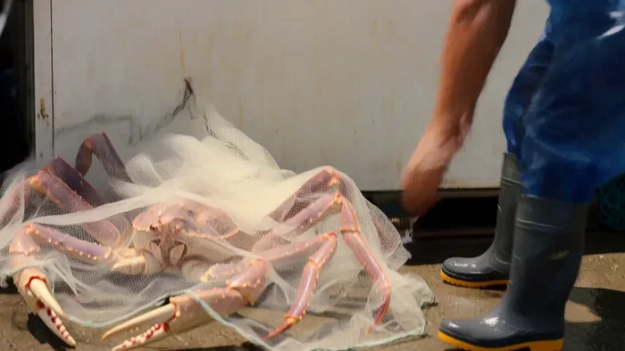

[← 返回总目录](../README.zh-CN.md#table-of-contents) · [English](shorts-reels.md) · [简体中文](shorts-reels.zh-CN.md) · [日本語](shorts-reels.ja.md)

### 社媒短视频 Shorts & Reels

- [Case 136: Backseat Raccoon and Flying Chips (浣熊抢薯片的后座插曲) — by @laviniavelle](#case-136)
- [Case 146: The Giant Crab Escapes (渔港水箱里的巨蟹逃脱) — by @Just_Anika_Here](#case-146)

### Case 136: Backseat Raccoon and Flying Chips (浣熊抢薯片的后座插曲) — by @laviniavelle

▶ [在 ofox.ai 观看完整视频](https://ofox.ai/hailuo-3-prompts?utm_source=github&utm_medium=case&utm_campaign=awesome-ai-video-prompts#case-136)

**输入素材**：未公开 —— 本案例未收录可用的输入素材，请参阅来源

<strong>Prompt</strong> — A cinematic video inside the back seat of a moving car with beige leather interior On the right a young woman with medium-length brown hair, wearing a…

~~~~text
A cinematic video inside the back seat of a moving car with beige leather interior On the right a young woman with medium-length brown hair, wearing a yellow knitted sweater and blue jeans is holding a blue bag of potato chips Sitting on the left is a fluffy raccoon and a small capuchin monkey is resting close to the raccoon The woman offers a chip to the animals but as the raccoon reaches into the bag chips accidentally burst into the air and scatter all over the backseat including one landing on the raccoon's head The woman reacts with surprise and then bursts into laughter while the monkey looks around curious and playful Photorealistic soft natural lighting, vibrant colors.
~~~~

**参数**：MiniMax H3 · 未标注 · 未标注 · 未标注 · 未标注 · 未标注 · 未标注
**来源**：@laviniavelle · [原帖](https://x.com/laviniavelle/status/2108851182244606445)

Preview © 2026 @laviniavelle · Prompt by @laviniavelle

[回到目录](#table-of-contents)

### Case 146: The Giant Crab Escapes (渔港水箱里的巨蟹逃脱) — by @Just_Anika_Here

▶ [在 ofox.ai 观看完整视频](https://ofox.ai/hailuo-3-prompts?utm_source=github&utm_medium=case&utm_campaign=awesome-ai-video-prompts#case-146)

**输入素材**：未公开 —— 本案例未收录可用的输入素材，请参阅来源

<strong>Prompt</strong> — Create an ultra-realistic 15-second video during a lively summer afternoon at a small Japanese fishing harbor. Use the provided reference image only t…

~~~~text
Create an ultra-realistic 15-second  video during a lively summer afternoon at a small Japanese fishing harbor. Use the provided reference image only to preserve the main woman's identity and appearance.

The video must feel like a real spontaneous travel vlog, recorded by her friend. Natural handheld smartphone footage, fast reactions, continuous movement, realistic expressions, authentic Japanese harbor details, and clear close-ups. The story must contain multiple connected actions, audible dialogue, distinctive environmental sounds, and a genuinely surprising ending.

0–3 seconds:
The woman stands beside a seafood stall, filming an enormous live Japanese spider crab displayed in a shallow tank. Suddenly, the crab stretches one long leg over the tank's edge and knocks her phone out of her hand. The phone lands safely on a nearby pile of fishing nets. She gasps, shouting, "Oh my God! Did you see that?!" The friend filming immediately exclaims, "Yo! It stole your shot!"
3–6 seconds:
The crab crawls sideways toward the nets while the woman quickly retrieves her phone. A fisherman rushes over, calling out in Japanese, "Abunai! Abunai!" A metal bucket clatters onto the ground, startling a flock of seagulls into flight. The camera swings rapidly between the escaping crab, the startled woman, and the fisherman.

6–9 seconds:
The crab unexpectedly grabs the loose end of a bright red fishing rope with one claw. As it moves, the rope pulls a small stack of empty plastic baskets across the wet pavement. The woman jumps aside and shouts, "Wait, wait! It's taking everything!" The fisherman laughs in disbelief and calls for someone to help.
9–12 seconds:
A sudden tug pulls a lightweight fishing net off a wooden crate. The net drops over the crab like a messy tent. Everyone freezes for a moment. The fisherman carefully lifts one corner, revealing the crab sitting beside a tiny hidden kitten that had been sheltering behind the crate. The kitten meows loudly and climbs onto the fisherman's rubber boot.

12–15 seconds:
Just as the woman bends down to film the kitten, the giant crab raises both claws behind her. The fisherman suddenly shouts, "Look out!" She spins around in shock, but the crab is simply holding her bright red phone strap between its claws. The woman stares at the camera in disbelief and says, "It actually wanted my phone!" End with the fisherman laughing and the crab releasing the strap.
Audio must be carefully designed and clearly audible: lively harbor ambience, waves against the dock, seagulls squawking, water splashing, metal bucket clattering, plastic baskets scraping across wet pavement, the crab tapping against the tank, realistic footsteps, a loud surprised gasp, spontaneous English dialogue, the fisherman's Japanese warning, a clear kitten meow, and natural overlapping reactions.

Use distinct sound events synchronized exactly with the visible actions. Keep dialogue crisp and intelligible, with the environmental sounds slightly quieter whenever someone speaks. The woman's voice should sound surprised and expressive, not continuously laughing. Include moments of silence and suspense before the final reveal.
Visual style: realistic smartphone exposure, natural summer sunlight, authentic Japanese fishing harbor, believable animal movement, consistent character appearance, clear medium shots and close-ups, natural camera shake, and realistic physical interactions.

Avoid constant laughter, silent characters, generic background noise, music overpowering dialogue, robotic voices, random sound effects, cinematic transitions, slow motion, cartoon behavior, impossible animal actions, distorted hands, duplicated animals, and blurry faces.
~~~~

**参数**：MiniMax H3 · 未标注 · 未标注 · 未标注 · 未标注 · 未标注 · 未标注
**来源**：@Just_Anika_Here · [原帖](https://x.com/Just_Anika_Here/status/2110229530019500523)

Preview © 2026 @Just_Anika_Here · Prompt by @Just_Anika_Here

[回到目录](#table-of-contents)
