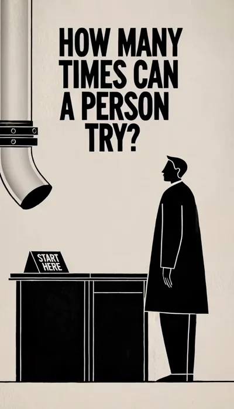
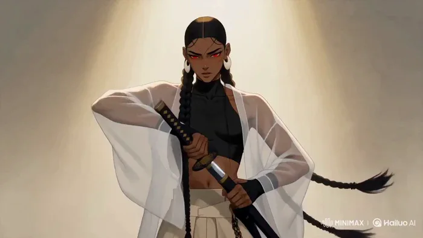
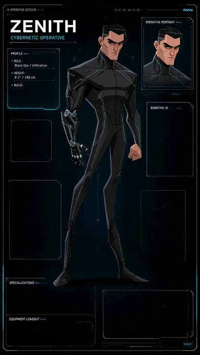
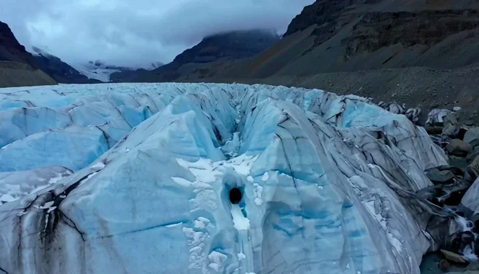
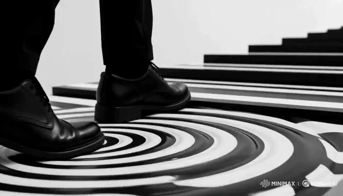
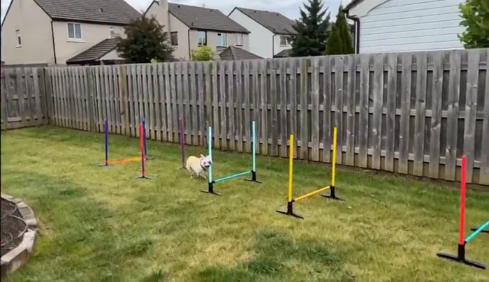
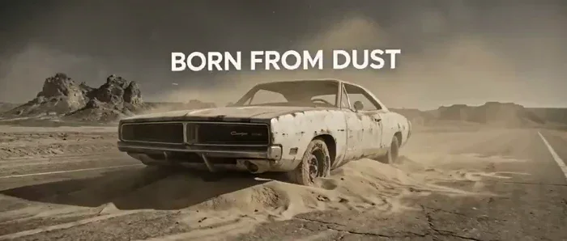
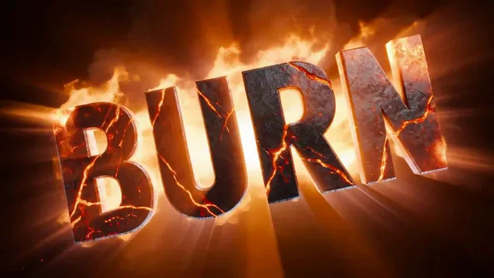

[← 返回总目录](../README.zh-CN.md#table-of-contents) · [English](ui-typography.md) · [简体中文](ui-typography.zh-CN.md) · [日本語](ui-typography.ja.md)

### 界面与文字动效 UI & Typography

- [Case 13: Beat-Synced Spaghetti-Western Title Sequence (西部片节拍标题动画) — by @itsphotogptai](#case-13)
- [Case 39: Bureaucracy Explained in Fifteen Seconds (十五秒看懂官僚主义) — by @airina_xyz](#case-39)
- [Case 40: Typography Flows Through the Scene (文字在镜头中流动) — by @opener_ai](#case-40)
- [Case 113: A Cybernetic Operative Appears on a Stat Panel (赛博特工从剪影显现在数据面板) — by @adithatipalli](#case-113)
- [Case 114: Two Glaciologists Enter a Blue-Ice Cave (两名冰川学者深入蓝色冰洞) — by @Strength04_X](#case-114)
- [Case 115: The Black-and-White Illusion of an Endless Staircase (无尽阶梯的黑白错视) — by @su_nagomi](#case-115)
- [Case 116: Wake the Wonder (唤醒宇宙奇观) — by @airina_xyz](#case-116)
- [Case 117: A French Bulldog Under Precise Direction (镜头下的法国斗牛犬) — by @cocktailpeanut](#case-117)
- [Case 118: Images and Typography in Seamless Motion (图像与文字的无缝变换) — by @opener_ai](#case-118)
- [Case 134: BURN Forged in Fire (烈焰熔铸 BURN 字幕) — by @CharaspowerAI](#case-134)

### Case 13: Beat-Synced Spaghetti-Western Title Sequence (西部片节拍标题动画) — by @itsphotogptai

▶ [在 ofox.ai 观看完整视频](https://ofox.ai/hailuo-3-prompts?utm_source=github&utm_medium=case&utm_campaign=awesome-ai-video-prompts#case-13)

**输入素材**：未公开 —— 本案例未收录可用的输入素材，请参阅来源

<strong>Prompt</strong> — Use the attached character reference (Image1) and audio track as the timing guide. Create a spaghetti-western pulp anime title sequence where every cu…

~~~~text
Use the attached character reference (Image1) and audio track as the timing guide. Create a spaghetti-western pulp anime title sequence where every cut lands precisely on the beat. Style the character as a flat black silhouette against solid desert-inspired colors (burnt orange, ochre, rust, adobe tan), using bold pop-art compositions, vintage bounty-poster framing, split panels, extreme close-ups, and wide horizon shots. Alternate fast action bursts with full-beat freeze frames (draw, stride, turn, match strike, etc.), using hard cuts only. Add worn woodblock/stencil title typography that slams into frame on the beat. Finish with the character frozen in silhouette on a burnt-orange background as the title stamps in on the final hit. Apply heavy 35mm film grain, scratches, dust, gate weave, cigarette burns, and sun-faded print wear throughout for an authentic 1960s spaghetti-western look.
~~~~

**参数**：MiniMax H3 · 未标注 · ref2va · 10s · 未标注 · 未标注 · 带音频
**来源**：@itsphotogptai · [原帖](https://x.com/itsphotogptai/status/2086555941831626849)

Preview © 2026 @itsphotogptai · Prompt by @itsphotogptai

[回到目录](#table-of-contents)

### Case 39: Bureaucracy Explained in Fifteen Seconds (十五秒看懂官僚主义) — by @airina_xyz

▶ [在 ofox.ai 观看完整视频](https://ofox.ai/hailuo-3-prompts?utm_source=github&utm_medium=case&utm_campaign=awesome-ai-video-prompts#case-39)

**输入素材**：未公开 —— 本案例未收录可用的输入素材，请参阅来源

<strong>Prompt</strong> — { "title": "The Void Replies", "duration": "15 seconds", "aspect_ratio": "9:16", "style": "surreal architectural etching blended with animated bureauc…

~~~~text
{ "title": "The Void Replies", "duration": "15 seconds", "aspect_ratio": "9:16", "style": "surreal architectural etching blended with animated bureaucratic flowcharts, endless stairways, cream paper, black ink and warning-red pathways, Escher-like scale, sharp editorial illustration", "prompt": "Create a meaningful 15-second vertical animation about learned helplessness inside systems so complex that personal action appears useless. Open on a citizen standing before a small civic desk labelled START HERE. They submit a simple request marked HOUSING. The paper enters a maze of pipes branching into DEPARTMENT, REVIEW, CONSULTATION, JURISDICTION, APPEAL and PENDING. The person runs alongside it through endless stairs and corridors, but the request repeatedly returns stamped WRONG FORM. Their voice becomes a visible red waveform that travels into the maze and gradually shrinks. Floating phrases gather around them: NOTHING CHANGES, WHY TRY, TOO COMPLICATED and SOMEONE ELSE'S JOB. They sit down. Another citizen arrives carrying a different request. Instead of entering alone, the two connect their red waveforms. More people join, and the combined signal illuminates a direct path through the structure. The maze does not vanish, but doors begin opening and officials become visible. Finish with the original request reaching a real human desk as bold text appears: POWERLESSNESS GROWS IN ISOLATION. AGENCY GROWS THROUGH CONNECTION. Avoid suggesting that every civic problem has a simple solution.", "timeline": [ { "time": "0.0-3.0 seconds", "visual": "A HOUSING request enters a vast bureaucratic maze.", "text": "HOW MANY TIMES CAN A PERSON TRY?" }, { "time": "3.0-8.0 seconds", "visual": "The request cycles through REVIEW, JURISDICTION, PENDING and WRONG FORM.", "text": "" }, { "time": "8.0-12.0 seconds", "visual": "NOTHING CHANGES and WHY TRY surround the exhausted citizen.", "text": "" }, { "time": "12.0-15.0 seconds", "visual": "Connected voices illuminate a shared route through the maze.", "text": "AGENCY GROWS\\nTHROUGH CONNECTION" } ], "voiceover": { "enabled": true, "delivery": "empathetic, grounded and steadily empowering", "script": "When every path leads nowhere, people stop walking. Connection can make a route visible again." }, "audio": { "music": "repetitive ticking rhythm expanding into layered human percussion", "sound_design": "paper tubes, stamps, footsteps, fading echoes and joined vocal tones" }, "camera": { "movement": "paper-following maze chase, dizzying overhead pullback and direct final push toward the open desk", "editing": "repeating loops interrupted by connected red lines" }, "negative_prompt": [ "mocking public workers", "simple anti-government message", "photorealism", "hopeless ending", "illegible flowcharts", "magical instant solution" ] }
~~~~

**参数**：MiniMax H3 · 未标注 · 未标注 · 15s · 未标注 · 未标注 · 带音频
**来源**：@airina_xyz · [原帖](https://x.com/airina_xyz/status/2085309090511675674)

Preview © 2026 @airina_xyz · Prompt by @airina_xyz

[回到目录](#table-of-contents)

### Case 40: Typography Flows Through the Scene (文字在镜头中流动) — by @opener_ai

▶ [在 ofox.ai 观看完整视频](https://ofox.ai/hailuo-3-prompts?utm_source=github&utm_medium=case&utm_campaign=awesome-ai-video-prompts#case-40)

**输入素材**：未公开 —— 本案例未收录可用的输入素材，请参阅来源

<strong>Prompt</strong> — [1] FORMAT 15-second 16:9 stylized anime action title sequence — martial-arts choreography fused with 3D kinetic typography. Painterly 2D anime illust…

~~~~text
[1] FORMAT
15-second 16:9 stylized anime action title sequence — martial-arts choreography fused with 3D kinetic typography. Painterly 2D anime illustration look with cel-shaded volumes and subtle paper grain, matching the source artwork's rendering.

[2] ASSETS
Use Image 1 as a strict identity reference for the female duelist KAELAN — read only the character artwork itself for her face, hair, wardrobe, weapon, and color palette. Ignore the sheet's layout, panels, printed labels, handwriting, silhouette thumbnails, and background parchment; none of them may appear in the video.

[3] IDENTITY
Preserve exactly: deep brown skin with warm highlights; luminous crimson-red eyes with a sharp black liner shape; jet-black hair pulled into a tight scalp-wrapped part that splits into two very long thick braids falling past the hips, moving like weighted whips; large white crescent hoop earrings on both ears; black high-neck sleeveless crop top exposing a toned midriff; a sheer white long-sleeved kimono robe worn open, translucent and lightly billowing; cream wide-leg hakama trousers with a single black diamond patch on the left thigh; black wrapped fingerless gloves with lattice cord across the back of the hand; white cloth-wrapped platform sandals; a well-worn katana with a dark blue-grey blade and a black diamond-wrapped hilt. Her expression stays calm and unblinking, never comic.

[4] BEATS
Shot 1 — [0–3 seconds] Kaelan stands centered in a void of warm off-white light, katana point-down, braids settling. She exhales; a slow iai draw begins. → Hard cut.
Shot 2 — [3–6 seconds] Mid-draw. The blade clears the saya and a clean arc of light follows the edge. The 3D extruded word "HAILUO" flies in from screen left along the blade's arc, its letter faces catching the same light, passing BEHIND her shoulder and IN FRONT of her trailing braid before exiting right. → Whip-pan cut.
Shot 3 — [6–9 seconds] Full-body kata combination: descending cut, pivot, rising horizontal sweep. Her sheer robe and both braids trail one frame behind her body. The word "MINIMAX" rotates up from the floor plane in thick extruded 3D, standing taller than her, and she cuts through the gap between its letters — the letterforms hold solid, do not shatter. → Hard cut.
Shot 4 — [9–12.5 seconds] Low-angle crouch landing, sword arm extended back, dust ring pushing outward. "H3" slams in from depth as a massive chromed 3D glyph directly behind her, scaling down to lock, with her silhouette reading cleanly against it. → Flash cut on the impact frame.
Shot 5 — [12.5–15 seconds] She rises into the neutral standing pose, katana returning to point-down. The full lockup "HAILUO MiniMax H3" assembles from the three pieces on a single horizontal baseline at lower third, settles, and holds perfectly still through the final frame.

[5] CAMERA
Anamorphic-feel 35mm for wides, 50mm for the mid shots.
~~~~

**参数**：MiniMax H3 · 未标注 · 未标注 · 15s · 未标注 · 未标注 · 带音频
**来源**：@opener_ai · [原帖](https://x.com/opener_ai/status/2085159317578330229)

Preview © 2026 @opener_ai · Prompt by @opener_ai

[回到目录](#table-of-contents)

### Case 113: A Cybernetic Operative Appears on a Stat Panel (赛博特工从剪影显现在数据面板) — by @adithatipalli

▶ [在 ofox.ai 观看完整视频](https://ofox.ai/hailuo-3-prompts?utm_source=github&utm_medium=case&utm_campaign=awesome-ai-video-prompts#case-113)

**输入素材**：未公开 —— 本案例未收录可用的输入素材，请参阅来源

<strong>Prompt</strong> — @[ref img] is the sole visual authority for ZENITH, his face, body, hairstyle, black tactical bodysuit, cyan circuit details, exposed cybernetic arm, …

~~~~text
@[ref img] is the sole visual authority for ZENITH, his face, body, hairstyle, black tactical bodysuit, cyan circuit details, exposed cybernetic arm, and the complete operative-dossier interface including typography, numbers, icons, colors, panels, lighting, layout, and 9:16 vertical composition.

Animate this exact screen without redesigning it. Preserve every existing label, stat value, diagnostic value, icon, panel boundary, and final UI position.

[GOAL]
Create a polished 15-second futuristic cyber-operative character dossier opening. The feeling is elite black-ops intelligence software coming online and identifying an extremely dangerous enhanced operative.

Use one continuous locked straight-on full-screen composition. No camera movement, cuts, reframing, cropping, zooming, rotation, or perspective distortion.

[SEQUENCE]

0–2.2 seconds:
Begin from near-black charcoal with only extremely faint cyan interface traces visible.

A thin horizontal biometric scanner travels downward through the screen, gradually revealing ZENITH’s silhouette and the outer dossier frame.

Fine digital particles, tiny grid points, circuit traces, and subtle cyan data noise activate progressively.

ZENITH remains almost motionless in shadow.

His cybernetic arm gives one extremely subtle mechanical initialization twitch as internal joints power on.

2.2–5.5 seconds:
The OPERATIVE DOSSIER header, FILE ID: ZN-7X-00, ZENITH nameplate, CYBERNETIC OPERATIVE subtitle, PROFILE panel, portrait frame, biometric panel, and THREAT LEVEL panel resolve through precise line-draw and scanning animations.

Reveal the existing profile information exactly:
ROLE: Black Ops / Infiltration
HEIGHT: 6’2” / 188 cm
BUILD: Lean / Athletic
AFFILIATION: Unknown

The THREAT LEVEL display resolves into:
EXTREME
CLASS: OMEGA

ZENITH emerges completely from darkness into the exact referenced standing pose.

He takes one controlled breath, subtly raises his chest and shoulders, then settles.

His stern gaze sharpens toward the viewer.

Maintain his exact angular face, slick black hairstyle, lean proportions, black fitted suit, cyan circuitry, and single exposed cybernetic arm.

Thin cyan suit lines illuminate progressively from the upper torso toward the legs and cybernetic arm.

5.5–10.8 seconds:
Animate the OPERATIVE METRICS panel sequentially.

Each bar fills smoothly left-to-right and lands precisely on the existing final value:

STRENGTH — 84
AGILITY — 96
REFLEX — 98
ENDURANCE — 88
STEALTH — 97
COMBAT IQ — 93
CYBER SYNC — 94
TACTICAL EFFICIENCY — 91

Each completed value receives one restrained cyan confirmation pulse. Do not alter the final numbers.

Simultaneously, the biometric body scan draws vertically through the miniature human silhouette.

Small waveform and graph elements activate with subtle believable data movement.

The CYBERNETIC ARM DIAGNOSTICS section powers online from shoulder to fingertips.

Callout lines trace toward the mechanical joints while the existing diagnostic values resolve exactly:

MOTOR UNITS — 100%
STRENGTH OUTPUT — 132%
RESPONSE TIME — 0.008s
SENSOR SUITE — ONLINE
GRIP FORCE — 2,400 N
SYSTEM INTEGRITY — 100% / OPTIMAL

The circular SYSTEM INTEGRITY indicator completes one clean clockwise sweep and locks at 100%.

ZENITH’s mechanical fingers make one tiny natural calibration movement before returning to the exact referenced resting position.

10.8–13.3 seconds:
The SPECIALIZATIONS and EQUIPMENT LOADOUT sections activate from left to right.

Existing specialization icons receive brief controlled cyan illumination:
STEALTH INFILTRATION
CQC EXPERT
CYBERNETIC ENHANCEMENT
INTEL GATHERING

Existing equipment cards resolve cleanly:
SHADOW BLADE
EMP SHARD
SMOKE DISPERSER
DATA SPIKE

Do not physically place these weapons or tools into ZENITH’s hands. They remain UI inventory graphics only.

A subtle electronic current travels through the cyan circuitry across ZENITH’s suit and into the cybernetic arm.

The mechanical shoulder, elbow, wrist, and finger joints produce extremely restrained servo adjustments.

ZENITH tightens his organic fist slightly.

He gives one natural blink while maintaining his intimidating expression and exact stance.

13.3–15 seconds:
The lower dossier statement and STATUS: ACTIVE indicator reach full brightness.

A controlled cyan system pulse travels once around the outer interface frame and converges briefly behind ZENITH.

His cybernetic arm emits a restrained internal energy glow through existing cyan seams—no new effects or weapons.

The pulse settles immediately.

Hold the fully assembled screen matching @[ref img] exactly.

ZENITH continues subtle breathing.
Tiny cybernetic servos remain alive.
Cyan suit circuitry gives a gentle idle pulse.
Biometric waveforms move minimally.
Small particles shimmer.
All text, numbers, icons, diagnostic values, stat bars, and UI geometry remain completely stable and readable.

[CHARACTER MOTION]
ZENITH is disciplined and nearly motionless.

Movement must remain minimal and believable:
controlled breathing,
one blink,
small shoulder adjustment,
slight organic fist tightening,
tiny cybernetic finger calibration,
subtle mechanical joint settling.

Do not turn his body away from the referenced pose.
Do not change his facial structure, hairstyle, costume, proportions, cybernetic-arm design, or expression language.

[UI MOTION]
Premium classified-military sci-fi HUD animation.

Use:
precise line drawing,
scanner sweeps,
data ticks,
segmented stat fills,
restrained cyan confirmation pulses,
biometric scan lines,
mechanical diagnostic tracing,
very subtle particles,
clean system boot transitions.

Keep every panel, icon, label, number, and geometric boundary fixed once revealed.

No floating panels.
No rearranging the interface.
No unnecessary glitching.
No aggressive flicker.
No holographic elements crossing over readable text.

[VISUAL STYLE]
Crisp premium futuristic game UI.
Clean stylized 2D animation matching the reference.
Dark charcoal-black interface with cyan/teal illumination and white typography.
Sharp angular graphic character rendering.
Subtle depth separation between ZENITH and the HUD while preserving the exact flat front-facing composition.
High readability throughout.

[STRICT PRESERVATION]
Do not introduce:
new text,
new numbers,
new stats,
new icons,
extra cybernetic limbs,
additional weapons,
extra characters,
new logos,
captions,
environment scenery,
camera motion,
screen shake,
interface redesign,
new panels,
or additional objects.

Do not change any final UI values.

[Audio]
Low classified-system boot hum.
Soft scanner sweep.
Fine electronic data ticks.
Short restrained confirmation tones as each metric locks.
Quiet mechanical servo clicks from the cybernetic arm.
Subtle electrical current as the cyan suit circuitry activates.
Low biometric pulse.
One refined completion chime when STATUS: ACTIVE resolves.

No dialogue.
No background music.
~~~~

**参数**：MiniMax H3 · 未标注 · 未标注 · 15s · 未标注 · 未标注 · 带音频
**来源**：@adithatipalli · [原帖](https://x.com/adithatipalli/status/2086477914699170293)

Preview © 2026 @adithatipalli · Prompt by @adithatipalli

[回到目录](#table-of-contents)

### Case 114: Two Glaciologists Enter a Blue-Ice Cave (两名冰川学者深入蓝色冰洞) — by @Strength04_X

▶ [在 ofox.ai 观看完整视频](https://ofox.ai/hailuo-3-prompts?utm_source=github&utm_medium=case&utm_campaign=awesome-ai-video-prompts#case-114)

**输入素材**：未公开 —— 本案例未收录可用的输入素材，请参阅来源

<strong>Prompt</strong> — EXPEDITION: Two glaciologists enter a newly formed ice cave to document its internal structure before seasonal melting changes it. EXPLORERS: Two rese…

~~~~text
EXPEDITION:
Two glaciologists enter a newly formed ice cave to document its internal structure before seasonal melting changes it.
EXPLORERS: Two researchers, both wearing crampons, helmets and headlamps, carrying compact measurement equipment.
SHOOT WINDOW: 7:05 AM – 7:20 AM Early morning outside. Overcast sky. Cold blue daylight enters through the cave entrance.
LOCATION: Glacial valley, massive blue ice formation, narrow cave entrance, translucent walls, frozen water flowing beneath the surface.
RECORDING STYLE: First-person expedition footage mixed with a second camera operator. Headlamps create moving pools of light across the ice. Natural breathing and footsteps remain prominent.
15-SECOND EXPLORATION:
00:00–00:03 → Researchers squeeze through the narrow entrance.
00:03–00:06 → Camera reveals deep blue translucent ice walls surrounding them.
00:06–00:09 → One researcher notices water suddenly moving beneath a transparent ice floor.
00:09–00:12 → Both carefully step backward and examine the changing surface.
00:12–00:15 → They mark the location and begin retreating toward daylight.
AUDIO: Boots scraping ice, dripping water, distant cracking, breathing, muffled voices.
REALISM DIRECTIVE: Ice must behave like real compressed glacier ice, not glass. Light scatters through the walls naturally. No fantasy formations, supernatural elements or impossible cave geometry.
~~~~

**参数**：MiniMax H3 · 未标注 · 未标注 · 15s · 未标注 · 未标注 · 带音频
**来源**：@Strength04_X · [原帖](https://x.com/Strength04_X/status/2086471165581902327)

Preview © 2026 @Strength04_X · Prompt by @Strength04_X

[回到目录](#table-of-contents)

### Case 115: The Black-and-White Illusion of an Endless Staircase (无尽阶梯的黑白错视) — by @su_nagomi

▶ [在 ofox.ai 观看完整视频](https://ofox.ai/hailuo-3-prompts?utm_source=github&utm_medium=case&utm_campaign=awesome-ai-video-prompts#case-115)

**输入素材**：未公开 —— 本案例未收录可用的输入素材，请参阅来源

<strong>Prompt</strong> — タイトル：ENDLESS STEP / 終わらない階段 尺：15秒 ジャンル：現代アート / Op Art / Surrealism 画面：16:9 カラー：白黒モノクロ中心 BGM：なし コンセプト：「進み続けているのに、どこにも辿り着いていない」 演出方針：前半は空間の異常、中盤は物理法則の崩壊…

~~~~text
タイトル：ENDLESS STEP / 終わらない階段 尺：15秒 ジャンル：現代アート / Op Art / Surrealism 画面：16:9 カラー：白黒モノクロ中心 BGM：なし コンセプト：「進み続けているのに、どこにも辿り着いていない」 演出方針：前半は空間の異常、中盤は物理法則の崩壊、後半は人間と空間そのものの境界を崩す。ネオン・派手なグリッチ・大量の粒子は禁止。幾何学、錯視、建築、人体の融合だけで見せる。 CUT1｜0.0–1.8秒 Visuals｜何も存在しない真っ白な巨大空間。中央に一本だけ細長い黒い階段が奥へ伸びている。黒いミニマルな衣装の主人公が背中を向け、ゆっくり階段を上る。階段の表面だけが細い白黒ストライプになっている。最初は完全に静かな世界。 Camera｜24mm / F4。床ギリギリのローアングル。主人公を中央固定した完全シンメトリー構図。ゆっくり前方へドリーイン。 Motion｜主人公の歩行のみ。1歩につき約0.7秒。最後の0.5秒から階段表面のストライプがごく僅かに波打つ。 Lighting｜巨大な白いソフトボックスで空間全体を均一照明。人物と階段の下だけにシャープな黒い影。 VFX｜非常に弱い水平波状ディストーション。まだ異常だと断定できない程度。 SFX｜乾いた靴音「コツ、コツ」。極低音のルームトーン。 Emotion｜静寂。整いすぎていることへの違和感。 Transition｜足が次の段へ触れた瞬間にCUT2。 CUT2｜1.8–3.3秒 Visuals｜足元の極端なクローズアップ。靴底が階段へ触れるたび、白黒ストライプが水面のように沈み込み、波紋となって階段全体へ広がる。階段自体は固体なのに、模様だけが液体のように反応する。 Camera｜70mm / F2.8。階段より少し低い位置から足を追うローアングルトラッキング。 Motion｜足が接触 → 模様が沈む → 円状波紋が広がる → 次の一歩。足の動きはリアル、模様だけ非現実。 Lighting｜白背景を飛ばし気味にし、靴とストライプの黒を強調。 VFX｜Optical ripple、局所的なストライプ変形、軽いレンズ屈折。 SFX｜足音の直後に低い「ブゥン」という短い共鳴音。 Emotion｜世界が人物の存在に反応し始める。 Transition｜波紋が画面いっぱいへ広がりCUT3。 CUT3｜3.3–5.0秒 Visuals｜主人公の横顔ミディアム。背後の真っ白な壁に、横方向へ伸びる黒い階段がいつの間にか存在している。その階段を、もう一人の人物が壁面に対して垂直に歩いている。さらに天井には逆さになった人物が歩く。主人公本人はまだ気づいていない。 Camera｜50mm / F2.8。主人公の横顔にフォーカス。約0.7秒後、背景の異常な階段へラックフォーカス。 Motion｜主人公、壁の人物、天井の人物は全員まったく同じ歩行周期。ただし方向だけ異なる。 Lighting｜全人物へ同じ方向から光が当たっている。重力方向と影の方向が一致しない。 VFX｜Impossible perspective、非ユークリッド建築、重力不一致。 SFX｜正面の足音に、左・上方向から別の足音が薄く加わる。 Emotion｜「何かがおかしい」が明確になる瞬間。 Transition｜主人公が次の一段へ足を置く瞬間、低音と同時にCUT4。 CUT4｜5.0–6.7秒 Visuals｜足が一段に着地した瞬間、巨大空間全体が突然90°回転する。床が右側の壁へ変わり、天井だった面が床になる。しかし主人公は何事もなかったかのように同じ階段を上り続ける。階段の白黒ストライプが一気に巨大な同心円へ変形。 Camera｜18mm / F5.6。主人公正面寄りの超広角。空間回転と完全同期してカメラも90°ロール。その後、主人公だけ水平に見える角度で固定。 Motion｜空間：高速90°回転。主人公：速度一定。同心円：主人公から外側へ膨張。 Lighting｜回転開始時に0.1秒だけ光量低下。回転後は光源方向だけ元の位置を維持し、不自然な影を作る。 VFX｜90° spatial rotation、同心円ディストーション、短いモーションブラー、パース破綻。 SFX｜重い「ゴォン」＋低周波スイープ。 Emotion｜重力のルールが完全に壊れる。 Transition｜同心円の中心へカメラが吸い込まれCUT5。 CUT5｜6.7–8.5秒 Visuals｜超広角全景。上下左右、斜め、天井、壁へ無数の階段が伸びる巨大な不可能建築。人物は複数存在するが大量には増やさず、5〜7人程度。それぞれ異なる重力方向で歩いている。階段同士は交差しているように見えるが、実際には接続していない。中央の主人公だけが正常方向にいる。 Camera｜14mm / F5.6。空間中央を中心に高速オービット約100°。少しだけロールを加える。 Motion｜階段は静止。人物は一定速度で歩行。背景のストライプのみ逆方向へゆっくり移動。 Lighting｜完全モノクロ。白背景、黒い階段。影だけが異なる方向へ伸び、現実感を壊す。 VFX｜Non-Euclidean architecture、forced perspective、figure-ground ambiguity。 SFX｜異なる方向から足音が重なり、リズムが少しずつズレる。 Emotion｜空間そのものが巨大な錯視装置になった感覚。 Transition｜オービット中、主人公の顔がフレーム中央へ入りCUT6。 CUT6｜8.5–10.2秒 Visuals｜主人公の正面クローズアップ。主人公が初めて立ち止まる。顔の右側が模様になるのではなく、頬の表面そのものがゆっくり内側へ折れ始める。皮膚が建築物の壁のように変形し、顔の内部へ何百メートルも続く小さな白黒階段が現れる。片目、鼻、口の位置は正常なまま。顔の内部だけが巨大空間になっている。 Camera｜85mm / F2。顔正面。0.8秒かけてゆっくりドリーイン。最後の0.4秒で顔内部の階段へ急速接近。 Motion｜主人公は完全静止。まばたき一回。顔表面が紙を内側へ折るように段階的に陥没。内部階段の小さな人物だけが歩き続ける。 Lighting｜顔中央に柔らかい正面光。顔内部の空間はCUT1と同じ白い美術館照明。 VFX｜Face-to-architecture morph、recursive geometry、skin folding、深度拡張。顔への単純な模様貼り付けは禁止。 SFX｜周囲の足音が突然消える。顔が開く瞬間に紙を折るような乾いた音＋低い吸引音。 Emotion｜人体と建築の境界が崩れる。 Transition｜カメラが顔内部の階段へ完全に突入してCUT7。 CUT7｜10.2–12.5秒 Visuals｜顔内部の階段を歩く小さな主人公を追う。カメラが180°回転すると、これまで階段だと思っていた巨大な構造が、実は横向きになった人間の顔の輪郭だったと判明する。鼻梁が階段、唇の輪郭が通路、眼窩が巨大な円形空間になっている。さらにもう一度角度が変わると、再びただの階段に見える。「顔」と「建築」が視点によって交互に切り替わる。 Camera｜18mm / F4。人物後方から高速プッシュイン → 180°カメラロール → 一瞬静止 → ゆっくりドリーアウト。 Motion｜小さな主人公は歩行継続。巨大構造は動かさず、カメラ角度だけで顔と階段の認識が反転する。 Lighting｜均一な白黒照明。輪郭にだけ薄いサイドライトを入れ、顔として認識できるギリギリまで強調。 VFX｜Figure-ground reversal、anamorphic perspective、face/architecture ambiguity。モーフではなく「見る角度で意味が変わる」錯視を優先。 SFX｜短い逆再生音。顔として見えた瞬間だけ人間の呼吸音が一度入る。 Emotion｜「見えているものが何なのか分からない」状態。 Transition｜階段の最上部にある巨大な黒い円へ主人公が近づきCUT8。 CUT8｜12.5–15.0秒 Visuals｜主人公が階段の頂上へ到達。正面には巨大な完全な黒い円。その向こうは見えない。主人公が黒い円へ足を踏み入れる。瞬間、カメラが真上へ高速ドリーアウト。巨大な階段構造全体が一度ねじれ、メビウスの輪のようにつながっていることが判明。さらに引くと、先ほどの黒い円は実はCUT1で主人公が最初に踏み出した「階段の一段目」の黒い面だったことが分かる。構図がCUT1と完全一致。主人公が再び最初の一歩を踏み出す。 Camera｜35mmから開始。黒い円への短いプッシュイン → 真上視点へ急上昇 → 14mm相当の超ワイド → CUT1と同じ24mmローアングル構図へシームレス変形。 Motion｜階段全体がゆっくり180°ねじれてメビウス構造になる。主人公は止まらず歩き続ける。最後の0.5秒はCUT1と完全同一の動き。 Lighting｜最後まで完全モノクロ。白と黒のみ。ループ直前に一瞬だけ白黒を反転し、すぐ元へ戻す。 VFX｜Möbius topology transformation、recursive space、black-white inversion、seamless loop。 SFX｜黒い円へ入る直前に音が完全停止。CUT1の構図へ戻った瞬間、最初と同じ「コツ」という一歩目の足音。 Emotion｜「15秒間進んでいたのに、実は最初の一歩から抜け出せていなかった」。 END｜暗転なし。文字なし。ロゴなし。CUT1へ完全に戻るシームレスループ。 最重要生成ルール｜  1. 主役は常に同一人物。同じ黒い衣装・髪型・体格を固定。 2. 世界は白・黒のみ。サイバーパンク、未来都市、ネオンは禁止。 3. 階段の形状と白黒ストライプを全CUTで共通モチーフとして維持。 4. CUT6は「顔に模様を貼る」のではなく「顔内部が巨大建築空間になる」。 5. CUT7は単純な顔モーフではなく、視点によって顔と階段の認識が反転する錯視。 6. CUT8は必ずCUT1へ物理的につながるメビウス構造にする。 7. グリッチは使わない。AIらしい溶け・崩れ・余計な手足・余計な人物生成を避ける。 8. オプ・アートらしい幾何学的精度、直線、反復、同心円、白黒コントラストを優先する。
Made with AI
~~~~

**参数**：MiniMax H3 · 未标注 · t2va · 15s · 未标注 · 未标注 · 带音频
**来源**：@su_nagomi · [原帖](https://x.com/su_nagomi/status/2086943242713813383)

Preview © 2026 @su_nagomi · Prompt by @su_nagomi

[回到目录](#table-of-contents)

### Case 116: Wake the Wonder (唤醒宇宙奇观) — by @airina_xyz

▶ [在 ofox.ai 观看完整视频](https://ofox.ai/hailuo-3-prompts?utm_source=github&utm_medium=case&utm_campaign=awesome-ai-video-prompts#case-116)

**输入素材**：未公开 —— 本案例未收录可用的输入素材，请参阅来源

<strong>Prompt</strong> — { "title": "Wake the Wonder", "duration": "15s", "aspect_ratio": "9:16", "style": "retro-futurist 1960s editorial illustration blended with hand-paint…

~~~~text
{
  "title": "Wake the Wonder",
  "duration": "15s",
  "aspect_ratio": "9:16",
  "style": "retro-futurist 1960s editorial illustration blended with hand-painted gouache animation, geometric space-age design, limited mustard, teal, coral and midnight-blue palette, grainy print texture, imaginative cosmic transitions, sophisticated picture-book composition, polished non-photorealistic motion graphics",
  "prompt": "Create a fast, imaginative 15-second vertical animated advertisement about escaping routine through curiosity. Open immediately inside a silent library located on a tiny moon. A middle-aged lunar librarian wearing a bubble helmet and neat retro uniform sits behind a circular desk, mechanically stamping identical grey books. Endless shelves curve around the moon's interior while dusty speech bubbles reading SAME OLD, ALREADY KNOW, WHY BOTHER and NOTHING NEW drift through the air. The librarian's movements are repetitive and perfectly synchronized with a ticking clock. At second 3.0, a small coral-colored book falls from the highest shelf and lands open on the desk. Instead of printed words, a miniature galaxy spins between its pages. The librarian's eyes widen. They slam the date stamp onto the glowing page, sending a teal shockwave through the library. Shelves bend into planetary rings, book pages become flocks of geometric spacecraft and the dusty speech bubbles burst into constellations. The librarian leaps onto a giant flying page and surfs through the transforming archive while the camera spirals beside them. Every book they pass opens into a different illustrated world: an underwater city, a jungle growing on an asteroid, a mechanical whale and a floating orchestra. At the climax, the librarian flies toward a locked circular door labelled NOTHING NEW. The glowing book opens in front of it and transforms the door into a vast cosmic iris. They burst through into an infinite colorful universe made of pages, stars and painted shapes. Finish with the librarian floating confidently above the small moon while bold retro typography appears: OPEN ONE DOOR. EXPAND YOUR WORLD. Maintain rapid wonder, clear visual storytelling, elegant graphic design and continuous transformation.",
  "timeline": [
    {
      "time": "0.0-3.0 seconds",
      "visual": "Immediate hook: a circular moon library in muted colors. The librarian mechanically stamps identical books while dusty phrases reading SAME OLD, ALREADY KNOW, WHY BOTHER and NOTHING NEW float around the desk. Fast orbiting push-in.",
      "text": "WHEN DID EVERYTHING FEEL FAMILIAR?"
    },
    {
      "time": "3.0-6.5 seconds",
      "visual": "A coral-colored book falls open, revealing a spinning miniature galaxy. The librarian stamps the page, releasing a teal shockwave that bends shelves into planetary rings and lights up their expression.",
      "text": ""
    },
    {
      "time": "6.5-11.5 seconds",
      "visual": "The librarian rides a giant flying page through the transforming archive. Books burst open into surreal worlds while grey speech bubbles collapse into bright constellations.",
      "text": ""
    },
    {
      "time": "11.5-15.0 seconds",
      "visual": "The librarian races through a locked door labelled NOTHING NEW as it becomes a huge cosmic iris. Wide pullback reveals them floating over the moon inside a limitless illustrated universe.",
      "text": "OPEN ONE DOOR\\nEXPAND YOUR WORLD"
    }
  ],
  "voiceover": {
    "enabled": true,
    "delivery": "bright, intelligent and inviting, accelerating from restrained curiosity into genuine excitement",
    "script": "Seen it all before? Look closer. One question opens a door. Wonder does the rest."
  },
  "audio": {
    "music": "up-tempo retro space-age jazz blended with modern electronic percussion, launching into full rhythm at second 3.0",
    "sound_design": "clock ticks, rubber stamp impacts, page flutters, cosmic shimmer, orbital whooshes, opening-book chimes and a bright final orchestral hit",
    "mix": "Narration stays crisp while page movements and cosmic effects bounce rhythmically around the beat."
  },
  "camera": {
    "movement": "circular push around the stamping desk, extreme macro on the miniature galaxy, spiralling tracking shot beside the flying page and dramatic orbital pullback around the moon",
    "editing": "rapid graphic match cuts using circular books, planets, helmet reflections and cosmic doorways"
  },
  "negative_prompt": [
    "photorealistic outer space",
    "modern realistic spacecraft",
    "slow educational documentary tone",
    "dark existential mood",
    "generic children's cartoon",
    "overcrowded cosmic imagery",
    "unreadable books or typography",
    "stiff character movement"
  ]
}
~~~~

**参数**：MiniMax H3 · 未标注 · 未标注 · 15s · 未标注 · 未标注 · 带音频
**来源**：@airina_xyz · [原帖](https://x.com/airina_xyz/status/2085784390903173149)

Preview © 2026 @airina_xyz · Prompt by @airina_xyz

[回到目录](#table-of-contents)

### Case 117: A French Bulldog Under Precise Direction (镜头下的法国斗牛犬) — by @cocktailpeanut

▶ [在 ofox.ai 观看完整视频](https://ofox.ai/hailuo-3-prompts?utm_source=github&utm_medium=case&utm_campaign=awesome-ai-video-prompts#case-117)

**输入素材**：未公开 —— 本案例未收录可用的输入素材，请参阅来源

<strong>Prompt</strong> — A casual handheld smartphone video filmed by the dog's owner in an ordinary suburban backyard. A cute, stocky French bulldog excitedly runs through a …

~~~~text
A casual handheld smartphone video filmed by the dog's owner in an ordinary suburban backyard. A cute, stocky French bulldog excitedly runs through a small homemade agility course, awkwardly weaving between plastic poles, hopping over two low hurdles, scrambling through a short fabric tunnel, and finally bumping a little bell with its nose.
~~~~

**参数**：MiniMax H3 · 未标注 · 未标注 · 14s · 未标注 · 未标注 · 带音频
**来源**：@cocktailpeanut · [原帖](https://x.com/cocktailpeanut/status/2085448660612182507)

Preview © 2026 @cocktailpeanut · Prompt by @cocktailpeanut

[回到目录](#table-of-contents)

### Case 118: Images and Typography in Seamless Motion (图像与文字的无缝变换) — by @opener_ai

▶ [在 ofox.ai 观看完整视频](https://ofox.ai/hailuo-3-prompts?utm_source=github&utm_medium=case&utm_campaign=awesome-ai-video-prompts#case-118)

**输入素材**：未公开 —— 本案例未收录可用的输入素材，请参阅来源

<strong>Prompt</strong> — [1] FORMAT 10-second 16:9 cinematic motion-graphics promo built from a single desert muscle-car image. Premium, fast, dimensional, elegant, and tactil…

~~~~text
[1] FORMAT
10-second 16:9 cinematic motion-graphics promo built from a single desert muscle-car image. Premium, fast, dimensional, elegant, and tactile.

[2] ASSETS
Use Image 1 as the exact first-frame source and core visual reference for the vintage white muscle car, dusty desert road, rock formations, muted sand palette, and gritty film texture.

[3] IDENTITY
Preserve:
- the old white Dodge Charger–style muscle car as the hero subject
- weathered paint, rust marks, dust buildup, and worn wheels
- low front three-quarter angle and dominant car scale
- barren desert highway with cracked asphalt and rocky outcrops
- beige, sepia, and charcoal color family
- airborne dust and dry wind atmosphere
- gritty, premium editorial mood rather than cheerful commercial energy
- realistic hard sunlight and soft dust diffusion
- grounded reflections and believable shadow direction

[4] BEATS
[0–2 seconds] Start from the original composition. Create subtle stillness for half a second, then introduce layered parallax: foreground dust, midground car, and background rocks separate in depth. Camera begins a slow push-in with a slight rightward arc. Fine sand drifts across frame.
[2–4 seconds] Speed ramps in. Add dimensional motion-graphic accents: thin metallic lines, soft grid fragments, and subtle contour-tracing highlights briefly wrap around the car body, emphasizing shape and speed. Main title appears: "BORN FROM DUST".
[4–6 seconds] Camera performs a faster sweep past the front quarter panel toward the side, with strong depth, dust streaks, and passing light sweeps. Secondary text appears: "SPEED HAS A SHAPE". Keep the car stable and heroic while the environment feels fast.
[6–8 seconds] Push the most dynamic moment: dust bursts, perspective stretch, and elegant 3D typography planes moving in space around the car without blocking it. Add one short accent line: "RAW / FAST / ICONIC".
[8–10 seconds] Motion resolves into a premium final frame. Camera eases back into a clean hero composition. Final end card text appears and holds: "CHASE THE HORIZON". Keep the last 1.5 seconds readable and polished.

[5] CAMERA
Cinematic virtual camera from a single still image. Use layered 2.5D depth separation, push-ins, slight orbit motion, and one speed-ramped sweep for dimensionality. Start as a low wide hero shot, move into a medium close pass on the car, then settle into a clean final hero frame. Motion should feel expensive and controlled, not chaotic.

[6] LIGHT
Harsh desert sunlight with dusty diffusion. Palette: sand beige, sun-faded ivory, smoky gray, and soft metallic charcoal. Add tasteful specular sweeps on the car edges and grille. Film texture should feel editorial and refined, with fine grain and suspended dust particles for depth.

[7] EDIT
Use seamless motion-graphics transitions only, no hard scene changes. Typography and graphic elements should feel integrated with the car and dust flow. Text behavior:
- "BORN FROM DUST" enters with a fast horizontal build and slight depth extrusion
- it remains readable for around 1 second
- it exits by dissolving into dust particles
- do not warp, misspell, mirror, or replace the text
- "SPEED HAS A SHAPE" enters on a perspective plane aligned to the car motion
- "RAW / FAST / ICONIC" appears as small premium kinetic type
- final text "CHASE THE HORIZON" enters cleanly, stays stable, and fades softly at the end

[8] AUDIO
Audio: dry desert wind, fine sand skimming across metal, distant low engine rumble, and one sharp whoosh accent at 4 seconds during the speed ramp.
BGM: 10-second cue, 65% cinematic tension and 35% luxury fashion energy. Deep pulse, restrained synth bass, tight percussion, airy reverse textures, and metallic hits. Build gradually from 0–4 seconds, intensify from 4–8 seconds, then resolve into a confident sustained ending. Freeze the final 2 seconds on a clean, premium sonic tail. Do not imitate an existing melody.

[9] NEGATIVE
No subtitles, on-screen text beyond the specified titles, watermarks, platform logos, or stickers.
Do not introduce Chinese text, garbled characters, or misspellings.
No slideshow feeling — use natural dimensional camera motion and seamless transitions.
No cartoon styling, no cheap VFX clutter, no excessive lens distortion, no unrealistic car deformation, and no extra vehicles or people.
~~~~

**参数**：MiniMax H3 · 未标注 · 未标注 · 15s · 未标注 · 未标注 · 带音频
**来源**：@opener_ai · [原帖](https://x.com/opener_ai/status/2085241788340797558)

Preview © 2026 @opener_ai · Prompt by @opener_ai

[回到目录](#table-of-contents)

### Case 134: BURN Forged in Fire (烈焰熔铸 BURN 字幕) — by @CharaspowerAI

▶ [在 ofox.ai 观看完整视频](https://ofox.ai/hailuo-3-prompts?utm_source=github&utm_medium=case&utm_campaign=awesome-ai-video-prompts#case-134)

**输入素材**：未公开 —— 本案例未收录可用的输入素材，请参阅来源

<strong>Prompt</strong> — Extreme Hollywood pyro title sequence: begin inside a microscopic droplet of fuel suspended in darkness as a spark suddenly ignites its surface. Fire …

~~~~text
Extreme Hollywood pyro title sequence: begin inside a microscopic droplet of fuel suspended in darkness as a spark suddenly ignites its surface. Fire spreads explosively outward and the camera rockets backward through a chain reaction of enormous fuel explosions. Liquid fire whips across the frame like glowing ribbons while burning debris and sparks spiral into a rapidly expanding fire tornado. The camera enters the vortex and rotates around a white-hot molten core where streams of liquid metal begin violently forging the gigantic word "BURN". Every letter emerges incandescent from the inferno before cooling into cracked black steel while magma remains visible beneath the surface. The completed title slams into frame with enormous weight as flames blast through the gaps between the letters. Pressure suddenly builds inside the typography until "BURN" violently ruptures from within, unleashing a radial explosion of molten metal, sparks and fire directly into the lens. Extreme heat distortion, realistic pyro physics, aggressive camera movement, AAA theatrical VFX.
~~~~

**参数**：MiniMax H3 · 未标注 · 未标注 · 未标注 · 未标注 · 未标注 · 未标注
**来源**：@CharaspowerAI · [原帖](https://x.com/CharaspowerAI/status/2106398901267812627)

Preview © 2026 @CharaspowerAI · Prompt by @CharaspowerAI

[回到目录](#table-of-contents)
