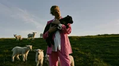
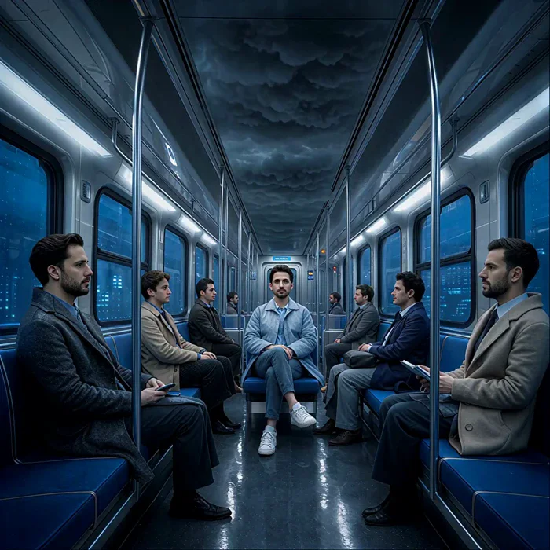
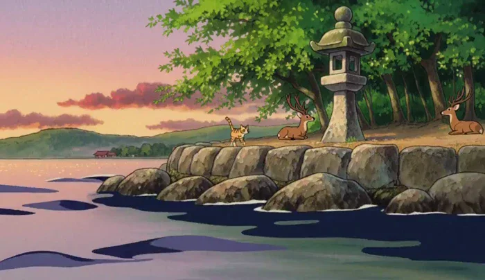
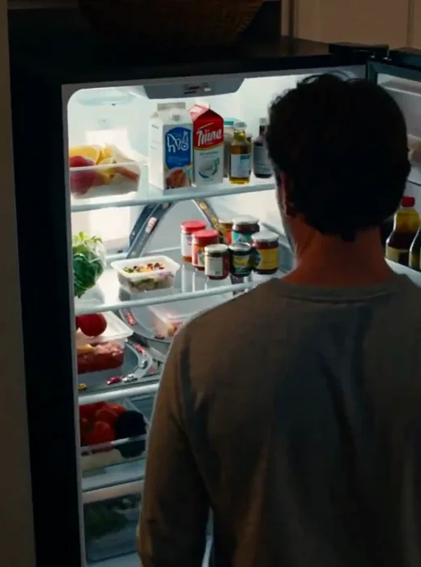
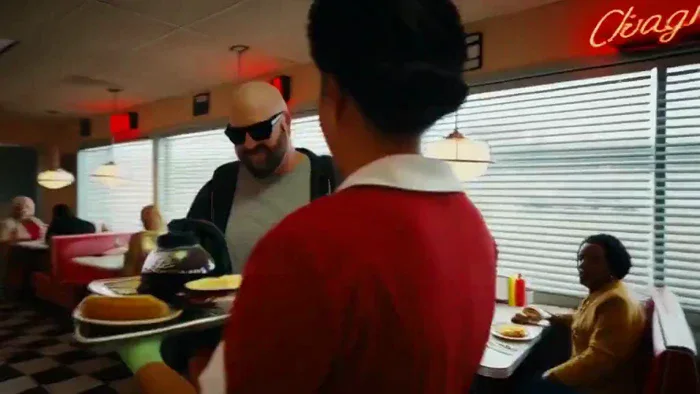
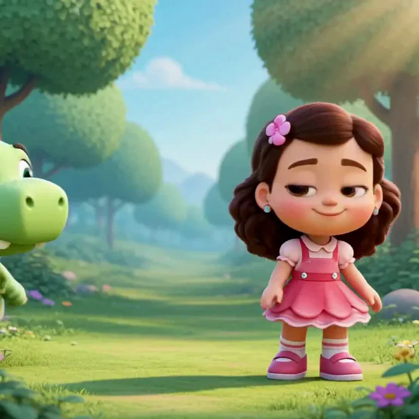

[← Back to the full index](../README.md#table-of-contents) · [English](video-extend-edit.md) · [简体中文](video-extend-edit.zh-CN.md) · [日本語](video-extend-edit.ja.md)

### Video Extend & Edit (视频延长和编辑)

- [Case 3: Lip-Synced Redub — Editing an Existing Clip (对口型改配音·视频编辑) — by MiniMax](#case-3)
- [Case 37: Cloud-Head Subway Transformation (地铁乘客云团变形) — by @AION_2077](#case-37)
- [Case 38: Adding Japanese Type to a Coastal Cycling Video (海岸骑行视频添加日文文字) — by @MireilleDartois](#case-38)
- [Case 68: A Ginger Cat Strolls Through Miyajima at Dusk (宫岛黄昏散步的橘猫) — by @sanasana0707](#case-68)
- [Case 69: A Miniature Highway Hidden Inside the Fridge (冰箱里的微型高速公路) — by @LikeToasters](#case-69)
- [Case 70: A Night in a 1990s American Diner (九十年代美式餐厅之夜) — by @NsitnovSitnov](#case-70)
- [Case 71: An 8-Bit Girl Walks a Sunny Path (八位像素少女漫步阳光小径) — by @albertgao](#case-71)
- [Case 72: A Five-Second Greeting from an Anime Idol (日系偶像的五秒问候) — by @riddi0908](#case-72)

### Case 3: Lip-Synced Redub — Editing an Existing Clip (对口型改配音·视频编辑) — by MiniMax

▶ [Watch the full video on ofox.ai](https://ofox.ai/hailuo-3-prompts?utm_source=github&utm_medium=case&utm_campaign=awesome-ai-video-prompts#case-3)

**输入素材**（1 段视频，只取首帧）

| | | | |
|:---:|:---:|:---:|:---:|
|  video1 source clip pink suit lamb |  |  |  |

<strong>Prompt</strong> — subject_definitions: &lt;Subject 1&gt; is the young man with short wavy blonde hair, wearing a bright pink suit jacket, matching pink trousers, an unbuttone…

~~~~text
subject_definitions:
<Subject 1> is the young man with short wavy blonde hair, wearing a bright pink suit jacket, matching pink trousers, an unbuttoned white shirt, and silver rings, holding a small black lamb in his arms in <Video 1>.
<Video 1> is the source video for the editing task.
<Audio 1> is the synchronized audio track of <Video 1>, providing the background music.
<Audio 2> is the voice timbre reference for <Subject 1>'s voice, containing a spoken male voiceover.

summary:
[video editing + audio reference + audio reuse] The target video is an edited version of <Video 1>. <Subject 1>, wearing a bright pink suit and holding a black lamb, stands in a grassy field with other white lambs in the background. The edit animates <Subject 1>'s face to speak the user-provided dialogue. <Audio 1> is partially reused as the continuous background music, while the target references the calm male voice timbre of <Audio 2> for <Subject 1>'s spoken lines.

retention_analysis:
<Subject 1> (appears in [Shot 1]): fully_preserved - the man retains his identity, wavy blonde hair, pink suit, white shirt, accessories, and the black lamb he holds, with his mouth newly animated to speak.
<Video 1> (source video editing): fully_preserved - the original camera framing, warm golden hour lighting, grassy hill setting, and background white lambs are maintained while the central character is edited.
<Audio 1>: partially_copy - the atmospheric background music from <Audio 1> is reused in the target video, mixed beneath the newly added spoken dialogue.
<Audio 2>: reference - the target audio references the male voice timbre from <Audio 2> to generate <Subject 1>'s spoken dialogue.

detailed_description:
The target video is in realistic photographic style.
[Shot 1] The shot begins from the source <Video 1>, showing <Subject 1>, a young man with short wavy blonde hair, wearing a bright pink suit jacket, matching pink trousers, and a casually unbuttoned white shirt. He stands confidently in a sunlit green pasture, gently holding a small black lamb securely in his arms. The warm, golden hour lighting casts soft shadows across his face and the bright pink fabric of his suit. Behind him, several white lambs stand and graze on the rolling grassy hill against a clear, pale blue sky. The atmospheric background music from <Audio 1> plays continuously throughout the scene. <Subject 1> physically speaks, his mouth movements naturally syncing to the new dialogue, with his voice timbre referencing the calm male delivery from <Audio 2>. Looking thoughtfully forward, <Subject 1> (S1) speaks softly, <d>[English] Follow the wind, live free.</d> As he delivers the line, he subtly shifts his weight, cradling the resting black lamb while the camera slowly pushes in. <Subject 1> (S1) continues his thought, <d>[English] Leave worries behind, enjoy the moment.</d> Exactly as his voice stops, his lips meet in a relaxed, peaceful smile, and his jaw ceases speaking motion. He then turns his gaze slightly away toward the horizon, gently stroking the black lamb's fleece with his fingers as the camera holds on this tranquil, sunlit state through the end of the video.

overall_soundscape:
The soundscape consists of the continuous, atmospheric background music from <Audio 1>, overlaid with the clear, calm male dialogue spoken by the main character, referencing the voice timbre of <Audio 2>.

non_diegetic_music:
The atmospheric, sustained background music from <Audio 1> is reused as the continuous score, playing quietly beneath the spoken dialogue.
~~~~

**参数**：MiniMax H3 · MiniMax（HuggingFace 官方仓库 H3-Base 768p 复现脚本自跑） · ref2va（视频编辑 + 语音音色参考） · 5s · 768p · auto · 带音频
**来源**：MiniMax 官方 HuggingFace 模型卡 · [source](https://huggingface.co/MiniMaxAI/MiniMax-H3/blob/main/scripts/readme/reproducible-768p-ref2va-request.sh)

MiniMax 官方示例 · HuggingFace MiniMax-H3 模型卡 Ref2VA 复现脚本 · 源视频来自 MiniMax 官方素材库 cdn.hailuoai.com · 另有一段语音音色参考音频未在页面内展示（见脚本 conditions）

[Back to top](#table-of-contents)

### Case 37: Cloud-Head Subway Transformation (地铁乘客云团变形) — by @AION_2077

▶ [Watch the full video on ofox.ai](https://ofox.ai/hailuo-3-prompts?utm_source=github&utm_medium=case&utm_campaign=awesome-ai-video-prompts#case-37)

**输入素材**：未公开 —— 本案例未收录可用的输入素材，请参阅来源

<strong>Prompt</strong> — integrated_multimodal_description: [Shot 1] Surreal live-action cinematic imagery in a symmetrical square deep-focus wide shot inside the same modern …

~~~~text
integrated_multimodal_description: [Shot 1] Surreal live-action cinematic imagery in a symmetrical square deep-focus wide shot inside the same modern subway carriage established by <Picture 1>. At the beginning, the same seated passengers occupy the exact same seats with the same bodies, clothing, poses, hands, phones, bags, spacing, and calm commuter behavior, but every passenger has a distinct, anatomically normal human head and natural human face; the ceiling above them is ordinary dim stormy condensation without the giant eye. The camera holds a completely static shot for the entire video. From 00:01.600 to 00:02.700, a thin horizontal digital phase glitch sweeps across the carriage with brief RGB channel separation and blocky temporal displacement restricted to the passengers' heads; their normal human heads transform into compact volumetric storm clouds while their necks, bodies, clothing, hands, and positions remain perfectly unchanged. From 00:02.700 to 00:03.450, the interference reverses and restores the same normal, stable human faces. From 00:03.450 to 00:05.550, two faster synchronized glitch pulses alternate every head between the same normal human face and its cloud form, with no body movement, no face melting, and no change to the carriage geometry. From 00:05.550 onward, a final sustained digital stutter locks the passengers into their distinct cloud-headed states: lightning flickers inside the left foreground cloud, warm light glows inside the left midground cloud, rain falls beneath the small dark cloud, a faint rainbow forms in the right-center cloud, and a small sun glows inside the right foreground cloud. Fine luminous mist rises from the central cloud and resolves into the huge pale cloud face and single open eye overhead. The glitches settle, all motion becomes nearly still, and at exactly 8.00 seconds the passenger count, cloud shapes, body poses, wardrobe, seats, poles, windows, lighting, colors, crop, ceiling apparition, and full composition converge precisely to <Picture 1>. No cuts, no camera movement, no zoom, no pan, no tilt, no roll, no shake, no body morphing, no extra people, no missing passengers, no fused limbs, no wardrobe changes, no seat changes, no floating bodies, no text, no subtitles, no logos, and no drift from the final reference image.

overall_soundscape: A steady low subway rumble, muted wheel rhythm, and soft ventilation hum continue throughout. Each transformation is marked by a brief dry digital stutter and electrical crackle, while the final cloud state adds faint rain, distant thunder, and a soft airy hiss without overpowering the train ambience.

non_diegetic_music: N/A
~~~~

**参数**：MiniMax H3 · 未标注 · ref2va · 8s · 未标注 · 未标注 · 带音频
**来源**：@AION_2077 · [原帖](https://x.com/AION_2077/status/2086595652692427042)

Preview © 2026 @AION_2077 · Prompt by @AION_2077

[Back to top](#table-of-contents)

### Case 38: Adding Japanese Type to a Coastal Cycling Video (海岸骑行视频添加日文文字) — by @MireilleDartois

▶ [Watch the full video on ofox.ai](https://ofox.ai/hailuo-3-prompts?utm_source=github&utm_medium=case&utm_campaign=awesome-ai-video-prompts#case-38)

**输入素材**：未公开 —— 本案例未收录可用的输入素材，请参阅来源

<strong>Prompt</strong> — Video editing, add texts into the &lt;Video 1&gt; while keep the layout, expressions, movement, color in &lt;Video 1&gt;. The bold white sans-serif word "この世界は" a…

~~~~text
Video editing, add texts into the <Video 1> while keep the layout, expressions, movement, color in <Video 1>. 
The bold white sans-serif word "この世界は" and "アシンメトリック" snaps upward individually behind the girl driving bicycle and in front of background in sync with the timing of the <Audio 1> audio track titled <d>[Japanese] この世界はアシンメトリック</d>.
~~~~

**参数**：MiniMax H3 · 未标注 · ref2va · 未标注 · 未标注 · 未标注 · 带音频
**来源**：@MireilleDartois · [原帖](https://x.com/MireilleDartois/status/2090620553640198394)

Preview © 2026 @MireilleDartois · Prompt by @MireilleDartois

[Back to top](#table-of-contents)

### Case 68: A Ginger Cat Strolls Through Miyajima at Dusk (宫岛黄昏散步的橘猫) — by @sanasana0707

▶ [Watch the full video on ofox.ai](https://ofox.ai/hailuo-3-prompts?utm_source=github&utm_medium=case&utm_campaign=awesome-ai-video-prompts#case-68)

**输入素材**：未公开 —— 本案例未收录可用的输入素材，请参阅来源

<strong>Prompt</strong> — Style &amp; Visual Direction:Classic 90s Japanese anime aesthetic, Hand-drawn anime style, Studio Ghibli-inspired warm tone, cel-shaded texturing, vibrant…

~~~~text
Style & Visual Direction:Classic 90s Japanese anime aesthetic, Hand-drawn anime style, Studio Ghibli-inspired warm tone, cel-shaded texturing, vibrant golden hour twilight lighting, soft painted backgrounds, natural fluid animation, high quality, masterpiece.
Scene Overview:A calm, peaceful afternoon on Miyajima Island. A ginger tabby cat wanders past the iconic floating Great Torii Gate standing in the serene water, enjoying a quiet stroll along the coastal stone path as deer rest nearby.

Storyboard (8-Second Sequence):
[0s-2s] Shot 1: Medium wide shot. The ginger tabby cat walks gracefully along the ancient stone lantern pathway near the shore, tail gently swaying. In the background, a friendly Miyajima deer rests peacefully under a maple tree.

[2s-4.5s] Shot 2: Tracking shot. Low-angle side camera following the cat as it steps smoothly along the stone path. The iconic red Torii Gate is visible across the calm, shimmering water under a soft orange and pink sky.

[4.5s-6.5s] Shot 3: Close-up shot. The cat pauses, turns its head toward the sea, and blinks slowly with curious amber eyes as the soft evening breeze rustles its fur.

[6.5s-8s] Shot 4: Wide cinematic shot. The cat sits next to a classic stone lantern, gazing out at the floating Torii Gate reflected in the gently rippling tide.

Camera:Smooth cinematic tracking, gentle pan and low-angle follow, clean cuts between shots on the natural beats.

Audio:Gentle ocean waves lapping against the shore, quiet rustling leaves, soft ambient wind chimes, peaceful low piano melody carrying through to the end.

Negative Prompts:No live-action photo style, no 3D CGI rendering, no text, no subtitles, no logos, no watermarks, no distorted anatomy, no abrupt jittery motion.
~~~~

**参数**：MiniMax H3 · 未标注 · t2va · 8s · 未标注 · 未标注 · 带音频
**来源**：@sanasana0707 · [原帖](https://x.com/sanasana0707/status/2086839288025710776)

Preview © 2026 @sanasana0707 · Prompt by @sanasana0707

[Back to top](#table-of-contents)

### Case 69: A Miniature Highway Hidden Inside the Fridge (冰箱里的微型高速公路) — by @LikeToasters

▶ [Watch the full video on ofox.ai](https://ofox.ai/hailuo-3-prompts?utm_source=github&utm_medium=case&utm_campaign=awesome-ai-video-prompts#case-69)

**输入素材**：未公开 —— 本案例未收录可用的输入素材，请参阅来源

<strong>Prompt</strong> — integrated_multimodal_description Shot 1 A realistic suburban kitchen at night. A man casually walks to the refrigerator and opens the door. The camer…

~~~~text
integrated_multimodal_description

Shot 1 A realistic suburban kitchen at night. A man casually walks to the refrigerator and opens the door. The camera starts just behind his shoulder and slowly pushes closer as bright refrigerator light illuminates his confused face.
Inside the refrigerator is an incredibly detailed miniature highway network integrated naturally between the food. Several lanes of tiny moving cars weave between milk cartons, jars, leftovers, vegetables, and drink bottles. Tiny headlights and brake lights glow realistically.
The camera moves closer into the refrigerator interior as if entering this tiny world.

A miniature traffic jam forms beside a tipped container leaking orange juice across one lane like a flooded roadway. Tiny construction vehicles arrive. Small workers in reflective clothing place cones and redirect traffic around the spill.

A tiny tow truck pulls a stalled car away. Another vehicle honks impatiently. Cars merge aggressively around a yogurt container.

The man slowly reaches one hand toward the highway. Several tiny cars immediately slam on their brakes. A miniature police officer begins angrily waving at his enormous finger to move away.

The man freezes, completely baffled.

The camera finishes extremely close to the refrigerator highway as traffic starts moving again around his stationary finger.

overall_soundscape

Quiet kitchen ambience, refrigerator hum, refrigerator door opening, tiny engines, miniature car horns, distant tiny sirens, construction equipment, subtle liquid splashing from the orange juice spill.

non_diegetic_music

None.
~~~~

**参数**：MiniMax H3 · 未标注 · t2va · 10s · 未标注 · 未标注 · 带音频
**来源**：@LikeToasters · [原帖](https://x.com/LikeToasters/status/2086603936736170082)

Preview © 2026 @LikeToasters · Prompt by @LikeToasters

[Back to top](#table-of-contents)

### Case 70: A Night in a 1990s American Diner (九十年代美式餐厅之夜) — by @NsitnovSitnov

▶ [Watch the full video on ofox.ai](https://ofox.ai/hailuo-3-prompts?utm_source=github&utm_medium=case&utm_campaign=awesome-ai-video-prompts#case-70)

**输入素材**：未公开 —— 本案例未收录可用的输入素材，请参阅来源

<strong>Prompt</strong> — Photorealistic cinematic 1990s American diner — red vinyl booths, neon signs, chrome details, checkerboard floor, soft window light mixed with warm pr…

~~~~text
Photorealistic cinematic 1990s American diner — red vinyl booths, neon signs, chrome details, checkerboard floor, soft window light mixed with warm practicals, subtle handheld texture, heavy film grain. Modern realism with precise temporal control.

Use the provided reference image as the exact character lock for the bald bearded man in black sunglasses and dark hoodie. Maintain identical facial structure, beard, head shape, skin texture and clothing at all times.

0-3s: [Medium Wide] The bald man rises from a red vinyl booth, turns, and collides hard into a waitress carrying a full breakfast tray (eggs, bacon, toast, coffee pot). Sudden, physical impact.

3-8s: [Dynamic Orbit into Super Slow-Motion] The collision detonates. Tray, plates, eggs, bacon and coffee pot explode upward; coffee erupts into long liquid ribbons and suspended droplets. Camera orbits the impact as time locks completely at the peak of the spill. Every face freezes in shock. Only the bald man still moves — one beat of a clear "I messed up" expression, then he calmly plucks two bacon strips and a fried egg out of the floating debris.

8-12s: [Tracking Shot] Still inside the frozen diner, he walks toward the exit taking deliberate bites of bacon, then egg. Patrons, waitress and flying food stay perfectly suspended mid-air.

12-15s: [Medium Shot into Medium Close-Up] His hand touches the door — time snaps back to full speed and everything crashes down at once: plates, eggs, tray and coffee slam to the floor in loud chaos as the patrons jolt into real-time shock. He pauses, glances back over his shoulder, raises his eyebrows and gives a small "it is what it is" shrug with a quiet half-smile, still holding the food.

Photorealistic, ultra-detailed fluid and object physics, correct volume and surface tension on liquids, motion blur only on moving elements, stable character identity, cinematic lighting, heavy natural film grain, no artifacts, movie-level temporal coherence.
~~~~

**参数**：MiniMax H3 · 未标注 · ref2va · 15s · 未标注 · 未标注 · 带音频
**来源**：@NsitnovSitnov · [原帖](https://x.com/NsitnovSitnov/status/2085329351915000274)

Preview © 2026 @NsitnovSitnov · Prompt by @NsitnovSitnov

[Back to top](#table-of-contents)

### Case 71: An 8-Bit Girl Walks a Sunny Path (八位像素少女漫步阳光小径) — by @albertgao

▶ [Watch the full video on ofox.ai](https://ofox.ai/hailuo-3-prompts?utm_source=github&utm_medium=case&utm_campaign=awesome-ai-video-prompts#case-71)

**输入素材**：未公开 —— 本案例未收录可用的输入素材，请参阅来源

<strong>Prompt</strong> — "A cute little girl walks through a sunny forest when a small, friendly dinosaur steps out, waves, and says hi. Suddenly, the dinosaur sneezes—and a s…

~~~~text
"A cute little girl walks through a sunny forest when a small, friendly dinosaur steps out, waves, and says hi. Suddenly, the dinosaur sneezes—and a shower of colorful butterflies bursts from its nose. They both laugh. Cute, colorful animated style."

- time: 15min ish
- 768x768
~~~~

**参数**：MiniMax H3 · 未标注 · 未标注 · 5s · 未标注 · 未标注 · 带音频
**来源**：@albertgao · [原帖](https://x.com/albertgao/status/2085137397134561487)

Preview © 2026 @albertgao · Prompt by @albertgao

[Back to top](#table-of-contents)

### Case 72: A Five-Second Greeting from an Anime Idol (日系偶像的五秒问候) — by @riddi0908

▶ [Watch the full video on ofox.ai](https://ofox.ai/hailuo-3-prompts?utm_source=github&utm_medium=case&utm_campaign=awesome-ai-video-prompts#case-72)

**输入素材**：未公开 —— 本案例未收录可用的输入素材，请参阅来源

<strong>Prompt</strong> — プロンプト置いときます✋ Japanese anime style, high-end TV anime production quality, soft pastel lighting, clean line art, subtle cel shading, bright and cheerful…

~~~~text
プロンプト置いときます✋

Japanese anime style, high-end TV anime production quality, soft pastel lighting, clean line art, subtle cel shading, bright and cheerful idol stage atmosphere, glowing lens flare, gentle bokeh in background, smooth vibrant 60fps animation feel.

Scene overview: An adorable anime idol girl stands center stage, looking directly at the camera with a brilliant smile. She holds a colorful microphone, energetic and joyful, giving a cute greeting to her fans. A short, charming 5-second anime idol greeting scene.

Storyboard:
[0s-1.5s] Shot 1: Medium close-up: The idol girl steps forward with a big smile, bringing the microphone to her mouth, blinking playfully as stage lights twinkle behind her.
[1.5s-3.5s] Shot 2: Close-up on her face: She speaks clearly into the microphone with precise lip-sync: "みんな、こんにちは！今日も一緒に楽しもうね！" (Minna, konnichiwa! Kyou mo issho ni tanoshimou ne!). She winks on "tanoshimou ne!".
[3.5s-5s] Shot 3: Slightly pulled-back medium shot: She strikes a cute victory-pose/heart-pose with her free hand, tilting her head with a beaming smile as sparkle particles drift around her.

Camera: Smooth pan-in at the start, staying centered and static during the lip-sync for maximum clarity, subtle handheld bounce on the final pose at 3.5s.

Audio: Crisp female anime idol voice clearly pronouncing "みんな、こんにちは！今日も一緒に楽しもうね！" in Japanese. Underneath, an upbeat synth-pop idol BGM playing, accompanied by a soft microphone "pop" sound at 0.5s and a sparkling magic SFX hit at 3.5s during the pose.

No real-life live action rendering, no realistic skin texture, no 3D CG look, no English subtitles or on-screen text clutter, keep the pure 2D anime aesthetic.
~~~~

**参数**：MiniMax H3 · 未标注 · ref2va · 5s · 未标注 · 未标注 · 带音频
**来源**：@riddi0908 · [原帖](https://x.com/riddi0908/status/2084233895202197998)

Preview © 2026 @riddi0908 · Prompt by @riddi0908

[Back to top](#table-of-contents)
