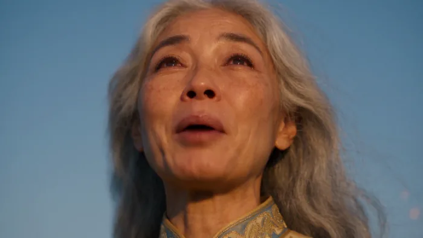
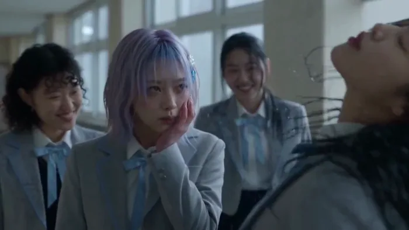
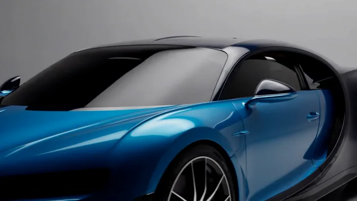
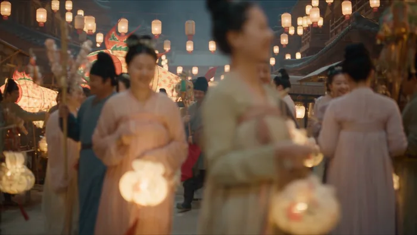

[← モデル一覧に戻る](../../README.ja.md) · [English](README.md) · [简体中文](README.zh-CN.md) · [日本語](README.ja.md)

# Seedance 2.5

ByteDance Seedance 2.5 の事例 92 件。すべてプロンプト全文・パラメータ・再生できる出力付き（公式 24 件、コミュニティ 53 件、自社実行 15 件は請求額付き）。[Ofox](https://ofox.ai/seedance-2-5-prompts?utm_source=github&utm_medium=readme&utm_campaign=awesome-seedance-2-5) 経由で実行・整理。

## Seedance 2.5 とは

Seedance 2.5 は ByteDance のテキスト生成動画・画像生成動画モデルです。4〜30秒のクリップを最大 1080p、8種類のアスペクト比で生成でき、音声は既定でオンになっています。今は [Ofox の動画API](https://ofox.ai/models/bytedance/seedance-2.5?utm_source=github&utm_medium=readme&utm_campaign=awesome-seedance-2-5) から直接呼び出せます —— 上流プロバイダーに直接申し込む場合と違い、中国法人や中国の電話番号は不要です。

```bash
curl -X POST https://api.ofox.ai/v1/videos \
  -H "Authorization: Bearer $OFOX_API_KEY" \
  -H "Content-Type: application/json" \
  -d '{"model":"bytedance/seedance-2.5","prompt":"A neon-lit Tokyo alley at night, cinematic dolly-in, rain reflections","duration":10,"resolution":"1080p","aspect_ratio":"16:9"}'
# -> {"id": "..."}; "status" が "completed" になるまで GET /v1/videos/{id} をポーリング
```

パラメータ・エラーコードの詳細: [Ofox 動画API ドキュメント](https://ofox.ai/docs/api/videos?utm_source=github&utm_medium=readme&utm_campaign=awesome-seedance-2-5)。APIキーの取得: [app.ofox.ai](https://app.ofox.ai?utm_source=github&utm_medium=readme&utm_campaign=awesome-seedance-2-5)。

## 料金

Ofox における Seedance 2.5 の秒単価、2026年8月時点（出典: [ofox.ai/models/bytedance/seedance-2.5](https://ofox.ai/models/bytedance/seedance-2.5?utm_source=github&utm_medium=readme&utm_campaign=awesome-seedance-2-5) —— 特に「期間限定」の 1080p 料金は変わる可能性があるため、正確な数字が必要な場合は必ず最新のページを確認してください):

| 解像度 | テキスト生成動画 (t2v) | 動画生成動画 (v2v) |
|---|---|---|
| 480p | $0.11/s | $0.14/s |
| 720p | $0.24/s | $0.30/s |
| 1080p | $0.48/s (通常 $0.60/s、期間限定価格) | $0.568/s (通常 $0.71/s) |

- 長さ: 4〜30秒の任意の整数。
- アスペクト比: 21:9 / 16:9 / 4:3 / 1:1 / 3:4 / 9:16 / adaptive。
- 音声は既定でオンで、上記の秒単価に含まれており別途課金されません。

この表は実行**前**の見積もりに使います。以下の各カテゴリファイルにある自分で実行した事例の「費用」欄は、この表からの見積もりではなく、そのジョブで実際に請求された金額であり、同じ行に課金対象の job id を併記しているため、どの金額も個々の API 呼び出しまで追跡できます —— [`CASE_TEMPLATE.md`](../../CASE_TEMPLATE.md) を参照してください。

<a id="table-of-contents"></a>
<a id="table-of-contents"></a>

## 目次

| | カテゴリ | 事例数 |
|:---:|---|---:|
| <a href="cases/short-drama.ja.md"></a> | [ショートドラマ Short Drama](cases/short-drama.ja.md) | 15 |
| <a href="cases/anime-drama.ja.md"></a> | [アニメドラマ Anime Drama](cases/anime-drama.ja.md) | 11 |
| <a href="cases/ad-creative.ja.md"></a> | [クリエイティブ広告 Ad Creative](cases/ad-creative.ja.md) | 7 |
| <a href="cases/product-video.ja.md"></a> | [ECサイト商品動画 Product Video](cases/product-video.ja.md) | 7 |
| <a href="cases/talking-head.ja.md"></a> | [トーキングヘッド・デジタルヒューマン Talking Head](cases/talking-head.ja.md) | 3 |
| <a href="cases/ugc-ads.ja.md"></a> | [UGC風広告 UGC Ads](cases/ugc-ads.ja.md) | 6 |
| <a href="cases/shorts-reels.ja.md"></a> | [ショート動画・リール Shorts & Reels](cases/shorts-reels.ja.md) | 14 |
| <a href="cases/product-demo.ja.md"></a> | [製品デモ Product Demo](cases/product-demo.ja.md) | 5 |
| <a href="cases/keyframe-animation.ja.md"></a> | [開始・終了フレームアニメーション Keyframe Animation](cases/keyframe-animation.ja.md) | 3 |
| <a href="cases/video-extend-edit.ja.md"></a> | [動画延長・編集 Video Extend & Edit](cases/video-extend-edit.ja.md) | 11 |
| <a href="cases/image-edit.ja.md"></a> | [画像編集・リタッチ Image Edit](cases/image-edit.ja.md) | 2 |
|  | [商品メイン画像・ポスター Product Image](cases/product-image.ja.md) | 0 |
| <a href="cases/music-video.ja.md"></a> | [ミュージックビデオ Music Video](cases/music-video.ja.md) | 5 |
| <a href="cases/explainer.ja.md"></a> | [解説動画 Explainer](cases/explainer.ja.md) | 3 |
