[← 総目次に戻る](../README.ja.md#table-of-contents) · [English](ad-creative.md) · [简体中文](ad-creative.zh-CN.md) · [日本語](ad-creative.ja.md)

### クリエイティブ広告 Ad Creative

- [Case 12: Fruit biscuit commercial (果味饼干广告片) — by ByteDance](#case-12)
- [Case 13: Steampunk 30-second motion graphics (蒸汽朋克 30 秒 3D 动态图形序列) — by ByteDance](#case-13)
- [Case 14: Crimson-studio noodle commercial (绯红影棚拉面广告) — by @AIwithSynthia](#case-14)
- [Case 15: Impossible warrior fashion editorial (不可能战士时尚大片) — by @charaspowerai](#case-15)
- [Case 1005: Running shoe, dust on landing (跑鞋 · 落地扬尘) — by Ofox Team](#case-1005)
- [Case 1006: YUNQI sparkling oolong (YUNQI 气泡乌龙茶) — by Ofox Team](#case-1006)
- [Case 1007: AURA serum, one drop in the afternoon (AURA 精华油 · 午后一滴) — by Ofox Team](#case-1007)
- [Case 78: Six Overenthusiastic Tutors (六位金牌导师的招生秀) — by @johnAGI168](#case-78)
- [Case 87: A Parisian Breeze Around a Kelly Bag (风经过巴黎：Kelly 手袋广告) — by @johnAGI168](#case-87)

### Case 12: Fruit biscuit commercial (果味饼干广告片) — by ByteDance

<a href="https://ofox.ai/seedance-2-5-prompts?utm_source=github&utm_medium=case&utm_campaign=awesome-seedance-2-5#case-12">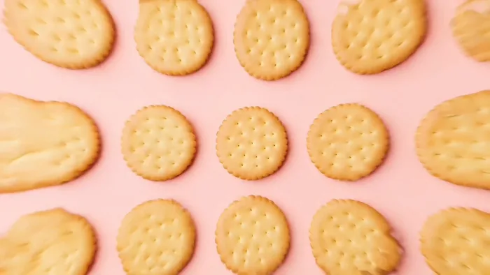</a>

▶ [ofox.ai で動画をすべて見る](https://ofox.ai/seedance-2-5-prompts?utm_source=github&utm_medium=case&utm_campaign=awesome-seedance-2-5#case-12)

**输入素材**（1 张官方参考图 + 6 段参考视频，视频只取首帧）

| | | | |
|:---:|:---:|:---:|:---:|
| 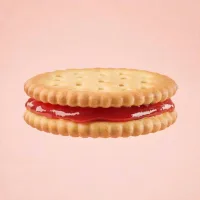 @图像1 · 草莓味 |  @视频1 首帧 | 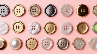 @视频2 首帧 | 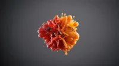 @视频3 首帧 |
| 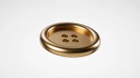 @视频4 首帧 | 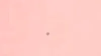 @视频5 首帧 | 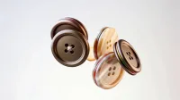 @视频6 首帧 |  |

<strong>Prompt</strong> — 明亮多彩的广告片风格，果味饼干为主角，包含草莓、苹果、葡萄、橙子四种口味，草莓味参考@图像1，饼干与对应水果以强秩序感的几何阵列排布，整体画面干净、高级、节奏强。开场水果快速建立视觉聚焦，参考@视频1的构图，音乐重拍切入。随后不同口味饼干整齐排列，切特写，参考@视频2的动态和运镜。高潮段一块饼干被折…

~~~~text
明亮多彩的广告片风格，果味饼干为主角，包含草莓、苹果、葡萄、橙子四种口味，草莓味参考@图像1，饼干与对应水果以强秩序感的几何阵列排布，整体画面干净、高级、节奏强。开场水果快速建立视觉聚焦，参考@视频1的构图，音乐重拍切入。随后不同口味饼干整齐排列，切特写，参考@视频2的动态和运镜。高潮段一块饼干被折断，瞬间进入慢动作，果味夹心爆开，碎屑飞溅，果汁感与颗粒冲击被放大展示，参考@视频3的冲击感。横向阵列，形成节奏抛物感，参考@视频4的运动，突出秩序美感与产品丰富度。随后迅速回到快节奏剪辑。结尾英文文字 One bite of crispness, a heart full of delight 快速分词切换入画，配合强节奏文字运动与产品定格，参考@视频5，最终品牌感收束，饼干和水果向四周发散，参考@视频6画面充满年轻、活力、好吃、想分享的广告氛围。
~~~~

**参数**：Seedance 2.5 · 火山方舟 · r2v · 15s（API 示例值；页面成片实测 26.3s）· 未标注 · 16:9 · 带音频
**来源**：火山方舟官方文档 · [中文](https://docs.volcengine.com/docs/82379/2607688?lang=zh) · [English](https://docs.byteplus.com/en/docs/ModelArk/2607688)

Preview frame © 2026 ByteDance, from the official demo video · Prompt by ByteDance · <a href="https://docs.volcengine.com/docs/82379/2607688?lang=zh">source</a>

[目次に戻る](#table-of-contents)

### Case 13: Steampunk 30-second motion graphics (蒸汽朋克 30 秒 3D 动态图形序列) — by ByteDance

▶ [ofox.ai で動画をすべて見る](https://ofox.ai/seedance-2-5-prompts?utm_source=github&utm_medium=case&utm_campaign=awesome-seedance-2-5#case-13)

**输入素材**（1 张官方参考图）

| |
|:---:|
| 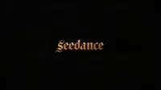 @图像1 · logo |

<strong>Prompt</strong> — 一段高级、极具电影感的30秒3D动态图形序列，采用精致的蒸汽朋克与复古微缩景观风格，配合连续流畅的环绕与穿透运镜。 [0-10秒]： 古董黄铜钟面微距特写，奇迹般层层展开为相互啮合的旋转齿轮环与体积雾。镜头向下穿透齿轮，一架机械扑翼机（Ornithopter），正从由做旧古籍堆叠而成的微缩峡谷中盘旋…

~~~~text
一段高级、极具电影感的30秒3D动态图形序列，采用精致的蒸汽朋克与复古微缩景观风格，配合连续流畅的环绕与穿透运镜。 [0-10秒]： 古董黄铜钟面微距特写，奇迹般层层展开为相互啮合的旋转齿轮环与体积雾。镜头向下穿透齿轮，一架机械扑翼机（Ornithopter），正从由做旧古籍堆叠而成的微缩峡谷中盘旋升空。 [10-20秒]： 镜头跟随扑翼机的轨迹向前滑行，无缝穿透入一个高速旋转的华丽黄铜幻影箱（Zoetrope），内部投射出飞驰的机械骏马动态光影。光影跃出箱体，场景瞬间化为一辆黄铜质感悬浮缆车，正沿着微光铜轨穿梭于机械齿轮森林，沐浴着电影级的黄金时刻光线。 [20-30秒]： 镜头优雅向下平移，缆车下方出现一艘精美的发条木制机械帆船，在深蓝色玻璃材质的起伏海浪中破浪前行。海浪尽头无缝演变为一轮发光巨月，一群举着摇曳提灯的探险者剪影，正沿着星空下的水晶矿脉山脊艰难跋涉。镜头平滑螺旋拉远，穿过空灵云朵，回到滴答作响的宏大黄铜钟面。最后一秒出现 logo，参考@图像1。 技术规格： 超写实机械纹理，丰富黄铜与金色调，电影级浅景深。平滑连贯的无缝穿梭运镜，极强的史诗感与奇幻冒险氛围。
~~~~

**参数**：Seedance 2.5 · 火山方舟 · r2v · 30s · 720p（Ark 默认，未显式设置）· 16:9 · 带音频
**来源**：火山方舟官方文档 · [中文](https://docs.volcengine.com/docs/82379/2607688?lang=zh) · [English](https://docs.byteplus.com/en/docs/ModelArk/2607688)

Preview frame © 2026 ByteDance, from the official demo video · Prompt by ByteDance · <a href="https://docs.volcengine.com/docs/82379/2607688?lang=zh">source</a>

[目次に戻る](#table-of-contents)

### Case 14: Crimson-studio noodle commercial (绯红影棚拉面广告) — by @AIwithSynthia

▶ [ofox.ai で動画をすべて見る](https://ofox.ai/seedance-2-5-prompts?utm_source=github&utm_medium=case&utm_campaign=awesome-seedance-2-5#case-14)

<strong>Prompt</strong> — Style: Bold high-energy food commercial cinematography, 8K photorealistic, deep crimson-red studio backdrop, dramatic dynamic splash effects, glossy v…

~~~~text
Style: Bold high-energy food commercial cinematography, 8K photorealistic, deep crimson-red studio backdrop, dramatic dynamic splash effects, glossy vibrant styling, fashion-editorial meets food-ad tone. 24fps, punchy fast-paced motion with slow-motion splash inserts, no jitter.
Character: A stylish young woman with double-bun hairstyle adorned with colorful beaded accents and ribbons, red tinted sunglasses, bold red lipstick, wearing a blue-and-black dragon-print traditional-style dress with a wide black belt. Confident, playful, high-fashion attitude.
Subject: A white ceramic bowl filled with rich reddish-brown broth, noodles, bok choy, lotus root slices, enoki mushrooms, and dumplings — dynamic splashing broth throughout.
Setting: A deep red studio backdrop with golden fan props framing the scene.
CUT 1 — Dynamic action shot, slow motion: She lifts chopsticks holding noodles high above the bowl, broth splashing dramatically upward with lotus root and bok choy suspended mid-air, confident smirk toward camera.
CUT 2 — Medium shot, seated pose: She sits cross-legged holding the bowl, chopsticks lifting noodles toward her mouth, red sunglasses catching studio light.
CUT 3  — Elegant seated pose, static hold: She leans back gracefully with legs crossed, bowl balanced in one hand, confident editorial gaze into camera.
CUT 4 — Medium shot, presenting pose: She holds the bowl forward toward camera with both hands, steam rising gently, inviting confident expression.
CUT 5  — Explosive splash shot, slow motion: Broth erupts upward in a dramatic arc as she reaches toward the bowl with chopsticks, lotus root and greens flying through the air in rich detail.
CUT 6  — Extreme dynamic splash shot, slow motion: A massive eruption of broth, noodles, and vegetables cascades around her in full-body motion, chopsticks raised triumphantly, golden fans framing the chaos.
CUT 7  — Action eating shot, slow motion: She lifts a large tangle of noodles from the steaming bowl with chopsticks, broth dripping and splashing at the edges, focused intense expression.
CUT 8 — Extreme close-up, dramatic splash: Broth splashes upward around her face as she peers over lowered sunglasses with wide, playful surprise, mouth open mid-reaction.
CUT 9 — Final hero shot, slow motion: She adjusts her sunglasses with one hand while broth splashes dynamically beside her, confident final pose against the deep red backdrop with golden fans in frame.
Camera: Fast dynamic handheld-style energy on splash shots, smooth static holds on posed shots, high-speed capture for slow-motion splash details.
Lighting: Bold saturated studio lighting, warm rim light on broth and steam, sharp contrast against the deep red backdrop.
Color palette: Crimson red, warm amber broth tones, deep indigo-blue dress pattern, gold accents.
Audio: Upbeat energetic instrumental with punchy percussion hits synced to splash moments, sizzling/broth-splash SFX, chopstick clicks, playful vocal ad-lib on the final reaction shot.
~~~~

**参数**：Seedance 2.5 · 未标注 · t2v · 未标注 · 未标注 · 未标注 · 带音频
**来源**：[@AIwithSynthia](https://x.com/AIwithSynthia) · [原帖](https://x.com/AIwithSynthia/status/2084852008448905417)

Preview © 2026 <a href="https://x.com/AIwithSynthia/status/2084852008448905417">@AIwithSynthia</a> · Prompt by <a href="https://x.com/AIwithSynthia/status/2084852008448905417">@AIwithSynthia</a>

[目次に戻る](#table-of-contents)

### Case 15: Impossible warrior fashion editorial (不可能战士时尚大片) — by @charaspowerai

<a href="https://ofox.ai/seedance-2-5-prompts?utm_source=github&utm_medium=case&utm_campaign=awesome-seedance-2-5#case-15">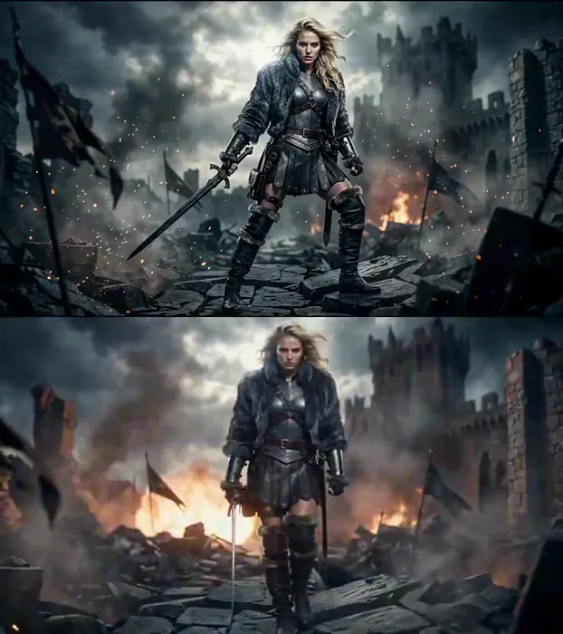</a>

▶ [ofox.ai で動画をすべて見る](https://ofox.ai/seedance-2-5-prompts?utm_source=github&utm_medium=case&utm_campaign=awesome-seedance-2-5#case-15)

**输入素材**：未公开 —— 原作者只发布了成片，未提供输入素材

<strong>Prompt</strong> — Use the provided image as the strict visual reference for the warrior’s face, blonde hair, armor, fur jacket, leather boots, sword, body proportions, …

~~~~text
Use the provided image as the strict visual reference for the warrior’s face, blonde hair, armor, fur jacket, leather boots, sword, body proportions, ruined battlefield, burning fortress, smoke, embers, and dark cinematic atmosphere. Preserve her identity and outfit throughout the entire sequence.

Create a 20-second impossible high-fashion warrior photoshoot, blending sensual confidence, brutal fantasy action, luxury editorial posing, explosive VFX, and aggressive cinematic camera work. The result must feel like a viral fashion campaign filmed in the middle of a medieval war.

0–4 seconds — Iconic opening pose
Begin with the exact composition of the reference image. The warrior stands on shattered stone, sword lowered beside her, staring directly into the lens. Her hair and fur move violently in the wind while embers spiral around her. The camera rushes toward her with a low-angle dolly-in. A powerful white flash freezes her pose, followed by a horizontal blue lens flare crossing her eyes and armor.

4–8 seconds — Fashion meets combat
She walks toward the camera with controlled, sensual confidence as explosions erupt behind her. Use rapid editorial cuts: close-up of her eyes, lips, hand tightening around the sword, fur texture, armored waist, boots crushing burning debris. She suddenly pivots and blocks an incoming blade from an unseen attacker. Sparks explode across the lens as the camera whip-pans around her.

8–12 seconds — Impossible action photoshoot
She launches into a fast spinning sword movement, cutting through smoke and shattered banners. Freeze her mid-motion in a dramatic fashion pose as dozens of camera flashes fire from impossible angles. Add elegant motion echoes, metallic silhouette trails, floating reflective shards, streaking embers, and anamorphic lens flares. Each flash captures a different powerful pose before snapping back into live action.

12–16 seconds — Sensual hero moment
The action suddenly slows. She plants the sword into the ground, steps close to the lens, and leans slightly forward with a fierce, provocative gaze. Wind sweeps her hair across her face while warm firelight shapes her silhouette. The camera performs a tight orbit around her body and rises into a close-up. A strong golden lens flare blooms behind her shoulder as ash drifts through the frame.

16–20 seconds — Epic viral finale
A massive explosion destroys part of the fortress behind her. Without looking back, she pulls the sword free and turns sharply toward the camera. Use an extreme speed ramp as she swings the blade directly past the lens, creating a seamless transition into three rapid flash-frozen editorial poses: sword over her shoulder, blade pointed downward, then a dominant frontal stance.

Finish on a slow-motion hero frame with the warrior standing perfectly centered, smoke and fire behind her, embers suspended in the air, her hair flowing, armor glowing along the edges, and a huge cinematic lens flare crossing the screen.

Ultra-premium fantasy fashion editorial, sensual but powerful warrior energy, impossible battlefield photoshoot, luxury magazine attitude, brutal sword choreography, low-angle camera, macro beauty shots, whip-pans, fast orbit movement, snap zooms, speed ramps, flash photography, freeze frames, motion echoes, metallic VFX, realistic fire and debris, dramatic anamorphic lens flares, realistic hair and fabric physics, no dialogue, no text, no subtitles, no identity drift, no wardrobe change, no facial deformation, no extra limbs.
~~~~

**参数**：Seedance 2.5 · 未标注 · i2v · 20s · 未标注 · 未标注 · 未标注
**来源**：[@charaspowerai](https://x.com/charaspowerai) · [原帖](https://x.com/charaspowerai/status/2083251609115468147)

Preview © 2026 <a href="https://x.com/charaspowerai/status/2083251609115468147">@charaspowerai</a> · Prompt by <a href="https://x.com/charaspowerai/status/2083251609115468147">@charaspowerai</a>

[目次に戻る](#table-of-contents)

### Case 1005: Running shoe, dust on landing (跑鞋 · 落地扬尘) — by Ofox Team

| 输入 | 输出 |
|:---:|:---:|
| 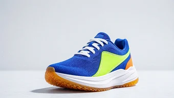 | <a href="https://ofox.ai/seedance-2-5-prompts?utm_source=github&utm_medium=case&utm_campaign=awesome-seedance-2-5#case-1005">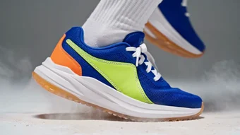</a> |

▶ [ofox.ai で動画をすべて見る](https://ofox.ai/seedance-2-5-prompts?utm_source=github&utm_medium=case&utm_campaign=awesome-seedance-2-5#case-1005)

<strong>Prompt</strong> — Begin with the exact composition of the reference image; the first frame is that image.  FORMAT: 20 seconds, wide landscape 16:9 following the referen…

~~~~text
Begin with the exact composition of the reference image; the first frame is that image.

FORMAT: 20 seconds, wide landscape 16:9 following the reference frame, 7 shots, a hard cut on every one of the six boundaries, no other kind of transition anywhere.
STYLE: athletic footwear commercial, 8K photoreal studio product cinematography, hyper-realistic engineered knit, foam and translucent rubber textures, real skin and real fabric; bright, fast and high-key throughout, high saturation and strong colour pop, everything crisp and airy with no deep shadow anywhere except the one clean contact shadow under the shoe.
COLOR PALETTE: bright pale grey seamless floor and background, electric cobalt blue, bright lime green, warm orange, clean white foam and white laces, translucent amber, and the pale neutral grey of fine dust in the light.
RUNNER: a woman in her late twenties, lean athletic build, dark hair pulled back tight into a high ponytail, plain matte black running shorts, a plain heather grey sleeveless training top, low plain white ankle socks on both feet, no jewellery, no watch, no wristband, nothing printed or embroidered on any garment. No person appears in the reference frame and no person is in shot for the first four seconds. The runner is described here in words only and is generated from this description; she arrives at 4 seconds and is built up from the feet upward across the clip, first as a foot, then as an ankle and two hands, then as a calf and a knee, and only once as a whole body at a distance. Her face is never turned toward the lens, never in focus and never in close-up at any point in the clip.
PRODUCT: the exact shoe in the reference image and no other. A modern low-profile running trainer in a bold high-saturation colourway: an electric cobalt blue engineered knit upper with a fine visible mesh weave, a bright lime green asymmetric side panel stitched with contrasting white thread, a warm orange heel counter, flat white round laces threaded through six pairs of eyelets, a thick chunky white foam midsole with a subtly sculpted sidewall, and a translucent amber rubber outsole with a deep fishscale tread pattern. The reference frame is the only authority on how this shoe looks, including its orientation in the opening and closing shots: the toe points to frame left and the heel sits at frame right, at a three-quarter angle, tilted just off the floor at the heel so a crisp shadow falls to the left. Every panel, seam, stitch line, eyelet and tread block stays exactly as it is in the reference frame for the whole clip. Do not restyle, recolour, reshape or redesign any part of it, and do not add a panel, a strip, a stripe, an overlay, a tab, a patch, a badge or a marking that is not already there.
SCENE: a bright pale grey seamless studio, floor and background the same tone with no visible join, no wall, no corner, no horizon, no prop, no furniture and no object of any kind other than the shoe and the runner. The light is clean high-key studio light: one large soft source above and slightly right giving crisp specular highlights on the white foam midsole and the translucent amber outsole, and a second fill from the left lifting the shadow side of the knit. Fine grey dust particles hang and drift in the air throughout, catching the light. The floor, the background, the two light sources and the shadow direction do not change at any point in the clip.

0-3s HOOK: hold the reference composition exactly. Medium product shot at shoe height, the single shoe centred on the bright floor, toe to frame left and heel to frame right, generous bright space all around it, the crisp contact shadow falling to the left. The camera is almost still, only the faintest slow push toward the shoe. The only movement in frame is fine grey dust drifting down through the light. No person, no foot and no hand is in frame. Sound: quiet studio room tone only, no music.
HARD CUT.
3-5.5s SHOWCASE A, the foot arrives: floor-level extreme close from the same side as the opening shot, the camera locked flat on the floor. The translucent amber outsole and the white foam midsole fill the lower half of frame, the knit upper fills the middle, and the collar and the tongue are above the top edge of frame and therefore out of shot. For the first second the shoe stands alone, unchanged and untouched. At 4 seconds a foot in a low plain white ankle sock enters fast from frame right, slides into the shoe in one clean motion, and the heel drops in and seats itself; the white foam compresses very slightly under the weight and the amber outsole presses flat and level against the floor. Only the foot and a few centimetres of bare ankle ever enter frame. Sound: the dry scuff of a sock against a knit lining, the soft knock of a heel seating, room tone.
HARD CUT.
5.5-8s SHOWCASE B, the laces: close on the lacing from above and slightly to the left, the shoe filling frame from the toe to the collar, the tongue running away from the lens and staying soft and unfocused. Two hands come in from the top of frame, take the crossed white lace bands on either side and pull them snug in one quick tug, then a second shorter tug; the knit upper draws in around the foot, the lace bands lift clear of the eyelets and settle back. Only two hands, the ankle and a short length of shin are ever in frame. Sound: the fast dry zip of round laces running through eyelets, two soft tugs, room tone.
HARD CUT.
8-10.5s CLIMAX A, the drive: low side tracking shot at ankle height, the camera travelling left and keeping pace. From a still stance the shoe loads: the white foam midsole compresses hard, the heel lifts, the amber outsole rolls forward through the forefoot and pushes off, and the first stride drives out of frame left while a small puff of grey dust lifts off the floor behind it. The calf and the knee enter the top of frame; nothing above the knee is in shot. Full speed. Sound: one hard sole scuff, the deep compression of foam under load, the sharp slap of the other foot landing, room tone.
HARD CUT.
10.5-14.5s CLIMAX B, the landing, and the only slow motion anywhere in the clip: low three-quarter front view at ankle height, the camera held still while the runner comes toward it and passes. 10.5-11.2s at full speed: the leading foot is in flight, the knee driving, the shoe crossing the frame from left to right. 11.2-13.2s in slow motion, two seconds taken out of this four-second shot and out of the nine seconds of the climax, not added to the clip: the landing itself. The amber outsole meets the bright floor, the deep fishscale tread flattens and grips, the white foam midsole compresses through its full travel and rebounds, the cobalt knit flexes and creases across the forefoot, the lime green side panel stretches, the white lace bands go tight, and a low ring of fine grey dust blooms outward from the point of contact and hangs there in the light. 13.2-14.5s back at full speed: the foot rolls through, pushes off, leaves frame, and the ring of dust collapses. The shot still ends at 14.5 seconds. Sound: the slap of the landing stretched long and low under the slow motion, foam creaking under load, then the crisp scuff of the push off as full speed returns.
HARD CUT.
14.5-17s CLIMAX C, the whole body, once and at a distance: wide and low, the studio bright and empty, the runner small in frame and seen from behind and slightly to the side, running away from the lens and across toward frame right with the head turned away, so the face is never toward the lens and no facial detail is resolved at this distance. Both feet wear the same shoe as the reference frame, a matching left and right pair, and the shoes are the brightest and most saturated thing in the picture; the amber outsoles flash as each foot leaves the floor and a light trail of grey dust rises behind her. The camera pans a few degrees to follow and does nothing else. Sound: a steady fast cadence of shoes striking a hard studio floor, one quiet breath, room tone.
HARD CUT.
17-20s CLOSE: a cut back to the product alone, not a continuation of the run. Hero frame, the exact composition of the opening shot: the single shoe centred on the bright pale grey floor, toe to frame left and heel to frame right, the same three-quarter angle, the same crisp shadow falling to the left, the same generous bright space around it. The studio is empty; no person, foot, leg, hand or sock is in frame. The camera is fully settled and completely motionless. The only movement is the last few grey dust particles drifting down through the light and settling. No word, letter, number, logo or graphic appears in this shot, and none has appeared anywhere earlier in the clip. Hold the final frame perfectly still for the last full second. Sound: the room tone drops away to near silence and the clip ends on it.

CAMERA: a movement stated per shot, and locked is a value here rather than the absence of one. The faintest slow push on the held opening; a locked floor-level extreme close for the foot arriving; a locked close from above and slightly left for the laces; a lateral tracking move to frame left at ankle height for the drive; a completely held low three-quarter front view for the landing, where every bit of motion in frame belongs to the runner and none to the camera; a pan of a few degrees for the one wide shot; and a fully settled, motionless hero frame at the end. Macro and short telephoto for the three close shots, a medium lens for the opening and closing product frames, a wide lens for the one full-body shot. Depth of field deep enough in the close shots that the knit weave, the stitch line on the side panel and the fishscale tread all stay sharp, while the collar and the tongue stay soft whenever they are in frame at all. Focus stays on the shoe in every single shot, never on the runner. No handheld shake, no wobble, no whip pan, no zoom, no rack focus, and no camera movement that carries across a cut.
AUDIO: recorded sound effects and studio room tone only, and absolutely no music of any kind - no score, no soundtrack, no instrument, no drums, no percussion, no bass, no synth, no strings, no piano, no guitar, no bell, no chime, no drone, no pad, no melody, no rhythm track, no beat, no humming, no singing, and no designed whoosh or riser sweeps. No dialogue, no voiceover, no narration, no counting and no spoken words of any kind anywhere in the clip. The only sounds are: quiet studio room tone under everything; the dry scuff of a sock against a knit lining; the soft knock of a heel seating; round laces running fast through eyelets and two soft tugs; foam compressing and creaking under load; the sharp slap of a sole landing on a hard floor, stretched long and low under the slow motion; a steady fast cadence of running steps on a hard studio floor; and one quiet breath.
CONSISTENCY: the shoe silhouette and every element of the colourway are identical in every shot and identical to the reference frame - the electric cobalt blue engineered knit upper with its fine visible mesh weave, the bright lime green asymmetric side panel with its contrasting white stitch line, the warm orange heel counter, the flat white round laces threaded through six pairs of eyelets, the thick white foam midsole with its sculpted sidewall, and the translucent amber rubber outsole with its deep fishscale tread. In the one wide shot where both feet are visible, the second shoe is the exact mirror image of the first, the same model and the same colourway, and the two form one matching pair. The small blue tab at the top of the tongue stays exactly as it is in the reference frame: soft, unfocused and unresolved. Never bring it into sharp focus, never enlarge it, never move it, never sharpen it, never resolve it into a badge, a patch, a logo, a wordmark or lettering of any kind, and never add anything to it or beside it. The bright pale grey seamless floor and background, the soft key light from above and slightly right, the fill from the left and the shadow falling to the left are the same in every shot. The runner is in frame only between 4 seconds and 17 seconds; before 4 seconds and after 17 seconds the shoe stands alone in an empty studio. Her clothing, her socks and her tied-back hair do not change while she is in frame. Exactly two things change state in the whole clip: a foot goes into the shoe and the laces are pulled snug.
AVOID: any text, lettering, character, letter, digit, number or symbol anywhere in frame at any point in the clip. No brand name, no logo, no wordmark, no monogram, no emblem, no badge, no shoe size, no size marking, no model number, no care label, no heel tab lettering, no insole print, no outsole lettering, no printing or embroidery on the tongue, on the side panel, on the heel, on the socks or on any garment. No subtitles, no captions, no slogan, no tagline, no title card, no text card, no closing card, no watermark, no logo overlay, no interface graphics, and no invented lettering on the floor or in the background. No close-up of the tongue and no sharp detail of the tongue at any point. No face toward the lens, no facial close-up, no portrait, no head and shoulders shot. No warped, melted, stretched or duplicated limbs, no extra leg, no extra arm, no third hand, no warped or extra fingers, no warped or extra toes, no foot bending the wrong way, no ankle bending backwards, no knee bending backwards, no leg with two knees, no limb passing through the shoe. No bare foot, no barefoot runner, no bare foot beside a shod foot, no missing sock, no mismatched socks, no sock worn outside the shoe, no shoe worn on the wrong foot. No third shoe, no spare shoe lying in frame, no odd or mismatched pair, no shoe in a different colourway, no shoe of a different model, no shoe box, no second pair, and no empty shoe hovering in the air. The colourway never changes: the knit never turns black, white or grey, the side panel never stops being lime green, the heel counter never stops being orange, the laces never change colour, and the outsole never stops being translucent amber. No dissolves, no fades between shots, no cross fades, no jump cuts, no whip pans, no speed ramp at any cut, no camera shake, no zoom and no rack focus; exactly six hard cuts and no other kind of transition anywhere. No slow motion anywhere except the two seconds written into the landing shot, and no freeze frame at any point. The background never darkens, never turns into a street, a road, a running track, a gym, a park or any outdoor location, and never gains a wall, a corner, a shelf, a sign, a screen, a mirror or a piece of furniture. No water, no rain, no puddle, no fire, no sparks, no glowing energy, no light trails, no motion-graphic lines, no speed lines, no sparkle particles, no lens flare stars, no confetti and no haze beyond the fine dust already described. No music, no score, no instrumental cue, no percussion and no melodic or rhythmic audio bed of any kind. No plastic or CGI look, no cartoonish or oversaturated grade beyond the bright commercial look described, no skin smoothing, no beauty retouching and no plastic skin.
~~~~

**参数**：Seedance 2.5 · Ofox · i2v · 20s · 720p · adaptive · 带音频
**费用**：$4.80（job ac927785-92ef-4e28-97b9-ff8172ec5554）
**来源**：Ofox 实测

[目次に戻る](#table-of-contents)

### Case 1006: YUNQI sparkling oolong (YUNQI 气泡乌龙茶) — by Ofox Team

| 输入 | 输出 |
|:---:|:---:|
|  |  |

▶ [ofox.ai で動画をすべて見る](https://ofox.ai/seedance-2-5-prompts?utm_source=github&utm_medium=case&utm_campaign=awesome-seedance-2-5#case-1006)

<strong>Prompt</strong> — Begin with the exact composition of the reference image; the first frame is that image.  FORMAT: 15 seconds, wide landscape 16:9 following the referen…

~~~~text
Begin with the exact composition of the reference image; the first frame is that image.

FORMAT: 15 seconds, wide landscape 16:9 following the reference frame, 5 shots, a hard cut on every one of the four boundaries, no other kind of transition anywhere.
STYLE: luxury beverage commercial, 8K photoreal studio product cinematography, cinematic colour grade, hyper-realistic glass, condensation and carbonation, realistic reflections on wet stone; slow, dark and patient throughout, everything falling into deep shadow except what one warm gold rim light chooses to show.
COLOR PALETTE: near-black background and deep shadow, amber-gold liquid, warm gold rim light and brushed gold cap, matte cream label, a cool blue-grey fill on the condensation, one small note of osmanthus yellow low in the foreground.
PRODUCT: the exact bottle in the reference image and no other. A clear glass bottle of sparkling oolong tea with a rounded shoulder and a short neck; amber-gold liquid with fine bubbles rising in steady columns; cold condensation beaded across the upper half of the glass; a brushed gold screw cap with a knurled edge; and a matte cream paper label with visible paper texture wrapped low around the body, carrying the single word YUNQI in widely spaced thin dark charcoal capitals with one small dark line ornament centred directly beneath it. The reference frame is the only authority on how this product looks. The label, the word YUNQI, its letter spacing, the small ornament beneath it, the bottle silhouette, the shoulder, the neck, the gold cap and every proportion stay exactly as they are in the reference frame for the whole clip. Do not regenerate, redraw, restyle, re-letter, translate or reword the label, and do not add a second word, a slogan, a barcode, a volume marking or any other marking to it.
SCENE: a wet black polished speckled stone surface that reflects the bottle, against a deep near-black background carrying only a faint warm gradient far behind and to the right; three fresh osmanthus sprigs with tiny yellow blossoms lie softly out of focus on the stone at frame left, one dry oolong leaf lies on the stone at frame right. A single warm gold rim light from behind and to the right traces the silhouette of the bottle and lights the rising bubbles from within; a soft cool fill from the left picks out the condensation; everything else stays in deep shadow. The background, the stone, the light direction and the two foreground props do not change at any point in the clip.

0-3s HOOK: hold the reference composition exactly. Frontal medium shot, the bottle centred, generous dark space either side, its reflection in the wet stone below. The camera is almost still, only the faintest slow inward drift. Inside the glass the bubble columns climb steadily; one bead of condensation releases from the shoulder of the glass and runs down. Nothing else moves. Sound: quiet room tone only, no music.
HARD CUT.
3-5.5s SHOWCASE A: extreme macro inside the amber liquid, no label and no cap in frame, the glass filling the whole picture. The camera drifts slowly upward with the bubbles. Hundreds of fine bubbles rise through gold-lit amber and break against the underside of the surface. Sound: fine carbonation, close and dry.
HARD CUT.
5.5-8s SHOWCASE B: medium on the bottle again with the label face-on. The camera orbits about 30 degrees around the bottle at constant height and constant speed, from a slight three-quarter angle toward dead front, so the label turns further toward the lens rather than away from it; the warm gold rim light travels along the wet edge of the glass and across the knurled edge of the cap as the camera moves. The word YUNQI stays sharp, centred and fully legible for the whole move. Sound: a faint ring of the glass under the moving light, room tone.
HARD CUT.
8-12s CLIMAX: macro on the neck and the cap, the label just below the bottom of frame, camera locked. 8-9s at full speed: a hand in a dark charcoal glove enters from frame right, only the gloved fingers and the edge of the glove ever visible, closes on the knurled edge of the cap and gives it a quarter turn. 9-11s in slow motion, two seconds taken out of this four-second shot and not added to the clip: the seal breaks, a fine ring of cold white mist rolls out over the lip and down the shoulder of the glass, three condensation droplets jump loose from the neck, and every bubble column inside surges upward at once. 11-12s back at full speed: the cap lifts clear and out of the top of frame and the glove withdraws to frame right. The shot still ends at 12 seconds. Sound: the dry crack of the seal, then a long slow hiss of escaping gas stretched under the slow motion, then carbonation surging as full speed returns.
HARD CUT.
12-15s CLOSE: hero frame, the same frontal medium composition as the opening shot. The bottle is now open, the brushed gold cap rests on the wet stone beside it, a thin ribbon of cold mist still lifts from the open neck, one last bead runs down the glass. The camera settles completely and stops moving. In the empty dark space at frame left, level with the shoulder of the bottle and well above the osmanthus sprigs, the single word YUNQI fades up small and clean in soft warm cream, thin and widely spaced in the same letterforms as the label, and holds; no other word, letter or mark appears with it. Hold the final frame perfectly still for the last second. Sound: the hiss fades to nothing and the clip ends on quiet room tone.

CAMERA: a movement stated per shot and every one of them slow. An almost imperceptible inward drift on the held opening; a slow vertical drift upward through the liquid on the macro; a 30 degree orbit at constant height and constant speed on the showcase; a locked macro on the cap where the only motion in frame is the cap turning, the mist rolling and the glove entering and leaving; and a fully settled, motionless hero frame at the end. Macro and long lens throughout, shallow depth of field in every shot, the background always far out of focus. Focus stays on the bottle, and on the label whenever the label is in frame. No handheld shake, no whip pan, no zoom, no rack focus, and no camera movement that carries across a cut.
AUDIO: recorded sound effects and room tone only, and absolutely no music of any kind - no score, no soundtrack, no instrument, no cello, no strings, no piano, no bell, no chime, no drone, no pad, no melody, no rhythm track, no humming and no singing. No dialogue, no voiceover, no narration and no spoken words of any kind anywhere in the clip. The only sounds are: fine carbonation inside the glass, the dry crack of the seal breaking, a long slow hiss of escaping gas stretched under the slow motion, one droplet landing on wet stone, and quiet room tone under everything.
CONSISTENCY: the bottle silhouette, the rounded shoulder and short neck, the glass thickness, the amber colour of the liquid, the brushed gold cap with its knurled edge, and above all the matte cream label with the word YUNQI, its letter spacing and the small ornament beneath it are identical in every shot and identical to the reference frame. The wet black speckled stone and its reflection of the bottle, the near-black background, the warm gold rim light from behind right, the cool fill from the left, the three osmanthus sprigs at frame left and the single dry oolong leaf at frame right do not move, change or disappear between shots. Exactly two things change state in the whole clip: the cap goes from closed to off, and the brand card fades up in the final shot.
AVOID: any text, lettering, character, digit or symbol anywhere in frame other than the word YUNQI on the label and the same word YUNQI as the brand card in the final shot. No subtitles, no captions, no slogan, no tagline, no second word, no barcode, no volume or ingredient marking, no watermark, no logo overlay, no interface graphics, no invented lettering on the stone or in the background, and no redrawn, restyled, misspelled, mirrored or partly formed version of the word YUNQI. No second bottle, no duplicate bottle, no drinking glass, no straw, no ice cubes, no fruit, no person, no face, no body, no bare skin, no bare hand, no wrist or forearm in frame, no second hand, no warped or extra fingers, no extra limbs. The bottle never floats, tips, pours or spills, and the liquid never changes colour. No dissolves, no fades between shots, no jump cuts, no whip pans, no speed ramp at any cut, no camera shake. The background never lightens or turns white, the props never move, the light direction never changes. No music, no score, no instrumental cue, no melodic or rhythmic audio bed of any kind. No plastic or CGI look, no oversaturated or cartoonish grade, no lens flare stars, no sparkle particles.
~~~~

**参数**：Seedance 2.5 · Ofox · i2v · 15s · 720p · adaptive · 带音频
**费用**：$3.60（job 7ae7d49e-7eb9-4165-9d95-09cd525d53ed）
**来源**：Ofox 实测

[目次に戻る](#table-of-contents)

### Case 1007: AURA serum, one drop in the afternoon (AURA 精华油 · 午后一滴) — by Ofox Team

| 输入 | 输出 |
|:---:|:---:|
|  |  |

▶ [ofox.ai で動画をすべて見る](https://ofox.ai/seedance-2-5-prompts?utm_source=github&utm_medium=case&utm_campaign=awesome-seedance-2-5#case-1007)

<strong>Prompt</strong> — Begin with the exact composition of the reference image; the first frame is that image.  FORMAT: 15 seconds, wide landscape 16:9 following the referen…

~~~~text
Begin with the exact composition of the reference image; the first frame is that image.

FORMAT: 15 seconds, wide landscape 16:9 following the reference frame, 5 shots, a hard cut on every one of the four boundaries, no other kind of transition anywhere.
STYLE: quiet premium skincare commercial shot as a real moment in a real room, 8K photoreal, cinematic colour grade, hyper-realistic frosted glass and clear glass, natural late-afternoon window light through half-closed blinds, visible dust in the air; slow, warm and patient, the light dimming as the afternoon goes.
COLOR PALETTE: warm off-white wall, deep warm walnut desk, amber-gold serum, cream matte paper label, matte black dropper cap, sage-grey eucalyptus, clear water and clear glass, with the whole frame drifting slightly warmer and lower in key as the clip runs.
PRODUCT: the exact bottle in the reference image and no other. A cylindrical frosted glass serum bottle filled with clear amber-gold oil, a matte black screw collar and a matte black rubber dropper bulb above it, the glass pipette visible standing inside the oil, and a matte cream paper label with visible paper texture wrapped around the middle of the body carrying the single word AURA in widely spaced thin dark charcoal capitals and nothing else. The reference frame is the only authority on how this product looks. The label, the word AURA, its letter spacing, the bottle silhouette, the frosted finish, the black collar and bulb, the pipette inside and every proportion stay exactly as they are in the reference frame for the whole clip. Do not regenerate, redraw, restyle, re-letter, translate or reword the label, and do not add a second word, a slogan, a barcode, a volume marking or any other marking to it.
SCENE: a solid warm walnut desk with visible open grain, against a plain warm off-white wall. The wall is entirely bare - no shelf, no book, no picture, no poster, no notice and no printed surface of any kind anywhere in the room. Late afternoon sun comes through half-closed venetian blinds off frame left and lays soft parallel bars of warm light across the wall and along the desk, with fine dust drifting slowly through them. A plain clear drinking glass half full of water stands on the desk behind and left of the bottle and throws a bright caustic of light onto the wood. A single sage-grey eucalyptus sprig lies on the desk at frame right. Deep empty wall fills the upper right of the frame. The desk, the wall, the glass of water, the eucalyptus sprig and the direction of the light do not change at any point in the clip; only the light bars creep slowly lower and warmer as the afternoon dims.

0-3s HOOK: hold the reference composition exactly. Frontal medium shot, the bottle a little left of centre on the wood, the glass of water behind it, the eucalyptus sprig at frame right, empty wall above right. The camera is almost still, only the faintest slow inward drift. Dust motes drift down through the bars of light; the caustic thrown by the glass of water trembles very slightly; one narrow leaf of the eucalyptus sprig settles by a millimetre. Nothing else moves. Sound: quiet room tone only, a room with a window open somewhere far off, no music.
HARD CUT.
3-5s SHOWCASE A: extreme macro inside the amber oil, no label and no cap in frame, the frosted glass and the oil filling the whole picture. The camera drifts slowly upward through the oil. A bar of window light refracts through the glass and lies across the oil as a soft amber band, and the surface of the oil holds one slow shallow bow of movement. Sound: room tone, nothing else, very quiet.
HARD CUT.
5-7s SHOWCASE B: medium on the bottle again with the label face-on. The camera orbits about 25 degrees around the bottle at constant height and constant speed, from a slight three-quarter angle toward dead front, so the label turns further toward the lens rather than away from it; a bar of window light travels across the frosted glass and along the matte black collar as the camera moves. The word AURA stays sharp, centred and fully legible for the whole move. Sound: room tone, the faint settle of the desk.
HARD CUT.
7-12s CLIMAX: macro on the black dropper bulb and the mouth of the bottle, the label just below the bottom of frame, camera locked. 7-8.5s at full speed: two fingers and a thumb enter from frame right, only the fingertips and the first knuckle ever visible and never more of the hand than that, close on the matte black bulb and lift the glass pipette clear of the mouth; a thin thread of amber oil runs back off the pipette into the bottle. 8.5-10.5s in slow motion, two seconds taken out of this five-second shot and not added to the clip: a single drop swells at the glass tip of the pipette, hangs, catches the bar of window light and glows through like a small amber lens with the bars of the blinds visible bent inside it, then releases and falls. 10.5-12s back at full speed: the drop lands on the surface of the oil in the bottle, one clean ring spreads out and dies against the glass, and the fingers withdraw to frame right. The shot still ends at 12 seconds. Sound: the small dry click of glass against glass as the pipette lifts, a long soft draw of air stretched under the slow motion, then one quiet plip as the drop lands, then room tone.
HARD CUT.
12-15s CLOSE: hero frame, the same frontal medium composition as the opening shot. The dropper is seated back in the bottle exactly as in the reference frame, one bead of oil sits on the outside of the frosted glass, and the bars of window light now lie visibly lower and warmer across the wall and the wood than they did in the opening shot. The camera settles completely and stops moving. In the empty wall space at upper frame right, well clear of the bottle and well above the eucalyptus sprig, the single word AURA fades up small and clean in soft warm cream, thin and widely spaced in the same letterforms as the label, and holds; no other word, letter or mark appears with it. Hold the final frame perfectly still for the last second. Sound: room tone alone, thinning to near silence as the clip ends.

CAMERA: a movement stated per shot and every one of them slow. An almost imperceptible inward drift on the held opening; a slow vertical drift upward through the oil on the macro; a 25 degree orbit at constant height and constant speed on the showcase; a locked macro on the dropper where the only motion in frame is the pipette lifting, the drop swelling and falling and the fingertips entering and leaving; and a fully settled, motionless hero frame at the end. Macro and long lens throughout, shallow depth of field in every shot, the wall always far out of focus. Focus stays on the bottle, and on the label whenever the label is in frame. No handheld shake, no whip pan, no zoom, no rack focus, and no camera movement that carries across a cut.
AUDIO: recorded sound effects and quiet room tone only, and absolutely no music of any kind - no score, no soundtrack, no instrument, no cello, no strings, no piano, no bell, no chime, no drone, no pad, no melody, no rhythm track, no humming and no singing. No dialogue, no voiceover, no narration and no spoken words of any kind anywhere in the clip. The only sounds are: quiet room tone with a far-off open window under everything, the small dry click of glass against glass as the pipette lifts, a long soft draw of air stretched under the slow motion, and one quiet plip as the drop lands on the oil.
CONSISTENCY: the bottle silhouette, the frosted glass finish, the amber colour of the oil, the matte black collar and rubber bulb, the glass pipette inside, and above all the matte cream label with the word AURA and its letter spacing are identical in every shot and identical to the reference frame. The walnut desk and its grain, the bare warm off-white wall, the direction of the window light from frame left, the parallel bars of the blinds, the clear glass of water behind left with its caustic on the wood, and the single eucalyptus sprig at frame right do not move, change or disappear between shots. Exactly three things change state in the whole clip: the pipette is lifted and returned, one drop falls and rings the surface of the oil, and the brand card fades up in the final shot. The light bars only ever creep lower and warmer, never brighter, never higher, and never change direction.
AVOID: any text, lettering, character, digit or symbol anywhere in frame other than the word AURA on the label and the same word AURA as the brand card in the final shot. No subtitles, no captions, no slogan, no tagline, no second word, no barcode, no volume or ingredient marking, no watermark, no logo overlay, no interface graphics, and no redrawn, restyled, misspelled, mirrored or partly formed version of the word AURA. Nothing that could carry printed matter enters the frame at any point: no book, no book spine, no notebook, no sticky note, no paper, no envelope, no card, no packaging box, no carton, no bottle carton, no magazine, no newspaper, no phone, no laptop, no screen, no shelf, no picture frame, no poster and no signage. No second bottle, no duplicate bottle, no pump bottle, no jar, no tube, no towel, no flower other than the one eucalyptus sprig, no candle, no plant pot. No face, no head, no body, no arm, no wrist, no forearm, no bare shoulder, no second hand, no full hand, no palm, no warped or extra fingers and no extra limbs - never more of the hand than the fingertips and first knuckle of two fingers and a thumb. The serum never lands on skin. The bottle never floats, tips, pours or spills, the glass of water never spills, and the oil never changes colour. No dissolves, no fades between shots, no jump cuts, no whip pans, no speed ramp at any cut, no camera shake. The wall never lightens or turns white, the props never move, the light direction never changes. No music, no score, no instrumental cue, no melodic or rhythmic audio bed of any kind. No plastic or CGI look, no oversaturated or cartoonish grade, no lens flare stars, no sparkle particles, no floating glitter.
~~~~

**参数**：Seedance 2.5 · Ofox · i2v · 15s · 720p · adaptive · 带音频
**费用**：$3.60（job 60fbea52-b14b-4796-80bf-03afe0aa4fa0）
**来源**：Ofox 实测

[目次に戻る](#table-of-contents)

### Case 78: Six Overenthusiastic Tutors (六位金牌导师的招生秀) — by @johnAGI168

<a href="https://ofox.ai/seedance-2-5-prompts?utm_source=github&utm_medium=case&utm_campaign=awesome-seedance-2-5#case-78">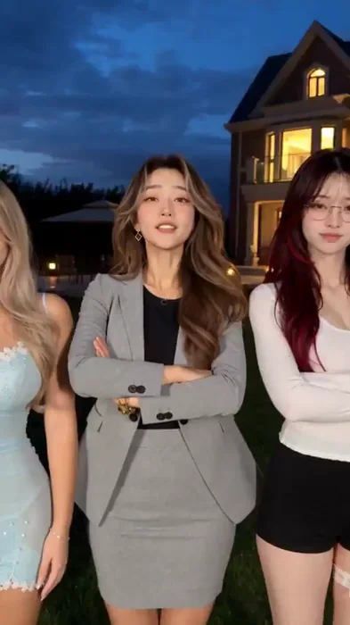</a>

▶ [ofox.ai でフル動画を見る](https://ofox.ai/seedance-2-5-prompts?utm_source=github&utm_medium=case&utm_campaign=awesome-seedance-2-5#case-78)

**输入素材**：未公开 —— 本案例未收录可用的输入素材，请参阅来源

<strong>Prompt</strong> — Duration：24秒 Aspect ratio：9:16 类型：六人群像，抽象搞笑的金牌导师招生宣传片。  整体风格： 一本正经、用力过猛的导师团队宣传短视频。六位导师依次抱胸亮相，大声说出各自的学科宣言，随后由激情澎湃的男声旁白接管，配合团队群像、金色粒子和层层叠加的励志文案。 人物越认真，宣…

~~~~text
Duration：24秒
Aspect ratio：9:16
类型：六人群像，抽象搞笑的金牌导师招生宣传片。

整体风格：
一本正经、用力过猛的导师团队宣传短视频。六位导师依次抱胸亮相，大声说出各自的学科宣言，随后由激情澎湃的男声旁白接管，配合团队群像、金色粒子和层层叠加的励志文案。
人物越认真，宣传包装越夸张，反差越好笑。真人实拍质感，手机直闪般的正面强补光，背景略暗。不要拍成高级时装广告。

六人参考绑定：
@图片1 对应“阿岚”，语文导师。
@图片2 对应“青禾”，数学导师。
@图片3 对应“知夏”，英语导师。
@图片4 对应“白露”，历史导师。
@图片5 对应“墨言”，地理导师。
@图片6 对应“桃桃”，美术导师。

每张图只绑定对应角色，保留各自人物身份、发型、服装和配饰。六人不能串脸或交换造型。参考图的背景、家具、自拍角度及原有姿势不进入视频。后文只使用角色名字。

场景：
傍晚至入夜的庭院草坪，深蓝有云天空，右后方欧式宅邸亮着暖黄色窗光，远处有庭院椅、遮阳伞和小地灯。人物正面补光明亮，背景稍暗。

开场站位：
六人站成横排，留出抱胸动作的空间。
画面从左到右：桃桃、墨言、白露、知夏、青禾、阿岚。
镜头从最右边的阿岚开始，向队列左侧依次横移。前一位滑出画面右侧，下一位进入中央。所有人实际站在同一空间里，不使用变脸转场。

声音总要求：
前9秒由六位角色分别说自己的台词，使用六种略有区别、与人物相符的成年女性声线，普通话清晰，气势自信，短促有力。每句只由当前居中的角色说，嘴型与汉字发音同步。
9秒以后切换为独立的幕后男声旁白：低沉厚实、胸腔共鸣强，像热血招生广告的王牌播音员，语气激情澎湃、坚定昂扬，逐句递进，最后一句达到高潮。不能念成平淡介绍，也不要破音尖叫。
旁白不由画面中的角色说，旁白期间人物不跟着张嘴。
对白、旁白、配乐分层清楚，不相互覆盖。

SHOT 1｜00.00–09.00｜六人依次亮相，各说一句

Camera：
连续沿队列向左横移，保持腰部以上中景和近似人物大小。每位人物居中时短暂停稳，横移时有轻微运动模糊。人物先开口并抬臂，再在句尾完成抱胸，让动作落点、最后一个字和音乐重拍同步。

00.00–01.50｜阿岚，语文
Action：
阿岚直视镜头，双手由身体两侧抬起，一条前臂横扫胸前，另一条跟上，交叉抱胸，肩膀略微侧转。
Performance：
沉稳笃定，嘴角带自信微笑，像在宣布自己的强项。
Dialogue：
“学好语文，出口成章！”
语气前半清楚铺开，后半加重，“章”字说完抱胸定住。
Text：
腹部前方弹出金黄色发光粗体字“语文”。

01.50–03.00｜青禾，数学
Action：
镜头左移，青禾进入中央。抬臂横扫，利落抱胸，轻轻扬眉。
Performance：
语速爽快，干脆自信，带一点“这题还用想”的神气。
Dialogue：
“拿下数学，思路清楚！”
“拿下”有力度，“清楚”果断收尾。
Text：
对应出现“数学”，上一学科标签消失。

03.00–04.50｜知夏，英语
Action：
知夏进入中央，边说边抬起双臂，句尾抱胸，肩膀微侧，头转回镜头。
Performance：
吐字利落，职业感强，从容中带气势。
Dialogue：
“英语开口，自信就有！”
重读“开口”和“自信”，最后保持笃定眼神。
Text：
出现“英语”。

04.50–06.00｜白露，历史
Action：
白露进入中央，双臂抬起幅度更大，随后果断交叉抱胸，挺直身体、抬下巴。
Performance：
六人里最有演讲气势，眼睛稍睁大，认真得略显夸张。
Dialogue：
“以史为鉴，胸有大局！”
“大局”加重，抱胸动作干净落定。
Text：
出现“历史”。

06.00–07.50｜墨言，地理
Action：
墨头进入中央后，墨言从自然站姿抬臂交叉抱胸，轻侧肩，笑看镜头。
Performance：
声音明亮，表达舒展，最后两个字干脆有力。
Dialogue：
“看懂地理，走遍天地！”
重读“地理”和“天地”。
Text：
出现“地理”。

07.50–09.00｜桃桃，美术
Action：
桃桃进入中央，两条前臂由低处向上扫起，交叉收拢，微抬下巴。
Performance：
明亮有冲劲，像为整组个人介绍作压轴。
Dialogue：
“提笔作画，创意开挂！”
“开挂”稍作强调，最后抱胸定住一拍。
Text：
出现“美术”。

Constraints：
六句台词依次说完，不抢话，不同时开口。每人约1.5秒，使用利落的广告短句节奏，不拖长尾音。每人先抬臂再抱胸，动作完整，手臂不穿模。六张脸保持稳定。

SHOT 2｜09.00–14.50｜拉远展示全队，热血旁白接管

09.00–09.60：
镜头迅速拉远并调整构图，短暂径向缩放模糊后恢复清晰，完整露出六人横排。六人仍按原左右顺序抱胸站在草坪上，直视镜头。音乐在此加入更强的鼓点与铜管合成器。

09.30–11.50：
Narration：
“成功——不是偶然！”
男声在“成功”后短暂停顿，“不是偶然”逐字有力量。
Text：
画面中下方出现大号金色立体字：
“成功不是偶然”
文字略侧转后迅速转正，配深色描边和金色外发光，金色粒子开始漂浮。

11.50–14.50：
Narration：
“让优秀，成为习惯！”
“优秀”加重，后半语气上扬但结尾收得坚定。
Text：
第二行出现：
“让优秀成为习惯”

Performance：
六人稳稳站立，只有轻微呼吸、抬下巴和重心调整。知夏短暂松开一条手臂，朝其他导师摊掌介绍，再收回。其他人不同时乱动，不跟随旁白对口型。

Camera：
拉远后固定六人全身群像，脸部清晰，文字位于脸部下方。

SHOT 3｜14.50–24.00｜团队海报，旁白层层推向高潮

Composition：
硬切同一庭院的新构图，前景放置足够三人并排坐下的条纹软包长凳。
后排从左到右：阿岚、知夏、墨言，站立。
前排从左到右：青禾、白露、桃桃，坐下。
后排脸部从前排肩膀之间错开露出，六张脸都完整可见。不得生成第七人。

14.50–17.00：
Action：
六人已经摆好姿势。后排挺直站立、抱胸或双手交叠；前排端正坐好，手自然放在腿上，神情认真自信。
Narration：
“久经沙场！实战为王！”
两句像口号一样有明确落点，第二句更强。
Text：
画面上方出现白色毛笔字、深红厚重阴影：
“久经沙场”
“实战为王”

17.00–18.50：
Narration：
“金牌导师团队！”
男声饱满昂扬，重读“金牌”。
Text：
中下部弹出金红色立体大字：
“金牌导师团队”
标题短促放大后停稳，配一次重鼓。

18.50–20.00：
Narration：
“手把手带教！”
强调“手把手”，语气坚定有力。
Text：
主标题下方增加：
“手把手带教”
Action：
知夏小幅抬起一只手，掌心朝团队介绍，再自然放下，其余人保持姿态。

20.00–24.00：
Narration：
“加入我们！把握机遇！成就更好的自己！”
三句连续递进，句间只作短暂停顿。“加入我们”发出号召，“把握机遇”提高力度，“成就更好的自己”达到全片高潮，最后一个字清晰收住。
Text：
随旁白依次出现三行：
“加入我们”
“把握机遇”
“成就更好的自己！”
采用黄白粗体字与深色描边，文字分层清楚，不遮挡人物脸部。
Action：
六人目光坚定地看向镜头，保持真实微动。最后半秒稳住整幅团队海报，配乐以有力的结束重拍收束。

Style：
人物始终一本正经，宣传文案和声音越来越热血，形成抽象招生广告的反差。金色粒子缓慢漂浮，适量轻微色差闪动，不影响人脸清晰。

Audio：
原创热血电子宣传配乐，强节奏鼓点、上扬铜管合成器、少量镲片与低音。
前9秒每人抱胸落定对应一次重拍，横移配短促“嗖”声；人声出现时音乐自动降低音量。
9秒后音乐扩大气势，男声旁白位于最前景，低频饱满但每个字都清楚。
六位女性对白与幕后男声旁白必须明显区分。
不添加其他台词，不生成人群杂乱喊叫，不增加逐句对白字幕，只显示指定学科标签和宣传文案。

Negative：
漏掉人物对白，只有配乐没有人声，六人同时说话，声线全部相同，口型与台词不同步，旁白期间六人一起张嘴，平淡机械朗读，含糊吞字，破音尖叫，配乐盖过人声，第七个人，人物缺失，六人复制同一张脸，角色串脸，服饰互换，参考图背景混入，人物变脸转场，多余手臂，抱胸穿模，相邻肢体融合，脚底滑动，拉远时凭空生人，坐站镜头身份错位，静止照片，六个人同时乱舞，故意扮鬼脸，身体局部特写，卡通渲染，重度磨皮，粒子遮脸，文字挡脸，错字，乱码，随机英文，水印，额外品牌标志。
~~~~

**参数**：Seedance 2.5 · 未标注 · 未标注 · 未标注 · 未标注 · 未标注 · 未标注
**来源**：[@johnAGI168](https://x.com/johnAGI168) · [原帖](https://x.com/johnAGI168/status/2096128599614947590)

Preview © 2026 <a href="https://x.com/johnAGI168/status/2096128599614947590">@johnAGI168</a> · Prompt by <a href="https://x.com/johnAGI168/status/2096128599614947590">@johnAGI168</a>

[目次に戻る](#table-of-contents)

### Case 87: A Parisian Breeze Around a Kelly Bag (风经过巴黎：Kelly 手袋广告) — by @johnAGI168

<a href="https://ofox.ai/seedance-2-5-prompts?utm_source=github&utm_medium=case&utm_campaign=awesome-seedance-2-5#case-87">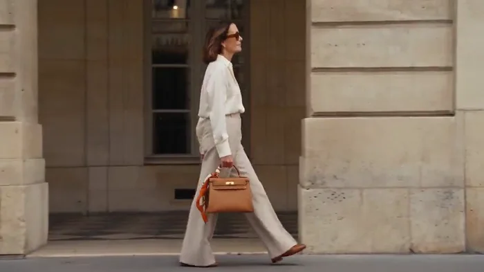</a>

▶ [ofox.ai でフル動画を見る](https://ofox.ai/seedance-2-5-prompts?utm_source=github&utm_medium=case&utm_campaign=awesome-seedance-2-5#case-87)

**输入素材**：未公开 —— 本案例未收录可用的输入素材，请参阅来源

<strong>Prompt</strong> — SEEDANCE 2.5 PROMPT  片名：《风经过巴黎》 Duration：30.00秒 Aspect ratio：16:9 类型：爱马仕 Hermès 巴黎生活方式时装广告，真人实拍质感。  整体风格： 巴黎暖阳下，一位女性从街角咖啡馆出发，带着皮革与丝绸穿过城市。气质从容、温暖、灵动，有轻…

~~~~text
SEEDANCE 2.5 PROMPT

片名：《风经过巴黎》
Duration：30.00秒
Aspect ratio：16:9
类型：爱马仕 Hermès 巴黎生活方式时装广告，真人实拍质感。

整体风格：
巴黎暖阳下，一位女性从街角咖啡馆出发，带着皮革与丝绸穿过城市。气质从容、温暖、灵动，有轻微俏皮感。用真实生活动作展示精致材质。
主色为奶油白、马鞍棕、蜂蜜色石材，爱马仕橙作为小面积视觉焦点。自然侧逆光，柔和高光过渡，轻微胶片颗粒，真实肤质、皮革纹理和丝绸光泽。环境保留空气感和城市纵深。

人物与产品统一：
全片同一位棕色及肩自然微卷发成年女性，淡妆，穿奶油白真丝衬衫、浅沙色高腰直筒长裤、焦糖棕皮革乐福鞋，佩戴无明显标识的琥珀色墨镜。
全片唯一主包为马鞍棕 Hermès Kelly：结构清晰的梯形包身、单一顶部提手、翻盖、两条皮革扣带、中央金色旋扣、细腻皮纹和整齐浅色缝线。不使用肩带。
一条橙色、奶油白与棕色组成的马术图案真丝方巾，一角牢固系在包柄根部，其余布面自然垂下。六个段落中保持同一只包、同一条丝巾、同一服装与人物。

SHOT 1｜00.00–05.00｜巴黎醒来
Subject：女性、Kelly手袋与街角咖啡馆。
Action：
00.00–01.20：巴黎蜂蜜色石材立面、铁艺阳台与树影，镜头轻缓下移，将视线引向露台。
01.20–02.20：硬切桌下低机位，棕色乐福鞋的鞋尖轻轻落地，浅沙色裤脚自然垂落。
02.20–05.00：硬切露台中景，女性将正在阅读的报纸合拢，放在小圆桌上，抬眼看向街道。Kelly立在桌面靠近她的一侧，橙色丝巾垂在包旁，风轻动丝巾末端。
Environment：藤编咖啡椅、小圆桌、石板路，背景有少量自然活动的行人。
Camera：建筑35mm；鞋部85mm；人物50mm，稳定、轻微呼吸感。
Style：柔暖晨间光感，生活化构图，产品自然进入画面。
Constraints：包底始终接触桌面，丝巾系结不松开；不出现可辨识报纸标题。

SHOT 2｜05.00–10.00｜触感与离座
Subject：手、咖啡杯、皮革提手与包扣。
Action：
05.00–06.20：微距，女性右手握着杯柄，将白色咖啡杯轻放回杯碟，杯底接触碟面后松手。
06.20–07.40：切包柄特写，右手四指穿入提手下方，拇指稳住提手；先握牢，再向上提起，包底离开桌面，丝巾受重力自然下垂。
07.40–10.00：切中景，女性提包起身，左手拿起桌上的墨镜并戴好，离开椅子。包保持在右手、身体右侧。
Environment：延续同一咖啡馆露台，人物与桌椅关系明确。
Camera：85–100mm材质特写，切50mm人物中景。
Style：皮革柔润，浅色缝线清楚，金属仅出现短促自然反光。
Constraints：手掌真实握住提手，手指不穿模；包具不变形、不漂浮；墨镜戴好后保持一致。

SHOT 3｜10.00–15.00｜城市流动
Subject：步行女性与右手提着的Kelly。
Action：
10.00–12.00：正面略低机位退行跟拍，女性沿巴黎街道从容走来。右手手提包随步态小幅摆动，丝巾稍滞后于包身摆动。
12.00–13.00：一辆浅灰汽车从右向左经过近前景，车身短暂完全遮住镜头。
13.00–15.00：在完全遮挡时剪辑，露出下一镜：女性经过米色石材拱廊，保持从左向右行走，镜头与她同向横移。橙色丝巾在暖灰背景中清晰可见。
Environment：巴黎街道、石材拱廊、少量远景行人。
Camera：50mm正面跟拍转侧向跟拍，以汽车遮挡完成转场。
Style：城市生活轻快流动，光影有层次。
Constraints：汽车从安全距离的前景经过；切镜前后保持人物、右手提包及服饰连续；街道不得液化变形。

SHOT 4｜15.00–20.00｜风触到丝绸
Subject：女性、手袋与马术图案丝巾。
Action：
15.00–16.50：女性在拱廊边停步，右手仍提包。一阵微风吹起头发，她转头感受风，露出很浅的笑意。
16.50–18.00：切丝巾近景。左手轻轻托起一个自由垂落的巾角，展开小片布面，露出橙色边框和马具线描图案；包柄上的系结始终固定。
18.00–20.00：切人物中近景，左手松开自由巾角，布面先自然落下，再被持续的侧风托起轻柔弧度。镜头沿人物侧前方缓慢环绕约45度。
Environment：暖色石墙、局部树影、明亮但柔和的背景。
Camera：85mm丝绸细节，切50mm小幅环绕。
Style：丝绸轻盈、真实褶皱，印花附着于织物并随布面弯曲。
Constraints：丝巾一角全程系住；自由巾角随手指松开后才落下；图案不游动，不变成真实动物；动作克制。

SHOT 5｜20.00–25.00｜步伐与皮革
Subject：女性步伐、Kelly包身和五金。
Action：
20.00–21.50：女性重新迈步，极低机位向上拍摄，裤脚与乐福鞋从镜头上方跨过，衣料短暂遮住画面。
21.50–23.50：借裤脚遮挡硬切至腰侧包袋近景。右手握住单提手，Kelly随两步行走轻轻前后摆动。焦点由皮革缝线移动到中央金色旋扣。
23.50–25.00：切侧后方全身景，女性走向明亮的石材庭院，步伐舒展，橙色丝巾沿行进方向向后轻飘。
Environment：石铺步道与开阔庭院，背景安静有纵深。
Camera：低机位24mm，产品85mm，侧后全身50mm。
Style：把皮革的重量与丝绸的轻盈放在同一运动中展示。
Constraints：包身保持结构和适度重量感；包扣处于闭合状态；步态自然，不滑步，不突然换手。

SHOT 6｜25.00–30.00｜风留下颜色
Subject：丝巾、Kelly产品定格与品牌落版。
Action：
25.00–26.50：近景，女性经过镜头附近，一阵侧风托起包柄上的丝巾自由布面，橙色丝绸形成柔和弧线，逐渐靠近镜头。
26.50–27.00：丝绸掠过近前景，失焦的橙色布面完全遮满画面；丝巾系结仍固定在包柄上。
27.00–28.50：在全遮挡处硬切产品静物。相同Kelly端正立在暖米色石台上，正面略转三分之二角度，同一丝巾仍系在提手根部，布面自然垂落台面。一束侧光展现皮纹、缝线、包扣和真实接触阴影。镜头极缓慢推进。
28.50–30.00：干净硬切爱马仕橙纯色品牌卡，中央深棕色“HERMÈS”，下方小字“PARIS”，排版稳定，保留充分留白，持续至30.00秒。
Environment：静物背景为温暖浅米色，没有其他商品和杂物。
Camera：85mm产品镜头，最后固定平面品牌卡。
Style：结尾简洁、精确、温暖，有余韵。
Constraints：由遮挡剪辑切换场景，不把丝巾变成包；产品落地有阴影；品牌字母准确，È保留重音符号。

Audio：
原创轻盈器乐，柔和钢琴、拨弦和少量木质打击乐，节奏从容。点缀杯碟轻碰、石板路脚步、远处城市环境和细微丝绸摩擦声。最后随品牌卡自然收束。
无旁白，无对白，无底部字幕。

Negative：
人物换脸，服饰漂移，多余手指，手掌穿过提手，包袋突然换手，Kelly变成双提手包，菱格绗缝，链条肩带，双C标志，粗花呢外套，红玫瑰，错误包扣，五金位置变化，皮革融化，包袋漂浮，丝巾突然脱落，印花游动，丝巾变成动物，物体变形转场，滑步，背景人物静止，猛烈甩镜，过度慢动作，通篇橙色滤镜，过曝金光，塑料皮肤，廉价CG质感，随机文字，错误品牌拼写，水印，底部字幕。
~~~~

**参数**：Seedance 2.5 · 未标注 · 未标注 · 未标注 · 未标注 · 未标注 · 未标注
**来源**：[@johnAGI168](https://x.com/johnAGI168) · [原帖](https://x.com/johnAGI168/status/2096082626364788752)

Preview © 2026 <a href="https://x.com/johnAGI168/status/2096082626364788752">@johnAGI168</a> · Prompt by <a href="https://x.com/johnAGI168/status/2096082626364788752">@johnAGI168</a>

[目次に戻る](#table-of-contents)
