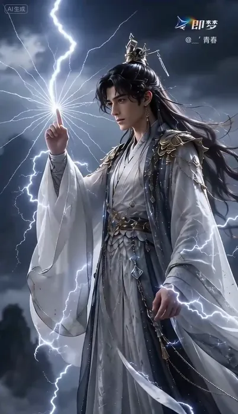
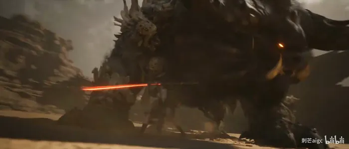
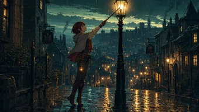
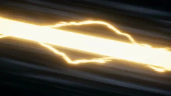
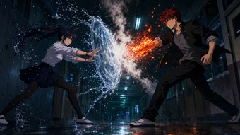
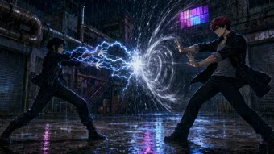

[← 返回总目录](../README.zh-CN.md#table-of-contents) · [English](anime-drama.md) · [简体中文](anime-drama.zh-CN.md) · [日本語](anime-drama.ja.md)

### 漫剧 Anime Drama

- [Case 9: Anime school hallway kung-fu fight (动漫风格校园走廊武术格斗) — by @AiwithElisia](#case-9)
- [Case 10: Cute anime girl in a magical garden (可爱动漫少女魔法花园场景) — by @LudovicCreator](#case-10)
- [Case 11: Cartoon bulldog vs. live-action boxer (卡通斗牛犬大战真人拳击手) — by @BaBELL81](#case-11)
- [Case 66: Backlit mountain-gate swordsman (山门石阶持剑少年 · 强逆光晴日) — by @平面设计柚子](#case-66)
- [Case 67: Many-headed black dragon, chained stone gate (多头黑龙 · 锁链石门 · 雷暴仙侠) — by @平面设计柚子](#case-67)
- [Case 68: Purple-eyed awakening in a shattered void (紫瞳觉醒 · 破碎虚空符文莲花) — by @平面设计柚子](#case-68)
- [Case 69: Desert duel with a giant beast, 30s single take (沙漠女主战巨兽 · 30 秒一刀未剪) — by @刺芒aigc](#case-69)
- [Case 1008: The Last Lamp (最后一盏) — by Ofox Team](#case-1008)
- [Case 1010: Eight Lightning Fangs (雷牙・八重) — by Ofox Team](#case-1010)
- [Case 1013: Water vs fire, night school corridor (水火对决・深夜学园走廊) — by Ofox Team](#case-1013)
- [Case 1014: Arc vs wind, flooded factory courtyard (雷风对决・暴雨工厂中庭) — by Ofox Team](#case-1014)

### Case 9: Anime school hallway kung-fu fight (动漫风格校园走廊武术格斗) — by @AiwithElisia

▶ [在 ofox.ai 观看完整视频](https://ofox.ai/seedance-2-5-prompts?utm_source=github&utm_medium=case&utm_campaign=awesome-seedance-2-5#case-9)

<strong>Prompt</strong> — 创建一个电影级、照片级真实感的动漫风格校园走廊格斗场景。  一位美丽的年轻日韩裔女学生，留着短款柔和的淡紫色头发，戴着一个小巧的蓝白花朵发夹，站在明亮但氛围感十足的日本高中走廊里。她穿着传统的校服：浅灰色修身西装外套配深色滚边，白色衬衫，系着巨大的淡蓝色蝴蝶结，深海军蓝百褶裙，白色过膝袜和深棕色/黑…

~~~~text
创建一个电影级、照片级真实感的动漫风格校园走廊格斗场景。

一位美丽的年轻日韩裔女学生，留着短款柔和的淡紫色头发，戴着一个小巧的蓝白花朵发夹，站在明亮但氛围感十足的日本高中走廊里。她穿着传统的校服：浅灰色修身西装外套配深色滚边，白色衬衫，系着巨大的淡蓝色蝴蝶结，深海军蓝百褶裙，白色过膝袜和深棕色/黑色低跟校鞋。背景中还有几位穿着同款灰色校服的女学生。

场景开始于一个特写镜头，淡紫色头发的女孩神情严肃且充满情绪地看向站在她面前的另一位女学生。自然光透过巨大的走廊窗户射入，营造出柔和、漫射的电影级光影。镜头具有浅景深效果，展现出真实的皮肤纹理、自然的表情以及细微的手持摄影晃动感。

随着女孩们对峙，紧张感不断升级。镜头在全景、特写和动态肩后镜头之间切换。淡紫色头发的女孩做出防御反应，并开始与另一位女学生格斗。展示真实的武术风格动作、出拳、格挡和踢腿，动作符合人体力学，且具有自然的惯性。

在某一时刻，展示一个低角度特写镜头，拍摄几名学生的鞋子在略显湿润、具有反射效果的校园走廊地板上快速移动。随着角色的移动，可以看到水面的倒影和细微的水花。

继续使用动态手持追踪镜头，拍摄淡紫色头发的女孩与另一名学生交手。包含一个戏剧性的侧踢和防御动作。背景中的学生们在远处注视着这场冲突，脸上带着惊讶和担忧的表情。

镜头应随着动作自然移动：特写 → 中景 → 追踪镜头 → 低角度足部镜头 → 走廊全景 → 特写。在快速移动时使用真实的动态模糊，同时保持面部和重要细节清晰。

走廊应看起来真实且富有生活气息：巨大的窗户、浅色的墙壁、木质教室门、抛光且具有反射效果的地板、清冷的阴天自然光以及略带戏剧性的氛围。

临近结尾时，淡紫色头发的女孩在冲突结束后走向镜头。她直视镜头，表情严肃而坚定，而其他女学生在背景中保持模糊状态。

超真实真人电影摄影，照片级真实面部，真实的日本校园环境，电影级构图，自然的皮肤毛孔，真实的织物和头发运动，物理准确的阴影，柔和的阴天自然光，浅景深，细微的胶片颗粒感，手持摄影，真实的动态模糊，戏剧性的节奏，高细节纹理，4K 电影级画质。

宽高比：16:9。
时长：约 30 秒。
风格：照片级真实感电影真人拍摄，真实的人体运动，动漫风格
~~~~

**参数**：Seedance 2.5 · 未标注 · t2v · 30s · 未标注 · 16:9 · 未标注
**来源**：[@AiwithElisia](https://x.com/AiwithElisia) · [原帖](https://x.com/AiwithElisia/status/2092843448462454971)

Preview © 2026 <a href="https://x.com/AiwithElisia/status/2092843448462454971">@AiwithElisia</a> · Prompt by <a href="https://x.com/AiwithElisia/status/2092843448462454971">@AiwithElisia</a>

[回到目录](#table-of-contents)

### Case 10: Cute anime girl in a magical garden (可爱动漫少女魔法花园场景) — by @LudovicCreator

▶ [在 ofox.ai 观看完整视频](https://ofox.ai/seedance-2-5-prompts?utm_source=github&utm_medium=case&utm_campaign=awesome-seedance-2-5#case-10)

<strong>Prompt</strong> — [项目类型] 文本生成视频。30 秒可爱动漫场景。单角色，无对白。  [全局设定] 黄金时刻阳光明媚的魔法花园。柔和的暖色调灯光。鲜花、草地、闪烁的魔法氛围。明亮欢快的色彩。梦幻般的电影级动漫美学。  [角色：可爱动漫少女] 12-14 岁，大大的闪亮眼睛，可爱的圆脸，长长的粉色头发配有丝带，穿着褶…

~~~~text
[项目类型] 文本生成视频。30 秒可爱动漫场景。单角色，无对白。

[全局设定] 黄金时刻阳光明媚的魔法花园。柔和的暖色调灯光。鲜花、草地、闪烁的魔法氛围。明亮欢快的色彩。梦幻般的电影级动漫美学。

[角色：可爱动漫少女] 12-14 岁，大大的闪亮眼睛，可爱的圆脸，长长的粉色头发配有丝带，穿着褶边淡色连衣裙（柔和色调）。天真、快乐、充满活力。娇小的比例。可爱的表情。

[场景描述]

[开场，0–6 秒] 黄金时刻魔法花园的广角镜头。闪光和光点在空气中漂浮。可爱的少女独自坐在草地上，周围环绕着五颜六色的鲜花。她抬头望向天空，露出灿烂的笑容，双眼闪闪发光。她将一篮鲜花抱在胸前。柔和的音乐响起——轻柔而欢快。镜头缓慢环绕她，捕捉她宁静的喜悦。

[趣味时刻，6–15 秒] 少女突然纯真地跳了起来。她开始在草地上旋转，双臂张开，咯咯地笑（可爱的高音笑声）。当她旋转时，花瓣在她周围飞舞。魔法闪光跟随她的动作，仿佛留下了光之轨迹。她采摘鲜花并挥舞，划出花瓣和闪光的小弧线。她的表情不断变化——惊奇、喜悦、纯粹的快乐。镜头跟随她俏皮的动作。花园对她的快乐做出回应——花朵发出更明亮的光芒，闪光变得更加强烈。

[魔法互动，15–24 秒] 一只可爱的小动物出现（蝴蝶、小狐狸或魔法生物）。少女注意到后，眼睛因惊喜而睁大。她轻轻伸出手。小动物小心翼翼地靠近。它触碰她的手时，她咯咯地笑了起来。她坐下来，小动物坐在她身边。它们共享一段安静的时光。她轻轻抚摸小动物，两者都感到无比满足。魔法光环环绕着它们。闪光增强。场景充满了纯真与魔法。

[结尾时刻，24–30 秒] 少女躺在草地上仰望天空。小动物蜷缩在她身边。日落的金色光芒洒满场景。闪光懒洋洋地在空气中漂浮。她闭上眼睛，平静地微笑，感到无比幸福与安宁。镜头缓慢拉远，展示她在广阔美丽花园中的娇小身影，被魔法光芒包围。音乐达到柔和的顶点。定格在这个纯粹宁静的喜悦瞬间。

[音频] 轻柔的音乐盒旋律，伴随轻盈的管弦乐弦乐和柔和的钟声。可爱少女的咯咯笑声（纯粹的快乐，非嘲讽）。花瓣轻轻沙沙作响。魔法闪光的声音（微妙，不过度，柔和的叮当声）。轻柔的动物叫声（轻微的喵喵声、拍打声）。草地上的脚步声（轻快、俏皮）。最后时刻：仅保留音乐和微风吹过花丛的声音。

[视觉风格]
— 动漫 3D 风格化（圆润讨喜的设计）
— 持续的闪光和魔法粒子
— 黄金时刻光效
~~~~

**参数**：Seedance 2.5 · 未标注 · t2v · 30s · 未标注 · 未标注 · 带音频
**来源**：[@LudovicCreator](https://x.com/LudovicCreator) · [原帖](https://x.com/LudovicCreator/status/2093277563992854638)

Preview © 2026 <a href="https://x.com/LudovicCreator/status/2093277563992854638">@LudovicCreator</a> · Prompt by <a href="https://x.com/LudovicCreator/status/2093277563992854638">@LudovicCreator</a>

[回到目录](#table-of-contents)

### Case 11: Cartoon bulldog vs. live-action boxer (卡通斗牛犬大战真人拳击手) — by @BaBELL81

▶ [在 ofox.ai 观看完整视频](https://ofox.ai/seedance-2-5-prompts?utm_source=github&utm_medium=case&utm_campaign=awesome-seedance-2-5#case-11)

**输入素材**：未公开 —— 原作者只发布了成片，未提供输入素材

<strong>Prompt</strong> — Use Image 1 for the large muscular cartoon bulldog boxer, Image 2 for the live-action Caucasian American boxer, and Image 3 for the vintage arena, rin…

~~~~text
Use Image 1 for the large muscular cartoon bulldog boxer, Image 2 for the live-action Caucasian American boxer, and Image 3 for the vintage arena, ring, crowd, and lighting.

Create an intense 24-second boxing sequence in 10 shots.

The bulldog remains a hand-drawn 2D character inspired by 1969 American TV cartoons, keeping the same face, proportions, red gloves, and striped shorts. Never make him realistic. The human boxer remains fully photorealistic.

Style: heated live sports documentary broadcast. Handheld ringside cameras, reactive pans, imperfect reframing, small zoom corrections, natural shake, motion blur, focus breathing, faded 35mm colors, soft lens bloom, subtle gate weave, and naturally changing film grain. No frozen grain or fixed texture.

Strong white spotlights illuminate the ring. The crowd is darker but visible and constantly reacting. Crowd cheering continues from the first frame to the last: shouting, applause, whistles, and stomping. Reactions grow louder after major punches. An excited male English commentator speaks continuously. No music.

Each numbered shot is one continuous camera take. The camera may pan, track, dolly, or reframe, but must not jump to a new position inside the same shot.

Comic effects must resemble authentic 1969 American comics: imperfect hand-drawn lines, thick black outlines, red, yellow, white, and black colors, halftone dots, faded ink, and slight print misregistration.

Use effects sparingly:
SPEED LINES on fast punches.
One-frame SMEAR FRAME on the strongest punches.
Small IMPACT BURSTS on selected hits.
IMPACT FLASH and SHOCKWAVE RING only on the decisive counter and final uppercut.
WOBBLE LINES and yellow rotating stars only when the human is badly dazed.

Use only these comic sound effects on major clean hits:
THWACK! POW! SMACK! WHAM! CRACK!

SHOT 1 — 0.0–2.0
High-angle view of the packed arena. The ring is under strong spotlights. Both fighters wait in opposite corners. The bell rings, the crowd erupts, and both walk toward the center as the camera pushes closer.

SHOT 2 — 2.0–4.0
Slightly elevated wide shot from outside the ring with ropes in the foreground. The referee steps back. Both fighters raise their guards, circle, and test distance. The handheld camera tracks right.

SHOT 3 — 4.0–6.2
Low canvas-level angle. The bulldog throws a jab with brief SPEED LINES. The human narrowly avoids it and counters with a jab that the bulldog blocks. Quick natural pan. No comic text.

SHOT 4 — 6.2–8.8
Slightly high-angle shot through the ropes. The human attacks with a combination. A left jab lands with a small IMPACT BURST and THWACK! A right straight follows with POW!, a brief IMPACT FLASH, and a small burst. A left hook lands with only a subtle impact mark. The camera tracks as the bulldog retreats.

SHOT 5 — 8.8–11.2
Close handheld shot from the opposite side. The human keeps pressing with short punches. The bulldog blocks several and absorbs one body shot. The camera urgently reframes. The bulldog answers with a short face hook using a small red IMPACT BURST and SMACK!

SHOT 6 — 11.2–14.0
Over-the-shoulder from behind the human. The human throws a powerful right straight. The bulldog slips underneath. The camera pans with the missed glove. Without cutting, the bulldog plants his feet, rotates, and launches a right counterpunch with SPEED LINES and a one-frame SMEAR FRAME.

SHOT 7 — 14.0–16.8
Tight ringside impact shot. The bulldog's right straight lands on the human's cheek in very brief slow motion. His cheek compresses and sweat flies. At contact, show a large IMPACT BURST, white IMPACT FLASH, radial lines, short SHOCKWAVE RING, and WHAM! The effects vanish immediately. Return to normal speed as the human staggers backward. The crowd explodes.

SHOT 8 — 16.8–19.2
Slightly elevated ringside shot. The human is badly dazed but standing. WOBBLE LINES and three yellow stars briefly appear. The bulldog lands one body punch without text, then a short face hook with SPEED LINES, a small burst, and SMACK!

SHOT 9 — 19.2–21.5
Low diagonal ringside angle. The bulldog throws a compact uppercut with a one-frame SMEAR FRAME. It lands under the chin with IMPACT FLASH, red-yellow IMPACT BURST, short SHOCKWAVE RING, and CRACK! The human falls into the ropes, drops to one knee, and collapses safely. The referee stops the fight. The bulldog steps back. Yellow stars fade.

SHOT 10 — 21.5–24.0
Final slightly high-angle wide shot. The referee brings the bulldog to the center and raises one arm. Red-and-white paper streamers fly into the ring. Vintage photographers fire flashbulbs and strong white strobes. The crowd remains standing, shouting, clapping, whistling, and waving hats. The handheld camera slowly pushes closer until the final frame.
~~~~

**参数**：Seedance 2.5 · 即梦 · i2v · 24s · 未标注 · 未标注 · 带音频
**来源**：[@BaBELL81](https://x.com/BaBELL81) · [原帖](https://x.com/BaBELL81/status/2083562978730029228)

Preview © 2026 <a href="https://x.com/BaBELL81/status/2083562978730029228">@BaBELL81</a> · Prompt by <a href="https://x.com/BaBELL81/status/2083562978730029228">@BaBELL81</a>

[回到目录](#table-of-contents)

### Case 66: Backlit mountain-gate swordsman (山门石阶持剑少年 · 强逆光晴日) — by @平面设计柚子

▶ [在 ofox.ai 观看完整视频](https://ofox.ai/seedance-2-5-prompts?utm_source=github&utm_medium=case&utm_campaign=awesome-seedance-2-5#case-66)

<strong>Prompt</strong> — 一位年轻男子，深色微卷短发，五官立体深邃，身穿黑色高领内搭、黑色长款宽松外套和黑色长裤。镜头沿石阶向前平稳推进，男子从远处向镜头走来，随后镜头快速推近至近景，男子右手持银色长剑将剑尖直指镜头中心，左手自然下垂，嘴角上扬露出自信微笑，阳光在剑身反射出高光；接着镜头切换为低角度仰拍，男子站在传统建筑飞檐…

~~~~text
一位年轻男子，深色微卷短发，五官立体深邃，身穿黑色高领内搭、黑色长款宽松外套和黑色长裤。镜头沿石阶向前平稳推进，男子从远处向镜头走来，随后镜头快速推近至近景，男子右手持银色长剑将剑尖直指镜头中心，左手自然下垂，嘴角上扬露出自信微笑，阳光在剑身反射出高光；接着镜头切换为低角度仰拍，男子站在传统建筑飞檐的屋顶上，背对镜头后迅速转身，右腿单腿蹲在屋脊兽上，双手紧握长剑剑柄将剑尖向下垂直刺出，黑色外套下摆随风飘动；然后镜头切至面部大特写，男子闭着双眼面带惬意微笑，阳光照亮侧脸，随后他缓缓睁开双眼温柔地看向镜头；随后镜头拉回中景，男子在石阶上向前快速奔跑，接着双腿急停微蹲降低重心，双手持剑在身前快速横向挥舞划出银色弧线，黑色外套和头发随动作剧烈甩动；紧接着镜头切至近景，男子站在石质栏杆旁双眼微闭，一把银色长剑悬浮在他头部侧上方，他右手单手持黑色剑鞘，左手自然搭在栏杆上；最后镜头推至面部特写，男子面带温柔微笑注视镜头，强烈的阳光从左上方射入，在镜头前形成明亮的光晕和闪烁的镜头光斑。场景为依山而建的中国传统石质建筑，有石栏杆、石阶、飞檐翘角，背景是陡峭岩壁和青山，晴朗白天，强烈的自然侧逆光，彩色，明亮高调，电影感，超清 4K，写实，光影细腻，竖屏。
~~~~

**参数**：Seedance 2.5 · 即梦 · t2v · 未标注 · 未标注 · 未标注 · 未标注
**来源**：[@平面设计柚子](https://space.bilibili.com/3546650324765434) · [原帖](https://www.bilibili.com/video/BV1Yru367Emg)

Preview © 2026 <a href="https://www.bilibili.com/video/BV1Yru367Emg">@平面设计柚子</a> · Prompt by <a href="https://www.bilibili.com/video/BV1Yru367Emg">@平面设计柚子</a>

[回到目录](#table-of-contents)

### Case 67: Many-headed black dragon, chained stone gate (多头黑龙 · 锁链石门 · 雷暴仙侠) — by @平面设计柚子

▶ [在 ofox.ai 观看完整视频](https://ofox.ai/seedance-2-5-prompts?utm_source=github&utm_medium=case&utm_campaign=awesome-seedance-2-5#case-67)

<strong>Prompt</strong> — 多头暗黑金属质感巨龙鳞片锋利带刺，粗大带倒刺的黑色金属锁链与带有复杂暗金浮雕和兽首门环的巨大黑色石门，身穿白色暗纹多层长袍、黑发高束戴冠的俊美冷峻东方仙侠男子，黑灰色调的古代宫殿城市群。先，多头黑龙在雷暴云层中向前突进，周围碎石和冰渣向四周剧烈飞溅，闪电在龙身周围闪烁，镜头快速向前推进穿过云层；接着…

~~~~text
多头暗黑金属质感巨龙鳞片锋利带刺，粗大带倒刺的黑色金属锁链与带有复杂暗金浮雕和兽首门环的巨大黑色石门，身穿白色暗纹多层长袍、黑发高束戴冠的俊美冷峻东方仙侠男子，黑灰色调的古代宫殿城市群。先，多头黑龙在雷暴云层中向前突进，周围碎石和冰渣向四周剧烈飞溅，闪电在龙身周围闪烁，镜头快速向前推进穿过云层；接着，粗大的黑色锁链在暴雨中紧绷，镜头沿着锁链快速向上推进，展现锁链连接的巨大黑色浮雕石门，闪电照亮石门上的兽首门环，雨水斜向飘落；然后，白衣男子站在巨大的黑色石台顶部，狂风使他的长发和白色衣袂剧烈向后飘动，镜头从低角度缓慢向上推，展现男子全身及背后漩涡状的雷暴云层；随后，镜头推至男子中近景，他神情冷峻，缓缓抬起右手，食指笔直指向上方，白色的电流特效在他的手臂和身体周围游走闪烁；最后，镜头瞬间切换至高空俯视，快速向后拉远并上升，展现下方庞大的黑灰色古代城市，城市中心的高台周围燃起暗红色的火焰，巨大的锁链从天空垂下，碎片在空中飞舞。场景为末日般的恶劣天气，乌云密布，狂风暴雨，电闪雷鸣，天空呈现漩涡状。运镜包含快速推进、沿物体推进、低角度仰拍推镜头、缓慢推近、快速拉远上升，景别从特写、中景、全景、中近景到大远景变化，中心构图。光影为低调冷色调，黑灰蓝为主，闪电提供瞬态强侧光和顶光，明暗对比极强。风格为暗黑奇幻东方仙侠史诗CG，电影感，超清4K，高细节写实材质，高帧率运动带有速度线和动态模糊。画幅9:16。
~~~~

**参数**：Seedance 2.5 · 即梦 · t2v · 未标注 · 未标注 · 9:16 · 未标注
**来源**：[@平面设计柚子](https://space.bilibili.com/3546650324765434) · [原帖](https://www.bilibili.com/video/BV1Xru36jEdC)

Preview © 2026 <a href="https://www.bilibili.com/video/BV1Xru36jEdC">@平面设计柚子</a> · Prompt by <a href="https://www.bilibili.com/video/BV1Xru36jEdC">@平面设计柚子</a>

[回到目录](#table-of-contents)

### Case 68: Purple-eyed awakening in a shattered void (紫瞳觉醒 · 破碎虚空符文莲花) — by @平面设计柚子

▶ [在 ofox.ai 观看完整视频](https://ofox.ai/seedance-2-5-prompts?utm_source=github&utm_medium=case&utm_campaign=awesome-seedance-2-5#case-68)

<strong>Prompt</strong> — 一名黑色微卷短发、面部带有清晰雀斑、佩戴耳环的年轻男性，身穿带有银色紫色云纹暗花的黑色古风交领长袍，材质呈现丝绸与皮革光泽。镜头先在破碎的黑暗空间中快速向前推进，穿过大量悬浮旋转的黑色古风建筑碎片和紫色光点，向中心的紫色能量漩涡靠近；接着镜头穿过碎片后减速平稳向前推进，展现该男子站在古风建筑平台上，…

~~~~text
一名黑色微卷短发、面部带有清晰雀斑、佩戴耳环的年轻男性，身穿带有银色紫色云纹暗花的黑色古风交领长袍，材质呈现丝绸与皮革光泽。镜头先在破碎的黑暗空间中快速向前推进，穿过大量悬浮旋转的黑色古风建筑碎片和紫色光点，向中心的紫色能量漩涡靠近；接着镜头穿过碎片后减速平稳向前推进，展现该男子站在古风建筑平台上，背后巨大的半透明紫色符文光带如花瓣般在空中缓缓舒展蜿蜒飘动；随后男子缓慢抬起右臂，小臂向上翻转使掌心朝上，微微低头注视掌心，动作平稳，伴随背后紫色光带的轻微摇曳；紧接着男子右手掌心中央迅速凝聚出一团内部光影流转的紫色能量光球，散发强烈紫光并照亮手部与衣襟，周围空气产生轻微扭曲；镜头推至面部特写，男子微微抬头直视前方，紫色能量纹路从眼角和脸颊迅速向外蔓延，双眼开始闪烁紫光；随后男子双眼完全变为发光的紫色，瞳孔呈现清晰的星芒齿轮状纹理，眼周紫色纹路如电流般微微跳动，他面无表情直视镜头，眼神极具压迫感；最后镜头迅速向后拉远，男子身体悬浮于半空，背后紫色光带完全展开如同巨大紫色莲花，黑色长袍下摆和衣带在强烈能量气流中剧烈翻飞，周围悬浮的建筑碎片随之剧烈震动。场景为高空中的破碎古风建筑群与深邃黑暗虚空，空间内充满紫色能量粒子。运镜包含快速推进、缓慢推镜头、微距平移与快速拉远，景别从远景过渡到特写再回到全景。画面采用暗黑底色搭配高饱和度霓虹紫色，低调影调，明暗对比强烈，自发光光源形成锐利高光与深邃阴影。3D玄幻动画风格，CGI特效，东方仙侠与暗黑奇幻色彩，电影感，超清4K，光影细腻，粒子特效丰富，景深明显，动作流畅。画幅比例9:16。
~~~~

**参数**：Seedance 2.5 · 即梦 · t2v · 未标注 · 未标注 · 9:16 · 未标注
**来源**：[@平面设计柚子](https://space.bilibili.com/3546650324765434) · [原帖](https://www.bilibili.com/video/BV1LYuR6rEke)

Preview © 2026 <a href="https://www.bilibili.com/video/BV1LYuR6rEke">@平面设计柚子</a> · Prompt by <a href="https://www.bilibili.com/video/BV1LYuR6rEke">@平面设计柚子</a>

[回到目录](#table-of-contents)

### Case 69: Desert duel with a giant beast, 30s single take (沙漠女主战巨兽 · 30 秒一刀未剪) — by @刺芒aigc

▶ [在 ofox.ai 观看完整视频](https://ofox.ai/seedance-2-5-prompts?utm_source=github&utm_medium=case&utm_campaign=awesome-seedance-2-5#case-69)

**输入素材**：未公开 —— 原作者只发布了成片，未提供输入素材

<strong>Prompt</strong> — 低机位从@女主侧前方斜向上移动，@女主位于画面左侧，右手持@古刀斜垂身侧，镜头贴近沙地缓慢抬升到肩部高度，风沙掠过前景，衣摆和发丝随风摆动，伴随风沙呼啸、衣料抽动和刀身轻微震鸣。镜头保持运动，沿她身体外侧绕到身后偏左形成过肩构图，远处@巨兽从沙尘中的残破古风废墟里踏出，巨足落地震裂地面，碎石和尘土向…

~~~~text
低机位从@女主侧前方斜向上移动，@女主位于画面左侧，右手持@古刀斜垂身侧，镜头贴近沙地缓慢抬升到肩部高度，风沙掠过前景，衣摆和发丝随风摆动，伴随风沙呼啸、衣料抽动和刀身轻微震鸣。镜头保持运动，沿她身体外侧绕到身后偏左形成过肩构图，远处@巨兽从沙尘中的残破古风废墟里踏出，巨足落地震裂地面，碎石和尘土向外炸开，@女主压低身体立即全速冲出。 [无缝风格转场] 随着冲刺直接进入日式动漫3D游戏CG画质，切为ACT第三人称侧后跟拍，镜头位于@女主身后偏右低位高速追随，脚步连续蹬地踢出长条沙尾，背景废墟快速拉伸，刀身拖出短促赤色残光。@巨兽迎面挥爪砸下，@女主向侧前方高速滑步切入攻击内侧，右手@古刀由下向上斩中前肢，刀弧爆出强烈光痕和火星，命中伴随沉重切击声与血肉冲击，@巨兽立即甩头撞击反攻，@女主贴身绕侧连续横斩、回身斩、突刺，动作不断线。 [HARD CUT] 镜头转为高速侧向跟拍，@巨兽前肢重踏掀起环形冲击波，地面大片龟裂，@女主踩上倾斜断墙借力跃起，从巨兽侧上方斜切而下，连续三次高速斩击在空中留下交叉刀光，落地后立即滑步追砍。@巨兽甩尾横扫逼迫她急停转向，尾部撞中残墙使墙体整片爆裂，碎砖和沙尘横穿画面，@女主穿过尘幕再次突进，一记重斩将@巨兽压向后方废墟，伴随密集斩击声、兽吼、碎石爆裂和墙体坍塌声。 [连续追击] 镜头贴近@女主右后方肩线跟随，她绕着@巨兽高速移动，连续闪避巨爪、顶撞与踏击，每次闪避后立刻反击，@古刀在近身连击中拉出短促刀光残痕，命中时产生明显震动、火星和沙尘爆散。@巨兽猛扑压下，@女主低身滑过前肢下方，转身重斩其侧腹，再借碎石跃起斩向肩颈，双方连续进攻与反击保持快速节奏，周围地面和断墙在冲击中持续碎裂。 [终结技] @巨兽重击落空出现破绽，镜头快速拉开再俯冲推向@女主，她滑步停下，右手将@古刀斜置身侧蓄力，刀身瞬间聚集高亮赤金能量，周围沙尘被气流吸成旋转涡流，碎石悬起震动，脚下裂纹向四周扩散。下一瞬间@女主高速突进化作一道斜向刀光贯穿@巨兽，镜头沿斩击轨迹高速甩移，巨兽身上爆开巨大斩痕，短暂停顿后庞大身体轰然倒向残墙，墙体整体崩塌，碎石、尘浪和冲击波向外爆发。镜头落在@女主斜后方，她站在画面一侧缓缓收刀，刀光逐渐熄灭，背景是倒下的@巨兽与翻滚沙尘。
~~~~

**参数**：Seedance 2.5 · 未标注 · r2v · 未标注 · 未标注 · 未标注 · 带音频
**来源**：[@刺芒aigc](https://space.bilibili.com/3706991820147515) · [原帖](https://www.bilibili.com/video/BV187ub6dEmU)

Preview © 2026 <a href="https://www.bilibili.com/video/BV187ub6dEmU">@刺芒aigc</a> · Prompt by <a href="https://www.bilibili.com/video/BV187ub6dEmU">@刺芒aigc</a>

[回到目录](#table-of-contents)

### Case 1008: The Last Lamp (最后一盏) — by Ofox Team

| 输入 | 输出 |
|:---:|:---:|
|  |  |

▶ [在 ofox.ai 观看完整视频](https://ofox.ai/seedance-2-5-prompts?utm_source=github&utm_medium=case&utm_campaign=awesome-seedance-2-5#case-1008)

<strong>Prompt</strong> — Start exactly on the opening frame. FORMAT: 16:9 horizontal, 20 seconds, 3 shots, hard cuts on the timestamps. STYLE: modern theatrical anime, cel-sha…

~~~~text
Start exactly on the opening frame.
FORMAT: 16:9 horizontal, 20 seconds, 3 shots, hard cuts on the timestamps.
STYLE: modern theatrical anime, cel-shaded, clean line art, flat vibrant colour with deep saturated darks, painterly background art; no photographic texture overlay. STRONG CHIAROSCURO throughout, high contrast: deep near-black shadow pressed against hot lamp gold, hard rim light carving every silhouette, never flat even lighting. Dense layered compositions in every shot - a reflective wet foreground, the subject in the midground, a receding chain of lamps and lit windows behind, the hillside city and its castle silhouette far off under a cold pale teal sky. Warm gold against cold teal in every frame. The light is the whole story: shot 1 the light winning, shot 2 the darkness taking the street back, shot 3 one point of gold holding out.
THE GIRL: about sixteen, slender; short dark auburn hair with one thin side braid tucked behind her ear; amber eyes; a pale grey hooded short cape lined in deep rust, a dark charcoal work vest over a cream shirt, a leather belt at her hip carrying a small brass oil lantern and a ring of flint; a fingerless leather glove on her right hand, fingertips smudged black with lamp soot. Diligent, unhurried, stubborn. Referred to as "the girl".
SCENE: one long wet cobbled street running steeply downhill between tall old stone houses toward a walled hillside city, lined with tall iron street lamps - at dusk in fine rain, then at night in a storm.
RULES - quiet: one action per segment, long enough to read. No fast cutting, no jump cuts inside a segment. The lamps and the darkness are the second character; every segment must show the light gaining or losing ground.

[Lighting, 0-7s] The camera holds on her at this low street-level three-quarter angle - she is mid-left in profile, the lighting pole raised to the lamp at centre - then cranes slowly up and back. The wick blooms brighter, its broken gold reflection stretches down the wet cobbles toward the lens, and the whole hillside opens up behind her: a chain of already-lit lamps and hundreds of warm windows shrinking into the rain haze. She lowers the pole and watches it for a beat, rain on her face. The girl, quietly and plainly: "今日も、明かりを灯します。"
HARD CUT.
[The storm, 7-14s] Night, heavy rain, violent wind. Wide shot straight down the street from high up. The furthest lamp gutters and dies, then the next, then the next - a wave of blackness walking up the hill toward the camera, swallowing the windows as it comes, faster than she can move. The girl runs against it with the brass lantern clutched to her chest, cape snapping, water sheeting off the cobbles and throwing torn reflections; a glass housing cracks and goes out just as she passes it, and her rim light dies with it. The camera tracks with her, low and unsteady. No dialogue in this segment.
HARD CUT.
[The last one, 14-20s] She reaches the last lamp still standing at the foot of the street and turns her back to the wind, spreading her cape as a shield; in near-total darkness her face is lit only from below by the lantern in her hands as she feeds the flame into the glass housing with her gloved hand. The wick catches and holds, and the gold comes back up across her face and the wet stone. She lifts her head, rain running off her chin, amber eyes bright. The girl, quietly: "一つ残っていれば、誰かが帰れる。" The camera pulls back and up into a high wide of the entire black street and the dark city, one point of gold in it; hold one second.

AUDIO: fine rain, the scrape of the lighting pole, the soft whump of the wick catching, distant evening bells / then storm wind, hard rain on stone, glass cracking, lamps guttering out one by one, her boots in water and her breath / then the wind dropping to a hiss, rain thinning, the single flame steady / her two lines spoken in Japanese, quiet and plain; nobody else speaks / at the end only rain and the small flame remain. No BGM, no music, no score, no instruments, no humming, no singing, no narration, no subtitles.
CONSISTENCY: the girl's face, facial proportions, skin tone, body type, short dark auburn hair with the thin side braid, amber eyes, pale grey hooded cape with rust lining, charcoal vest, cream shirt, leather belt, brass lantern and the fingerless glove identical in every shot; strictly no random character changes; never change the visual style.
AVOID: subtitles, watermarks, logos, on-screen text; fast cutting and jump cuts inside a segment; photorealism, 3D game CG, plastic skin; identity drift; flat washed-out lighting, low contrast; modern clothing, electric lighting, cars.
Modern theatrical anime, cel-shaded, high contrast chiaroscuro, expressive facial animation, dense painterly background art, cinematic depth of field, character design consistent throughout.
~~~~

**参数**：Seedance 2.5 · Ofox · i2v · 20s · 720p · adaptive · 带音频
**费用**：$4.80（job 98f2c80e-219d-4973-818f-42e3d9c53379）
**来源**：Ofox 实测

[回到目录](#table-of-contents)

### Case 1010: Eight Lightning Fangs (雷牙・八重) — by Ofox Team

| 输入 | 输出 |
|:---:|:---:|
|  |  |

▶ [在 ofox.ai 观看完整视频](https://ofox.ai/seedance-2-5-prompts?utm_source=github&utm_medium=case&utm_campaign=awesome-seedance-2-5#case-1010)

<strong>Prompt</strong> — Start exactly on the opening frame. FORMAT: 16:9 horizontal, 30 seconds, 10 shots, hard cuts on the timestamps. STYLE: modern theatrical anime, cel-sh…

~~~~text
Start exactly on the opening frame.
FORMAT: 16:9 horizontal, 30 seconds, 10 shots, hard cuts on the timestamps.
STYLE: modern theatrical anime, cel-shaded, clean line art, flat vibrant colour with deep saturated darks, painterly background art; no photographic texture overlay. STRONG CHIAROSCURO, extreme contrast throughout: near-black cedar forest and night sky against small hot lantern orange, and against the gold-violet of the lightning; hard rim light on every silhouette; never flat even lighting. Dense layered depth in every shot: wet reflective stone in the foreground, the fight in the midground, the receding double row of stone lanterns and black cedar trunks behind.
THE WOMAN: mid-twenties, tall and long-limbed with mature adult proportions, straight-backed and composed, a calm hard gaze; sharp cool grey eyes with upswept outer corners; jet-black hair, no gradient, in a high ponytail with two loose strands at the temples; deep indigo Japanese short-jacket and hakama, a plain dark leather chest guard, white wrapped bracers; a plain charcoal short haori with a ragged torn hem and no pattern of any kind; a slim straight sword, cold silver blade with no colour gradient, plain square iron guard. Her blade is ALREADY DRAWN and in her right hand from the first frame; it is sheathed only once, at the very end. Referred to as "the woman".
THE DEMON: not humanoid. A shifting mass of liquid blackness that holds no fixed shape - it pours, bulges and re-forms; from inside it, long thin claws and clusters of small red glowing eyes push out and withdraw. It has no face and no body plan. It never becomes a person.
SCENE: a long stone stairway at night in a cedar forest after rain, stone lanterns down both sides, mist in the lantern beams, wet steps mirroring the flames.
RULES - action: each shot is one continuous camera take, no jump to a new position inside a shot. Every strike runs visible target then body entry then strike motion then clear contact then immediate body reaction then balance change then next action; no reaction before contact; no effects in place of real body motion. Full speed throughout - no slow motion, no speed ramps, no freeze frames. Effects allowed: SPEED LINES, SMEAR FRAME, IMPACT BURST, SHOCKWAVE RING - sparingly, and the heaviest only on the finishing blow. Lightning is gold-violet, thin and forked, and it lights the whole forest for the instant it exists.

[1. Found, 0-4s] The camera holds behind and left of her, then rises and pushes slowly up the stairway past her shoulder. She stands with the drawn blade lowered at her side, looking up into the dark. More red points open above her - three, then eight, then too many to count. One thread of gold-violet runs the length of the silver blade and dies. She turns her head a few degrees further toward them. The woman, low and level: "……見つけた。"
HARD CUT.
[2. First exchange, 4-7.5s] Wide side-on shot across the steps. The black mass pours down the stairway and a long claw comes down at her; she steps off the line and the claw splits the stone where she stood, chips flying. She is already turning into the gap.
HARD CUT.
[3. Her answer, 7.5-11s] Low tracking shot rising with her. She cuts upward backhand through the mass; gold-violet arcs tear along the wound and the blackness recoils up the steps, shedding eyes that wink out as they fall.
HARD CUT.
[4. Three at once, 11-14.5s] Medium shot, the camera circling her. Three thin claws stab in from three sides; she parries all three, one two three, sparks and thin lightning at every contact, her feet sliding back a hand's width each time.
HARD CUT.
[5. Struck down, 14.5-18s] The fourth blow catches her and throws her; she hits a stone lantern back-first and it bursts, scattering orange fire across the wet steps. She comes up on one knee, still holding the blade, and her gaze goes colder; gold-violet begins to leak from her shoulders and forearms. Behind her the mass swells into a wall and every eye in it opens at once.
HARD CUT.
[6. Gathering, 18-19.5s] Tight close-up. She drops low with the blade held back and low behind her, both hands on the hilt; lightning pours down her arms and floods the whole length of the steel until it is a bar of gold-violet, and the stone under her boots cracks and lifts. The woman, shouting: "雷牙——八重！"
HARD CUT.
[7. The strike, 19.5-21s] The frame holds the empty stairway for a beat - she is no longer where she was. A single gold-violet diagonal tears across the whole screen, SPEED LINES and one SMEAR FRAME, the forest lit white-gold for that instant.
HARD CUT.
[8. Eight fangs, 21-23s] Eight afterimages of her enter the black mass from eight directions at once, each one a clean stroke; every cut line bursts gold-violet, IMPACT BURST on each, a SHOCKWAVE RING going out across the treetops.
HARD CUT.
[9. Undone, 23-27s] The mass is lit from inside by the eight burning lines, holds one moment, then comes apart into ash that lifts upward through the lantern light. She lands with her back to the camera at the top of the steps and slides the sword home for the first time; the guard closes with one hard click.
HARD CUT.
[10. After, 27-30s] The camera pulls back and cranes up into a high wide of the whole stairway. One by one the stone lanterns light again down both sides, a double line of small warm flames running away downhill, ash still drifting up through them. She stands alone halfway down the frame, small. Hold one second.

AUDIO: mist and dripping cedar, a single distant temple bell / then stone splitting, cloth snapping, blade on claw, her breath and boots on wet stone, lantern glass bursting / then the deep crack and roll of lightning on the finishing blow, ash hissing, and one hard click as the guard closes / at the end only rain-drip and the bell again. Her two lines in Japanese, low and hard; the demon has no voice, only a wet shifting sound. No BGM, no music, no score, no instruments, no humming, no singing, no narration, no subtitles.
CONSISTENCY: the woman's face, facial proportions, adult build, skin tone, jet-black high ponytail with the two temple strands, cool grey upswept eyes, indigo jacket and hakama, leather chest guard, white bracers, plain charcoal torn-hem haori and the plain silver blade identical in every shot; strictly no random character changes; never change the visual style.
AVOID: subtitles, watermarks, logos, on-screen text; photorealism, 3D game CG, plastic skin; identity drift; the demon ever taking human shape or growing a face; any patterned haori, checkered or flame motifs, earrings, or a colour-gradient blade; flat washed-out lighting, low contrast; slow motion, speed ramps, freeze frames; reactions landing before contact; effects standing in for body motion.
Modern theatrical anime, cel-shaded, high contrast chiaroscuro, expressive facial animation, dense painterly background art, character design consistent throughout.
~~~~

**参数**：Seedance 2.5 · Ofox · i2v · 30s · 720p · adaptive · 带音频
**费用**：$7.20（job 7dd61aab-6843-42b1-a4e4-4254753d7d94）
**来源**：Ofox 实测

[回到目录](#table-of-contents)

### Case 1013: Water vs fire, night school corridor (水火对决・深夜学园走廊) — by Ofox Team

| 输入 | 输出 |
|:---:|:---:|
|  |  |

▶ [在 ofox.ai 观看完整视频](https://ofox.ai/seedance-2-5-prompts?utm_source=github&utm_medium=case&utm_campaign=awesome-seedance-2-5#case-1013)

<strong>Prompt</strong> — 严格从首帧图开始。第一帧就是正在发生的战斗，禁止重新站位、禁止重新对峙、禁止慢慢准备。  【格式】16:9横屏，30秒，one continuous generation，一镜到底，无硬切、无跳切、无黑场。  【画风】现代剧场版赛璐璐动画：干净有力的线条、平涂高饱和色、强边缘光与硬投影，夜间冷蓝绿荧…

~~~~text
严格从首帧图开始。第一帧就是正在发生的战斗，禁止重新站位、禁止重新对峙、禁止慢慢准备。

【格式】16:9横屏，30秒，one continuous generation，一镜到底，无硬切、无跳切、无黑场。

【画风】现代剧场版赛璐璐动画：干净有力的线条、平涂高饱和色、强边缘光与硬投影，夜间冷蓝绿荧光与橙红火光强对比。高速动作用 SPEED LINES、SMEAR FRAME、IMPACT BURST、IMPACT FLASH、SHOCKWAVE RING 表现，只用在决定性命中上，节制使用。绝不写实真人、绝不3D游戏CG、绝不塑料皮肤。

【角色A—水】首帧图左侧少女为唯一身份基准：冰蓝色瞳孔、深藏青近黑长发高马尾（发梢湿透）、挽袖白衬衫、深藏青短裙、深色打底裤、室内鞋、左手腕褪色红绳。称作「水少女」。
【角色B—火】首帧图右侧少年为唯一身份基准：琥珀色瞳孔、凌乱暗红短发、敞开的黑色制服外套、灰色T恤、深色长裤。称作「火少年」。

【场景】深夜学园走廊，两侧储物柜与教室门向纵深退去，天花板冷蓝绿荧光灯管闪烁，地面湿滑反光。

【能力规则】水少女可直接从自身持续生成大量真实透明水，不依赖环境水源；除以水强化拳脚外，必须清楚打出独立水系技能。火少年直接生成火焰与高热，以近身火焰格斗为主。水必须是透明液体，有折射、飞溅、重量与惯性；火必须有热压与上升气流；水火接触必产生真实白色蒸汽与热扭曲。禁止巨大海啸、火龙、魔法阵、发光魔法水、游戏能量球。

【PHYSICAL CONTACT LOCK — 最高优先级】所有近身动作严格遵循：VISIBLE TARGET → BODY ENTRY → REAL STRIKE MOTION → CLEAR CONTACT → IMMEDIATE BODY REACTION → BALANCE CHANGE → NEXT ACTION。禁止接触前提前出现受击反应。禁止特效代替真实人体动作。双方都必须成功命中对方。防御后必须立即反击。NO CAUTIOUS ACTION. NO HESITATION. NO WAITING. NO LONG RESET. FULL COMMITMENT ON EVERY ATTACK.

【00:00–00:05 — VORTEX REDIRECT + HYDRAULIC BURST】第一帧直接爆发。火焰前臂压向旋转水盾，接触点蒸汽暴涨。水少女不后退，猛然改变水盾旋转方向——VORTEX REDIRECT——真实把他的右臂向外带偏，他的肩线与上身随力量转开。她立即切入：LEFT ELBOW CONTACT → RIGHT BODY PUNCH → KNEE STRIKE，三次连续命中不许停顿。最后双掌真实拍上他胸前，掌心之间的水瞬间高压压缩——HYDRAULIC BURST——零距离透明水压爆发，他明显被推退数步，鞋底在湿地面上刮出水花。

【00:05–00:10 — FIRE RUSH vs WATER WHIP】他后退中立刻稳住重心，脚后短促火焰助推前冲——FIRE RUSH。LEFT FIRE HOOK → 水少女低头闪过，速度线横扫；RIGHT FIRE ELBOW 实际连接她肩侧 → 她上身明显受力并横移一步。她不再退，右手猛挥并当场生成一条高速粗水流——WATER WHIP——精准缠住他攻击前臂，用全身旋转力量猛拉，把他的上身与攻击线强制带向侧方。她沿拉扯方向直接冲入：KNEE CONTACT → WATER-ASSISTED SIDE KICK。

【00:10–00:15 — PRESSURE WAVE】他用高热瞬间蒸散水鞭并直接再次前冲。她不等待，双掌前推，从自身瞬间生成大量透明水——PRESSURE WAVE。不是海啸，是一道填满走廊宽度、短距离、高密度的厚重水墙，猛烈向前推进。他双臂交叉以高密度火压正面顶住：PRESSURE WAVE → FIRE CONTACT → VIOLENT STEAM GENERATION，整条走廊被白色蒸汽灌满，荧光灯在蒸汽里散成光斑。他被推动但没有倒下，顶着水压强行穿过逐渐蒸散的水墙，从蒸汽中冲出，FIRE FOREARM 实际连接她上身，她被强行推开。

【00:15–00:20 — VORTEX BREAK】他继续追击：FIRE BODY HOOK 实际命中 → 她明确受力；紧接 FIRE KNEE 继续前压。第三次攻击将要进入时，她双臂从下向上猛烈展开——VORTEX BREAK。大量水在她周身瞬间形成短暂的高速螺旋水压场。不是保护罩，不持续防守。ROTATING WATER PRESSURE EXPANDS OUTWARD，他的攻击手臂、肩部与重心被短暂强制打开。她立刻从旋涡内部冲出：HYDRO STEP ENTRY → ELBOW CONTACT → BODY KICK → HYDRAULIC PALM，掌心接触后短促水压爆发，再次把他推离。

【00:20–00:25 — HYDRO DRILL】他落脚即再次 FIRE RUSH，右前臂形成极高密度火焰层。她同时右臂后拉，大量透明水沿手掌、前臂、上臂高速螺旋压缩——HYDRO DRILL。不是魔法光束，是围绕真实手臂高速旋转的厚重高压水流。双方正面快速进入：FIRE FOREARM vs ROTATING HYDRO DRILL。真实前臂距离接近 → 水火正面碰撞 → 高温蒸汽猛烈爆发，冲击波环向两侧掀起地面积水。短暂力量对抗后，她猛然把 HYDRO DRILL 向外旋转，把他的火焰手臂与肩线一起带偏。禁止停下来摆Pose。

【00:25–00:30 — MAXIMUM HYDRO FINISH】他立即用另一只火拳做最后一次高速反击。她左前臂生成短促 ROTATING WATER LAYER，真实接触火拳后向外 redirect，他因自身前冲惯性导致躯干打开。她随即转体起腿：REAL KICK CONTACT FIRST → 命中瞬间大量压缩水沿同一踢击方向爆发 → FIRE + WATER → MASSIVE STEAM BURST。绝对禁止水先爆炸、禁止他先移动、禁止脚最后才碰到；真实踢击是第一段，压缩水爆发是第二段强化。他被强力推离战斗中心，失去平衡落到走廊后方，身上主要火焰消散。她高速旋转后真实落地，因连续高强度战斗明显喘息、调整重心，不摆英雄姿势，抬头看向他的方向，湿透的马尾贴在肩上。最后极短一瞬，他垂下的手旁重新亮起一小簇微弱火焰。

【摄影】剧场版动作作画质感。handheld close tracking、OTS、lateral tracking、low-angle tracking、short whip-pan，镜头随身体位移穿过走廊空间。镜头运动激烈但必须始终看清动作。重要攻击必须让攻击者与目标在接触前后短暂处于同一画面。动作可读性优先于特效。只允许最终踢击接触瞬间最多0.2秒 micro slow motion，其余全程正常高速。一镜到底，禁止硬切、禁止跳切、禁止瞬移、禁止黑场。

【AUDIO】节奏层：低沉太鼓连打与心跳般的低频轰鸣，纯打击节奏，随打斗强度逐段加快加重，最终踢击时全部撞在一起——这是打击节奏，不是配乐：没有旋律、没有和弦、没有乐器演奏、没有歌声、没有主题曲、没有BGM。音效层：高压水流的冲刷与撕裂、火焰的低吼与爆燃、水火接触的剧烈蒸汽爆裂、肉体命中的沉闷冲击、鞋底在湿地面的刮擦、储物柜与玻璃的震颤、走廊回声。人声层：双方短促的发力吼声与喘息，无台词、无对白、无旁白。结尾只剩她的喘息、滴水声与荧光灯的电流嗡鸣。

【CONSISTENCY】水少女的脸、五官比例、肤色、体型、发型发色、高马尾、左腕红绳、白衬衫、藏青短裙、深色打底裤全程完全一致；火少年的脸、五官比例、肤色、体型、暗红短发、黑色外套、灰T恤、深色长裤全程完全一致。严禁角色随机变化，严禁中途换脸，严禁改变画风。

【严格禁止】禁止字幕、水印、logo、任何文字、拟声词文字。禁止谨慎、试探、犹豫。禁止双方分开后等待。禁止连续格挡。禁止攻击空气。禁止接触前受击。禁止瞬移。禁止长时间蓄力。禁止英雄Pose。禁止只用水强化拳脚——必须清楚表现 HYDRAULIC BURST、WATER WHIP、PRESSURE WAVE、VORTEX BREAK、HYDRO DRILL 五个独立水系技能。禁止巨大火球、火龙、海啸、魔法阵、蓝色发光魔法水、游戏粒子。禁止写实真人、3D、游戏CG、塑料皮肤。

现代剧场版赛璐璐动画，表情作画有张力，动作可读性优先，角色设计全程一致。
~~~~

**参数**：Seedance 2.5 · Ofox · i2v · 30s · 720p · adaptive · 带音频
**费用**：$7.20（job c192dbe6-ae09-4dba-8e81-3a3e82ff5912）
**来源**：Ofox 实测

[回到目录](#table-of-contents)

### Case 1014: Arc vs wind, flooded factory courtyard (雷风对决・暴雨工厂中庭) — by Ofox Team

| 输入 | 输出 |
|:---:|:---:|
|  |  |

▶ [在 ofox.ai 观看完整视频](https://ofox.ai/seedance-2-5-prompts?utm_source=github&utm_medium=case&utm_campaign=awesome-seedance-2-5#case-1014)

<strong>Prompt</strong> — 严格从首帧图开始。第一帧就是正在发生的对撞，雷弧与风旋已经在空中相接，闪光点亮两人侧脸。  【格式】16:9横屏，15秒，4段。硬切发生在 00:04、00:08、00:11.5 三处，其余段内保持连续运镜。  【画风】现代剧场版赛璐璐动画：干净有力的线条、平涂高饱和色、强边缘光与硬投影；夜雨、冷蓝…

~~~~text
严格从首帧图开始。第一帧就是正在发生的对撞，雷弧与风旋已经在空中相接，闪光点亮两人侧脸。

【格式】16:9横屏，15秒，4段。硬切发生在 00:04、00:08、00:11.5 三处，其余段内保持连续运镜。

【画风】现代剧场版赛璐璐动画：干净有力的线条、平涂高饱和色、强边缘光与硬投影；夜雨、冷蓝白电光与洋红青霓虹的强对比。

【角色A—雷】首帧图左侧少女为唯一身份基准：短黑发被雨打湿贴额、深色拉链夹克、深色长裤、旧短靴；白蓝色电弧缠绕前臂、在指间跳跃。称作「雷少女」。
【角色B—风】首帧图右侧少年为唯一身份基准：暗红短发、敞开的黑色长外套、灰白衬衫、深色长裤；掌前有可见的高速旋转风环，雨水绕环偏折。称作「风少年」。

【场景】暴雨夜，旧工厂之间的积水中庭。地面积水没过鞋面，裂缝混凝土，两侧卷帘门与锈蚀管道，墙上方一块洋红与青色的招牌，低云被城市光映成暗橙。

【材质与光】雨以可见的斜线落下，被下方与侧方的光源照亮。水顺着布料成股流下而不是整片反光；湿卷帘门与管道上的高光被落下的雨点打断、散开，不是单一镜面亮斑；积水倒影随涟漪碎成条状。暗部在外套褶皱与管道下方保持深黑；高光滚降而不是硬切死白。电光是唯一的高频光源，每次爆发都在湿地面上投出一次短促的反光。

【能力规则】雷少女的电弧沿真实手臂与手指走，可导入积水；风少年的风是可见的压缩气旋，靠偏折雨幕与掀起水花来显形。两者都必须有重量与惯性，不是发光特效贴图。

【PHYSICAL CONTACT LOCK】所有近身动作严格遵循：VISIBLE TARGET → BODY ENTRY → REAL STRIKE MOTION → CLEAR CONTACT → IMMEDIATE BODY REACTION → BALANCE CHANGE → NEXT ACTION。接触之前对方不出现受击反应；不用特效代替真实人体动作。

【00:00–00:04 — ARC BREAK】第一帧直接爆发。风环把雷弧向外压偏，雷少女顺着被压偏的方向低身切入，右肩先行、左掌贴上他前臂外侧，电流沿接触点炸开一圈短促白光，他的重心被真实带开半步。镜头随她切入横移，两人始终同框。
HARD CUT at 00:04.

【00:04–00:08 — WIND RUSH】风少年脚下气旋炸开水花，借风高速前冲。他的右掌推出压缩风刃，雷少女侧身让过，风刃击中身后的卷帘门，金属被压出一道明显凹陷并震颤。她不退，右手向下拍进积水——电流沿水面高速扩散。镜头低角度贴近水面追随电流扩散方向。
HARD CUT at 00:08.

【00:08–00:11.5 — GROUND CONDUCT】水中电流抵达他脚下，他被迫向上跃起脱离水面。空中他双掌下压制造风压缓冲，雷少女已经在落点等他：VISIBLE TARGET → 她起跳入身 → 右肘真实接触他胸前 → 他上身明显受力后仰 → 两人一起砸回积水，水花高高炸开。镜头跟随两人一起下落。
HARD CUT at 00:11.5.

【00:11.5–00:15 — THUNDER STEP FINISH】两人几乎同时从水里起身。风少年双掌合拢压出最后一道正面风墙；雷少女不绕开，双臂交叉正面顶进风墙，电弧沿风墙表面炸成网状。她穿过风墙的瞬间右膝已经抬起：REAL KNEE CONTACT FIRST → 命中他腹侧的同时电流沿接触点爆发 → 他被真实推离并踉跄后退数步，单膝跪进积水。动作在 00:13 全部结束。此后镜头缓缓收住，雨继续落，她保持落地姿势喘息，电弧在指间衰减成零星火花，画面停在两人隔着雨幕对视。

【摄影】剧场版动作作画质感。handheld close tracking、low-angle tracking、lateral tracking、short whip-pan，镜头随身体位移穿过中庭空间。镜头运动激烈但动作必须始终看得清——动作可读性优先于特效。每一次重要接触，攻击者与目标在接触前后必须短暂处于同一画面。

【特效预算】速度线、抹帧、冲击闪光、冲击波环：只用在 00:08 的电流扩散与 00:13 的膝撞两处。micro slow motion 至多 0.15 秒，只允许出现在 00:13 膝撞接触的那一瞬，其余全程正常高速。

【AUDIO】节奏层：低沉太鼓连打与心跳般的低频轰鸣，纯打击节奏，随四段逐段加快加重，00:13 全部撞在一起——这是打击节奏，不是配乐：没有旋律、没有和弦、没有乐器演奏、没有歌声、没有主题曲、没有BGM。音效层：持续的雨声与地面积水的溅落、电流的高频爆裂与嗡鸣、风压的低频推挤、金属卷帘门的震颤、肉体命中的沉闷冲击、鞋底在积水里的刮擦、工厂中庭的回声。人声层：双方短促的发力吼声与喘息，无台词、无对白、无旁白。结尾只剩雨声、她的喘息与电弧衰减的细碎噼啪。

【CONSISTENCY】雷少女的脸、五官比例、肤色、体型、短黑发、深色拉链夹克、深色长裤、旧短靴全程完全一致；风少年的脸、五官比例、肤色、体型、暗红短发、黑色长外套、灰白衬衫、深色长裤全程完全一致。严禁角色随机变化，严禁中途换脸，严禁改变画风。

【AVOID】字幕、水印、logo、任何屏幕文字、拟声词文字；写实真人、3D、游戏CG、塑料皮肤、磨皮、统一镜面高光、全局过曝；魔法阵、游戏能量球、发光粒子贴图；角色身份漂移。
~~~~

**参数**：Seedance 2.5 · Ofox · i2v · 15s · 720p · adaptive · 带音频
**费用**：$3.60（job 9cd773d0-b84e-4135-bc75-8f4e8963be2b）
**来源**：Ofox 实测

[回到目录](#table-of-contents)
