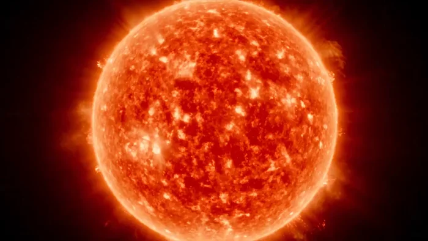

[← 返回总目录](../README.zh-CN.md#table-of-contents) · [English](explainer.md) · [简体中文](explainer.zh-CN.md) · [日本語](explainer.ja.md)

### 教学解说视频 Explainer

- [Case 62: Classroom explainer, a Song dynasty poem (豆包课堂 · 辛弃疾《青玉案》) — by ByteDance](#case-62)
- [Case 63: Anime-style avocado toast, step by step (动漫风格牛油果吐司分步教程) — by @Sairah_0](#case-63)

- [Case 71: Solar System documentary trailer (太阳系纪录片预告) — by @CharaspowerAI](#case-71)

### Case 62: Classroom explainer, a Song dynasty poem (豆包课堂 · 辛弃疾《青玉案》) — by ByteDance

▶ [在 ofox.ai 观看完整视频](https://ofox.ai/seedance-2-5-prompts?utm_source=github&utm_medium=case&utm_campaign=awesome-seedance-2-5#case-62)

**输入素材**：未公开 —— ByteDance Seed 博客只发布了成片，未随文发布输入素材

**Prompt**

~~~~text
东方写意风格。 南宋临安街景，热闹的街上几个孩子边跑边闹，孩子们嘴里张嘴念着“蓦然回首，那人却在，灯火阑珊处”。镜头始终跟随孩子们奔跑，带过热闹的街景。镜头上摇，此人正是 @图片 1 辛弃疾。辛弃疾回头，远处是在灯火阑珊中的男子，镜头连贯。
~~~~

**参数**：Seedance 2.5 · 未标注 · r2v · 未标注 · 未标注 · 未标注 · 带音频
**来源**：ByteDance Seed 官方博客 · [中文](https://seed.bytedance.com/zh/blog/one-take-creation-flexible-referencing-introducing-seedance-2-5) · [English](https://seed.bytedance.com/en/blog/one-take-creation-flexible-referencing-introducing-seedance-2-5)

Preview frame © 2026 ByteDance, from the official demo video · Prompt by ByteDance · <a href="https://seed.bytedance.com/zh/blog/one-take-creation-flexible-referencing-introducing-seedance-2-5">source</a>

[回到目录](#table-of-contents)

### Case 63: Anime-style avocado toast, step by step (动漫风格牛油果吐司分步教程) — by @Sairah_0

▶ [在 ofox.ai 观看完整视频](https://ofox.ai/seedance-2-5-prompts?utm_source=github&utm_medium=case&utm_campaign=awesome-seedance-2-5#case-63)

<strong>Prompt</strong> — 动漫风格视频，描绘了在阳光明媚的厨房中制作牛油果吐司的过程。 • 场景 1 (0:00 - 0:01)：特写镜头，展示双手在木质项目上用刀将成熟的牛油果切成两半，然后用勺子挖出果核。 • 场景 2 (0:02 - 0:03)：将油从透明瓶中倒入正在燃气灶平底锅中煎烤的面包片上，随后用木勺搅拌锅中煮沸…

~~~~text
动漫风格视频，描绘了在阳光明媚的厨房中制作牛油果吐司的过程。 • 场景 1 (0:00 - 0:01)：特写镜头，展示双手在木质项目上用刀将成熟的牛油果切成两半，然后用勺子挖出果核。 • 场景 2 (0:02 - 0:03)：将油从透明瓶中倒入正在燃气灶平底锅中煎烤的面包片上，随后用木勺搅拌锅中煮沸的水以制作水波蛋。 • 场景 3 (0:04 - 0:06)：将调味后的牛油果泥涂抹在烤好的酸种面包上。轻轻放上两个水波蛋，并点缀以对半切开的圣女果、萝卜片、新鲜微型蔬菜和调味料。 • 场景 4 (0:07 - 0:08)：一位留着凌乱深色头发、戴着眼镜的年轻女性坐在阳光明媚的餐桌旁，享受着牛油果吐司，并喝了一口咖啡。
~~~~

**参数**：Seedance 2.5 · 未标注 · t2v · 未标注 · 未标注 · 未标注 · 未标注
**来源**：[@Sairah_0](https://x.com/Sairah_0) · [原帖](https://x.com/Sairah_0/status/2088827610902168020)

Preview © 2026 <a href="https://x.com/Sairah_0/status/2088827610902168020">@Sairah_0</a> · Prompt by <a href="https://x.com/Sairah_0/status/2088827610902168020">@Sairah_0</a>

[回到目录](#table-of-contents)

### Case 71: Solar System documentary trailer (太阳系纪录片预告) — by @CharaspowerAI

▶ [在 ofox.ai 观看完整视频](https://ofox.ai/seedance-2-5-prompts?utm_source=github&utm_medium=case&utm_campaign=awesome-seedance-2-5#case-71)

**输入素材**：未公开 —— 原帖未附可下载的独立输入素材

<strong>Prompt</strong> —   Ultra-realistic premium space documentary trailer with high-end streaming-series cinematography. Scientifically grounded planetary scale, cinematic …

~~~~text
  Ultra-realistic premium space documentary trailer with high-end streaming-series cinematography. Scientifically grounded planetary scale, cinematic orbital flybys, slow majestic camera pushes, macro solar detail, deep-space parallax, volumetric sunlight, realistic planetary textures, restrained lens flares, subtle film grain, immense sense of scale. Serious, awe-inspiring, mysterious and elegant.

  The Solar System as the main subject: the Sun, Mercury, Venus, Earth, Moon, Mars, Jupiter, Saturn, Uranus, Neptune and the distant outer regions. No fictional spacecraft as the focus, no fantasy creatures, no human characters.

 Deep space, solar corona, planetary orbits, Earth atmosphere, Mars surface, Jupiter cloud layers, Saturn rings, icy outer-system darkness.

  0-5s: Epic opening  Black screen. A thin arc of sunlight appears, revealing the enormous surface of the Sun. Camera slowly approaches turbulent plasma and glowing prominences. English voice-over: “Eight worlds… bound to one star.”

5-10s:  Inner planets Rapid elegant flybys of Mercury’s scorched terrain, Venus hidden beneath dense clouds, then Earth rotating into sunlight. Voice-over: “From worlds burned by heat… to the only home we know.”

10-15s: Earth to Mars  Camera passes the Moon, dives toward Earth’s blue atmosphere, then match-cuts to the red deserts and vast canyons of Mars. Voice-over: “Each planet carries the story of what a world can become.”

15-21s:  The giants  Jupiter fills the frame. Camera skims above turbulent cloud bands and the Great Red Spot, then transitions through Saturn’s rings in spectacular slow motion. Voice-over: “Beyond the inner worlds… giants rule the darkness.”

21-26s:  Outer frontier  Uranus and Neptune drift through cold blue light. Tiny icy bodies appear against an immense star field as the Sun becomes a distant point. Voice-over: “And farther still… the Solar System fades into the unknown.”

26-30s:  Final reveal  Wide pullback showing the planetary orbits around the Sun, then continuing outward until the entire Solar System becomes tiny within the surrounding darkness. Voice-over: “This is not just our neighborhood. It is our origin story.” Hard cut to black.

  Photorealistic planetary surfaces, believable orbital scale, realistic sunlight behavior, stable planetary appearance, premium science-documentary pacing, deep cinematic English narration, majestic composition, physically plausible space lighting, no fantasy imagery, no readable text, no logos.
~~~~

**参数**：Seedance 2.5 · 未标注 · 未标注 · 未标注 · 未标注 · 未标注 · 未标注
**来源**：[@CharaspowerAI](https://x.com/CharaspowerAI) · [原帖](https://x.com/CharaspowerAI/status/2097022168441725317)

Preview © 2026 <a href="https://x.com/CharaspowerAI/status/2097022168441725317">@CharaspowerAI</a> · Prompt by <a href="https://x.com/CharaspowerAI/status/2097022168441725317">@CharaspowerAI</a>

[返回目录](#table-of-contents)
