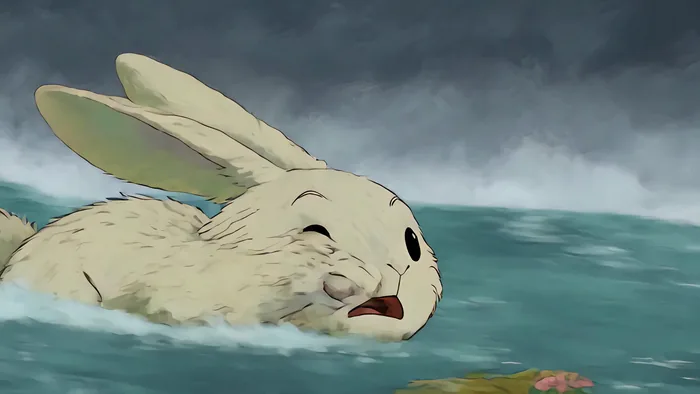

[← 総目次に戻る](../../../README.ja.md#table-of-contents) · [English](image-edit.md) · [简体中文](image-edit.zh-CN.md) · [日本語](image-edit.ja.md)

### 画像編集・リタッチ Image Edit

- [Case 55: Dubstep photo-animation edit (回响贝斯照片动画剪辑) — by @rahulnanda86](#case-55)
- [Case 56: Locked-illustration creature story (锁定原画的生物故事) — by @AiMeowing](#case-56)

### Case 55: Dubstep photo-animation edit (回响贝斯照片动画剪辑) — by @rahulnanda86

▶ [ofox.ai で動画をすべて見る](https://ofox.ai/seedance-2-5-prompts?utm_source=github&utm_medium=case&utm_campaign=awesome-seedance-2-5#case-55)

**输入素材**：未公开 —— 原作者只发布了成片，未提供输入素材

<strong>Prompt</strong> — Create a fast, trippy 30-second dubstep music video using all the uploaded photographs  (PLEASE FIND ATTACHED ALL 14 IMAGES + AUDIO IN THREAD).  Use t…

~~~~text
Create a fast, trippy 30-second dubstep music video using all the uploaded photographs

(PLEASE FIND ATTACHED ALL 14 IMAGES + AUDIO IN THREAD).

Use the uploaded 30-second audio as the only soundtrack. Make it a powerful dubstep edit: every movement, punch-in, transition and hard cut must hit the beat. Fully animate everything inside the photographs. Make the dancers perform, fabric and flames spin, painted eyes react, masks lunge, multiple arms ripple, the drummer strike his drum, sadhus dissolve into ash and black birds, motorcycles race aggressively, smoke creatures come alive, the underwater band actively play, boats move through the surreal landscape, and the flaming weapon create violent circles of fire. No photograph should remain static.Freely mix all the visuals in whatever order works best with the music. Let movement from one photograph naturally transform into the next: spinning fire becomes fabric, fabric becomes a painted eye, expanding arms become the drummer's arms, ash birds become racing motorcycles, motorcycle dust becomes dancing smoke, smoke becomes underwater bubbles, bubbles become water and boats, and the boats transform into circles of fire.Keep constant movement throughout. Use rapid punch-ins, speed ramps, bass-impact flashes, hard rhythmic cuts, brief freeze-frames and fluid psychedelic transitions. Add a separate graphic layer flashing ॐ, the trishul, damru, third eye, crescent moon and traditional Hindu sacred symbols precisely on the beat. Let them pulse, rotate, distort and dissolve without covering the performers.Make it stylish, colourful, strange and extremely high-energy—an edgy, award-winning Incredible India advertisement edited like a dubstep music video. No dialogue, no typography, no slideshow, no long static shots and no complicated story. Finish with the strongest collision of fire, ash, birds and sacred symbols on the final bass hit.

#capcutseedance25 #capcutcpp
~~~~

**参数**：Seedance 2.5 · CapCut · edit · 30s · 未标注 · 未标注 · 带音频
**来源**：[@rahulnanda86](https://x.com/rahulnanda86) · [原帖](https://x.com/rahulnanda86/status/2083355736479052209)

Preview © 2026 <a href="https://x.com/rahulnanda86/status/2083355736479052209">@rahulnanda86</a> · Prompt by <a href="https://x.com/rahulnanda86/status/2083355736479052209">@rahulnanda86</a>

[目次に戻る](#table-of-contents)

### Case 56: Locked-illustration creature story (锁定原画的生物故事) — by @AiMeowing

▶ [ofox.ai で動画をすべて見る](https://ofox.ai/seedance-2-5-prompts?utm_source=github&utm_medium=case&utm_campaign=awesome-seedance-2-5#case-56)

**输入素材**：未公开 —— 原作者只发布了成片，未提供输入素材

<strong>Prompt</strong> — Lock the original illustration completely. Preserve the exact art style, brushwork, textures, material rendering, color palette, creature proportions,…

~~~~text
Lock the original illustration completely. Preserve the exact art style, brushwork, textures, material rendering, color palette, creature proportions, facial expressions, lighting, composition, and every character design exactly as shown. Never change the visual style. Every creature must remain identical in every shot. No text, watermark, logo, or signature. One continuous story. Motion always progresses forward. No creature moves backward. Use cinematic pacing with hard cuts, speed ramps, bullet time, dynamic tracking, volumetric water, realistic physics, motion blur, subtle film grain, dramatic lighting, lens droplets, cinematic depth of field, bold camera language, emotional facial animation, and seamless transitions.

0-3s

Without warning, the peaceful group suddenly notices every bird exploding into the sky. Tiny ripples appear beneath their feet. A deep rumble grows louder. Extreme close-up of frightened eyes. Fast push-in toward the rabbit. Hard cut to a gigantic wall of water rising behind them. Lightning-fast whip pan reveals the impossible tsunami racing toward the camera. Deep bass hit.

3-6s

The wave crashes over everyone. Water engulfs the frame. Camera tumbles underwater with bubbles, debris, flowers, leaves and sunlight cutting through the current. Every creature is separated naturally by the force. Slow-motion for one second before time accelerates again.

6-10s

Rapid cross-cut survival sequence. The rabbit paddles frantically with long ears floating behind. The lion powers through the waves with strong strokes. The rhino kicks heavily while struggling to stay above water. The giant blue triceratops swims like a massive whale. Frogs leap from floating debris. Tiny creatures cling to drifting branches. Cats desperately paddle while trying not to sink. Dynamic handheld water-level camera alternating with overhead drone shots.

10-15s

The current becomes more violent. Floating logs collide. The turtle spins helplessly in a whirlpool before escaping. The sheep nearly slips beneath the surface until the lion nudges it upward. The black cat loses its grip and disappears beneath a wave. Silence for half a second except muffled underwater sound.

15-20s

The gray kitten dives underwater searching. Cinematic underwater tracking follows the kitten weaving between drifting plants and bubbles. A frightened turtle struggles below. The kitten reaches it, grabs its shell with tiny paws and guides it upward toward sunlight breaking through the surface.

20-25s

Both burst above the water. The exhausted kitten climbs onto the turtle's shell. The turtle begins swimming steadily through the endless flood while the kitten balances carefully, soaked but relieved. Around them every animal continues fighting the current in its own unique way. Long aerial tracking shot follows their path.

25-28s

The current slowly weakens. One by one the surviving animals regroup behind the turtle. The rabbit swims beside it. Frogs hop onto floating wood. The lion keeps everyone together. The enormous blue triceratops shields the smaller creatures from remaining waves. Warm sunlight finally pierces the storm clouds.

28-30s

A majestic vertical drone shot rises high into the sky. The flood forms beautiful winding rivers across the landscape. At the center, the tiny kitten sits safely on the turtle's shell leading the group forward while every surviving creature follows behind. The music swells into an emotional orchestral finale. Hold the final frame like an animated movie poster as golden light reflects across the water.
~~~~

**参数**：Seedance 2.5 · 即梦 · edit · 30s · 未标注 · 未标注 · 带音频
**来源**：[@AiMeowing](https://x.com/AiMeowing) · [原帖](https://x.com/AiMeowing/status/2083332412558172377)

Preview © 2026 <a href="https://x.com/AiMeowing/status/2083332412558172377">@AiMeowing</a> · Prompt by <a href="https://x.com/AiMeowing/status/2083332412558172377">@AiMeowing</a>

[目次に戻る](#table-of-contents)
