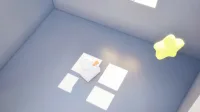

[← 総目次に戻る](../../../README.ja.md#table-of-contents) · [English](keyframe-animation.md) · [简体中文](keyframe-animation.zh-CN.md) · [日本語](keyframe-animation.ja.md)

### 開始・終了フレームアニメーション Keyframe Animation

- [Case 42: First-last frame, "cheese" (首尾帧 · 女孩说「茄子」) — by ByteDance](#case-42)
- [Case 43: Coarse clay-model 30-second fairytale short (粗粒度白模 · 30 秒童话 3D 短片) — by ByteDance](#case-43)
- [Case 44: PYONA school corridor fight, part 2 (PYONA 校园走廊格斗·下集) — by @pyona_ai](#case-44)

### Case 42: First-last frame, "cheese" (首尾帧 · 女孩说「茄子」) — by ByteDance

| 输入 | 输出 |
|:---:|:---:|
|  |  |

▶ [ofox.ai で動画をすべて見る](https://ofox.ai/seedance-2-5-prompts?utm_source=github&utm_medium=case&utm_campaign=awesome-seedance-2-5#case-42)

**Prompt**

~~~~text
图中女孩对着镜头说“茄子”，360度环绕运镜
~~~~

**参数**：Seedance 2.5 · 火山方舟 · 首尾帧 · 5s · 未标注 · adaptive（锁定首帧，输出 1:1）· 带音频
**来源**：火山方舟官方文档 · [中文](https://docs.volcengine.com/docs/82379/2607688?lang=zh) · [English](https://docs.byteplus.com/en/docs/ModelArk/2607688)

Preview frame © 2026 ByteDance, from the official demo video · Prompt by ByteDance · <a href="https://docs.volcengine.com/docs/82379/2607688?lang=zh">source</a>

[目次に戻る](#table-of-contents)

### Case 43: Coarse clay-model 30-second fairytale short (粗粒度白模 · 30 秒童话 3D 短片) — by ByteDance

▶ [ofox.ai で動画をすべて見る](https://ofox.ai/seedance-2-5-prompts?utm_source=github&utm_medium=case&utm_campaign=awesome-seedance-2-5#case-43)

**输入素材**（1 段白模参考视频 + 9 张关键帧参考图，视频只取首帧）

| | | | |
|:---:|:---:|:---:|:---:|
|  &lt;video1&gt; 白模首帧 |  &lt;2pic&gt; |  &lt;3pic&gt; |  &lt;4pic&gt; |
|  &lt;5pic&gt; |  &lt;6pic&gt; |  &lt;7pic&gt; |  &lt;8pic&gt; |
|  &lt;9pic&gt; |  &lt;10pic&gt; |  |  |

<strong>Prompt</strong> — 以白模参考视频 &lt;video1&gt; 作为整支视频唯一的运镜、镜头节奏、景别变化、主体运动轨迹和镜头调度参考，严格保持白模视频的镜头顺序、机位变化、运动方式和节奏，不改变镜头结构，不新增镜头，不改变主体运动逻辑。结合各阶段关键帧参考图，生成一部 30 秒电影级 3D 动画短片，整体风格梦幻、童话、温暖，…

~~~~text
以白模参考视频 <video1> 作为整支视频唯一的运镜、镜头节奏、景别变化、主体运动轨迹和镜头调度参考，严格保持白模视频的镜头顺序、机位变化、运动方式和节奏，不改变镜头结构，不新增镜头，不改变主体运动逻辑。结合各阶段关键帧参考图，生成一部 30 秒电影级 3D 动画短片，整体风格梦幻、童话、温暖，具有儿童幻想色彩，角色外形与各阶段的关键帧保持一致，不要改变角色形象，人物表情情绪随场景变化而改变。
0-3s（首帧参考 <2pic>）镜头由全景俯视缓缓推向地上的小女孩，小女孩坐在房间的地毯上玩飞机，小女孩起身左转，右手使劲一挥将手里的飞机放飞。
3-5s（参考 <3pic>）飞机从左至右穿过房间悬挂的星星挂件，小女孩乘坐飞机进入幻想的天空。
5-8s（参考 <4pic>）镜头继续侧跟，以小女孩为中心的环绕。
8-10s（参考 <5pic>）镜头环绕到小女孩驾驶的飞机背面、飞机开始缓缓俯冲海面。
10-19s（参考 <6pic>、参考 <7pic>）小女孩继续向海底游去，一条鳐鱼游过来入画。
19-23s（参考 <8pic>）小女孩从时空裂缝冲出来到幻想宇宙。
23-24s（参考 <9pic>）前景小女孩和星球开始前翻转并，逐渐幻化消失。
24-28s（参考 <9pic>）俯视镜头持续推进，小女孩躺在地的毯上熟睡。
28-30s（参考 <10pic>）镜头继续推进绘本，随后爸爸进入画面。
整体要求：所有画面均参考对应关键帧，白模视频仅作为运镜、镜头运动和角色动画参考，不参考画面内容。最终输出 30 秒 16:9 横构图宽屏视频。
~~~~

**参数**：Seedance 2.5 · 火山方舟 · r2v · 30s · 未标注 · 16:9 · 未标注
**来源**：火山方舟官方文档 · [中文](https://docs.volcengine.com/docs/82379/2607689?lang=zh) · [English](https://docs.byteplus.com/en/docs/ModelArk/2607689)

Preview frame © 2026 ByteDance, from the official demo video · Prompt by ByteDance · <a href="https://docs.volcengine.com/docs/82379/2607689?lang=zh">source</a>

[目次に戻る](#table-of-contents)

### Case 44: PYONA school corridor fight, part 2 (PYONA 校园走廊格斗·下集) — by @pyona_ai

▶ [ofox.ai で動画をすべて見る](https://ofox.ai/seedance-2-5-prompts?utm_source=github&utm_medium=case&utm_campaign=awesome-seedance-2-5#case-44)

**输入素材**：未公开 —— 原作者只发布了成片，未提供输入素材

<strong>Prompt</strong> — Use exactly 2 uploaded image assets. image1 = PYONA唯一且最高优先级人物身份与服装参考。严格保持她可辨识的脸部、五官比例、肤色、体型、发型、发色、所有可见配件与image1服装一致。必须像PART 1中同一个真实韩国女性继续战斗。禁止换脸、AI塑料皮…

~~~~text
Use exactly 2 uploaded image assets. image1 = PYONA唯一且最高优先级人物身份与服装参考。严格保持她可辨识的脸部、五官比例、肤色、体型、发型、发色、所有可见配件与image1服装一致。必须像PART 1中同一个真实韩国女性继续战斗。禁止换脸、AI塑料皮肤、3D、游戏CG。 image2 = 男性火属性对手唯一且最高优先级人物身份与服装参考。严格保持他的可辨识脸部、五官比例、肤色、发型、体型、服装与所有可见特征一致。必须与PART 1为完全同一个真实韩国男性。 生成严格30秒、16:9横屏、原生4K、24fps、one continuous generation的超写实真人韩国校园超自然动作短片。REAL LIVE-ACTION + EXTREMELY FAST CONTINUOUS ELEMENTAL COMBAT。无BGM、无字幕、无旁白、无台词。 【连续性】 严格延续PART 1最终画面。同一条深夜韩国学校走廊。第一帧两人已经处于近距离正面碰撞：男性右拳与前臂被高密度橙红火焰包裹，正在压向PYONA；PYONA双臂前方已有大量透明水形成高速旋转水盾，火与水接触产生白色蒸汽。 禁止重新站位、禁止重新对峙、禁止慢慢准备。第一帧立刻继续战斗。 【能力规则】 PYONA可直接从自身能力持续生成大量真实透明水，完全不依赖环境水源。她不仅使用水强化拳脚，还必须主动使用明显、强力、不同形态的水系技能。 男性直接生成火焰和高热，以近身火焰格斗为主。 禁止巨大海啸、火龙、魔法阵、游戏能量球。水与火必须保持真实液体、蒸汽、热压、惯性和重量感。 【PHYSICAL CONTACT LOCK — 最高优先级】 所有近身动作必须遵循： VISIBLE TARGET → BODY ENTRY → REAL STRIKE MOTION → CLEAR CONTACT → IMMEDIATE BODY REACTION → BALANCE CHANGE / DISPLACEMENT → NEXT ACTION. 禁止接触前提前出现受击反应。 禁止水火VFX代替真实人体动作。 双方都必须成功命中对方。 防御后必须立即反击。 NO CAUTIOUS ACTION. NO HESITATION. NO LIGHT SPARRING. NO WAITING. NO LONG RESET. FULL COMMITMENT ON EVERY ATTACK. 【00:00–00:05 — VORTEX REDIRECT + HYDRAULIC BURST】 第一帧直接爆发。 FIRE FIST PRESSURE → ROTATING WATER SHIELD COMPRESSES → DENSE STEAM BURST。 PYONA不后退。她猛然改变水盾旋转方向，形成WATER VORTEX REDIRECT，真实推动男性右臂向外偏离，男性肩膀和上身随力量转开。 PYONA立即切入： LEFT ELBOW CONTACT → RIGHT BODY PUNCH → KNEE STRIKE。 三次近身攻击连续发生，不能停顿。 最后PYONA双掌真实接触男性胸前后立即发动： HYDRAULIC BURST。 PALM CONTACT FIRST → WATER RAPIDLY COMPRESSES BETWEEN HANDS → POINT-BLANK HIGH-PRESSURE WATER BURST。 短促但极强的透明水压从接触点爆发，男性明显被推退数步。 【00:05–00:10 — FIRE RUSH vs WATER WHIP】 男性后退过程中立即稳住重心，脚后短促火焰辅助真实前冲，FIRE RUSH高速返回。 LEFT FIRE HOOK → PYONA低头闪过； RIGHT FIRE ELBOW实际连接PYONA肩侧 → PYONA上身明显受力并横移一步。 PYONA没有继续退。右手猛然挥出并直接生成一条高速粗水流： WATER WHIP。 水鞭准确缠住男性攻击前臂，PYONA用全身旋转力量猛拉，使男性上身与攻击线被强制带向侧方。 她沿着拉扯方向直接冲入： KNEE CONTACT → WATER-ASSISTED SIDE KICK。 男性被再次逼离，但立刻重新进入战斗。 【00:10–00:15 — PRESSURE WAVE】 男性用高热快速蒸散Water Whip并直接再次前冲。 PYONA不等待，双手向前快速推开，同时从自身瞬间生成大量透明水： PRESSURE WAVE。 不是海啸。是一道填满局部走廊宽度、短距离、高密度、高压的厚重水墙，猛烈向前推进。 男性双臂交叉，以高密度FIRE PRESSURE正面顶住。 PRESSURE WAVE → FIRE CONTACT → VIOLENT STEAM GENERATION。 男性被推动但没有倒下，竟然顶着水压强行穿过逐渐蒸散的水墙。 他从蒸汽中冲出并立即以FIRE FOREARM实际连接PYONA上身，PYONA被强行推开。 【00:15–00:20 — VORTEX BREAK + 强力反攻】 男性继续追击： FIRE BODY HOOK实际命中 → PYONA明确受力； 紧接FIRE KNEE继续前压。 第三次攻击即将进入时，PYONA双臂从下向上猛烈展开。 VORTEX BREAK。 大量水从她身体周围瞬间形成短暂高速螺旋水压场。 不是保护罩，不持续防守。 ROTATING WATER PRESSURE EXPANDS OUTWARD → 男性的攻击手臂、肩部与重心被短暂强制打开。 PYONA立刻从旋涡内部冲出： HYDRO STEP ENTRY → ELBOW CONTACT → BODY KICK → HYDRAULIC PALM。 最后手掌接触后短促水压爆发，把男性再次推离。 【00:20–00:25 — HYDRO DRILL】 男性落脚后立刻再次FIRE RUSH，右前臂形成极高密度火焰层。 PYONA同时右臂后拉，大量透明水瞬间沿手掌、前臂、上臂高速螺旋压缩。 HYDRO DRILL。 水不是魔法光束，而是围绕真实手臂高速旋转的厚重高压水流。 双方正面快速进入： FIRE FOREARM vs ROTATING HYDRO DRILL。 真实前臂距离接近 → 水火正面碰撞 → 高温蒸汽猛烈爆发。 短暂力量对抗后，PYONA猛然将Hydro Drill向外旋转，把男性火焰手臂和肩线一起带偏。 禁止停下来摆Pose。 【00:25–00:30 — MAXIMUM HYDRO FINISH】 男性立即用另一只火拳进行最后一次高速反击。 PYONA左前臂生成短促ROTATING WATER LAYER，将火拳真实接触后向外redirect。 男性因自身高速前进惯性导致躯干打开。 PYONA立即追击，最后一击决定性攻击。
~~~~

**参数**：Seedance 2.5 · 未标注 · i2v · 30s · 未标注 · 16:9 · 未标注
**来源**：[@pyona_ai](https://x.com/pyona_ai) · [原帖](https://x.com/pyona_ai/status/2093334200112091428)

Preview © 2026 <a href="https://x.com/pyona_ai/status/2093334200112091428">@pyona_ai</a> · Prompt by <a href="https://x.com/pyona_ai/status/2093334200112091428">@pyona_ai</a>

[目次に戻る](#table-of-contents)
