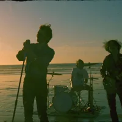
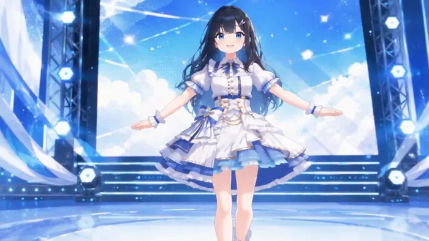
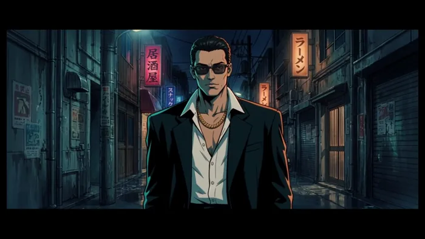

[← 総目次に戻る](../../../README.ja.md#table-of-contents) · [English](music-video.md) · [简体中文](music-video.zh-CN.md) · [日本語](music-video.ja.md)

### ミュージックビデオ Music Video

- [Case 57: Multilingual hip-hop MV, eight-language lip-sync (多语言 Hip-hop MV · 8 种语言口型) — by ByteDance](#case-57)
- [Case 58: One-take concert entrance (一镜到底演唱会登台) — by ByteDance](#case-58)
- [Case 59: 30-second classical concert (30 秒古典音乐会) — by ByteDance](#case-59)
- [Case 60: Idol pop performance, full lyrics & BPM (偶像流行音乐表演·完整歌词与节拍) — by @stocktrading0](#case-60)
- [Case 61: 90s underground gangster-anime beatbox MV (90年代地下帮派动漫节奏口技MV) — by @Madhuribhai](#case-61)

### Case 57: Multilingual hip-hop MV, eight-language lip-sync (多语言 Hip-hop MV · 8 种语言口型) — by ByteDance

▶ [ofox.ai で動画をすべて見る](https://ofox.ai/seedance-2-5-prompts?utm_source=github&utm_medium=case&utm_campaign=awesome-seedance-2-5#case-57)

**输入素材**（1 张官方参考图）

| |
|:---:|
|  @图像1 |

<strong>Prompt</strong> — 电影级 hip-hop / 说唱音乐视频，真实照片级质感，高端调性，海边场景。以@图像1构建画面：一支乐队在金色沙滩、海浪拍岸的岸边表演 —— 一名主唱手握麦克风、麦架立于湿沙上激情演唱，一名吉他手立于画面左侧，一名吉他手立于画面右侧，一名鼓手坐在后方的架子鼓后敲击；辽阔的海岸线在身后展开，滚滚海浪…

~~~~text
电影级 hip-hop / 说唱音乐视频，真实照片级质感，高端调性，海边场景。以@图像1构建画面：一支乐队在金色沙滩、海浪拍岸的岸边表演 —— 一名主唱手握麦克风、麦架立于湿沙上激情演唱，一名吉他手立于画面左侧，一名吉他手立于画面右侧，一名鼓手坐在后方的架子鼓后敲击；辽阔的海岸线在身后展开，滚滚海浪层层涌来，巨大而温暖的黄金时刻夕阳斜掠过沙滩、在水面上粼粼闪耀，空气中漂浮着海雾与咸湿水汽。 红色运动服的主唱对着镜头充满节奏感地 RAP 演唱 —— 口型与下颌随每一个字精准对位，头随节拍用力点动，带动整段 flow。乐手们随节奏摇摆律动，身后海浪层层拍岸。这是一首明快带劲的说唱曲 —— 语速快、自信、节拍强劲。踩着节拍硬切（HARD CUT），每次切换双重反差（景别与镜头类型同时改变）。 歌词（主唱依次演唱以下每种语言的「你好」，精准对口型）： 英语："Hello" 中文："你好" 日语："こんにちは" 韩语："안녕하세요" 葡萄牙语："Olá" 泰语："สวัสดี" 西班牙语："Hola" 阿拉伯语："مرحبا" 镜头 1 [0:00–0:03] —— 低角度大远景定场，斯坦尼康在黄金夕照与海雾中缓缓推进，海浪在乐队身后翻涌。歌词第 1 句（英语「Hello」）。硬切。镜头 2 [0:03–0:05] —— 红运动服主唱对镜头 RAP 的特写，手持甩镜切入，身后海面虚焦粼粼波光。歌词第 2 句（中文「你好」）。硬切。镜头 3 [0:05–0:08] —— 微距插入镜头，固定机位，吉他手的手指在弦上快速拨动，沙粒与咸湿水雾从画面前掠过。歌词第 3 句（日语「こんにちは」）。硬切。镜头 4 [0:08–0:10] —— 对某位乐手的 3/4 侧中景，缓慢潜行环绕，乐器金属件与湿润高光映着海面低斜的夕阳。歌词第 4 句（韩语「안녕하세요」）。硬切。镜头 5 [0:10–0:13] —— 岸边一名乐手，快速横移轨道掠过他，他转向镜头，身后一道浪花破碎。歌词第 5 句（葡萄牙语「Olá」）。硬切。镜头 6 [0:13–0:15] —— 水边的鼓手，手持快速上摇，海风与水花吹动他的头发，他随节拍律动敲击。歌词第 6 句（泰语「สวัสดี」）。硬切。镜头 7 [0:15–0:18] —— 对红运动服主唱 flow 正酣时的紧凑猛推，富攻击性的手持，身后暮色海面衬着乐队剪影。歌词第 7 句（西班牙语「Hola」）。硬切。镜头 8 [0:18–0:20] —— 全乐队英雄式大远景，富攻击性的手持推进，主唱与乐手踩着节拍向镜头迈步，海浪拍碎、金色夕光在整支乐队身后炸开光晕。歌词第 8 句（阿拉伯语「مرحبا」）。 白平衡 4000K，青橙（teal-and-amber）调色，35mm，浅景深，胶片颗粒，弥漫的海雾，黄金时刻光晕。质感扎实、高级、高端。节奏感说唱表演，精准对口型，头随节拍点动。无字幕、无文字叠加、无叠化转场、无重复人物，仅用硬切。总时长 20 秒。
~~~~

**参数**：Seedance 2.5 · 火山方舟 · r2v · 20s · 未标注 · 16:9 · 带音频
**来源**：火山方舟官方文档 · [中文](https://docs.volcengine.com/docs/82379/2607688?lang=zh) · [English](https://docs.byteplus.com/en/docs/ModelArk/2607688)

Preview frame © 2026 ByteDance, from the official demo video · Prompt by ByteDance · <a href="https://docs.volcengine.com/docs/82379/2607688?lang=zh">source</a>

[目次に戻る](#table-of-contents)

### Case 58: One-take concert entrance (一镜到底演唱会登台) — by ByteDance

▶ [ofox.ai で動画をすべて見る](https://ofox.ai/seedance-2-5-prompts?utm_source=github&utm_medium=case&utm_campaign=awesome-seedance-2-5#case-58)

<strong>Prompt</strong> — 一镜到底手持稳定器跟拍，镜头从红色厚重幕布缝隙缓缓推进，进入暖色后台化妆间。年轻女歌手背对镜头整理耳机，工作人员提醒她准备登台。她回头看向镜头，开始唱起 City Pop。镜头后退跟拍，歌手穿过幕布进后台通道，与舞伴自然互动，一位工作人员把麦克风递给她。随后歌手与舞伴登上舞台，镜头绕至背面，红黑舞美…

~~~~text
一镜到底手持稳定器跟拍，镜头从红色厚重幕布缝隙缓缓推进，进入暖色后台化妆间。年轻女歌手背对镜头整理耳机，工作人员提醒她准备登台。她回头看向镜头，开始唱起 City Pop。镜头后退跟拍，歌手穿过幕布进后台通道，与舞伴自然互动，一位工作人员把麦克风递给她。随后歌手与舞伴登上舞台，镜头绕至背面，红黑舞美、LED 屏、追光、烟雾与反光地板逐渐展开。镜头最终拉远至体育馆全景，呈现满场观众、灯牌、荧光棒与欢呼声，营造年轻自由的演唱会高潮氛围。
~~~~

**参数**：Seedance 2.5 · 未标注 · t2v · 30s · 未标注 · 未标注 · 带音频
**来源**：ByteDance Seed 官方博客 · [中文](https://seed.bytedance.com/zh/blog/one-take-creation-flexible-referencing-introducing-seedance-2-5) · [English](https://seed.bytedance.com/en/blog/one-take-creation-flexible-referencing-introducing-seedance-2-5)

Preview frame © 2026 ByteDance, from the official demo video · Prompt by ByteDance · <a href="https://seed.bytedance.com/zh/blog/one-take-creation-flexible-referencing-introducing-seedance-2-5">source</a>

[目次に戻る](#table-of-contents)

### Case 59: 30-second classical concert (30 秒古典音乐会) — by ByteDance

▶ [ofox.ai で動画をすべて見る](https://ofox.ai/seedance-2-5-prompts?utm_source=github&utm_medium=case&utm_campaign=awesome-seedance-2-5#case-59)

**输入素材**：未公开 —— ByteDance Seed 博客只发布了成片，未随文发布输入素材

<strong>Prompt</strong> — 30 秒音乐会片段，16:9 横屏，电影感写实，真实音乐厅光影，暖金色舞台灯，正式古典音乐会氛围。场景@图一，钢琴家参考@图二，大提琴参考@图三，小提琴参考@图四，主唱参考@图五，管弦等其他乐队参考@图六到图十，合唱团参考图十一到图十四，观众席参考@图十五到图十八。主唱舞台中央走向前沿，钢琴家在钢琴…

~~~~text
30 秒音乐会片段，16:9 横屏，电影感写实，真实音乐厅光影，暖金色舞台灯，正式古典音乐会氛围。场景@图一，钢琴家参考@图二，大提琴参考@图三，小提琴参考@图四，主唱参考@图五，管弦等其他乐队参考@图六到图十，合唱团参考图十一到图十四，观众席参考@图十五到图十八。主唱舞台中央走向前沿，钢琴家在钢琴旁，乐队分布两侧与后方，合唱团在舞台后方。开场高位俯拍音乐厅全景，钢琴家落键，主唱进入追光演唱，镜头自然带过小提琴、大提琴与管弦乐队，小提琴明亮，大提琴温暖。后段合唱团加入，主唱与第一排观众短暂眼神交流，观众微笑点头。结尾镜头后移，演唱结束，观众跟随鼓掌。
~~~~

**参数**：Seedance 2.5 · 未标注 · r2v · 30s · 未标注 · 16:9 · 带音频
**来源**：ByteDance Seed 官方博客 · [中文](https://seed.bytedance.com/zh/blog/one-take-creation-flexible-referencing-introducing-seedance-2-5) · [English](https://seed.bytedance.com/en/blog/one-take-creation-flexible-referencing-introducing-seedance-2-5)

Preview frame © 2026 ByteDance, from the official demo video · Prompt by ByteDance · <a href="https://seed.bytedance.com/zh/blog/one-take-creation-flexible-referencing-introducing-seedance-2-5">source</a>

[目次に戻る](#table-of-contents)

### Case 60: Idol pop performance, full lyrics & BPM (偶像流行音乐表演·完整歌词与节拍) — by @stocktrading0

▶ [ofox.ai で動画をすべて見る](https://ofox.ai/seedance-2-5-prompts?utm_source=github&utm_medium=case&utm_campaign=awesome-seedance-2-5#case-60)

**输入素材**：未公开 —— 原作者只发布了成片，未提供输入素材

<strong>Prompt</strong> — 16:9 aspect ratio. All lyrics sung in Japanese. Subject: Suzuko-chan from attached image. Scene: All-ages, live stage with no audience. Shooting strat…

~~~~text
16:9 aspect ratio. All lyrics sung in Japanese. Subject: Suzuko-chan from attached image. Scene: All-ages, live stage with no audience. Shooting strategy: 4-shot composition utilizing full screen, smooth tracking, suppress sudden jitter. Background music spec: Complete within 20 seconds. Genre: Fast-paced idol pop. Tempo: BPM 170. Characteristics: Fast-paced beat, clear synthesizer effects, fresh and vibrant major key melody.

Shot 1 (0:00-0:05) Camera: Large-scale tilting motion from bottom to top-left diagonal. Action: Lightly move from screen right to center and dance. Lyrics: Let it echo in the clear sky.

Shot 2 (0:05-0:10) Camera: Smooth diagonal pan from top-left to bottom-right. Action: Dynamic movement toward screen left while continuing rotation. Lyrics: Advance with unstoppable rhythm.

Shot 3 (0:10-0:15) Camera: Tracking shot pushing forward from behind subject. Action: Large jump from background toward foreground, rushing toward camera. Lyrics: Chase that shining light.

Shot 4 (0:15-0:20) Camera: Wide shot capturing overview from top diagonal angle, pulling further upward. Action: Spin at center background, reaching toward sky at conclusion. Lyrics: Touch the future I envision.
~~~~

**参数**：Seedance 2.5 · 未标注 · i2v · 未标注 · 未标注 · 未标注 · 未标注
**来源**：[@stocktrading0](https://x.com/stocktrading0) · [原帖](https://x.com/stocktrading0/status/2092593635380363512)

Preview © 2026 <a href="https://x.com/stocktrading0/status/2092593635380363512">@stocktrading0</a> · Prompt by <a href="https://x.com/stocktrading0/status/2092593635380363512">@stocktrading0</a>

[目次に戻る](#table-of-contents)

### Case 61: 90s underground gangster-anime beatbox MV (90年代地下帮派动漫节奏口技MV) — by @Madhuribhai

▶ [ofox.ai で動画をすべて見る](https://ofox.ai/seedance-2-5-prompts?utm_source=github&utm_medium=case&utm_campaign=awesome-seedance-2-5#case-61)

<strong>Prompt</strong> — 创作一个 50 秒的电影级动漫音乐视频，采用 90 年代粗粝的地下黑帮美学，主角是一位冷酷、自信的 beatbox 表演者，身穿深色西装，佩戴黑色墨镜和金项链。 视觉风格：手绘日本动漫风格，具有高度细腻的墨线、传神的眼睛、戏剧性的阴影、微妙的胶片颗粒感、90 年代动画特有的轻微瑕疵质感、柔和的青橙色…

~~~~text
创作一个 50 秒的电影级动漫音乐视频，采用 90 年代粗粝的地下黑帮美学，主角是一位冷酷、自信的 beatbox 表演者，身穿深色西装，佩戴黑色墨镜和金项链。 视觉风格：手绘日本动漫风格，具有高度细腻的墨线、传神的眼睛、戏剧性的阴影、微妙的胶片颗粒感、90 年代动画特有的轻微瑕疵质感、柔和的青橙色调灯光、烟雾缭绕的氛围以及复古的城市色彩分级。 角色进行高强度的 beatbox 表演，嘴部动作精准，肢体语言自信。使用与节奏自然呼应的剪辑：墨镜后眼睛的极度特写、嘴部动作、手指敲击、点头、调整墨镜以及缓慢自信的手势。 场景设定在 90 年代阴暗的地下城市环境中，背景包括布满涂鸦的墙壁、烟雾弥漫的小巷、昏暗的霓虹灯、老式汽车、阴影中的黑帮人物和朦胧的路灯。保持环境在动漫世界观内的写实感与可信度。 镜头语言：缓慢推镜头、低角度黑帮视角、戏剧性特写、平滑的追踪镜头、偶尔的手持拍摄感，以及与重音完美契合的剪辑。添加微妙的 VHS 时代瑕疵、模拟噪点、光线闪烁和复古电影颗粒感，同时确保画面清晰。 节奏循序渐进。从神秘的慢镜头开始，引入 beatbox 表演者，随着节奏增强，剪辑速度加快。结尾处以一个强有力的特写镜头收尾，主角调整墨镜并直视镜头。 关键要求：在整个视频中保持角色身份、服装、发型、墨镜、面部比例和视觉风格的一致性。严禁角色随机变化。禁止出现未来科技、超级英雄、超能力或卡通物理效果。整体风格应如同遗失的 90 年代黑帮动漫音乐视频。 使其充满时尚感、压迫感、怀旧感、电影感且极具视觉冲击力，针对 X/Twitter 受众进行优化。
~~~~

**参数**：Seedance 2.5 · 未标注 · t2v · 未标注 · 未标注 · 未标注 · 未标注
**来源**：[@Madhuribhai](https://x.com/Madhuribhai) · [原帖](https://x.com/Madhuribhai/status/2092480744493134134)

Preview © 2026 <a href="https://x.com/Madhuribhai/status/2092480744493134134">@Madhuribhai</a> · Prompt by <a href="https://x.com/Madhuribhai/status/2092480744493134134">@Madhuribhai</a>

[目次に戻る](#table-of-contents)
