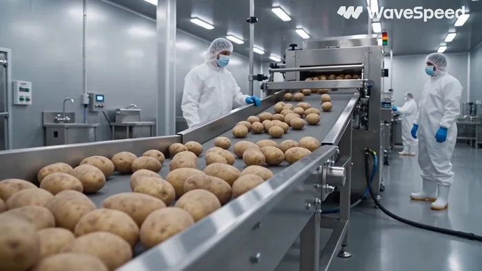
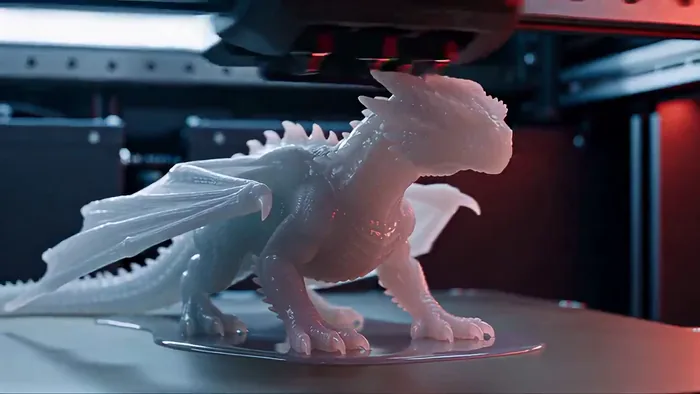
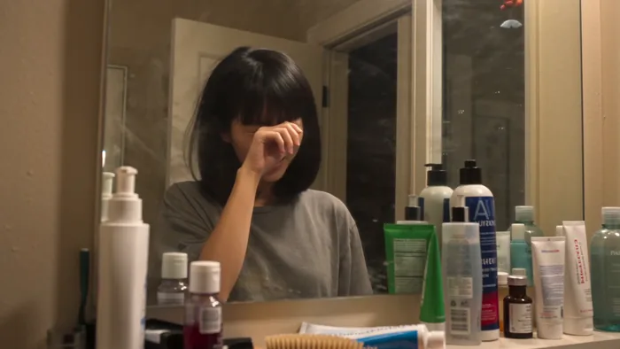
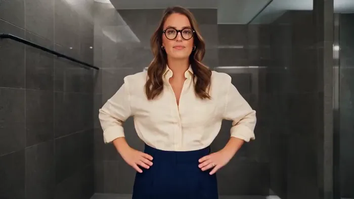

[← 総目次に戻る](../README.ja.md#table-of-contents) · [English](product-demo.md) · [简体中文](product-demo.zh-CN.md) · [日本語](product-demo.ja.md)

### 製品デモ Product Demo

- [Case 37: Clay-model car assembly render (白模渲染 · 汽车拼装) — by ByteDance](#case-37)
- [Case 38: Automated french-fry factory line (全自动薯条工厂生产线) — by @aiwithaly](#case-38)
- [Case 39: Industrial 3D printer, print-to-life dragon (工业3D打印机·打印成真的巨龙) — by @PromptSin](#case-39)
- [Case 40: Identity-locked morning routine brief (身份锁定晨间日程简报) — by @doctorwasif](#case-40)
- [Case 41: Office washroom fashion transformation (办公室洗手间时尚变装) — by @bmx_ai13](#case-41)

### Case 37: Clay-model car assembly render (白模渲染 · 汽车拼装) — by ByteDance

▶ [ofox.ai で動画をすべて見る](https://ofox.ai/seedance-2-5-prompts?utm_source=github&utm_medium=case&utm_campaign=awesome-seedance-2-5#case-37)

**输入素材**：未公开 —— ByteDance Seed 博客只发布了成片，未随文发布输入素材

**Prompt**

~~~~text
参考 @白模 1 的运镜、构图、景别、空间关系、零件位置、模型结构、装配顺序和运动轨迹。参考 @图片 1 的材质、光照、色彩、反射和氛围，将白模渲染为高端真实汽车拼装片段。
~~~~

**参数**：Seedance 2.5 · 未标注 · r2v · 未标注 · 未标注 · 未标注 · 未标注
**来源**：ByteDance Seed 官方博客 · [中文](https://seed.bytedance.com/zh/blog/one-take-creation-flexible-referencing-introducing-seedance-2-5) · [English](https://seed.bytedance.com/en/blog/one-take-creation-flexible-referencing-introducing-seedance-2-5)

Preview frame © 2026 ByteDance, from the official demo video · Prompt by ByteDance · <a href="https://seed.bytedance.com/zh/blog/one-take-creation-flexible-referencing-introducing-seedance-2-5">source</a>

[目次に戻る](#table-of-contents)

### Case 38: Automated french-fry factory line (全自动薯条工厂生产线) — by @aiwithaly

▶ [ofox.ai で動画をすべて見る](https://ofox.ai/seedance-2-5-prompts?utm_source=github&utm_medium=case&utm_campaign=awesome-seedance-2-5#case-38)

<strong>Prompt</strong> — 一家现代化的自动化炸薯条工厂从头到尾处理新鲜土豆。土豆经由不锈钢传送带运送，通过工业清洗和去皮机，随后进入精密切割设备，加工成大小均匀的薯条。新鲜切割的薯条依次经过漂烫、热油炸制、沥油和冷却系统，最终到达自动称重和包装机。薯条被分装、密封在食品级包装袋中，经由质量控制扫描仪检测，并由机械臂装入纸箱。…

~~~~text
一家现代化的自动化炸薯条工厂从头到尾处理新鲜土豆。土豆经由不锈钢传送带运送，通过工业清洗和去皮机，随后进入精密切割设备，加工成大小均匀的薯条。新鲜切割的薯条依次经过漂烫、热油炸制、沥油和冷却系统，最终到达自动称重和包装机。薯条被分装、密封在食品级包装袋中，经由质量控制扫描仪检测，并由机械臂装入纸箱。超写实工业食品生产纪录片，真实的土豆和薯条物理效果，物理精确的机械设备，连续的传送带运动，逼真的水流，真实的油炸气泡，自然的蒸汽，精准的机械臂动作，卫生的工厂环境，明亮的工业 LED 照明，逼真的不锈钢反光，穿着规范防护装备的受训工人，流畅的纪录片摄影风格，真实的工厂音效，包括传送带电机声、流水声、切割机声、油炸气泡声、冷却风扇声和包装机械声，无旁白，无背景音乐，视觉连续性无缝衔接，无 CGI 感，无悬浮物体，无变形食物，无机械穿模，无过量蒸汽，无灯光闪烁，无文字覆盖、标志或水印。
~~~~

**参数**：Seedance 2.5 · 未标注 · t2v · 未标注 · 未标注 · 未标注 · 未标注
**来源**：[@aiwithaly](https://x.com/aiwithaly) · [原帖](https://x.com/aiwithaly/status/2091031033986634183)

Preview © 2026 <a href="https://x.com/aiwithaly/status/2091031033986634183">@aiwithaly</a> · Prompt by <a href="https://x.com/aiwithaly/status/2091031033986634183">@aiwithaly</a>

[目次に戻る](#table-of-contents)

### Case 39: Industrial 3D printer, print-to-life dragon (工业3D打印机·打印成真的巨龙) — by @PromptSin

▶ [ofox.ai で動画をすべて見る](https://ofox.ai/seedance-2-5-prompts?utm_source=github&utm_medium=case&utm_campaign=awesome-seedance-2-5#case-39)

<strong>Prompt</strong> — 创建一个 15 秒的写实电影级奇幻序列，在黑暗的专业 3D 打印车间内进行单镜头长镜头拍摄。 一台大型工业树脂 3D 打印机正在其构建平台上快速打印一只凶猛的微型龙。这条龙在整个过程中具有连贯的解剖结构设计：四条肌肉发达的腿、一对巨大的折叠翅膀、一条长长的盔甲尾巴、锋利的角、带有微妙深红色高光的层叠…

~~~~text
创建一个 15 秒的写实电影级奇幻序列，在黑暗的专业 3D 打印车间内进行单镜头长镜头拍摄。 一台大型工业树脂 3D 打印机正在其构建平台上快速打印一只凶猛的微型龙。这条龙在整个过程中具有连贯的解剖结构设计：四条肌肉发达的腿、一对巨大的折叠翅膀、一条长长的盔甲尾巴、锋利的角、带有微妙深红色高光的层叠黑色鳞片、琥珀色的眼睛以及强壮的爬行动物头部。从打印到动画化，必须保持龙的身份、解剖结构、鳞片图案、角、翅膀和比例完全一致。 0–4 秒：从打印机内部的极致微距特写开始。清晰展示龙从脚部向上快速成型的加速打印过程。薄薄的树脂层按正确的物理顺序构建出腿部、躯干、尾巴、折叠的翅膀、颈部、角和头部。打印机机械装置高速移动，同时保持机械上的真实感。当完整的实体龙出现时，摄像机缓慢绕着构建平台旋转。在第 4 秒时，打印机停止，成品龙在平台上静止片刻。 4–7 秒：摄像机推进至龙的脸部特写。其坚硬的打印表面逐渐转化为真实的黑色鳞片，且不改变其轮廓或解剖结构。温暖的琥珀色光芒在其眼中点亮。它的胸部随着第一次呼吸而起伏，爪子在平台上抓挠，尾巴自然摆动，鼻孔中冒出淡淡的烟雾。这种转变从头部到尾部平滑蔓延，呈现出逼真的材质细节。 7–11 秒：龙抬起头，完全展开双翼并发出凶猛的咆哮。翅膀产生的气流将松散的树脂粉尘和车间里的小纸片吹向四周。它蹲下身子，从构建平台上用力一蹬，带着真实的重量感、肌肉运动和空气动力学拍翼动作冲向空中。身后的打印机保持完好。 11–15 秒：摄像机以快速、平滑的追踪镜头跟随龙，穿过车间设备飞向一扇敞开的大型工业窗户。它强有力地拍打翅膀，飞入夜空并攀升至屋顶之上。最后以广角电影镜头展现活生生的龙飞向月光下的城市天际线，下方仍可见发光的 3D 打印车间。定格最终画面。 摄像机与风格：写实真人电影摄影，黑暗工业车间，戏剧性的实用照明，冷蓝色环境光与温暖的红色打印机灯光交织，极致微距细节，浅景深，逼真的树脂半透明感，精细的鳞片，自然的运动模糊和体积光尘埃。采用单一连续的摄像机轨迹：微距环绕、面部推进、起飞追踪和外部航拍揭示。
~~~~

**参数**：Seedance 2.5 · 未标注 · t2v · 未标注 · 未标注 · 未标注 · 未标注
**来源**：[@PromptSin](https://x.com/PromptSin) · [原帖](https://x.com/PromptSin/status/2094070647395901652)

Preview © 2026 <a href="https://x.com/PromptSin/status/2094070647395901652">@PromptSin</a> · Prompt by <a href="https://x.com/PromptSin/status/2094070647395901652">@PromptSin</a>

[目次に戻る](#table-of-contents)

### Case 40: Identity-locked morning routine brief (身份锁定晨间日程简报) — by @doctorwasif

▶ [ofox.ai で動画をすべて見る](https://ofox.ai/seedance-2-5-prompts?utm_source=github&utm_medium=case&utm_campaign=awesome-seedance-2-5#case-40)

**输入素材**：未公开 —— 原作者只发布了成片，未提供输入素材

<strong>Prompt</strong> — Subject: Person from Image1. Face and hairstyle must match Image1 exactly; do not change identity. Ignore its outfit, background, pose, and text. Outf…

~~~~text
Subject: Person from Image1. Face and hairstyle must match Image1 exactly; do not change identity. Ignore its outfit, background, pose, and text. Outfit: oversized casual sleepwear, messy morning look. 9:16 vertical.

Old iPhone everyday-video aesthetic throughout: static phone propped on bathroom sink, standard 1x lens, no distortion, heavy noise/compression, slight mirror steam, warm/off-white overhead lighting. Natural skin, pores, flyaways, under-eye tiredness. No beauty filter, grading, cinematic/CG look, fisheye, vignette, or legible text.

0–4s: Groggy, walks in yawning, glances at phone/mirror, rubs eyes.
4–8s: Brushes messy hair and mutters, "okay... five more minutes wasn't enough."
8–12s: Steps on bathroom scale, looks down, gives a subtle eye-roll/sigh/shrug, steps off.
12–16s: Opens small closet, holds up two shirts one after another, indecisive.
16–19s: Chooses the first, tosses the other aside, looks at camera and says softly, "…this one. good enough for today," with a tired smile; freeze final frame.

Bathroom clutter: toothpaste/skincare bottles, but all labels illegible. Sound only: bathroom ambience, hairbrush, scale beep/click, fabric rustle, close muffled sleepy voice with slight bathroom reverb. Keep all cuts and actions; no skipped scenes or on-screen text.
~~~~

**参数**：Seedance 2.5 · 未标注 · i2v · 未标注 · 未标注 · 未标注 · 带音频
**来源**：[@doctorwasif](https://x.com/doctorwasif) · [原帖](https://x.com/doctorwasif/status/2087528917972431102)

Preview © 2026 <a href="https://x.com/doctorwasif/status/2087528917972431102">@doctorwasif</a> · Prompt by <a href="https://x.com/doctorwasif/status/2087528917972431102">@doctorwasif</a>

[目次に戻る](#table-of-contents)

### Case 41: Office washroom fashion transformation (办公室洗手间时尚变装) — by @bmx_ai13

▶ [ofox.ai で動画をすべて見る](https://ofox.ai/seedance-2-5-prompts?utm_source=github&utm_medium=case&utm_campaign=awesome-seedance-2-5#case-41)

<strong>Prompt</strong> — Create a 30 second photorealistic fashion transformation video in a 16:9 landscape frame. A stylish young woman with long softly waved brown hair, war…

~~~~text
Create a 30 second photorealistic fashion transformation video in a 16:9 landscape frame. A stylish young woman with long softly waved brown hair, warm medium skin, round black glasses, small earrings, natural makeup, and consistent facial features stands in the same modern office washroom or dressing area for the entire video. The background has large charcoal gray stone tiles, a pale ceiling, a slim black wall rail on the left, and a narrow metal partition line on the right. Keep every architectural line perfectly fixed across all cuts.

Camera is locked on a tripod at eye level, medium full shot from mid thigh upward, using a natural 35 mm equivalent smartphone lens. The subject remains centered with enough space on both sides for the landscape composition. No camera shake, zoom, reframing, or perspective change. Use crisp realistic detail, true skin texture, fine hair strands, believable fabric folds, accurate hands, subtle breathing, and tiny posture adjustments. Lighting is soft cool overhead office lighting with gentle facial fill, mild reflections on the gray tiles, consistent exposure, and realistic shadow direction.

Begin with her palm very close to the lens, briefly obscuring most of the frame. She pulls her hand away and reveals the first outfit, a sleeveless pale blue floral office dress with a light scarf over one shoulder. She looks calmly into the camera, lowers her arm, places one hand on her hip, glances upward with a mildly unimpressed expression, then folds her arms. Match this exact folded arm pose for the first invisible jump cut.

Across the next twenty four seconds, reveal nine distinct office outfits through clean pose matched cuts timed to the music. Use a lemon yellow floral kimono blouse, a relaxed ivory button shirt with navy trousers, a fitted black sleeveless top with dark tailored pants and a brown belt, a soft blush pink top with black trousers, a deep green crew neck blouse, a vivid blue paisley shift dress, a black and white dotted peplum blouse, a camel blazer over a cream top, and a final elegant burgundy wrap dress. Between changes, give her natural confident gestures such as a small shoulder bounce, two thumbs up, hands settling on hips, crossing her arms, turning her chin, smoothing a cuff, lightly flicking her hair, pointing toward her cheek, and smiling directly at camera. Each gesture should begin in one outfit and end in the next so the cut feels practical and intentional, never like body morphing.

Hold each look long enough to read clearly, roughly two seconds per outfit, with cuts landing on strong beats. Preserve identical body position, hair direction, glasses placement, limb anatomy, background geometry, and lighting at every transition. Avoid warped fingers, changing facial identity, floating clothing, cloth melting, duplicated accessories, sudden camera motion, or artificial beauty smoothing.

For the final four seconds, she lands in the burgundy dress with one hand on her hip, gives a warm playful smile, taps one finger lightly against her cheek, then reaches toward the lens until her palm fills the frame, creating a natural practical ending. Do not add captions, logos, watermarks, interface graphics, or generated text.

Music should be an upbeat polished fashion pop instrumental at about 112 beats per minute with tight percussion, light bass, finger snaps, bright synth accents, and clean beat drops for every outfit change. Add subtle realistic clothing movement, bracelet clicks, and a soft hand whoosh at the opening and closing. The finished result should feel like a real creator filmed several office looks in one location and edited them precisely to music.
~~~~

**参数**：Seedance 2.5 · 未标注 · t2v · 30s · 未标注 · 16:9 · 未标注
**来源**：[@bmx_ai13](https://x.com/bmx_ai13) · [原帖](https://x.com/bmx_ai13/status/2083372393649832355)

Preview © 2026 <a href="https://x.com/bmx_ai13/status/2083372393649832355">@bmx_ai13</a> · Prompt by <a href="https://x.com/bmx_ai13/status/2083372393649832355">@bmx_ai13</a>

[目次に戻る](#table-of-contents)
