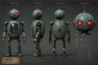
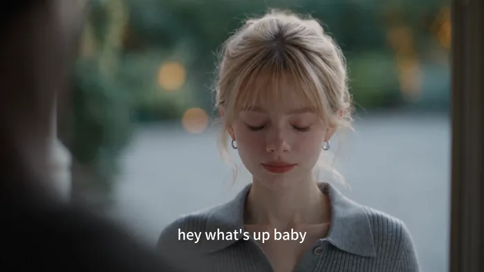
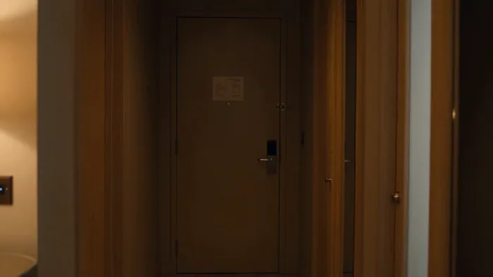
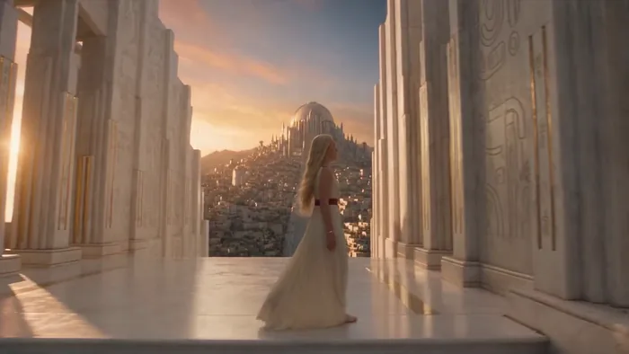
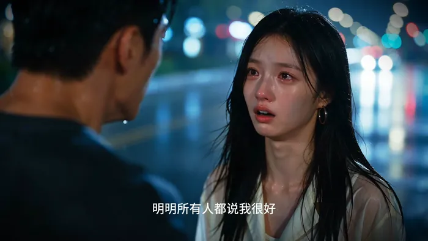
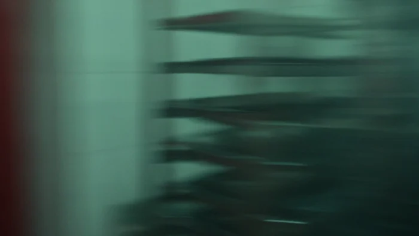
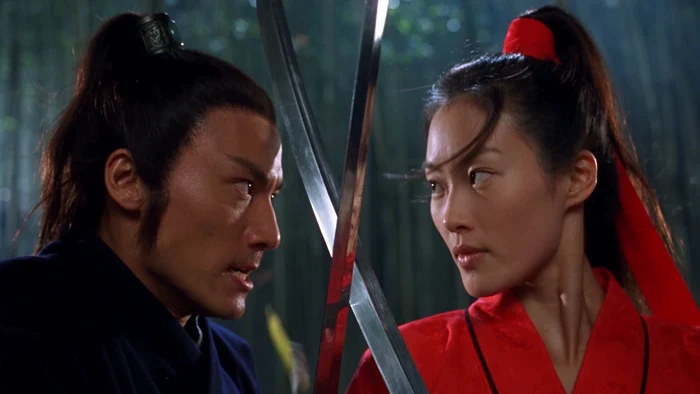
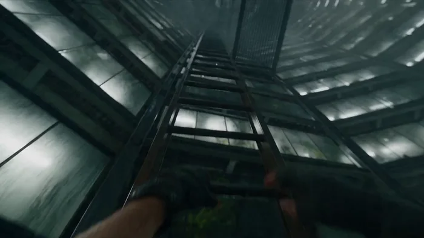
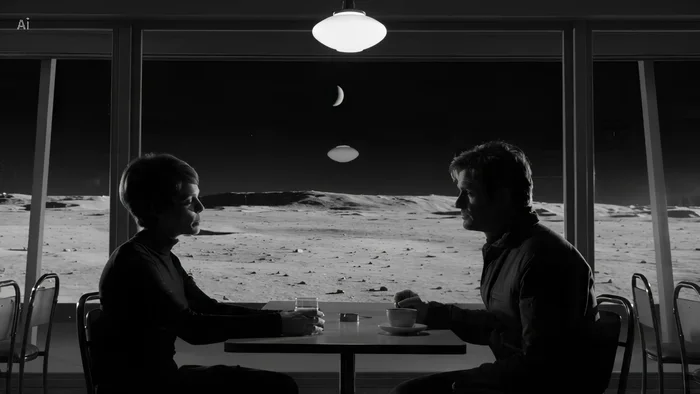

[← 返回总目录](../README.zh-CN.md#table-of-contents) · [English](short-drama.md) · [简体中文](short-drama.zh-CN.md) · [日本語](short-drama.ja.md)

### 短剧 Short Drama

- [Case 1: Guardian robot and grandmother, nine-shot storyboard (守护机器人与老奶奶 · 九宫格分镜) — by ByteDance](#case-1)
- [Case 2: Peking opera "Farewell My Concubine", one take (京剧霸王别姬 · 一镜到底) — by ByteDance](#case-2)
- [Case 3: Cinematic breakup farewell, one continuous take (电影感分手告别·一镜到底) — by @liyue_ai](#case-3)
- [Case 4: Hotel thriller, encrypted USB, balcony escape (酒店惊悚·加密U盘·阳台脱逃) — by @aiwithaly](#case-4)
- [Case 5: 90s multi-cam sitcom, “Cat Book Club” (90年代多机位情景喜剧·猫咪读书会) — by @frametheory058](#case-5)
- [Case 6: London techno club, 30-second one-shot (伦敦电子舞曲俱乐部·30秒一镜到底) — by @JMSvid](#case-6)
- [Case 7: Midnight laundromat short film (午夜自助洗衣店短片) — by @bmx_ai13](#case-7)
- [Case 8: Epic fantasy continuous long take (史诗奇幻一镜到底长镜头) — by @aicanvas_frames](#case-8)
- [Case 65: Rainy-night argument, 14 timecoded shots (雨夜争吵 ·《如果我拿不出这些钱》) — by @cosset_li](#case-65)
- [Case 1001: The toasting dress and one plate (敬酒服 · 一盘菜) — by Ofox Team](#case-1001)
- [Case 1002: Duel in the bamboo grove at night (竹林夜战) — by Ofox Team](#case-1002)
- [Case 1003: The handover, and the car at the mouth of the alley (雨夜交接 · 巷口那辆车) — by Ofox Team](#case-1003)
- [Case 1004: Good that you are back (回来就好) — by Ofox Team](#case-1004)

- [Case 72: Escape from a flooding botanical tower (逃离洪水中的植物档案塔) — by @bmx_ai13](#case-72)
- [Case 75: Late-night conversation in a lunar cafe (月球咖啡馆的深夜对话) — by @digitalwindai](#case-75)

### Case 1: Guardian robot and grandmother, nine-shot storyboard (守护机器人与老奶奶 · 九宫格分镜) — by ByteDance

▶ [在 ofox.ai 观看完整视频](https://ofox.ai/seedance-2-5-prompts?utm_source=github&utm_medium=case&utm_campaign=awesome-seedance-2-5#case-1)

**输入素材**（4 张官方参考图）

| | | | |
|:---:|:---:|:---:|:---:|
|  image1 · 九宫格分镜 |  image2 · 环境 |  image3 · 机器人 |  image4 · 老奶奶 |

<strong>Prompt</strong> — image1: 九宫格分镜参考，用于整体镜头结构、景别与运镜节奏。 image2: 火箭发射场黄昏草原实拍参考，用于环境构图、暖金夕照与冷暮蓝的写实彩色实拍质感基准。 image3: 主体 1 (守护机器人) 角色外观参考。 image4: 主体 2 (老奶奶) 角色外观参考。 【主体设定】 主体 …

~~~~text
image1: 九宫格分镜参考，用于整体镜头结构、景别与运镜节奏。
image2: 火箭发射场黄昏草原实拍参考，用于环境构图、暖金夕照与冷暮蓝的写实彩色实拍质感基准。
image3: 主体 1 (守护机器人) 角色外观参考。
image4: 主体 2 (老奶奶) 角色外观参考。
【主体设定】
主体 1 (守护机器人): 参考 image3，近未来做旧复古机器人，做旧蓝绿色金属机身、斑驳锈蚀，圆顶头，两只发光的红色圆形机眼，细天线，细长关节四肢；体型高大，约为人类两倍高。
主体 2 (老奶奶): 参考 image4，瘦小年迈女性，银发挽成低髻，皱纹深刻，身穿明黄金色及地长裙、缀金蓝刺绣胸襟，神情不舍；身高只及机器人胸口。
环境 (黄昏草原・发射场): 参考 image2，近未来黄昏草原，暮色天空由暖金渐入冷蓝，远处地平线一座发射台矗立白色火箭、蒸汽升腾；及膝野草随风起伏，广袤空旷。
【整体风格】
真人实拍彩色电影正片，写实照片级质感，全程真实彩色画面；彩色 35mm 电影胶片质感，细腻真实胶片颗粒，浓郁饱满的电影级调色，IMAX 大画幅质感；手持摄影，呼吸感摇晃，浅景深大光圈，前景持续飘散的草叶、火星与灰烬，微微倾斜荷兰角，暖金夕照与冷暮蓝、爆炸暖橙强烈对撞，16:9 横屏。近未来温情灾难片氛围，静谧、悲壮、守护与不舍。
【严格排除】黑白、单色、灰度、去色；手绘、素描、线稿、插画、漫画、动画；分镜稿 / 故事板、草图；移轴微缩、玩偶感、塑料 CG、油腻过曝 CG。
【分镜头】(9 镜 ≈ 30s)
镜头 1 (0-3s): 超远景低机位仰视，黄昏草原两人背影仰望远方火箭。台词 (机器人): "I'm right here. I won't let go."
镜头 2 (3-6s): 正面中景手持，机器人搀扶老奶奶。
镜头 3 (6-10s): 面部特写，老奶奶眼含不舍。台词 (老奶奶): "Fly safe, my child. Come back to me."
镜头 4 (10-14s): 超远景仰摇，火箭升空拖曳浓白烟迹。台词 (老奶奶): "There he goes... there he goes."
镜头 5 (14-18s): 超远景，火箭在半空爆炸碎裂。台词 (老奶奶): "No... no, no—"
镜头 6 (18-22s): 面部大特写，老奶奶瞳孔骤缩泪滑落。台词 (老奶奶): "...he was almost there."
镜头 7 (22-25s): 特写转近景，老奶奶崩溃痛哭。台词 (老奶奶): "Bring him back! Please— bring him back!"
镜头 8 (25-28s): 超低视角近乎垂直仰拍，机器人环抱老奶奶罩成保护穹顶。台词 (机器人): "Don't look up. I've got you."
镜头 9 (28-30s): 超远景背影，两人紧紧相拥剪影。台词 (机器人): "I'm still here. I'll stay... as long as you need."
~~~~

**参数**：Seedance 2.5 · 火山方舟 · r2v · 30s · 未标注 · 16:9 · 带音频
**来源**：火山方舟官方文档 · [中文](https://docs.volcengine.com/docs/82379/2607689?lang=zh) · [English](https://docs.byteplus.com/en/docs/ModelArk/2607689)

Preview frame © 2026 ByteDance, from the official demo video · Prompt by ByteDance · <a href="https://docs.volcengine.com/docs/82379/2607689?lang=zh">source</a>

[回到目录](#table-of-contents)

### Case 2: Peking opera "Farewell My Concubine", one take (京剧霸王别姬 · 一镜到底) — by ByteDance

▶ [在 ofox.ai 观看完整视频](https://ofox.ai/seedance-2-5-prompts?utm_source=github&utm_medium=case&utm_campaign=awesome-seedance-2-5#case-2)

**输入素材**：未公开 —— ByteDance Seed 博客只发布了成片，未随文发布输入素材

<strong>Prompt</strong> — 16:9 宽幅电影级质感，一镜到底，丝滑运镜，无剪辑。场景参考 @图片 4。 0-5 秒：@图片 2 霸王近景开场，镜头缓慢环绕上半身并过渡至中景；霸王旋身翻转，随后身体与靠旗从镜头前快速掠过，形成自然遮挡，镜头顺势绕至 @图片 1 虞姬身侧。6-10 秒：镜头稳定环绕 @图片 1 虞姬中景，跟随水…

~~~~text
16:9 宽幅电影级质感，一镜到底，丝滑运镜，无剪辑。场景参考 @图片 4。 0-5 秒：@图片 2 霸王近景开场，镜头缓慢环绕上半身并过渡至中景；霸王旋身翻转，随后身体与靠旗从镜头前快速掠过，形成自然遮挡，镜头顺势绕至 @图片 1 虞姬身侧。6-10 秒：镜头稳定环绕 @图片 1 虞姬中景，跟随水袖动作完成环绕运镜虞姬抬臂、挑腕、展袖、半转身。最后收袖定格，侧身看向霸王。11-20 秒：@图片 3 武生出场完成后空翻腾动作，随后霸王居中，武生在对侧进退攻防。虞姬位于霸王侧后方以水袖配合，形成刚柔对比。镜头从武生中近景缓慢后拉至舞台大景，结尾三人面向观众同步京剧落幕亮相。
~~~~

**参数**：Seedance 2.5 · 未标注 · r2v · 20s（由 11–20 秒段落隐含）· 未标注 · 16:9 · 未标注
**来源**：ByteDance Seed 官方博客 · [中文](https://seed.bytedance.com/zh/blog/one-take-creation-flexible-referencing-introducing-seedance-2-5) · [English](https://seed.bytedance.com/en/blog/one-take-creation-flexible-referencing-introducing-seedance-2-5)

Preview frame © 2026 ByteDance, from the official demo video · Prompt by ByteDance · <a href="https://seed.bytedance.com/zh/blog/one-take-creation-flexible-referencing-introducing-seedance-2-5">source</a>

[回到目录](#table-of-contents)

### Case 3: Cinematic breakup farewell, one continuous take (电影感分手告别·一镜到底) — by @liyue_ai

▶ [在 ofox.ai 观看完整视频](https://ofox.ai/seedance-2-5-prompts?utm_source=github&utm_medium=case&utm_campaign=awesome-seedance-2-5#case-3)

<strong>Prompt</strong> — ## 一、镜头核心 - 成片时长：约 15 秒。 - 推荐画幅：16:9。原文件是 9:16 教程排版，但其中的人物表演画面本身接近横向 16:9。 - 镜头形式：第三人称、正面越肩构图、一镜到底，不切正反打。 - 景别变化：从近景/胸上景开始，结尾因女主后撤自然变为稍松的中近景。 - 情绪路径：紧…

~~~~text
## 一、镜头核心 - 成片时长：约 15 秒。 - 推荐画幅：16:9。原文件是 9:16 教程排版，但其中的人物表演画面本身接近横向 16:9。 - 镜头形式：第三人称、正面越肩构图、一镜到底，不切正反打。 - 景别变化：从近景/胸上景开始，结尾因女主后撤自然变为稍松的中近景。 - 情绪路径：紧张准备 → 听见熟悉问候 → 短暂动摇 → 苦笑掩饰 → 决绝宣告 → 克制退场。 - 核心表演链：刺激（门开、听见男声）→ 理解停顿 → 无意识反应（闭眼、吸气）→ 主动选择（抬眼、苦笑）→ 台词（"WE'RE DONE."）→ 残留情绪（仍不舍但拉开距离）。 ## 二、人物与场景 ### 女主 参考上传图片 {{Mixed 1}} 外表柔软、干净，真实皮肤质感，不过度磨皮。她来这里之前已经做过决定，但真正见到男主时仍会动摇；表演不是愤怒，而是压住痛苦后的告别。 ### 男主 只以镜头右前方的深色失焦肩部、头部轮廓出现，不露脸、不抢焦、不进入清晰景深。声音温和、亲昵，尚未意识到女主是来结束关系的。 ### 场景与氛围 住宅门口或临近庭院的入口，背景可见柔化的绿色植物、浅灰路面和几颗暖色圆形散景。整体是傍晚前后的自然光感：人物左前方约 45° 的柔和冷白主光，背景带少量暖金色轮廓光。空间安静，空气似乎刚下过雨或带着潮湿感。氛围温柔、克制、疏离，不做强烈戏剧化灯光。 > 说明：焦段与灯光参数是根据画面反推的复拍建议，并非原视频元数据。建议使用全画幅等效 70–100mm 中长焦、较浅景深；焦点始终锁定女主双眼。 ## 三、15 秒连续表演脚本 ### 0.0–0.8 秒｜门开，人物被揭示 画面先被男主深色、严重失焦的身体轮廓大面积遮住。门打开后，男主略微向镜头右侧移动，女主从遮挡后被揭示，站在门外，正对男主。机位保持稳定，不突然推拉。 女主没有立刻抬头。她下巴轻收，视线停在男主胸口或门槛附近，嘴唇自然分开一点。身体看似安静，但肩颈带着轻微僵硬，像已经在门外排练过很多次。 声音：轻微开门声、衣料摩擦、安静的户外底噪。 ### 0.8–3.2 秒｜用呼吸压住情绪 女主缓慢吸气，动作很小：胸口与锁骨区域轻微抬起，肩膀先绷紧一点，再缓慢落下。她的目光仍向下，眼睑逐渐闭合，闭眼时间略长于正常眨眼。 不要立刻流泪，不要夸张皱眉。只保留两个可见信号：呼吸变深、唇角轻微发紧。她试图把即将失控的情绪压回去。 镜头：固定近景，浅景深，男主虚化轮廓留在画面右侧作为关系压力。 ### 3.2–5.4 秒｜听见熟悉的问候 男主画外音自然地说："Hey, what's up, baby?" 语气轻松、带一点笑意，像平常迎接她一样。 女主先保持闭眼约半秒，让声音真正落进身体。随后喉咙轻轻吞咽，眉心只出现很浅的紧张，不抬头、不回答。她缓慢呼出刚才那口气，嘴唇微动，却没有形成语言。 表演重点：反应必须发生在听见台词之后；熟悉的亲昵让她短暂动摇，但没有改变决定。 ### 5.4–7.5 秒｜抬眼，对视，短暂动摇 女主先睁眼，再抬视线，最后才微微抬起下巴，动作分三层完成。焦点从男主胸口缓慢移到男主眼睛。眼神由散乱转为清晰，眼底有湿润感，但泪水不掉落。 她与男主对视后停住。鼻息稍乱，嘴唇轻轻抿合，面部仍然保持克制。镜头不要推进，让观众主动观察她的变化。 ### 7.5–9.3 秒｜苦笑成为最后一道防线 女主嘴角极轻地向一侧抬起，形成一个不完整、略不对称的苦笑。笑意只停留在嘴角，没有进入眼睛。她仍望着男主，像在确认自己熟悉的人还在，却也确认这段关系已经无法继续。 苦笑持续不到两秒，随后慢慢消失。消失后不要立刻变成冷脸，仍保留一点不舍和受伤，让悲伤与决心同时存在。 ### 9.3–10.6 秒｜宣告结束 女主保持眼神接触，以很轻、很清晰、没有怒气的声音说："We're done." 说话前留一个短促吸气；"We're"仍带着残余的温柔，"done"落下时眼神变得更稳定。嘴部动作自然，不刻意咬字，不大幅摇头。台词结束后双唇轻合，停顿半秒。 声音：保留真实呼吸和轻微环境声；不需要煽情配乐，不需要额外字幕。 ### 10.6–13.4 秒｜让沉默完成切割 女主继续看着男主，不马上离开。她的表情逐渐回到近乎平静，眼睛仍有水光，下巴轻轻收紧。身体重心开始从前脚转向后脚，显示她准备离开，但上半身还有一点不愿拉开距离的迟疑。 镜头保持停留，不切男主反应。男主仍只是右侧虚焦前景，让观众只能从女主脸上感受这句话的重量。 ### 13.4–15.1 秒｜后撤，关系距离被具象化 女主缓慢向后退一至两小步，眼神最初仍留在男主脸上。她的身体在画面中自然变小，景别由近景松到中近景；肩膀放松、站姿重新变直，表情从痛苦转为疏离而坚定。 最后定格状态：女主与男主之间的距离已经被拉开，她没有转身逃跑，也没有情绪崩溃，只用平静的后撤完成告别。焦点仍锁在她脸上，背景与男主保持柔和虚化。 ## 四、摄影执行要点 - 机位在男主肩后、接近女主眼睛高度，男主位于画面右侧前景，女主居中略偏左。 - 始终遵守同一条视线轴，不跳轴、不突然切换主观视角。 - 主要使用固定机位或极轻微的稳定呼吸感；结尾的景别变化来自女主后撤，不用明显变焦。 - 对焦点始终在女主眼睛；男主轮廓、庭院背景和灯光散景保持失焦。 - 曝光保护女主肤色与浅金发丝，避免高光溢出；保留真实皮肤纹理、细小不对称和自然眨眼。 - 每个情绪段只保留 1–3 个可见信号，避免眉毛、眼睛、鼻翼、嘴角同时机械运动。 ## 五、连续性与禁止项 - 女主身份、发型、耳环、项链、灰色翻领针织上衣、体型和年龄感全程一致。 - 男主始终不露脸、不抢焦，不突然变成清晰人物，也不与女主发生肢体接触。 - 不新增眼泪滚落、歇斯底里哭泣、愤怒瞪眼、突然大笑或夸张摇头。 - 不使用正反打、快速推镜、环绕镜头、突然变焦或多机位切换。 - 不改变光线方向、背景空间、两人站位轴线和女主视线高度。 - 不继承原教程视频顶部的参考图、底部滚动文字、平台水印和排版黑边；只复刻其中人物表演画面的镜头与情绪逻辑。
~~~~

**参数**：Seedance 2.5 · 未标注 · t2v · 15s · 未标注 · 16:9 · 带音频
**来源**：[@liyue_ai](https://x.com/liyue_ai) · [原帖](https://x.com/liyue_ai/status/2090378405288300626)

Preview © 2026 <a href="https://x.com/liyue_ai/status/2090378405288300626">@liyue_ai</a> · Prompt by <a href="https://x.com/liyue_ai/status/2090378405288300626">@liyue_ai</a>

[回到目录](#table-of-contents)

### Case 4: Hotel thriller, encrypted USB, balcony escape (酒店惊悚·加密U盘·阳台脱逃) — by @aiwithaly

▶ [在 ofox.ai 观看完整视频](https://ofox.ai/seedance-2-5-prompts?utm_source=github&utm_medium=case&utm_campaign=awesome-seedance-2-5#case-4)

<strong>Prompt</strong> — 超写实电影级 30 秒动作惊悚场景，背景设定在深夜高层现代高档酒店房间内。一位身穿深色实用夹克、长裤和舒适鞋子的成年职业女性，在旅行包中发现了一个神秘的加密 USB 驱动器后，意识到自己正被追捕。 0–5 秒：酒店桌面上 USB 驱动器的紧凑微距特写。她迅速抓起驱动器，看向房门，将其放入旅行包并合上…

~~~~text
超写实电影级 30 秒动作惊悚场景，背景设定在深夜高层现代高档酒店房间内。一位身穿深色实用夹克、长裤和舒适鞋子的成年职业女性，在旅行包中发现了一个神秘的加密 USB 驱动器后，意识到自己正被追捕。 0–5 秒：酒店桌面上 USB 驱动器的紧凑微距特写。她迅速抓起驱动器，看向房门，将其放入旅行包并合上。三声突如其来的敲门声让她僵在原地。 5–10 秒：镜头缓慢推向酒店房门。随之而来的是沉重的敲门声，一个低沉的男声说道："开门。我们知道你在里面。"她的表情从困惑转为恐惧。她低声说："这不可能"，然后小心翼翼地后退。 10–15 秒：门把手缓慢向下转动的极端特写。逼真的门闩和锁具声音。切至她惊恐的脸部特写，她抓起旅行包冲向阳台。 15–20 秒：她用双手推开玻璃阳台门，克服了轨道阻力。凉爽的夜风自然地吹动她的头发和夹克。身后，酒店房门因撞击而剧烈震动。她小心地踏上阳台，在高处边缘保持着逼真的平衡感。 20–25 秒：又一次强力撞击撞向房门。锁具和门框在门最终沿铰链自然向内打开前进行了抵抗。门口出现了一个模糊的轮廓。随着她向阳台深处移动，散落的纸张因气流而飘动。 25–30 秒：她到达栏杆旁，俯瞰远处的城市。她转向由狭窄缝隙隔开的相邻阳台，然后回头看向逼近的轮廓。她紧紧抓住栏杆，低声说："冷静。"戏剧性的远景镜头展示了酒店外立面、她的阳台以及相邻的阳台。 基于电影写实主义，逼真的真人表演与生物力学，准确的重力、动量、惯性、摩擦力、平衡感、门体结构、滑动玻璃门运动、织物运动、物体重量、自然的夜间照明、克制的手持摄影、逼真的景深、自然的运动模糊、实拍效果美学、同步的对白与音效设计，以及远处的城市环境音、脚步声、呼吸声、撞门声、锁具震动、玻璃门移动声和夜风声。 无超级英雄物理效果，无不可能的跳跃，无坠落，无瞬间移动，无漂浮物体，无爆炸门，无无故破碎的玻璃，无夸张的风效，无机械化表演，无扭曲的解剖结构，无面部或服装变化，无重复角色，无不可能的摄像机运动，无 CGI 感，无血腥，无暴力，无文字，无 Logo，无水印。 在悬念达到顶峰时以硬切黑屏结束。
~~~~

**参数**：Seedance 2.5 · 未标注 · t2v · 未标注 · 未标注 · 未标注 · 未标注
**来源**：[@aiwithaly](https://x.com/aiwithaly) · [原帖](https://x.com/aiwithaly/status/2094295756878622745)

Preview © 2026 <a href="https://x.com/aiwithaly/status/2094295756878622745">@aiwithaly</a> · Prompt by <a href="https://x.com/aiwithaly/status/2094295756878622745">@aiwithaly</a>

[回到目录](#table-of-contents)

### Case 5: 90s multi-cam sitcom, “Cat Book Club” (90年代多机位情景喜剧·猫咪读书会) — by @frametheory058

▶ [在 ofox.ai 观看完整视频](https://ofox.ai/seedance-2-5-prompts?utm_source=github&utm_medium=case&utm_campaign=awesome-seedance-2-5#case-5)

<strong>Prompt</strong> — 创作一个 30 秒的 90 年代多机位情景喜剧场景，9:16 竖屏，采用真实的 35mm 电视胶片质感拍摄。明亮舒适的公寓，温暖的钨丝灯光，柔和均匀的补光，细腻的胶片颗粒感，窗外是傍晚的蓝色暮色，呈现地道的情景喜剧舞台调度和自然的观众笑声。 一名年轻男子提着杂货走进公寓，当他发现 12 只真实的猫正…

~~~~text
创作一个 30 秒的 90 年代多机位情景喜剧场景，9:16 竖屏，采用真实的 35mm 电视胶片质感拍摄。明亮舒适的公寓，温暖的钨丝灯光，柔和均匀的补光，细腻的胶片颗粒感，窗外是傍晚的蓝色暮色，呈现地道的情景喜剧舞台调度和自然的观众笑声。 一名年轻男子提着杂货走进公寓，当他发现 12 只真实的猫正在举办"读书会"时，他惊呆了。猫咪们自然地分散在红色沙发、扶手椅、地毯和茶几区域，旁边放着打开的书。他那只胖乎乎的白猫戴着反戴的酒红色鸭舌帽、长方形眼镜，身穿红黑格子法兰绒衬衫，自豪地坐在沙发中央。所有猫咪必须保持完全写实的四足家猫形象；只有那只白猫会说话，带着优雅的英式口音。 0:00–0:05 男子难以置信地环顾四周。 男子："不。别闹。这到底是什么？" 猫："读书会。" 男子："读书会？！" 猫："每周四。" 0:05–0:11 男子："我的客厅里有 11 只猫！" 猫："12 只。" 男子："第 12 只在哪——？" 另一只猫突然从他的购物袋里自然地探出头来。 男子："噢，拜托！" 0:11–0:17 男子指着书。 男子："你们连字都不认识！" 全场死寂。所有猫咪逐渐转过头，自然地盯着他看。 男子，突然变得不确定："……对吧？" 0:17–0:22 白猫从眼镜上方看他。 猫："然而，不知怎么的……你还是这里最笨的一个。" 观众爆发出巨大的笑声。男子对着镜头露出疲惫的表情。 0:22–0:27 男子："够了！全都出去！读书会结束了！" 猫："我们投票了。" 男子："结果呢？！" 猫："你走。" 0:27–0:30 门铃响了。男子打开门，发现外面坐着另一只真实的猫，嘴里轻轻叼着一本平装书。 沙发上的猫："太好了。那是 Margaret。" 男子无奈地闭上眼睛。画面定格，伴随着巨大的笑声、掌声和一段简短欢快的 90 年代情景喜剧片尾音乐。 超写实的物理场景，自然的真人表演，真实的猫毛和解剖结构，可信的物理效果和不完美的猫科动物动作。禁止出现 CGI/AI 感、拟人化猫咪、人类般的猫咪动作、多余肢体、卡通风格、未来主义元素、深色电影调色、字幕、Logo 或水印。
~~~~

**参数**：Seedance 2.5 · 未标注 · t2v · 未标注 · 未标注 · 未标注 · 未标注
**来源**：[@frametheory058](https://x.com/frametheory058) · [原帖](https://x.com/frametheory058/status/2094258542492733717)

Preview © 2026 <a href="https://x.com/frametheory058/status/2094258542492733717">@frametheory058</a> · Prompt by <a href="https://x.com/frametheory058/status/2094258542492733717">@frametheory058</a>

[回到目录](#table-of-contents)

### Case 6: London techno club, 30-second one-shot (伦敦电子舞曲俱乐部·30秒一镜到底) — by @JMSvid

▶ [在 ofox.ai 观看完整视频](https://ofox.ai/seedance-2-5-prompts?utm_source=github&utm_medium=case&utm_campaign=awesome-seedance-2-5#case-6)

<strong>Prompt</strong> — Original scene, 30 seconds, one continuous shot, no cuts.  0–8 seconds: Inside a packed underground London techno club. The camera holds tightly on th…

~~~~text
Original scene, 30 seconds, one continuous shot, no cuts.

0–8 seconds: Inside a packed underground London techno club. The camera holds tightly on the face of a young English woman. She is Caucasian, brunette, with delicate features and melancholy behind her eyes. She remains centered in frame and only sways subtly with the music. Around her, the crowd moves intensely and chaotically, with bodies, arms, shoulders and faces constantly passing close to camera, creating strong motion blur and a sense of pressure and overwhelm.

Fast white strobe lights flash continuously, pushing the image back and forth between near-total darkness and sudden bursts of harsh illumination. In the darker intervals, only silhouettes, rim light, glints of sweat and fragmented movement are visible. Each flash briefly reveals fragments of her face—her eyes, cheekbones, wet strands of hair, and distant expression—before she disappears again into darkness. She feels strangely still and emotionally detached while the crowd around her becomes a mass of blurred bodies and flickering light. Heavy four-on-the-floor techno dominates the soundscape, loud, compressed and physically overwhelming.

8–16 seconds: She stays in this space for a moment longer, absorbing the intensity, then finally breaks her gaze, turns and begins pulling herself out of the crowd. The camera does not cut. It releases from the locked close-up and shifts into a close handheld follow shot, staying just behind and slightly beside her as she pushes through dancers. Bodies knock into her shoulders. Arms and backs occasionally obscure the frame. The camera feels intimate, bumped and instinctive, struggling through the same crowded space with her.

As she leaves the center of the dancefloor, the strobing becomes less dominant and the club lighting grows dirtier and more practical. She enters a narrow back passage leading away from the main room.

16–23 seconds: She moves through a cramped, dirty corridor with graffiti-covered walls, peeling paint, torn posters, exposed pipes, damp patches, flickering fluorescent lights and littered plastic cups on the floor. People lean against the walls smoking, chatting, waiting, watching others pass. She threads through them silently. The camera stays close and observational, catching the rustle of fabric, brief shoulder contact and bodies slipping past in the narrow space.

The music becomes more muffled and distant as she moves farther from the dancefloor. The heavy techno remains present only as a low, dulled throb through the walls. Footsteps, clothing friction, breathing, shuffling bodies and indistinct overlapping crowd chatter become clearer. No individual conversation is intelligible. She does not speak.

23–30 seconds: She pushes through the exit and steps into the cold London night. Outside the club, groups of people stand smoking, talking, drifting in and out of the entrance. Streetlight mixes with spill from the doorway and practical urban light. She walks to the nearest dirty exterior wall and pauses. With slightly shaky hands, she lights a cigarette. The flame briefly illuminates her face. She takes a drag, leans back against the wall, then slowly slides down into a seated position on the pavement.

The camera follows her downward and settles at her level, then holds. She sits smoking in silence, looking past the moving crowd into the distance, disconnected from everything around her. People continue crossing the frame, talking, laughing and smoking nearby, but she feels completely alone inside the busy environment.

The sound transitions from overwhelming club techno, to muffled bass and corridor ambience, to distant low-frequency vibration outside mixed with cigarette lighter clicks, breathing, street ambience, footsteps and indistinct smoker chatter. No dialogue.

The overall image should feel raw, naturalistic and grounded, with visible film grain, slight exposure fluctuation, realistic skin texture and subtle handheld instability. Avoid glossy polish, commercial beauty lighting and music-video slickness.
~~~~

**参数**：Seedance 2.5 · 未标注 · t2v · 30s · 未标注 · 未标注 · 未标注
**来源**：[@JMSvid](https://x.com/JMSvid) · [原帖](https://x.com/JMSvid/status/2083210992343756893)

Preview © 2026 <a href="https://x.com/JMSvid/status/2083210992343756893">@JMSvid</a> · Prompt by <a href="https://x.com/JMSvid/status/2083210992343756893">@JMSvid</a>

[回到目录](#table-of-contents)

### Case 7: Midnight laundromat short film (午夜自助洗衣店短片) — by @bmx_ai13

▶ [在 ofox.ai 观看完整视频](https://ofox.ai/seedance-2-5-prompts?utm_source=github&utm_medium=case&utm_campaign=awesome-seedance-2-5#case-7)

<strong>Prompt</strong> — Create a 30 second cinematic short film titled The Suit Was Still Listening, presented in 16:9 with synchronized dialogue, environmental sound, and or…

~~~~text
Create a 30 second cinematic short film titled The Suit Was Still Listening, presented in 16:9 with synchronized dialogue, environmental sound, and original music. The film must feel completely live action, physically grounded, and captured on location, never glossy or synthetic.

Visual language: a rain soaked neighborhood laundromat at midnight, warm amber fluorescent tubes inside, cold blue street light and moving car reflections outside, wet pavement, fogged windows, chipped enamel machines, baskets, detergent boxes, loose receipts, realistic skin texture, natural eye moisture, subtle fabric lint, imperfect hair, restrained film grain, gentle halation, lifted shadows, rich but believable color. Wardrobe creates bold editorial color blocking: Mara wears a cobalt trench over a cream blouse, Noah wears a rust knit polo, the teenage attendant wears faded green workwear, and an elderly customer wears a pale gray suit and dark hat. Use expressive medium close shots, tactile inserts, occasional low angles, clean profile compositions, and brief handheld movement that feels operated by a human. Preserve consistent faces, clothing, props, screen direction, reflections, hand anatomy, and spatial continuity. Use realistic speech timing, breathing, blinking, eye focus, and precise lip synchronization.

0 to 3 seconds. Exterior wide shot through falling rain. A lonely laundromat glows on a dark corner. A black sedan turns slowly into the street. Camera makes a subtle forward creep. Music begins with muted upright bass, brushed snare, a low analog pulse, and the rhythmic churn of washers.

3 to 6 seconds. Interior macro shot through a round washer door. A red scarf turns through soap and water. Cut to Mara opening a dryer. A tiny black transmitter falls from the lining of a cream suit and strikes the tile with a sharp metallic click. The score briefly drops out.

6 to 10 seconds. Low medium two shot. Noah freezes beside a folding table. He says quietly, You said clean the suit. Mara studies the transmitter in her palm and replies, I did. You hid a heartbeat in the lining. Keep the delivery controlled and intimate, not theatrical.

10 to 14 seconds. Tight insert on the teenage attendant checking an old signal meter beside the change machine. A green needle jumps. He looks toward the fogged front window and says, It is still transmitting. Camera racks focus from the meter to white headlights sliding across the glass.

14 to 18 seconds. The sedan stops outside. The elderly customer continues folding a shirt without looking up. He says, Then he is already here. Hold on Mara as the moving headlights carve across her face. Let silence, rain, and machine motors carry the tension.

18 to 22 seconds. Noah whispers, Back door. The old man calmly turns the deadbolt on the back exit and answers, Too obvious. Mara notices a delivery rider outside pushing a rolling laundry cart past the window. Use a fast sequence of close shots: her eyes, the transmitter, the cart wheel, the sedan mirror.

22 to 27 seconds. Mara crosses naturally behind a row of machines, slips the transmitter into a sealed laundry bag on the moving cart through an open service hatch, and returns without drawing attention. Noah asks, What did you do. Mara watches the cart continue down the wet street and says, Gave him a cleaner story.

27 to 30 seconds. Exterior telephoto view. The black sedan pulls away and follows the cart. Cut back inside to a symmetrical medium shot of the four characters framed by spinning washer doors. The red scarf circles behind Mara like a slow warning light. She sits opposite Noah and says, Now tell me who owns the suit. End on the transmitter signal fading from the attendant meter as the final bass note lands.

Sound design must include rain on glass, distant tires on wet road, washer motors, dryer buttons, fabric movement, the transmitter click, door lock, fluorescent hum, and soft room reflections around every voice. Dialogue must remain clean and naturally mixed above the music. Avoid visual distortion, artificial camera acceleration, floating objects, excessive shallow focus, oversharpening, plastic skin, extra fingers, unreadable signage, random background motion, or dreamlike effects.
~~~~

**参数**：Seedance 2.5 · 未标注 · t2v · 30s · 未标注 · 16:9 · 未标注
**来源**：[@bmx_ai13](https://x.com/bmx_ai13) · [原帖](https://x.com/bmx_ai13/status/2083124798461489228)

Preview © 2026 <a href="https://x.com/bmx_ai13/status/2083124798461489228">@bmx_ai13</a> · Prompt by <a href="https://x.com/bmx_ai13/status/2083124798461489228">@bmx_ai13</a>

[回到目录](#table-of-contents)

### Case 8: Epic fantasy continuous long take (史诗奇幻一镜到底长镜头) — by @aicanvas_frames

▶ [在 ofox.ai 观看完整视频](https://ofox.ai/seedance-2-5-prompts?utm_source=github&utm_medium=case&utm_campaign=awesome-seedance-2-5#case-8)

<strong>Prompt</strong> — 16:9, 30 seconds, an epic photorealistic fantasy cinematic long take, original worldbuilding, one continuous shot, continuous camera movement, no hard…

~~~~text
16:9, 30 seconds, an epic photorealistic fantasy cinematic long take, original worldbuilding, one continuous shot, continuous camera movement, no hard cuts, and no references to any existing film, character, actor, or recognizable cinematic scene.

OVERALL STYLE:
A high-budget fantasy film aesthetic with realistic cinematography, monumental world scale, and a beautiful protagonist with natural skin, realistic expressions, and believable body proportions. The overall tone is intelligent, elegant, mysterious, and courageous, never childish, cartoonish, or exaggerated cosplay. Four locations are connected through one continuous flight path: Iceland’s black coastline, an alternate Victorian London, a Paris-inspired city at night in the rain, and a futuristic New York-inspired aerial metropolis.

UNIFIED COLOR PALETTE:
Deep black, silver-gray, and warm gold remain the dominant colors throughout the film. Iceland adds cold blue; London adds gray-green and amber; Paris adds deep blue and wet gold; New York adds deep teal, silver-white, and gold. Maintain realistic atmospheric perspective, thin mist, rainfall, wet surfaces, glass reflections, and volumetric light throughout. Avoid a video-game look, concept-art appearance, and plastic materials.

MAIN CHARACTER:
There is only one female protagonist throughout the entire video. She is approximately 28 years old, slender, exceptionally beautiful, intelligent, elegant, and quietly determined. Her refined facial features are completely original and must not copy any real actor or movie character. She has naturally bright eyes, clearly defined eyebrows, a soft but strong facial structure, natural skin tone, realistic skin texture, and a restrained, focused expression.

She has warm chestnut-brown hair reaching her waist, naturally wavy at the ends. Part of her hair is blown behind her shoulders by the wind. Her hairstyle must remain identical throughout the entire film.

She wears a deep forest-green long coat, an ivory high-neck blouse, a dark-red knitted scarf, brown leather wrist guards, dark-gray trousers, and worn leather boots. Her costume has an elevated British fantasy aesthetic, but she does not wear a school uniform or pointed hat. Do not include badges, school emblems, magical-school symbols, recognizable character costumes, or elements from any existing film.

She rides the same original flying broom throughout the sequence: a dark, aged wooden handle with silver-gray metallic fibers at the rear and a small warm-gold light at the front. The broom’s shape, size, color, and materials must never change.

HER OBJECTIVE:
She is flying through different cities to carry the small warm-gold light toward the far edge of the clouds. She is not a combat character. She does not attack anyone or cast explosive magic. She simply continues forward through cities, coastlines, fog, rain, and high-altitude air. Her emotional progression moves from concentration to wonder, then finally to freedom and determination.

0-5 SECONDS: TAKEOFF FROM ICELAND’S BLACK-SAND BEACH
The shot begins extremely low above a black volcanic beach using a 24mm wide-angle lens. Black ocean waves are on the left, towering basalt columns on the right, and blue-white glacial mountains in the distance. Cold blue clouds press down across the sky, while a narrow line of warm golden sunset remains near the horizon.

The beautiful female traveler rapidly enters from the rear right of the frame, riding her broom just above the ocean surface. Her chestnut-brown hair streams backward in the sea wind. Her dark-red scarf creates a clean motion line behind her, while her deep forest-green coat moves naturally in the airflow. The warm-gold light at the front of the broom illuminates the sea mist and droplets of water.

The camera follows her from behind with a stable FPV movement, keeping her slightly right of center. It must not circle around to the front or allow her to leave the frame. Her body leans slightly forward; one hand holds the broom handle while the other maintains balance. She flies toward a massive wall of blue ice.

At the fourth second, she enters a natural裂缝 beneath the ice wall. The ice passes rapidly along both sides of the camera. Cold blue crystals briefly intersect with the warm-gold light, creating the first natural transition. No explosion, magical smoke, or sudden transformation.

5-12 SECONDS: VICTORIAN LONDON IN THE FOG
As the ice clears the lens, the environment naturally becomes an alternate Victorian city at night. The protagonist and broom retain exactly the same direction, speed, clothing, appearance, and flying posture. The camera continues following from behind.

Below are wet dark-gray stone streets. Red-brick buildings, black iron bridges, narrow windows, and old amber streetlamps line both sides. Several dark-red double-decker public vehicles without text or branding move slowly through the fog. The city should evoke Victorian London without reproducing real landmarks.

The camera gradually transitions from fast FPV pursuit into a smooth three-quarter rear tracking shot, moving approximately 45 degrees to her left side. Her beautiful profile appears briefly. Her eyes remain focused, and her hair and scarf maintain stable continuity. The warm-gold light leaves only a short trail through the rain and fog.

She passes beneath a black elevated iron bridge. Its steel structure moves across the top of the frame as a brief physical occlusion. The camera does not cut, and when the obstruction clears, she remains on the same movement axis.

At the tenth second, she flies into a massive arched railway station. Its roof is made from black steel beams and wet glass, with rainwater flowing across the surface. The roof completely covers the frame, creating the second natural transition.

12-19 SECONDS: PARIS-INSPIRED CITY IN THE RAIN
When the glass roof clears the camera, the environment becomes a romantic, original Paris-inspired city at night in the rain. Do not reproduce real landmarks. Preserve only the atmosphere of stone bridges, a river, narrow streets, classical stone buildings, wrought-iron balconies, and warm window light.

The protagonist flies low above a broad river. The water reflects golden windows and the deep-blue night sky. Pale-gray stone buildings, tall narrow windows, wet rooftops, and fine rain lines extend along both sides. Her deep-green coat and dark-red scarf form a clear silhouette against the blue city, while her chestnut hair streams backward.

The camera moves into a parallel tracking position on her right side. The broom stays approximately three meters above the river. The camera remains slightly below shoulder level, preserving the spatial relationship between the woman, broom, river, and architecture. She passes beneath a sequence of classical stone bridges whose arches form continuous reflections in the water.

At the seventeenth second, she enters a long mirror corridor made from wet glass walls. The reflections may show only the same woman, the same broom, and the same warm-gold light. Do not create duplicate people. Rainwater, city lights, and reflections slide along the glass surfaces.

A powerful warm-gold light appears at the end of the corridor. She flies toward it, creating the third natural transition.

19-24 SECONDS: FUTURISTIC NEW YORK-INSPIRED CITY
The mirror corridor opens into an original futuristic New York-inspired metropolis. The camera rapidly but smoothly shifts from the three-quarter rear position into a controlled forward-facing FPV shot moving backward in front of her. Her beautiful, focused face, chestnut hair, dark-red scarf, and the golden broom light are briefly visible.

Below are wet streets, glass skyscrapers, metallic elevated bridges, and enormous urban canyons. The buildings reflect golden light, a deep-teal night sky, and silver-white mist. All screens and glass surfaces must remain abstract and free of text, advertisements, logos, or branding.

She flies between two skyscrapers. The glass wall on the left passes close to the camera, while a vast urban canyon opens on the right. The camera briefly maintains its backward-facing position before completing one stable 90-degree upward movement, transitioning from her face to a position above her.

Do not spin rapidly, make her tumble, or transform the broom into an aircraft. She remains graceful, skilled, and stable.

At the twenty-third second, she bursts out from between the skyscrapers. The city lights rapidly become smaller below her, while the warm-gold light at the front of the broom becomes the only stable light source near the center of the image.

24-30 SECONDS: THE FINAL WORLD ABOVE THE CLOUDS
The camera continues rising at high speed and passes through a dense layer of cloud. When the clouds clear, the protagonist appears high above a vast cloud sea, hovering on her broom.

She gradually slows down and changes from a forward-leaning posture to a more upright position. Her chestnut hair and dark-red scarf move backward in the high-altitude wind. The camera moves from the front to her right rear side, then rises into a high-angle 24mm wide shot.

Distant traces of the four worlds appear below without forming a chaotic collage: Iceland’s black coastline and blue glacier on the far left; London-inspired red-brick structures and gray-green fog in the middle distance; Paris-inspired golden waterways and stone bridges on the right; and silver-white lights from the New York-inspired glass city at the lowest level.

These locations must exist only as distant spatial layers. Do not suddenly reproduce four complete cities or make buildings float and reorganize. A warm golden horizon appears at the edge of the clouds, suggesting that another world is waiting beyond it.

At the twenty-eighth second, the protagonist raises her right hand. The warm-gold light at the front of the broom emits one thin beam toward the horizon. The beam only illuminates a new path through the clouds. It does not explode, create a giant energy sphere, or alter her appearance.

During seconds twenty-nine to thirty, the camera becomes completely stable. The protagonist, broom, cloud sea, distant layers of the four cities, and golden horizon are all clearly visible. She appears as a beautiful but small figure near the lower center of the frame, facing the open world. The final emotion is freedom, wonder, and the sense that the journey will continue.

CAMERA AND PACING:
0-5 seconds: low-altitude rear FPV pursuit.
5-12 seconds: smooth three-quarter rear tracking through London.
12-19 seconds: parallel low-altitude tracking through Paris.
19-24 seconds: one controlled front-facing backward FPV movement through New York.
24-30 seconds: continuous rise into a high-angle wide establishing shot.
Use FPV speed only during the Iceland takeoff and New York skyscraper passage. Keep the London and Paris sections controlled, elegant, and spatially readable.

SOUND DESIGN:
Iceland: ocean waves, cold wind, low glacial rumbling, and subtle vibration from the wooden broom.
London: rain, steam, iron-bridge resonance, and distant wheels.
Paris: rain droplets, water, distant bells, and low strings.
New York: low urban rumble, wind pressure across glass, and metallic structural resonance.
Above the clouds, all city sounds gradually fade, leaving high-altitude wind, a subtle metallic resonance from the broom fibers, and one warm sustained string note.

CONTINUITY RESTRICTIONS:
Only one female protagonist appears throughout the video.
She must remain exceptionally beautiful, natural, and realistic, with stable original facial features that do not copy any actor or film character.
Her chestnut-brown hair must retain the same color, length, and hairstyle.
Her forest-green coat, ivory blouse, dark-red scarf, brown wrist guards, dark-gray trousers, and worn boots must remain unchanged.
The broom must remain the same dark aged wooden broom with silver-gray metallic fibers and a warm-gold front light.
Do not add companions or other flying characters.
Do not include pointed hats, school uniforms, magical schools, badges, school emblems, castles, recognizable film characters, superhero logos, or brand symbols.
Do not generate text, subtitles, advertisements, UI elements, logos, or readable signs.
Do not allow buildings to melt, drift, resize, or suddenly reorganize.
Do not create duplicate figures in mirrors.
Maintain realistic physical behavior for ice, rain, water, glass, fog, and clouds.
Do not use hard cuts, sudden spinning, random shaking, abrupt zooms, body deformation, face replacement, explosions, large-scale destruction, or unmotivated effects.
Keep the protagonist, broom, flying direction, city geography, and lighting transitions continuous and visually traceable.
~~~~

**参数**：Seedance 2.5 · 未标注 · t2v · 30s · 未标注 · 16:9 · 未标注
**来源**：[@aicanvas_frames](https://x.com/aicanvas_frames) · [原帖](https://x.com/aicanvas_frames/status/2083383374840787223)

Preview © 2026 <a href="https://x.com/aicanvas_frames/status/2083383374840787223">@aicanvas_frames</a> · Prompt by <a href="https://x.com/aicanvas_frames/status/2083383374840787223">@aicanvas_frames</a>

[回到目录](#table-of-contents)

### Case 65: Rainy-night argument, 14 timecoded shots (雨夜争吵 ·《如果我拿不出这些钱》) — by @cosset_li

▶ [在 ofox.ai 观看完整视频](https://ofox.ai/seedance-2-5-prompts?utm_source=github&utm_medium=case&utm_campaign=awesome-seedance-2-5#case-65)

<strong>Prompt</strong> — Seedance 2.5 AI生成｜《如果我拿不出这些钱》30秒情感短剧提示词  全局设定 16:9横屏，30秒，电影级写实摄影，日系都市雨夜，固定机位（50/85mm人像镜头，浅景深），男女始终面对面（女右男左），雨势逐渐增大。小满（28岁东亚女性，长直黑发，清冷淡颜）与男主（34岁，黑色偏分短发…

~~~~text
Seedance 2.5 AI生成｜《如果我拿不出这些钱》30秒情感短剧提示词

全局设定
16:9横屏，30秒，电影级写实摄影，日系都市雨夜，固定机位（50/85mm人像镜头，浅景深），男女始终面对面（女右男左），雨势逐渐增大。小满（28岁东亚女性，长直黑发，清冷淡颜）与男主（34岁，黑色偏分短发，深色亨利领上衣）全程同一人物、同一服装，仅随雨水湿润。

镜头序列
镜1（0-1.8s） 小满眼眶泛红，努力忍泪，风撩动湿发，委屈开口：“明明所有人都说我很好……”眼神紧盯对方。
镜2（1.8-3.8s） 男主低头，右手抬起又放下，声音低沉自责：“对你最好，是我配不上你……”尾音减弱。
镜3（3.8-5.7s） 小满愣住，轻摇头，泪水滑落，身体前倾：“我没有说你不配……”语气不解。
镜4（5.7-7.8s） 呼吸变急，拨开贴颊湿发，质问带哭腔：“为什么你越来越不在意我呢……”
镜5（7.8-9.8s） 突然安静，低头颤抖，再抬头疲惫：“明明我那么在乎你……”
镜6（9.8-12.2s） 男主双手按胸，雨水冲湿偏分短发，崩溃吼出：“我没钱了……我没钱了！”（第二遍带哭腔）。小满瞬间甩出一记真实耳光，男主头偏右，后退半步，怔住后流泪。
镜7（12.2-14.5s） 男主不怒反急，身体前倾，手指比划：“你要的是很多很多的爱……”
镜8（14.5-17.2s） 小满睁大眼，意识到什么；切男主痛苦低语：“可我需要很多很多的钱……”眼神闪躲。
镜9（17.2-19.5s） 男主双手抱头，湿发凌乱，放下后喘息：“你以为我们的爱是靠什么支撑着的？”
镜10（19.5-22.2s） 快速列举，手势自然：“住房、旅游、过节送礼、谈婚论嫁……”声音急促。
镜11（22.2-24.8s） 极近景，湿发贴额，泪雨混流，嘶吼：“哪一个不需要钱？！”尾音喊破后戛然。
镜12（24.8-26.5s） 切小满，完全沉默，泪流不止，湿发贴颊，嘴微张又合上，只剩雨声。
镜13（26.5-28.3s） 男主泄力，手放胸口，低头再抬头，沙哑：“如果我拿不出这些钱……”
镜14（28.3-30s） 双手无力摊开，望雨夜，回看女生，极轻颤抖：“我用什么来证明我的爱……”对视0.3秒，雨幕落下，结束。

表演与声音
情绪曲线：小满委屈→不解→质问→心碎→震惊→沉默；男主自责→崩溃→解释→爆发→无力。全程真实雨声，呼吸与衣物摩擦声，无喧宾夺主BGM，镜11音乐退出，镜12仅雨声，镜14雨声+轻呼吸。

一致性约束
禁止换脸/变发型/换装/左右移位，头发仅随雨水变湿，偏分始终可辨，耳光真实无慢动作，所有口型同步中文对白。

#AI生成 #Seedance2.5 #情感短剧 #雨夜争吵 #现实压力 #电影级AI
~~~~

**参数**：Seedance 2.5 · 未标注 · t2v · 30s · 未标注 · 16:9 · 带音频
**来源**：[@cosset_li](https://space.bilibili.com/3546814332537575) · [原帖](https://www.bilibili.com/video/BV1y1bL6ZE9v)

Preview © 2026 <a href="https://www.bilibili.com/video/BV1y1bL6ZE9v">@cosset_li</a> · Prompt by <a href="https://www.bilibili.com/video/BV1y1bL6ZE9v">@cosset_li</a>

[回到目录](#table-of-contents)

### Case 1001: The toasting dress and one plate (敬酒服 · 一盘菜) — by Ofox Team

▶ [在 ofox.ai 观看完整视频](https://ofox.ai/seedance-2-5-prompts?utm_source=github&utm_medium=case&utm_campaign=awesome-seedance-2-5#case-1001)

<strong>Prompt</strong> — FORMAT: 16:9, 30 seconds, 9 shots; three hard cuts, the other five boundaries carried in camera as named on the timeline. STYLE: live-action, colour 3…

~~~~text
FORMAT: 16:9, 30 seconds, 9 shots; three hard cuts, the other five boundaries carried in camera as named on the timeline.
STYLE: live-action, colour 35mm film grain, slight exposure fluctuation; the camera crosses three light worlds inside one scene — the banquet hall is warm tungsten with red lantern bounce, the service corridor behind it is cold green-white fluorescent on wet stainless steel and steam, the propped-open fire door at the end is deep blue night on wet concrete; real skin texture, no smoothing, no beauty filter.
THE BRIDE: woman around 30, slim; hair pinned up with a few strands come loose at the temples, heavy banquet makeup slightly worn through, small pearl earrings; a red brocade qipao-style toasting dress with a short mandarin collar, the hem gathered up in her left hand, flat black shoes; steady, tired, not tearful. Referred to as "the bride".
THE MOTHER: woman in her late 50s, shorter and solid; permed short black hair, a maroon jacquard jacket with a red corsage pinned crooked at the shoulder, reading glasses pushed up onto her head; she carries a small white plate with four or five pieces of food on it in both hands and does not put it down until the last shot. Referred to as "the mother".
SCENE: the back of a hotel banquet hall on a wedding night, and the service side behind it. In the hall: twenty red-draped round tables, a lit stage, a microphone toast running, guests standing and sitting. At the side wall: a heavy red curtain. Behind it: a narrow service corridor of stainless trolleys, steam, stacked plastic crates and a wet tiled floor, waiters passing with loaded trays. At the end of the corridor: a fire door propped open onto a concrete landing — the rain has just stopped, the ground is wet and reflective, a dark city block beyond. The banquet stays audible through the wall throughout.
ARC: she walks out of a banquet too loud to hear anything in → her mother comes after her down the service corridor with a small plate → the mother assumes she is having second thoughts and starts to persuade → she does not take up that thread → she says the thing she actually came out to say → the mother looks down at the plate, is sat on a crate, and eats one bite.

SHOT 1 (0-4s): Wide, chest height, moving — a close handheld follow that starts behind her at the back of the hall and stays just behind and beside her as she crosses right to left between the round tables, hem gathered in one hand, looking at nobody; a toast runs on the lit stage behind her and two guests step out of her way. No line. Sound: a microphone toast, applause, dishes, a very loud room.
Without cutting, the camera pushes through the gap in the heavy red curtain into the service corridor, and the hall noise drops behind it to a muffled bass through the wall.
SHOT 2 (4-7.5s): Medium from behind, the same close handheld follow, now just behind and beside her in the corridor; steam crosses the frame, a trolley passes on her right, the wet floor throws the fluorescent tubes back up at her. She does not look back. No line. Sound: extraction fans, plates stacking, one kitchen shout, a trolley wheel, the hall thudding through the wall.
Without cutting, a loaded waiter tray sweeps across the lens; the camera comes out of the occlusion having swung back the way it came, and finds the mother just inside the curtain.
SHOT 3 (7.5-10s): Medium single on the mother, handheld, moving with her as she comes through the curtain with the plate held out in front of her in both hands and looks down the corridor for her daughter; a waiter steps around her. No line. Sound: the corridor, her shoes on wet tile.
HARD CUT.
SHOT 4 (10-13.5s): Wide, low, from inside the corridor looking at the propped-open fire door; the camera arrives on a short handheld drift and settles as the bride stops in the doorway, puts one hand flat on the door frame and breathes out into the blue night; wet concrete and one far streetlight beyond her. The mother (off-screen, careful, not scolding): 「你一口没吃。」 Sound: water dripping off a canopy outside, the fans behind, no music.
HARD CUT.
SHOT 5 (13.5-17s): Medium single on the mother, three-quarter, the camera drifting in a few centimetres; she lifts the plate slightly, as if the plate were the argument. The mother (quiet, pleading, no anger): 「都到这一步了。」 Sound: her breath, the dripping water.
HARD CUT.
SHOT 6 (17-20.5s): Close-up single on the bride, reverse angle on the same eye-line, faint handheld drift; she looks at the plate and not at her mother, and one loose strand moves in the air from the open door. The bride (level, no bitterness, unhurried): 「妈，我不是不想结。」 A short breath before it; on the last word her eyes come up to her mother. Sound: dripping water, one fan.
Without cutting, the raised hand of the bride passes very close to the lens and briefly covers most of the frame; the camera comes out of the occlusion on the plate.
SHOT 7 (20.5-23s): Macro insert, held with only a faint breathing sway: the small white plate in the hands of the mother, the food untouched and going cold, one thumb pressed on the rim, the crooked corsage out of focus above it. No line. Sound: the corridor, two breaths.
Without cutting, the camera tilts up from the plate to the face of the mother.
SHOT 8 (23-26.5s): Close-up on the mother, holding after the tilt; she is listening, not answering. The bride (off-screen, quieter, almost apologetic): 「我是想你今天也吃一口。」 Her mouth opens slightly, then closes; she looks down at the plate she is holding. Sound: the dripping water, the banquet still thudding through the wall.
Without cutting, the camera pulls back and down as the bride steps into frame from the right and takes the plate out of her hands.
SHOT 9 (26.5-30s): Wide, low, from the wet corridor floor: the bride sets the plate on an overturned plastic crate beside the open fire door, puts both hands on the shoulders of her mother and sits her down on a second crate, then sits beside her; the mother picks up one piece and eats it. The camera settles and holds the two of them, the blue doorway and the crates for the last second. No line. Sound: water dripping, the banquet through the wall, two people breathing; no music.

CAMERA: movement per shot, and held is a value here rather than the absence of one — a close handheld follow in 1 and 2 that carries through the curtain, handheld with the mother in 3, a short drift that settles in 4, a few centimetres of push in 5, a faint drift in 6, held with a breathing sway on the macro insert in 7, a tilt up in 8, a pull back and down into the low wide of 9; 28mm in the hall, in the corridor and on the final wide, 70mm for the singles, macro for the insert; shallow depth of field on the singles, deeper on the follows; the eye-line axis between the two of them is set in shot 4 and never crossed — the singles in 5 and 6 are a shot and reverse shot on that axis, which is wanted, not forbidden.
SOUND: three stages the camera crosses, and the mix follows it — the hall is a microphone toast, applause, dishes and a very loud room; from the curtain onward the banquet is only a muffled bass through the wall; the corridor is extraction fans, plates stacking, one kitchen shout and a trolley wheel; the landing is water dripping off a canopy, one far road and two breaths. No music at any point. Dialogue in Mandarin Chinese, mouths matched to Mandarin.
CONSISTENCY: the face of the bride, the pinned-up hair with loose strands at the temples, the pearl earrings, the red brocade qipao-style dress and the flat black shoes identical in every shot; the face of the mother, the permed short hair, the maroon jacquard jacket, the crooked red corsage and the reading glasses on her head identical in every shot; the small white plate and the food on it identical from shot 3 to shot 9; the hall stays lit and loud behind the wall, the fire door stays propped open, the corridor floor stays wet, and the rain does not start again.
AVOID: subtitles, captions, on-screen text, watermarks, logos, legible signage; extra or warped limbs, warped hands, hands passing through the plate; CGI look, plastic skin, skin smoothing, beauty filter; dissolves, jump cuts, whip pans, sudden zooms, crossing the eye-line axis; a white wedding gown, a groom, guests following them out of the hall, anyone else speaking; theatrical over-acting, raised voices, tears rolling, embracing, kneeling.
~~~~

**参数**：Seedance 2.5 · Ofox · t2v · 30s · 480p · 16:9 · 带音频
**费用**：$3.30（job 844c9145-9b10-4335-9fdc-ec4937793a2f）
**来源**：Ofox 实测

[回到目录](#table-of-contents)

### Case 1002: Duel in the bamboo grove at night (竹林夜战) — by Ofox Team

▶ [在 ofox.ai 观看完整视频](https://ofox.ai/seedance-2-5-prompts?utm_source=github&utm_medium=case&utm_campaign=awesome-seedance-2-5#case-1002)

<strong>Prompt</strong> — FORMAT: 16:9, 30 seconds, 10 shots; three hard cuts, the other six boundaries carried in camera as named on the timeline. STYLE: live-action wuxia cin…

~~~~text
FORMAT: 16:9, 30 seconds, 10 shots; three hard cuts, the other six boundaries carried in camera as named on the timeline.
STYLE: live-action wuxia cinema, colour 35mm film grain with a soft diffusion haze from the fog; the only light is moonlight in hard-edged shafts through the bamboo canopy, throwing sculptural rim light along cheekbones, jawlines, hair and blade edges; skin carries a natural warm sheen, catching the moonlight rather than looking flat; a cool blue-silver key from above, a faint warm bounce off the ground mist below.
THE SWORDSMAN: man late 20s, tall and lean with squared shoulders and a long-limbed build; a sharp, angular jaw, a straight high-bridged nose, narrow phoenix-shaped eyes under straight dark brows, defined cheekbones; long black hair pulled back into a high topknot with a few loose strands at the temples, a dark jade hairpin through the knot; a fitted charcoal-black changshan robe with a stand collar, thin silver-thread embroidery at the cuffs, a wide indigo silk sash cinched at the waist, black leather vambraces on both forearms; carries a straight double-edged jian in a black lacquered scabbard with a silver guard, the blade catching a cold gleam. Referred to as "the swordsman".
THE SWORDSWOMAN: woman mid-20s, slender but strong, a straight posture; almond-shaped eyes, a straight fine nose, a soft but defined jawline, high cheekbones; a high ponytail bound with a crimson silk ribbon that streams behind her in the wind, loose strands crossing one temple; a fitted crimson silk changyi with a stand mandarin collar and black piping down the front, a black sash at the waist with a pale jade pendant, black fitted trousers, soft black boots; carries a curved single-edged dao with a crimson tassel at the pommel and a dark wood grip. Referred to as "the swordswoman".
SCENE: a dense bamboo grove deep at night. Tall bamboo stalks rise into a canopy that breaks the moonlight into hard-edged shafts, some falling directly on the small clearing at the centre where the two of them fight, others lost in the grove beyond. Ground mist sits at ankle height and drifts with every gust. Fallen bamboo leaves cover the ground and lift into the air with the wind of every strike. A few free-standing thick bamboo stalks stand inside the clearing itself, close enough for the fight to move through and around them.
ARC: a poised standoff across the misted clearing, then first blade contact with sparks at the point of contact, then she presses the attack with a spinning slash, then he parries and closes the gap and a sleeve is cut away, then the fight moves fast through the bamboo stalks, then a bamboo trunk is severed and falls between them, then blades lock at the guard and she speaks, then he breaks the lock with a decisive strike that freezes mid-air, then her block holds and he staggers back, then both step apart with weapons lowered as the mist settles between them.

SHOT 1 (0-2.5s): Wide, static, at chest height across the clearing. The swordsman and the swordswoman face each other from opposite edges of the misted clearing, bamboo stalks rising around them, moonlight falling in shafts between the canopy gaps, ground mist drifting at ankle height, bamboo leaves settling around their feet. Neither moves. No line. Sound: wind through bamboo leaves, a distant owl, silence between them.
Without cutting, a thick bamboo stalk between them sweeps across the lens as the swordsman closes the distance in one stride; the camera comes out of the occlusion already on the first clash.
SHOT 2 (2.5-5s): Medium two-shot, low handheld, moving with the collision. The straight jian meets the curved dao at the guard in one hard block, sparks scattering at the point of contact, a gust of wind sweeping leaves outward from the impact. He disengages first, stepping back half a pace. No line. Sound: the ring of steel on steel, wind, both breathing hard.
HARD CUT.
SHOT 3 (5-7.5s): Close-up on the swordswoman, following the spin, low handheld. Her dao arcs through a full spinning slash, the crimson ribbon and the hem of her changyi snapping outward with the motion, one bamboo leaf sliced clean in the foreground and drifting down in two pieces. No line. Sound: the whistle of the blade through the air, cloth snapping, leaves rustling.
Without cutting, her dao sweeps very close across the lens on the follow-through of the strike, briefly filling the frame; the camera comes out of the occlusion already on his counter, the jian already rising to meet it.
SHOT 4 (7.5-10s): Close-up on the swordsman, low handheld, moving with the parry. The jian angles up to intercept the dao at the last instant, sparks bursting off the point of contact, the edge of the dao catching the loose end of his sleeve and cutting away a thin strip of dark cloth that drifts off in the wind. No line. Sound: steel grinding on steel, a thin tear of cloth, wind.
HARD CUT.
SHOT 5 (10-13s): Wide, tracking, moving with them through the bamboo. The camera follows the two of them weaving between the free-standing bamboo stalks in the clearing, blades trading fast blows in motion blur, one stalk grazed by the jian and left leaning. No line. Sound: rapid clashes of steel, footfalls on packed earth, wind moving through the grove.
Without cutting, the camera pushes through the gap between two bamboo stalks as the fight spins past on either side of it, arriving on the other side already mid-exchange.
SHOT 6 (13-15.5s): Medium, low angle, handheld, close on the exchange. Three blade contacts land in quick succession, sparks flashing at each point of contact, bamboo leaves kicked up around their feet; the dao lands a clean horizontal cut across a bamboo stalk at chest height, the top half beginning to lean and fall. No line. Sound: three fast clangs of steel, the crack of the cut bamboo starting to give.
Without cutting, the severed bamboo trunk drops and sweeps across the lens between them; the camera comes out of the occlusion on the next beat, the two of them now closer, blades already locked at the guard.
SHOT 7 (15.5-18.5s): Close two-shot, locked blades at the guard, faces close, held with a faint handheld sway. Both breathing hard, a gust lifting loose leaves and the loose strands at her temple between them; the jian and the dao grind against each other at the crossed edges, neither giving ground. The swordswoman (quiet, controlled, a faint challenge, not mocking): 「你的剑，还是这么急。」 A short breath before it; on 急 her eyes narrow slightly, the pressure on the blade held steady. Sound: the grind of locked steel, wind, both breathing.
HARD CUT.
SHOT 8 (18.5-23s): Wide, low angle. He breaks the lock and swings the jian in one decisive arc directly past the lens toward her, an extreme speed ramp on the swing, then the frame flash-freezes for an instant on the peak of the block: her dao raised to intercept the jian a hand-width from her shoulder, both weapons frozen mid-motion, a single moonbeam catching the crossed blade edges, bamboo leaves suspended in the air around them. No line. Sound: the whistle of the swing accelerating, then total silence on the freeze.
Without cutting, motion resumes from the freeze at normal speed as her dao deflects the jian wide, the force of the block sending a visible gust that scatters the suspended leaves outward and sends him staggering half a step back; the camera holds through the resume.
SHOT 9 (23-26.5s): Medium, handheld, holding on the swordsman. He catches his balance on the second step, plants his back foot, breathing hard, the jian lowered to his side; a beat of stillness between them, the wind settling, mist drifting low again around their feet. No line. Sound: his breath slowing, wind dropping, one leaf settling on the ground.
Without cutting, the camera drifts back and widens as both of them step back from each other, weapons lowering.
SHOT 10 (26.5-30s): Wide, static after the drift settles, at chest height across the clearing again, mirroring shot 1. Both fighters stand apart, weapons lowered but not sheathed, moonlight steady in its shafts between them, mist settling at their feet, a long held look between them. The camera settles and holds on both of them for the last second. No line. Sound: wind through the leaves, mist settling, no music.

CAMERA: movement per shot, and held is a value here rather than the absence of one — static in 1 and mirrored static in 10, the standoff bookends; low handheld with the collision in 2; low handheld following the spin in 3; low handheld with the parry in 4; wide tracking through the bamboo in 5 that carries through the pass-through; low angle handheld on the triple clash in 6; held with a faint sway on the locked blades in 7; a wide low angle carrying the speed ramp and the freeze in 8; handheld holding on him through the recovery in 9; a drift back and wide settling into the static close of 10. 24mm wide for the wides and the tracking shot, 50 to 85mm for the close-ups and the two-shots; shallow depth of field on every close-up and two-shot, deeper on the wides; focus stays on the blade edges at the point of every contact; the eye-line axis between them is set in shot 1 and never crossed.
SOUND: forest night ambience throughout — wind through the bamboo canopy, leaves rustling, an occasional distant owl; every blade contact carries its own ring of steel on steel; cloth snapping and tearing on the cut sleeve in shot 4; the crack of bamboo giving way in shots 5 and 6; near total silence on the flash freeze in shot 8, then the gust and the stagger; both fighters breathing hard through shots 7 to 9. A single low sustained string note enters under the freeze in shot 8 and fades out by shot 9; no music anywhere else. Dialogue in Mandarin Chinese, mouth matched to Mandarin. No narration, no subtitles.
CONSISTENCY: the face of the swordsman, the topknot with the jade hairpin, the charcoal changshan robe with the silver-thread cuffs, the indigo sash, the black vambraces and the straight jian with its black scabbard identical in every shot, including the cut sleeve staying cut from shot 4 onward; the face of the swordswoman, the high ponytail with the crimson ribbon, the crimson changyi with the black piping, the black sash with the jade pendant and the curved dao with its crimson tassel identical in every shot; the moonlight direction and the layout of the bamboo stalks in the clearing do not change, aside from the one stalk cut and fallen in shot 6.
AVOID: subtitles, captions, on-screen text, watermarks, logos; extra or warped limbs, warped hands, blades passing through bodies; a real historical figure, a real public figure, any recognisable public identity; blood, open wounds, cuts to skin, severed limbs, a blade piercing a body, death, a corpse; glowing energy, magical light effects, floating or flying that breaks contact with the ground, wire-fu physics; CGI look, plastic skin, waxy skin; dissolves, jump cuts, whip pans, crossing the eye-line axis; theatrical over-acting, exaggerated grimacing, screaming.
~~~~

**参数**：Seedance 2.5 · Ofox · t2v · 30s · 720p · 16:9 · 带音频
**费用**：$7.20（job 4e5c9581-d462-443b-9663-b1aa6d72f527）
**来源**：Ofox 实测

[回到目录](#table-of-contents)

### Case 1003: The handover, and the car at the mouth of the alley (雨夜交接 · 巷口那辆车) — by Ofox Team

▶ [在 ofox.ai 观看完整视频](https://ofox.ai/seedance-2-5-prompts?utm_source=github&utm_medium=case&utm_campaign=awesome-seedance-2-5#case-1003)

<strong>Prompt</strong> — FORMAT: 16:9, 20 seconds, 8 shots; five hard cuts, two boundaries carried in camera as named on the timeline. STYLE: live-action 1930s Shanghai noir, …

~~~~text
FORMAT: 16:9, 20 seconds, 8 shots; five hard cuts, two boundaries carried in camera as named on the timeline.
STYLE: live-action 1930s Shanghai noir, photographed with a fashion-editorial cinematic eye — colour 35mm film grain, hyper-realistic skin texture with a natural sheen catching the light rather than looking flat; the only light is a single caged bulb above the doorway and the warm tungsten spill through the open door, throwing hard-edged rim light along cheekbones, jawlines and wet fabric, deep shadow filling the rest; cool blue-grey night beyond the light, rain falling through it in visible streaks, red and amber neon reflected in the standing water down the alley.
HER: woman late 20s, striking bone structure — high cheekbones, a straight fine nose, a defined jawline, almond-shaped eyes with a level unafraid gaze, thin arched brows, dark red matte lipstick; black hair set in soft finger waves pinned close at the nape, a single pearl drop earring; a fitted dark emerald green silk qipao with a stand mandarin collar, fine gold-thread piping at the collar and frog closures, an open charcoal wool trench coat over it, collar turned up, rain beaded on one shoulder; a small black clutch held in both hands, a thin gold ring on one finger; composed, giving nothing away. Referred to as "her".
HIM: man late 30s, tall, upright, lean; a sharp brow ridge, deep-set eyes, a straight nose, a clean-shaven angular jaw; dark hair combed back close to the scalp with a faint sheen; a dark grey fedora with the brim pulled low, a charcoal wool overcoat over a white shirt and black tie, black leather gloves, a silver pocket-watch chain at the waistcoat; still, unreadable, in no hurry. Referred to as "him".
SCENE: the covered back doorway of a dance hall on a rainy Shanghai night, 1930s — a heavy iron-framed door standing ajar with warm tungsten light spilling across wet black cobblestones, a short flight of worn stone steps, a dented metal rubbish bin, stacked wooden crates, a single bare bulb in a wire cage over the doorway; the alley runs away toward a street where blurred red and amber neon reflects in standing water, rain falling through every light in visible streaks; a wet brick wall on one side with old pasted notices reduced to an unreadable blur of paper and shadow; ground fog low against the cobbles, water running steadily from a downpipe.
ARC: the handover completes → his line lands, level and unhurried → the flicker she cannot quite stop → the held stillness between them → she turns without a word → she steps into the rain and the neon, resolve settling into her spine.

SHOT 1 (0-2s): Wide, restrained handheld sway, chest height across the doorway. Her gloved hand extends a small silk-wrapped packet into his waiting hand at the threshold, rain streaking through the bulb light between them, water beading on the shoulder of her coat; his fingers close around it without looking down. No line. Sound: rain on stone and tin, the crinkle of the wrapped paper, water in the downpipe.
Without cutting, the loose wet hem of her coat swings across the lens as her hand withdraws; the camera comes out of the occlusion already close on her fingers curling back into her coat pocket.
SHOT 2 (2-4.5s): Macro insert on her hand, handheld, subtle breathing sway. Her fingers close around the clasp of the clutch, knuckles pale for a moment then relaxing; off-screen, the faint sound of the packet disappearing into his coat. No line. Sound: cloth, the packet settling, rain.
HARD CUT.
SHOT 3 (4.5-7s): Medium two-shot from behind his shoulder toward her, handheld follow. She lifts her eyes to his; an even, unhurried look passes between them, rain falling past both faces, breath visible in the cold. No line. Sound: rain, both breathing, a distant tram bell.
HARD CUT.
SHOT 4 (7-9.5s): Close-up on him, locked camera, chest-up, the brim of his fedora shadowing his eyes and leaving only his jaw and mouth lit. Him (level, unhurried, almost gentle — no threat in the tone, which is what makes it land): 「巷口那辆车，已经等你三天了。」 The line comes slowly, evenly, filling almost the whole shot. Sound: his voice, rain, one distant tram bell fading.
HARD CUT.
SHOT 5 (9.5-12s): Close-up on her, locked camera, chest-up. For the first half second she is still taking the words in; then the shot drops into slow motion for 1.5 seconds on the exact instant her eyes widen a fraction and her breath catches, one strand of hair trembling against her cheek in the wind, rain hanging visibly in the frame; then back to speed for the final half second as her jaw sets and the flicker is gone, replaced by careful stillness. No line. Sound: near total silence under the slow motion but for one low sustained string note; rain resumes in full at normal speed.
HARD CUT.
SHOT 6 (12-14.5s): Medium two-shot, handheld, breathing sway. She says nothing; her gaze drops a fraction, her body turning half a step away from him, water dripping from the cage of the bulb between them; he stays exactly where he is, unhurried, not pressing further. No line. Sound: rain, water dripping, the silence held between them.
Without cutting, she turns and steps deeper into the alley shadow; the camera drifts sideways with her, the doorway light sliding off her shoulder, arriving already following her retreat.
SHOT 7 (14.5-17s): Medium three-quarter profile, handheld follow, staying just behind and beside her. She walks a few steps down the alley, jaw tight, one hand closing hard around the clutch, the doorway light and his silhouette shrinking behind her; rain streaks past in the foreground. No line. Sound: her footsteps on wet stone, rain, the tram bell now gone.
HARD CUT.
SHOT 8 (17-20s): Wide, handheld with a slow trailing push, from further down the alley. She reaches the mouth of the alley where the neon-lit street begins, pauses for half a second in the reflected red and amber light without turning back, then walks on into the rain; the camera settles as she recedes, holding on her retreating silhouette for the last second. No line. Sound: rain, distant traffic, the tram bell does not return; one low string note re-enters and fades under the final second.

CAMERA: movement per shot, and locked is a deliberate choice on only two of them — restrained handheld sway on the wide establishing shot in 1; handheld macro on the hand insert in 2; handheld two-shot follow in 3; locked, no movement at all, on the line in 4 and on the reveal in 5, so nothing competes with either face; handheld two-shot in 6 carrying into the drift; handheld follow close behind her in 7; a handheld wide with a slow trailing push in 8. 35mm-equivalent for the wides, 85mm-equivalent for the close-ups and the two-shots; shallow depth of field on every close-up, deeper on the wides; focus stays on whichever face is speaking or listening; the eye-line axis between them is set in shot 1 and never crossed.
SOUND: rain on stone and tin throughout, water steady in the downpipe, a distant tram bell that fades out after shot 4 and never returns; his line spoken level and unhurried; near total silence under the slow-motion insert in shot 5 but for one low sustained string note, which re-enters once more under the final second of shot 8 and fades out; no other music anywhere in the clip. Dialogue in Mandarin Chinese, mouth matched to Mandarin. No narration, no subtitles.
CONSISTENCY: her face, the finger-wave hairstyle, the pearl earring, the emerald qipao with its gold piping, the charcoal trench coat, the black clutch and the gold ring identical in every shot; his face, the low brim of the fedora and the shadow it casts, the charcoal overcoat, white shirt, black tie and pocket-watch chain identical in every shot; the position and light direction of the caged bulb, and the layout of the alley — the steps, the bin, the crates, the downpipe — do not change; rain intensity and the neon colour in the distance stay constant.
AVOID: subtitles, captions, on-screen text, watermarks, logos; any legible text anywhere in frame — no readable shop signage, street signs, posters, or Chinese or English characters of any kind, including in the distant background; all signage and lettering must render only as an unreadable blur of light and shadow; a real historical figure, a real public figure, any recognisable real political, military or intelligence organisation; blood, open wounds, cuts to skin, weapons, a gun or blade of any kind, a weapon or a hand pointed at a person, physical violence, death, a corpse; extra or warped limbs, warped hands; CGI look, plastic skin, waxy skin; dissolves, jump cuts, whip pans, crossing the eye-line axis; theatrical over-acting, exaggerated fear, screaming.
~~~~

**参数**：Seedance 2.5 · Ofox · t2v · 20s · 720p · 16:9 · 带音频
**费用**：$4.80（job 41f87ac7-d7a6-4c8c-8efd-feb7bdc4818d）
**来源**：Ofox 实测

[回到目录](#table-of-contents)

### Case 1004: Good that you are back (回来就好) — by Ofox Team

▶ [在 ofox.ai 观看完整视频](https://ofox.ai/seedance-2-5-prompts?utm_source=github&utm_medium=case&utm_campaign=awesome-seedance-2-5#case-1004)

<strong>Prompt</strong> — FORMAT: 16:9, 20 seconds, 7 shots; three hard cuts and three in-camera transitions (a pass-through, an occlusion, and a camera drift) named on the tim…

~~~~text
FORMAT: 16:9, 20 seconds, 7 shots; three hard cuts and three in-camera transitions (a pass-through, an occlusion, and a camera drift) named on the timeline.
STYLE: live-action, rural northern China at dusk on the eve of the Lunar New Year, around 2010, photographed as an honest documentary family portrait rather than a fashion-editorial or glamour-lit one — colour 35mm film grain, real skin texture with visible pores, creases and windburn on every face, no beauty retouching, no skin smoothing, no glamour lighting; the only light is the warm tungsten spill through the open door and the glow of the red lantern under the eaves, catching faces at close range against the cold blue-grey dusk beyond the courtyard wall.
MOTHER: woman in her late 50s, short and slightly stooped, a kind weathered face with deep laugh lines at the eyes, greying hair pinned back plainly; a padded maroon floral-print cotton jacket over dark trousers and a faded apron, worn cloth shoes, hands red from cold work. Referred to as the mother.
FATHER: man in his early 60s, thin and upright, a lined sun-darkened face, close-cropped grey hair; a navy padded work coat over a grey sweater, an unlit cigarette tucked behind one ear. Referred to as the father.
SON: man around 28, tall, city-thinned, a tired but warm face with real stubble and slightly chapped lips, short black hair; a black imitation-leather jacket over a red sweater, jeans and city trainers, a large red-white-blue striped nylon bag on one shoulder, a small Nokia bar phone in his coat pocket. Referred to as the son.
SCENE: the swept-earth courtyard of a single-storey brick and whitewash farmhouse at dusk on the eve of the Lunar New Year, around 2010; a wooden double door standing open with warm tungsten light spilling out, fresh red paper couplets pasted either side of the door and a red diamond paper square above it, one red cloth lantern glowing under the eaves; scattered red firecracker paper across the yard, a dusty blue three-wheeled farm motorcycle parked against the wall with a striped nylon bag still strapped to it, a stack of firewood, an enamel basin on a low stool, strings of dried corn and red chillies hanging from the eaves; a low brick wall with an open gate to a dirt lane, bare persimmon and poplar branches against a cold blue-grey dusk sky, distant low hills, thin smoke rising from a neighbouring chimney; through the open door, the flicker of a television and a round table already laid.
ARC: waiting in the cold at the lit doorway → the gate, and an engine somewhere past it → the mother sees him first and cannot quite believe it → the bag eases off the shoulder of the son and into the hands of the father → the mother pulls him toward the warm light and the waiting table → the three of them cross the threshold together.

SHOT 1 (0-3s): Wide, locked camera, chest height, from the open gate looking at the house, deep depth of field; the paper couplets sit at the very edges of the frame, small and softened by the falling dusk light and the distance. The mother and the father stand together in the lit doorway, breath visible in the cold, listening. No line. Sound: wind through bare branches, a distant two-stroke engine drawing nearer somewhere past the gate, the lantern creaking, one faint firecracker pop far off.
Without cutting, the camera pushes through the open gate into the courtyard, arriving already close behind the son as he steps through carrying the striped bag.
SHOT 2 (3-6s): Medium wide, handheld follow, breathing sway, staying just behind and beside the son as he crosses the yard; his boots crunch over the scattered firecracker paper, the doorway light finding his tired face; the mother and the father are already stepping down to meet him, soft and out of focus at the edge of frame, the door itself out of frame so no couplets are visible from this angle. No line. Sound: boots on paper and packed earth, cloth, the engine fading out behind the wall.
HARD CUT.
SHOT 3 (6-9s): Close-up, locked camera, on the mother, chest-up, shallow depth of field; she has stepped a few paces into the yard, the blurred background is firewood and lantern glow, no paper or text of any kind behind her. She reaches up and takes hold of the sleeve of the son, her eyes glassy, a laugh catching in her throat. The mother (warm, disbelieving): 「哎呀，回来了！」 Sound: her voice, a stifled breath, wind easing.
HARD CUT.
SHOT 4 (9-12s): Close-up, handheld, subtle breathing sway, on the son, chest-up, shallow depth of field, the same soft yard background as shot 3, no paper or text in frame. He eases the strap of the bag down off his shoulder without fully setting it down, a tired half-smile breaking through. The son (a little sheepish, warm): 「妈，路上雪大堵车，来晚了。」 Sound: the canvas strap creaking loose, his voice, the wind easing further.
Without cutting, the father steps in from frame right, his shoulder sweeping close past the lens as he closes the last step; the camera comes out of the occlusion already on the two of them together.
SHOT 5 (12-15s): Medium two-shot, locked camera, on the father and the son, shallow depth of field, one paper couplet just visible at the far edge of frame, soft in the blur. The father reaches over and lifts the striped bag off the shoulder of the son, settling it onto his own shoulder without a word first. The father (gruff, quiet warmth): 「回来就好，回来就好。」 Sound: the strap shifting and resettling, his low voice.
HARD CUT.
SHOT 6 (15-17.5s): Medium three-shot, handheld, breathing sway, as the mother takes hold of the sleeve of the son and turns him toward the door; the warm light and the flicker of the television spill wider across the three of them, one paper couplet at the door edge half-covered by the shoulder of the father as he passes in front of it. The mother (already moving, practical): 「锅里炖着肉呢，快进屋，外头风大，别站着了。」 Sound: her voice, footsteps on the swept earth, the television murmuring faintly through the door.
Without cutting, the camera drifts back and rises a little as the three of them turn together toward the door, the doorway light widening to fill the frame.
SHOT 7 (17.5-20s): Wide, locked camera, from just behind the three of them, framed by the doorway; the paper couplets sit right at the outer edges of frame, partly cut off and blown soft by the glare of the warm light. The son pauses half a step in the light and looks back once at the dark courtyard and the gate. The son (quiet, low, almost to himself): 「妈，我回来了。」 He steps through after the others; the door light fills the frame around all three, and the camera settles and holds on the warm glow and the low hum of the television for the last second. Sound: his voice, the door light humming warm, the wind falling away, held through the final second.

CAMERA: movement per shot, and locked is a deliberate choice on four of the seven — the establishing wide of shot 1, the close-up on the mother in shot 3, the two-shot on the father and the son in shot 5, and the closing wide of shot 7, so nothing competes with either face or with the threshold itself; handheld with subtle breathing sway on the follow behind the son in shot 2, on his close-up in shot 4, and on the turn toward the door in shot 6. 35mm-equivalent for the wides, 50 to 70mm-equivalent for the close-ups and the two-shot; deep depth of field only on the establishing wide of shot 1, shallow on every close-up and on shot 5; focus stays on whichever face is speaking or listening; the eye-line axis set in shot 2, as the son approaches the doorway, is never crossed.
SOUND: wind through bare branches, a distant two-stroke engine that fades out after shot 2 and never returns, boots on scattered firecracker paper and packed earth, the canvas strap of the bag, a red lantern creaking, the muffled hum of a television through the open door, one faint firecracker pop far off in shot 1 only; no music anywhere in the clip, no narration. Dialogue in Mandarin Chinese, mouths matched to Mandarin.
CONSISTENCY: the mother — her face, greying pinned-back hair, maroon floral cotton jacket, apron and cold-reddened hands — identical in every shot; the father — his face, close-cropped grey hair, navy padded coat, grey sweater and the unlit cigarette behind one ear — identical in every shot; the son — his face, stubble, black imitation-leather jacket, red sweater, jeans, city trainers, and the striped nylon bag until it passes to the father in shot 5 — identical in every shot; the tungsten light of the doorway, the red lantern, and the position of the couplets, the motorcycle, the firewood and the basin in the courtyard do not change; the cold blue-grey dusk and the warm light spilling from the door stay constant.
AVOID: subtitles, captions, on-screen text, watermarks, logos; any legible text anywhere in frame, including on the paper couplets, the red diamond paper square above the door, and any other pasted or printed surface, at any distance — every couplet and paper square must render as an unreadable blur of red paper and shadow, never as a sharp, centred, readable surface; a real historical figure, a real public figure; CGI look, plastic skin, beauty retouching, skin smoothing, waxy skin, glamour lighting; extra or warped limbs, warped hands; dissolves, jump cuts, whip pans, crossing the eye-line axis; theatrical over-acting, sobbing, exaggerated wailing.
~~~~

**参数**：Seedance 2.5 · Ofox · t2v · 20s · 720p · 16:9 · 带音频
**费用**：$4.80（job 036ac3a8-6f68-47ad-a553-86a29aa3e5b8）
**来源**：Ofox 实测

[回到目录](#table-of-contents)

### Case 72: Escape from a flooding botanical tower (逃离洪水中的植物档案塔) — by @bmx_ai13

▶ [在 ofox.ai 观看完整视频](https://ofox.ai/seedance-2-5-prompts?utm_source=github&utm_medium=case&utm_campaign=awesome-seedance-2-5#case-72)

**输入素材**：未公开 —— 原帖未附可下载的独立输入素材

<strong>Prompt</strong> — Scene and Mood: A lone figure climbs upward through a flooding vertical botanical archive tower during a night storm, glass tiers shattering and casca…

~~~~text
Scene and Mood: A lone figure climbs upward through a flooding vertical botanical archive tower during a night storm, glass tiers shattering and cascading water below, forcing a desperate ascent toward the glass dome roof as lightning flickers outside. Frame Map: Shot 1, seconds 0 to 6, subject small in the lower third of a tall vertical tower interior, tiers of glass terrariums stacked upward through the frame, water sheeting down from above. Shot 2, seconds 6 to 12, subject center frame climbing a metal service ladder bolted to the tower's inner wall, glass tiers visible left and right, water pouring past. Shot 3, seconds 12 to 18, subject in the right third crossing a narrow catwalk as a glass panel shatters in the left third behind them. Shot 4, seconds 18 to 24, subject small in the lower third reaching the dome's base, storm sky and glowing drifting spores filling the top two thirds through the glass ceiling above. Shot 5, seconds 24 to 30, subject silhouetted center frame bursting through the dome into open night air, lightning lighting the wider tower silhouette below. Subject Lock: One adult figure, lean build, soaked dark hair plastered to the forehead, a heavy canvas work jacket dark with water over a plain thermal shirt, fingerless work gloves, mud and plant matter smeared on one forearm. Posture straining and climbing throughout, gaze fixed upward, hands gripping rungs, rails, and glass edges with visible strain. Same face, hair, jacket, and build locked across all five shots, no change at any cut. Cross Frame Rules: Only one figure occupies every frame across the runtime, nothing else enters or crosses. Screen position shifts per the Frame Map, but soaked jacket state and climbing posture carry unbroken across every cut. Movement: Shot 1, subject wades through knee deep water at the tower's base then grips a ladder rung and begins climbing at second 4, water sheeting down past the shoulders, loose leaves and broken glass drifting past in the current below. Shot 2, subject climbs rung over rung, jacket heavy and dragging, a terrarium panel cracks audibly at second 9 sending a spray of water sideways past the frame. Shot 3, subject sprints across the catwalk at second 14, a glass tier shatters behind them at second 16 releasing a wall of water and debris that just misses their trailing foot. Shot 4, subject reaches the dome's base at second 20, presses both palms flat against the glass overhead, glowing spores drifting slowly against the dark storm clouds beyond it. Shot 5, subject drives a shoulder through the weakened dome glass at second 26, bursting into open air as lightning flashes and rain drives sideways, glass fragments scattering outward around them. Last Frame: Subject holds silhouetted center frame at the dome's broken edge, chest heaving, one hand still braced on the shattered frame, storm clouds and a bright lightning flash filling the upper half, the flooded tower's tiered silhouette dropping away below into darkness. No on screen text, no captions, no signage typography, no rendered text in the frame. World Plate: A tall cylindrical botanical archive tower at night during a storm, tiers of glass terrariums stacked vertically and lit faintly from within by dim growth lamps, water sheeting down the tower's interior walls, a narrow metal ladder and catwalk system running up the center. A glass dome caps the tower, storm clouds and lightning visible through it, faint bioluminescent spores drifting in the air near the ceiling. Sound Bed: Diegetic only, rushing water and heavy dripping throughout, metal rungs clanging under gripped hands, glass cracking and shattering at intervals, distant thunder rolling, wind howling as the dome breaks, heavy strained breathing and grunts of effort, rain hammering the outer glass, a final gust of wind once the dome opens. Capture Realism: Depth via suspended water mist and falling spray between the figure and the tiered glass planes behind them. Moisture without shine, soaked jacket and hair read matte and heavy, not glossy. Per zone specular kill on skin, wet skin reads diffuse, no beauty light glow. Contrast curve, controlled highlights on the lightning and growth lamps, lifted but not crushed shadow on the figure, mid tones held cool and desaturated throughout. Camera Capture: Wide latitude cinema capture, vintage 2x anamorphic character on Shots 1 through 3 at 35mm, handheld with restrained breath, shifting to clean spherical character on Shots 4 and 5 at 24mm, wider and harder shake against wind, fine 35mm grain, desaturated rendition crushed toward deep green and steel blue, 24fps natural 180 degree shutter blur, 30s total across five hard cut shots.
~~~~

**参数**：Seedance 2.5 · 未标注 · 未标注 · 未标注 · 未标注 · 未标注 · 未标注
**来源**：[@bmx_ai13](https://x.com/bmx_ai13) · [原帖](https://x.com/bmx_ai13/status/2083276955634589734)

Preview © 2026 <a href="https://x.com/bmx_ai13/status/2083276955634589734">@bmx_ai13</a> · Prompt by <a href="https://x.com/bmx_ai13/status/2083276955634589734">@bmx_ai13</a>

[返回目录](#table-of-contents)

### Case 75: Late-night conversation in a lunar cafe (月球咖啡馆的深夜对话) — by @digitalwindai

▶ [在 ofox.ai 观看完整视频](https://ofox.ai/seedance-2-5-prompts?utm_source=github&utm_medium=case&utm_campaign=awesome-seedance-2-5#case-75)

<strong>Prompt</strong> — META  STYLE Black-and-white 35mm arthouse cinema, 1960s European café-film look. High-contrast monochrome, soft film grain, gentle bloom on the lamps,…

~~~~text
META

STYLE
Black-and-white 35mm arthouse cinema, 1960s European café-film look. High-contrast monochrome, soft film grain, gentle bloom on the lamps, shallow depth of field on close-ups.

LIGHT
Night interior lit only by practicals: hanging globe lamps, the espresso machine's glow, and cold light through the window from the lunar plain. Soft key from the window side, deep shadow in the corners, clear catch-lights in the eyes.

COLOR
None. Full grayscale, rich mid-grays on skin, no tint of any kind.

TEXTURE
Fine grain. Chrome holds soft rolling reflections, glass refracts the lamps in small bright points, skin keeps visible pore-level texture with no smoothing.

MOOD
Quiet, intimate, unhurried — a conversation overheard in a place that is ordinary to the people in it.

SCENE CONTEXT
A near-empty late-night café on the surface of the moon. A man and a woman sit across a small round table beside the wide window, talking about the water. Neither of them ever looks outside.

CHARACTERS

The woman: early thirties, dark bob haircut, intelligent face, dark turtleneck with the cuffs visible at her wrists, thin earrings, light coat over her chair. She sits camera-left. Identical in every shot.

The man: mid-thirties, dark slightly messy hair, light stubble, shadowed under-eyes, dark jacket over an open-collar light shirt, jacket sleeve visible at his wrists. He sits camera-right. Identical in every shot.

LOCATION MAP
Foreground: their small round table. Her espresso cup and the single tall glass of water sit on her side, close to her right hand. His espresso cup and spoon sit on his side. Nothing else on the table.
Midground: small round tables, worn tiled floor, hanging globe lamps, chrome espresso machine at the counter.
Background: a wide window along the wall beside them. Beyond the glass, a grey lunar plain with low craters, black sky, and Earth small and low near the horizon.

FIRST FRAME / BLOCKING
Interior medium two-shot, 47°, eye level. The woman sits camera-left, the man camera-right, the window and lunar plain behind them, café interior deeper in the room. Her hands are around her cup with the water glass beside it, his forearms rest on the table.

FORMAT MODE
Timed multishot with HARD CUTS only at 6.0s, 8.5s, 11.0s, 13.0s, 16.0s, 19.0s, 22.5s, 25.0s and 28.0s. The camera cuts only at these points.

STORYBOARD

SHOT 1 (0.0–6.0s)
Medium two-shot, 47°, faint 1–2 cm breathing drift.
The woman, eyes on him: "Do you think people get more honest when they're tired?"
The man answers late, eyes coming up off the table: "No. Their lies just get less inventive."

SHOT 2 (6.0–8.5s)
Extreme close-up, 12°, of the woman's hands on her side of the table, dark turtleneck cuffs at her wrists. Her fingers leave her cup, lift the tall glass of water, and set it back down in the same place, the water rocking once.
The woman, speaking over the image: "It's different tonight."

SHOT 3 (8.5–11.0s)
Close portrait of the man, 18°, eyes down.
The man: "They changed the water."

SHOT 4 (11.0–13.0s)
Extreme close-up, 12°, of the man's hand on his side of the table, dark jacket sleeve at his wrist, turning his spoon a half-turn on the saucer.
The woman, speaking over the image from off-frame: "Again?"

SHOT 5 (13.0–16.0s)
Medium close-up of the man, 29°, lunar plain soft behind his shoulder, eyes still on his cup.
The man: "The old one remembered too much."

SHOT 6 (16.0–19.0s)
Close-up of the woman, 18°. Her eyes come up and hold his.
The woman: "Water can't remember people."

SHOT 7 (19.0–22.5s)
Medium close-up of the man, 29°. He swallows once, then looks up at her.
The man: "Probably not. But people can't remember the past either."

SHOT 8 (22.5–25.0s)
Medium two-shot, 47°, lunar plain behind them. She leans in slightly.
The woman: "Then what do we remember?"

SHOT 9 (25.0–28.0s)
Close portrait of the man, 18°. One breath, then his eyes come up and hold hers.
The man: "The last version we could live with."

SHOT 10 (28.0–30.0s)
Close-up of the woman, 18°, the lunar plain and black sky soft behind her through the glass. No dialogue. Her face stills, one slow blink, her eyes drop toward her cup and then drift slightly aside. The shot holds on her to the last frame, the image staying full and lit.

PERFORMANCE
Both faces stay mostly still, so small movements read. Emotion comes through eyelids, brow corners, jaw and breath rather than expression. Blinks work as punctuation — withheld through the important lines, released after. She runs from light and half-joking, to quieter, to genuinely curious, to quiet recognition at the end. He runs from dry amusement, to flat matter-of-fact, to unguarded tiredness on the last line. Living eyes with catch-lights, natural skin, precise lip sync whenever a speaking face is in frame. Every line is delivered unhurried and complete inside its own shot.

PHYSICS
Steam curls off the cups and the espresso machine. Water rocks and settles in the glass. The cup meets the saucer with weight, the spoon rings faintly on chrome. Nothing beyond the window moves.

AUDIO
The low hum of an enclosed room, a faint air-system whisper, the hiss of the espresso machine, a spoon against a saucer, a swallow of water. No music anywhere. Voices sit close and dry, as in a small room late at night.

OUTPUT SETTINGS
Black and white throughout, real-time, no slow motion.

POSITIVE LOCKS
The image stays fully monochrome in every shot.
The woman speaks her five lines and the man speaks his five lines, exactly as assigned in the storyboard, and neither ever speaks the other's words.
The single glass of water stays on the woman's side of the table for the whole scene, and only she touches it.
The woman stays camera-left and the man camera-right in every two-shot.
Hands in the extreme close-ups are identified by sleeve — turtleneck cuff for her, jacket sleeve for him.
The table holds only two espresso cups on saucers, two spoons and one glass of water.
The interior reads clearly as a café — table, cups, lamps, counter, espresso machine.
The window shows a grey lunar plain, black sky and small distant Earth wherever it is visible, and nothing beyond the glass ever moves.
Both characters keep their exact appearance and seats across every shot.
All ten lines are spoken in full and finish inside their own shot.
Cuts land only at the stated seconds.
The video ends on the held close-up of the woman's face, the image full and lit to the final frame.
~~~~

**参数**：Seedance 2.5 · 未标注 · t2v · 未标注 · 未标注 · 未标注 · 未标注
**来源**：[@digitalwindai](https://x.com/digitalwindai) · [原帖](https://x.com/digitalwindai/status/2083281155286085911)

Preview © 2026 <a href="https://x.com/digitalwindai/status/2083281155286085911">@digitalwindai</a> · Prompt by <a href="https://x.com/digitalwindai/status/2083281155286085911">@digitalwindai</a>

[返回目录](#table-of-contents)
