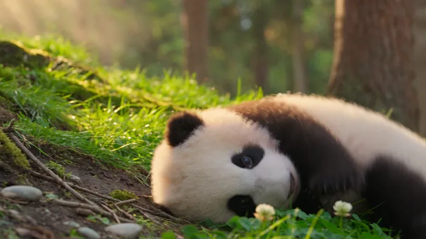
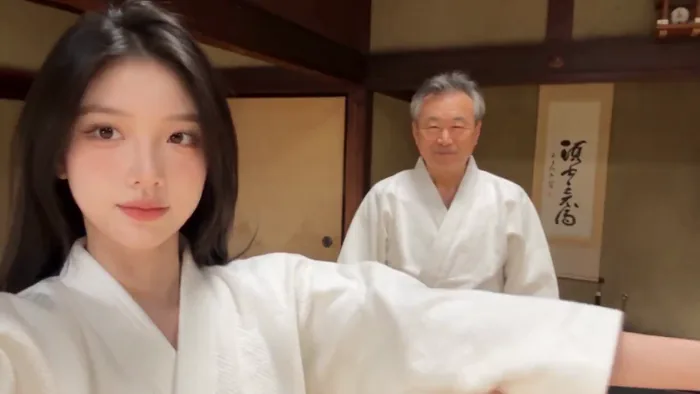
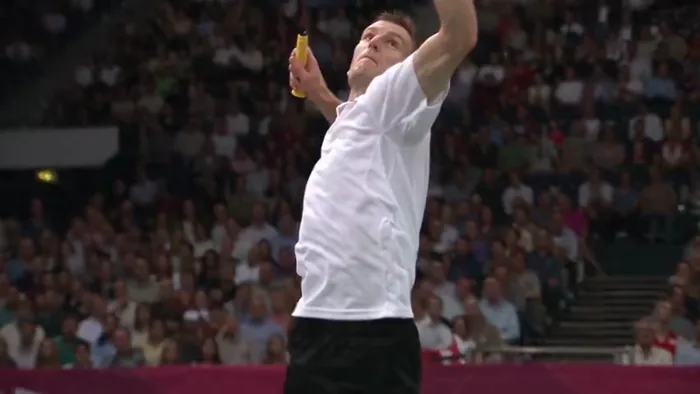
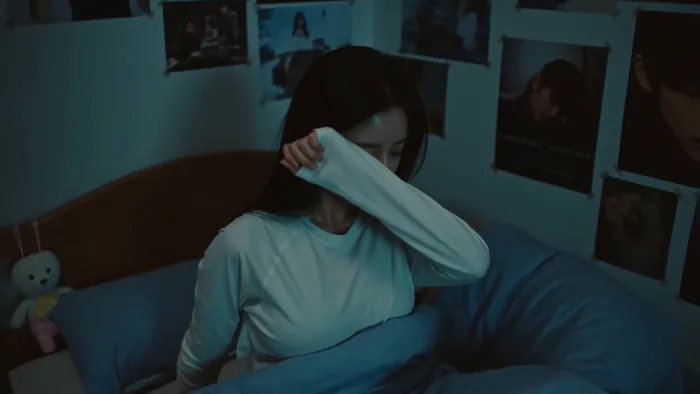
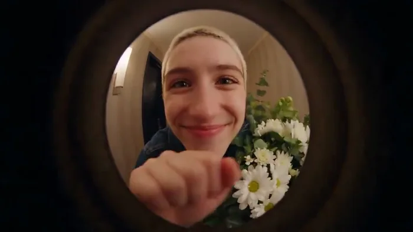
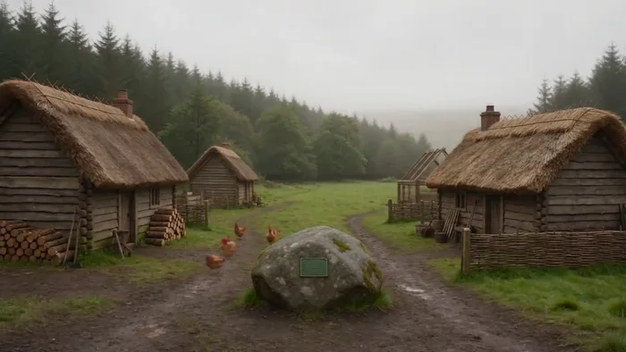

[← 返回总目录](../README.zh-CN.md#table-of-contents) · [English](shorts-reels.md) · [简体中文](shorts-reels.zh-CN.md) · [日本語](shorts-reels.ja.md)

### 社媒短视频 Shorts & Reels

- [Case 28: Panda cub in the forest (熊猫幼崽) — by ByteDance](#case-28)
- [Case 29: Pixel wuxia vertical short (像素武侠竖屏) — by ByteDance](#case-29)
- [Case 30: Spicy food challenge, confidence to collapse (吃辣挑战·从自信到崩溃) — by @oggii_0](#case-30)
- [Case 31: Korean gym vlog, DV camcorder (韩式健身房 Vlog·DV 摄像机质感) — by @doctorwasif](#case-31)
- [Case 32: Madrid grocery run, 2004 MiniDV home video (马德里超市采购·2004年MiniDV家庭录像) — by @ZephyraLeigh](#case-32)
- [Case 33: Japanese dojo travel vlog, first lesson (日本道场旅拍·武道初体验) — by @SimplyAnnisa](#case-33)
- [Case 34: Cyber skydive freefall cut sequence (赛博跳伞自由落体剪辑序列) — by @opener_ai](#case-34)
- [Case 35: Olympic badminton smash, slow motion (奥运羽毛球杀球·慢动作) — by @tanabe_fragm](#case-35)
- [Case 36: “Chase,” a DV camcorder self-shot day (Chase 的一天·DV自拍随拍) — by @doctorwasif](#case-36)
- [Case 64: Friend-filmed day-trip vlog, city to coast (朋友跟拍的一日旅拍 · 从街区到海边) — by @BubbleBrain](#case-64)
- [Case 70: MiniDV morning vlog in an old residential lane (老生活区晨间 Vlog · MiniDV 质感) — by @羊羊Vincent](#case-70)

- [Case 73: Three doorstep visits through a peephole (猫眼里的三次敲门) — by @bmx_ai13](#case-73)
- [Case 74: One thousand years beside a mossy boulder (苔藓巨石旁的一千年) — by @sebatheepan](#case-74)
- [Case 76: Bedroom candid, cat and doorbell (卧室随拍、猫咪与门铃) — by @oggii_0](#case-76)

### Case 28: Panda cub in the forest (熊猫幼崽) — by ByteDance

▶ [在 ofox.ai 观看完整视频](https://ofox.ai/seedance-2-5-prompts?utm_source=github&utm_medium=case&utm_campaign=awesome-seedance-2-5#case-28)

<strong>Prompt</strong> — 写实自然纪录片风格，电影级真实光影，温暖的午后, 在森林草坡上, 一只圆滚滚的熊猫幼崽从坡上滚下来.  熊猫黑白毛发蓬松真实，体型小而胖，动作笨拙可爱。场景为绿色森林斜坡，地面覆盖青草、苔藓、三叶草、泥土、小石块、枯枝和少量小黄花，虚化背景中有高大树干与树林。镜头为低机位中远景，轻微手持感，整体基本…

~~~~text
写实自然纪录片风格，电影级真实光影，温暖的午后, 在森林草坡上, 一只圆滚滚的熊猫幼崽从坡上滚下来.

熊猫黑白毛发蓬松真实，体型小而胖，动作笨拙可爱。场景为绿色森林斜坡，地面覆盖青草、苔藓、三叶草、泥土、小石块、枯枝和少量小黄花，虚化背景中有高大树干与树林。镜头为低机位中远景，轻微手持感，整体基本固定，始终保持熊猫在画面中。

0s-3s：一只熊猫幼崽趴在绿色草坡上，身体圆滚滚, 它刚开始顺着斜坡慢慢侧滚，动作笨拙，草叶被身体轻轻压弯。微风拂过, 阳光从左上方穿过树林，形成斑驳光影。
3s-8s：熊猫滚到画面右下方，动作逐渐停止，从侧躺变成趴卧。它的圆脸朝向镜头，前爪压在草地上，熊猫趴在前景草丛中，身体调整到舒服的姿势，头部小幅抬起又放低, 发出轻微哼唧声。

低机位，轻微手持感，轻微跟随熊猫向右下方移动。景深自然，前景草叶轻微虚化，熊猫主体清晰，背景树林柔和虚化。自然环境音，风声、熊猫滚动时轻微柔软的扑通声, 整体温暖、真实、自然。
~~~~

**参数**：Seedance 2.5 · 火山方舟 · t2v · 8s（由提示词分段隐含）· 未标注 · 未标注 · 带音频
**来源**：火山方舟官方文档 · [中文](https://docs.volcengine.com/docs/82379/2607689?lang=zh) · [English](https://docs.byteplus.com/en/docs/ModelArk/2607689)

Preview frame © 2026 ByteDance, from the official demo video · Prompt by ByteDance · <a href="https://docs.volcengine.com/docs/82379/2607689?lang=zh">source</a>

[回到目录](#table-of-contents)

### Case 29: Pixel wuxia vertical short (像素武侠竖屏) — by ByteDance

▶ [在 ofox.ai 观看完整视频](https://ofox.ai/seedance-2-5-prompts?utm_source=github&utm_medium=case&utm_campaign=awesome-seedance-2-5#case-29)

**输入素材**（6 张官方关键帧参考图）

| | | | |
|:---:|:---:|:---:|:---:|
|  @图片1 |  @图片2 |  @图片3 |  @图片4 |
|  @图片5 |  @图片6 |  |  |

<strong>Prompt</strong> — 根据 @图片1 - @图片6 制作一镜到底的像素武侠主题竖版视频，背景音乐使用国风 8bit 武侠风格音乐。全片统一浅蓝底色，像素风格统一，画面干净通透。 镜头 1：静止展示 @图片 1 的「江湖风云」水墨风格 logo，背景为统一浅蓝底色，画面保持约 1 秒静止。 镜头 2：@图片 1 中的文字区…

~~~~text
根据 @图片1 - @图片6 制作一镜到底的像素武侠主题竖版视频，背景音乐使用国风 8bit 武侠风格音乐。全片统一浅蓝底色，像素风格统一，画面干净通透。
镜头 1：静止展示 @图片 1 的「江湖风云」水墨风格 logo，背景为统一浅蓝底色，画面保持约 1 秒静止。
镜头 2：@图片 1 中的文字区域消失后，@图片 2 的武侠男性角色像素脸部特写从画面底部滑入；角色眨眨眼看向镜头，随后快速向下位移离场；角色离场后，原本 logo 处变为 @图片 3 的蓝色「武功秘籍」像素书。
镜头 3：紧接 @图片 4，像素武侠小人角色从画面下方用力向上跃出，顶起上方的蓝色菱形问号标，问号标上方弹出深蓝色粗体字「今日闯江湖！」；角色落地后摆出 @图片 4 的站姿 pose，随后抬手打招呼，接着做出预备跑动作，转身向画面右侧奔跑（奔跑姿态参考 @图片 5），镜头跟随角色向右移动，角色从画面右侧跳出画面。
镜头 4：@图片 6 的 UI 界面从画面右侧位移入画，像素武侠角色从画面右上角跳入，落在「三月廿七日」大字的右下方，张开双臂摆出热情展示的定格姿势，最终定格在该画面。
整体像素武侠美术风格，色调统一浅蓝底，运镜连贯顺滑呈现一镜到底的连续位移与跟随，元素过渡自然、角色动作衔接流畅，画面无卡顿、无闪烁；文字与 UI 清晰稳定。
~~~~

**参数**：Seedance 2.5 · 火山方舟 · r2v · 15s · 720p · 9:16 · 带音频
**来源**：火山方舟官方文档 · [中文](https://docs.volcengine.com/docs/82379/2607689?lang=zh) · [English](https://docs.byteplus.com/en/docs/ModelArk/2607689)

Preview frame © 2026 ByteDance, from the official demo video · Prompt by ByteDance · <a href="https://docs.volcengine.com/docs/82379/2607689?lang=zh">source</a>

[回到目录](#table-of-contents)

### Case 30: Spicy food challenge, confidence to collapse (吃辣挑战·从自信到崩溃) — by @oggii_0

▶ [在 ofox.ai 观看完整视频](https://ofox.ai/seedance-2-5-prompts?utm_source=github&utm_medium=case&utm_campaign=awesome-seedance-2-5#case-30)

<strong>Prompt</strong> — 创作一段 30 秒、1080p 超写实的个人家庭视频，内容是一位韩国年轻女性自信地接受朋友发起的吃辣挑战，却在辣味袭来时彻底"破防"的全过程。无需参考图。主要人物：20 出头的韩国年轻女性，充满随性活泼的能量，自然妆容，表情生动，从起初的自负自信转变为真实的痛苦。头发扎成高马尾以"避免碍事"，几缕碎…

~~~~text
创作一段 30 秒、1080p 超写实的个人家庭视频，内容是一位韩国年轻女性自信地接受朋友发起的吃辣挑战，却在辣味袭来时彻底"破防"的全过程。无需参考图。主要人物：20 出头的韩国年轻女性，充满随性活泼的能量，自然妆容，表情生动，从起初的自负自信转变为真实的痛苦。头发扎成高马尾以"避免碍事"，几缕碎发散落在外，戴着小巧的耳钉。身穿灰色大码连帽衫，袖子挽起，穿着宽松的运动裤，盘腿坐在地板上，仿佛准备迎接一场战斗。在整个视频中保持相同的面部特征、发型、服装、身体比例和外貌。场景：一个温馨、有生活气息的客厅地板，午后的阳光透过窗户洒入。低矮的咖啡桌上摆放着一排辣度递增的炒年糕/拉面碗，旁边放着一叠餐巾纸、一盒牛奶和一杯水以备"不时之需"，手机靠在水瓶上计时，半袋吃剩的零食被推到一边，沙发上随意丢着一条毯子。普通、略显凌乱，非常真实。摄像/视觉美学：由朋友用手机拍摄的原始个人素材，全程带有强烈的手持 Vlog 晃动感。随着朋友为了捕捉她脸部更好的角度而变换位置，镜头会有轻微的抖动。自动对焦在冒热气的碗和她的脸之间切换。当她惊慌失措地去拿水时，画面有轻微的运动模糊。随着午后光线的变化，曝光度略有偏移。画面可见数字噪点，窗户光线带来略微温暖的色调。没有防抖，没有电影级的润色——它应该感觉像是一段为了群聊挑战而拍摄的真实视频。00:00–00:05 —— 自信的准备：她夸张地挽起袖子，在碗上方掰动手指，仿佛要干一件大事。她看向镜头，完全不当回事，露出自负的微笑。"这算什么。我从小就是吃辣长大的。" 00:05–00:10 —— 第一口：她拿起第一个最不辣的碗，自信地吃了一口，随意地咀嚼着，点头表示很简单。"看吧？没什么。" 镜头保持稳定，镜头外的朋友显然不为所动："那个基本就是番茄酱，继续吃。" 00:10–00:15 —— 转变：她转向第二个更辣的碗。吃了几口后，她点头的速度慢了下来。她的眼睛开始微微泛泪，伸手去拿水杯"润润喉"，依然试图表现得随意。她的声音听起来有些紧绷："没——没事，只是有点热。" 镜头微微推近，捕捉到她额头上开始渗出的汗珠。00:15–00:20 —— 失去镇定：她吃到了最辣的那碗。刚吃一口，她的整张脸都变了——双眼圆睁，用手扇着张开的嘴，抓起牛奶盒直接喝了起来。她重重地放下牛奶，呼吸急促，指着碗控诉道："好吧——好吧，那个不正常，那不是——" 镜头随着镜头外朋友爆发出的笑声而剧烈晃动。00:20–00:25 —— 全面崩溃：她抓起餐巾纸，一边用手扇着舌头，一边发出痛苦的声音，坐在原地微微摇晃。她再次伸手去拿水，猛灌一口，随即立刻后悔，又抓回牛奶。镜头外的朋友笑得几乎拿不稳手机："你不是说你从小吃辣长大的吗？！" 她泪眼汪汪地瞪了镜头一眼，无法回应，依然在扇着嘴。00:25–00:30 —— 最后一刻：她瘫倒在沙发上，彻底认输，牛奶盒紧贴在胸前，脸颊通红，眼泪还在打转。她看着镜头，声音沙哑且狼狈。"……我不是从小吃辣长大的。我撒谎了。" 她虚弱地竖起大拇指朝下，画面随着朋友的笑声剧烈晃动，视频戛然而止，转为黑屏。音频：仅限自然环境音：咀嚼声、吸鼻涕声、夸张的呼气和喘息声、打开牛奶盒和吞咽声、餐巾纸摩擦声、镜头外朋友真实的笑声、玻璃杯碰撞桌面的声音，以及手持摄像机的噪音。无背景音乐。无旁白。无人工音效。台词："这算什么。我从小就是吃辣长大的。" / "看吧？没什么。" / "那个基本就是番茄酱，继续吃。"（朋友） / "没——没事，只是有点热。" / "好吧——好吧，那个不正常，那不是——" / "你不是说你从小吃辣长大的吗？！"（朋友） / "……我不是从小吃辣长大的。我撒谎了。" 最终效果：真实、逐渐升级的肢体喜剧，完全建立在对真实辣味的真实反应之上——从自信的否认到彻底的投降。有趣、有共鸣、感觉像未排练过，那种会被直接发到群聊里并配上"哈哈哈哈"的视频。没有超出真实吃辣反应的夸张表演。没有虚假的强撑——喜剧效果来自于她防线崩溃的速度和彻底程度。
~~~~

**参数**：Seedance 2.5 · 未标注 · t2v · 未标注 · 未标注 · 未标注 · 未标注
**来源**：[@oggii_0](https://x.com/oggii_0) · [原帖](https://x.com/oggii_0/status/2094267751477232053)

Preview © 2026 <a href="https://x.com/oggii_0/status/2094267751477232053">@oggii_0</a> · Prompt by <a href="https://x.com/oggii_0/status/2094267751477232053">@oggii_0</a>

[回到目录](#table-of-contents)

### Case 31: Korean gym vlog, DV camcorder (韩式健身房 Vlog·DV 摄像机质感) — by @doctorwasif

▶ [在 ofox.ai 观看完整视频](https://ofox.ai/seedance-2-5-prompts?utm_source=github&utm_medium=case&utm_campaign=awesome-seedance-2-5#case-31)

<strong>Prompt</strong> — 摄像/视觉：DV 16mm 磁带摄像机 Vlog 美学，POV 在 CHASE 和 PARTNER 之间切换，有时放置在健身器材上。手持晃动、构图不完美、对焦延迟、笨拙的变焦、偶尔出现人脸被切断的情况。柔和模糊的磁带质感、微弱的噪点、泛光暖色高光、闪烁的曝光、柔和的对比度、真实的皮肤质感。汗水和潮红…

~~~~text
摄像/视觉：DV 16mm 磁带摄像机 Vlog 美学，POV 在 CHASE 和 PARTNER 之间切换，有时放置在健身器材上。手持晃动、构图不完美、对焦延迟、笨拙的变焦、偶尔出现人脸被切断的情况。柔和模糊的磁带质感、微弱的噪点、泛光暖色高光、闪烁的曝光、柔和的对比度、真实的皮肤质感。汗水和潮红的面部在整个过程中逐渐加深。摄像机始终不可见。 角色： CHASE：韩国偶像，20 多岁，黑色高马尾，眼神生动，脸颊潮红，身材苗条健美。穿着轻便保守的夏季运动上衣 + 高腰紧身裤/及膝短裤，运动鞋。 PARTNER：韩国女性，20 多岁，年龄/活力相仿，扎发，健美身材，轻便保守的运动装，运动鞋。无首饰。两人都大汗淋漓。 场景：炎热的夏季健身房，空调坏了，光线温暖而强烈，风扇吹着热风，开着的门，架子、垫子、镜子、水瓶。 30 秒分镜 — 15 个镜头： 1. 0–2 秒：固定机位。两人边扇风边走进来。CHASE："好吧，今天这里实在太热了。" 2. 2–4 秒：手持。PARTNER 指着坏掉的空调："空调从今天早上就坏了。" 3. 4–6 秒：在架子旁，CHASE 装杠铃片，PARTNER 辅助。"我们坚持下去吧。" 4. 6–8 秒：固定机位。CHASE 举重，PARTNER 辅助。 5. 8–9.5 秒：特写，双手紧握出汗的杠铃，汗水滴落。环境音。 6. 9.5–11.5 秒：PARTNER 举重，CHASE 辅助："你能行的，加油！" 7. 11.5–13.5 秒：两人喘气、扇动衣服、大笑。PARTNER："好吧，我已经湿透了。" 8. 13.5–15.5 秒：拿着水走向垫子。CHASE："喝水时间，强制执行。" 9. 15.5–17.5 秒：固定机位。两人喝水、叹气、大笑。 10. 17.5–19.5 秒：两人比赛做平板支撑。PARTNER："谁先放弃？" 11. 19.5–21.5 秒：用力支撑，汗水滴落。CHASE："不—是—我—" 12. 21.5–23.5 秒：特写，汗水滴在垫子上，沉重的呼吸声。 13. 23.5–25.5 秒：两人瘫倒大笑。PARTNER："好吧，这正式算平局。" 14. 25.5–27.5 秒：坐起来，开玩笑地用毛巾互相扇风。CHASE："这热度简直疯了。" 15. 27.5–30 秒：手臂长度的自拍。两人满头大汗、咧嘴笑、疲惫地击掌。CHASE："好吧，我们活下来了——大家下次见！" 基调：俏皮、汗水感、充满活力的健身 Vlog。充满竞争但又相互支持的对话，真实的疲惫与欢笑。热度和汗水从开始到结束逐渐升级。
~~~~

**参数**：Seedance 2.5 · 未标注 · t2v · 未标注 · 未标注 · 未标注 · 未标注
**来源**：[@doctorwasif](https://x.com/doctorwasif) · [原帖](https://x.com/doctorwasif/status/2093928113130619122)

Preview © 2026 <a href="https://x.com/doctorwasif/status/2093928113130619122">@doctorwasif</a> · Prompt by <a href="https://x.com/doctorwasif/status/2093928113130619122">@doctorwasif</a>

[回到目录](#table-of-contents)

### Case 32: Madrid grocery run, 2004 MiniDV home video (马德里超市采购·2004年MiniDV家庭录像) — by @ZephyraLeigh

▶ [在 ofox.ai 观看完整视频](https://ofox.ai/seedance-2-5-prompts?utm_source=github&utm_medium=case&utm_campaign=awesome-seedance-2-5#case-32)

<strong>Prompt</strong> — 主要人物：25 岁西班牙年轻女性，自然日常装扮，齐肩深棕色长发，留着略显凌乱的刘海，真实的皮肤质感，淡妆，下班后神态轻松。 身穿褪色的赤陶色 T 恤、轻便米色开衫、高腰深蓝色牛仔裤、旧白色运动鞋，手提一个简约帆布袋。请在整个过程中保持人物身份、服装、发型和外貌的一致性。 地点：温暖工作日傍晚的普通马…

~~~~text
主要人物：25 岁西班牙年轻女性，自然日常装扮，齐肩深棕色长发，留着略显凌乱的刘海，真实的皮肤质感，淡妆，下班后神态轻松。 身穿褪色的赤陶色 T 恤、轻便米色开衫、高腰深蓝色牛仔裤、旧白色运动鞋，手提一个简约帆布袋。请在整个过程中保持人物身份、服装、发型和外貌的一致性。 地点：温暖工作日傍晚的普通马德里住宅区。小型本地杂货店、带有阳台的公寓楼、停放的小型汽车、踏板摩托车、悬铃木、瓷砖人行道、回收箱以及下班回家的居民。无著名地标、旅游街道或刻意安排的活动。 视觉风格：超写实纪录片风格。真实的日常行为，自然的肢体语言，自发的本地互动，地道的西班牙社区氛围。 摄像风格：21 世纪初消费级 MiniDV 摄像机。强烈的肩扛式抖动，不完美的构图，在货架与人物面部之间自动对焦的拉扯感，进出商店时的曝光波动，褪色的色彩，柔和的对比度，轻微的运动模糊，DV 压缩伪影，轻微的传感器噪点，无防抖。 00:00–00:03 她提着一个空帆布袋走在住宅区的人行道上。在靠近一家小型社区商店时，她查看了一份手写的购物清单。 00:03–00:06 在店内，她拿起西红柿和橙子，随意地比较了一下，然后放入篮子。自动对焦短暂地锁定在色彩鲜艳的农产品上。 00:06–00:09 她挑选了一条面包和一盒牛奶。店主在柜台后向她打招呼，她微笑着回应。 00:09–00:12 店外，她站在树下整理帆布袋里的杂货。一辆踏板摩托车从她身后缓慢驶过。 00:12–00:15 她注意到摄像机，轻声笑了笑，举起购物袋展示她买的东西，然后继续朝公寓走去。拍摄者跟了几步，随后不小心将镜头对准了地面，画面切黑。 音频：仅自然环境音——西班牙语交谈声、商店门铃声、购物袋摩擦声、脚步声、踏板摩托车声、远处的交通声、鸟鸣声、公寓生活声以及轻微的社区闲聊声。无背景音乐。无旁白。 目标：一段 2004 年被遗忘的 MiniDV 家庭录像，记录了马德里一次平凡的下班后购物过程——本地化、随意、不完美、温暖、怀旧且完全真实可信。
~~~~

**参数**：Seedance 2.5 · 未标注 · t2v · 未标注 · 未标注 · 未标注 · 未标注
**来源**：[@ZephyraLeigh](https://x.com/ZephyraLeigh) · [原帖](https://x.com/ZephyraLeigh/status/2094038963233435763)

Preview © 2026 <a href="https://x.com/ZephyraLeigh/status/2094038963233435763">@ZephyraLeigh</a> · Prompt by <a href="https://x.com/ZephyraLeigh/status/2094038963233435763">@ZephyraLeigh</a>

[回到目录](#table-of-contents)

### Case 33: Japanese dojo travel vlog, first lesson (日本道场旅拍·武道初体验) — by @SimplyAnnisa

▶ [在 ofox.ai 观看完整视频](https://ofox.ai/seedance-2-5-prompts?utm_source=github&utm_medium=case&utm_campaign=awesome-seedance-2-5#case-33)

<strong>Prompt</strong> — 制作一段 20 秒超写实、轻松的智能手机旅行 Vlog，全程由同一位 20 岁出头的韩国女性出镜。她拥有小巧的鹅蛋脸、棕色眼睛、自然的珊瑚色嘴唇、白皙真实的皮肤和一头乌黑的长直发。保持面部特征、发型、身体比例和外貌完全一致，严禁变形或身份特征偏移。 旅行穿搭：米色廓形针织毛衣、深蓝色直筒牛仔裤、白色…

~~~~text
制作一段 20 秒超写实、轻松的智能手机旅行 Vlog，全程由同一位 20 岁出头的韩国女性出镜。她拥有小巧的鹅蛋脸、棕色眼睛、自然的珊瑚色嘴唇、白皙真实的皮肤和一头乌黑的长直发。保持面部特征、发型、身体比例和外貌完全一致，严禁变形或身份特征偏移。 旅行穿搭：米色廓形针织毛衣、深蓝色直筒牛仔裤、白色低帮运动鞋和小型斜挎包。头发扎成随意的低马尾，留有自然碎发。 训练穿搭：米白色棉质道服风格上衣，搭配同色系白色训练裤和纯深蓝色初学者腰带。无任何 Logo、文字或图案。训练期间保持此服装完全一致。 风格：真实的手机手持拍摄视角，构图不完美，带有轻微的镜头晃动、自动对焦偏移、自然曝光、轻微的动态模糊，以及真实的皮肤质感、眨眼和身体动作。严禁电影感镜头、无人机、稳定器、美颜滤镜或商业广告感。 地点：宁静的日本乡村社区，以及一个拥有传统建筑、木地板和自然采光的小型正宗道场。严禁出现著名地标。 0:00–0:04：她一边自拍一边走向道场，神情兴奋且好奇。她用韩语自然地说道："오늘은 일본 무술을 직接 배워볼게요!"（今天我要亲自尝试学习日本武术！） 她简短地展示了道场入口，随后切回自拍模式。 0:04–0:07：进入道场后，她已换上训练服。她整理了一下袖子。一位友好的教练恭敬地鞠躬；她有些笨拙地回礼并微笑。 0:07–0:11：教练演示了一个简单的初学者站姿和受控的手部动作。她笨拙地模仿，脚位放错，在教练冷静地纠正姿势后，她再次尝试。 0:11–0:15：她尝试进行缓慢的初学者站姿转换，配合受控的防御性手臂动作，期间短暂失去平衡，随后稳住重心并自然地笑了出来。教练给予鼓励的微笑。动作需保持安全且符合初学者水平。 0:15–0:18：自然跳剪。同一位女性，服装和外貌完全一致。她重复了刚才的动作序列，平衡感明显提升，但看起来仍是初学者水平。她自豪地笑了。 0:18–0:20：道场外，在午后柔和的阳光下，她对着镜头自拍，略微喘着气并微笑着。她说："생각보다 어렵지만 정말 재미있어요!"（比想象中难，但真的很有趣！） 她挥了挥手，放下手机。 音频：自然的韩国女性原声，口型同步准确。包含脚步声、衣物摩擦声、道场环境音、远处的社区声音和微风声。无背景音乐或戏剧性音效。 最终规则：照片级真实感，真实的智能手机 Vlog 风格，符合物理规律，展现初学者水平的武术动作。严禁打斗、夸张动作、动作编排、著名地标、Logo、品牌、字幕、文字、水印或视觉特效。
~~~~

**参数**：Seedance 2.5 · 未标注 · t2v · 未标注 · 未标注 · 未标注 · 未标注
**来源**：[@SimplyAnnisa](https://x.com/SimplyAnnisa) · [原帖](https://x.com/SimplyAnnisa/status/2093978574692679983)

Preview © 2026 <a href="https://x.com/SimplyAnnisa/status/2093978574692679983">@SimplyAnnisa</a> · Prompt by <a href="https://x.com/SimplyAnnisa/status/2093978574692679983">@SimplyAnnisa</a>

[回到目录](#table-of-contents)

### Case 34: Cyber skydive freefall cut sequence (赛博跳伞自由落体剪辑序列) — by @opener_ai

▶ [在 ofox.ai 观看完整视频](https://ofox.ai/seedance-2-5-prompts?utm_source=github&utm_medium=case&utm_campaign=awesome-seedance-2-5#case-34)

**输入素材**：未公开 —— 原作者只发布了成片，未提供输入素材

<strong>Prompt</strong> — Prompt  IDENTITY: @Image1 supplies identity only — face, long black hair, low-brim cap, glossy black bodysuit, segmented cybernetic right arm, circuit…

~~~~text
Prompt

IDENTITY: @Image1 supplies identity only — face, long black hair, low-brim cap, glossy black bodysuit, segmented cybernetic right arm, circuit tattoos, heeled boots. Frame is one continuous open-sky environment edge to edge. Cuts every 2-3s, no shot over 3s, one camera movement per shot. 0-2s | Worm-eye far below, whip tilt up as she pushes off the spire ledge. [Cut] 2-4s | Macro on her heel leaving the lip, static. [Cut] 4-6s | Top-down on her back, falling with her, hair rips straight up. [Cut] 6-8s | Boot macro, black plates streak in and latch over her shins, static. [Cut] 8-10s | Side track, thigh and hip plates snap shut. [Cut] 10-12s | Cybernetic arm macro, forearm plating extends over it, static. [Cut] 12-15s | Wide, chest harness clamps on, two stabilizer fins fold from her back, push-in. [Cut] 15-17s | Face close-up, a thin dark visor slides from the cap brim over her eyes, locked. [Cut] 17-20s | Extreme wide, geared figure punches the cloud layer, twin vapor spirals. [Cut] 20-23s | Head-down delta dive, fins biting air, hard push-in on her back. [Cut] 23-26s | Ground-level low angle, she swells in frame fast. [Cut] 26-28s | She lands in a deep crouch, cybernetic arm braced on stone, cracks radiate 4m in a spider-web pattern. [Cut] 28-30s | 0.4x slow motion, concentric shockwave ripple distorts the air outward, dust erupts to waist height, she rises into a recovery stance. GEAR: plates arrive as fast streaks from off-frame, each locking with a latch snap and a thin amber seam that fades in 0.4s and lights her skin. Assembly runs 6-17s, one region per shot. PHYSICS: terminal velocity, hair and fabric dragged upward, motion blur on background only, subject sharp, faster after 17s. AUDIO: wind roar climbing, latch snap on each lock, sub-bass on every cut, half beat of silence at 25.5s, air-pressure boom at 26s, rumble tail. STYLE: painterly anime illustration matching @Image1, cel-and-gradient shading, cool desaturated sky.
~~~~

**参数**：Seedance 2.5 · 未标注 · i2v · 30s · 未标注 · 未标注 · 未标注
**来源**：[@opener_ai](https://x.com/opener_ai) · [原帖](https://x.com/opener_ai/status/2083542433078624470)

Preview © 2026 <a href="https://x.com/opener_ai/status/2083542433078624470">@opener_ai</a> · Prompt by <a href="https://x.com/opener_ai/status/2083542433078624470">@opener_ai</a>

[回到目录](#table-of-contents)

### Case 35: Olympic badminton smash, slow motion (奥运羽毛球杀球·慢动作) — by @tanabe_fragm

▶ [在 ofox.ai 观看完整视频](https://ofox.ai/seedance-2-5-prompts?utm_source=github&utm_medium=case&utm_campaign=awesome-seedance-2-5#case-35)

<strong>Prompt</strong> — A cinematic slow-motion shot of a professional Caucasian male badminton player competing in the Olympic finals. He leaps high into the air with explos…

~~~~text
A cinematic slow-motion shot of a professional Caucasian male badminton player competing in the Olympic finals. He leaps high into the air with explosive power for a powerful smash. Focus on the intense facial expression and the flexed muscles of his arm. As he hits the shuttlecock, a subtle motion blur and wind effect are visible. The background shows a packed Olympic arena with blurred crowds and bright stadium lights. Smooth camera tracking following his jump. 4K, ultra-realistic, high frame rate, vivid colors, athletic anatomy, professional sports photography style.
~~~~

**参数**：Seedance 2.5 · 未标注 · t2v · 15s · 未标注 · 未标注 · 未标注
**来源**：[@tanabe_fragm](https://x.com/tanabe_fragm) · [原帖](https://x.com/tanabe_fragm/status/2083140946640916720)

Preview © 2026 <a href="https://x.com/tanabe_fragm/status/2083140946640916720">@tanabe_fragm</a> · Prompt by <a href="https://x.com/tanabe_fragm/status/2083140946640916720">@tanabe_fragm</a>

[回到目录](#table-of-contents)

### Case 36: “Chase,” a DV camcorder self-shot day (Chase 的一天·DV自拍随拍) — by @doctorwasif

▶ [在 ofox.ai 观看完整视频](https://ofox.ai/seedance-2-5-prompts?utm_source=github&utm_medium=case&utm_campaign=awesome-seedance-2-5#case-36)

**输入素材**：未公开 —— 原作者只发布了成片，未提供输入素材

<strong>Prompt</strong> — **CAMERA:** DV 16mm tape camcorder handheld feel. POV of CHASE holding the camera herself throughout each location, occasionally propped briefly for h…

~~~~text
**CAMERA:**
DV 16mm tape camcorder handheld feel. POV of CHASE holding the camera herself throughout each location, occasionally propped briefly for hands-free moments. Hand shake, misaligned framing, delayed focus pulls, clumsy zooms, occasional face cut-off framing, imperfect shots. Camcorder never appears on screen.

**LOOK:**
Soft, slightly blurry tape quality, faint tape noise, bloomed highlights, flickering auto-exposure, muted contrast, realistic skin tones — lighting shifts per location (dim early-morning dorm → fluorescent vocal room → mirror-lit practice room → stark evaluation room lighting).

**STYLE:**
Nostalgic, determined montage feel — younger, rawer energy than her current polished vlogs, evoking a flashback to trainee days. Quick cuts stitched across locations, reflective voiceover narration plays over the visuals instead of synced dialogue. Mood shifts from tired to focused to nervous, ending on quiet resolve.

**Character**

CHASE — Korean trainee (ref image), late teens/early 20s (younger, flashback version of herself). Long straight black hair, often in a simple ponytail or braid, minimal to no makeup, tired but determined eyes. Wearing simple practice clothes — a plain long-sleeve top and joggers or sweats, fully covering arms and torso, no jewelry.

**Setting Progression**

Trainee dorm room (early morning) → vocal lesson room (morning) → dance practice room (afternoon) → evaluation room (evening).

**Storyboard (15s, 5 cuts)**

1. *(~3s, dorm, propped camera, dim early light)* She wakes up before sunrise, rubbing her eyes, quietly getting ready in the dark so as not to wake roommates. VOICEOVER (CHASE): "Back then, mornings started before the sun even came up."

2. *(~3s, vocal room, handheld, fluorescent light)* She stands at a mic, sheet in hand, focused and a little nervous, mouthing through warmups. VOICEOVER (CHASE): "Every note mattered — you never knew who was listening."

3. *(~3s, practice room, handheld, mirror wall)* She's mid-motion rehearsing choreography, sweat forming, repeating a step over and over. VOICEOVER (CHASE): "I must have run that same eight-count a hundred times."

4. *(~3s, practice room, macro insert)* Close-up on her feet repeating the same step, breathing audible, tape blur softening the motion. No narration — ambient practice room sound only.

5. *(~3s, evaluation room, wide-to-close, tense finish)* She stands nervously in front of unseen evaluators, hands clasped, taking a steadying breath before the camera holds on her face. VOICEOVER (CHASE): "That was the version of me that started all of this."
~~~~

**参数**：Seedance 2.5 · 未标注 · i2v · 15s · 未标注 · 未标注 · 未标注
**来源**：[@doctorwasif](https://x.com/doctorwasif) · [原帖](https://x.com/doctorwasif/status/2083539372478251247)

Preview © 2026 <a href="https://x.com/doctorwasif/status/2083539372478251247">@doctorwasif</a> · Prompt by <a href="https://x.com/doctorwasif/status/2083539372478251247">@doctorwasif</a>

[回到目录](#table-of-contents)

### Case 64: Friend-filmed day-trip vlog, city to coast (朋友跟拍的一日旅拍 · 从街区到海边) — by @BubbleBrain

▶ [在 ofox.ai 观看完整视频](https://ofox.ai/seedance-2-5-prompts?utm_source=github&utm_medium=case&utm_campaign=awesome-seedance-2-5#case-64)

**输入素材**：未公开 —— 原作者只发布了成片，未提供输入素材

<strong>Prompt</strong> — A realistic handheld travel vlog filmed by a friend following the main character throughout the day. Use the woman from …

~~~~text
A realistic handheld travel vlog filmed by a friend following the main character throughout the day. Use the woman from the reference image as the main subject. Maintain her exact facial identity, hairstyle, facial features, and body proportions throughout the entire video. The camera feels like a real personal vlog camera, not a commercial production. Natural handheld movement, casual framing, imperfect human camera motion, authentic everyday atmosphere. No scripted acting. The woman behaves naturally, interacting with the environment like a real travel vlog. 0-5s: Morning departure. The woman leaves a cozy apartment with a small backpack. She checks her phone, smiles at the camera, adjusts her hair, and starts walking outside. The camera follows her from behind, slightly shaky like a friend filming. Morning sunlight, quiet neighborhood streets, people starting their day. 5-12s: Exploring the city. The camera follows her walking through local streets. She visits a small cafe, buys a drink, briefly talks to the camera, laughs naturally. She walks through a street market, looks at small shops, takes casual photos. The camera stays close, capturing spontaneous moments. 12-20s: Arriving at the beach. She takes public transportation or walks toward the coast. The environment gradually changes from city streets to a seaside town. Ocean breeze moves her hair. She looks excited when she sees the ocean. The camera follows her walking along the beach. She picks up a seashell, watches waves, and interacts naturally with people nearby. 20-27s: Summer beach afternoon. She meets friends at the beach. Everyone chats, laughs, plays near the water. The camera moves naturally between people, capturing real candid moments. She looks back at the camera and smiles. 27-30s: Ending moment. Golden hour sunset. She sits near the ocean, holding a drink, watching the sunset. The camera slowly moves backward, revealing the beach, waves, and the peaceful evening. A feeling of a real personal travel memory. Visual style: Authentic travel vlog footage. Realistic smartphone or mirrorless camera look. Natural daylight. Casual handheld movement. Slight camera shake. Real human reactions. Documentary realism. No cinematic commercial look. No dramatic posing. No artificial transitions. No text overlays. No logos. No face changes. No identity changes.
~~~~

**参数**：Seedance 2.5 · 未标注 · i2v · 30s · 未标注 · 未标注 · 未标注
**来源**：[@BubbleBrain](https://x.com/BubbleBrain) · [原帖](https://x.com/BubbleBrain/status/2083659648108990925)

Preview © 2026 <a href="https://x.com/BubbleBrain/status/2083659648108990925">@BubbleBrain</a> · Prompt by <a href="https://x.com/BubbleBrain/status/2083659648108990925">@BubbleBrain</a>

[回到目录](#table-of-contents)

### Case 70: MiniDV morning vlog in an old residential lane (老生活区晨间 Vlog · MiniDV 质感) — by @羊羊Vincent

▶ [在 ofox.ai 观看完整视频](https://ofox.ai/seedance-2-5-prompts?utm_source=github&utm_medium=case&utm_campaign=awesome-seedance-2-5#case-70)

**输入素材**：未公开 —— 原作者只发布了成片，未提供输入素材

<strong>Prompt</strong> — 完整提示词： 【视觉与风格设定】 画质与摄影机美学：2000年代初家用手持小型DV摄像机（MiniDV）录像风格，强烈的手持摇晃与抖动、频繁且随意的重新构图、偶发自动对焦搜索与镜头呼吸、曝光偶有波动。低对比度、泛白褪色感（faded/washed-out）、伴随轻微数字噪点与轻度压缩感，无任何现代稳…

~~~~text
完整提示词：
【视觉与风格设定】
画质与摄影机美学：2000年代初家用手持小型DV摄像机（MiniDV）录像风格，强烈的手持摇晃与抖动、频繁且随意的重新构图、偶发自动对焦搜索与镜头呼吸、曝光偶有波动。低对比度、泛白褪色感（faded/washed-out）、伴随轻微数字噪点与轻度压缩感，无任何现代稳定器滤镜或商业调色。
场景环境：安静老旧的生活住宅区，狭窄水泥小巷、带小露台的矮房、院内晾衣绳、花盆绿植、停靠的自行车/摩托车、茂密树木与纵横交错的架空电线，纯粹真实的生活街区，无任何商业或店铺元素。
音频设计：纯环境原声（无背景音乐）。清晨鸟鸣、微风拂过树叶的沙沙声、远处摩托车引擎声、脚步踏在水泥路上的声响、猫叫声、咖啡杯轻碰声。
角色设计@ 角色设定
【分秒时间轴细节（0-15s）】
00:00 - 00:05 | 开场与小巷相遇
画面：开场镜头略微失焦随后对准，女性坐在路边水泥地面整理侧马尾，手臂抬起并露出真诚微笑，微风吹拂发丝。紧接着摄像机跟随着她站起并拐入狭窄小巷，她蹲下身轻抚并喂食一只主动走近的流浪小猫，镜头有明显的手持摇晃与焦点轻微飘移。
00:05 - 00:10 | 院落日常与邻里挥手
画面：切换至前院晨间日常，她在晾衣绳上晾挂衣物，微风轻轻吹拂；随后镜头松散漂移至房屋露台，她静静端着咖啡杯坐着望向街道。接着镜头右侧近景捕捉到她抬手向画外邻居热情挥手示意，摄像机慢了半拍才调整好构图跟随她的动作。
00:10 - 00:15 | 街道漫步与戛然而止
画面：摄像机以手持低位缓慢倒退跟随她在街道上漫步，她手拿咖啡杯，在注意到镜头时微微转头露出一抹安静柔和的微笑。
结尾：在第15秒视频画面无任何渐隐过渡，中途直接硬切为纯黑屏，伴随DV机电源切断的突兀停录感。
~~~~

**参数**：Seedance 2.5 · 未标注 · r2v · 15s · 未标注 · 未标注 · 带音频
**来源**：[@羊羊Vincent](https://space.bilibili.com/283745134) · [原帖](https://www.bilibili.com/video/BV1tDhV6eEgT)

Preview © 2026 <a href="https://www.bilibili.com/video/BV1tDhV6eEgT">@羊羊Vincent</a> · Prompt by <a href="https://www.bilibili.com/video/BV1tDhV6eEgT">@羊羊Vincent</a>

[回到目录](#table-of-contents)

### Case 73: Three doorstep visits through a peephole (猫眼里的三次敲门) — by @bmx_ai13

▶ [在 ofox.ai 观看完整视频](https://ofox.ai/seedance-2-5-prompts?utm_source=github&utm_medium=case&utm_campaign=awesome-seedance-2-5#case-73)

**输入素材**：未公开 —— 原帖未附可下载的独立输入素材

<strong>Prompt</strong> — A realistic doorway peephole POV video shot through a ultra wide fisheye lens with a pronounced circular black vignette and curved distortion. The sce…

~~~~text
A realistic doorway peephole POV video shot through a ultra wide fisheye lens with a pronounced circular black vignette and curved distortion. The scene takes place in a warmly lit, carpeted apartment hallway with dark doors and warm sconce lights running along the walls. A cheerful young woman with short, bleached blonde pixie cut hair, wearing a casual layered outfit, approaches the camera close up, leaning in and playfully knocking on the lens as if knocking on a door. She holds a large fresh bouquet of white daisies and eucalyptus. She smiles brightly, applies lip balm while looking into the camera, spins around happily, and runs off down the corridor. Next, she returns wearing an oversized cream-colored trench coat carrying a small red gift bag, knocks again, poses, turns, and playfully darts away down the hallway before running back toward the door. Finally, she returns wearing a warm brown sweater, holding a frosted red velvet cake on a glass plate. She knocks on the camera lens, licks frosting off her finger, smiles, blows a kiss directly to the camera lens, and runs off giggling. Natural handheld instability, realistic indoor lighting, handheld camera movement, high definition organic video quality, upbeat indie pop background soundtrack. Aspect ratio 16:9, total duration 20 seconds.
~~~~

**参数**：Seedance 2.5 · 未标注 · 未标注 · 未标注 · 未标注 · 未标注 · 未标注
**来源**：[@bmx_ai13](https://x.com/bmx_ai13) · [原帖](https://x.com/bmx_ai13/status/2083678409272721652)

Preview © 2026 <a href="https://x.com/bmx_ai13/status/2083678409272721652">@bmx_ai13</a> · Prompt by <a href="https://x.com/bmx_ai13/status/2083678409272721652">@bmx_ai13</a>

[返回目录](#table-of-contents)

### Case 74: One thousand years beside a mossy boulder (苔藓巨石旁的一千年) — by @sebatheepan

▶ [在 ofox.ai 观看完整视频](https://ofox.ai/seedance-2-5-prompts?utm_source=github&utm_medium=case&utm_campaign=awesome-seedance-2-5#case-74)

**输入素材**：未公开 —— 原帖未附可下载的独立输入素材

<strong>Prompt</strong> — A 30 second film from ONE completely locked, static camera position that never moves, never pans, never zooms, never cuts. The same view of the same p…

~~~~text
A 30 second film from ONE completely locked, static camera position that never moves, never pans, never zooms, never cuts. The same view of the same patch of ground for one thousand years, time passing at enormous speed. In the foreground of every single frame sits a large mossy grey boulder. It never moves. It is present and recognisable in every frame of the film from first to last. [0:00-0:03] Ancient temperate forest. Huge old trees, deep green undergrowth, mist between the trunks, soft grey daylight. [0:03-0:06] Trees fall and are dragged away. A clearing opens. Stumps, churned mud, a first thin column of smoke. [0:06-0:09] A single timber and thatch hut rises beside the boulder. A small vegetable plot. Chickens. [0:09-0:12] A village grows around it. More huts, fences, a dirt track, wood smoke, sheep in the field beyond. [0:12-0:15] A stone wall is built, incorporating the boulder into its base. A church tower rises behind. Snow falls and melts. Seasons flicker past. [0:15-0:18] Fire. The village burns, timbers collapse, smoke blackens the sky. The wall and the boulder survive. [0:18-0:21] Rebuilding in brick. A cobbled road. A chimney, then many chimneys. Industrial smoke, grey air, rain. [0:21-0:24] The town becomes a city. Concrete rises. The old wall is demolished. The boulder sits in a small paved square, surrounded by buildings. [0:24-0:26] Glass towers. Traffic light streaking past at night. The boulder is fenced off, a small green plaque beside it. [0:26-0:28] Abandonment. Windows dark, glass cracked, weeds through the paving, ivy climbing the towers. Silence. [0:28-0:30] The towers have collapsed and gone. Young forest has grown over everything. Mist between the trunks. The frame is now identical to the opening frame, the same boulder in the same position under the same soft grey light. Camera: absolutely locked and static for all 30 seconds. No movement of any kind. No cuts, no dissolves, no transitions — one continuous transforming shot. Style: photoreal, cinematic, natural overcast light throughout, muted natural colour, seasons and weather flickering rapidly past. Audio: diegetic only, evolving with the era — forest birds, axes, village life, church bell, fire, industrial machinery, city traffic, then silence, then birds again. NO MUSIC, no score, no soundtrack, no instruments. No text, no captions, no titles, no watermarks, no camera movement, no cuts.
~~~~

**参数**：Seedance 2.5 · Higgsfield · 未标注 · 未标注 · 未标注 · 未标注 · 未标注
**来源**：[@sebatheepan](https://x.com/sebatheepan) · [原帖](https://x.com/sebatheepan/status/2083290634731864190)

Preview © 2026 <a href="https://x.com/sebatheepan/status/2083290634731864190">@sebatheepan</a> · Prompt by <a href="https://x.com/sebatheepan/status/2083290634731864190">@sebatheepan</a>

[返回目录](#table-of-contents)

### Case 76: Bedroom candid, cat and doorbell (卧室随拍、猫咪与门铃) — by @oggii_0

▶ [在 ofox.ai 观看完整视频](https://ofox.ai/seedance-2-5-prompts?utm_source=github&utm_medium=case&utm_campaign=awesome-seedance-2-5#case-76)

**输入素材**：未公开 —— 原作者只发布了成片，未提供输入素材

<strong>Prompt</strong> — Montage, multi-shot candid observational footage. Do not use a single camera angle or continuous take. Handheld documentary style with the feeling of …

~~~~text
Montage, multi-shot candid observational footage. Do not use a single camera angle or continuous take. Handheld documentary style with the feeling of accidental real-life capture. Slightly imperfect framing, subtle handheld shake, tiny reframing adjustments, gentle exposure breathing, and autofocus that settles half a beat late. Realistic skin texture, soft indoor natural light, film grain, shallow depth of field. Relaxed breathing, natural blinking, restrained and authentic performance. Total of 7 shots.
The woman from @ Image 1 is wearing a matching cotton pajama set consisting of a scoop-neck sleeveless top and loose shorts made from the same fabric and design. Barefoot, she lies on her stomach across a lived-in, slightly messy bed in her bedroom, browsing a mobile shopping page on a black smartphone. A house cat jumps onto the bed seeking attention, and she affectionately plays with it. Moments later, a friend calls. She answers, chats, and eventually bursts into laughter. The doorbell rings, so she ends the call and gets up to collect her dinner.
Shot 1 (0–2s):
She is already moving. One thumb scrolls through a shopping page while she frowns slightly, thinking. She quietly mutters in Korean: "아, 뭐 살랬더라…" ("Ah... what was I going to buy again?"). Lips synchronize naturally. Her bare feet gently sway behind her. A low handheld camera glides along the edge of the mattress, with soft bedding partially obscuring the foreground.
Shot 2 (2–4s):
The house cat jumps onto the bed, compressing the blanket as it walks toward her forearm and lets out a single meow. The camera gives a slight jolt from the impact, then quickly reframes from the phone to an over-the-shoulder view that includes her face, hands, phone, and cat.
Shot 3 (4–6s):
She turns warmly toward the cat, stroking it once from its forehead to its shoulders. In a gentle, affectionate tone she says: "우리 애기 왔어?" ("Did my baby come?"). Lip sync is clear and natural. The camera pushes in briefly through the cat's softly blurred foreground toward her face and hand.
Shot 4 (6–8s):
A friend's ringtone sounds. She glances down, confirms the caller, swipes to answer, and brings the phone to her ear. The camera moves in a loose semicircle from a slightly tilted overhead angle, capturing the entire answering motion.
Shot 5 (8–11s):
Her friend begins talking. She responds first with confusion, then disbelief: "어, 왜? 진짜 거짓말." ("Huh? Why? No way, you're kidding."). Immediately afterward she naturally bursts into laughter. The cat kneads the blanket beside her. A close handheld side angle keeps both her phone and profile within the same focal plane.
Shot 6 (11–13s):
A clear doorbell interrupts the laughter. Both she and the cat turn toward the bedroom door. She braces one hand on the mattress to get up. The camera reacts a fraction too late, briefly turning toward the door before naturally correcting back to her rising movement.
Shot 7 (13–15s):
Still on the phone, she hurriedly says: "어, 나 밥 왔다. 끊어." ("My food's here. I'll hang up."). She ends the call with her thumb, gets off the bed, and walks toward the door while the cat follows across the blankets. The camera slides low beneath her elbow and tilts upward as she stands in one continuous motion.
Sound:
No music. Only raw production sound: bedding rustling, quiet breathing, finger taps on the phone, the soft impact of the cat jumping onto the bed, one natural meow, faint purring, a single short incoming ringtone, call connection tone, the friend's voice through the phone, the woman's four Korean lines with accurate lip sync, a genuine brief laugh, one clear doorbell, the tap ending the call, and soft cat footsteps. No subtitles, no on-screen text, no logo, no watermark. Never render a reference sheet or duplicate the subject.
~~~~

**参数**：Seedance 2.5 · 未标注 · 未标注 · 未标注 · 未标注 · 未标注 · 未标注
**来源**：[@oggii_0](https://x.com/oggii_0) · [原帖](https://x.com/oggii_0/status/2085640281941307648)

Preview © 2026 <a href="https://x.com/oggii_0/status/2085640281941307648">@oggii_0</a> · Prompt by <a href="https://x.com/oggii_0/status/2085640281941307648">@oggii_0</a>

[返回目录](#table-of-contents)
