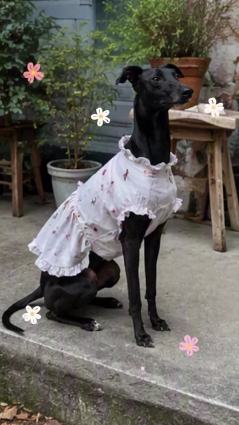
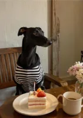
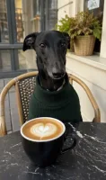
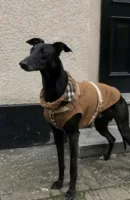
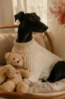
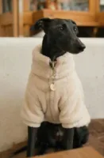
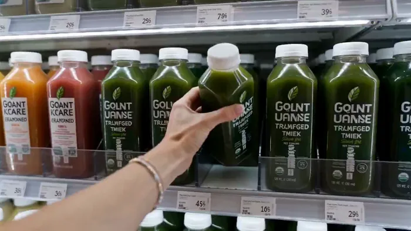
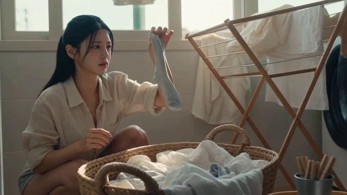
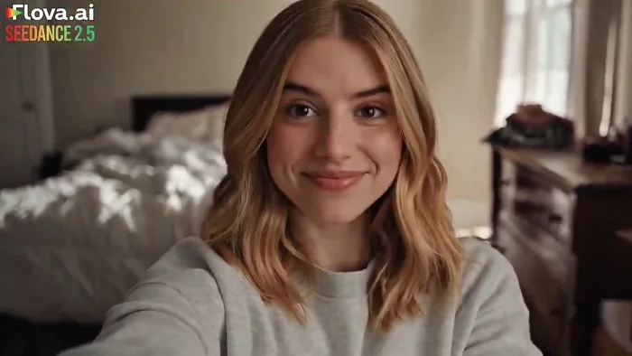

[← Back to the full index](../README.md#table-of-contents) · [English](ugc-ads.md) · [简体中文](ugc-ads.zh-CN.md) · [日本語](ugc-ads.ja.md)

### UGC Ads (UGC风格广告)

- [Case 23: Dog cafe vlog, one-click assembly (小狗咖啡店 vlog · 一键成片) — by ByteDance](#case-23)
- [Case 24: Sunglasses unboxing identity ad (墨镜开箱身份定制广告) — by @AIwithkhan](#case-24)
- [Case 25: Gym bench phone recording (健身房长椅手机自拍) — by @simplyannisa](#case-25)
- [Case 26: Chiropractic clinic social video (整脊诊所社媒宣传视频) — by @bmx_ai13](#case-26)
- [Case 27: Organic grocery UGC shopping vlog (有机超市UGC购物Vlog) — by @aiwithsynthia](#case-27)

- [Case 77: Quiet morning laundry vlog (安静清晨的洗衣 Vlog) — by @doctorwasif](#case-77)
- [Case 81: Hair Color Spray: Bedroom to Hero Shot (染发喷雾从卧室随拍到产品大片) — by @Aqsahere_](#case-81)

### Case 23: Dog cafe vlog, one-click assembly (小狗咖啡店 vlog · 一键成片) — by ByteDance

▶ [Watch the full video on ofox.ai](https://ofox.ai/seedance-2-5-prompts?utm_source=github&utm_medium=case&utm_campaign=awesome-seedance-2-5#case-23)

**输入素材**（8 张官方参考图）

| | | | |
|:---:|:---:|:---:|:---:|
|  参考图 1 |  参考图 2 |  参考图 3 |  参考图 4 |
|  参考图 5 |  参考图 6 |  参考图 7 |  参考图 8 |

**Prompt**

~~~~text
将所有图片进行一键成片，图片顺序自由安排，生成一个手绘动态涂鸦抠像风格的咖啡店 vlog，记录一只小狗穿着不同可爱服装在咖啡店打卡拍照的趣味日常。生成具有网感的趣味音频或者 bgm。
图片可以微微动起来，live 图的效果，但不要改变原图，保持和原图的高度一致。
~~~~

**参数**：Seedance 2.5 · 火山方舟 · r2v（一键成片）· 未标注 · 未标注 · 未标注 · 带音频
**来源**：火山方舟官方文档 · [中文](https://docs.volcengine.com/docs/82379/2607689?lang=zh) · [English](https://docs.byteplus.com/en/docs/ModelArk/2607689)

Preview frame © 2026 ByteDance, from the official demo video · Prompt by ByteDance · <a href="https://docs.volcengine.com/docs/82379/2607689?lang=zh">source</a>

[Back to top](#table-of-contents)

### Case 24: Sunglasses unboxing identity ad (墨镜开箱身份定制广告) — by @AIwithkhan

▶ [Watch the full video on ofox.ai](https://ofox.ai/seedance-2-5-prompts?utm_source=github&utm_medium=case&utm_campaign=awesome-seedance-2-5#case-24)

**输入素材**：未公开 —— 原作者只发布了成片，未提供输入素材

<strong>Prompt</strong> — Use the uploaded reference image as the exact character reference. Preserve her facial identity, hairstyle, eye color, makeup, skin tone, body proport…

~~~~text
Use the uploaded reference image as the exact character reference. Preserve her facial identity, hairstyle, eye color, makeup, skin tone, body proportions, white sleeveless fitted top, light blue wide-leg jeans, pearl choker, rings, and bracelets consistently throughout the video. Use the uploaded sunglasses, retail box, and leather carrying case as locked product references. Maintain perfect product consistency, including the frame shape, lenses, hinges, colors, materials, and proportions.

Create an ultra-realistic UGC luxury creator review filmed inside a modern luxury bedroom with warm golden-hour sunlight, soft natural shadows, and a premium lifestyle aesthetic. The camera feels like a handheld smartphone with subtle natural movement while maintaining cinematic commercial quality.

The video begins with the woman sitting on the bed beside the retail box and leather case. Smiling at the camera, she says, "I genuinely wasn't expecting to love these this much." She picks up the box, opens it naturally, reveals the leather case, then slowly removes the sunglasses while continuing, "The packaging already feels incredibly premium."

She rotates the sunglasses slowly in front of the camera, showing the frame, hinges, and lenses as natural reflections glide across the surface. She smiles and says, "The finish feels amazing, and they're incredibly lightweight."

She puts on the sunglasses, stands up, and walks toward a large full-length mirror. Looking at her reflection, she adjusts the frame naturally and says, "Honestly... they look so good, and they're really comfortable on the eyes, even in bright sunlight."

She turns slightly left and right so the sunglasses catch the sunlight from different angles before removing them with a smile. Walking back to the bed, she places the sunglasses beside the leather case and retail box, then picks them up one last time and holds them beside her face.

Looking directly into the camera, she smiles warmly and says, "Definitely one of my favorite accessories this year." The camera slowly pushes in on the sunglasses before fading out.

Ultra-realistic UGC fashion content, authentic creator review, cinematic handheld smartphone movement, luxury bedroom, macro product cinematography, realistic reflections, detailed frame textures, expressive facial animation, perfect lip sync, shallow depth of field, premium color grading, 4K HDR, 16:9, no subtitles, no logos, no watermarks, no on-screen text.
~~~~

**参数**：Seedance 2.5 · 未标注 · i2v · 未标注 · 未标注 · 16:9 · 带音频
**来源**：[@AIwithkhan](https://x.com/AIwithkhan) · [原帖](https://x.com/AIwithkhan/status/2084608509837275231)

Preview © 2026 <a href="https://x.com/AIwithkhan/status/2084608509837275231">@AIwithkhan</a> · Prompt by <a href="https://x.com/AIwithkhan/status/2084608509837275231">@AIwithkhan</a>

[Back to top](#table-of-contents)

### Case 25: Gym bench phone recording (健身房长椅手机自拍) — by @simplyannisa

▶ [Watch the full video on ofox.ai](https://ofox.ai/seedance-2-5-prompts?utm_source=github&utm_medium=case&utm_campaign=awesome-seedance-2-5#case-25)

<strong>Prompt</strong> — FORMAT: 30-second horizontal 16:9 realistic smartphone video.  Create an authentic, imperfect everyday gym phone recording, as if a friend casually le…

~~~~text
FORMAT: 30-second horizontal 16:9 realistic smartphone video.

Create an authentic, imperfect everyday gym phone recording, as if a friend casually left a phone recording on a nearby bench. Use a standard smartphone camera with mild autofocus hunting, subtle exposure shifts, natural motion blur, compression artifacts, and slightly uneven handheld framing. No polished commercial look.

00–05s — ARRIVAL

The character walks into a nearly empty gym after finishing a difficult set. They place a water bottle and towel beside a bench, sit down heavily, and lean forward with both elbows on their knees. Their breathing is noticeably heavy.

Camera remains several feet away at a slightly low angle, as if casually recording from a phone placed on a gym bench.

05–10s — RECOVERY

They slowly unscrew the water bottle, take two small drinks, then pause with the bottle still in their hand. Their chest continues rising and falling from exertion.

They look down at their hands for a moment, flex their fingers, then wipe sweat from their forehead with the towel.

10–15s — THE NEXT SET

A gym timer or workout screen is visible in the background but remains completely out of focus and unreadable.

The character notices the timer, looks at it, gives a small tired smile, and shakes their head as if realizing they have less rest time than expected.

They stand up slowly and roll their shoulders.

15–20s — PUSHING THROUGH

They walk toward a cable machine and adjust the weight themselves.

Close natural phone framing as they step into position. They briefly close their eyes, take one deep breath, then begin a controlled exercise set.

Show realistic physical effort: tightening muscles, sweat collecting around the forehead and neck, slight trembling near the end of each repetition, natural breathing rather than exaggerated acting.

20–25s — FINAL REP

The final repetitions become visibly difficult.

They pause halfway through one repetition, breathe hard, regain control, and complete the movement with genuine effort.

After finishing, they slowly release the handle, bend forward slightly, and place their hands on their thighs while catching their breath.

25–30s — QUIET ENDING

They grab the towel, wipe their face and neck, then look directly toward the phone for a brief moment.

With a tired but satisfied expression, they quietly say in a natural low voice:

“Okay… that was worth it.”

They pick up the water bottle and walk out of frame.

End naturally while the camera continues recording for a moment before the clip stops.

AUDIO

Natural gym ambience only: distant weights being placed down, cable machine sounds, rubber flooring footsteps, ventilation hum, subtle clothing movement, water bottle clicks, realistic breathing, and occasional muffled gym sounds.

Dialogue should sound spontaneous and slightly breathless, not scripted or theatrical.

VISUAL REALISM

Authentic smartphone footage, ordinary gym lighting, realistic skin texture, visible pores, natural sweat, slightly flushed face, damp hair around the forehead, realistic muscle movement, imperfect exposure, mild phone-camera sharpening, compression noise, subtle autofocus changes, believable shadows and reflections.

STRICTLY AVOID: cinematic color grading, beauty filters, artificial skin smoothing, dramatic slow motion, music, subtitles, captions, logos, readable text, fake gym equipment, exaggerated muscles, perfect lighting, fisheye distortion, excessive camera shake, unrealistic sweat, duplicated limbs, warped hands, unnatural facial expressions, scene cuts, time jumps, or skipping the described actions.
~~~~

**参数**：Seedance 2.5 · 未标注 · t2v · 30s · 未标注 · 16:9 · 未标注
**来源**：[@simplyannisa](https://x.com/simplyannisa) · [原帖](https://x.com/simplyannisa/status/2087078357595009085)

Preview © 2026 <a href="https://x.com/simplyannisa/status/2087078357595009085">@simplyannisa</a> · Prompt by <a href="https://x.com/simplyannisa/status/2087078357595009085">@simplyannisa</a>

[Back to top](#table-of-contents)

### Case 26: Chiropractic clinic social video (整脊诊所社媒宣传视频) — by @bmx_ai13

▶ [Watch the full video on ofox.ai](https://ofox.ai/seedance-2-5-prompts?utm_source=github&utm_medium=case&utm_campaign=awesome-seedance-2-5#case-26)

<strong>Prompt</strong> — Create a 30 second 16:9 cinematic social video set inside a modern chiropractic and mobility clinic during late morning. The room has pale warm walls,…

~~~~text
Create a 30 second 16:9 cinematic social video set inside a modern chiropractic and mobility clinic during late morning. The room has pale warm walls, clean wood flooring, black padded treatment tables, gray visitor chairs, a few green plants, subtle wall art, and tall windows overlooking leafy trees. Use natural daylight mixed with soft ceiling light, realistic skin texture, true fabric behavior, accurate anatomy, physically believable contact, consistent faces, and natural micro expressions. No text, no logos, no watermarks, no surreal motion.

From 0 to 4 seconds, open on a wide establishing shot with a slow handheld push through the clinic. A calm male practitioner in a charcoal shirt guides an adult male client in a white shirt toward a treatment table. Other staff move softly in the distant background. The mood feels professional, relaxed, and observational.

From 4 to 8 seconds, cut to a medium seated shot. The client sits centered while the practitioner stands behind him, gently checking shoulder level and neck rotation. Use small natural camera drift, shallow depth of field, window light on one side of the face, and realistic eye contact. Show quiet anticipation without exaggerated acting.

From 8 to 12 seconds, move into a close side angle as the practitioner carefully positions the head for a controlled neck release. Keep the motion restrained and anatomically correct. Capture a quick release, a subtle facial reaction, a sharp breath, and an immediate smile. Let the camera react with a tiny authentic handheld movement rather than a dramatic shake.

From 12 to 17 seconds, cut to a medium wide side view of the client lying on his side on the table. The practitioner braces the shoulder and pelvis, pauses, then performs one compact lumbar adjustment. Show realistic weight transfer, table cushion compression, shirt folds, breathing, hand pressure, and a brief surprised laugh from the client.

From 17 to 22 seconds, cut to the client lying face down. The practitioner palpates the upper back, stacks both hands, and applies one controlled thoracic compression. Use a slightly lower camera angle, soft reflections on the table, gentle background activity, and a brief focus pull from the hands to the client’s relieved expression.

From 22 to 26 seconds, transition to a head of table view. The client lies on his back while the practitioner places a black traction strap beneath the base of the skull. Build tension slowly and safely, then deliver one short controlled pull. The client reacts with wide eyes, then laughs and covers his face for a moment.

From 26 to 30 seconds, finish with the client sitting upright, rolling his shoulders and turning his neck comfortably while the practitioner stands beside him. End on an honest shared smile and a slow pullback that reveals the bright clinic. Keep the final moment calm and satisfying, not promotional.

Audio should feel captured on location with soft room ambience, distant clinic movement, clothing rustle, table creaks, natural breathing, quiet conversation without clearly audible words, and crisp but not exaggerated adjustment sounds. Add a low volume modern instrumental track with warm piano, soft bass, light percussion, and a gentle rise at each release, ending on a clean resolved note.
~~~~

**参数**：Seedance 2.5 · 未标注 · t2v · 30s · 未标注 · 16:9 · 未标注
**来源**：[@bmx_ai13](https://x.com/bmx_ai13) · [原帖](https://x.com/bmx_ai13/status/2083501494150574415)

Preview © 2026 <a href="https://x.com/bmx_ai13/status/2083501494150574415">@bmx_ai13</a> · Prompt by <a href="https://x.com/bmx_ai13/status/2083501494150574415">@bmx_ai13</a>

[Back to top](#table-of-contents)

### Case 27: Organic grocery UGC shopping vlog (有机超市UGC购物Vlog) — by @aiwithsynthia

▶ [Watch the full video on ofox.ai](https://ofox.ai/seedance-2-5-prompts?utm_source=github&utm_medium=case&utm_campaign=awesome-seedance-2-5#case-27)

<strong>Prompt</strong> — A realistic UGC-style from  lifestyle grocery shopping vlog filmed vertically on a smartphone with natural handheld movement and subtle camera shake. …

~~~~text
A realistic UGC-style from  lifestyle grocery shopping vlog filmed vertically on a smartphone with natural handheld movement and subtle camera shake. The video opens with the young woman entering a modern premium organic grocery store with warm ambient lighting, clean wooden shelves, fresh produce, and a bright minimalist interior. She holds the phone in selfie mode, smiles naturally, and gestures for viewers to follow her. She walks toward the refrigerated drinks section, scans the shelves, and picks up a green cold-pressed juice bottle, turning it slowly so the label faces the camera. Cut to a cinematic close-up as she twists the cap open and takes a refreshing sip beside a large sunlit window, smiling with a satisfied expression. Transition to a POV shot from inside a shopping cart as she pushes it through wide grocery aisles, occasionally looking down into the cart and smiling. Follow with an over-the-shoulder walking shot through beautifully organized shelves filled with premium groceries. Close-up of her hand selecting fresh oranges, gently inspecting one before placing it into the cart. End with a close-up of her picking up a vibrant dragon fruit, rotating it naturally in her hand while admiring its color before placing it into the cart. Finish with her walking toward the checkout while smiling at the camera, pushing the cart under warm golden lighting.

Ultra-realistic, authentic creator content, premium grocery aesthetic, natural body language, realistic facial expressions, soft cinematic lighting, shallow depth of field, smooth transitions, realistic store ambience, subtle background music, 4K HDR, 24fps, clean color grading, lifestyle commercial quality.
~~~~

**参数**：Seedance 2.5 · 未标注 · t2v · 20s · 未标注 · 未标注 · 未标注
**来源**：[@aiwithsynthia](https://x.com/aiwithsynthia) · [原帖](https://x.com/aiwithsynthia/status/2084264050717045019)

Preview © 2026 <a href="https://x.com/aiwithsynthia/status/2084264050717045019">@aiwithsynthia</a> · Prompt by <a href="https://x.com/aiwithsynthia/status/2084264050717045019">@aiwithsynthia</a>

[Back to top](#table-of-contents)

### Case 77: Quiet morning laundry vlog (安静清晨的洗衣 Vlog) — by @doctorwasif

▶ [Watch the full video on ofox.ai](https://ofox.ai/seedance-2-5-prompts?utm_source=github&utm_medium=case&utm_campaign=awesome-seedance-2-5#case-77)

**输入素材**：未公开 —— 原作者只发布了成片，未提供输入素材

<strong>Prompt</strong> — 15s handheld home-video vlog, 7-shot montage. Photorealistic phone footage with slight tilt, natural shake, window light, subtle film grain.  A woman …

~~~~text
15s handheld home-video vlog, 7-shot montage. Photorealistic phone footage with slight tilt, natural shake, window light, subtle film grain.

A woman (use Image1 only for facial identity and hairstyle) does laundry alone on a quiet morning. Outfit: oversized cream linen shirt with rolled sleeves, grey knit shorts, loose cotton apron. Cozy sunlit laundry nook with an open front-load washer, overflowing basket, wooden drying rack, clothespins, and warm sunlight. She is the only person in the video.

Sequence: untangles wet clothes → shakes out a shirt → checks a collar stain by the window → hangs it saying "Good enough." → finds a mismatched sock → struggles with a heavy bedsheet while laughing → finishes hanging it and quietly admires the sunlit laundry.

Dialogue is natural spoken Korean (except "Good enough"), reacting casually to each moment. Ambient sound only: washer winding down, wet fabric, clothespins, rustling clothes, soft laughter, breeze. No subtitles, text, logos, or watermarks. Do not recreate or copy the reference image—use it only for facial identity and hairstyle.
~~~~

**参数**：Seedance 2.5 · 未标注 · 未标注 · 未标注 · 未标注 · 未标注 · 未标注
**来源**：[@doctorwasif](https://x.com/doctorwasif) · [原帖](https://x.com/doctorwasif/status/2083779989414019109)

Preview © 2026 <a href="https://x.com/doctorwasif/status/2083779989414019109">@doctorwasif</a> · Prompt by <a href="https://x.com/doctorwasif/status/2083779989414019109">@doctorwasif</a>

[Back to top](#table-of-contents)

### Case 81: Hair Color Spray: Bedroom to Hero Shot (染发喷雾从卧室随拍到产品大片) — by @Aqsahere_

▶ [Watch the full video on ofox.ai](https://ofox.ai/seedance-2-5-prompts?utm_source=github&utm_medium=case&utm_campaign=awesome-seedance-2-5#case-81)

**输入素材**：未公开 —— 本案例未收录可用的输入素材，请参阅来源

<strong>Prompt</strong> — Create a 30-second ultra-photorealistic UGC-to-commercial hair color spray advertisement. The first 25 seconds should feel like authentic creator-shot…

~~~~text
Create a 30-second ultra-photorealistic UGC-to-commercial hair color spray advertisement. The first 25 seconds should feel like authentic creator-shot UGC, while the final 5 seconds must transition into a premium professional product commercial hero shot.
A young woman has naturally deep black hair at the beginning. After applying the hair color spray, the sprayed hair becomes clearly light brown. The black-to-light-brown difference must be obvious and visually satisfying.
0–4 SEC — UGC HOOK
Real young woman filming herself with a modern smartphone in a realistic bedroom. Handheld front-camera feel, natural daylight, subtle camera shake and authentic facial expression. She touches her clearly black hair and says:
“I wanted lighter hair…”
She looks at herself in the mirror.
4–8 SEC — PRODUCT DISCOVERY
She turns toward her bedroom dressing table. The hair color spray is clearly standing on the dressing table.
She reaches for it and picks it up naturally.
As soon as she lifts it, the smartphone camera briefly autofocuses sharply onto the spray, making the entire product clearly visible and recognizable. Realistic bottle/can material, nozzle, cap, label, reflections and printing.
She says:
“…without permanently dyeing it.”
8–13 SEC — PRODUCT APPLICATION
She holds the spray clearly in her hand, then separates a section of her black hair and applies it.
Show a realistic fine aerosol mist leaving the nozzle and settling onto the hair.
The sprayed hair changes realistically from deep black to light brown. The transformation must happen through believable color coverage, not glowing or magical effects.
13–18 SEC — CLEAR TRANSFORMATION
Close smartphone shot of the hair.
Show untreated deep-black hair beside the newly light-brown hair so the color difference is extremely obvious.
She gently moves the hair with her fingers under natural daylight.
She reacts naturally:
“Okay… that is actually a huge difference.”
18–23 SEC — UGC RESULT
Mirror selfie showing her finished light-brown hair. She turns her head naturally, showing the color from different angles.
She smiles and says:
“I actually love it.”
The footage remains authentic UGC with natural imperfections.
23–26 SEC — FINAL UGC PRODUCT MOMENT
She holds the spray beside her newly light-brown hair and looks into the camera.
She says:
“Just spray and switch up your look.”
She lowers the product slightly.
26–30 SEC — PREMIUM COMMERCIAL PRODUCT HERO SHOT
Hard transition from UGC footage into a clean professional product advertisement. No woman visible in this final shot.
Show the hair color spray alone as the hero product, standing upright on a clean premium surface. Create a beautiful realistic commercial product-photography setup with a soft neutral background, subtle depth of field, controlled studio lighting, realistic product shadow and premium reflections.
The camera slowly pushes toward the product.
The product must be large, centered and extremely sharp, with the packaging, cap, nozzle, label and every visible detail clearly readable and professionally presented.
Place the product beside a small visual indication of the black → light brown transformation, such as realistic strands of black hair transitioning into light brown hair, subtly arranged behind or beside the product.
Leave clean negative space around the product for advertising copy.
Final frame should look like a professional beauty-brand product poster / end card, not UGC.
Suggested minimal on-screen copy:
INSTANT HAIR COLOR
BLACK → LIGHT BROWN
SPRAY • STYLE • GO
Keep the product as the dominant visual element.
IMPORTANT
The final 4 seconds must feel like a real commercial product hero/end card, with a completely different level of polish from the preceding UGC footage. No girl in the final hero shot. No hands holding the product. No messy bedroom.
~~~~

**参数**：Seedance 2.5 · @Flovaai · 未标注 · 未标注 · 未标注 · 未标注 · 未标注
**来源**：[@Aqsahere_](https://x.com/Aqsahere_) · [原帖](https://x.com/Aqsahere_/status/2091372529709400169)

Preview © 2026 <a href="https://x.com/Aqsahere_/status/2091372529709400169">@Aqsahere_</a> · Prompt by <a href="https://x.com/Aqsahere_/status/2091372529709400169">@Aqsahere_</a>

[Back to top](#table-of-contents)
