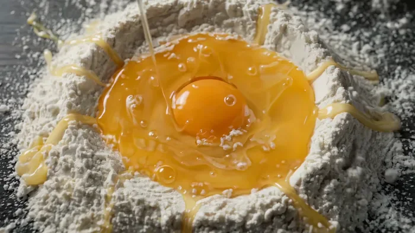
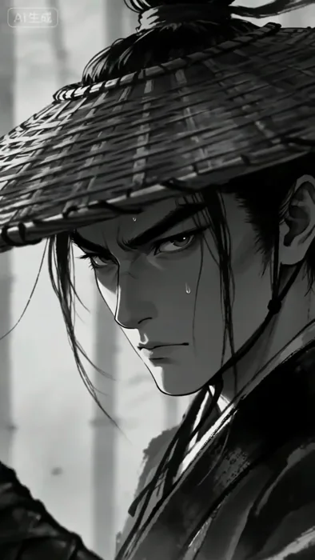
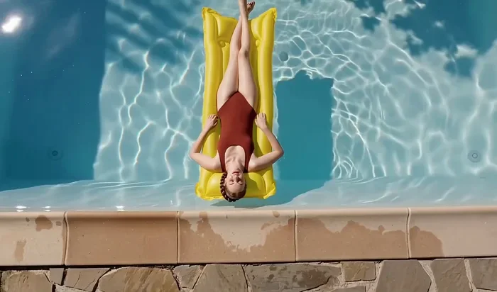
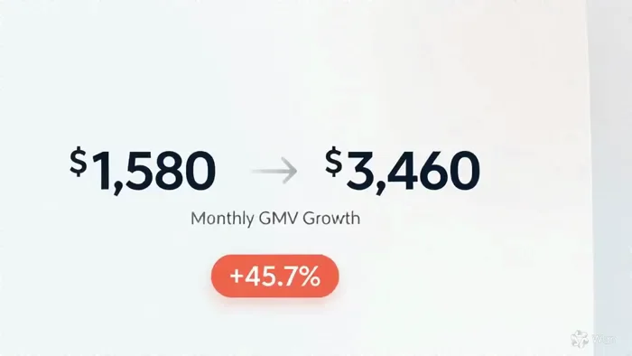
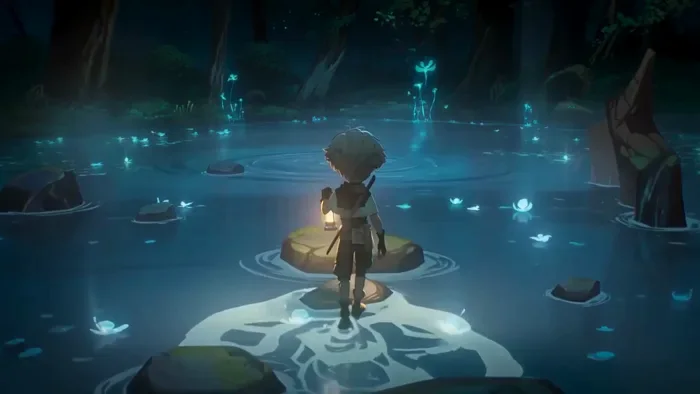
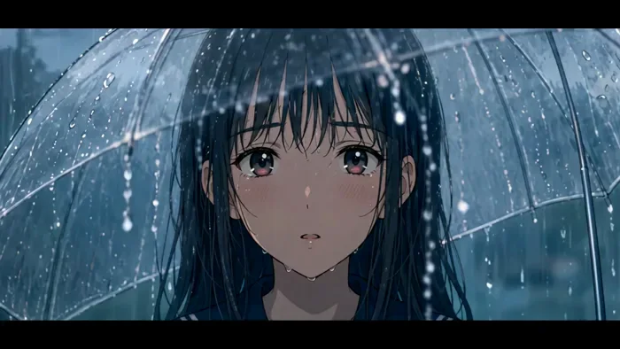
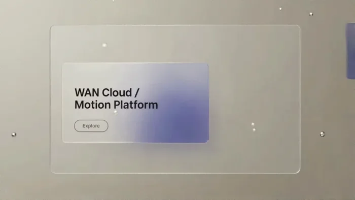

[← モデル一覧に戻る](../../README.ja.md) · [English](README.md) · [简体中文](README.zh-CN.md) · [日本語](README.ja.md)

# Tongyi Wanxiang Wan 3.0

Tongyi Wanxiang Wan 3.0 の事例 80 件。プロンプト全文と公開済みパラメータを掲載し、80 件に再生可能な出力を収録。[Ofox](https://ofox.ai) が収集・検証。モデル提供元は Alibaba。

▶ [Tongyi Wanxiang Wan 3.0 事例ページ](https://ofox.ai/wan-3-prompts?utm_source=github&utm_medium=readme&utm_campaign=awesome-ai-video-prompts) · [Ofox で試す](https://app.ofox.ai/playground?utm_source=github&utm_medium=readme&utm_campaign=awesome-ai-video-prompts)

| | カテゴリ | 事例数 |
|:---:|---|---:|
|  | [クリエイティブ広告 Ad Creative](cases/ad-creative.ja.md) | 5 |
|  | [ECサイト商品動画 Product Video](cases/product-video.ja.md) | 6 |
|  | [開始・終了フレームアニメーション Keyframe Animation](cases/keyframe-animation.ja.md) | 4 |
|  | [動画延長・編集 Video Extend & Edit](cases/video-extend-edit.ja.md) | 18 |
|  | [ミュージックビデオ Music Video](cases/music-video.ja.md) | 2 |
|  | [解説動画 Explainer](cases/explainer.ja.md) | 3 |
|  | [ショートドラマ Short Drama](cases/short-drama.ja.md) | 5 |
|  | [セリフ・リップシンク Dialogue & Lip-Sync](cases/dialogue-lipsync.ja.md) | 4 |
|  | [シネマティック Cinematic](cases/cinematic.ja.md) | 9 |
|  | [アクション・VFX Action & VFX](cases/action-vfx.ja.md) | 5 |
|  | [アニメーション・スタイライズ Animation & Stylized](cases/animation-stylized.ja.md) | 10 |
|  | [マルチ参照合成 Reference Composition](cases/reference-composition.ja.md) | 7 |
|  | [UI・タイポグラフィ UI & Typography](cases/ui-typography.ja.md) | 2 |
