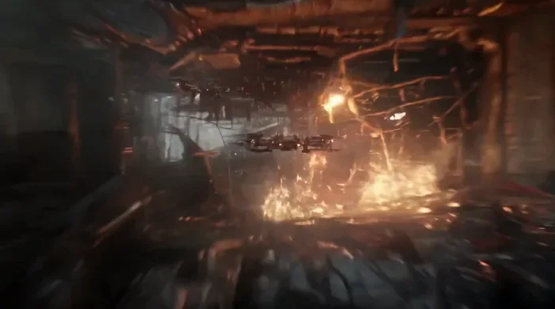
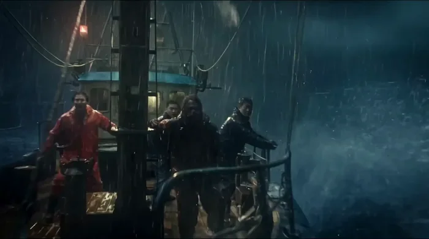
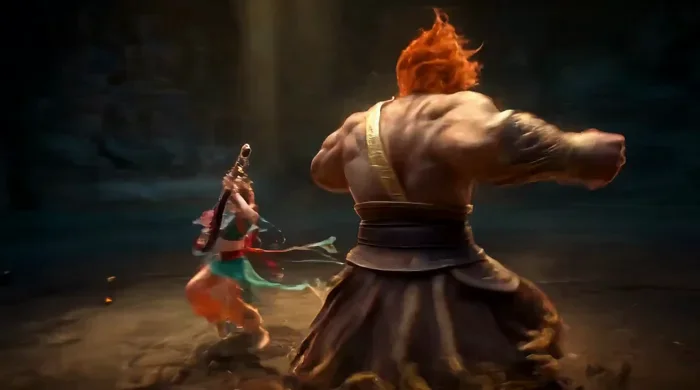

[← 返回总目录](../README.zh-CN.md#table-of-contents) · [English](action-vfx.md) · [简体中文](action-vfx.zh-CN.md) · [日本語](action-vfx.ja.md)

### 动作特效 Action & VFX

- [Case 8: One Arrow, One Dragon (一箭猎龙) — by Alibaba](#case-8)
- [Case 13: Sci-Fi Animation — The Skeletal Soldier and the Flower (科幻动画·骨骼战兵与花) — by Alibaba](#case-13)
- [Case 14: Disaster Film — Kaiju Rising from the Deep (灾难电影·深海巨兽出水) — by Alibaba](#case-14)
- [Case 24: Dragonfly-Style Micro Flyer (蜻蜓式微型飞行者) — by Alibaba](#case-24)
- [Case 33: Dunhuang Apsara vs. Vajra Warrior (敦煌飞天对决金刚) — by Alibaba](#case-33)

### Case 8: One Arrow, One Dragon (一箭猎龙) — by Alibaba

▶ [在 ofox.ai 观看完整视频](https://ofox.ai/wan-3-prompts?utm_source=github&utm_medium=case&utm_campaign=awesome-ai-video-prompts#case-8)

**输入素材**：未公开 —— 本案例未收录可用的输入素材，请参阅来源

<strong>Prompt</strong> — 奇幻史诗风，重型战弓远距猎龙，金红夕照与灰烬风暴色调。一名披着烧灼边缘深绿斗篷的女龙猎人立于断裂城墙最高处，面颊有旧伤细痕，眼神锁定远方俯冲的幼龙，肩背线条清晰，皮甲外套雕纹金属护肩，前臂厚实护臂，腰后箭袋插着黑羽重型破甲箭。她左臂伸直稳弓，右手三指扣弦拉至嘴角，斜方肌、背阔肌与肋侧因满弓绷出明显受…

~~~~text
奇幻史诗风，重型战弓远距猎龙，金红夕照与灰烬风暴色调。一名披着烧灼边缘深绿斗篷的女龙猎人立于断裂城墙最高处，面颊有旧伤细痕，眼神锁定远方俯冲的幼龙，肩背线条清晰，皮甲外套雕纹金属护肩，前臂厚实护臂，腰后箭袋插着黑羽重型破甲箭。她左臂伸直稳弓，右手三指扣弦拉至嘴角，斜方肌、背阔肌与肋侧因满弓绷出明显受力，持弓手出现细微颤抖。战弓为深色层压木与兽骨嵌片结构，弓臂弯出夸张弧度，拉满后弓弦高频震颤，箭杆粗重、箭簇带倒钩与细小符文刻线，箭尾黑羽侧风中抖动；放弦瞬间指尖干净利落弹开，弓身猛烈回弹，抽出低沉破风声。15秒内她先借坍塌塔楼边缘避过龙焰掠烧，灰烬卷过斗篷，随后半跪稳姿，利用城墙豁口形成天然射击窗，目光在龙翼节奏与风向旗帜间快速判断；镜头特写她压住呼吸、下颌收紧、瞳孔锁定龙胸前鳞甲缝隙。箭矢离弦后近乎直线高速穿尘，随后因超远距离轻微下坠，半侧跟拍可见重箭带出扭曲尾流与火星般的符文拖尾，掠过断旗、擦碎城墙石块，最终精准钉入幼龙右翼根部鳞缝，硬质鳞甲炸出火花与裂片后被穿透，整支箭没入大半、箭尾剧颤，幼龙被惯性带偏、右翼失衡折起，庞大身躯砸向下方攻城塔，木梁与铁箍崩裂，尘浪与羽灰冲天。结尾她顺势转身再抽第二支箭，披风在高空风中猎猎扬起，燃烧余烬、碎石、龙鳞残片与夕光尘埃形成层次。采用超长焦压缩空间、放弦前指尖与眼神特写、箭矢中段高速跟飞、命中瞬间局部慢放，8K写实CG质感、史诗级体积光、风沙颗粒、鳞甲反光与城墙碎屑细节清晰可读。
~~~~

**参数**：Wan 3.0 · 未标注 · ref2v · 15s · 未标注 · 未标注 · 带音频
**来源**：阿里云 Wan 3.0 官方展示页 · [source](https://www.aliyun.com/benefit/scene/wan)

Wan 3.0 官方示例 · 阿里云万相展示页「参考生视频」一箭猎龙

[回到目录](#table-of-contents)

### Case 13: Sci-Fi Animation — The Skeletal Soldier and the Flower (科幻动画·骨骼战兵与花) — by Alibaba

▶ [在 ofox.ai 观看完整视频](https://ofox.ai/wan-3-prompts?utm_source=github&utm_medium=case&utm_campaign=awesome-ai-video-prompts#case-13)

<strong>Prompt</strong> — 生成一支 30 秒、16:9 横屏比例的成人科幻战争动画短片。 画面采用： 超写实 CGI； 生物机械结构； 灰白骨骼与黑色金属融合； 类昆虫式关节； 极端精细的骨质纹理； 干燥血痕、陶瓷裂纹和工业油污； 废弃未来城市； 冷灰色天光； 少量毒绿色生命体； 高反差电影照明； 低饱和冷色系； 火焰和警报…

~~~~text
生成一支 30 秒、16:9 横屏比例的成人科幻战争动画短片。

画面采用：

超写实 CGI；
生物机械结构；
灰白骨骼与黑色金属融合；
类昆虫式关节；
极端精细的骨质纹理；
干燥血痕、陶瓷裂纹和工业油污；
废弃未来城市；
冷灰色天光；
少量毒绿色生命体；
高反差电影照明；
低饱和冷色系；
火焰和警报使用极少量橙红色；
写实物理破坏；
压迫、沉重、无英雄主义。

人物不再有完整肉体，主要由：

人类脊柱；
肋骨；
头骨；
黑色液压肌肉；
金属关节；
神经光纤；
武器接口组成。

骨骼不是丧尸，而是被军工系统继续使用的“遗留硬件”。

30 秒剧情与动态时间轴
0—4 秒｜死亡之后仍在战斗

镜头从一枚掉落在积水中的士兵识别牌开始。

远处传来机械步伐。积水表面震动，一具三米高的骨骼战兵从画面上方跨过。

摄影机迅速贴地前冲，沿它的机械脚掌、液压小腿和裸露脊柱向上移动，最后停在其后脑接口。

接口中持续闪烁一条红色指令：

ADVANCE

城市背景空无一人，但远处骨骼军队仍在交火。

4—8 秒｜废城自动战争

镜头突然从战兵肩后高速冲出，进入城市街道。

数十具骨骼战兵在废弃高楼间战斗：

自动火炮从肋骨间展开；
脊柱向后弯曲吸收后坐力；
头骨被击碎后，身体仍继续行走；
黑色无人机像苍蝇一样围绕尸骨飞行；
破败广告屏仍播放早已结束的征兵宣传。

摄影机以高速 FPV 轨迹穿过交火区：

从骨架肋骨之间钻过；
贴着弹道侧面掠过；
穿过一辆翻覆装甲车；
急速滚转避开坠落楼板。
8—12 秒｜花朵出现

主角骨骼战兵突然停下。

它脚边的混凝土裂缝中，长出一朵极小的淡绿色花。

所有环境声短暂降低。

镜头从战争远景快速推向花朵微距：

花瓣半透明；
内部有细小脉冲；
露珠映出战兵破碎的头骨；
机械脚掌差点踩下，却在最后一厘米停住。

战兵头部缓慢偏转，红色指令开始闪烁错误代码。

12—16 秒｜第一次违抗程序

远处火炮锁定主角。

它没有继续前进，而是蹲下，用肋骨和机械手臂包围花朵。

炮弹飞来。

摄影机绕主角完成快速 180 度环绕，炮弹从镜头旁擦过，击中后方建筑。

爆炸冲击波掀起沙尘，主角骨骼被炸裂一部分，但仍用身体护住花朵。

红色指令变成：

OBJECTIVE LOST

16—21 秒｜骨骼军队转向

周围所有战兵同时停止战斗。

它们的头骨机械式转向主角。

数百枚红色瞄准点落在它身上。

主角缓慢站起，将花朵藏进空洞胸腔。肋骨像牢笼一样闭合。

镜头从胸腔内部向外拍摄，透过肋骨看见整支骨骼军队开始冲锋。

21—26 秒｜极限逃亡

主角突然转身高速奔跑。

摄影机紧贴其背部：

它穿过坍塌地铁口；
从断裂轨道跃下；
骨骼军队从后方倾泻而来；
主角一条腿被击断；
它用机械脊柱和手臂继续爬行；
胸腔中的花朵持续发出绿色光。

镜头在地铁隧道中连续大幅滚转，跟随它钻进一道狭窄维修管道。

26—30 秒｜反转

主角躲进黑暗地下设施。

它打开肋骨，花朵已经长出大量细小根须。根须迅速刺入它的神经接口。

绿色光从胸腔沿脊柱向全身扩散。

战兵第一次抬起头，像获得了新的意识。

下一秒，地下深处亮起数百万朵同样的绿色花。所有花朵同时张开，露出内部类似眼睛的结构。

系统界面出现新的指令：

GERMINATION COMPLETE

画面立即切黑。

运镜设计
微距低机位开场；
贴地高速追踪；
肋骨内部穿越；
爆炸时方向性镜头震动；
主角违抗程序时进行大幅环绕；
逃亡阶段持续低空 FPV；
最后一镜从花朵极近景高速拉远，揭示整个地下生态。
动态重点
骨骼关节要有重量；
断裂后运动逻辑仍符合机械结构；
肋骨开合像保护舱；
花朵与机械形成柔软与硬质反差；
战争场面不能只是背景爆炸，要有完整空间穿越。
~~~~

**参数**：Wan 3.0 · 未标注 · t2v · 30s · 未标注 · 16:9 · 带音频
**来源**：《Wan3.0 视频创作者手册》（万相官方） · [source](https://alidocs.dingtalk.com/i/nodes/qnYMoO1rWxrkmoj2IjExdZLBJ47Z3je9)

Wan 3.0 官方示例 ·《Wan3.0 视频创作者手册》

[回到目录](#table-of-contents)

### Case 14: Disaster Film — Kaiju Rising from the Deep (灾难电影·深海巨兽出水) — by Alibaba

▶ [在 ofox.ai 观看完整视频](https://ofox.ai/wan-3-prompts?utm_source=github&utm_medium=case&utm_campaign=awesome-ai-video-prompts#case-14)

<strong>Prompt</strong> — 这是一段30秒的真实电影质感海上巨兽登场场景，整体氛围参考好莱坞灾难怪兽大片。故事从一艘在暴雨狂风中艰难航行的小型渔船开始，船身上清晰可见 “WAN” 的标识。镜头先建立恶劣海况与渔船渺小脆弱的状态，再逐步通过海面异动、水下阴影、船体震动、海浪异常隆起等细节制造压迫感，最终一头体型庞大、形象类似《环…

~~~~text
这是一段30秒的真实电影质感海上巨兽登场场景，整体氛围参考好莱坞灾难怪兽大片。故事从一艘在暴雨狂风中艰难航行的小型渔船开始，船身上清晰可见 “WAN” 的标识。镜头先建立恶劣海况与渔船渺小脆弱的状态，再逐步通过海面异动、水下阴影、船体震动、海浪异常隆起等细节制造压迫感，最终一头体型庞大、形象类似《环太平洋》怪兽风格的深海巨兽从海底破浪而出。整体要求写实、厚重、真实比例、强烈水体冲击、暴雨与闪电下的大光比氛围，强调电影级特效质感、海水体积感、怪兽皮肤湿润细节和巨物压迫感。
分镜1：夜晚暴雨海面，真实电影质感，广角镜头展现一艘小型渔船在巨浪中艰难前行，船体老旧、湿滑、被海浪不断拍打，船身侧面清晰可见白色字母 “WAN”。海面波涛汹涌，狂风卷起雨幕，天空乌云翻滚，远处闪电短暂照亮整片海域。画面强调真实海水、暴风雨环境、船体细节和渺小无助感。
分镜2：中近景镜头靠近渔船船头或甲板侧面，海浪猛烈拍打船身，海水冲过甲板，缆绳、渔网、金属栏杆在风雨中剧烈摆动。镜头随着船体起伏产生真实摇晃感，雨水不断打在镜头前景和船体表面。船身上的 WAN 标识再次短暂进入画面。整体强调真实材质、恶劣天气、湿漉漉的金属和木质结构、强烈生存危机感。
分镜3：镜头从渔船视角看向前方海面，暴雨中原本混乱的海浪出现不自然的巨大隆起，像有什么庞然大物正在海底快速接近。海面形成巨大漩涡与异常翻涌，浪峰被从下方顶起，海水流向紊乱。闪电照亮海面时，隐约可见深海下方模糊而庞大的黑影。画面突出悬疑感、海面压迫感与巨物逼近的恐怖预兆。
分镜4：真人写实镜头切入渔船甲板，船员在暴雨中艰难站稳，满脸雨水与惊恐，转头看向异常海面。风吹动雨衣和头发，船灯摇晃，背景中海浪不断升高。镜头快速靠近人物面部，再顺着他的视线转向远处翻涌海面，形成情绪与危险的连接。整体强化灾难片临场感和人物渺小感。
分镜5：镜头切到半水下或贴近海面的低机位，暴雨与浪涛之间，一道极其巨大的黑影从渔船下方或附近快速掠过，带起巨大的气泡、水流和海面抬升。渔船被猛然顶起或剧烈倾斜，船体发出不堪重负的吱嘎声。闪电和船灯的微弱光线只能勾勒出怪兽轮廓的一部分，保持神秘但极具压迫感。
分镜6：镜头回到海面，前方海水突然像被一股巨大力量向上顶开，形成一个迅速抬升的浪墙，暴雨与白色浪沫被巨力掀起。渔船在前景中被海浪甩动，远处海面中央鼓起成巨大的圆形隆起，仿佛海底火山喷发前兆。气氛到达极限紧张，怪兽即将出现。
分镜7：高潮镜头，海面轰然炸裂，一头体型庞大的深海巨兽从海底破浪而出，掀起数十米高的海浪与漫天水雾。巨兽形象参考《环太平洋》怪兽风格：巨大、凶暴、异形生物结构，粗糙厚重的湿润皮肤，锋利骨刺、巨大头部轮廓、发光细节或深海生物般的恐怖纹理。闪电划过夜空，短暂照亮巨兽全身局部与张开的巨口。画面强调真实尺度感、海水冲击力和怪兽压迫感。
分镜8：中近景或仰视镜头对准巨兽头部和上半身，巨兽在暴雨和闪电中抬起身躯，皮肤表面布满海水、伤痕、角质结构和深海生物纹理，张口发出震撼咆哮。雨水顺着怪兽外骨骼和鳞甲流下，眼部或头部细节在闪电下显得异常恐怖。强调湿润生物质感、真实皮肤结构、重量感和电影级怪兽设计。
分镜9：镜头回到渔船，渔船在巨兽出海带来的冲击波与海浪中被猛然掀起，甲板倾斜，海水灌入，缆绳断裂，船灯爆闪。WAN 标识在剧烈晃动的船身上一闪而过，渔船几乎被巨浪吞没。画面强调人类造物在巨兽面前的绝对脆弱感，海水、木板、金属碎片和雨幕共同构成混乱灾难场面。
分镜10：最终镜头拉远，巨兽高高矗立在狂暴海面上，周围巨浪翻腾，渔船在前景或侧下方显得极其渺小。天空闪电再次劈下，短暂照亮巨兽庞大的轮廓、背部骨刺与翻涌海水，形成史诗级灾难怪兽电影海报般的终极画面。画面停留在最震撼的一刻，以巨物压迫感和末日感收尾。
配乐采用好莱坞灾难怪兽电影风格。开场以低沉环境音、深海般的低频轰鸣、稀疏鼓点和压抑弦乐营造暴风雨中的不安感；随着海面异动逐渐加入更强的低音脉冲、金属撞击感和不断堆积的弦乐张力；在巨兽即将浮出水面前，音乐进入几乎屏息般的悬停和持续上升；巨兽破浪而出时，爆发出巨大的铜管、重型打击乐和低频冲击，形成灾难级高潮；结尾以厚重、压迫、末日感极强的长音和鼓点收束，强化巨兽矗立海面的史诗感。
~~~~

**参数**：Wan 3.0 · 未标注 · t2v · 30s · 未标注 · 未标注 · 带音频
**来源**：《Wan3.0 视频创作者手册》（万相官方） · [source](https://alidocs.dingtalk.com/i/nodes/qnYMoO1rWxrkmoj2IjExdZLBJ47Z3je9)

Wan 3.0 官方示例 ·《Wan3.0 视频创作者手册》

[回到目录](#table-of-contents)

### Case 24: Dragonfly-Style Micro Flyer (蜻蜓式微型飞行者) — by Alibaba

▶ [在 ofox.ai 观看完整视频](https://ofox.ai/wan-3-prompts?utm_source=github&utm_medium=case&utm_campaign=awesome-ai-video-prompts#case-24)

**输入素材**：未公开 —— 本案例未收录可用的输入素材，请参阅来源

<strong>Prompt</strong> — 生成一支10秒、16:9横版、1920×1080、30fps、单镜头连续完成的微缩奇幻高速追逐短片。 最高优先级要求：小精灵必须采用蜻蜓式“定点悬停—瞬间弹射—完全急停—锐角变轨”的运动方式。禁止将其表现为普通仙女缓慢漂浮、匀速前进或连续平滑滑翔。参考图风格： @Image2 全片前7.8秒至少出现…

~~~~text
生成一支10秒、16:9横版、1920×1080、30fps、单镜头连续完成的微缩奇幻高速追逐短片。

最高优先级要求：小精灵必须采用蜻蜓式“定点悬停—瞬间弹射—完全急停—锐角变轨”的运动方式。禁止将其表现为普通仙女缓慢漂浮、匀速前进或连续平滑滑翔。参考图风格： @Image2

全片前7.8秒至少出现六次清晰可辨的爆发移动。每次弹射必须在3—5帧内跨越画面宽度的60%—90%，到达新位置后立即完全停止2—4帧。冲刺过程只留下1—2帧粉色身体残影和透明翅膀拖影，急停后的角色必须瞬间恢复锐利。

视觉效果接近真实蜻蜓：

远处定点悬停 → 突然跨越数米 → 在另一处瞬间定住 → 改变身体朝向 → 再向完全不同的方向爆发移动。

这不是连续飞行路径，而是由多个短促、锐利、近乎跳帧的高速位移连接而成。角色不能用普通缓慢飞行填充时长。

角色造型

全片只出现同一位成年微型飞行者，身高约15—20厘米：

浅金色短发；
浅粉色轻薄短裙；
裸露小腿；
两对狭长半透明蜻蜓翅膀；
翅膀具有细密翅脉和轻微虹彩；
身体比例稳定；
主要展示背面与侧背面；
不出现面部特写。

她不是儿童角色，不采用可爱芭蕾式悬浮姿态。

悬停时身体接近竖直，四片翅膀高频振动；爆发启动前，身体在1—2帧内迅速压低并转为水平前倾姿态，头部、胸口与脚尖指向飞行方向。

急停时身体快速抬起，双腿向前摆动抵消惯性，翅膀向两侧展开制动。急停完成后身体必须完全静止，只有翅膀保持高频振动。

场景

真实、温暖、略显凌乱的儿童玩具房：

米黄色短绒地毯；
暖灰绿色墙面；
木质收纳柜；
红色玩具卡车；
绿色小汽车；
棕色毛绒熊；
白色毛绒动物；
散落的绘本和积木；
房间尽头的大型彩色积木城堡。

积木城堡由黄、蓝、绿、红色大型塑料积木搭建，具有塔楼、城墙、门洞和明显松动结构。

城堡之后连接一座深蓝色水下空间，上方有明亮水面、蓝白体积光、少量水草、浅色沙地和上升气泡。

摄影机规则

摄影机不能一直锁定角色，不能与角色保持固定距离。

每次弹射采用以下固定逻辑：

摄影机短暂稳定观察悬停的小精灵；
小精灵先在3—5帧内突然冲向画面边缘；
角色允许完全冲出画面2—4帧；
摄影机慢0.1—0.2秒才快速甩向新方向；
摄影机可能短暂越过角色的停止位置；
随后反向微调，重新发现已经完全悬停的小精灵；
停留2—4帧后，角色再次弹射。

必须多次出现“角色已经到达并停止，摄影机仍在追赶”的视觉关系。

摄影机不能让小精灵始终处于中央、始终清晰、始终保持相同大小。冲刺时角色可从近景迅速缩成远处粉色小点，也可以从远处突然掠过镜头边缘。

运动画面要求

每次冲刺都必须同时出现至少三种速度证据：

小精灵屏幕位置大幅改变；
角色大小迅速改变；
前景玩具高速掠过；
地毯纹理形成方向性拖影；
摄影机产生延迟甩动；
空气推动纸张边缘；
翅膀形成高频透明扇形残影；
冲刺结束后角色突然锐利定格。

禁止只用翅膀快速振动表现高速。必须看到角色真正跨越明显空间距离。

10秒时间轴
0—0.7秒｜固定观察与第一次横穿

镜头距离地毯约5厘米，暂时保持近似固定。

小精灵悬停在画面左侧，身体清晰，翅膀高速振动。保持约0.12秒后，她突然压低身体并水平弹射。

第一次弹射必须在约0.13秒、4帧内从画面左侧横穿到右侧，跨越画面宽度约85%。中间只留下极短的粉色定向残影。

小精灵冲出画面右侧，摄影机继续停留在原位置约2帧，随后猛然向右甩动。

0.7—1.5秒｜追回与第一次急停

摄影机快速向右甩动，在绿色玩具车上方重新找到小精灵。

此时小精灵已经完全停止，距离玩具车顶部约10厘米。摄影机因惯性略微越过她，再快速向左回调。

小精灵保持清晰悬停约3帧，随即以约90度夹角向左前方弹射，从摄影机前方极近掠过。角色瞬间从小型远景变成占画面高度约25%的粉色模糊近景，再从左侧消失。

1.5—2.6秒｜连续两次蜻蜓变轨

摄影机向左甩动追赶。

小精灵在毛绒熊肩膀旁瞬间停止2—3帧，身体迅速转向房间深处。随后完成两次爆发：

第三次弹射：从毛绒熊旁冲到红色玩具卡车后方，约4帧完成；
急停3帧；
第四次弹射：向右上方跨越绘本和散落积木，约3帧完成。

每次停止位置之间相隔1—2米，不能只移动几十厘米。摄影机每次慢半拍追赶，画面产生明显左右甩动和空间跳跃。

2.6—3.8秒｜远距离超高速弹射

积木城堡位于房间尽头。

小精灵在前景积木上方突然完全悬停。摄影机也短暂停止，画面安静约0.12秒。

随后小精灵完成第五次、全片距离最长的爆发移动：

身体瞬间转为水平；
翅膀变成半透明扇形；
在约0.2秒内跨越房间主要距离；
从占画面高度约18%迅速缩小到不足3%；
直接到达远处城堡入口前；
摄影机仍停留在原位置约3帧后才突然加速。

前景玩具、柜脚、绘本与地毯纹理高速向后掠过。摄影机追近时，城堡从远景瞬间扩张，占据整个画面。

3.8—5秒｜城墙上的三段跳跃

小精灵不沿城墙连续上升，而是在三个明确位置之间瞬间跳跃：

城墙底部悬停；
3帧内弹射到中层塔楼；
完全停止2帧；
4帧内横向弹射到另一座塔楼；
停止2帧；
3帧内垂直弹射到最高处。

每次到达后，小精灵像被钉在空气中一样立即完全停止，不能减速滑行。

摄影机通过急剧抬头、快速横摆和短促回转依次寻找她。彩色积木从镜头两侧高速掠过，镜头可以暂时失去角色，但必须重新捕捉。

5—6.3秒｜折返俯冲与城堡坍塌

到达塔楼顶部后，小精灵只悬停约0.1秒，突然向下完成第六次弹射，折返角度约110度。

她从高处高速俯冲，擦过一处松动连接积木，穿入城堡内部。角色本身不撞墙，急速气流和擦碰使积木结构失去稳定。

城堡依次坍塌：

顶部大块首先倾斜；
中层积木受重力掉落；
小块随后翻滚弹跳；
不同积木拥有不同运动方向和速度。

小精灵在碎片中连续做两次3—4帧的左右闪避。摄影机晚半拍甩动，在大块积木之间穿行。

6.3—7.8秒｜碎片通道与高速俯冲

城堡内部露出深蓝色洞口。

小精灵在洞口前突然急停，身体完全定住约3帧。摄影机因惯性先向前冲，几乎接近她。

下一瞬间，小精灵垂直向下弹射，迅速冲出画面底部。摄影机慢约0.15秒后才向下翻转80度追赶。

角色、积木和摄影机高速坠落。穿过水面边界时产生真实折射、水花、气泡和2—3帧短暂失焦。

7.8—9秒｜水阻强制减速

进入水下后，运动规则立刻改变。

小精灵原本高速向下的身体在0.3秒内受到强烈水阻：

前进距离迅速缩短；
身体向前翻转约20度；
双腿和手臂因惯性继续摆动；
头发和裙摆向上漂浮；
翅膀停止高速振动；
四片翅膀展开并缓慢摆动。

摄影机从高速追赶状态向前滑行少量距离，随后逐渐稳定。气泡统一向上，积木碎片缓慢旋转下沉。

9—10秒｜完全静止收尾

小精灵在水下完全停止，悬浮在画面中央偏上。

摄影机仍因惯性靠近约20厘米，随后完全停住。小精灵缓慢转向前方蓝色光柱，裙摆与翅膀受到水流轻轻摆动。

最后0.4秒保持稳定画面：

小精灵不再向前移动；
气泡向上；
水草缓慢回弹；
积木继续下沉；
上方水面产生柔和焦散；
不淡出黑场。
强制速度限制

空气中必须至少出现六次完整的“弹射—急停”。每次弹射跨越画面宽度不少于60%，每次急停必须出现2—4帧完全锐利、完全静止的角色画面。

不要使用缓慢起飞、逐渐加速、平滑减速或连续曲线飞行。不要让小精灵像普通仙女一样直立飘浮前进。不要让她以跑步、游泳或鸟类滑翔的动作在空中移动。

允许小精灵短暂冲出画面，允许摄影机暂时丢失角色，允许角色在冲刺阶段只呈现为1—2帧粉色方向性残影。

不要把摄影机固定在角色背后，不要让两者保持相同速度、距离和构图。摄影机必须明显慢于小精灵的每一次启动。

高速效果不能只依赖运动模糊、翅膀振动或背景移动，必须表现真实位置跳跃、尺度变化、摄影机追赶与瞬间急停。

角色不能真正消失或凭空传送。每次位置跳跃之间保留1—2帧连续方向性残影，使空间路线仍可追溯。

全片保持同一连续镜头，不使用剪辑硬切。保持角色造型、翅膀数量和身体结构稳定。不要肢体扭曲、翅膀消失、角色复制、积木粉末化、火焰、烟雾、发光轨迹、魔法粒子、文字、Logo或水印。 @Image1
~~~~

**参数**：Wan 3.0 · 未标注 · ref2v · 10s · 未标注 · 16:9 · 带音频
**来源**：《Wan3.0 视频创作者手册》（万相官方） · [source](https://alidocs.dingtalk.com/i/nodes/qnYMoO1rWxrkmoj2IjExdZLBJ47Z3je9)

Wan 3.0 官方示例 ·《Wan3.0 视频创作者手册》

[回到目录](#table-of-contents)

### Case 33: Dunhuang Apsara vs. Vajra Warrior (敦煌飞天对决金刚) — by Alibaba

▶ [在 ofox.ai 观看完整视频](https://ofox.ai/wan-3-prompts?utm_source=github&utm_medium=case&utm_campaign=awesome-ai-video-prompts#case-33)

<strong>Prompt</strong> — 一镜到底，动态跟拍环绕混合视角，16:9画幅，CG动画电影质感，角色面部精致光洁无毛孔无皮肤纹理，五官线条简练优美，色彩浓郁饱满，光影柔和温暖带戏剧对比，8K超清，浅景深，动态模糊，暖金与石绿宝石色调，暗黑石窟中暖金光柱。低沉鼓点与琵琶弦音交织的敦煌风格配乐，节奏随对决升级加速。 幽暗石窟深处接近全…

~~~~text
一镜到底，动态跟拍环绕混合视角，16:9画幅，CG动画电影质感，角色面部精致光洁无毛孔无皮肤纹理，五官线条简练优美，色彩浓郁饱满，光影柔和温暖带戏剧对比，8K超清，浅景深，动态模糊，暖金与石绿宝石色调，暗黑石窟中暖金光柱。低沉鼓点与琵琶弦音交织的敦煌风格配乐，节奏随对决升级加速。
幽暗石窟深处接近全黑，正中一尊巨大金色佛像在暗处泛琥珀色暖光，面容慈悲轮廓隐约。穹顶一道裂缝射入一束暖金色光柱，光柱中金色光尘缓慢旋转。四壁壁画沉没在黑暗中仅隐约可辨石绿与朱砂色轮廓。石窟空旷，回声深远绵长。
光柱中一名飞天舞者：瓜子脸柳叶弯眉丹凤眼眼尾上挑，肤色如暖玉光洁细腻，朱唇微启，眉心一点朱砂花钿。乌黑高髻盘旋，鬓边垂落两缕碎发，头顶三层金莲花冠镶嵌绿松石珠，冠顶金链流苏垂落至耳际。三串璎珞层叠垂落胸前：最上层细密珍珠链，中层绿松石与玛瑙间隔串珠，最下层金莲花坠。穿石绿色交领窄袖短衫领口和袖口金色卷草纹边饰，琥珀金色高腰宽腿长裤裤脚收束金环，腰系朱砂红宽缎带蝴蝶结带尾垂落至膝。双肩各系一条三米长飘带左朱砂红右石绿色，飘带宽约二十厘米边缘金色细线滚边，舒展时色彩浓郁线条流畅。双臂金臂钏刻莲花纹，手腕金镯各三只。反手持一把朱漆琵琶，琴身绘金色凤凰，琴头雕卷云纹。赤足，脚踝系金铃。
暗处一名金刚武者：方阔面部铜铃大眼圆睁，鼻翼宽厚嘴角下撇露出下排獠牙，额头三道竖纹，表情凶猛。火焰状赤褐色短发向上竖起。赤裸上身肌肉块状分明，肤色深古铜，高光处泛赭金。胸前一条赭金色宽锦带从左肩斜系至右肋。双臂金色臂环刻怒龙纹，前臂暗褐色护腕。腰缠暗赭色战裙至膝上，裙面浮雕烈焰纹铜色铆钉沿边排列。小腿深褐色交叉绑带。赤足宽厚。
0-3秒，缓推+微升：镜头从黑暗中缓推进入石窟，暖金光柱照亮中央。飞天在光柱中以三道弯身法起舞，琵琶反持于背后，朱砂红和石绿飘带随旋转甩出在暖光中翻飞划出流畅弧线，金色滚边闪烁，脚踝金铃碎响。金刚从佛像阴影中一步踏出，赤足踏地震响在穹顶回荡放大，脚下石地放射状碎裂，震落佛像表面金漆碎屑在光柱中旋转坠落。飞天停住旋转面向金刚，琵琶由背后旋至身前横持，璎珞随动作轻晃，飘带余韵仍在身后翻卷。
3-7秒，弧形环绕+平移追踪：金刚低吼冲向飞天挥拳直砸，拳风推开光柱中金色光尘形成可见冲击波纹向外扩散。飞天侧身以三道弯身法滑步闪避，朱砂红飘带甩出缠住金刚前臂拉紧，缠绕处飘带金色滚边在暖光中闪烁。金刚用力回拽将飞天拉近，飞天借力旋身琵琶横挡金刚第二拳，琵琶面板碎裂琴弦崩断发出尖锐颤音在穹顶回荡，金凤凰彩绘碎片飞散。飞天借格挡反弹力后仰凌空翻转，石绿短衫下摆和飘带在翻转中展开成绚丽弧形色带，双足蹬中金刚胸口，赭金锦带断裂飞出。金刚踉跄后撤撞上佛像脚趾，金漆碎片震落在暖光中旋转如金色碎屑雨。飞天落地单膝跪稳，碎裂的琵琶仍握在手中，璎珞和金镯叮当碎响。
7-11秒，快速推拉+急升俯拍：金刚怒吼双拳捶地，震波从落拳点向外扩散推开地面碎石，冲击传至四壁使暗处壁画颜料簌簌碎落。飞天纵身踩上佛像手掌借力弹射旋转，展开的朱砂红飘带扫过金刚面部末端抽中面颊。金刚抓住飘带猛拽撕断，飞天肩部飘带断口处碎丝飘散在暖光中清晰可见。镜头急升至穹顶俯拍，下方暖金光柱中两个身影缠斗，一柔一刚节奏交错，飘带碎片和金漆碎屑在光柱中旋转飘浮闪烁。
11-15秒，极速俯冲+地面跟拍：飞天掷出琵琶残骸砸向金刚面门，金刚挥拳击碎，朱漆碎片和断弦在暖光中爆散。飞天趁金刚视线被遮贴身旋入双掌推中金刚腰肋，沉闷撞击声回荡，金刚庞大身躯撞向佛像底座崩塌一角，大佛缓慢倾斜发出结构应力的持续低吟。金刚从碎石中起身最后冲锋，飞天迎面飞身踢出。双方在光柱正中同时击中对方，声音达到峰值后骤然跌入一瞬沉寂。碰撞冲击掀起漫天碎屑，暖金光柱中金漆碎屑和飘带碎片缓慢旋转沉降，两人各自后退稳住身形喘息急促，剩余飘带仍在余波中翻卷不止，碎石仍在簌簌洒落。
画面中不要复制相同角色，飞天舞者与金刚武者体型气质完全不同。五官精致不变形、动画角色质感面部光洁无毛孔、身体结构正常、服饰珠宝造型全程一致。
~~~~

**参数**：Wan 3.0 · 未标注 · t2v · 未标注 · 未标注 · 16:9 · 带音频
**来源**：《Wan3.0 视频创作者手册》（万相官方） · [source](https://alidocs.dingtalk.com/i/nodes/qnYMoO1rWxrkmoj2IjExdZLBJ47Z3je9)

Wan 3.0 官方示例 ·《Wan3.0 视频创作者手册》

[回到目录](#table-of-contents)
