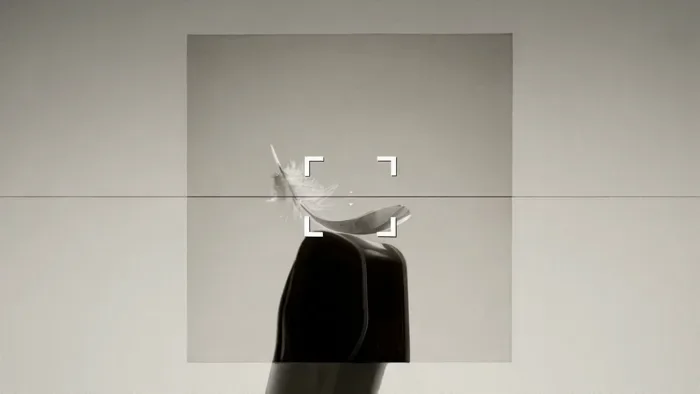
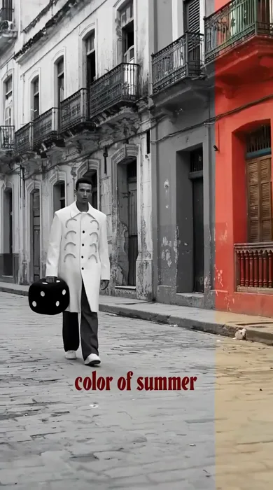
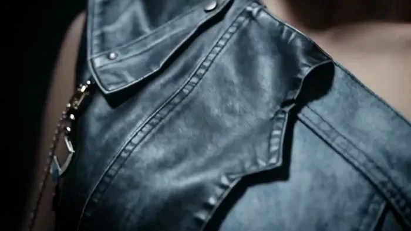

[← Back to the full index](../README.md#table-of-contents) · [English](ad-creative.md) · [简体中文](ad-creative.zh-CN.md) · [日本語](ad-creative.ja.md)

### Ad Creative (创意广告)

- [Case 1: Minimalist Camera Concept Film (极简相机概念片) — by Alibaba](#case-1)
- [Case 34: color of summer — Havana Street Fashion (color of summer·夏日街头时装) — by Alibaba](#case-34)
- [Case 43: Game Operator PV — Three Characters, Three Skills (游戏干员 PV·三人技能展示) — by Alibaba](#case-43)
- [Case 44: Two-Model Fashion Film — Jump Cuts Only (双女主时尚大片) — by Alibaba](#case-44)
- [Case 53: A Skincare Brand Film, from a .pptx (一份创意提案生成的护肤品牌片) — by Alibaba](#case-53)

### Case 1: Minimalist Camera Concept Film (极简相机概念片) — by Alibaba

▶ [Watch the full video on ofox.ai](https://ofox.ai/wan-3-prompts?utm_source=github&utm_medium=case&utm_campaign=awesome-ai-video-prompts#case-1)

<strong>Prompt</strong> — 15秒、16:9横版、30fps高端便携相机概念广告，围绕同一台无品牌便携相机展开。产品为横向圆角机身，比例约2.1:1，左侧大型镜头占机身高约68%，右侧窄幅纯黑显示区，银色喷砂铝框，黑色机身带细纹理，顶部齐平快门键，正面极小暗红状态点，边缘精密缝。镜头由六片深灰黑光圈叶片、拉丝黑环和深墨色多层光…

~~~~text
15秒、16:9横版、30fps高端便携相机概念广告，围绕同一台无品牌便携相机展开。产品为横向圆角机身，比例约2.1:1，左侧大型镜头占机身高约68%，右侧窄幅纯黑显示区，银色喷砂铝框，黑色机身带细纹理，顶部齐平快门键，正面极小暗红状态点，边缘精密缝。镜头由六片深灰黑光圈叶片、拉丝黑环和深墨色多层光学玻璃组成，仅少量蓝灰、冷白反射，无彩虹炫光。全片无品牌名、Logo、文字、数字或参数；不变手机、单反或运动相机。画面具工业设计广告质感，构图克制留白、运镜快速精准。灯光为左上方大型柔光、右后方轮廓光、正前方竖向柔光反射；背景在黑、冷灰、暖白间转换。四张极简艺术静物样张：象牙白羽毛悬浮深石墨灰背景、黑色火山岩置于暖白台面、弯曲银色金属薄片、冷灰水面圆形波纹。黑白银灰配色，水面仅极少量蓝灰，无人物、风景或杂乱桌面。0—1.7秒镜头内部极限微距，六片光圈叶片同步外旋，中央圆孔从冷白光点逐渐扩大，摄影机沿光轴高速后拉呈现真实镜头内部空间。1.7—3.5秒继续后撤并弧形右移，边缘光扫过使机身显现。3.5—5.3秒冲入镜头中心，画面转暖白摄影棚，取景只有象牙白羽毛悬浮于深灰与暖白交界处；界面仅四角标、空心对焦框、细水平线、暗红圆点，无文字参数，对焦框收缩锁定羽毛中心。5.3—7秒快门触发不闪白，光圈快速内闭合，取景画面缩成影像卡片；随后另三张样张依次展开，四张卡片漂浮暖白空间。7—9.2秒卡片横向序列排开，摄影机低机位从左向右高速穿行，近处边缘方向性模糊、远处形成视差；经前三张后于水面卡片前精准制动回正。9.2—11.4秒水面卡片开始放大并产生波纹，摄影机加速穿入使水面扩展全屏，镜头贴近水面滑行，波纹从中央向外扩散，中央高光渐与镜头形状一致。11.4—13.2秒靠近水面中央深色圆形反射，圆形满屏瞬间形状匹配切回相机镜头前组玻璃，摄影机拉远并左上方环绕使完整相机显现。13.2—15秒相机悬浮暖白棚中左前方三分之四角度，摄影机向上绕并推进展示各面，终点减速回正，冷白高光扫过机身，暗红状态点轻亮一次。最后0.6秒完全静止，无落版文字，直接结束。转场由镜头、卡片、水面波纹和产品镜头的形状与位置匹配完成，拒绝硬切、闪白或液体融化。声音为克制精准现代实验电子乐，无旁白、人声、管弦乐或EDM鼓点。拒绝廉价塑料感、彩虹炫光、霓虹或赛博朋克风格；拒绝拍立得边框、卡片旋转、穿透、重复、变形或素材消失。
~~~~

**参数**：Wan 3.0 · 未标注 · t2v · 15s · 未标注 · 16:9 · 带音频
**来源**：阿里云 Wan 3.0 官方展示页 · [source](https://www.aliyun.com/benefit/scene/wan)

Wan 3.0 官方示例 · 阿里云万相展示页「文生视频」极简相机概念片

[Back to top](#table-of-contents)

### Case 34: color of summer — Havana Street Fashion (color of summer·夏日街头时装) — by Alibaba

▶ [Watch the full video on ofox.ai](https://ofox.ai/wan-3-prompts?utm_source=github&utm_medium=case&utm_campaign=awesome-ai-video-prompts#case-34)

<strong>Prompt</strong> — 生成一支 25 秒、9:16 竖版的高饱和夏日街头时装短片。 整支视频发生在一座具有加勒比海、古巴哈瓦那或拉丁美洲老城区气质的城市街区。街道狭窄，地面铺设旧石板，两侧排列色彩鲜艳、表面略有斑驳的历史建筑： 珊瑚红墙面； 橙黄色立面； 青绿色门窗； 钴蓝色木门； 粉色与紫红色外墙； 老式阳台、铁艺栏杆…

~~~~text
生成一支 25 秒、9:16 竖版的高饱和夏日街头时装短片。
整支视频发生在一座具有加勒比海、古巴哈瓦那或拉丁美洲老城区气质的城市街区。街道狭窄，地面铺设旧石板，两侧排列色彩鲜艳、表面略有斑驳的历史建筑：
珊瑚红墙面；
橙黄色立面；
青绿色门窗；
钴蓝色木门；
粉色与紫红色外墙；
老式阳台、铁艺栏杆和脱落的墙皮；
远处偶尔停放一辆复古黄色汽车；
夏日阳光明亮强烈；
空气中带轻微湿热感与胶片颗粒。
主角是一名年轻成年男性，身材修长，短黑发，气质冷静、自信、略带时尚模特式疏离感。
人物造型在全片保持一致：
白色或奶油白色长款修身外套；
外套长度到膝盖附近；
正面从胸口到腹部纵向排列四到五组黄色弧形、环形或带状装饰；
黄色装饰像缝制在衣服上的软质绳带；
外套内搭保持简洁；
高饱和钴蓝色或宝蓝色长裤；
白色鞋；
不佩戴帽子；
不改变发型、服装颜色和黄色装饰数量。
全片的重要道具是一枚 大型黑色软骰子：
近似立方体；
表面为黑色软胶、织物或哑光塑料；
六个面带大型白色圆点；
尺寸接近人物小腿高度；
可以被人物手持、踢动、抛起、拖动或放在地面；
所有镜头中保持相同比例与外形；
不变成普通小骰子。
画面底部持续或间歇出现红色小标题：
color of summer
标题使用复古粗体衬线或打字机式字体，字距略宽，颜色为暗红或鲜红。文字位于底部中央，尺寸小而醒目。除这句标题外，不出现其他大段文案。
一、整体画面风格
色彩系统
画面前半段使用 黑白背景与彩色人物的局部上色效果：
建筑、街道和路人是高对比黑白；
主角白色外套、黄色胸前装饰、蓝色裤子和黑色骰子保留彩色；
红色标题保持彩色；
黑白部分带银盐胶片颗粒和略微过曝的白色天空。
进入中段后，场景逐渐恢复全彩：
红、橙、黄、蓝、青绿、粉色形成强烈撞色；
人物白色服装保持亮度中心；
黄色装饰与城市暖色建筑形成呼应；
蓝色裤子与青蓝门窗形成冷暖对比。
后段泳池场景使用：
青蓝池水；
珊瑚红建筑；
粉色、绿色、橙色泳装；
亮白阳光；
高饱和热带夏日色彩。
2. 胶片与画面材质
整体模拟 1990 年代时尚摄影、老胶片杂志与夏日旅行录像：
明显但细腻的胶片颗粒；
轻微褪色；
高光略微泛白；
阴影带少量青灰或暖红偏色；
局部漏光；
轻微画面抖动；
少量灰尘、划痕与帧间跳动；
快动作中出现胶片式方向拖影；
不要现代超锐利数码感。
部分画面可以使用：
黑色胶片边框；
圆角画幅；
接触印样式小照片；
轻微错位套色；
多重曝光；
一帧短促过曝。
二、人物表演与动态气质
主角的动作不是专业舞蹈编排，而是介于时装摆拍、街头即兴舞蹈和夏日游戏之间。
动作特点：
步伐松弛；
肩膀自然摆动；
偶尔踢动骰子；
轻微下蹲；
一只脚踩在骰子附近；
双手调整黄色胸前绳带；
面对镜头短暂停留；
与周围人群形成简单节奏互动；
表情克制，但偶尔露出轻微笑容。
人物始终是视觉中心。背景群众动作更热闹、更自由，但不能遮挡主角。
三、群体角色与服装
中段出现四至六名年轻男女，与主角一起在街道上跳舞或围绕骰子互动。
群体服装使用高饱和夏日色彩：
橙色背心或宽松上衣；
绿色短裤；
粉色花纹短裤；
青蓝色无袖上衣；
宝蓝长裤；
黄色或红色配件；
轻便夏装；
复古运动风和街头风混合。
人物肤色、发型和体型可多样化，但所有人保持真实自然，不使用统一模特脸。
群体动作：
侧步；
抬腿；
轻微旋转；
围绕骰子下蹲；
拍手；
彼此看向对方；
从镜头近处快速经过；
形成街头庆典与即兴游戏感。
四、手绘黄色动态图形
视频后段与结尾叠加大量鲜黄色手绘图形。
图形语言包括：
粗细不均的黄色蜡笔线；
手绘圆环；
连续螺旋；
箭头；
波浪线；
速度线；
半圆；
断续短线；
像胸前黄色绳带被放大、复制和延伸到空间中。
动态方式：
黄色线条沿人物轮廓快速绘制；
从胸前黄色装饰向四周生长；
圆环围绕头部、手臂和腿部旋转；
地面出现黄色弧形轨迹；
画面边缘出现放射线；
线条可以短暂遮挡人物，但不能覆盖面部太久；
所有涂鸦有真实手绘抖动，不是精准矢量 UI。
五、镜头语言
全片混合四种主要镜头风格。
低机位街头跟拍
镜头位于腰部或膝盖高度；
人物从街道远处向镜头走来；
地面石板形成强烈纵深；
建筑向上汇聚；
轻微手持或稳定器跟拍；
带时尚纪录片气质。
正面长焦肖像
人物居中走向镜头；
背景轻微压缩；
主角面部和黄色装饰清晰；
周围街景柔和虚化；
镜头缓慢后退。
圆形鱼眼镜头
强烈超广角；
画面四周形成黑色圆形暗角；
中央街道被夸张拉伸；
靠近镜头的人腿、手臂和骰子被放大；
建筑向画面边缘弯曲；
用于群舞和最终涂鸦高潮。
胶片接触印排版
黑色全屏背景；
中央排列两至三张竖向小照片或活动画面；
每张画面带白边或胶片边缘；
小画面依次出现人物走路、踢骰子和街头群众；
下方保留红色标题。
六、25 秒详细时间轴
0—3 秒｜黑白街道中的彩色主角
画面从狭窄老城街道的黑白长镜头开始。
两侧建筑、石板地面和背景路人全部为高对比黑白。主角从画面左侧或街道深处走入，只有以下元素保留彩色：
白色长外套；
黄色胸前弧形装饰；
蓝色长裤；
黑色骰子与白色圆点；
底部红色标题“color of summer”。
镜头在人物正前方缓慢后退。主角手持大型黑色骰子，平静地走向镜头，偶尔看向一侧。
画面带明显胶片颗粒、轻微过曝和细小抖动。
3—5 秒｜主角正面靠近与时装姿态
人物逐渐靠近镜头，占据画面中央。
他把大型骰子垂在身体一侧，另一只手放入口袋或轻触外套。
镜头略微从低角度向上拍摄，使白色长外套与黄色装饰更加突出。
背景仍为黑白。人物轻微调整步伐并停住半秒，直视镜头或略微偏头。
红色标题继续位于底部。
5—7 秒｜黑底胶片接触印
人物近景快速缩小成一张竖向胶片照片，画面切换为纯黑背景。
黑色背景中央依次出现两至三张小型竖画幅：
第一张：主角站在彩色街道中；
第二张：主角抬腿踢骰子；
第三张：一位路人从镜头前经过。
小画面像摄影接触印或杂志版式，带白色边缘、轻微胶片抖动。
红色“color of summer”在底部中央保持稳定。
7—9.5 秒｜全彩街道与踢骰子
画面恢复全彩。
主角站在一面珊瑚红墙与钴蓝色木门前。大型黑色骰子位于他脚边。
他先保持直立，然后缓慢抬起一条腿，用鞋尖轻轻踢动骰子：
骰子向前翻滚一至两次；
白色圆点清晰可见；
主角裤腿因抬腿动作产生褶皱；
外套下摆轻微摆动。
镜头正面固定或轻微推近，构图像时装杂志照片被激活。
9.5—12.5 秒｜鱼眼街头群舞
切换到圆形鱼眼镜头。
画面四周形成黑色圆形暗角，中央是高饱和橙红、蓝绿街道。
主角和四至六名年轻人围绕大型骰子跳舞：
有人从镜头前快速经过，腿部因鱼眼被夸张放大；
主角轻微下蹲；
一名蓝裤人物从前景跨过；
橙色衣服的人抬腿；
绿色短裤的人在背景拍手；
骰子在众人脚边滚动。
镜头位于很低的位置，轻微左右摆动，但不剧烈抖动。
底部红色标题部分被圆形鱼眼边缘裁切，仍可识别。
12.5—14.5 秒｜街道独自行走
鱼眼黑边通过快速扩张退出画面，恢复普通竖版街道镜头。
主角独自沿狭窄巷道从左向右行走，大型骰子在他身后拖行、滚动或以细绳连接。
背景建筑为粉红、米白与砖红色。镜头侧面平移跟随，人物步伐松弛，外套下摆随动作摆动。
这一段形成群舞高潮后的短暂呼吸。
14.5—17 秒｜正面走来与复古汽车
主角从街道远处正面走向镜头。
身后出现一辆复古黄色汽车，缓慢驶入或停在街角。两侧为红色和绿色墙面。
大型骰子在人物右侧地面滚动，每次翻转的速度与人物步伐大致同步。
镜头稳定后退，人物始终居中，红色标题位于底部。
17—19 秒｜泳池派对插入镜头
快速硬切到夏日泳池场景。
青蓝色泳池中，一群年轻男女正在玩水：
有人抬起手臂；
有人把朋友托起；
水面产生飞溅；
岸边站着穿粉色、绿色、橙色泳装的人；
背景是橙红色老建筑与蓝天。
镜头略高角度俯拍，停留时间短，像一张夏日生活照片插入时装片中。
不要出现主角换装，泳池只是氛围补充镜头。
19—21.5 秒｜主角近景调整黄色装饰
切回老城街道的浅景深人物近景。
主角站在画面中央，背景街道与泳池色彩被柔化成高饱和散景。
他低头看向胸前，用一只手缓慢调整或轻触黄色弧形装饰：
手指夹住其中一条黄色绳带；
绳带轻微移动；
白色外套的面料纹理清晰；
人物逐渐露出轻微笑容。
镜头从中景缓慢推到胸口和面部近景。
21.5—23 秒｜黄色装饰开始延展
人物胸前的黄色绳带像获得生命一样，向画面外部延伸成手绘线条。
动态：
第一条黄色弧线从胸口向左上生长；
第二条向右侧旋转；
更多黄色圆环和短线围绕人物生成；
人物保持基本静止；
背景仍是彩色街巷。
线条出现时伴随轻微逐帧抖动和蜡笔质感。
23—25 秒｜鱼眼涂鸦高潮与定格
画面重新切入圆形鱼眼视角。
主角正面站在老城街道中央，周围没有密集人群，主体更加清晰。
大量黄色手绘图形快速出现：
头部上方的黄色光环；
身体两侧的放射线；
胸前绳带延伸形成螺旋；
地面出现弧形轨迹；
画面边缘出现短箭头与波浪线；
大型骰子位于人物脚边。
涂鸦线条先快速绘制，再进行一次轻微旋转和扩散，最后稳定。
主角保持正面站姿，轻微抬头，形成时装英雄画面。
底部红色标题：
color of summer
清晰出现。
最后 0.3 秒所有涂鸦停止运动，人物、骰子和街道定格，不淡出黑场。
七、转场设计
黑白到彩色
开场通过局部上色逐渐扩散完成：
人物先保留彩色；
随后红墙与蓝门从人物周围向外恢复色彩；
不使用闪白。
街道到胶片接触印
人物走近镜头后，当前画面快速缩小成黑色背景中的一张竖向照片。
普通镜头到鱼眼
黑色圆形从画面中心或边缘收缩，形成圆形鱼眼画幅；退出时圆形边缘向外扩张。
街道到泳池
使用蓝色裤腿、蓝门或天空色块填满画面，匹配切换至泳池蓝色水面。
胸前绳带到涂鸦
黄色服装装饰直接延长为二维手绘线条，保证颜色、粗细与运动方向连续。
八、动效精细度要求
主角一致性
始终是同一人物；
发型与面部不改变；
白色外套长度稳定；
黄色弧形装饰保持四至五组；
蓝裤不变色；
白鞋不改变；
不生成第二个相同主角。
骰子
始终是同一个大型黑色软骰子；
六面结构清晰；
白点排列符合真实骰子逻辑；
滚动时不变成球体；
不突然改变尺寸；
不漂浮成魔法道具；
与地面保持真实碰撞。
鱼眼镜头
只在指定群舞与结尾阶段使用；
黑色圆形暗角清楚；
中心清晰；
边缘拉伸明显；
不让人物身体断裂；
不持续全片使用。
手绘涂鸦
颜色统一为鲜黄色；
有手工笔触与轻微抖动；
不变成 3D 发光管；
不生成可读文字；
不遮挡面部超过短暂瞬间；
最终构图保持有秩序。
九、声音设计
使用轻快、热烈、带拉丁街头气息的节奏音乐。整体声音应与画面中的步伐、骰子翻滚和手绘线条同步。
音乐气质：
夏日感；
轻快打击乐；
手鼓、沙锤、木质敲击；
复古贝斯；
少量铜管或明亮吉他切分；
轻微街头环境声；
节奏活泼但不过度电子化。
声音节点：
开场黑白画面：保留街道环境声和简洁节拍；
胶片画框出现：配合快门与胶片推进声；
骰子翻滚：加入柔软低频撞击和连续翻面声；
鱼眼群舞：音乐进入最密集的打击乐段；
泳池：加入短促水花声；
胸前装饰延展：配合蜡笔划线声；
最终涂鸦：每条线出现时对应短促高频划线或口哨音；
最后一帧以干净鼓点结束。
不要宏大电影配乐，不要阴暗低频，不要人声旁白，不要强烈 EDM。
十、风格关键词
summer fashion film in colorful Havana streets, Caribbean old town editorial, young Black male fashion model, white long coat with yellow loop details, cobalt blue trousers, oversized black dice, selective color black and white opening, vintage 35mm film grain, contact sheet layout, saturated colonial architecture, fisheye street dance, Latin summer energy, pool party insert, handwritten yellow doodle animation, red serif title, playful fashion campaign, low-angle wide lens, retro magazine photography, vibrant street culture, color of summer
十一、负面提示词
不要现代玻璃商务区，不要冷灰城市，不要夜景，不要霓虹赛博朋克，不要人物换脸，不要服装变化，不要黄色装饰数量变化，不要普通西装短外套，不要黑色骰子变成小型骰子，不要骰子点数混乱，不要骰子融化，不要人物肢体扭曲，不要群舞人物数量过多，不要鱼眼持续全片，不要卡通 3D 人物，不要黄色涂鸦变成霓虹灯，不要复杂文字，不要额外品牌名称，不要红色标题乱码，不要过度磨皮，不要现代高清数码感，不要持续镜头抖动，不要强烈运动模糊，不要低清晰度，不要水印。
~~~~

**参数**：Wan 3.0 · 未标注 · t2v · 25s · 未标注 · 9:16 · 带音频
**来源**：《Wan3.0 视频创作者手册》（万相官方） · [source](https://alidocs.dingtalk.com/i/nodes/qnYMoO1rWxrkmoj2IjExdZLBJ47Z3je9)

Wan 3.0 官方示例 ·《Wan3.0 视频创作者手册》

[Back to top](#table-of-contents)

### Case 43: Game Operator PV — Three Characters, Three Skills (游戏干员 PV·三人技能展示) — by Alibaba

▶ [Watch the full video on ofox.ai](https://ofox.ai/wan-3-prompts?utm_source=github&utm_medium=case&utm_campaign=awesome-ai-video-prompts#case-43)

**输入素材**：未公开 —— 本案例未收录可用的输入素材，请参阅来源

<strong>Prompt</strong> — 【视频类型】游戏买量角色PV展示视频 【视频时长】15秒 【参考素材】三张干员角色立绘图（赤狐双枪枪手·绯狩 @Image1 、人类炼金学者·紫珞 @Image3 、虎纹兽人法师·霆岳 @Image2 ） 【镜头结构】 第1段（0-3秒）：三人依次登场特写镜头，从暗影中显现，专属元素粒子环绕（绯狩-…

~~~~text
【视频类型】游戏买量角色PV展示视频
【视频时长】15秒
【参考素材】三张干员角色立绘图（赤狐双枪枪手·绯狩 @Image1 、人类炼金学者·紫珞 @Image3 、虎纹兽人法师·霆岳 @Image2 ）
【镜头结构】
第1段（0-3秒）：三人依次登场特写镜头，从暗影中显现，专属元素粒子环绕（绯狩-狐火幻焰 @Image1 、紫珞-炼金精华 @Image3 、霆岳-雷雕术法 @Image2 ），镜头缓缓推进聚焦面部，表情展现角色特质（绯狩 @Image1 机敏回眸、紫珞 @Image3 知性微笑、霆岳 @Image2 沉稳凝视）
第2段（3-10秒）：技能展示动态镜头，快速转场切换
● 绯狩：侧身低伏、双手燧发长枪连射，薄荷金色狐火自枪口迸发凝成三道狐影分身穿梭突袭，枪鸣音效+狐火粒子特效
● 紫珞：单手高举黄铜天平、指尖涌出紫罗兰色精华液流，凝成流形复制体环绕，精华涌动音效+紫光透明粒子特效
● 霆岳：斜举魔法长杖引金雕振翅腾空，墨绿古铜色雷霆自杖端爆发席卷震慑敌方，雷鸣音效+雷光粒子特效
镜头跟随元素轨迹摇动，角色动作姿势动态展现，表情专注战斗状态
第3段（10-15秒）：三人并肩站立群像镜头，从全景缓慢拉近至中景，三人专属元素在身后交汇融合（狐火+精华+雷雕混合粒子云），色调渐变（薄荷金+紫罗兰+墨绿古铜），三人各自展现角色特质表情，三人名称依次闪现
【镜头控制】
● 特写镜头：角色面部特写，表情细节与口型同步
● 中景镜头：角色上半身，动作与特效释放
● 全景镜头：三人群像，团队气势展现
● 动态镜头：技能释放快速移动，跟随元素轨迹
● 转场：暗影渐显、元素过渡（狐火→精华→雷雕）、快速切换、慢镜头拉近
【动作与特效】
● 绯狩：双枪连射召唤狐火幻影，薄荷金色狐火粒子环绕，敏捷猎手气场
● 紫珞：天平与精华操控，紫罗兰色液光粒子，炼金学者气场
● 霆岳：金雕腾空、雷霆席卷，墨绿古铜色雷光粒子，术法宗师气场
● 交汇特效：三人元素混合粒子云，色调渐变融合
【表情与口型】
● 绯狩：机敏回眸，略带锋锐，眼神轻佻而笃定，台词"扳机之下，无人能逃"口型同步
● 紫珞：知性微笑，略带神秘，眼神亲切沉静，台词"万物皆可等价，包括命运"口型同步
● 霆岳：沉稳凝视，略带威严，眼神锐利如鹰，台词"苍鹰所至，即是雷霆"口型同步
【语音与音效】
● 绯狩台词：男声清朗冷冽，略带洒脱痞气，语速偏快音调适中
● 紫珞台词：女声温柔知性，略带神秘，语速舒缓音调适中
● 霆岳台词：男声威严庄重，略带冷峻，语速适中音调偏低
● 音效：枪鸣+狐火迸发+精华涌动+雷霆席卷+金雕振翅+混合粒子爆发
● BGM：史诗交响+电子音效混合，节奏与镜头切换/技能释放/台词发音同步
【视觉风格】
● 色调：暗色调+高对比，绯狩薄荷金、紫珞紫罗兰、霆岳墨绿古铜
● 粒子特效：狐火粒子、精华粒子、雷雕粒子，交汇融合
● UI元素：游戏Logo浮现，角色名称闪现，技能名称标注
● 背景：暗影背景→战斗场景→高空雷云背景渐变
~~~~

**参数**：Wan 3.0 · 未标注 · ref2v · 15s · 未标注 · 未标注 · 带音频
**来源**：《Wan3.0 视频创作者手册》（万相官方） · [source](https://alidocs.dingtalk.com/i/nodes/qnYMoO1rWxrkmoj2IjExdZLBJ47Z3je9)

Wan 3.0 官方示例 ·《Wan3.0 视频创作者手册》

[Back to top](#table-of-contents)

### Case 44: Two-Model Fashion Film — Jump Cuts Only (双女主时尚大片) — by Alibaba

▶ [Watch the full video on ofox.ai](https://ofox.ai/wan-3-prompts?utm_source=github&utm_medium=case&utm_campaign=awesome-ai-video-prompts#case-44)

**输入素材**：未公开 —— 本案例未收录可用的输入素材，请参阅来源

<strong>Prompt</strong> — 电影级双女主时尚大片，极快节奏，纯硬切（Jump Cut）剪辑逻辑，阿莱Alexa 65与Panavision变形宽银幕镜头拍摄，柯达Vision3 500T胶片质感，8k分辨率，照片级真实，无文字。人物面部特征完全锁定女生A @Image1 和 女生B@ @Image2 。 [0-3秒：极速登场与…

~~~~text
电影级双女主时尚大片，极快节奏，纯硬切（Jump Cut）剪辑逻辑，阿莱Alexa 65与Panavision变形宽银幕镜头拍摄，柯达Vision3 500T胶片质感，8k分辨率，照片级真实，无文字。人物面部特征完全锁定女生A @Image1 和 女生B@ @Image2 。

[0-3秒：极速登场与反差] （硬切）纯白极简空间，被强烈的侧光切割出锐利的阴影。左屏/左侧：女生A穿着黑色解构主义皮革西装，冷光下眼神冷艳，快速转头直视镜头。右屏/右侧：女生B穿着香槟金流动真丝长裙，暖光下眼神慵懒，快速转头直视镜头。真实的胶片颗粒感。

[3-6秒：材质极致特写] （硬切）极近微距特写。女生A参考服饰 @Image3 ：冷光打在黑色皮革的锋利折痕和金属配饰上，呈现冷冽的高级光泽。女生B参考服饰 @Image4 ：暖光勾勒出她锁骨的线条，真丝面料如水波般流动，皮肤呈现超写实的通透水光肌质感，可见细微绒毛。

[6-9秒：张力交错（高速摄影）] （硬切）两人在纯白空间中迎面走来，擦肩而过。高速摄影（1000fps慢动作）。黑色皮革的硬朗与香槟真丝的柔软在交错瞬间剧烈碰撞，裙摆与发丝在空中飞扬。两人在交错的零点一秒内，眼神锐利地对视。

[9-12秒：背靠背的压迫感] （硬切）两人背靠背站立。强烈的侧逆光（Rim light）同时勾勒出两人的面部轮廓和发丝金边。她们同时快速转头，直视镜头。表情极具压迫感、专业且充满顶级超模的自信气场。

[12-15秒：松弛与定格] （硬切）两人并肩站立，微微侧头相视，露出极具感染力的、松弛而自信的微笑。镜头缓慢向后拉远（Slow zoom out），展现两人在宏大光影空间中的完美比例，画面在高级的光晕中渐暗。

运镜：快速手持，极速推镜头，高速摄影慢动作，纯粹的硬切，无花哨视觉特效。
色彩：高对比度的黑白灰基调，点缀冷冽的金属光泽与温暖的香槟金色，电影级色彩分级。
~~~~

**参数**：Wan 3.0 · 未标注 · ref2v · 15s · 未标注 · 未标注 · 带音频
**来源**：《Wan3.0 视频创作者手册》（万相官方） · [source](https://alidocs.dingtalk.com/i/nodes/qnYMoO1rWxrkmoj2IjExdZLBJ47Z3je9)

Wan 3.0 官方示例 ·《Wan3.0 视频创作者手册》

[Back to top](#table-of-contents)

### Case 53: A Skincare Brand Film, from a .pptx (一份创意提案生成的护肤品牌片) — by Alibaba

▶ [Watch the full video on ofox.ai](https://ofox.ai/wan-3-prompts?utm_source=github&utm_medium=case&utm_campaign=awesome-ai-video-prompts#case-53)

**输入素材**：未公开 —— 本案例未收录可用的输入素材，请参阅来源

<strong>Prompt</strong> — 根据我的提案文档，生成素研SĒRA光蕴精华品牌广告片——一个关于「清晨三分钟」的故事。女主角从醒来到护肤到出门，全程素颜，用自然光的质感证明：好的皮肤不需要遮盖，只需要被善待。全片零旁白、零产品功效宣称，仅靠画面情绪传递「素颜自信」的品牌态度 。保证主角的一致性。最后的镜头以产品图收尾。

~~~~text
根据我的提案文档，生成素研SĒRA光蕴精华品牌广告片——一个关于「清晨三分钟」的故事。女主角从醒来到护肤到出门，全程素颜，用自然光的质感证明：好的皮肤不需要遮盖，只需要被善待。全片零旁白、零产品功效宣称，仅靠画面情绪传递「素颜自信」的品牌态度 。保证主角的一致性。最后的镜头以产品图收尾。
~~~~

**参数**：Wan 3.0 · 未标注 · ref2v · 未标注 · 未标注 · 未标注 · 带音频
**来源**：《Wan3.0 视频创作者手册》（万相官方） · [source](https://alidocs.dingtalk.com/i/nodes/qnYMoO1rWxrkmoj2IjExdZLBJ47Z3je9)

Wan 3.0 官方示例 ·《Wan3.0 视频创作者手册》

[Back to top](#table-of-contents)
