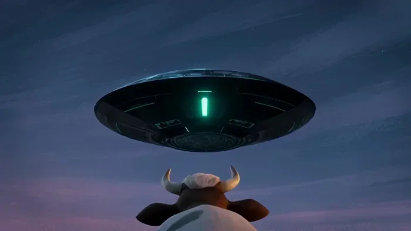
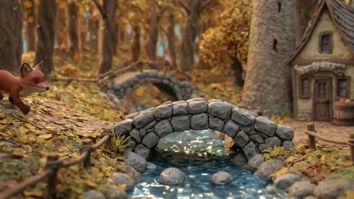
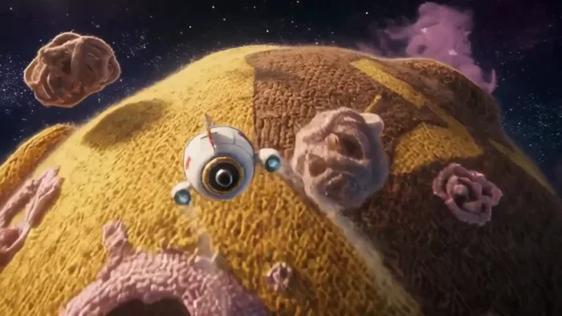
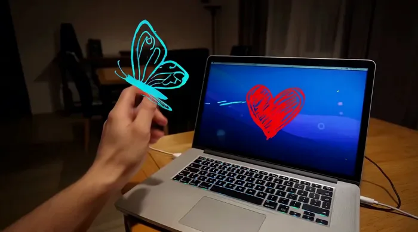
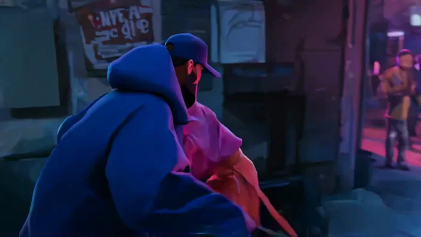
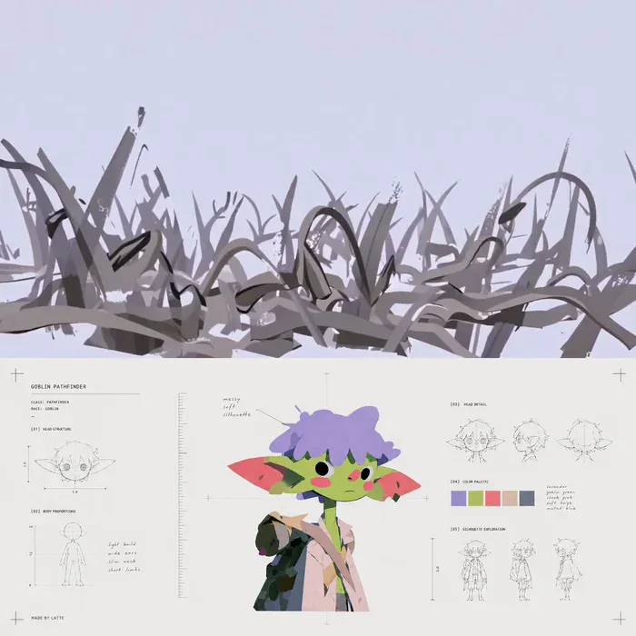

[← Back to the full index](../README.md#table-of-contents) · [English](animation-stylized.md) · [简体中文](animation-stylized.zh-CN.md) · [日本語](animation-stylized.ja.md)

### Animation & Stylized (动画与风格化)

- [Case 16: 3D Stylized — The Giant Translucent Plant (3D 风格化动画·湖心巨型植物) — by Alibaba](#case-16)
- [Case 17: Polished 2D — Leap from the Cliff (精美 2D 动画·悬崖纵身) — by Alibaba](#case-17)
- [Case 18: Sports Anime — Boxing Training (2D 运动番·拳击训练) — by Alibaba](#case-18)
- [Case 20: Clay Animation — UFO Takes the Cow (黏土动画·飞碟掳走奶牛) — by Alibaba](#case-20)
- [Case 29: Ramen Chef and the Stray Kitten (拉面店大叔与流浪猫) — by Alibaba](#case-29)
- [Case 30: Clay Fox in the Autumn Town (黏土小狐狸的秋日小镇) — by Alibaba](#case-30)
- [Case 32: Plush Universe Escape (毛绒宇宙大逃亡) — by Alibaba](#case-32)
- [Case 35: First-Person Hand-Drawn MG Night Walk (第一人称手绘 MG 夜游) — by Alibaba](#case-35)
- [Case 45: Urban MG Chase for the Light Orb (都市 MG 光球追逐) — by Alibaba](#case-45)
- [Case 80: Before the Void Swallows You (在虚空吞噬你之前) — by @0xbisc](#case-80)

### Case 16: 3D Stylized — The Giant Translucent Plant (3D 风格化动画·湖心巨型植物) — by Alibaba

▶ [Watch the full video on ofox.ai](https://ofox.ai/wan-3-prompts?utm_source=github&utm_medium=case&utm_campaign=awesome-ai-video-prompts#case-16)

<strong>Prompt</strong> — 一段共4个镜头场景的3D动画奇幻短片，从谨慎接近到巨大生物显现再到震撼凝视，情感表达为安静、神秘、惊叹。场景环境为夜色森林中的浅湖，室外自然空间，湖面平静，周围高树包围，漂浮发光花瓣分布于水面，空气里有淡薄雾气。主色调为青蓝、墨绿、月白，冷色调为主，局部发光植物提供青白色高亮，饱和度中等，对比度中高…

~~~~text
一段共4个镜头场景的3D动画奇幻短片，从谨慎接近到巨大生物显现再到震撼凝视，情感表达为安静、神秘、惊叹。场景环境为夜色森林中的浅湖，室外自然空间，湖面平静，周围高树包围，漂浮发光花瓣分布于水面，空气里有淡薄雾气。主色调为青蓝、墨绿、月白，冷色调为主，局部发光植物提供青白色高亮，饱和度中等，对比度中高。主体为探险少年与湖中心巨大透明植物。探险少年年龄偏少年，身形纤细，短浅色发，有雀斑，穿轻便探险服，手持小油灯，面部柔和。镜头一为中远景定场，探险少年从画面右侧踩着露出水面的石头向湖中心移动，镜头缓慢前推；镜头二硬切到背后中景，镜头继续跟踪他的移动，浅水波纹向四周扩散，少量漂浮花瓣被轻轻推开；镜头三切到湖心中景，水面出现越来越密集的同心波纹，一株巨大透明植物缓慢升起，内部像液态光在流动，枝叶展开时投下摇曳反光；镜头四切到侧面中近景，探险少年停下两只脚一前一后踩在两块石头上、放低手灯，面部由警惕变成睁大双眼的惊讶，视线凝视湖中心巨大透明植物。音频类型包含环境音与音乐，无语音内容，仅有夜间虫鸣、轻微水声、植物上升时的低频共鸣和空灵合成器与弦乐。要求明确湖面波纹、发光材质、镜头推进、主体表演和冷色夜景光影。
~~~~

**参数**：Wan 3.0 · 未标注 · t2v · 未标注 · 未标注 · 未标注 · 带音频
**来源**：《Wan3.0 视频创作者手册》（万相官方） · [source](https://alidocs.dingtalk.com/i/nodes/qnYMoO1rWxrkmoj2IjExdZLBJ47Z3je9)

Wan 3.0 官方示例 ·《Wan3.0 视频创作者手册》

[Back to top](#table-of-contents)

### Case 17: Polished 2D — Leap from the Cliff (精美 2D 动画·悬崖纵身) — by Alibaba

▶ [Watch the full video on ofox.ai](https://ofox.ai/wan-3-prompts?utm_source=github&utm_medium=case&utm_campaign=awesome-ai-video-prompts#case-17)

<strong>Prompt</strong> — 这是一段精致的日式2D卡通动画短片，对情绪高潮场景需要有细腻处理，尤其是天空色彩渐变与云层光影的运用。需要有戏剧化的逆光效果，在空间感上采用带强烈透视纵深的构图，强调人物在辽阔场景中的渺小与坚定。悬崖边缘的辽阔场景，远处是翻涌的云海与远处若隠若现的城市，天空呈现出剧烈变化的渐变色彩，从深蓝逐渐过渡到…

~~~~text
这是一段精致的日式2D卡通动画短片，对情绪高潮场景需要有细腻处理，尤其是天空色彩渐变与云层光影的运用。需要有戏剧化的逆光效果，在空间感上采用带强烈透视纵深的构图，强调人物在辽阔场景中的渺小与坚定。悬崖边缘的辽阔场景，远处是翻涌的云海与远处若隠若现的城市，天空呈现出剧烈变化的渐变色彩，从深蓝逐渐过渡到橙红色，云层边缘泛着金边，狂风卷起地面的花瓣与碎叶漫天飞舞。
主角设计：孤独少女，银白色长发在风中剧烈飘散，身穿破损的白色礼裙，裙摆边缘有细微的裂纹状发光纹路，脸色苍白如瓷，眼神中蕴含着深深的挣扎与决绝。
镜头以极大远景开场，主角的身影在辽阔天地间显得格外渺小孤独，镜头缓慢推进至她的中景，裙摆与发丝在狓风中剧烈飘散翻卷。她缓缓抬起头望向翻涌的云海，脸部特写捕捉她眼中闻过的复杂情绪——恐惧、挣扎，最终转化为坚定。她向前迈出一步站在悬崖最边缘，镜头切换为高速的环绕拍摄，天空的色彩在她周身流转变化，最终她纵身跃下的瞬间画面进入慢镜头处理，裙摆如花朵般在空中绽放展开，身躬周围泛起的白色光点如羽毛般飘散。
~~~~

**参数**：Wan 3.0 · 未标注 · t2v · 未标注 · 未标注 · 未标注 · 带音频
**来源**：《Wan3.0 视频创作者手册》（万相官方） · [source](https://alidocs.dingtalk.com/i/nodes/qnYMoO1rWxrkmoj2IjExdZLBJ47Z3je9)

Wan 3.0 官方示例 ·《Wan3.0 视频创作者手册》

[Back to top](#table-of-contents)

### Case 18: Sports Anime — Boxing Training (2D 运动番·拳击训练) — by Alibaba

▶ [Watch the full video on ofox.ai](https://ofox.ai/wan-3-prompts?utm_source=github&utm_medium=case&utm_campaign=awesome-ai-video-prompts#case-18)

<strong>Prompt</strong> — 日式运动番质感的2d动画，30秒。拳击训练场里，黑色短发的运动员连续出拳，手套击打沙袋时产生明显的震动回弹，但他似乎有些乏力，表情痛苦，流着汗，像是陷入在什么困境中一样。

~~~~text
日式运动番质感的2d动画，30秒。拳击训练场里，黑色短发的运动员连续出拳，手套击打沙袋时产生明显的震动回弹，但他似乎有些乏力，表情痛苦，流着汗，像是陷入在什么困境中一样。
~~~~

**参数**：Wan 3.0 · 未标注 · t2v · 30s · 未标注 · 未标注 · 带音频
**来源**：《Wan3.0 视频创作者手册》（万相官方） · [source](https://alidocs.dingtalk.com/i/nodes/qnYMoO1rWxrkmoj2IjExdZLBJ47Z3je9)

Wan 3.0 官方示例 ·《Wan3.0 视频创作者手册》

[Back to top](#table-of-contents)

### Case 20: Clay Animation — UFO Takes the Cow (黏土动画·飞碟掳走奶牛) — by Alibaba

▶ [Watch the full video on ofox.ai](https://ofox.ai/wan-3-prompts?utm_source=github&utm_medium=case&utm_campaign=awesome-ai-video-prompts#case-20)

<strong>Prompt</strong> — 手绘风格动画，油画笔触，色调偏冷，美国郊外农场上，一个外星飞碟从远处飞来，飞碟下射出绿色光柱，将农场中的一只奶牛吸走了，不远处二楼房间中的小男孩看到了这一幕。

~~~~text
手绘风格动画，油画笔触，色调偏冷，美国郊外农场上，一个外星飞碟从远处飞来，飞碟下射出绿色光柱，将农场中的一只奶牛吸走了，不远处二楼房间中的小男孩看到了这一幕。
~~~~

**参数**：Wan 3.0 · 未标注 · t2v · 未标注 · 未标注 · 未标注 · 带音频
**来源**：《Wan3.0 视频创作者手册》（万相官方） · [source](https://alidocs.dingtalk.com/i/nodes/qnYMoO1rWxrkmoj2IjExdZLBJ47Z3je9)

Wan 3.0 官方示例 ·《Wan3.0 视频创作者手册》

[Back to top](#table-of-contents)

### Case 29: Ramen Chef and the Stray Kitten (拉面店大叔与流浪猫) — by Alibaba

▶ [Watch the full video on ofox.ai](https://ofox.ai/wan-3-prompts?utm_source=github&utm_medium=case&utm_campaign=awesome-ai-video-prompts#case-29)

**输入素材**：未公开 —— 本案例未收录可用的输入素材，请参阅来源

<strong>Prompt</strong> — 镜头1：深夜打烊后， Image1 用抹布仔细擦拭吧台&lt;抹布摩擦声&gt;，一双布满旧茧和新伤的巨手动作沉稳，脸上是打烊后的疲惫。 镜头2：传来一声微弱的呜咽&lt;小猫呜咽声&gt;，他手上动作停下，眉头微皱拉开门，只见门口一只瘦骨嶙峋的流浪小猫在雨中发抖。 镜头3：缓慢推镜到小猫无助的眼神， Image1 疲惫表…

~~~~text
镜头1：深夜打烊后， Image1 用抹布仔细擦拭吧台<抹布摩擦声>，一双布满旧茧和新伤的巨手动作沉稳，脸上是打烊后的疲惫。
镜头2：传来一声微弱的呜咽<小猫呜咽声>，他手上动作停下，眉头微皱拉开门，只见门口一只瘦骨嶙峋的流浪小猫在雨中发抖。
镜头3：缓慢推镜到小猫无助的眼神， Image1 疲惫表情逐渐被一种温柔取代，沉默对峙数秒后这个巨汉缓缓僵硬地蹲下身。
镜头4：面部特写，他脸上坚硬的线条松弛下来，嘴角咧开一个笨拙而和善的微笑，眼角伤疤周围的肌肉也跟着舒展。赛璐珞动画质感，粗黑轮廓线硬朗画面，拉面店暖黄灯光与后巷雨夜冷蓝对比调。
~~~~

**参数**：Wan 3.0 · 未标注 · ref2v · 未标注 · 未标注 · 未标注 · 带音频
**来源**：《Wan3.0 视频创作者手册》（万相官方） · [source](https://alidocs.dingtalk.com/i/nodes/qnYMoO1rWxrkmoj2IjExdZLBJ47Z3je9)

Wan 3.0 官方示例 ·《Wan3.0 视频创作者手册》

[Back to top](#table-of-contents)

### Case 30: Clay Fox in the Autumn Town (黏土小狐狸的秋日小镇) — by Alibaba

▶ [Watch the full video on ofox.ai](https://ofox.ai/wan-3-prompts?utm_source=github&utm_medium=case&utm_campaign=awesome-ai-video-prompts#case-30)

**输入素材**：未公开 —— 本案例未收录可用的输入素材，请参阅来源

<strong>Prompt</strong> — 参考图片1的美学风格。一只黏土质感的小狐狸站在秋天的森林边缘，竖起耳朵望向远处冒着炊烟的小镇。它迈开短腿小跑下山坡，穿过一座微缩的石拱桥，桥下溪水用透明树脂般的质感缓缓流动。小狐狸跑进小镇集市，在一个水果摊前停下，用爪子拨弄一颗红苹果，苹果滚落到地上骨碌碌转了几圈。它叼起苹果继续跑，经过一家面包店门…

~~~~text
参考图片1的美学风格。一只黏土质感的小狐狸站在秋天的森林边缘，竖起耳朵望向远处冒着炊烟的小镇。它迈开短腿小跑下山坡，穿过一座微缩的石拱桥，桥下溪水用透明树脂般的质感缓缓流动。小狐狸跑进小镇集市，在一个水果摊前停下，用爪子拨弄一颗红苹果，苹果滚落到地上骨碌碌转了几圈。它叼起苹果继续跑，经过一家面包店门口，烟囱里飘出的烟雾像棉絮一样一团团升起。最后小狐狸跳上镇外的矮墙，坐下来对着夕阳啃苹果，橙色晚霞铺满整个黏土天空。微缩场景，浅景深。
~~~~

**参数**：Wan 3.0 · 未标注 · ref2v · 未标注 · 未标注 · 未标注 · 带音频
**来源**：《Wan3.0 视频创作者手册》（万相官方） · [source](https://alidocs.dingtalk.com/i/nodes/qnYMoO1rWxrkmoj2IjExdZLBJ47Z3je9)

Wan 3.0 官方示例 ·《Wan3.0 视频创作者手册》

[Back to top](#table-of-contents)

### Case 32: Plush Universe Escape (毛绒宇宙大逃亡) — by Alibaba

▶ [Watch the full video on ofox.ai](https://ofox.ai/wan-3-prompts?utm_source=github&utm_medium=case&utm_campaign=awesome-ai-video-prompts#case-32)

<strong>Prompt</strong> — 生成一�� 20 秒、16:9 超宽银幕比例的毛绒宇宙冒险片段。 一艘由毛绒布、纽扣、拉链和填充棉制成的宇宙飞船，在由巨大毛线行星、绒毛星云和布偶巨兽组成的宇宙中高速逃亡。驾驶飞船的是三只小型毛绒动物：兔子、狐狸和乌鸦。 一只覆盖深蓝长绒毛、眼睛像两枚玻璃纽扣的巨大星际鲸兽，从星云中追赶飞船。 整体…

~~~~text
生成一�� 20 秒、16:9 超宽银幕比例的毛绒宇宙冒险片段。

一艘由毛绒布、纽扣、拉链和填充棉制成的宇宙飞船，在由巨大毛线行星、绒毛星云和布偶巨兽组成的宇宙中高速逃亡。驾驶飞船的是三只小型毛绒动物：兔子、狐狸和乌鸦。

一只覆盖深蓝长绒毛、眼睛像两枚玻璃纽扣的巨大星际鲸兽，从星云中追赶飞船。

整体采用 超精细毛绒材质、电影级太空尺度、可爱外形与强烈动作反差、夸张 FPV 运镜和真实软体物理。

20 秒动态时间轴
0—3 秒｜拉链飞船弹射起航

镜头位于毛绒飞船内部，驾驶舱由缝线、纽扣和布料仪表组成。

红色警示纽扣快速闪烁。兔子拉下一条巨大拉链控制杆，飞船前方舱门像布袋一样裂开。

摄影机从驾驶舱高速后退，穿过拉链舱门来到飞船外部。飞船从一颗毛线行星的针织环形山中弹射升空。

3—6 秒｜贴着毛线行星高速绕行

镜头紧贴飞船尾部，沿行星表面低空飞行。

地面由巨大毛线编织而成：

针织山脉从下方高速掠过；
松散线头像森林一样摆动；
飞船左右大幅闪避；
摄影机连续侧倾和滚转；
推进器喷出白色棉絮尾流。
6—8.5 秒｜巨型毛绒鲸出现

绒毛星云突然向两侧分开，巨大深蓝毛绒鲸从后方冲出。

鲸体表面长绒毛被高速气流吹向后方，玻璃纽扣眼反射行星光芒。

镜头快速绕飞船半圈，改为倒飞视角，让鲸兽在飞船后方不断放大。

8.5—11 秒｜穿越纽扣小行星带

飞船进入由数千枚巨大纽扣组成的小行星带。

摄影机跟随飞船进行连续高速 S 形运动：

从两枚旋转纽扣之间穿过；
贴着纽扣孔洞边缘掠过；
穿进一枚透明纽扣内部；
从另一侧冲出；
巨鲸用嘴撞碎纽扣，产生布屑和线头爆发。
11—13.5 秒｜被鲸兽吞入口中

前方路线被封锁，飞船突然转向巨鲸张开的嘴部。

鲸兽口腔内部像一个巨大的毛绒玩具箱：

绒毛牙齿柔软却巨大；
悬浮积木、布偶和铃铛不断碰撞；
摄影机在狭窄空间连续滚转；
飞船贴着舌面低空冲刺；
舌面绒毛产生剧烈波纹。
13.5—16 秒｜从背部拉链逃出

飞船发现巨鲸体内一条巨大的金色拉链。

狐狸角色按下按钮，飞船射出线钩拉开拉链。摄影机沿拉链齿高速推进，拉链向两侧打开，露出外部星空。

飞船从巨鲸背部冲出，镜头同时完成一次向后翻滚。

16—18 秒｜鲸兽软体坍缩

拉链开启后，巨鲸像泄掉填充棉的毛绒玩具一样缓慢变扁，但不发生伤害。

大量白色棉花云从拉链中喷出，形成巨大柔软冲击波。摄影机和飞船被棉花浪推向前方。

18—20 秒｜穿越星云与英雄定格

飞船冲出棉花云，进入一片粉紫色绒毛星云。

摄影机从飞船侧面高速环绕至正前方倒飞，透过驾驶舱玻璃看见三只毛绒角色兴奋地抱在一起。

飞船从镜头上方掠过，向一颗彩色纽扣太阳飞去，结束。
~~~~

**参数**：Wan 3.0 · 未标注 · t2v · 20s · 未标注 · 16:9 · 带音频
**来源**：《Wan3.0 视频创作者手册》（万相官方） · [source](https://alidocs.dingtalk.com/i/nodes/qnYMoO1rWxrkmoj2IjExdZLBJ47Z3je9)

Wan 3.0 官方示例 ·《Wan3.0 视频创作者手册》

[Back to top](#table-of-contents)

### Case 35: First-Person Hand-Drawn MG Night Walk (第一人称手绘 MG 夜游) — by Alibaba

▶ [Watch the full video on ofox.ai](https://ofox.ai/wan-3-prompts?utm_source=github&utm_medium=case&utm_campaign=awesome-ai-video-prompts#case-35)

<strong>Prompt</strong> — 生成一支15秒、16:9横版的“低照度真实室内摄影 × 粗糙手绘MG动画 × 第一人称互动VFX”短片。全片为第一人称POV视角，模拟使用小型运动相机或手持超广角相机，在夜晚住宅中连续拍摄。整体不是精致广告片，而是一段带有偶然性、即时感和轻微失控感的个人创意影像。 实拍空间与色调 场景是一间面积不大…

~~~~text
生成一支15秒、16:9横版的“低照度真实室内摄影 × 粗糙手绘MG动画 × 第一人称互动VFX”短片。全片为第一人称POV视角，模拟使用小型运动相机或手持超广角相机，在夜晚住宅中连续拍摄。整体不是精致广告片，而是一段带有偶然性、即时感和轻微失控感的个人创意影像。

实拍空间与色调

场景是一间面积不大的夜晚住宅，客厅、餐桌、电脑工作区、狭窄过道和厨房彼此连接。空间略显拥挤，家具并不完全对称，保留真实生活痕迹。

墙面为哑光米棕色和浅咖啡色，带有细微墙漆颗粒、阴影不均和轻微使用痕迹。家具以深色旧木材、黑色皮革和暗色织物为主，木质桌面保留细小划痕、反光不均和日常物品。不要过度整洁，不要样板间，不要高级民宿。

室内不开明亮顶灯。主要光源来自暖黄色壁灯、桌边小灯、笔记本电脑屏幕，以及沿天花板不规则悬挂的一串红、黄、绿、蓝色小灯泡。窗外完全黑暗。房间大部分区域处于低照度阴影中，只有局部被壁灯照亮。

整体色调以暗棕色、焦糖色、琥珀橙和深黑色为主。暗部不能全部提亮，墙角、家具底部和过道必须保留大片深色阴影。电脑屏幕提供少量冷蓝光，冰箱打开时出现突然增强的冷白光，自动曝光需要短暂调整。

画面保留消费级相机的低照度特征：轻微高感噪点、暗部彩色颗粒、有限动态范围、轻微色彩偏移、镜头暗角、压缩纹理和不完全干净的运动模糊。禁止电影级无噪点画质，禁止通透锐利的商业摄影，禁止三维渲染感和塑料材质。

POV镜头与真实手持抖动

使用约14—16mm超广角镜头，存在轻微鱼眼畸变和桶形变形，画面边缘的家具与门框略微弯曲。摄影机位于成年人眼睛或胸口高度，观众就是正在行动的人物。

镜头不能像稳定器一样平滑。全程保留不规则的真实手持运动：

静止观察时也有细小呼吸起伏和左右重心变化；
手臂抬起时，摄影机轻微向反方向偏移；
人物行走时，每一步带来小幅上下起伏和轻微左右滚转；
镜头转向时先加速、后减速，停止位置有一次很小的过冲与回弹；
手部动作先发生，摄影机延迟约0.1秒跟随，形成真实反应时间；
快速低头、抬头和转身时出现明显方向性运动模糊与轻微滚动快门变形；
镜头接近电脑、墙壁和冰箱时距离过近，构图允许偏斜、裁切和短暂失焦；
运动结束后自动对焦需要约0.2秒重新锁定。

抖动必须来自呼吸、脚步、转身惯性和受惊反应，不能是规律振动，也不能全程高频乱晃。镜头既要有真实不稳定感，也要让观众看清核心动作。

画面中只出现同一人物的真实右手或双手前臂。手臂保持未经美化的实拍皮肤质感，包括毛孔、细小汗毛、关节纹理和暖光阴影。手臂不能出现白色描边、卡通描边或抠图边缘。MG线条只能围绕手臂运动，不能把整只手勾勒成贴纸。

手绘MG质感

所有动画均为粗糙的二维逐帧手绘，不是光滑矢量动画，不是3D卡通，不是塑料贴纸。

笔触由蜡笔、油画棒、粉笔和干燥排刷混合形成。线条宽度不均匀，边缘有刷毛分叉、颗粒缺口、断笔、重复描画和局部半透明痕迹。每一帧的轮廓都会产生轻微变化，形成明显但克制的“线条沸腾”。

动画以接近每秒10—12张手绘帧的节奏跳动，而实拍背景保持连续运动。笔触移动时不能做完美曲线插值，必须带有逐帧手绘产生的轻微顿挫、伸缩和位置漂移。

颜色以粉笔白、明黄色、青蓝色、鲜红色和荧光粉色为主。颜色为粗糙哑光颜料，没有镜面高光、塑料反射、立体厚度、柔软阴影或强烈霓虹光晕。

简单生物可以使用黑色轮廓，但轮廓必须粗细不一、断续、抖动，不能形成光滑均匀的卡通描边。蝴蝶、章鱼、汉堡和巨口都应像临时画出来的儿童涂鸦或独立动画原画，而不是商业表情包。

动画必须跟随真实摄影机透视：

靠近镜头时快速变大，远离时明显缩小；
经过门框、手臂、桌面和冰箱门时产生正确遮挡；
摄影机甩动时，动画同样出现运动模糊和短暂拖影；
动画不能永远保持居中，允许从画面边缘进入、部分出画或被镜头裁切；
贴在墙面和电脑上的图形必须跟随表面透视，不得平行悬浮在屏幕上。
0—2秒｜白色笔触缠绕手臂

镜头从昏暗客厅开始，构图略微向左倾斜。右下角只能看到电脑屏幕的一部分，房间深处是黑暗窗户、餐桌和暖黄色壁灯。

人物抬起右臂，摄影机因身体重心变化产生轻微下沉和侧移。食指在空中画出弧线，一条粗糙白色干刷笔触从指尖实时生长。

白线不描绘手臂外轮廓，而是像松弛绳索一样穿过手指之间，绕到手掌后方，再连续缠绕手腕和前臂。绕到手臂背面的部分被皮肤自然遮挡。白线每一帧都轻微抖动，局部露出刷毛和颜料缺口。

人物张开手掌，一颗不规则的黄色手绘五角星从掌心弹出。星星边缘粗糙，内部可见多次涂抹的蜡笔纹理，不能是平滑纯色图标。

2—4.3秒｜星星进入电脑并冲出蓝色笔触

人物用手指做出捏住星星的动作，随即快速向右下方甩手。摄影机慢半拍低头追随，产生明显的向下甩镜、边缘拉伸和短暂运动模糊。

黄色星星拖着两条手绘尾迹飞向电脑。电脑不要正对镜头居中，而是以倾斜透视出现在画面下方。星星落入屏幕后，沿屏幕表面拖出粗糙红线，快速画成一个不对称的红色爱心。

红色爱心内部被多层凌乱笔触填满。青蓝色干刷笔触围绕爱心快速旋转，部分笔触超出屏幕边缘。摄影机进一步贴近屏幕，画面允许裁掉部分键盘与屏幕边框。

蓝色与黄色笔触突然从电脑屏幕边缘向上冲出，摄影机立即快速抬头跟随。粗大笔触近距离擦过镜头，短暂占据画面大部分区域，能看见粗糙刷毛与不均匀颜料，不要将其做成柔软塑料丝带。

4.3—6.3秒｜笔触变成蝴蝶并引导转身

蓝黄色笔触在米棕色墙面附近收缩成两只松散的白蓝色手绘蝴蝶。蝴蝶只是由几笔快速涂出的翅膀轮廓组成，没有精细纹路，没有均匀黑边。

蝴蝶一只近、一只远，快速扇动翅膀飞向过道。近处蝴蝶短暂从镜头左侧擦过并被裁切，摄影机立即转身追赶。转身带有约90度快速甩镜、强烈方向模糊和一次小幅过冲，不能平滑旋转。

摄影机向过道行走，伴随连续两三次脚步起伏。蝴蝶经过门框时被门框遮挡一部分，随后在另一侧重新出现。房间亮度随着进入过道自然下降。

6.3—9.5秒｜粉色线条与小章鱼

其中一只蝴蝶在壁灯附近化为一小段粉色蜡笔线。粉线沿着墙壁快速生长，绕过墙角和门框，在真实空间中形成几个松散的大弧线和螺旋。

摄影机边走边跟随粉线，画面略微倾斜，前景门框从镜头旁快速掠过。粉色线条非常接近镜头时只显示局部粗笔触，不能始终完整居中展示。

线条末端长出两个简单白眼睛和数条短触手，变成一只体积很小的粉色章鱼。章鱼只占画面宽度约5%—8%，悬浮在走廊远处上下弹跳，不要生成巨大的精致卡通角色。

章鱼向冰箱方向移动，旁边连续闪现几根手绘黄色箭头。箭头形状歪斜、笔触粗糙，出现后迅速擦除。摄影机跟着章鱼快速靠近冰箱，脚步频率提高，镜头抖动略微增强。

9.5—12.3秒｜冰箱中的汉堡怪物

人物右手伸向冰箱把手，摄影机因身体靠近产生轻微碰撞式晃动。拉开冰箱门后，冷白色灯光突然出现，画面先短暂过曝，随后自动曝光快速压低。

冰箱内部不能崭新空旷，应摆放饮料罐、塑料容器、瓶子和剩余食物。中央偏后的隔板上站着一只较小的手绘汉堡，只占冰箱内部面积约15%，不能直接以大特写居中出现。

汉堡拥有橙黄色面包、红色番茄、绿色生菜、两个不对称圆眼睛和细小手脚。颜色保留蜡笔涂抹纹理，黑色轮廓不断轻微跳动。

汉堡先无辜晃动，随后上下两层面包突然裂开，露出深色嘴巴和两排大小不一的粗糙白色三角牙齿。怪物向前跳动一次，摄影机受到惊吓迅速后退并向一侧歪斜。

人物立刻推上冰箱门。门板从画面右侧快速扫过，产生真实遮挡、撞击震动和短暂模糊。不要将怪物长期正面居中展示。

12.3—15秒｜手绘眼睛与巨口袭击

冰箱门关闭后，摄影机立即快速转身。转身约120度，带有明显手持甩镜、滚动快门倾斜和暗部拖影。镜头停止时略微超过目标位置，再向回摆动一点。

客厅墙面上出现一只粗糙的白色手绘眼睛。眼睛由几笔不闭合的白色干刷轮廓组成，内部是简单的青蓝色虹膜和黑色瞳孔。不要画成写实眼睛，不要睫毛、眼球高光和精致渐变。

瞳孔快速左右寻找，随后突然看向镜头。摄影机产生紧张的轻微后退和不稳定呼吸。

眼睛下方，一条荧光粉色粗线快速向两侧延伸，形成巨大的弯曲嘴巴。嘴巴内部是粗糙深色涂抹，两排白色三角牙齿大小不同、排列歪斜，边缘保留明显粉笔颗粒。

巨口先停顿约0.2秒，随后突然脱离墙面扑向镜头。摄影机受到惊吓猛烈后仰，画面快速抖动。巨口在最后0.6秒内产生极强透视放大，只有部分粉色嘴角与白色牙齿进入画面，其余部分被画面边缘裁切。

画面在牙齿即将咬合镜头的瞬间直接结束，不淡出、不黑场、不出现文字。

音效

不生成对白，不使用旋律明显的配乐。保留夜晚室内底噪、脚步、呼吸、衣物摩擦、冰箱门和手部挥动声。MG动画配合蜡笔摩擦、干刷扫过、弹性伸缩、纸张拍动和短促卡通撞击声。最后巨口扑来时加入快速增强的低频冲击和空气破风声。

强制限制

真实背景不能具有3D渲染、游戏场景、塑料模型或AI样板间质感；墙壁、木材、皮革、皮肤和冰箱必须是哑光、自然、不完美的实拍材质。镜头不能稳定如云台，不能全程水平，不能每个主体都自动居中。

手臂不能出现卡通白边、描边或抠图轮廓；白色动画只能缠绕手臂，不能沿皮肤边缘勾线。

MG动画不能使用光滑贝塞尔曲线、均匀描边、纯净矢量填色、渐变塑料、3D厚度、镜面高光、柔软投影、高清商业卡通或表情包风格。不要让蝴蝶和章鱼变得过大、过度精致、始终面对镜头。不要人物面部、字幕、Logo、水印、闪白转场或普通硬切。
~~~~

**参数**：Wan 3.0 · 未标注 · t2v · 15s · 未标注 · 16:9 · 带音频
**来源**：《Wan3.0 视频创作者手册》（万相官方） · [source](https://alidocs.dingtalk.com/i/nodes/qnYMoO1rWxrkmoj2IjExdZLBJ47Z3je9)

Wan 3.0 官方示例 ·《Wan3.0 视频创作者手册》

[Back to top](#table-of-contents)

### Case 45: Urban MG Chase for the Light Orb (都市 MG 光球追逐) — by Alibaba

▶ [Watch the full video on ofox.ai](https://ofox.ai/wan-3-prompts?utm_source=github&utm_medium=case&utm_campaign=awesome-ai-video-prompts#case-45)

**输入素材**：未公开 —— 本案例未收录可用的输入素材，请参阅来源

<strong>Prompt</strong> — 生成一支约30秒、16:9横版的高审美都市MG追逐短片。图1 @Image1 作为城市空间、霓虹氛围、车道结构和整体视觉质感参考；图2 @Image2 作为男性角色唯一形象参考；图3 @Image3 作为女性角色唯一形象参考。严格保持两人的脸、发型、体型、服装结构、配色和识别度稳定统一。 【整体风格…

~~~~text
生成一支约30秒、16:9横版的高审美都市MG追逐短片。图1 @Image1 作为城市空间、霓虹氛围、车道结构和整体视觉质感参考；图2 @Image2 作为男性角色唯一形象参考；图3 @Image3 作为女性角色唯一形象参考。严格保持两人的脸、发型、体型、服装结构、配色和识别度稳定统一。

【整体风格】
高端motion graphics动态插画风格，融合扁平MG图形语言、精致2.5D空间层次和克制三维体积感。整体不是写实真人电影，不是低幼卡通，也不是脏乱重工业赛博朋克。气质要炫技、酷、美、紧张、抓眼，像动作电影级都市追逐宣传短片。镜头大量使用手持跟拍、快速摇镜、snap zoom、低机位贴地、前方倒退、whip pan、偶尔无人机大全景，形成强烈追逐压迫感。

【角色动作逻辑】
女子的优势是轻、快、反应敏捷、擅长借环境和变线；男子的优势是力量、预判、压迫感、擅长截击和近身控制。两人都是武术高手，所以争夺不是胡乱撕扯，而是围绕光球展开的“抓、挡、卸力、换手、借力、转身、闪避、反制”。女子常用转身卸力、变线脱身、借障碍拉开距离；男子常用提前卡位、抓腕截球、用身体封路线、逼近后压制。

【光球】
光球一手可握，白色核心，带紫粉蓝柔和光晕，是全片唯一争夺目标。光球要真实照亮手部、脸部边缘、衣服和周围环境。它始终只有一颗，大小稳定，不复制、不消失、不变形，运动时只有短促干净的光轨。

【0.0-4.0秒｜城市穿梭与女子登场】
镜头从高空城市夜景高速穿梭开始，掠过高楼、霓虹招牌和道路灯光，再沿主干道俯冲进入街区，越过车流后急速压低到街边。镜头急停时，女子从侧面冲入，手中紧握光球。先给一组快速近景：脚步、握球的手、回头的眼神、上半身前冲姿态。女子不是悠闲奔跑，而是明显在逃：她边跑边快速观察后方和前方路线，说明她知道有人在追。

【4.0-8.0秒｜男子截击，第一次近身争夺】
女子冲入街角狭窄通道时，男子从另一条路线提前切入，说明他不是盲追，而是在预判拦截。女子看到男子后不立即停下，而是试图斜切绕开。男子第一步先伸手抓女子持球手腕，目标明确只冲光球。女子立刻收臂护球，同时借被抓的力量顺势转身，把身体绕到男子抓手外侧，形成第一次卸力。男子马上换另一只手去截球路线，并用肩膀封住她的去路。女子下沉重心，低身从男子手臂下方滑出，临出身位时用前臂轻挡男子胸口制造半步空隙。男子再次追上，短暂碰到球，但没有完全拿稳。这里镜头要紧贴两人，采用手持近拍、快速变焦和小幅环绕，始终围着光球和手部动作走。最后女子用一个快速转身摆脱男子，继续冲出。

【8.0-13.0秒｜冲入人流，女子借人群反制】
女子冲入人流密集区，不是随机跑，而是主动选择复杂环境，因为她比男子更灵活。她先从两名行人中间侧身穿过，再借路边摊位和栏杆快速变向，让男子难以直线逼近。男子不减速，直接穿人群追压，偶尔撞开肩膀制造压迫感。镜头此时以广角手持贴身追拍为主，画面可被行人短暂遮挡，制造真实混乱感。男子在人群中一度抓到女子外套后摆，女子不回头硬拽，而是顺势半转身，把外套拉力引到侧方，同时反手用手肘压开男子前臂，再回身从男子身侧抹过。两人在人群中第二次近身接触：男子一手扣住女子前臂，另一手直取光球；女子用持球手上抬避开，另一手扣住男子手腕，身体向反方向旋转，借惯性把男子带偏半步。这个瞬间女子从男子身侧挤出，再次脱身。

【13.0-16.5秒｜进入车流，骑车提速】
女子冲出人群后进入主干道边缘，她判断继续徒步会被男子追上，所以立即升级交通方式。她顺手抓起路边自行车的车把，借前冲惯性直接跨上车，几乎不停顿就开始骑行。男子晚半拍冲出，也立刻抢起另一辆路边自行车追击。这里用一个短暂大全景交代空间：城市高楼、主干道、车流和两人路线。随后立刻切回低机位，进入高速骑车追逐。

【16.5-24.0秒｜车流追逐与第三次争夺】
女子骑行路线更灵活，她贴着汽车边缘变线、压车、斜切，利用车流缝隙拉开距离；男子路线更直接更凶，目标是不断缩短直线距离。镜头交替使用贴地跟拍、前方倒退、侧面高速平移和短暂俯拍。车流需要对追逐产生真实反应：两人擦过车头时，前方车辆急刹、灯光亮起、鸣笛、轻微避让，形成危险感。男子第一次在骑车段逼到并肩，伸手去抓球，女子不急着收手，而是故意把球保持在外侧半拍，引导男子身体进一步探出；等男子重心偏移后，女子突然压车变线，让男子抓空。第二次逼近时，男子路线更聪明，他借一辆减速汽车挡住女子外逃方向，再从侧后逼近，几乎抓住女子持球手腕。女子这次不硬扛，而是把球迅速换到另一只手，同时身体借车把做一个半转位移，从男子手边滑开。两辆车几乎擦肩，镜头要有强烈速度和危险感。

【24.0-27.5秒｜最后一次压迫与女子脱身】
前方路口车流更复杂。男子利用直线速度再度逼近，几乎要从后侧压上女子肩位。女子这时看到一辆横向经过的大型公交车和一排急停车辆，瞬间判断这是脱身机会。她先故意保持原线路让男子继续锁定自己，等到男子贴近时，女子突然压车向一辆急刹汽车外侧切入，从汽车车头和公交车之间的狭小空间穿过。男子反应稍慢，被汽车和公交车形成的夹角迫使减速绕行。镜头快速摇动并被公交车车身完全遮挡，形成自然转场。

【27.5-30.0秒｜收尾】
公交车遮挡过去后，男子冲出，却发现女子已经拉开距离。远处霓虹街角只剩一颗快速移动的光球亮点。镜头快速推向远处，女子在更深的霓虹街区短暂回头，带一点得意和轻松的神情，随即带球继续骑远。最后镜头缓缓升高拉远，展示繁华夜城、持续车流和远处逐渐消失的光点，女子成功逃脱。

【运镜要求】
全片70%镜头带手持感，不要过度稳定。近身争夺段以手持、快速推拉和小幅环绕为主；人群追逐段加强遮挡感和呼吸感；车流段强调低机位、对冲、快速变焦和急刹氛围；大全景只用于建立空间与节奏呼吸。镜头始终服务光球归属、双方距离和追逐方向，不做无意义花哨旋转。

【负面限制】
不要平稳广告片镜头，不要一直侧面跟拍，不要慢动作，不要简单撕扯式抢球，不要人物无逻辑乱跑，不要低幼卡通，不要写实真人风，不要战争警察武器，不要人物变脸，不要空间混乱，不要车辆穿模，不要光球消失、复制、变形，不要廉价赛博朋克。
~~~~

**参数**：Wan 3.0 · 未标注 · ref2v · 30s · 未标注 · 16:9 · 带音频
**来源**：《Wan3.0 视频创作者手册》（万相官方） · [source](https://alidocs.dingtalk.com/i/nodes/qnYMoO1rWxrkmoj2IjExdZLBJ47Z3je9)

Wan 3.0 官方示例 ·《Wan3.0 视频创作者手册》

[Back to top](#table-of-contents)

### Case 80: Before the Void Swallows You (在虚空吞噬你之前) — by @0xbisc

▶ [Watch the full video on ofox.ai](https://ofox.ai/wan-3-prompts?utm_source=github&utm_medium=case&utm_campaign=awesome-ai-video-prompts#case-80)

**输入素材**：未公开 —— 本案例未收录可用的输入素材，请参阅来源

<strong>Prompt</strong> — REFERENCE Strictly follow the goblin character appearance and style in @ Image1. There is only this one main character throughout the entire video. Do…

~~~~text
REFERENCE
Strictly follow the goblin character appearance and style in @ Image1. There is only this one main character throughout the entire video. Do not add any new main characters. No subtitles, Logo, or voice-over. Keep only environmental sounds, action sound effects, and continuous restrained tense music.
WHITE SPACE
The white space is a pure white empty area that continuously contracts inward. It always stays behind or diagonally behind the goblin, keeping a clearly visible distance from him, and must never appear in the direction he is running toward. When the white area passes through the forest, the plants first rapidly lose their color, grass and leaves curl and crack dry, flowers shrink and wither, bushes die, then even the dead plants themselves disappear, leaving only pure white space in the end.
0s-6s:
From the first second, the goblin is already running away in the forest. His brows are tightly furrowed, his mouth is open as he breathes hard, and he frequently looks back while running. After seeing the white space behind him, he immediately turns back to the front and keeps running. The image mainly uses very low rear-side close and medium views. Nearby grass blades, tree trunks, and branches quickly sweep past the edges of the frame. From the rear-side angle, the distant white area can clearly be seen swallowing the forest.
After the escape begins, there is a short low-angle plant close view. In the foreground is a cluster of green grass blades and several small flowers, gently swaying in the wind. The white boundary behind them approaches and covers them. The green quickly fades into grayish brown, the petals shrink inward, the leaves curl and crack, the thin stems fall over, and the whole cluster of plants quickly dies. Then even the dead plants disappear as well, leaving only the pure white space. The image immediately returns to the goblin running, then briefly shows a rear-side medium-long view again. A whole row of grass, flowers, bushes, and trees along the white boundary continuously loses color, withers, collapses, and disappears into pure white. After the goblin turns back and sees this, his eyes open wider, his breathing becomes more chaotic, and he pushes off the ground and speeds up again.
6s-14s:
The goblin keeps running fast the whole time. He steps over a fallen log and continues running immediately after landing. His foot slips and he quickly slides down a short slope. After his body sways, he regains balance. Then he squeezes sideways through two trees that stand very close together, nearly trips over exposed roots, pitches forward, quickly braces himself on the ground with his hand, gets up again, and continues sprinting. While running, he anxiously scans the trees ahead, and occasionally looks back to check the white space. His panicked expression remains clearly visible throughout. The image mainly keeps a low rear-side close view, medium view, and basic side view. Tree trunks and branches sometimes quickly sweep across the foreground.
A short first-person view appears. The front always shows the green forest, the path between the trees that can be passed through, and the ground rapidly approaching. The white space must not appear. During the run, branches and grass on both sides keep sweeping past, and the line of sight moves left and right across the surroundings ahead.
14s-21s:
The goblin rushes into a path where the trees are denser. From the beginning, a low, rough, hard old tree branch is already growing there by the roadside, fixed as it stretches horizontally from the side of a tree trunk into part of the path. It stays still the whole time. While running, the goblin does not fully avoid the branch, and the glowing seed in his hand is knocked to the ground by it, landing on the soil at the edge of the grass, in a clearly visible position.
The goblin immediately lowers his head and searches nearby. His eyes are wide open, his breathing is fast and chaotic, his head turns quickly from side to side, and both hands push aside nearby grass leaves as he checks the ground and the gaps beside the roots. The ground, grass leaves, roots, and the movement of his hands appear in sequence in the image. At the same time, the white space behind him continues to approach. Distant plants keep losing color, withering, and disappearing, while a short clearly visible distance still remains between the white boundary and the goblin. The goblin finally finds the glowing seed on the muddy ground by the grass, immediately grabs it, and his expression briefly relaxes. Then he turns back again in fear, stands up, and continues running away.
21s-27s:
The goblin tightly grips the seed and keeps running. He anxiously scans the forest ahead, then sees an ancient tree among the trees that is clearly different from the surrounding trees. The ancient tree has an unusually thick and old trunk, huge raised roots twisting around it, and a naturally formed tree hollow under the trunk with a unique and easy-to-recognize shape. After seeing the tree hollow, the goblin’s eyes clearly light up, hope appears on his face, and he immediately rushes toward the ancient tree.
The goblin reaches the ancient tree. In the last few meters, his body loses some balance, and he slides forward on his knees to the front of the tree hollow. He immediately aims the seed he has been holding into the inside of the tree hollow and forcefully inserts it deep inside. The white space behind him is still approaching this place. Large parts of the distant forest keep losing color and withering, but the white boundary still keeps a clear distance from the ancient tree and the goblin.
The goblin stays kneeling in front of the tree hollow, eyes wide open and staring at it. In the next moment, a very bright point of light appears inside the tree hollow. The seed quickly grows, a new sprout pushes out, the roots rapidly spread inside the hollow, and the inside of the ancient tree lights up from the inside out. Then a blinding life light bursts out from the tree hollow, the brightness rapidly increases, and the surrounding trunk and the goblin’s whole body are lit by the strong light. The extreme terror on the goblin’s face gradually changes into shock and disbelief. The bright life light spreads from the ancient tree outward through the forest. The white space immediately stops continuing to shrink, pauses briefly, and then begins to fade in the opposite direction.
27s-30s:
The white space rapidly retreats toward the outer edge of the forest. After the white area fades away, the originally gray-brown dead grass becomes fresh green again, the curled and cracked leaves stretch open again, the drooping withered flowers stand upright again and recover their color, the dry bushes grow leaves again, and the tree crowns become lush again.
In the final image, the view gradually shifts from near the ancient tree and the goblin to a top-down wide full view, and the overall range of the forest gradually appears. Large pure white areas rapidly fade outward from all directions of the forest. Centered on the ancient tree and the tree hollow, the vivid green area keeps spreading outward. The goblin stands beside the ancient tree and looks up at the restored forest.
~~~~

**核验说明**：原帖上半部为成片，下半部为角色设定图。

**参数**：Wan 3.0 · 未标注 · 未标注 · 30s · 未标注 · 未标注 · 未标注
**来源**：@0xbisc · [原帖](https://x.com/0xbisc/status/2093296541834653883)

社区创作 · Latte (@0xbisc) · X 原帖成片与同作者回复中的逐字提示词

[Back to top](#table-of-contents)
