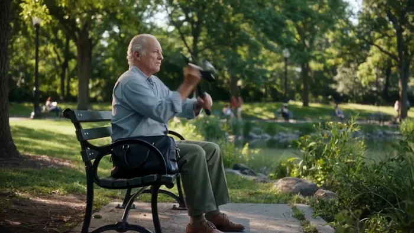
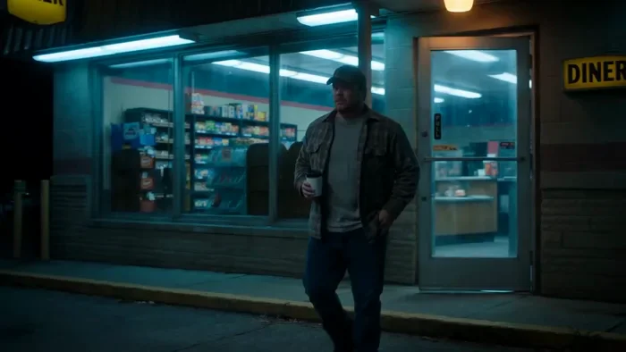
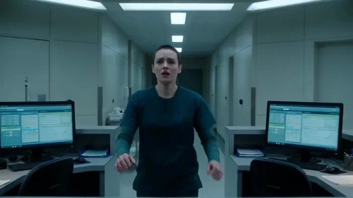
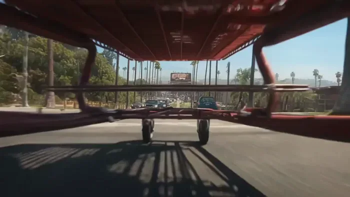
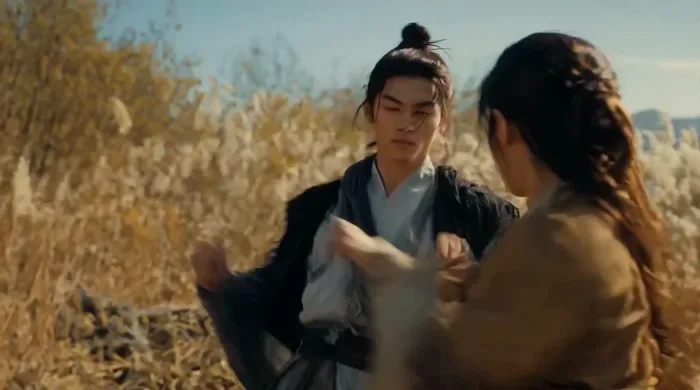
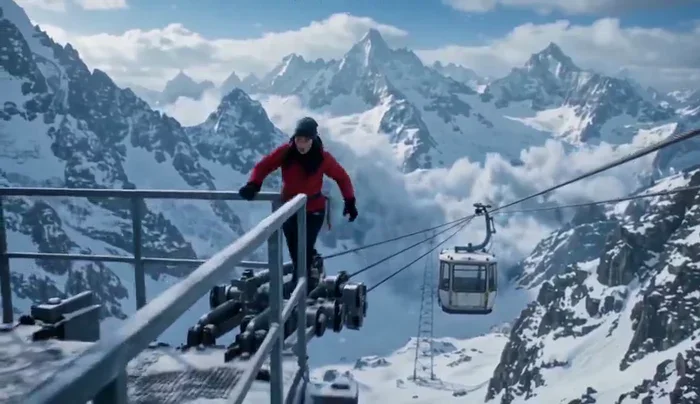
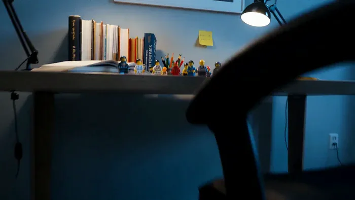
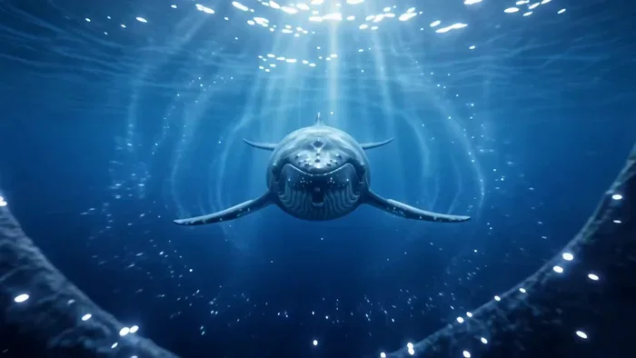
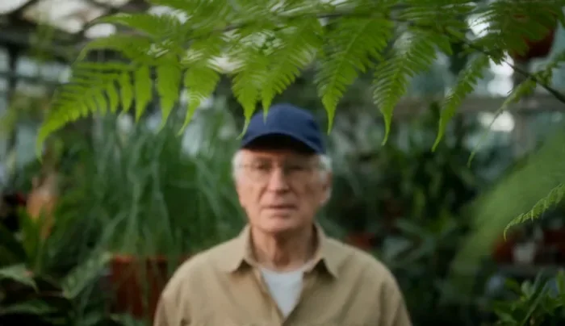

[← 返回总目录](../README.zh-CN.md#table-of-contents) · [English](cinematic.md) · [简体中文](cinematic.zh-CN.md) · [日本語](cinematic.ja.md)

### 电影感叙事 Cinematic

- [Case 2: Ambush from Ten Sides — Pipa on the Loess Ridge (十面埋伏) — by Alibaba](#case-2)
- [Case 6: The Sunken City Below the Fishing Line (钓线下的沉没城) — by Alibaba](#case-6)
- [Case 7: Late-Night Gas Station Encounter (深夜加油站邂逅) — by Alibaba](#case-7)
- [Case 10: Mystery Film — Pale-Green Hospital Corridor (悬疑电影·淡绿医院走廊) — by Alibaba](#case-10)
- [Case 12: Creative Short — Shopping-Cart Downhill (创意短片·购物车俯冲) — by Alibaba](#case-12)
- [Case 19: Dark Fantasy — The Violet-Eyed Villain (暗黑奇幻·紫瞳反派独白) — by Alibaba](#case-19)
- [Case 26: Wuxia Duel — Character Sheets on a Reed Marsh (武侠对决·角色卡与芦苇滩) — by Alibaba](#case-26)
- [Case 81: Mountain Cable Car Survival (雪山缆车惊险求生) — by @chatgptpaglu](#case-81)
- [Case 82: Lego-Scale First-Person Home Adventure (乐高颗粒视角家居冒险) — by Alibaba](#case-82)
- [Case 83: A World Inside a Falling Water Drop (水滴里的海洋、山脉与云城) — by @PromptSin](#case-83)
- [Case 86: Rack Focus from Ferns to a Gardener (从前景蕨叶到园丁的焦点转移) — by PixelDojo](#case-86)
- [Case 87: Midnight Ramen Counter in One Shot (深夜拉面铺的一镜出锅) — by Himanshu Goel / Segmind](#case-87)
- [Case 88: A Retriever Fetches a Ball Toward Camera (金毛衔球迎面奔跑) — by ClipRush Team](#case-88)
- [Case 90: A Reference Face on a Sunset Bike Ride (角色参考到海边骑行) — by ClipRush Team](#case-90)

### Case 2: Ambush from Ten Sides — Pipa on the Loess Ridge (十面埋伏) — by Alibaba

▶ [在 ofox.ai 观看完整视频](https://ofox.ai/wan-3-prompts?utm_source=github&utm_medium=case&utm_campaign=awesome-ai-video-prompts#case-2)

<strong>Prompt</strong> — 秦朝战场遗址黄土高坡，夕阳如血，残破战车半埋黄土，风卷沙尘。画面从战车残骸推焦到远处高坡上一位红衣女子怀抱琵琶，她开始弹奏《十面埋伏》，琵琶以钢丝弦尖锐穿透的音色模拟兵器碰撞，右手轮指形成密集如万马奔腾的音墙，扫弦如刀劈。镜头从她开弹的瞬间快速推进，轮指密度与推进速度同步递增，左手高把位推拉弦使音高…

~~~~text
秦朝战场遗址黄土高坡，夕阳如血，残破战车半埋黄土，风卷沙尘。画面从战车残骸推焦到远处高坡上一位红衣女子怀抱琵琶，她开始弹奏《十面埋伏》，琵琶以钢丝弦尖锐穿透的音色模拟兵器碰撞，右手轮指形成密集如万马奔腾的音墙，扫弦如刀劈。镜头从她开弹的瞬间快速推进，轮指密度与推进速度同步递增，左手高把位推拉弦使音高尖锐上升如战马嘶鸣，风声在琵琶声中被掩盖如战场喊杀盖过一切；最后一个扫弦从最低到最高发出炸裂和弦，随后绝对寂静两秒，只剩风声。
~~~~

**参数**：Wan 3.0 · 未标注 · t2v · 未标注 · 未标注 · 未标注 · 带音频
**来源**：阿里云 Wan 3.0 官方展示页 · [source](https://www.aliyun.com/benefit/scene/wan)

Wan 3.0 官方示例 · 阿里云万相展示页「文生视频」十面埋伏

[回到目录](#table-of-contents)

### Case 6: The Sunken City Below the Fishing Line (钓线下的沉没城) — by Alibaba

▶ [在 ofox.ai 观看完整视频](https://ofox.ai/wan-3-prompts?utm_source=github&utm_medium=case&utm_campaign=awesome-ai-video-prompts#case-6)

**输入素材**：未公开 —— 本案例未收录可用的输入素材，请参阅来源

<strong>Prompt</strong> — 一镜到底，手持跟拍一位老人坐在公园长椅上钓鱼，钓线甩入湖中，镜头沿钓线潜入水下，水底是一座沉没的城市废墟，鱼群穿梭在倒塌的霓虹招牌之间，一条鱼咬钩——它身上刻着文字。

~~~~text
一镜到底，手持跟拍一位老人坐在公园长椅上钓鱼，钓线甩入湖中，镜头沿钓线潜入水下，水底是一座沉没的城市废墟，鱼群穿梭在倒塌的霓虹招牌之间，一条鱼咬钩——它身上刻着文字。
~~~~

**参数**：Wan 3.0 · 未标注 · ref2v · 未标注 · 未标注 · 未标注 · 带音频
**来源**：阿里云 Wan 3.0 官方展示页 · [source](https://www.aliyun.com/benefit/scene/wan)

Wan 3.0 官方示例 · 阿里云万相展示页「参考生视频」钓线下的沉没城

[回到目录](#table-of-contents)

### Case 7: Late-Night Gas Station Encounter (深夜加油站邂逅) — by Alibaba

▶ [在 ofox.ai 观看完整视频](https://ofox.ai/wan-3-prompts?utm_source=github&utm_medium=case&utm_campaign=awesome-ai-video-prompts#case-7)

**输入素材**：未公开 —— 本案例未收录可用的输入素材，请参阅来源

<strong>Prompt</strong> — 美剧色调，冷暖对比，宽画幅电影感。深夜两点，美国中西部只有一条主街的小镇，唯一加油站只剩一盏钠灯亮着，投下孤零零的橙黄色光圈；旁边24小时餐馆脏玻璃窗内透出暖黄灯光和空桌椅。穿格子法兰绒衬衫、戴鸭舌帽的中年卡车司机推门走出，一手外带咖啡，一手摸车钥匙，走向停在加油站旁、引擎低沉怠速的十八轮大卡车。经…

~~~~text
美剧色调，冷暖对比，宽画幅电影感。深夜两点，美国中西部只有一条主街的小镇，唯一加油站只剩一盏钠灯亮着，投下孤零零的橙黄色光圈；旁边24小时餐馆脏玻璃窗内透出暖黄灯光和空桌椅。穿格子法兰绒衬衫、戴鸭舌帽的中年卡车司机推门走出，一手外带咖啡，一手摸车钥匙，走向停在加油站旁、引擎低沉怠速的十八轮大卡车。经过车头时他停下脚步：柏油路面站着一个身高约1.5米的纤细人形生物，半透明淡灰蓝色皮肤下，蓝色血管网络微微脉动发光。头部比例偏大，倒水滴形，无毛；两只巨大杏仁眼纯黑无虹膜瞳孔，反射钠灯橙光，如两面黑镜；鼻子是两个细小呼吸孔，嘴巴是极窄水平缝。四根细长手指张开，每根指尖有微微发光的蓝色生物光点。咖啡杯落地溅开，司机后退一步僵在原地，嘴巴微张。外星生物缓缓歪头，一个极人类化的好奇动作，黑眼反射的橙光随头部倾斜微微移位，皮下蓝色血管脉动频率加快、光芒略增强，似情绪反应。它伸出四指缓缓举起，做出类似打招呼的张手掌姿态，四个指尖蓝光在黑暗中如四颗微小星星。镜头从卡车侧面中景缓缓推近至两者约三米对峙的中近景，柏油路面反射着钠灯暖橙光和生物皮下冷蓝光，交汇成冷暖分界线；右侧暖调卡车司机与左侧冷调外星生物形成极致色温对比。小镇主街向远处延伸，消失在漆黑旷野中。
~~~~

**参数**：Wan 3.0 · 未标注 · ref2v · 未标注 · 未标注 · 未标注 · 带音频
**来源**：阿里云 Wan 3.0 官方展示页 · [source](https://www.aliyun.com/benefit/scene/wan)

Wan 3.0 官方示例 · 阿里云万相展示页「参考生视频」深夜加油站邂逅

[回到目录](#table-of-contents)

### Case 10: Mystery Film — Pale-Green Hospital Corridor (悬疑电影·淡绿医院走廊) — by Alibaba

▶ [在 ofox.ai 观看完整视频](https://ofox.ai/wan-3-prompts?utm_source=github&utm_medium=case&utm_campaign=awesome-ai-video-prompts#case-10)

<strong>Prompt</strong> — 一段现代悬疑风格的电影感长镜头，整个画面呈现出强烈的淡绿色滤镜风格，营造出一种基于淡绿色系的清冷氛围。在散发着冰冷白光的荧光灯下，空无一人的医院走廊呈现出低饱和的色彩与极高对比的光影关系，锐利且非人情化。镜头从护士台后方开始，一名身穿墨绿色夹克的女子猛地从走廊尽头的门后冲入，沿着对称的中心线向镜头快…

~~~~text
一段现代悬疑风格的电影感长镜头，整个画面呈现出强烈的淡绿色滤镜风格，营造出一种基于淡绿色系的清冷氛围。在散发着冰冷白光的荧光灯下，空无一人的医院走廊呈现出低饱和的色彩与极高对比的光影关系，锐利且非人情化。镜头从护士台后方开始，一名身穿墨绿色夹克的女子猛地从走廊尽头的门后冲入，沿着对称的中心线向镜头快速跑来，摄影机流畅地向后移动。她的脚步声急促而响亮，口中焦急地呼喊。最终，她冲到台前，双手用力拍在台面上，绝望地环顾四周，发出几近崩溃的求助呐喊，声音在只有微弱设备嗡鸣的寂静中回荡。
~~~~

**参数**：Wan 3.0 · 未标注 · t2v · 未标注 · 未标注 · 未标注 · 带音频
**来源**：《Wan3.0 视频创作者手册》（万相官方） · [source](https://alidocs.dingtalk.com/i/nodes/qnYMoO1rWxrkmoj2IjExdZLBJ47Z3je9)

Wan 3.0 官方示例 ·《Wan3.0 视频创作者手册》

[回到目录](#table-of-contents)

### Case 12: Creative Short — Shopping-Cart Downhill (创意短片·购物车俯冲) — by Alibaba

▶ [在 ofox.ai 观看完整视频](https://ofox.ai/wan-3-prompts?utm_source=github&utm_medium=case&utm_campaign=awesome-ai-video-prompts#case-12)

<strong>Prompt</strong> — 这是一段30秒电影级高强度单镜头（One-Take）视觉奇观短片，整体风格定位为“西海岸街头幻想主义”，视觉语言融合了90年代街头滑板录像的粗粝感与现代商业大片的精致质感。画面整体采用极致的“加州阳光”电影级调色，高饱和度的蓝色天空与阳光直射下的棕榈树影子形成强烈的对比，空气中弥漫着柏油马路的炙热感…

~~~~text
这是一段30秒电影级高强度单镜头（One-Take）视觉奇观短片，整体风格定位为“西海岸街头幻想主义”，视觉语言融合了90年代街头滑板录像的粗粝感与现代商业大片的精致质感。画面整体采用极致的“加州阳光”电影级调色，高饱和度的蓝色天空与阳光直射下的棕榈树影子形成强烈的对比，空气中弥漫着柏油马路的炙热感、购物车轮摩擦的金属声以及一种无所畏惧的青春叛逆气息。空间透视随着主角的极速滑行不断被拉长，镜头通过极低角度的跟随与极高动态的物理穿梭营造强烈的视觉冲力。

主角是一位穿着撞色条纹衫、带着黑色棒球帽的潮酷少年，神情从最初的慵懒松弛瞬间切换为冲破极限的亢奋；第二个场景的主角则是同一个少年，但他以一种“审视者”的姿态出现在现实维度。

第一个镜头 0-6s：
起幅为特写镜头，少年慵懒地躺在一辆红色铁质购物车内，背景是加州标志性的笔直大道与高耸入云的棕榈树。随着音乐节奏爆发，摄影机执行一个极速的向后拉远并下沉至地面，以极低角度紧贴车轮。少年开始在陡峭的公路上俯冲，购物车在路面上剧烈颠簸，两侧的汽车急速倒退，镜头捕捉到一种近乎疯狂的加速感。

第二个镜头 7-15s：
不切镜，摄影机像一个滑板手般紧紧贴地跟随，镜头在少年越过一个简易木质斜坡的瞬间，顺势执行一个优美的抛物线拉升。购物车腾空而起，摄影机从购物车底部穿过。此时，前方的巨型商业广告牌迅速占据整个视野，镜头以一种不可思议的“准心式”推进，直指广告牌中心。

第三个镜头 16-24s：
不切镜，少年连同购物车以一种“破裂次元壁”的方式直接嵌入了巨大的广告牌中。原本三维的身体在接触海报的瞬间发生“扁平化”质变，画面中出现真实的纸张撕裂纹理与彩色故障墨迹。少年保持着滑行的姿态，却化为了广告牌上的一幅平面艺术作品。摄影机在此时执行一个180度的水平环绕，并在高空进行一个俯冲降落，重回地面。

第四个镜头 25-30s：
不切镜，镜头平滑降落至广告牌正下方的街道，画面中出现另一个“真实”的少年。他停下脚步，缓缓压低帽檐，带着一丝玩味的微笑抬头望向广告牌上那个“被定格”的自己。摄影机顺着他的视线执行一个快速的变焦推近，最终定格在广告牌上“WAN”字样旁那个被撕裂的洞口。背景音乐融合了高能的嘻哈节奏与胶片卷动的物理声，视觉信息高度凝练且充满时尚反叛力。
~~~~

**参数**：Wan 3.0 · 未标注 · t2v · 30s · 未标注 · 未标注 · 带音频
**来源**：《Wan3.0 视频创作者手册》（万相官方） · [source](https://alidocs.dingtalk.com/i/nodes/qnYMoO1rWxrkmoj2IjExdZLBJ47Z3je9)

Wan 3.0 官方示例 ·《Wan3.0 视频创作者手册》

[回到目录](#table-of-contents)

### Case 19: Dark Fantasy — The Violet-Eyed Villain (暗黑奇幻·紫瞳反派独白) — by Alibaba

▶ [在 ofox.ai 观看完整视频](https://ofox.ai/wan-3-prompts?utm_source=github&utm_medium=case&utm_campaign=awesome-ai-video-prompts#case-19)

<strong>Prompt</strong> — 3D动画短片，30秒，暗黑奇幻题材，单镜头，昏暗石砖室内场景。高冷俊美男子、紫罗兰色眼睛、墨蓝银挑染乱发、墨色晶角、苍白冷肤，暗紫星轨魔纹布满额角，身穿极夜蓝织锦立领风衣，内搭玄色丝质衬衫，左耳佩暗银紫水晶耳骨夹。 场景：夜晚冷白月光硬光主导，高对比低调打光，前侧光效果，背景两个模糊人影与暖黄火光摇…

~~~~text
3D动画短片，30秒，暗黑奇幻题材，单镜头，昏暗石砖室内场景。高冷俊美男子、紫罗兰色眼睛、墨蓝银挑染乱发、墨色晶角、苍白冷肤，暗紫星轨魔纹布满额角，身穿极夜蓝织锦立领风衣，内搭玄色丝质衬衫，左耳佩暗银紫水晶耳骨夹。
场景：夜晚冷白月光硬光主导，高对比低调打光，前侧光效果，背景两个模糊人影与暖黄火光摇曳，幽蓝尘埃粒子漂浮。
镜头：中近景微俯视，浅景深锁定左侧人物，随独白极缓速上摇至平视。
动作：男子斜侧而立，垂头轻蔑一笑，侧视手掌后转向镜头，抬头以阴冷磁性声线道："Ripe enough for the void." 左手五指摊开，掌心凝聚暗影星云漩涡，说到："Your soul, a mere spark for me to extinguish." 猛然攥拳，星云爆裂消散为暗紫雾气与幽蓝星屑，最终露出残忍笑容，暗紫渐变指甲微展。
配合虚空共鸣音效与能量破裂声，英文青年反派语音贯穿全程。
~~~~

**参数**：Wan 3.0 · 未标注 · t2v · 30s · 未标注 · 未标注 · 带音频
**来源**：《Wan3.0 视频创作者手册》（万相官方） · [source](https://alidocs.dingtalk.com/i/nodes/qnYMoO1rWxrkmoj2IjExdZLBJ47Z3je9)

Wan 3.0 官方示例 ·《Wan3.0 视频创作者手册》

[回到目录](#table-of-contents)

### Case 26: Wuxia Duel — Character Sheets on a Reed Marsh (武侠对决·角色卡与芦苇滩) — by Alibaba

▶ [在 ofox.ai 观看完整视频](https://ofox.ai/wan-3-prompts?utm_source=github&utm_medium=case&utm_campaign=awesome-ai-video-prompts#case-26)

**输入素材**：未公开 —— 本案例未收录可用的输入素材，请参阅来源

<strong>Prompt</strong> — 1️⃣模块一·多模态参考层 基于上传的角色卡，严格保持男性角色的黑发高发髻、鬓角碎发被风吹起、锐利深色瞳、清瘦而线条分明的面部轮廓特征一致；严格保持其灰白色交领长衫内衬、外披黑灰色破边流苏罩肩、胸前多重银币吊坠链饰、深棕色宽腰带缠绕层叠布料的造型细节一致。基于上传的角色卡，严格保持女性角色的深棕色长…

~~~~text
1️⃣模块一·多模态参考层

基于上传的角色卡，严格保持男性角色的黑发高发髻、鬓角碎发被风吹起、锐利深色瞳、清瘦而线条分明的面部轮廓特征一致；严格保持其灰白色交领长衫内衬、外披黑灰色破边流苏罩肩、胸前多重银币吊坠链饰、深棕色宽腰带缠绕层叠布料的造型细节一致。基于上传的角色卡，严格保持女性角色的深棕色长直发略带湿润感散落肩侧、清冷侧脸轮廓、深色瞳孔的特征一致；严格保持其橄榄棕色皮革立领短打劲装、胸腹部多重皮带交叉束缚绑带、内搭浅色衬衣领口的造型一致。场景严格基于上传的湖畔芦苇滩图（金色芦苇丛在夕阳逆光中大片摇曳，地面散布深色碎石与岩块，湖面在远处泛起细碎波光，天空由青转金形成冷暖交界的过渡色带），不替换、不混入其他场景元素。

2️⃣模块二·全局设定

基础环境与质感：湖畔芦苇滩地，金色芦苇随风大片剧烈翻涌，近景散落深色岩石可作借力、翻跃与遮蔽，地面为干硬沙土混杂枯草与碎石，远处湖面波光粼粼，逆光颗粒感强烈，空气中大量漂浮芦苇绒絮与扬尘，视觉冲击力强。
视觉风格：电影级写实武侠质感，一代宗师式逆光剪影与卧虎藏龙式旷野张力并置，暖金逆光与冷蓝天色形成强烈色温对撞，高对比光影切割身体轮廓，浅景深与深景深交替使用以强化空间纵深与冲击力。
镜头语言：本版本运镜复杂度显著提升——开场对白用中近景固定镜头制造言语张力的静场感；进入打斗后采用多机位快速切换（低角度仰拍出手轮廓、过顶俯冲镖射镜头展现缠斗整体、望远长焦压缩空间制造逼近感、手持轻微震动贴身跟拍配合寸拳节奏、侧向大幅度环绕展现身位互换）；允许使用速度渐变（正常速度骤然推入极短慢镜，再瞬间弹回正常速度）制造打击瞬间的冲击力，全片慢镜/定格次数放宽至2次，每次不超过1秒；切镜频率提升但轴线与几何关系必须保持连续，不得出现方向错乱或位置漂移；收尾采用缓慢拉升的全景镜头收束情绪。
人物造型：男性角色延续角色卡设定，罩肩流苏与银币链饰在剧烈打斗中大幅甩动碰撞出清晰声响，长衫下摆随高强度步法翻卷撕扯；女性角色延续角色卡设定，皮革束带贴身不散但衣领与发丝随身法剧烈甩动，长发在多次翻转闪避中大幅扬起。
表演核心：开场对白简练锋利，一句挑衅、一句应战，语气克制但暗藏杀机；打斗段落要求招招凌厉、连续性强、力量感十足——寸拳、擒摔、反关节、借力翻跌接连爆发，节奏应比常规版本更密集、更具视觉冲击，但每一击仍须有明确发力与受力反馈，杜绝为炫技而炫技的空转动作；整场为纯粹徒手近战，不出现兵器、法术、光效等超现实特效。
台词与音效纪律：全片保留人物同步对白，不使用屏幕字幕；对白仅出现在开场极短两句交锋，打斗全程不安排语言，仅保留急促呼吸声、拳风破空声、布料剧烈摩擦声与身体落地闷响；背景不使用配乐，环境音（狂风声、芦苇剧烈摩擦声、水浪声）随打斗强度增大而增强，收尾处可点缀极简重音强调最后定格。
禁止项：不要屏幕字幕；不要背景音乐喧宾夺主；不要面部或服装穿模变形；不要肢体断裂或穿插错位；不要出现光刃、法术特效或凌空浮空超出人体力学的动作；不要慢镜/定格超过2次或单次超过1秒；不要镜头切换导致空间重置或轴线错乱；不要下跪等仪式性动作；不要镜头静止超过1.5秒（对白固定镜头单镜不超过2秒）。
空间调度：以芦苇丛边界、近景岩石群、湖岸边缘三个空间锚点构建动线——对白后迅速由静转动，从芦苇丛外围爆发式贴近，转入岩石区借力翻跌与反关节缠斗，最终在湖岸边缘完成高潮摔投并定格收束；打斗时长控制在约15秒，运镜强度随节奏逐步攀升再骤然收束。

3️⃣模块三·时间戳戏剧分镜

【0-1.5秒】男性角色立于芦苇丛边缘，逆光轮廓锐利，风卷起衣袍下摆，镜头固定中近景对准他，他冷声开口："还想拦我？"

【1.5-3秒】镜头切至女性角色近景，发丝被风扬起半遮面容，她唇角一沉："试试就知道。"话音未落，她已向前迈出第一步——打斗骤然引爆。

【3-4.5秒】女性角色骤然贴近，右拳直取面门，男性角色侧头堪堪避过，镜头由固定切为手持贴身跟拍，微震感配合出拳节奏，芦苇绒絮在两人之间炸开。

【4.5-6秒】男性角色反手抓其手腕借力回带，女性角色顺势翻转卸力反打一肘，镜头切换至低角度仰拍，捕捉两人交叠手臂与转身轮廓的剪影。

【6-7.5秒】速度渐变慢镜（约0.8秒）：女性角色一记侧踢擦过男性角色肋侧堪堪未中，衣料剧烈鼓起的瞬间被短暂放大，随即镜头速度骤然弹回正常。

【7.5-9秒】男性角色借躲闪之势反手擒住她手臂发力欲摔，女性角色低身卸力翻滚脱出，镜头切换为过顶俯冲镖射镜头，展现二人在地面翻滚缠斗的整体轨迹。

【9-10.5秒】二人几乎同时起身再次贴近，连续三次快速交手（直拳—格挡—反打），镜头做侧向大幅度环绕运镜，轴线保持连续，展现身位持续互换。

【10.5-12秒】女性角色借岩石借力猛然腾身，一记高踢直取男性角色肩侧，男性角色侧身堪堪滑过并顺势抓住她小腿，镜头切至望远长焦压缩镜头，强化逼近感与冲击力。

【12-13秒】男性角色借势用力一带，女性角色借惯性翻身反手扣住他肩颈欲制，二人瞬间贴身角力僵持，镜头急速推进特写二人紧绷的手臂与肌肉线条。

【13-14秒】速度渐变第二次慢镜（约1秒）：男性角色发力将女性角色翻身压制，二人同时向岩石区边缘倾倒失衡，衣袍与发丝在空气中剧烈甩起的瞬间被放大定格，随即镜头速度骤然恢复正常。

【14-16秒】恢复正常速度，二人翻滚跌落至湖岸边缘沙地，扬起大片尘土与水花，镜头随跌落轨迹俯冲跟拍，冲击力拉满。
~~~~

**参数**：Wan 3.0 · 未标注 · ref2v · 未标注 · 未标注 · 未标注 · 带音频
**来源**：《Wan3.0 视频创作者手册》（万相官方） · [source](https://alidocs.dingtalk.com/i/nodes/qnYMoO1rWxrkmoj2IjExdZLBJ47Z3je9)

Wan 3.0 官方示例 ·《Wan3.0 视频创作者手册》

[回到目录](#table-of-contents)

### Case 81: Mountain Cable Car Survival (雪山缆车惊险求生) — by @chatgptpaglu

▶ [在 ofox.ai 观看完整视频](https://ofox.ai/wan-3-prompts?utm_source=github&utm_medium=case&utm_campaign=awesome-ai-video-prompts#case-81)

**输入素材**：未公开 —— 本案例未收录可用的输入素材，请参阅来源

<strong>Prompt</strong> — Shot 1 | 0–6 sec Photorealistic cinematic survival thriller. A young woman in a red winter jacket rides a small cable car above breathtaking snow-cove…

~~~~text
Shot 1 | 0–6 sec 
Photorealistic cinematic survival thriller. A young woman in a red winter jacket rides a small cable car above breathtaking snow-covered mountains at golden hour. Suddenly, a rockslide crashes into the cable, violently swinging the cabin before it stops. Realistic physics, dramatic camera movement, Hollywood cinematography.                                                     
Shot 2 | 6–12 sec 
The same woman inside the stranded cable car, breathing heavily as she tries the emergency radio, but there is no response. She looks through the window toward a distant mountain station. A dark snowstorm approaches behind the peaks. Photorealistic, tense, cinematic lighting.                              
Shot 3 | 12–18 sec
 The same woman opens the emergency roof hatch and carefully climbs onto the safety cable, moving toward the mountain station. Strong winds shake her body and blowing snow reduces visibility. Vast snowy mountains below, beautiful golden light fading into the storm. Realistic survival thriller.              
 Shot 4 | 18–24 sec
 The woman moves desperately along the cable when another rockslide strikes the mountain. The cable begins tearing apart behind her. She looks back in panic and accelerates toward the station. Heavy snow, violent wind, realistic physics, intense cinematic camera movement.                                                                     
 Shot 5 | 24–30 sec 
The woman reaches the station platform and jumps onto solid ground just as the damaged cable collapses behind her. She falls to her knees, exhausted, then turns toward the mountains as a massive avalanche sweeps across the valley. Epic wide shot, breathtaking snowy landscape, photorealistic Hollywood survival thriller.
~~~~

**参数**：Wan 3.0 · Lart AI · 未标注 · 未标注 · 未标注 · 未标注 · 未标注
**来源**：@chatgptpaglu · [原帖](https://x.com/chatgptpaglu/status/2094710054675157354)

社区创作 · yusra. (@chatgptpaglu) · X 原帖逐字提示词与成片

[回到目录](#table-of-contents)

### Case 82: Lego-Scale First-Person Home Adventure (乐高颗粒视角家居冒险) — by Alibaba

▶ [在 ofox.ai 观看完整视频](https://ofox.ai/wan-3-prompts?utm_source=github&utm_medium=case&utm_campaign=awesome-ai-video-prompts#case-82)

<strong>Prompt</strong> — 核心：电影级超写实，第一人称乐高颗粒视角，一镜到底丝滑穿梭，硬核冒险、冷峻质感，无台词无 BGM，仅高保真环境音，15 秒全程高速惊险避险，放大乐高塑料质感与尺度反差。 画面：乐高颗粒视角闯入巨型人类家居场景，地板 = 荒野、桌面 = 荒原、书本 = 山崖、水杯 = 摩天塔、键盘 = 机械群，手掌 …

~~~~text
核心：电影级超写实，第一人称乐高颗粒视角，一镜到底丝滑穿梭，硬核冒险、冷峻质感，无台词无 BGM，仅高保真环境音，15 秒全程高速惊险避险，放大乐高塑料质感与尺度反差。
画面：乐高颗粒视角闯入巨型人类家居场景，地板 = 荒野、桌面 = 荒原、书本 = 山崖、水杯 = 摩天塔、键盘 = 机械群，手掌 / 脚步带来强压迫感，无卡通感，贴合家居逻辑。
分镜（15 秒）
0-2s：微缩低空视角，从地板 / 桌面边缘弹射冲出，贴地狂飙，超广角强化尺度反差，快速代入微型冒险。
2-5s：高速穿越，擦过乐高零件、书本、笔、键盘、水杯，躲避手掌阴影，贴地 / 俯冲 / 钻缝，极限避障。
5-8s：高风险穿梭，滑向沙发、穿椅腿、冲书页断崖、躲水杯 / 人类脚步，节奏加快，险境拉满。
8-11s：闯入人类活动区，躲避打字、翻书、饮水动作，键盘轰鸣、翻书如狂风，极限避险穿梭。
11-13s：冲出险境，进入乐高半成品 / 零件区，氛围短暂舒缓，明确乐高视角。
13-15s：急速拉升定格乐高成品，背景留巨型家居残影，收尾犀利有记忆点。
音效：无 BGM，开场风切 / 塑料摩擦声；中段键盘 / 纸张 / 脚步 / 震动声；后半段塑料卡扣 / 微弱风声，放大尺度反差。

~~~~

**参数**：Wan 3.0 · 未标注 · t2v · 未标注 · 未标注 · 未标注 · 未标注
**来源**：阿里云 Wan 3.0 官方提示词指南 · [source](https://help.aliyun.com/zh/model-studio/wan3-video-generation-prompt-guide)

Wan 3.0 官方示例 · 阿里云百炼提示词指南「游戏」第一人称乐高冒险

[回到目录](#table-of-contents)

### Case 83: A World Inside a Falling Water Drop (水滴里的海洋、山脉与云城) — by @PromptSin

▶ [在 ofox.ai 观看完整视频](https://ofox.ai/wan-3-prompts?utm_source=github&utm_medium=case&utm_campaign=awesome-ai-video-prompts#case-83)

**输入素材**（4 张图）

| | | | |
|:---:|:---:|:---:|:---:|
|  原帖参考图 1 |  原帖参考图 2 |  原帖参考图 3 |  原帖参考图 4 |

<strong>Prompt</strong> — A water drop hangs above a miniature city. The camera dives through it into an ocean; a whale becomes mountains and reveals a city in the clouds. The …

~~~~text
A water drop hangs above a miniature city. The camera dives through it into an ocean; a whale becomes mountains and reveals a city in the clouds. The world then folds into a drop on the protagonist’s fingertip.
~~~~

**参数**：Wan 3.0 · OpenArt · 未标注 · 未标注 · 未标注 · 未标注 · 未标注
**来源**：@PromptSin · [原帖](https://x.com/PromptSin/status/2093363648836337735)

Preview © 2026 @PromptSin · Prompt by @PromptSin

[回到目录](#table-of-contents)

### Case 86: Rack Focus from Ferns to a Gardener (从前景蕨叶到园丁的焦点转移) — by PixelDojo

▶ [在 ofox.ai 观看完整视频](https://ofox.ai/wan-3-prompts?utm_source=github&utm_medium=case&utm_campaign=awesome-ai-video-prompts#case-86)

**输入素材**：未公开 —— 本案例未收录可用的输入素材，请参阅来源

<strong>Prompt</strong> — In a greenhouse, a gardener stands among hanging ferns. Rack focus: shift focus smoothly from the fern leaves in the foreground to the gardener in the…

~~~~text
In a greenhouse, a gardener stands among hanging ferns. Rack focus: shift focus smoothly from the fern leaves in the foreground to the gardener in the background. The leaves gradually blur while the gardener's face changes from soft to sharp. The camera does not move.
~~~~

**参数**：Wan 3.0 · 未标注 · 未标注 · 未标注 · 未标注 · 未标注 · 未标注
**来源**：PixelDojo · [原帖](https://pixeldojo.ai/guides/wan-3-0-prompting-guide)

Preview © 2026 PixelDojo · Prompt by PixelDojo

[回到目录](#table-of-contents)

### Case 87: Midnight Ramen Counter in One Shot (深夜拉面铺的一镜出锅) — by Himanshu Goel / Segmind

▶ [在 ofox.ai 观看完整视频](https://ofox.ai/wan-3-prompts?utm_source=github&utm_medium=case&utm_campaign=awesome-ai-video-prompts#case-87)

<strong>Prompt</strong> — A weathered Japanese chef in his sixties, close-cropped grey hair, a navy indigo apron over a white tee, wire-rim glasses fogged at the edges. A cramp…

~~~~text
A weathered Japanese chef in his sixties, close-cropped grey hair, a navy indigo apron over a white tee, wire-rim glasses fogged at the edges. A cramped six-seat ramen counter late at night, blond hinoki wood, condensation running down the window, red lantern light outside. He lifts a wire noodle basket sharply out of the boiling water and snaps it downward three times, fast and practiced, then tips the noodles into the bowl in one smooth unbroken motion. Warm tungsten light from a low overhead lamp, cool blue streetlight spilling through the window behind him, medium close-up, slight low angle, shallow depth of field, slow push in. Photorealistic, cinematic, 35mm film grain. Ambient sound of a rolling boil, the metallic rattle of the basket against the pot rim, faint street noise outside. No music.
~~~~

**参数**：Wan 3.0 · Segmind · t2v · 5s · 720P · 16:9 · 带音频
**来源**：Himanshu Goel / Segmind · [原帖](https://blog.segmind.com/wan-3-prompt-guide-alibabas-official-formulas-tested/)

Preview © 2026 Himanshu Goel / Segmind · Prompt by Himanshu Goel / Segmind

[回到目录](#table-of-contents)

### Case 88: A Retriever Fetches a Ball Toward Camera (金毛衔球迎面奔跑) — by ClipRush Team

▶ [在 ofox.ai 观看完整视频](https://ofox.ai/wan-3-prompts?utm_source=github&utm_medium=case&utm_campaign=awesome-ai-video-prompts#case-88)

**输入素材**（1 张图）

| | | | |
|:---:|:---:|:---:|:---:|
|  参考图 1 · dog |  |  |  |

<strong>Prompt</strong> — The dog grabs the red ball in its mouth and runs toward the camera, ears flapping, as the camera tracks backward low to the ground.

~~~~text
The dog grabs the red ball in its mouth and runs toward the camera, ears flapping, as the camera tracks backward low to the ground.
~~~~

**参数**：Wan 3.0 · ClipRush · i2v · 5s · 720p · 未标注 · 带音频
**来源**：ClipRush Team · [原帖](https://www.cliprush.ai/tests/wan-3-0-review#dog)

Preview © 2026 ClipRush Team · Prompt by ClipRush Team

[回到目录](#table-of-contents)

### Case 90: A Reference Face on a Sunset Bike Ride (角色参考到海边骑行) — by ClipRush Team

▶ [在 ofox.ai 观看完整视频](https://ofox.ai/wan-3-prompts?utm_source=github&utm_medium=case&utm_campaign=awesome-ai-video-prompts#case-90)

**输入素材**（1 张图）

| | | | |
|:---:|:---:|:---:|:---:|
|  参考图 1 · cafe |  |  |  |

<strong>Prompt</strong> — [Image 1] is the woman's face and hair. The woman from [Image 1] rides a bicycle along a seaside promenade at sunset, laughing as the wind moves her h…

~~~~text
[Image 1] is the woman's face and hair. The woman from [Image 1] rides a bicycle along a seaside promenade at sunset, laughing as the wind moves her hair. The camera tracks alongside her.
~~~~

**参数**：Wan 3.0 · ClipRush · r2v · 5s · 720p · 未标注 · 带音频
**来源**：ClipRush Team · [原帖](https://www.cliprush.ai/tests/wan-3-0-review#references-face)

Preview © 2026 ClipRush Team · Prompt by ClipRush Team

[回到目录](#table-of-contents)
