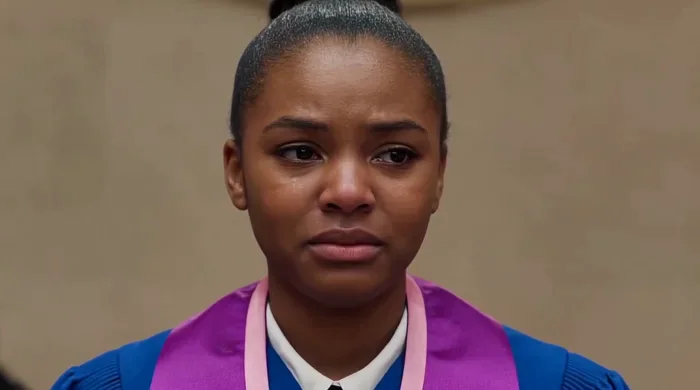

[← 返回总目录](../README.zh-CN.md#table-of-contents) · [English](dialogue-lipsync.md) · [简体中文](dialogue-lipsync.zh-CN.md) · [日本語](dialogue-lipsync.ja.md)

### 对白与口播 Dialogue & Lip-Sync

- [Case 9: Emotional Realism — Graduate in a Blue Gown (情绪写实·毕业袍女孩) — by Alibaba](#case-9)
- [Case 23: Gym Small Talk — Two Voices from Audio Refs (健身房双人对白·音色参考) — by Alibaba](#case-23)
- [Case 51: Voice Reference — Swap the Character and the Line (音色参考·替换角色与台词) — by Alibaba](#case-51)

### Case 9: Emotional Realism — Graduate in a Blue Gown (情绪写实·毕业袍女孩) — by Alibaba

▶ [在 ofox.ai 观看完整视频](https://ofox.ai/wan-3-prompts?utm_source=github&utm_medium=case&utm_campaign=awesome-ai-video-prompts#case-9)

<strong>Prompt</strong> — 这是一个正面的近景镜头，画面主要呈现一位年轻黑人女孩的头部和上半身，她穿着一件蓝色的毕业袍。镜头稍微偏一点点，可以看到左边还有一个人，但背景被虚化处理了，看起来很模糊。女孩正对着镜头说话，嘴巴在动，眉头稍微皱着，表情看起来有点严肃和忧虑。光线从上方照下来，把她脸上的轮廓衬托得很自然，甚至能看到皮肤真…

~~~~text
这是一个正面的近景镜头，画面主要呈现一位年轻黑人女孩的头部和上半身，她穿着一件蓝色的毕业袍。镜头稍微偏一点点，可以看到左边还有一个人，但背景被虚化处理了，看起来很模糊。女孩正对着镜头说话，嘴巴在动，眉头稍微皱着，表情看起来有点严肃和忧虑。光线从上方照下来，把她脸上的轮廓衬托得很自然，甚至能看到皮肤真实的质感。镜头虽然固定，但带着一点点人手持拍摄时的轻微呼吸感和晃动，视线从看着前面慢慢变成了低头看手里。
~~~~

**参数**：Wan 3.0 · 未标注 · t2v · 未标注 · 未标注 · 未标注 · 带音频
**来源**：《Wan3.0 视频创作者手册》（万相官方） · [source](https://alidocs.dingtalk.com/i/nodes/qnYMoO1rWxrkmoj2IjExdZLBJ47Z3je9)

Wan 3.0 官方示例 ·《Wan3.0 视频创作者手册》

[回到目录](#table-of-contents)

### Case 23: Gym Small Talk — Two Voices from Audio Refs (健身房双人对白·音色参考) — by Alibaba

▶ [在 ofox.ai 观看完整视频](https://ofox.ai/wan-3-prompts?utm_source=github&utm_medium=case&utm_campaign=awesome-ai-video-prompts#case-23)

<strong>Prompt</strong> — 将图片1中的女人定义为主体1，将图片2中的女人定义为主体2，主体1台词音色参考音频1，主体2台词音色参考音频2，在健身房内，主体1和主体2并排站在跑步机旁，主体1转头微笑对主体2说{今天练哪个部位}，主体2一边用毛巾擦汗一边回应{练背吧，昨天腿还酸着呢}，主体1笑着点头说{行，我陪你，先热身十分钟}…

~~~~text
将图片1中的女人定义为主体1，将图片2中的女人定义为主体2，主体1台词音色参考音频1，主体2台词音色参考音频2，在健身房内，主体1和主体2并排站在跑步机旁，主体1转头微笑对主体2说{今天练哪个部位}，主体2一边用毛巾擦汗一边回应{练背吧，昨天腿还酸着呢}，主体1笑着点头说{行，我陪你，先热身十分钟}，主体2拿起水杯喝一口回应{走吧}，背景是器械区和落地镜，写实拍摄，画面明亮通透，冷白色自然饱和度色调
~~~~

**参数**：Wan 3.0 · 未标注 · ref2v · 未标注 · 未标注 · 未标注 · 带音频
**来源**：《Wan3.0 视频创作者手册》（万相官方） · [source](https://alidocs.dingtalk.com/i/nodes/qnYMoO1rWxrkmoj2IjExdZLBJ47Z3je9)

Wan 3.0 官方示例 ·《Wan3.0 视频创作者手册》

[回到目录](#table-of-contents)

### Case 51: Voice Reference — Swap the Character and the Line (音色参考·替换角色与台词) — by Alibaba

▶ [在 ofox.ai 观看完整视频](https://ofox.ai/wan-3-prompts?utm_source=github&utm_medium=case&utm_campaign=awesome-ai-video-prompts#case-51)

**输入素材**（1 段视频，只取首帧）

| | | | |
|:---:|:---:|:---:|:---:|
|  参考视频 |  |  |  |

<strong>Prompt</strong> — 将图片 @Image1 的男性角色无缝替换至视频 @Video1 的女生。角色坐在窗边，手持手机贴耳说话。 【音色与台词】提取音频 @Audio1 中的音色特征，并让角色说出以下台词：“真的吗？听起来很棒！你什么时候回来啊。我好想你啊.” 【口型与神态】生成的语音需精准驱动角色的口型自然开合。说话时…

~~~~text
将图片 @Image1 的男性角色无缝替换至视频 @Video1 的女生。角色坐在窗边，手持手机贴耳说话。

【音色与台词】提取音频 @Audio1 中的音色特征，并让角色说出以下台词：“真的吗？听起来很棒！你什么时候回来啊。我好想你啊.”

【口型与神态】生成的语音需精准驱动角色的口型自然开合。说话时伴随自然的眨眼、轻微的头部点动和呼吸感，面部微表情需与台词中的关怀、回忆情绪完美契合。

【光影与场景】人物面部需自然接收室内暖光与窗外霓虹冷光的混合照明。背景窗外雨滴持续缓慢滑落，桌上咖啡有轻微热气升腾，人物与场景边缘融合自然，无抠图痕迹。

【镜头与画质】15秒长镜头，镜头极缓慢向前推进，画面极度稳定，电影级光影，8K分辨率，照片级真实感。
~~~~

**参数**：Wan 3.0 · 未标注 · ref2v · 15s · 未标注 · 未标注 · 带音频
**来源**：《Wan3.0 视频创作者手册》（万相官方） · [source](https://alidocs.dingtalk.com/i/nodes/qnYMoO1rWxrkmoj2IjExdZLBJ47Z3je9)

Wan 3.0 官方示例 ·《Wan3.0 视频创作者手册》

[回到目录](#table-of-contents)
