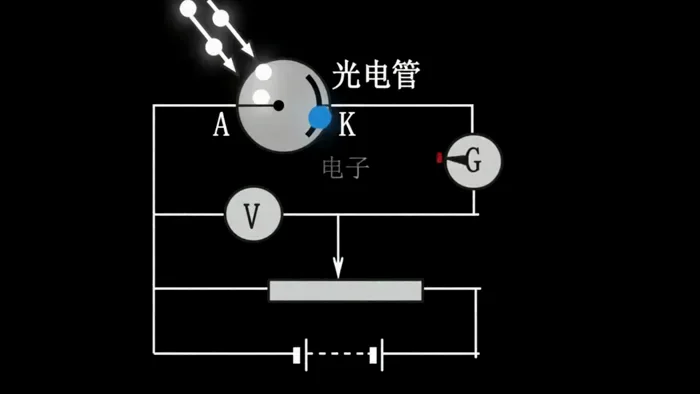

[← Back to the full index](../README.md#table-of-contents) · [English](explainer.md) · [简体中文](explainer.zh-CN.md) · [日本語](explainer.ja.md)

### Explainer (教学解说视频)

- [Case 54: A GMV Data Film, from an .xlsx (一张 GMV 报表生成的数据片) — by Alibaba](#case-54)
- [Case 55: An Encyclopedia Page into a Quantum Explainer (百科网页转量子力学科普) — by Alibaba](#case-55)
- [Case 56: An Encyclopedia Page into “Who Was Wang Wei” (百科网页转「谁是王维」) — by Alibaba](#case-56)

### Case 54: A GMV Data Film, from an .xlsx (一张 GMV 报表生成的数据片) — by Alibaba

▶ [Watch the full video on ofox.ai](https://ofox.ai/wan-3-prompts?utm_source=github&utm_medium=case&utm_campaign=awesome-ai-video-prompts#case-54)

<strong>Prompt</strong> — 总时长22秒，4个片段顺序拼接。全片纯白底，柔色色块与简洁线条图表，Apple Keynote式极简商务风格，无衬线深灰字体。BGM（必须有，贯穿全片，音量清晰可闻）：一段轻快的商务背景音乐，节奏稳定、旋律简洁，从第一秒开始就有音乐，全程不间断，旁白出现时音乐不消失、音量略低于人声。音效层：色块滑入…

~~~~text
总时长22秒，4个片段顺序拼接。全片纯白底，柔色色块与简洁线条图表，Apple Keynote式极简商务风格，无衬线深灰字体。BGM（必须有，贯穿全片，音量清晰可闻）：一段轻快的商务背景音乐，节奏稳定、旋律简洁，从第一秒开始就有音乐，全程不间断，旁白出现时音乐不消失、音量略低于人声。音效层：色块滑入时'嗖'的whoosh声、数字跳动时轻键盘'咔嗒'声、关键数据弹出时清脆的'叮'一声bell。旁白：英文男声或女声，明快自信，语速约2.5词/秒，像在季度会上做presentation的语气——专业但不冰冷，有节奏感，关键数字处微微加重。
H1-2026跨境电商月度GMV.xlsx
片段1：全景，中心构图，纯白底，柔光，极简商务风格，视觉参考参考图1的干净白底+柔和色块。纯白画面从中央展开，无数金色光粒子从画面四周向中心汇聚聚拢，粒子碰撞闪烁后凝结成标题文字'H1 2026 · Wan'，文字表面泛着流动的数据流光效，边缘有微光粒子持续环绕飘散，整体炫酷而高级。停留片刻后标题化作粒子流散消失，下方同时滑入两组大号深灰数字——左侧是第7行B7单元格的值$1,580（1月GMV）、右侧是G7单元格的值$3,460（6月GMV），中间一个浅灰色箭头连接，箭头下方浮出浅灰小字'Monthly GMV Growth'。底部弹出一枚珊瑚色圆角标签，显示第8行H8单元格的值+45.7%（H1整体增幅），弹出时伴随清脆的'叮'一声。旁白明快自信地说道：'In the first half of 2026, monthly GMV grew from 15.8 to 34.6 million dollars.' BGM从画面第一秒起就清晰响起，轻快节奏贯穿，色块滑入时带轻微的'嗖'whoosh声。片段末尾色块向两侧平滑滑开，露出下一段画面。

片段2：全景，左侧Y轴+底部X轴构图，纯白底+浅灰点状网格，柔光，极简商务风格，视觉参考参考图2的趋势线图风格。画面底部X轴从左到右依次清晰标注六个月份标签：Jan、Feb、Mar、Apr、May、Jun，等距排列，浅灰色无衬线字体。左侧Y轴标注数值刻度。画面从左向右同时绘制三条趋势线——珊瑚色代表东南亚（数据取自第4行：B4=$580, C4=$640, D4=$750, E4=$880, F4=$1,050, G4=$1,280）、青蓝色代表北美（第5行：B5=$420, C5=$480, D5=$560, E5=$680, F5=$860, G5=$1,260）、琥珀色代表欧洲（第6行：B6=$580, C6=$610, D6=$680, E6=$750, F6=$830, G6=$920），三条线从Jan同一位置出发，随节奏向右上方延伸至Jun。线条下方各带30%透明度渐变填充。每个月份节点到达时，数据点轻弹一下，正上方浮出该点的精确数值标签——标签只显示美元数值，不显示百分比、不显示其他文字，数值必须与上述单元格完全一致。右上角滑出图例：三个色块配市场英文名。六个点全部到达后画面定格片刻。旁白节奏稳定地说道：'All three markets — Southeast Asia, North America, and Europe — showed consistent month-over-month growth, with no single dip.' BGM持续可闻，数字弹出时伴随细碎的'咔嗒'键盘音。6月终点标签放大填满画面后缩小重组，过渡至下一段。

片段3：全景，左60%柱状图+右40%数据列构图，纯白底，柔光，极简商务风格，视觉参考参考图1的柱状图风格。白底上从左到右依次升起6根青蓝色圆角柱体，分别对应1月至6月——必须完整展示6根柱子，柱体高度严格对应第5行North America各月数值：B5=$420, C5=$480, D5=$560, E5=$680, F5=$860, G5=$1,260，从低到高递增排列，呈现明显的逐月增长趋势。每根柱体升起时带轻微的'嗖'弹性音效，柱顶浮出对应的精确美元数值标签。柱体全部就位后，右侧纵向排列滑出5个北美逐月环比增长率，分别由相邻两月数值计算得出：Feb +14.3%（C5相对B5）、Mar +16.7%（D5相对C5）、Apr +21.4%（E5相对D5）、May +26.5%（F5相对E5）、Jun +46.5%（G5相对F5）。每个增长率显示为：翠绿色向上箭头图标 + 百分比数值（如↑+14.3%），整体呈阶梯状从上到下依次排列，绿色箭头强调增长态势，字体略大确保清晰可读。每个数字滑入时带一声细碎的'咔嗒'。最后，北美整体增幅用珊瑚色大号字体从中央弹出：+200%（由G5=$1,260相对B5=$420计算），伴随清脆的'叮'一声bell，停留片刻，数字周围散发轻微光晕。旁白在关键数据处微微加重语气：'North America was our growth engine — up two hundred percent in just six months, accelerating every single month.' BGM持续清晰，节奏逐渐推向高点。整体增幅数字居中放大，周围元素柔和淡出，过渡至尾段。

片段4：全景，中心构图偏上，纯白底，柔光，极简商务风格，视觉参考参考图3的环形图风格。白底中央浮现一个简约环形图（甜甜圈图），只有三段弧形，分别用珊瑚色、青蓝色、琥珀色渲染三个市场的H1占比——东南亚占比由H4=5180计算、北美由H5=4260计算、欧洲由H6=4370计算，三者总和H7=13810。三段弧形之间用白色间隙分隔，环形图整体干净简洁，图表上没有任何百分比符号、没有任何数字标注、没有任何散落的标签，只有纯粹的三段色弧。环形图以约10°/s的速度缓缓旋转。环形图正中央显示一个大号深灰数字，该数字从0快速跳动至H7单元格的值$138.1M（即13810万美元），跳动时伴随连续的细碎'咔嗒'声，最终数字落定时一声清脆的'叮'。下方淡入一行浅灰副标题'Three Markets · All Growing · Zero Downturn'。旁白沉稳收尾，说完留1秒静音：'138 million in total — all markets growing, zero downturns.' BGM持续可闻，最后缓缓衰减，1秒静音后全片结束。
~~~~

**参数**：Wan 3.0 · 未标注 · ref2v · 22s · 未标注 · 未标注 · 带音频
**来源**：《Wan3.0 视频创作者手册》（万相官方） · [source](https://alidocs.dingtalk.com/i/nodes/qnYMoO1rWxrkmoj2IjExdZLBJ47Z3je9)

Wan 3.0 官方示例 ·《Wan3.0 视频创作者手册》

[Back to top](#table-of-contents)

### Case 55: An Encyclopedia Page into a Quantum Explainer (百科网页转量子力学科普) — by Alibaba

▶ [Watch the full video on ofox.ai](https://ofox.ai/wan-3-prompts?utm_source=github&utm_medium=case&utm_campaign=awesome-ai-video-prompts#case-55)

<strong>Prompt</strong> — 帮我把网页里讲量子力学的内容，转成通俗有趣的科普短视频

~~~~text
帮我把网页里讲量子力学的内容，转成通俗有趣的科普短视频
~~~~

**参数**：Wan 3.0 · 未标注 · ref2v · 未标注 · 未标注 · 未标注 · 带音频
**来源**：《Wan3.0 视频创作者手册》（万相官方） · [source](https://alidocs.dingtalk.com/i/nodes/qnYMoO1rWxrkmoj2IjExdZLBJ47Z3je9)

Wan 3.0 官方示例 ·《Wan3.0 视频创作者手册》

[Back to top](#table-of-contents)

### Case 56: An Encyclopedia Page into “Who Was Wang Wei” (百科网页转「谁是王维」) — by Alibaba

▶ [Watch the full video on ofox.ai](https://ofox.ai/wan-3-prompts?utm_source=github&utm_medium=case&utm_campaign=awesome-ai-video-prompts#case-56)

<strong>Prompt</strong> — 根据该王维的百科介绍，我要给一年级的孩子们做一个“谁是王维”的动画视频

~~~~text
根据该王维的百科介绍，我要给一年级的孩子们做一个“谁是王维”的动画视频
~~~~

**参数**：Wan 3.0 · 未标注 · ref2v · 未标注 · 未标注 · 未标注 · 带音频
**来源**：《Wan3.0 视频创作者手册》（万相官方） · [source](https://alidocs.dingtalk.com/i/nodes/qnYMoO1rWxrkmoj2IjExdZLBJ47Z3je9)

Wan 3.0 官方示例 ·《Wan3.0 视频创作者手册》

[Back to top](#table-of-contents)
