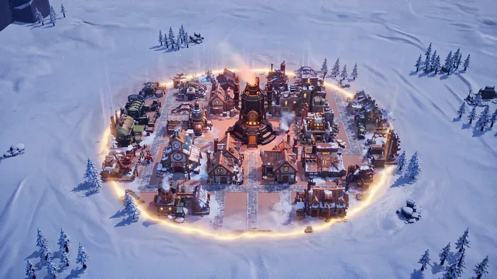

[← 総目次に戻る](../README.ja.md#table-of-contents) · [English](keyframe-animation.md) · [简体中文](keyframe-animation.zh-CN.md) · [日本語](keyframe-animation.ja.md)

### 開始・終了フレームアニメーション Keyframe Animation

- [Case 69: First & Last Frame — Ink-Wash Swordsman (首尾帧·水墨刀客竹林对决) — by Alibaba](#case-69)
- [Case 70: First & Last Frame — Four Memories in 35mm (首尾帧·草帽女子的四段回忆) — by Alibaba](#case-70)
- [Case 71: First & Last Frame — West Lake Goddess (首尾帧·西湖西子岩彩长镜) — by Alibaba](#case-71)
- [Case 77: Snowbound Steampunk Village Construction (冰雪蒸汽朋克村庄建造) — by Alibaba](#case-77)
- [Case 92: Rosebud to Bloom with Two Keyframes (首尾帧控制玫瑰绽放) — by ClipRush Team](#case-92)

### Case 69: First & Last Frame — Ink-Wash Swordsman (首尾帧·水墨刀客竹林对决) — by Alibaba

▶ [ofox.ai で動画をすべて見る](https://ofox.ai/wan-3-prompts?utm_source=github&utm_medium=case&utm_campaign=awesome-ai-video-prompts#case-69)

**输入素材**：未公开 —— 本案例未收录可用的输入素材，请参阅来源

<strong>Prompt</strong> — (0:00 - 0:03) 运镜：中景。 画面：沿用 @Image1 的水墨竹林场景。头戴斗笠、身着墨色长袍的刀客，其剪影伫立在浓雾环绕、竹影婆娑的中心。 动作：刀客左手轻按刀柄，竹叶随风飘落。 氛围：寂静，压抑，水墨晕染的颗粒感清晰可见。 (0:03 - 0:08) 剧情引入，运镜：特写。 剧情：…

~~~~text
(0:00 - 0:03) 运镜：中景。
画面：沿用 @Image1 的水墨竹林场景。头戴斗笠、身着墨色长袍的刀客，其剪影伫立在浓雾环绕、竹影婆娑的中心。
动作：刀客左手轻按刀柄，竹叶随风飘落。
氛围：寂静，压抑，水墨晕染的颗粒感清晰可见。

(0:03 - 0:08) 剧情引入，运镜：特写。

剧情：刀客察觉杀气。
画面：镜头快速推进到刀客斗笠下的特写。
细节：斗笠边缘露出一双凌厉、决绝的眼睛，眼神如刀。水墨晕染的“汗珠”从额头滑落。
动作：刀客右手缓缓握紧刀柄，指关节泛白。竹叶飘落的速度加快。

(0:08 - 0:13) 运镜：快速环绕。

画面：镜头以刀客为中心快速环绕。
剧情：两名同样是水墨剪影的刺客从竹林深处杀出，手持双钩和短刃。
细节：刺客的动作也是水墨笔触构成的，如墨迹流动。镜头快速掠过刺客的身影，强调速度感。

(0:13 - 0:18) 运镜：手持感，高速捕捉。

打斗：刀客猛然拔刀，刀光是一道纯白色的水墨裂痕。刺客双钩攻来。
细节：
一击：刀客回身一斩，刀刃与刺客双钩碰撞，迸发出无数黑白相间、带有书法感的火花和墨点。
二击：刀客虚晃一枪，利用竹竿弹射，从高处劈下。刺客翻滚躲避。竹竿被打断，化作飞散的墨痕。
三击：刀客刀尖直指另一刺客咽喉，刺客以短刃格挡，镜头捕捉刀刃与短刃摩擦时细微的墨迹崩裂细节。

**(0:18 - 0:20) 运镜：慢镜头至定格。**

* **画面：** 刀客的刀停在刺客颈侧，刺客凝固。
* **细节：** 刀客的斗笠在打斗中略微倾斜。竹林归于平静，更多竹叶飞舞。
* **氛围：** 镜头慢慢拉远，回到中景，定格在刀客收刀、刺客倒地的画面。
* **文字（可选）：** 画面下方显现水墨风文字：“江湖，不过一笔勾销。”

**风格说明：** 整个过程保持 `image_0.png` 的高度黑白、水墨画风格，动作必须有毛笔触感，速度要快，细节要足（墨滴、火花、墨痕裂口）。
~~~~

**参数**：Wan 3.0 · 未标注 · flf2v · 20s · 未标注 · 未标注 · 带音频
**来源**：《Wan3.0 视频创作者手册》（万相官方） · [source](https://alidocs.dingtalk.com/i/nodes/qnYMoO1rWxrkmoj2IjExdZLBJ47Z3je9)

Wan 3.0 官方示例 ·《Wan3.0 视频创作者手册》

[目次に戻る](#table-of-contents)

### Case 70: First & Last Frame — Four Memories in 35mm (首尾帧·草帽女子的四段回忆) — by Alibaba

▶ [ofox.ai で動画をすべて見る](https://ofox.ai/wan-3-prompts?utm_source=github&utm_medium=case&utm_campaign=awesome-ai-video-prompts#case-70)

**输入素材**：未公开 —— 本案例未收录可用的输入素材，请参阅来源

<strong>Prompt</strong> — 镜头 1：美好的过往（00:00 - 00:08） 35mm电影胶片，复古阳光花园，一位戴草帽、黑色项链和白色衣裙的优雅女子，站在盛开的玫瑰花墙前。风吹拂着她的发丝，她轻触帽檐，眼神温柔而带有一丝沉思。镜头缓慢拉近，自然光斑，柔和暖色调，浅景深，极其细腻的动态，4k高画质。 镜头 2：情绪的转折（0…

~~~~text
镜头 1：美好的过往（00:00 - 00:08）
35mm电影胶片，复古阳光花园，一位戴草帽、黑色项链和白色衣裙的优雅女子，站在盛开的玫瑰花墙前。风吹拂着她的发丝，她轻触帽檐，眼神温柔而带有一丝沉思。镜头缓慢拉近，自然光斑，柔和暖色调，浅景深，极其细腻的动态，4k高画质。

镜头 2：情绪的转折（00:08 - 00:15）
电影特写镜头，女子缓缓摘下头上的草帽，低下头，表情带有淡淡的怅惘与眷恋。柔和的风掠过，画面光影微变化，呈现出故事感与叙事氛围，35mm胶片质感，深沉优雅，电影感光线。

镜头 3：回归现实/车内（00:15 - 00:23）
行驶的车内后座视角，同一个女子侧颜，手枕在车门上，凝视着挂满雨滴的车窗外。窗外模糊的绿植与光影迅速退后，车内光线阴沉而温暖，侧面轮廓精致，极具电影情绪感，真实胶片颗粒，慢速摄影，优雅忧郁。

镜头 4：最后的凝望（00:23 - 00:30）
极近面部特写，女子在车窗旁缓缓闭上双眼，流露出沉静而释怀的表情。雨滴在车窗玻璃上缓缓滑落，焦距逐渐转移到玻璃雨滴上，背景人物虚化，画面逐渐淡出黑屏，王家卫风格电影感，深情且流畅。
~~~~

**参数**：Wan 3.0 · 未标注 · flf2v · 30s · 未标注 · 未标注 · 带音频
**来源**：《Wan3.0 视频创作者手册》（万相官方） · [source](https://alidocs.dingtalk.com/i/nodes/qnYMoO1rWxrkmoj2IjExdZLBJ47Z3je9)

Wan 3.0 官方示例 ·《Wan3.0 视频创作者手册》

[目次に戻る](#table-of-contents)

### Case 71: First & Last Frame — West Lake Goddess (首尾帧·西湖西子岩彩长镜) — by Alibaba

▶ [ofox.ai で動画をすべて見る](https://ofox.ai/wan-3-prompts?utm_source=github&utm_medium=case&utm_campaign=awesome-ai-video-prompts#case-71)

**输入素材**：未公开 —— 本案例未收录可用的输入素材，请参阅来源

<strong>Prompt</strong> — 【一镜到底，慢速唯美运镜，无剪辑，15秒长镜头，岩彩画矿物颜料质感与3D渲染碰撞，青蓝×鎏金撞色】 全局设定：国风岩彩画质感，矿物颜料颗粒肌理，金箔质感，青蓝与鎏金强烈撞色。场景为清晨薄雾中的西湖：湖面呈哑光青蓝晕染，金色晨光穿透云层形成丁达尔光柱，远处三潭印月的石塔与雷峰塔在雾中若隐若现，近处有荷…

~~~~text
【一镜到底，慢速唯美运镜，无剪辑，15秒长镜头，岩彩画矿物颜料质感与3D渲染碰撞，青蓝×鎏金撞色】
全局设定：国风岩彩画质感，矿物颜料颗粒肌理，金箔质感，青蓝与鎏金强烈撞色。场景为清晨薄雾中的西湖：湖面呈哑光青蓝晕染，金色晨光穿透云层形成丁达尔光柱，远处三潭印月的石塔与雷峰塔在雾中若隐若现，近处有荷叶与荷花。画面主体是西湖水神"西子"：岩彩画质感，鹅蛋脸，柳叶眉，丹凤眼，眉心一点朱砂花钿，肌肤如羊脂白玉泛着柔光，头后悬浮一轮淡金色圆光；高挽发髻插一支鎏金荷花发簪，她的裙摆与披帛由流动的湖水构成，青蓝色渐变，表面水光粼粼。
配音与音效：背景为轻柔的古筝与竹笛，环境音有细微的水波声与清晨鸟鸣。第8秒起，一位空灵温柔的女声缓慢吟诵："欲把西湖比西子——"；回眸段接下半句："淡妆浓抹，总相宜。"语速缓慢，带轻微回响，余韵悠长。
[0-3秒：一滴水]
极近微距，清晨的荷叶边缘，一颗水珠凝聚饱满，映着金色晨光，缓缓坠落。镜头跟随水珠下摇（Tilt down），水珠滴入湖中，激起一圈金蓝色涟漪，涟漪层层扩散。
[3-7秒：水聚成形]
涟漪中心，湖水缓缓隆起，凝聚成神女"西子"的身形：湖水化作她的青蓝色裙摆与半透明披帛，细小水流在她周身环绕流动。她从湖心缓缓升起，双眸轻闭又缓缓睁开，鎏金荷花簪亮起微光。镜头缓慢环绕（Orbit）她半垂的眼眸与流水织成的裙摆。
[7-11秒：一步一莲]
她赤足踏在湖面上缓缓前行，每一步脚下都漾开一圈金色涟漪，涟漪中荷花次第绽放。镜头后撤拉远成中全景：薄雾散开，远处三潭印月的三座石塔亮起温暖灯光，雷峰塔在晨光中显现，岸边垂柳拂水。第8秒，女声旁白起："欲把西湖比西子——"她的披帛在身后拖出长长的金蓝色水光。
[11-15秒：回眸·总相宜]
她停下脚步，回眸看向镜头，镜头缓缓推近至半身特写：晨光洒在她的脸上，湖水披帛在身侧轻轻飘动，几滴发光的水珠从发梢滴落，在空中化作细碎光点。旁白接下半句："淡妆浓抹，总相宜。"她浅浅微笑，身后是晨光中的雷峰塔与朦胧的三潭印月。最后一秒画面完全定格在她的回眸特写，定格为完美的电影海报构图。
~~~~

**参数**：Wan 3.0 · 未标注 · flf2v · 15s · 未标注 · 未标注 · 带音频
**来源**：《Wan3.0 视频创作者手册》（万相官方） · [source](https://alidocs.dingtalk.com/i/nodes/qnYMoO1rWxrkmoj2IjExdZLBJ47Z3je9)

Wan 3.0 官方示例 ·《Wan3.0 视频创作者手册》

[目次に戻る](#table-of-contents)

### Case 77: Snowbound Steampunk Village Construction (冰雪蒸汽朋克村庄建造) — by Alibaba

▶ [ofox.ai で動画をすべて見る](https://ofox.ai/wan-3-prompts?utm_source=github&utm_medium=case&utm_campaign=awesome-ai-video-prompts#case-77)

**输入素材**（2 张图）

| | | | |
|:---:|:---:|:---:|:---:|
|  图1 · 首帧雪原熔炉 |  图2 · 尾帧村庄与火车 |  |  |

<strong>Prompt</strong> — 冰雪蒸汽朋克建造动画，固定俯视斜角镜头，保持参考图1（首帧）与图2（尾帧）的构图、视角、镜头高度和地形范围一致。 画面是一片极寒雪原，四周散落的雪松、岩石和远处雪地纹理保持稳定不变。 全片从空旷雪原中央的一座熔炉开始，到完整蒸汽朋克村庄建成并有火车进站结束。 画面风格为精致游戏过场动画，雪地冷蓝色环…

~~~~text
冰雪蒸汽朋克建造动画，固定俯视斜角镜头，保持参考图1（首帧）与图2（尾帧）的构图、视角、镜头高度和地形范围一致。 画面是一片极寒雪原，四周散落的雪松、岩石和远处雪地纹理保持稳定不变。 全片从空旷雪原中央的一座熔炉开始，到完整蒸汽朋克村庄建成并有火车进站结束。 画面风格为精致游戏过场动画，雪地冷蓝色环境光与熔炉橙红色热光形成强烈冷暖对比。 整体运动是建筑从无到有的生成过程，干净、有秩序、有机械感，不要混乱爆炸式生长。  场景位于极寒雪原中的一片平整空地。
 开场只有熔炉立在画面中央，熔炉是深色金属圆柱结构，顶部烟囱冒出白色蒸汽，炉口内部有橙红色火光。 熔炉的热量在雪地上形成一圈温暖的圆形光晕，光晕边缘逐渐过渡到冷蓝色雪原。 雪松和岩石分布在远处与画面边缘，位置始终保持不变。 后续所有建筑都以熔炉为中心向外生成，最终形成一个矩形蒸汽朋克村庄。
 镜头01，固定俯视建立。 摄影机保持高位斜俯视，广角构图，熔炉位于画面中心。 画面开始时没有其他建筑，没有围墙，没有铁轨，没有站台，没有火车。 只有熔炉独自燃烧，橙红色热光照亮周围雪面。 熔炉顶部持续冒出白色蒸汽，蒸汽缓慢向上飘散。 雪面被火光照亮的区域呈现柔和暖色，远处雪原仍是冷蓝色。 底层声音是寒风、熔炉低沉燃烧声、金属炉体轻微震动声和蒸汽泄压声。 本镜停留时间较短，只交代熔炉是整个村庄生成的核心。
镜头02，第一圈建筑生成。 摄影机仍然固定不动，视角不变。 熔炉周围的雪地开始出现一圈淡淡的金色施工光纹，像机械蓝图一样从熔炉底部向外扩散。 靠近熔炉的木屋最先生成，地基先从雪地下浮现，随后墙体快速拼接，屋顶落下，烟囱竖起。 另一侧的工坊以更慢的速度生成，先出现金属框架，再出现砖墙、齿轮、管线和小型烟囱。 仓库生成速度较快，木梁、侧墙和斜屋顶几乎连续拼合完成。 每个独立建筑的生成速度都不同，有的快速弹出成型，有的逐层搭建，有的先出框架再补细节。 不要让所有建筑同步生成，不要像复制粘贴一样同时冒出来。 生成过程要有清晰的先后关系和层次感。
镜头03，第二圈建筑扩展。 以熔炉为中心，更多蒸汽朋克建筑向外圈逐步生成。 发电塔在一侧缓慢升起，金属支架一节一节向上锁定，顶部蓝色能量核心最后亮起。 多个小型工坊与居住木屋在不同位置陆续出现，屋顶、窗框、门廊和烟囱依次补齐。 蒸汽管道从熔炉底部向四周延伸，像金属血管一样连接到各个建筑。 有些管道先铺到一半停顿片刻，再继续接入对应建筑。 地面上的雪被生成中的建筑挤开，露出木质平台、石板路和金属地基。 建筑生成时伴随细小的金属拼接声、木板落位声、齿轮咬合声和蒸汽喷气声。 整个村庄逐渐变得繁忙，但画面仍然秩序清晰。
镜头04，完整内部村庄成型。 摄影机保持同一俯视角度，可以做极其轻微的缓慢拉远，让整个矩形村庄轮廓逐渐被看见。 熔炉仍然是画面中心和最亮的热源。 所有内部建筑基本生成完成，木屋、工坊、仓库、发电塔、蒸汽管道和道路围绕熔炉形成紧凑布局。 不同建筑的窗户陆续亮起暖光，有的烟囱开始冒烟，有的机器开始转动。 雪地上出现被踩实的道路纹理和木制平台边缘。 不要改变雪松和岩石的位置，不要让自然景物被建筑吞掉。 此时村庄内部已经完整，但外围还没有围墙。
镜头05，围墙生成。 矩形村庄边缘开始生成围墙。 围墙不是一次性出现，而是从四个角落和几个门楼位置分段快速搭建。 先出现角楼地基，再升起木质与金属混合的墙体，随后补上护栏、支撑柱和蒸汽灯。 围墙沿着矩形边界向两侧延伸，最后在正面大门和两侧角楼处闭合。 围墙生成速度比内部建筑更快，但仍能看出每一段墙体依次落位。 围墙闭合时，门楼上的灯一盏盏亮起，整个村庄的边界变得清晰。 底层声音加入沉重木桩落地声、金属铆钉锁紧声和门楼机械合拢声。 不要让围墙先于内部建筑出现，必须是所有主要建筑完成后再生成围墙。
镜头06，铁轨与站台生成。 围墙完成后，画面上方外侧的雪地开始出现两条平行的暗色轨迹。 铁轨从画面上方远处向村庄侧边延伸，枕木一根一根落入雪地，钢轨随后贴合锁紧。 铁轨旁边的站台开始生成，先出现木质平台地基，再出现站台边缘、棚架、灯柱和小型蒸汽信号灯。 站台与村庄入口形成清晰连接。 雪地被铁轨和站台压出真实凹痕，旁边堆起少量被推开的积雪。 铁轨生成的速度比建筑更线性，像一条路线从远处铺向村庄。 不要让火车提前出现，必须等铁轨和站台完整生成后再出现火车。
镜头07，火车驶入。 铁轨和站台完全成型后，画面上方远处出现一列蒸汽火车。 火车沿铁轨从画面上方驶来，方向明确，逐渐靠近站台。 车头冒出浓白蒸汽，车轮与连杆机械运动清晰，车身是深色金属与木质车厢结合的蒸汽朋克风格。 火车速度逐渐减慢，接近站台时喷出一大团蒸汽。 站台灯光亮起，信号灯从冷色转为暖色。 火车最终平稳停靠在站台旁，车轮停止转动，蒸汽向两侧扩散。 熔炉仍在村庄中心燃烧，所有建筑、围墙、铁轨、站台和火车构成完整尾帧。
 画面结束在完整村庄与停靠火车的稳定俯视构图里。
全片物理效果需要清晰可见：熔炉橙红热光照亮雪面、白色蒸汽上升、雪地冷暖光过渡、建筑地基从雪中浮现、木板与金属框架拼接、烟囱逐个竖起、蒸汽管道逐段延伸、窗户暖光逐个点亮、围墙分段闭合、铁轨枕木逐根落位、积雪被挤开形成边缘堆雪、火车车轮转动、蒸汽喷出并在冷空气中扩散。  光线前段以熔炉作为唯一暖色光源，周围雪原保持冷蓝色环境光。 建筑生成后，窗户、蒸汽灯、信号灯逐步加入新的暖色点光源。 村庄完成后，中央熔炉光、建筑窗光、围墙灯光和站台灯光共同形成温暖核心。 火车进站时，车头灯在雪地上扫出一道暖光，蒸汽被灯光照亮。 整体保持清晰俯视游戏质感，高细节，建筑边缘锐利，雪地纹理干净。  不要改变镜头视角和构图。 不要让雪松、岩石和远处自然地形漂移。 不要让所有建筑同时生成。 不要让围墙早于内部建筑出现。 不要让铁轨和站台早于围墙出现。 不要让火车早于铁轨和站台出现。 不要建筑互相穿模、重叠或漂浮。 不要建筑生成后又消失或位置跳动。 不要火车脱轨、穿过建筑或停在站台外。 不要画面闪烁、跳帧、抖动或中途切换视角。 不要出现人物近景。 不要出现文字、水印、界面按钮或游戏UI。

~~~~

**参数**：Wan 3.0 · 未标注 · keyframe · 未标注 · 未标注 · 未标注 · 未标注
**来源**：阿里云 Wan 3.0 官方提示词指南 · [source](https://help.aliyun.com/zh/model-studio/wan3-video-generation-prompt-guide)

Wan 3.0 官方示例 · 阿里云百炼提示词指南「游戏」冰雪蒸汽朋克建造动画

[目次に戻る](#table-of-contents)

### Case 92: Rosebud to Bloom with Two Keyframes (首尾帧控制玫瑰绽放) — by ClipRush Team

▶ [ofox.ai で動画をすべて見る](https://ofox.ai/wan-3-prompts?utm_source=github&utm_medium=case&utm_campaign=awesome-ai-video-prompts#case-92)

**输入素材**（2 张图）

| | | | |
|:---:|:---:|:---:|:---:|
|  首帧 |  尾帧 |  |  |

<strong>Prompt</strong> — Time-lapse: the rose bud slowly opens into a full bloom, its petals unfolding one by one. Static camera, soft morning light.

~~~~text
Time-lapse: the rose bud slowly opens into a full bloom, its petals unfolding one by one. Static camera, soft morning light.
~~~~

**参数**：Wan 3.0 · ClipRush · keyframe · 5s · 720p · 未标注 · 带音频
**来源**：ClipRush Team · [原帖](https://www.cliprush.ai/tests/wan-3-0-review#first-last)

Preview © 2026 ClipRush Team · Prompt by ClipRush Team

[目次に戻る](#table-of-contents)
