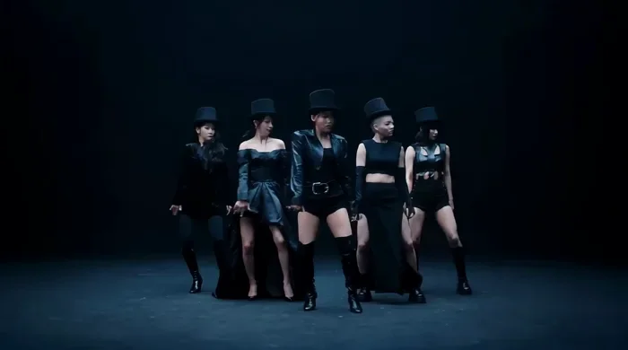
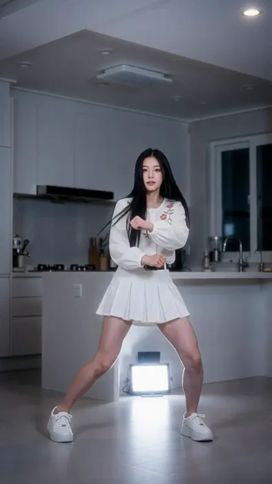

[← 総目次に戻る](../README.ja.md#table-of-contents) · [English](music-video.md) · [简体中文](music-video.zh-CN.md) · [日本語](music-video.ja.md)

### ミュージックビデオ Music Video

- [Case 31: Five-Member Girl Group — Hard-Light Dance Break (五人女团硬核舞段) — by Alibaba](#case-31)
- [Case 50: Audio-Driven Idol Dance (音频驱动的偶像舞蹈) — by Alibaba](#case-50)

### Case 31: Five-Member Girl Group — Hard-Light Dance Break (五人女团硬核舞段) — by Alibaba

▶ [ofox.ai で動画をすべて見る](https://ofox.ai/wan-3-prompts?utm_source=github&utm_medium=case&utm_campaign=awesome-ai-video-prompts#case-31)

<strong>Prompt</strong> — MV概念风的五人韩国女团硬核大片舞段，纯黑与纯白无缝影棚交替作底，色调为黑白高对比硬光时尚摄影质感，音乐节奏为工业电子贝斯配合骤停式重鼓点，五人以杂志封面式错落层次站位分布，居中者气场慵懒眼神锐利、短发微湿贴颅、长指甲银色美甲修长延展，左侧一人黑色宽檐礼帽压低眉骨、波浪长发垂至腰侧，右侧一人金色寸头…

~~~~text
MV概念风的五人韩国女团硬核大片舞段，纯黑与纯白无缝影棚交替作底，色调为黑白高对比硬光时尚摄影质感，音乐节奏为工业电子贝斯配合骤停式重鼓点，五人以杂志封面式错落层次站位分布，居中者气场慵懒眼神锐利、短发微湿贴颅、长指甲银色美甲修长延展，左侧一人黑色宽檐礼帽压低眉骨、波浪长发垂至腰侧，右侧一人金色寸头露出锐利下颌线，前排两人分别为黑色齐肩直发与挑染长卷发、皆以高眉骨冷艳表情基调统一嘴角紧闭眼神斜视镜头下方四十五度，五人皆着黑色天鹅绒礼帽或露肩缎面礼服与皮质镂空西装外套配银色皮带扣，缎面下摆与镂空剪裁将在旋转与甩臂时随即产生具体形变，地面为深色反光地砖制造倒影延迟感但非镜面墙，鼓点第一响时五人保持雕塑式背对起势、头部同步甩转九十度露出侧脸并以指尖扶正礼帽完成预备点位定格一拍，第一句歌词重音处居中者以食指从锁骨向下缓抹并在句尾骤停两拍同时两侧成员各自以肩部隔离向内错动完成小幅卡点，第二句切分点处五人指尖同步做出符号化点位手势并借银色美甲划出短促弧线，进入间奏时能量从居中者指尖发起、经手臂传导至肩部再沉入腰胯完成一次完整body wave并向两侧成员依次接续形成连锁传导链、全程耗时四拍，队形借此从错落松散站位沿弧线滑步收拢为对角线，两侧成员经过居中者身侧时以侧身让位方式完成交叉不打断中心视线，副歌鼓点最密集处五人从对角线骤然甩开呈扇形最大化展开，缎面下摆随转身甩出扇形弧线、镂空西装侧腰随抬手露出线条，甩发瞬间镜头由固定广角俯仰构图骤然切至升格慢动作特写捕捉发丝悬空与布料翻卷的瞬间张力，随后骤停并保持胸腔呼吸颤动可见两拍，进入桥段时居中者后退两步让位、右侧长发成员经交叉步于其身后穿过完成五拍内的中心位轮转、新中心以后仰再借力起身完成一次独立展示动作，收尾段五人沿相反路径快速归位收拢为V字队形，镜头以环绕跟随缓慢推近至新中心面部，定格于其眼神杀直视镜头的瞬间同时灯光由顶光切换为逆光轮廓光两拍延续收束，全程镜头分配为开场固定中景仿封面构图、分部位段落切近特写点位手、间奏环绕跟随波浪传导、副歌广角扇形展开后骤切升格特写、桥段环绕跟随新中心、结尾缓慢推近定格，全片维持黑白高对比硬边光影与冷调影棚质感，无柔光无滤镜，布料与美甲反光边缘始终清晰可辨。
~~~~

**参数**：Wan 3.0 · 未标注 · t2v · 未标注 · 未标注 · 未标注 · 带音频
**来源**：《Wan3.0 视频创作者手册》（万相官方） · [source](https://alidocs.dingtalk.com/i/nodes/qnYMoO1rWxrkmoj2IjExdZLBJ47Z3je9)

Wan 3.0 官方示例 ·《Wan3.0 视频创作者手册》

[目次に戻る](#table-of-contents)

### Case 50: Audio-Driven Idol Dance (音频驱动的偶像舞蹈) — by Alibaba

▶ [ofox.ai で動画をすべて見る](https://ofox.ai/wan-3-prompts?utm_source=github&utm_medium=case&utm_campaign=awesome-ai-video-prompts#case-50)

**输入素材**：未公开 —— 本案例未收录可用的输入素材，请参阅来源

<strong>Prompt</strong> — 竖屏9:16，全身镜头，固定稳定机位。一位长黑发的年轻女性，身穿白色花朵刺绣长袖上衣、白色百褶短裙配黑色腰带、白色厚底运动鞋，在现代简约风厨房中，跟随固定音频的节拍跳偶像风舞蹈。背景为浅灰色橱柜、白色岛台、深色夜景窗户，人物身后有一块方形补光灯形成轮廓光，室内冷白色灯光。 根据固定音频的节奏、速度和…

~~~~text
竖屏9:16，全身镜头，固定稳定机位。一位长黑发的年轻女性，身穿白色花朵刺绣长袖上衣、白色百褶短裙配黑色腰带、白色厚底运动鞋，在现代简约风厨房中，跟随固定音频的节拍跳偶像风舞蹈。背景为浅灰色橱柜、白色岛台、深色夜景窗户，人物身后有一块方形补光灯形成轮廓光，室内冷白色灯光。
根据固定音频的节奏、速度和情绪起伏进行舞蹈编排：鼓点重拍对应干脆利落的大幅度动作与定格姿势，舒缓段落对应柔和的身体波浪与手部姿态，副歌高潮段落动作更密集更有爆发力。整体为偶像风舞蹈，动作连贯流畅，富有节奏感和表现力，与音频节拍完全同步。
运动流畅，肢体比例自然。
~~~~

**参数**：Wan 3.0 · 未标注 · ref2v · 未标注 · 未标注 · 9:16 · 带音频
**来源**：《Wan3.0 视频创作者手册》（万相官方） · [source](https://alidocs.dingtalk.com/i/nodes/qnYMoO1rWxrkmoj2IjExdZLBJ47Z3je9)

Wan 3.0 官方示例 ·《Wan3.0 视频创作者手册》

[目次に戻る](#table-of-contents)
