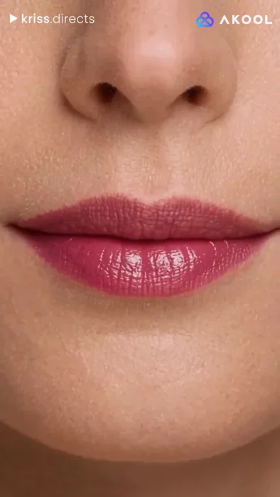
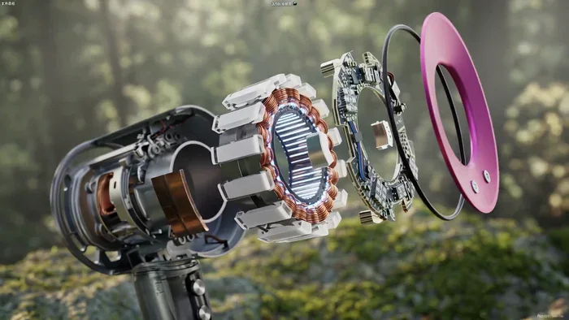
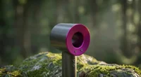
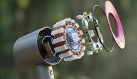
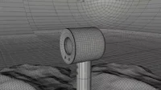
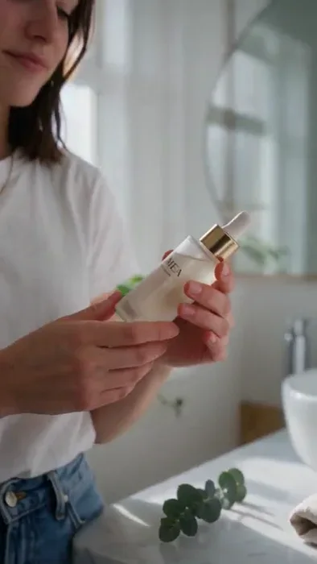
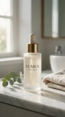
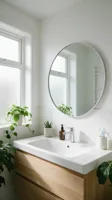

[← Back to the full index](../README.md#table-of-contents) · [English](product-video.md) · [简体中文](product-video.zh-CN.md) · [日本語](product-video.ja.md)

### Product Video (电商产品视频)

- [Case 4: The Rhythm of Dough (面团的律动) — by Alibaba](#case-4)
- [Case 5: Lace Blouse Try-On (蕾丝衬衫换装) — by Alibaba](#case-5)
- [Case 28: Lip Glaze — Swatch Video from a Product Shot (唇釉试色·只给一张产品图) — by Alibaba](#case-28)
- [Case 46: Nut Snack Packaging — Three-Shot Showcase (坚果包装三镜展示) — by Alibaba](#case-46)
- [Case 78: Lipstick Try-On with a Single Product Reference (单张产品图生成口红试色) — by u/Accomplished-Ebb7783](#case-78)
- [Case 79: Hair Dryer Exploded-View Render (吹风机内部零件拆解渲染) — by Alibaba](#case-79)
- [Case 91: Three References for a Serum Showcase (人物、产品与浴室三图参考) — by ClipRush Team](#case-91)

### Case 4: The Rhythm of Dough (面团的律动) — by Alibaba

▶ [Watch the full video on ofox.ai](https://ofox.ai/wan-3-prompts?utm_source=github&utm_medium=case&utm_campaign=awesome-ai-video-prompts#case-4)

**输入素材**：未公开 —— 本案例未收录可用的输入素材，请参阅来源

<strong>Prompt</strong> — 参考image1，面点和面展示生命力的律动大片。1—3秒俯拍垂直镜头，镜头匀速下压对准案板中央面粉堆，45度斜侧柔光营造宁静感，一颗晶莹鸡蛋打破落入中心，捕捉蛋黄破裂瞬间粘稠液态与粉末态碰撞的动态张力。3—6秒手部特写低角度仰拍，厨师双手进入画面展示复杂揉捏动作，冷暖对比光强调肌肉力量感与面团受压后…

~~~~text
参考image1，面点和面展示生命力的律动大片。1—3秒俯拍垂直镜头，镜头匀速下压对准案板中央面粉堆，45度斜侧柔光营造宁静感，一颗晶莹鸡蛋打破落入中心，捕捉蛋黄破裂瞬间粘稠液态与粉末态碰撞的动态张力。3—6秒手部特写低角度仰拍，厨师双手进入画面展示复杂揉捏动作，冷暖对比光强调肌肉力量感与面团受压后的物理形变，面粉微粒在光束中如星尘。6—10秒微距慢动作极近距离拍摄面团表面，展示手指按下后面筋纤维缓慢回弹的物理真实感，光线转为明亮轮廓光勾勒出面团细腻毛孔，最终镜头平稳拉远，定格在光滑如玉的面团成品上。
~~~~

**参数**：Wan 3.0 · 未标注 · i2v · 10s · 未标注 · 未标注 · 带音频
**来源**：阿里云 Wan 3.0 官方展示页 · [source](https://www.aliyun.com/benefit/scene/wan)

Wan 3.0 官方示例 · 阿里云万相展示页「图生视频」面团的律动

[Back to top](#table-of-contents)

### Case 5: Lace Blouse Try-On (蕾丝衬衫换装) — by Alibaba

▶ [Watch the full video on ofox.ai](https://ofox.ai/wan-3-prompts?utm_source=github&utm_medium=case&utm_campaign=awesome-ai-video-prompts#case-5)

**输入素材**：未公开 —— 本案例未收录可用的输入素材，请参阅来源

<strong>Prompt</strong> — image1的女孩穿上image2的米白色蕾丝衬衫，搭配黑色高腰A字半裙与尖头短靴，身处欧式复古街角咖啡馆门前，场景有铁艺桌椅、爬藤玫瑰、暖黄橱窗与旧砖墙面。她从玻璃门推门而出，全身入画展示整体穿搭轮廓，三层荷叶边袖口随手臂动作层叠飘动；随后靠铁艺椅背微侧站立，一手轻抬至锁骨处，镜头推近展示胸前蕾丝…

~~~~text
image1的女孩穿上image2的米白色蕾丝衬衫，搭配黑色高腰A字半裙与尖头短靴，身处欧式复古街角咖啡馆门前，场景有铁艺桌椅、爬藤玫瑰、暖黄橱窗与旧砖墙面。她从玻璃门推门而出，全身入画展示整体穿搭轮廓，三层荷叶边袖口随手臂动作层叠飘动；随后靠铁艺椅背微侧站立，一手轻抬至锁骨处，镜头推近展示胸前蕾丝镂空花纹与珍珠扣精致细节；接着拢了拢发丝转身侧面，缎面面料的柔和光泽随身体弧度流动；最后端起桌上咖啡杯轻抿，袖口荷叶边在杯沿旁层层散开定格收尾。午后柔和自然光，法式慵懒浪漫调性。
~~~~

**参数**：Wan 3.0 · 未标注 · i2v · 未标注 · 未标注 · 未标注 · 带音频
**来源**：阿里云 Wan 3.0 官方展示页 · [source](https://www.aliyun.com/benefit/scene/wan)

Wan 3.0 官方示例 · 阿里云万相展示页「图生视频」蕾丝衬衫换装

[Back to top](#table-of-contents)

### Case 28: Lip Glaze — Swatch Video from a Product Shot (唇釉试色·只给一张产品图) — by Alibaba

▶ [Watch the full video on ofox.ai](https://ofox.ai/wan-3-prompts?utm_source=github&utm_medium=case&utm_campaign=awesome-ai-video-prompts#case-28)

**输入素材**：未公开 —— 本案例未收录可用的输入素材，请参阅来源

<strong>Prompt</strong> — 只有唇釉产品图 @Image1 ，生成模特试色视频，15秒，竖屏，突出唇色效果

~~~~text
只有唇釉产品图 @Image1 ，生成模特试色视频，15秒，竖屏，突出唇色效果
~~~~

**参数**：Wan 3.0 · 未标注 · ref2v · 15s · 未标注 · 9:16 · 带音频
**来源**：《Wan3.0 视频创作者手册》（万相官方） · [source](https://alidocs.dingtalk.com/i/nodes/qnYMoO1rWxrkmoj2IjExdZLBJ47Z3je9)

Wan 3.0 官方示例 ·《Wan3.0 视频创作者手册》

[Back to top](#table-of-contents)

### Case 46: Nut Snack Packaging — Three-Shot Showcase (坚果包装三镜展示) — by Alibaba

▶ [Watch the full video on ofox.ai](https://ofox.ai/wan-3-prompts?utm_source=github&utm_medium=case&utm_campaign=awesome-ai-video-prompts#case-46)

**输入素材**：未公开 —— 本案例未收录可用的输入素材，请参阅来源

<strong>Prompt</strong> — 镜头1：远景，厨房木桌场景中 图1 的脆研社黑松露海盐混合坚果脆包装居中陈列，旁边散落几颗巴旦木、腰果、核桃仁和黑松露薄片作为氛围道具，镜头缓推靠近；镜头2：特写，包装正面占满画面，清晰展示顶部烫金麦穗坚果圆形徽章Logo、"脆研社"烫金书法字、"黑松露海盐混合坚果脆"品名、三枚胶囊标签"精选6种进…

~~~~text
镜头1：远景，厨房木桌场景中 图1 的脆研社黑松露海盐混合坚果脆包装居中陈列，旁边散落几颗巴旦木、腰果、核桃仁和黑松露薄片作为氛围道具，镜头缓推靠近；镜头2：特写，包装正面占满画面，清晰展示顶部烫金麦穗坚果圆形徽章Logo、"脆研社"烫金书法字、"黑松露海盐混合坚果脆"品名、三枚胶囊标签"精选6种进口坚果""0反式脂肪酸""非油炸·低温轻烘焙"及深森林绿底色烫金配色，文字锐利可辨；镜头3：一只手从上方拿起包装翻转至 图2 的背面，展示密排的配料表、营养成分表格、生产商信息及底部条形码，奶白色小字在深绿底色上清晰可读，随后翻回正面；全程产品包装的烫金Logo、文字、深森林绿配色与印刷花纹保持高度统一不变形。电商产品展示风格，暖调生活感
~~~~

**参数**：Wan 3.0 · 未标注 · ref2v · 未标注 · 未标注 · 未标注 · 带音频
**来源**：《Wan3.0 视频创作者手册》（万相官方） · [source](https://alidocs.dingtalk.com/i/nodes/qnYMoO1rWxrkmoj2IjExdZLBJ47Z3je9)

Wan 3.0 官方示例 ·《Wan3.0 视频创作者手册》

[Back to top](#table-of-contents)

### Case 78: Lipstick Try-On with a Single Product Reference (单张产品图生成口红试色) — by u/Accomplished-Ebb7783

▶ [Watch the full video on ofox.ai](https://ofox.ai/wan-3-prompts?utm_source=github&utm_medium=case&utm_campaign=awesome-ai-video-prompts#case-78)

**输入素材**：未公开 —— 本案例未收录可用的输入素材，请参阅来源

<strong>Prompt</strong> — Using only the lipstick product Image1 as a reference, generate a 15-second vertical video of a model trying on the lipstick, highlighting its color a…

~~~~text
Using only the lipstick product Image1 as a reference, generate a 15-second vertical video of a model trying on the lipstick, highlighting its color and finish on the lips.
~~~~

**参数**：Wan 3.0 · Akool · 未标注 · 未标注 · 未标注 · 未标注 · 未标注
**来源**：u/Accomplished-Ebb7783 · [原帖](https://www.reddit.com/r/Akool_Official/comments/1wsjwlh/product_ugc_using_wan_30_in_akool/)

社区分享 · u/Accomplished-Ebb7783 · Akool · Reddit 原帖逐字提示词与成片

[Back to top](#table-of-contents)

### Case 79: Hair Dryer Exploded-View Render (吹风机内部零件拆解渲染) — by Alibaba

▶ [Watch the full video on ofox.ai](https://ofox.ai/wan-3-prompts?utm_source=github&utm_medium=case&utm_campaign=awesome-ai-video-prompts#case-79)

**输入素材**（3 项（2 张图 + 1 段视频，视频只取首帧））

| | | | |
|:---:|:---:|:---:|:---:|
|  图1 · 吹风机外观 |  图2 · 内部拆解风格 |  视频1 · 待渲染的白模动画 |  |

<strong>Prompt</strong> — 把视频1改为图片风格，吹风机拆解图，细致的内部零件，环形芯片，内部环形电机模块，动态图形，4K高清

~~~~text
把视频1改为图片风格，吹风机拆解图，细致的内部零件，环形芯片，内部环形电机模块，动态图形，4K高清
~~~~

**参数**：Wan 3.0 · 未标注 · edit · 未标注 · 未标注 · 未标注 · 未标注
**来源**：阿里云 Wan 3.0 官方提示词指南 · [source](https://help.aliyun.com/zh/model-studio/wan3-video-generation-prompt-guide)

Wan 3.0 官方示例 · 阿里云百炼提示词指南「电商广告」吹风机拆解

[Back to top](#table-of-contents)

### Case 91: Three References for a Serum Showcase (人物、产品与浴室三图参考) — by ClipRush Team

▶ [Watch the full video on ofox.ai](https://ofox.ai/wan-3-prompts?utm_source=github&utm_medium=case&utm_campaign=awesome-ai-video-prompts#case-91)

**输入素材**（3 张图）

| | | | |
|:---:|:---:|:---:|:---:|
|  参考图 1 · cafe |  参考图 2 · product |  参考图 3 · bathroom |  |

<strong>Prompt</strong> — [Image 1] is the woman's face and hair, [Image 2] is the LUMEA serum bottle, [Image 3] is the bathroom. In the bathroom from [Image 3], the woman from…

~~~~text
[Image 1] is the woman's face and hair, [Image 2] is the LUMEA serum bottle, [Image 3] is the bathroom. In the bathroom from [Image 3], the woman from [Image 1] picks up the [Image 2] bottle, turns the label to the camera and smiles.
~~~~

**参数**：Wan 3.0 · ClipRush · r2v · 5s · 720p · 9:16 · 带音频
**来源**：ClipRush Team · [原帖](https://www.cliprush.ai/tests/wan-3-0-review#references-scene)

Preview © 2026 ClipRush Team · Prompt by ClipRush Team

[Back to top](#table-of-contents)
