[← 返回总目录](../README.zh-CN.md#table-of-contents) · [English](product-video.md) · [简体中文](product-video.zh-CN.md) · [日本語](product-video.ja.md)

### 电商产品视频 Product Video

- [Case 4: The Rhythm of Dough (面团的律动) — by Alibaba](#case-4)
- [Case 5: Lace Blouse Try-On (蕾丝衬衫换装) — by Alibaba](#case-5)
- [Case 28: Lip Glaze — Swatch Video from a Product Shot (唇釉试色·只给一张产品图) — by Alibaba](#case-28)
- [Case 46: Nut Snack Packaging — Three-Shot Showcase (坚果包装三镜展示) — by Alibaba](#case-46)
- [Case 78: Lipstick Try-On with a Single Product Reference (单张产品图生成口红试色) — by u/Accomplished-Ebb7783](#case-78)
- [Case 79: Hair Dryer Exploded-View Render (吹风机内部零件拆解渲染) — by Alibaba](#case-79)
- [Case 91: Three References for a Serum Showcase (人物、产品与浴室三图参考) — by ClipRush Team](#case-91)
- [Case 96: A Water Bottle on Wet River Stones (湿润河石上的不锈钢水瓶) — by PixelDojo](#case-96)
- [Case 99: A Serum Bottle from a First Frame (首帧驱动的精华瓶环绕) — by ClipRush Team](#case-99)
- [Case 101: A Serum Commercial from Text (纯文本生成精华瓶广告) — by ClipRush Team](#case-101)
- [Case 103: Orbiting an Earbuds Case (耳机充电盒的桌面环绕) — by Blurbly](#case-103)
- [Case 104: Unboxing a Smartwatch (俯拍智能手表开箱) — by Blurbly](#case-104)
- [Case 105: A Speaker Splash Test (音箱的水花测试) — by Blurbly](#case-105)
- [Case 106: Plugging in a Power Bank (给充电宝插上数据线) — by Blurbly](#case-106)

### Case 4: The Rhythm of Dough (面团的律动) — by Alibaba

<a href="https://ofox.ai/wan-3-prompts?utm_source=github&utm_medium=case&utm_campaign=awesome-ai-video-prompts#case-4">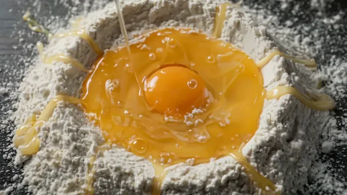</a>

▶ [在 ofox.ai 观看完整视频](https://ofox.ai/wan-3-prompts?utm_source=github&utm_medium=case&utm_campaign=awesome-ai-video-prompts#case-4)

**输入素材**：未公开 —— 本案例未收录可用的输入素材，请参阅来源

<strong>Prompt</strong> — 参考image1，面点和面展示生命力的律动大片。1—3秒俯拍垂直镜头，镜头匀速下压对准案板中央面粉堆，45度斜侧柔光营造宁静感，一颗晶莹鸡蛋打破落入中心，捕捉蛋黄破裂瞬间粘稠液态与粉末态碰撞的动态张力。3—6秒手部特写低角度仰拍，厨师双手进入画面展示复杂揉捏动作，冷暖对比光强调肌肉力量感与面团受压后…

~~~~text
参考image1，面点和面展示生命力的律动大片。1—3秒俯拍垂直镜头，镜头匀速下压对准案板中央面粉堆，45度斜侧柔光营造宁静感，一颗晶莹鸡蛋打破落入中心，捕捉蛋黄破裂瞬间粘稠液态与粉末态碰撞的动态张力。3—6秒手部特写低角度仰拍，厨师双手进入画面展示复杂揉捏动作，冷暖对比光强调肌肉力量感与面团受压后的物理形变，面粉微粒在光束中如星尘。6—10秒微距慢动作极近距离拍摄面团表面，展示手指按下后面筋纤维缓慢回弹的物理真实感，光线转为明亮轮廓光勾勒出面团细腻毛孔，最终镜头平稳拉远，定格在光滑如玉的面团成品上。
~~~~

**参数**：Wan 3.0 · 未标注 · i2v · 10s · 未标注 · 未标注 · 带音频
**来源**：阿里云 Wan 3.0 官方展示页 · [source](https://www.aliyun.com/benefit/scene/wan)

Wan 3.0 官方示例 · 阿里云万相展示页「图生视频」面团的律动

[回到目录](#table-of-contents)

### Case 5: Lace Blouse Try-On (蕾丝衬衫换装) — by Alibaba

<a href="https://ofox.ai/wan-3-prompts?utm_source=github&utm_medium=case&utm_campaign=awesome-ai-video-prompts#case-5">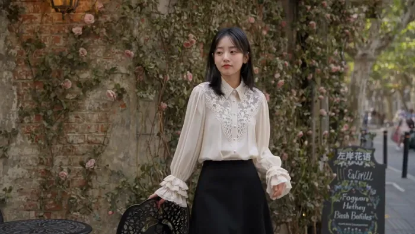</a>

▶ [在 ofox.ai 观看完整视频](https://ofox.ai/wan-3-prompts?utm_source=github&utm_medium=case&utm_campaign=awesome-ai-video-prompts#case-5)

**输入素材**：未公开 —— 本案例未收录可用的输入素材，请参阅来源

<strong>Prompt</strong> — image1的女孩穿上image2的米白色蕾丝衬衫，搭配黑色高腰A字半裙与尖头短靴，身处欧式复古街角咖啡馆门前，场景有铁艺桌椅、爬藤玫瑰、暖黄橱窗与旧砖墙面。她从玻璃门推门而出，全身入画展示整体穿搭轮廓，三层荷叶边袖口随手臂动作层叠飘动；随后靠铁艺椅背微侧站立，一手轻抬至锁骨处，镜头推近展示胸前蕾丝…

~~~~text
image1的女孩穿上image2的米白色蕾丝衬衫，搭配黑色高腰A字半裙与尖头短靴，身处欧式复古街角咖啡馆门前，场景有铁艺桌椅、爬藤玫瑰、暖黄橱窗与旧砖墙面。她从玻璃门推门而出，全身入画展示整体穿搭轮廓，三层荷叶边袖口随手臂动作层叠飘动；随后靠铁艺椅背微侧站立，一手轻抬至锁骨处，镜头推近展示胸前蕾丝镂空花纹与珍珠扣精致细节；接着拢了拢发丝转身侧面，缎面面料的柔和光泽随身体弧度流动；最后端起桌上咖啡杯轻抿，袖口荷叶边在杯沿旁层层散开定格收尾。午后柔和自然光，法式慵懒浪漫调性。
~~~~

**参数**：Wan 3.0 · 未标注 · i2v · 未标注 · 未标注 · 未标注 · 带音频
**来源**：阿里云 Wan 3.0 官方展示页 · [source](https://www.aliyun.com/benefit/scene/wan)

Wan 3.0 官方示例 · 阿里云万相展示页「图生视频」蕾丝衬衫换装

[回到目录](#table-of-contents)

### Case 28: Lip Glaze — Swatch Video from a Product Shot (唇釉试色·只给一张产品图) — by Alibaba

<a href="https://ofox.ai/wan-3-prompts?utm_source=github&utm_medium=case&utm_campaign=awesome-ai-video-prompts#case-28">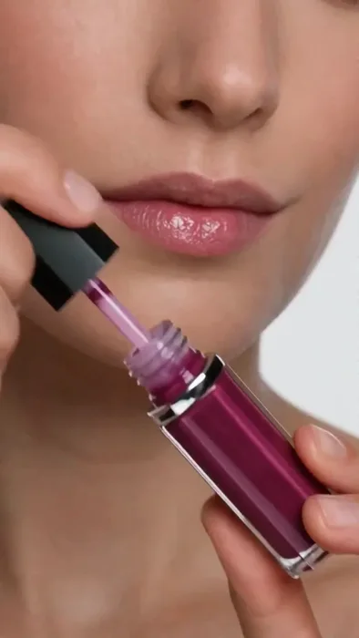</a>

▶ [在 ofox.ai 观看完整视频](https://ofox.ai/wan-3-prompts?utm_source=github&utm_medium=case&utm_campaign=awesome-ai-video-prompts#case-28)

**输入素材**：未公开 —— 本案例未收录可用的输入素材，请参阅来源

<strong>Prompt</strong> — 只有唇釉产品图 @Image1 ，生成模特试色视频，15秒，竖屏，突出唇色效果

~~~~text
只有唇釉产品图 @Image1 ，生成模特试色视频，15秒，竖屏，突出唇色效果
~~~~

**参数**：Wan 3.0 · 未标注 · ref2v · 15s · 未标注 · 9:16 · 带音频
**来源**：《Wan3.0 视频创作者手册》（万相官方） · [source](https://alidocs.dingtalk.com/i/nodes/qnYMoO1rWxrkmoj2IjExdZLBJ47Z3je9)

Wan 3.0 官方示例 ·《Wan3.0 视频创作者手册》

[回到目录](#table-of-contents)

### Case 46: Nut Snack Packaging — Three-Shot Showcase (坚果包装三镜展示) — by Alibaba

▶ [在 ofox.ai 观看完整视频](https://ofox.ai/wan-3-prompts?utm_source=github&utm_medium=case&utm_campaign=awesome-ai-video-prompts#case-46)

**输入素材**：未公开 —— 本案例未收录可用的输入素材，请参阅来源

<strong>Prompt</strong> — 镜头1：远景，厨房木桌场景中 图1 的脆研社黑松露海盐混合坚果脆包装居中陈列，旁边散落几颗巴旦木、腰果、核桃仁和黑松露薄片作为氛围道具，镜头缓推靠近；镜头2：特写，包装正面占满画面，清晰展示顶部烫金麦穗坚果圆形徽章Logo、"脆研社"烫金书法字、"黑松露海盐混合坚果脆"品名、三枚胶囊标签"精选6种进…

~~~~text
镜头1：远景，厨房木桌场景中 图1 的脆研社黑松露海盐混合坚果脆包装居中陈列，旁边散落几颗巴旦木、腰果、核桃仁和黑松露薄片作为氛围道具，镜头缓推靠近；镜头2：特写，包装正面占满画面，清晰展示顶部烫金麦穗坚果圆形徽章Logo、"脆研社"烫金书法字、"黑松露海盐混合坚果脆"品名、三枚胶囊标签"精选6种进口坚果""0反式脂肪酸""非油炸·低温轻烘焙"及深森林绿底色烫金配色，文字锐利可辨；镜头3：一只手从上方拿起包装翻转至 图2 的背面，展示密排的配料表、营养成分表格、生产商信息及底部条形码，奶白色小字在深绿底色上清晰可读，随后翻回正面；全程产品包装的烫金Logo、文字、深森林绿配色与印刷花纹保持高度统一不变形。电商产品展示风格，暖调生活感
~~~~

**参数**：Wan 3.0 · 未标注 · ref2v · 未标注 · 未标注 · 未标注 · 带音频
**来源**：《Wan3.0 视频创作者手册》（万相官方） · [source](https://alidocs.dingtalk.com/i/nodes/qnYMoO1rWxrkmoj2IjExdZLBJ47Z3je9)

Wan 3.0 官方示例 ·《Wan3.0 视频创作者手册》

[回到目录](#table-of-contents)

### Case 78: Lipstick Try-On with a Single Product Reference (单张产品图生成口红试色) — by u/Accomplished-Ebb7783

<a href="https://ofox.ai/wan-3-prompts?utm_source=github&utm_medium=case&utm_campaign=awesome-ai-video-prompts#case-78">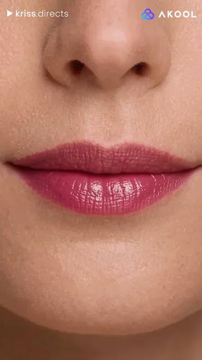</a>

▶ [在 ofox.ai 观看完整视频](https://ofox.ai/wan-3-prompts?utm_source=github&utm_medium=case&utm_campaign=awesome-ai-video-prompts#case-78)

**输入素材**：未公开 —— 本案例未收录可用的输入素材，请参阅来源

<strong>Prompt</strong> — Using only the lipstick product Image1 as a reference, generate a 15-second vertical video of a model trying on the lipstick, highlighting its color a…

~~~~text
Using only the lipstick product Image1 as a reference, generate a 15-second vertical video of a model trying on the lipstick, highlighting its color and finish on the lips.
~~~~

**参数**：Wan 3.0 · Akool · 未标注 · 未标注 · 未标注 · 未标注 · 未标注
**来源**：u/Accomplished-Ebb7783 · [原帖](https://www.reddit.com/r/Akool_Official/comments/1wsjwlh/product_ugc_using_wan_30_in_akool/)

社区分享 · u/Accomplished-Ebb7783 · Akool · Reddit 原帖逐字提示词与成片

[回到目录](#table-of-contents)

### Case 79: Hair Dryer Exploded-View Render (吹风机内部零件拆解渲染) — by Alibaba

<a href="https://ofox.ai/wan-3-prompts?utm_source=github&utm_medium=case&utm_campaign=awesome-ai-video-prompts#case-79">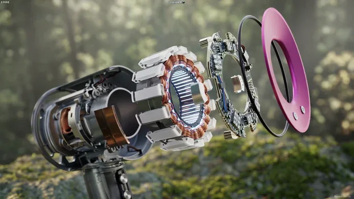</a>

▶ [在 ofox.ai 观看完整视频](https://ofox.ai/wan-3-prompts?utm_source=github&utm_medium=case&utm_campaign=awesome-ai-video-prompts#case-79)

**输入素材**（3 项（2 张图 + 1 段视频，视频只取首帧））

| | | | |
|:---:|:---:|:---:|:---:|
| 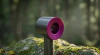 图1 · 吹风机外观 | 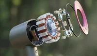 图2 · 内部拆解风格 | 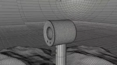 视频1 · 待渲染的白模动画 |  |

<strong>Prompt</strong> — 把视频1改为图片风格，吹风机拆解图，细致的内部零件，环形芯片，内部环形电机模块，动态图形，4K高清

~~~~text
把视频1改为图片风格，吹风机拆解图，细致的内部零件，环形芯片，内部环形电机模块，动态图形，4K高清
~~~~

**参数**：Wan 3.0 · 未标注 · edit · 未标注 · 未标注 · 未标注 · 未标注
**来源**：阿里云 Wan 3.0 官方提示词指南 · [source](https://help.aliyun.com/zh/model-studio/wan3-video-generation-prompt-guide)

Wan 3.0 官方示例 · 阿里云百炼提示词指南「电商广告」吹风机拆解

[回到目录](#table-of-contents)

### Case 91: Three References for a Serum Showcase (人物、产品与浴室三图参考) — by ClipRush Team

<a href="https://ofox.ai/wan-3-prompts?utm_source=github&utm_medium=case&utm_campaign=awesome-ai-video-prompts#case-91">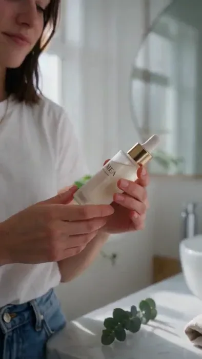</a>

▶ [在 ofox.ai 观看完整视频](https://ofox.ai/wan-3-prompts?utm_source=github&utm_medium=case&utm_campaign=awesome-ai-video-prompts#case-91)

**输入素材**（3 张图）

| | | | |
|:---:|:---:|:---:|:---:|
|  参考图 1 · cafe |  参考图 2 · product |  参考图 3 · bathroom |  |

<strong>Prompt</strong> — [Image 1] is the woman's face and hair, [Image 2] is the LUMEA serum bottle, [Image 3] is the bathroom. In the bathroom from [Image 3], the woman from…

~~~~text
[Image 1] is the woman's face and hair, [Image 2] is the LUMEA serum bottle, [Image 3] is the bathroom. In the bathroom from [Image 3], the woman from [Image 1] picks up the [Image 2] bottle, turns the label to the camera and smiles.
~~~~

**参数**：Wan 3.0 · ClipRush · r2v · 5s · 720p · 9:16 · 带音频
**来源**：ClipRush Team · [原帖](https://www.cliprush.ai/tests/wan-3-0-review#references-scene)

Preview © 2026 ClipRush Team · Prompt by ClipRush Team

[回到目录](#table-of-contents)

### Case 96: A Water Bottle on Wet River Stones (湿润河石上的不锈钢水瓶) — by PixelDojo

▶ [在 ofox.ai 观看完整视频](https://ofox.ai/wan-3-prompts?utm_source=github&utm_medium=case&utm_campaign=awesome-ai-video-prompts#case-96)

**输入素材**：未公开 —— 本案例未收录可用的输入素材，请参阅来源

<strong>Prompt</strong> — A vertical social ad for a stainless steel water bottle. The bottle stands on wet river stones, the camera rises slowly, and condensation runs down th…

~~~~text
A vertical social ad for a stainless steel water bottle. The bottle stands on wet river stones, the camera rises slowly, and condensation runs down the side. Text-free, product-first framing for a phone screen.
~~~~

**参数**：Wan 3.0 · 未标注 · 未标注 · adaptive（-1） · 未标注 · adaptive · 未标注
**来源**：PixelDojo · [原帖](https://pixeldojo.ai/guides/wan-3-0-prompting-guide)

Preview © 2026 PixelDojo · Prompt by PixelDojo

[回到目录](#table-of-contents)

### Case 99: A Serum Bottle from a First Frame (首帧驱动的精华瓶环绕) — by ClipRush Team

▶ [在 ofox.ai 观看完整视频](https://ofox.ai/wan-3-prompts?utm_source=github&utm_medium=case&utm_campaign=awesome-ai-video-prompts#case-99)

**输入素材**（1 张图）

| | | | |
|:---:|:---:|:---:|:---:|
|  First frame |  |  |  |

<strong>Prompt</strong> — The camera slowly orbits the serum bottle from left to right while soft morning light glides across the frosted glass and the LUMEA label. A single go…

~~~~text
The camera slowly orbits the serum bottle from left to right while soft morning light glides across the frosted glass and the LUMEA label. A single golden drop slides down the dropper.
~~~~

**参数**：Wan 3.0 · ClipRush · i2v · 5s · 720p · 未标注 · 带音频
**来源**：ClipRush Team · [原帖](https://www.cliprush.ai/tests/wan-3-0-review#product)

Preview © 2026 ClipRush Team · Prompt by ClipRush Team

[回到目录](#table-of-contents)

### Case 101: A Serum Commercial from Text (纯文本生成精华瓶广告) — by ClipRush Team

▶ [在 ofox.ai 观看完整视频](https://ofox.ai/wan-3-prompts?utm_source=github&utm_medium=case&utm_campaign=awesome-ai-video-prompts#case-101)

<strong>Prompt</strong> — A frosted glass serum bottle with a gold dropper and a label that reads "LUMEA" with "NIGHT SERUM" underneath stands on a white marble bathroom counte…

~~~~text
A frosted glass serum bottle with a gold dropper and a label that reads "LUMEA" with "NIGHT SERUM" underneath stands on a white marble bathroom counter in soft morning light. The camera slowly orbits the bottle while a single golden drop slides down the dropper. Premium product commercial.
~~~~

**参数**：Wan 3.0 · ClipRush · t2v · 5s · 720p · 9:16 · 带音频
**来源**：ClipRush Team · [原帖](https://www.cliprush.ai/tests/wan-3-0-review#t2v)

Preview © 2026 ClipRush Team · Prompt by ClipRush Team

[回到目录](#table-of-contents)

### Case 103: Orbiting an Earbuds Case (耳机充电盒的桌面环绕) — by Blurbly

<a href="https://ofox.ai/wan-3-prompts?utm_source=github&utm_medium=case&utm_campaign=awesome-ai-video-prompts#case-103">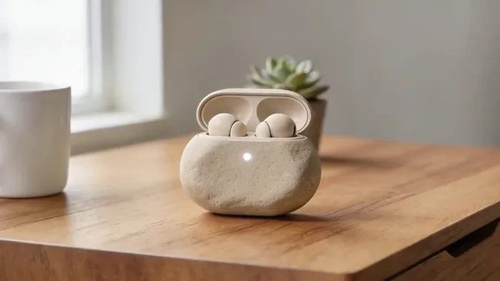</a>

▶ [在 ofox.ai 观看完整视频](https://ofox.ai/wan-3-prompts?utm_source=github&utm_medium=case&utm_campaign=awesome-ai-video-prompts#case-103)

**输入素材**（1 张图）

| | | | |
|:---:|:---:|:---:|:---:|
| 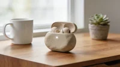 First frame |  |  |  |

<strong>Prompt</strong> — The camera slowly orbits around the open earbuds case from left to right, about a quarter turn, keeping the case centered and in sharp focus while the…

~~~~text
The camera slowly orbits around the open earbuds case from left to right, about a quarter turn, keeping the case centered and in sharp focus while the mug and the potted succulent slide past in the soft background. The small white status light on the front of the case pulses gently. Morning window light stays soft and constant. The case shape, sand-beige color and both earbuds stay exactly the same; no other objects appear, no text or logos appear.
~~~~

**参数**：Wan 3.0 · MuleRouter · i2v · 5s · 720p · 16:9 · off
**来源**：Blurbly · [原帖](https://blurbly.ai/prompts/wan-3-0-electronics-gadget-video#shot-earbuds-orbit)

Preview © 2026 Blurbly · Prompt by Blurbly

[回到目录](#table-of-contents)

### Case 104: Unboxing a Smartwatch (俯拍智能手表开箱) — by Blurbly

<a href="https://ofox.ai/wan-3-prompts?utm_source=github&utm_medium=case&utm_campaign=awesome-ai-video-prompts#case-104">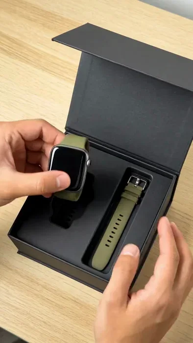</a>

▶ [在 ofox.ai 观看完整视频](https://ofox.ai/wan-3-prompts?utm_source=github&utm_medium=case&utm_campaign=awesome-ai-video-prompts#case-104)

**输入素材**（1 张图）

| | | | |
|:---:|:---:|:---:|:---:|
| 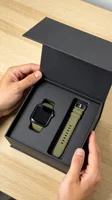 First frame |  |  |  |

<strong>Prompt</strong> — Top-down view. The hands lift the box lid fully open, take the smartwatch out of its tray and turn it face-up toward the camera; the black screen ligh…

~~~~text
Top-down view. The hands lift the box lid fully open, take the smartwatch out of its tray and turn it face-up toward the camera; the black screen lights up with a simple minimal analog watch face with no numbers. Natural, unhurried hand movement, exactly two hands with five fingers each. Very slight camera push-in. The olive green strap, the black box and the oak table stay the same as the first frame.
~~~~

**参数**：Wan 3.0 · MuleRouter · i2v · 5s · 720p · 9:16 · off
**来源**：Blurbly · [原帖](https://blurbly.ai/prompts/wan-3-0-electronics-gadget-video#shot-smartwatch-unboxing)

Preview © 2026 Blurbly · Prompt by Blurbly

[回到目录](#table-of-contents)

### Case 105: A Speaker Splash Test (音箱的水花测试) — by Blurbly

<a href="https://ofox.ai/wan-3-prompts?utm_source=github&utm_medium=case&utm_campaign=awesome-ai-video-prompts#case-105">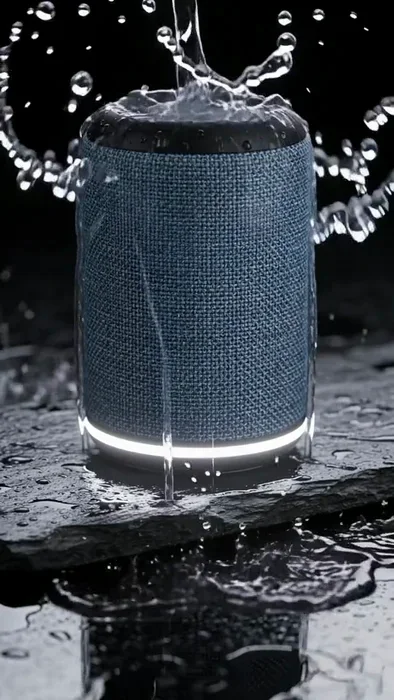</a>

▶ [在 ofox.ai 观看完整视频](https://ofox.ai/wan-3-prompts?utm_source=github&utm_medium=case&utm_campaign=awesome-ai-video-prompts#case-105)

**输入素材**（1 张图）

| | | | |
|:---:|:---:|:---:|:---:|
| 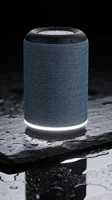 First frame |  |  |  |

<strong>Prompt</strong> — Water splashes onto the speaker from above; droplets bounce and run off the woven fabric. The speaker pulses with bass, making the water droplets on i…

~~~~text
Water splashes onto the speaker from above; droplets bounce and run off the woven fabric. The speaker pulses with bass, making the water droplets on its rubber top jump in rhythm. The white light ring at the base glows steadily. Macro, slow motion, camera static. The speaker’s shape, slate blue fabric and black top stay exactly the same as the first frame.
~~~~

**参数**：Wan 3.0 · MuleRouter · i2v · 5s · 720p · 9:16 · off
**来源**：Blurbly · [原帖](https://blurbly.ai/prompts/wan-3-0-electronics-gadget-video#shot-speaker-splash)

Preview © 2026 Blurbly · Prompt by Blurbly

[回到目录](#table-of-contents)

### Case 106: Plugging in a Power Bank (给充电宝插上数据线) — by Blurbly

<a href="https://ofox.ai/wan-3-prompts?utm_source=github&utm_medium=case&utm_campaign=awesome-ai-video-prompts#case-106">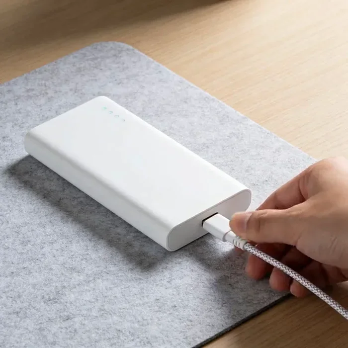</a>

▶ [在 ofox.ai 观看完整视频](https://ofox.ai/wan-3-prompts?utm_source=github&utm_medium=case&utm_campaign=awesome-ai-video-prompts#case-106)

**输入素材**（1 张图）

| | | | |
|:---:|:---:|:---:|:---:|
| 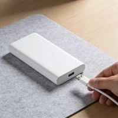 First frame |  |  |  |

<strong>Prompt</strong> — The hand pushes the USB cable plug fully into the port on the end of the power bank. The four small indicator lights on the top edge light up one afte…

~~~~text
The hand pushes the USB cable plug fully into the port on the end of the power bank. The four small indicator lights on the top edge light up one after another from left to right, then stay on. Camera static, soft daylight. The hand keeps natural proportions with five fingers; the power bank and cable keep the same shape and color as the first frame.
~~~~

**参数**：Wan 3.0 · MuleRouter · i2v · 5s · 720p · 1:1 · off
**来源**：Blurbly · [原帖](https://blurbly.ai/prompts/wan-3-0-electronics-gadget-video#shot-power-bank-plug)

Preview © 2026 Blurbly · Prompt by Blurbly

[回到目录](#table-of-contents)
