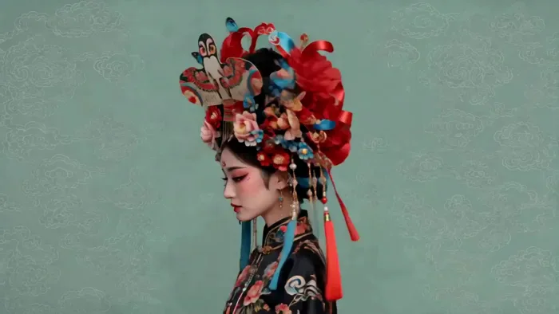
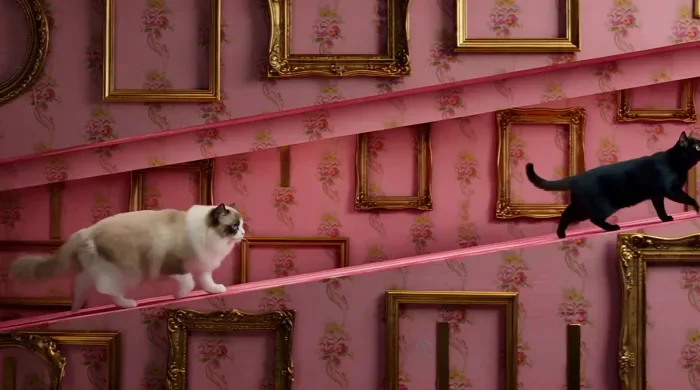
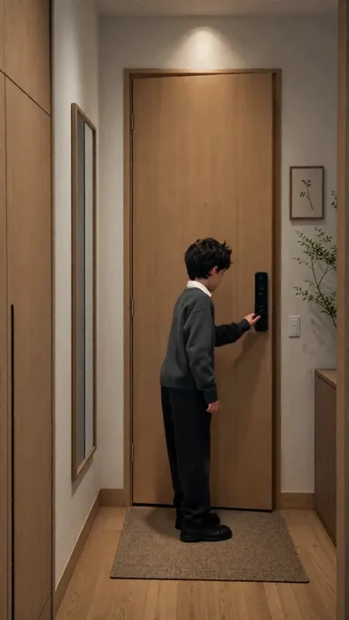
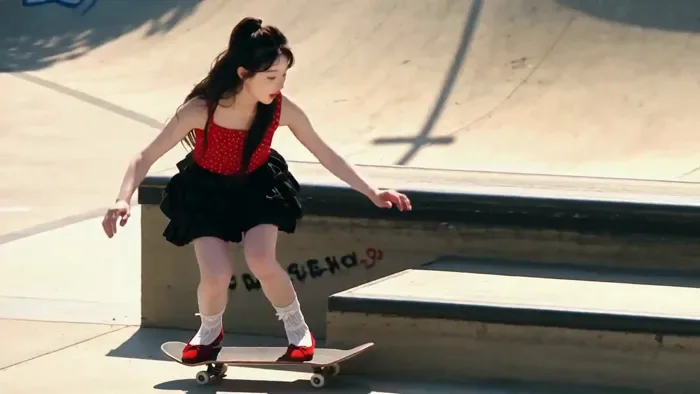
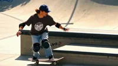
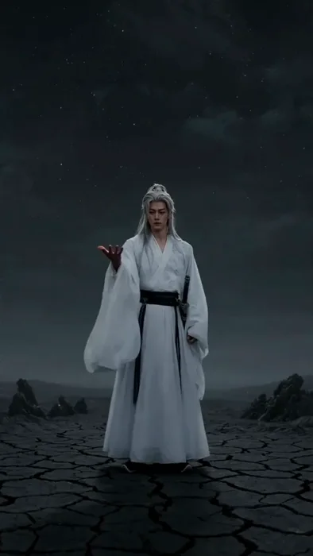

[← 返回总目录](../README.zh-CN.md#table-of-contents) · [English](reference-composition.md) · [简体中文](reference-composition.zh-CN.md) · [日本語](reference-composition.ja.md)

### 多素材参考合成 Reference Composition

- [Case 21: Rainy Platform — Six Shots from a Storyboard (雨夜车站·六镜分镜图参考) — by Alibaba](#case-21)
- [Case 22: Guofeng Headdresses — Five-Keyframe Card Flip (国风头饰·五关键帧翻牌) — by Alibaba](#case-22)
- [Case 25: Ragdoll and Black Cat — A Symmetrical Chase (布偶猫与黑猫的对称追逐) — by Alibaba](#case-25)
- [Case 42: Through the Door into a Magic Alley (玄关推门进入魔法街巷) — by Alibaba](#case-42)
- [Case 47: Motion Reference — Swap the Skater, Keep the Trick (动作参考·换人不换动作) — by Alibaba](#case-47)
- [Case 48: Camera Reference — Same Move, Rooftop Coffee (运镜参考·换成天台咖啡) — by Alibaba](#case-48)
- [Case 49: VFX Reference — Replicate the Energy Flames (特效参考·复刻能量火焰) — by Alibaba](#case-49)

### Case 21: Rainy Platform — Six Shots from a Storyboard (雨夜车站·六镜分镜图参考) — by Alibaba

▶ [在 ofox.ai 观看完整视频](https://ofox.ai/wan-3-prompts?utm_source=github&utm_medium=case&utm_campaign=awesome-ai-video-prompts#case-21)

<strong>Prompt</strong> — 参考 @Image1 的分镜图，镜头1：雨夜小火车站台全景，长发女孩撑蓝色雨伞独自站在站台上，身后小站房透出暖光，远处青山隐没在雨雾中；镜头2：中景，女孩撑伞与背书包的短发男孩在站台上面对面站立，大雨倾盆，铁轨在两人之间延伸；镜头3：透过雨滴滑落的透明伞面拍摄女孩面部特写，她眼眶泛红，轻声说{到了那…

~~~~text
参考 @Image1 的分镜图，镜头1：雨夜小火车站台全景，长发女孩撑蓝色雨伞独自站在站台上，身后小站房透出暖光，远处青山隐没在雨雾中；镜头2：中景，女孩撑伞与背书包的短发男孩在站台上面对面站立，大雨倾盆，铁轨在两人之间延伸；镜头3：透过雨滴滑落的透明伞面拍摄女孩面部特写，她眼眶泛红，轻声说{到了那边记得发消息}；镜头4：从男孩背后越肩拍向女孩方向，远处一列火车亮着车头灯缓缓驶来，雨幕中光晕扩散；镜头5：双手特写，女孩将一张折叠的纸条递到男孩手中，指尖微微颤抖；镜头6：女孩独自站在站台边，目送铁轨延伸向远方，男孩已不在身旁，雨势渐弱。
~~~~

**参数**：Wan 3.0 · 未标注 · ref2v · 未标注 · 未标注 · 未标注 · 带音频
**来源**：《Wan3.0 视频创作者手册》（万相官方） · [source](https://alidocs.dingtalk.com/i/nodes/qnYMoO1rWxrkmoj2IjExdZLBJ47Z3je9)

Wan 3.0 官方示例 ·《Wan3.0 视频创作者手册》

[回到目录](#table-of-contents)

### Case 22: Guofeng Headdresses — Five-Keyframe Card Flip (国风头饰·五关键帧翻牌) — by Alibaba

▶ [在 ofox.ai 观看完整视频](https://ofox.ai/wan-3-prompts?utm_source=github&utm_medium=case&utm_campaign=awesome-ai-video-prompts#case-22)

<strong>Prompt</strong> — 参考上传的5张关键帧图片，生成一支10秒、16:9横版的国风人物头饰展示短视频。整体风格延续参考视频的节奏与展示逻辑，画面精致、干净、克制，带有时尚国风与中式视觉设计感。5位人物按照上传顺序依次出场，人物始终固定在画面正中央，构图稳定，不要人物跑位，不要大幅运镜，不要夸张肢体动作。每位人物停留约2秒…

~~~~text
参考上传的5张关键帧图片，生成一支10秒、16:9横版的国风人物头饰展示短视频。整体风格延续参考视频的节奏与展示逻辑，画面精致、干净、克制，带有时尚国风与中式视觉设计感。5位人物按照上传顺序依次出场，人物始终固定在画面正中央，构图稳定，不要人物跑位，不要大幅运镜，不要夸张肢体动作。每位人物停留约2秒，主要动态为轻微左右摇头、缓慢偏头、微微抬颌或回正，让头饰得到充分展示。头饰上的流苏、花朵、喜鹊、纸鸢、蝴蝶等装饰可以有轻微摆动或颤动，背景中的中式纹样如祥云、亭台楼阁、山水纹样保持相对静止，仅有极轻微的呼吸感或视差感。

人物之间的切换方式要统一为“水平翻牌式切换”：当前人物画面像一张竖立在中心的卡片，围绕竖直中轴做平滑的水平翻转，翻到侧面时短暂变窄，随后下一位人物从翻转的另一面自然出现，形成连续的卡牌翻面效果。切换过程干净利落、平滑顺畅，节奏清晰，不要飞散，不要缩放乱跳，不要人物从边缘飞入。切换时人物位置不能偏移，始终保持中心对齐，像在同一个展示台上不断翻牌更换不同人物。

每一位人物的单独动态要求如下：人物保持半身肖像式展示，眼神自然，表情平静高级，身体整体稳定，只有头部轻微向左偏转再回正，或向右偏转再回正，动作幅度小而优雅，用来展示头饰层次。耳饰、流苏、花枝、鸟羽、纸鸢细节可以随动作产生轻微延迟摆动，增强精致感。不要说话，不要夸张眨眼，不要大笑，不要大幅度扭身。

整体镜头语言以固定镜头为主，可有极轻微缓慢推进，营造高级海报动态感，但不能破坏人物始终居中的展示效果。视频整体节奏是“停留展示—水平翻牌—停留展示—水平翻牌”，重复5位人物，最终在最后一位人物上稳定停留结束。

分镜时间轴版
0s - 2s

第一位人物居中展示。
人物轻微将头从正面偏向一侧，再缓慢回正，展示头顶花朵、喜鹊与流苏头饰。
流苏和小装饰轻微摆动，背景纹样保持稳定。

2s - 2.4s

进入第一次翻牌切换。
当前人物画面围绕竖直中轴做水平翻转，像卡片翻面一样，翻到最窄处后自然切换到下一位人物。
翻转时人物仍固定在中心。

2.4s - 4.4s

第二位人物居中展示。
侧脸人物可做轻微抬颌、微小回头或轻轻转回一点，再停住，突出纸鸢、花朵和喜鹊头饰。
花瓣或小装饰可以极轻微漂浮。

4.4s - 4.8s

第二次翻牌切换。
同样采用水平翻牌式过渡，干净利落，不要多余特效。

4.8s - 6.8s

第三位人物居中展示。
人物轻微左右摇头，小幅展示夸张头饰的不同层次。
头饰中的鸟、纸鸢、流苏可有细微摆动，背景云纹轻微呼吸感。

6.8s - 7.2s

第三次翻牌切换。
继续保持统一的中心翻牌节奏。

7.2s - 8.6s

第四位人物居中展示。
人物轻微偏头，露出头饰正面与侧向层次，动作幅度小，精致克制。

8.6s - 9.0s

第四次翻牌切换。
水平翻转，人物不偏移，节奏平稳。

9.0s - 10s

第五位人物居中展示并作为结尾。
人物轻微抬头或缓慢转头回正，头饰小元素轻轻晃动。
最后稳定停住，定格结束。
不要人物走动，不要人物缩放漂移，不要头饰变形，不要人物位置变化，不要背景乱飞，不要复杂粒子，不要夸张镜头旋转，不要卡顿，不要多人同屏。
~~~~

**参数**：Wan 3.0 · 未标注 · ref2v · 10s · 未标注 · 16:9 · 带音频
**来源**：《Wan3.0 视频创作者手册》（万相官方） · [source](https://alidocs.dingtalk.com/i/nodes/qnYMoO1rWxrkmoj2IjExdZLBJ47Z3je9)

Wan 3.0 官方示例 ·《Wan3.0 视频创作者手册》

[回到目录](#table-of-contents)

### Case 25: Ragdoll and Black Cat — A Symmetrical Chase (布偶猫与黑猫的对称追逐) — by Alibaba

▶ [在 ofox.ai 观看完整视频](https://ofox.ai/wan-3-prompts?utm_source=github&utm_medium=case&utm_campaign=awesome-ai-video-prompts#case-25)

<strong>Prompt</strong> — 0-4秒（全景/对称定格）： 画面：一条无限延伸的豪华酒店长廊。画面正中央，一只毛茸茸的布偶猫 @Image1 四肢腾空，呈标准的奔跑姿态冲向镜头。它的表情严肃而专注，仿佛在执行一项神圣任务。在它身后右侧约两米处，一只体型较小的黑猫 @Image2 正背对镜头向走廊深处狂奔，但头部夸张地向后扭转18…

~~~~text
0-4秒（全景/对称定格）：
画面：一条无限延伸的豪华酒店长廊。画面正中央，一只毛茸茸的布偶猫 @Image1 四肢腾空，呈标准的奔跑姿态冲向镜头。它的表情严肃而专注，仿佛在执行一项神圣任务。在它身后右侧约两米处，一只体型较小的黑猫 @Image2 正背对镜头向走廊深处狂奔，但头部夸张地向后扭转180度，瞪圆了眼睛回望追兵。
细节：两者的动作被凝固在一种“动态的静止”中，如同精致的发条玩具。背景中的拱门、壁灯、地毯花纹全部严格左右对称。
4-9秒（侧跟拍/剖面视角）：
画面：镜头切换至走廊侧面的剖面视角（仿佛墙壁被切开）。布偶猫在前景从左向右匀速跑过，步伐机械而优雅；黑猫在中景从右向左反向穿过，形成交叉动线。
风格：背景是层层叠叠的粉色墙纸与金色画框，所有物体都保持绝对的垂直与水平，没有任何倾斜。两只猫的毛发质感极其细腻，与背景平整的色块形成强烈对比。
9-13秒 [洗衣房/滚筒特写]：
画面：正面平视特写，聚焦于一台复古薄荷绿的双缸洗衣机玻璃门。布偶猫@图片1 和黑猫@图片2 被困在旋转的滚筒内，随着水流和泡沫翻滚。
细节：两只猫并未惊慌，而是保持着僵硬的“漂浮”姿态，眼神空洞地直视前方，仿佛在进行某种失重训练。背景是整齐排列的同色系洗衣液瓶，标签颜色按彩虹光谱严格排序。光线透过肥皂泡折射出梦幻的光斑，动作缓慢而富有节奏感，如同水下芭蕾。
13-17秒 [行李传送带/俯视追踪]：
画面：垂直90度俯拍。一条深红色的机场式行李传送带横贯画面。布偶猫@图片1 端坐在一个贴满旅行贴纸的棕色皮箱上，双手交叠放在膝盖，神情庄重如贵族出行；黑猫@图片2 则趴在另一个较小的绿色手提箱上，身体随传送带匀速向右滑动，尾巴有节奏地左右摆动，像节拍器一样精准。
细节：传送带两侧是纯白色的墙壁，没有任何杂物。每隔五秒，一盏顶灯闪烁一次，配合猫咪的移动频率，营造出机械般的秩序感。色彩以红、棕、绿、白为主，对比鲜明且干净利落。
17-20秒 [电话亭/镜像对称]：
画面：正面平视，画面被一扇老式红色电话亭的玻璃门一分为二。左侧是布偶猫@图片1 的正脸特写，它正对着听筒，嘴巴微张似乎在说话，眼神犀利；右侧是黑猫@图片2 的镜像倒影（或实际站在玻璃另一侧），它模仿着布偶猫的动作，但表情却是极度的惊恐和滑稽，眼睛瞪得极大。
细节：电话亭内部空间狭小，背景是模糊的城市街景，但被处理成柔和的色块。玻璃上的反光清晰可见，增强了空间的层次感。最后画面定格在两只猫截然不同的表情对比上，色彩饱和度达到峰值，充满戏剧张力与荒诞幽默感。
~~~~

**参数**：Wan 3.0 · 未标注 · ref2v · 20s · 未标注 · 未标注 · 带音频
**来源**：《Wan3.0 视频创作者手册》（万相官方） · [source](https://alidocs.dingtalk.com/i/nodes/qnYMoO1rWxrkmoj2IjExdZLBJ47Z3je9)

Wan 3.0 官方示例 ·《Wan3.0 视频创作者手册》

[回到目录](#table-of-contents)

### Case 42: Through the Door into a Magic Alley (玄关推门进入魔法街巷) — by Alibaba

▶ [在 ofox.ai 观看完整视频](https://ofox.ai/wan-3-prompts?utm_source=github&utm_medium=case&utm_campaign=awesome-ai-video-prompts#case-42)

<strong>Prompt</strong> — 分段1[0-5秒]：一个连续的、照片级写实的电影镜头。在 图2的现代公寓玄关内， 图1的儿童以斜侧身位站在画面中央，面对镜头微笑并做出自然的招手动作，示意观众跟上，右脸颊浮现浅浅的酒窝。随后他放下手臂，身体流畅地向左后方转身&lt;脚步踩在木地板上的两声轻响&gt;，他背对镜头走向前方的木纹入户门，伸出左手握住…

~~~~text
分段1[0-5秒]：一个连续的、照片级写实的电影镜头。在 图2的现代公寓玄关内， 图1的儿童以斜侧身位站在画面中央，面对镜头微笑并做出自然的招手动作，示意观众跟上，右脸颊浮现浅浅的酒窝。随后他放下手臂，身体流畅地向左后方转身<脚步踩在木地板上的两声轻响>，他背对镜头走向前方的木纹入户门，伸出左手握住黑色电子锁把手转动<咔哒机械解锁声>，缓慢地将门向内打开。在这段前半部分摄影机保持完全静止，角色的外貌和服装保持一致，动作自然流畅，门的结构和材质呈现真实质感。柔和的室内顶光均匀照亮米色墙壁和浅棕色木地板，无硬切或突兀的场景转换。

分段2[5-10秒]：从上一分段的最后一帧无缝衔接，角色、服装、公寓玄关和机位保持完全一致。角色将门完全打开，一股暖黄色的、夹带着潮湿气息的光线从门外涌入。门外是 图3 的魔法街巷世界——一条湿漉漉的鹅卵石窄巷向纵深延伸，两侧是高耸的哥特式尖顶建筑，锻铁招牌从墙面伸出，暖橙色的煤气灯笼照亮每一扇橱窗，远处一座尖塔在灰蓝色暮云中若隐若现，屋顶烟囱冒着白烟<远处隐约的钟声>。构图设计、摄影机角度、空间距离以及玄关与街巷两个空间层次之间的关系保持一致，门外的所有环境都是魔法街巷世界。他在门口稍作停顿，回头越过左肩再次看向镜头，脸上的微笑从轻松转为带着好奇的兴奋。当镜头越过门槛时光线和氛围从室内明亮暖木色调变化为街巷湿冷的暖橙灯光与灰蓝暮色交织，但空间和照明在物理上保持自然且连续（低沉的大提琴旋律缓缓响起，间杂竖琴拨弦）。无硬切或突兀的场景转换。

分段3[10-15秒]：从上一分段的最后一帧无缝衔接，镜头此刻已穿过门框进入魔法街巷世界。他转身迈步踏上湿漉漉的鹅卵石路面<皮鞋踩在湿石板上的清脆回响>，镜头以稳定的跟拍轨迹从身后平滑跟随，持续穿过门洞进入窄巷深处。他的身影在两侧高耸建筑之间缓步前行，他的灰色毛衣和深色长裤被两侧橱窗透出的暖光交替照亮，路面积水倒映着头顶灯笼和建筑轮廓，远处尖塔越来越清晰。最终镜头落幅于一个纵深全景画面，将他行走在灯火通明的魔法窄巷中的背影置于湿漉石路与哥特尖塔的正中心（大提琴与竖琴在此交织达到沉稳而神秘的高点）。全程无硬切或突兀的场景转换。写实与暗黑奇幻无缝过渡质感，高清锐利画面，玄关暖木低饱和色调渐变为街巷暖橙灯光与灰蓝暮色交织的高对比暗调。
~~~~

**参数**：Wan 3.0 · 未标注 · ref2v · 15s · 未标注 · 未标注 · 带音频
**来源**：《Wan3.0 视频创作者手册》（万相官方） · [source](https://alidocs.dingtalk.com/i/nodes/qnYMoO1rWxrkmoj2IjExdZLBJ47Z3je9)

Wan 3.0 官方示例 ·《Wan3.0 视频创作者手册》

[回到目录](#table-of-contents)

### Case 47: Motion Reference — Swap the Skater, Keep the Trick (动作参考·换人不换动作) — by Alibaba

▶ [在 ofox.ai 观看完整视频](https://ofox.ai/wan-3-prompts?utm_source=github&utm_medium=case&utm_campaign=awesome-ai-video-prompts#case-47)

**输入素材**（1 段视频，只取首帧）

| | | | |
|:---:|:---:|:---:|:---:|
|  参考视频 |  |  |  |

<strong>Prompt</strong> — 参考视频，视频1 @Video 中的滑板男人替换为图片 @Image1 中的女人和衣服，注意：只替换人物，保留原视频中滑板动作、运动轨迹和滑板场背景完全保持不变。

~~~~text
参考视频，视频1 @Video 中的滑板男人替换为图片 @Image1 中的女人和衣服，注意：只替换人物，保留原视频中滑板动作、运动轨迹和滑板场背景完全保持不变。
~~~~

**参数**：Wan 3.0 · 未标注 · ref2v · 未标注 · 未标注 · 未标注 · 带音频
**来源**：《Wan3.0 视频创作者手册》（万相官方） · [source](https://alidocs.dingtalk.com/i/nodes/qnYMoO1rWxrkmoj2IjExdZLBJ47Z3je9)

Wan 3.0 官方示例 ·《Wan3.0 视频创作者手册》

[回到目录](#table-of-contents)

### Case 48: Camera Reference — Same Move, Rooftop Coffee (运镜参考·换成天台咖啡) — by Alibaba

▶ [在 ofox.ai 观看完整视频](https://ofox.ai/wan-3-prompts?utm_source=github&utm_medium=case&utm_campaign=awesome-ai-video-prompts#case-48)

**输入素材**（1 段视频，只取首帧）

| | | | |
|:---:|:---:|:---:|:---:|
|  参考视频 |  |  |  |

<strong>Prompt</strong> — 参考视频的运镜方式，场景更改为一杯咖啡放在天台咖啡桌上。

~~~~text
参考视频的运镜方式，场景更改为一杯咖啡放在天台咖啡桌上。
~~~~

**参数**：Wan 3.0 · 未标注 · ref2v · 未标注 · 未标注 · 未标注 · 带音频
**来源**：《Wan3.0 视频创作者手册》（万相官方） · [source](https://alidocs.dingtalk.com/i/nodes/qnYMoO1rWxrkmoj2IjExdZLBJ47Z3je9)

Wan 3.0 官方示例 ·《Wan3.0 视频创作者手册》

[回到目录](#table-of-contents)

### Case 49: VFX Reference — Replicate the Energy Flames (特效参考·复刻能量火焰) — by Alibaba

▶ [在 ofox.ai 观看完整视频](https://ofox.ai/wan-3-prompts?utm_source=github&utm_medium=case&utm_campaign=awesome-ai-video-prompts#case-49)

**输入素材**（1 段视频，只取首帧）

| | | | |
|:---:|:---:|:---:|:---:|
|  参考视频 |  |  |  |

<strong>Prompt</strong> — 图片1人物参考视频1的能量特效，生成同样的特效和动作。

~~~~text
图片1人物参考视频1的能量特效，生成同样的特效和动作。
~~~~

**参数**：Wan 3.0 · 未标注 · ref2v · 未标注 · 未标注 · 未标注 · 带音频
**来源**：《Wan3.0 视频创作者手册》（万相官方） · [source](https://alidocs.dingtalk.com/i/nodes/qnYMoO1rWxrkmoj2IjExdZLBJ47Z3je9)

Wan 3.0 官方示例 ·《Wan3.0 视频创作者手册》

[回到目录](#table-of-contents)
