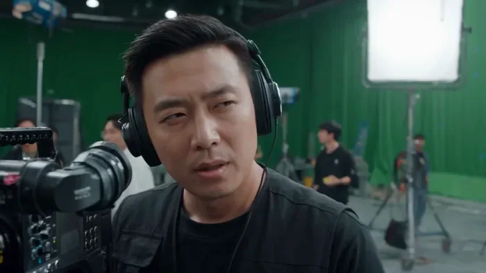
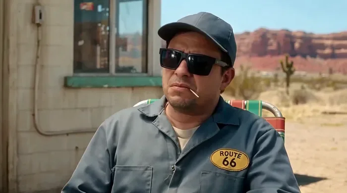
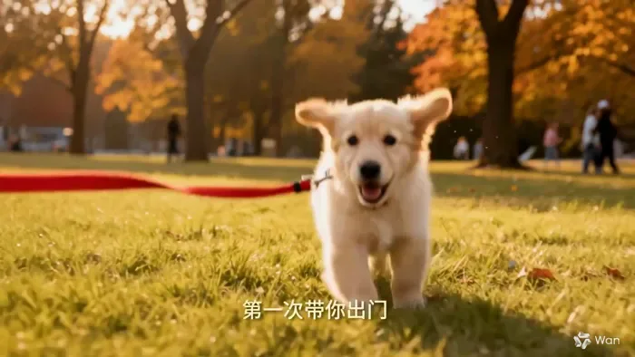

[← 返回总目录](../README.zh-CN.md#table-of-contents) · [English](short-drama.md) · [简体中文](short-drama.zh-CN.md) · [日本語](short-drama.ja.md)

### 短剧 Short Drama

- [Case 11: Comedy Short — The Director and the Nepo Star (喜剧短片·导演与关系户) — by Alibaba](#case-11)
- [Case 15: Absurd Short — Refuelling a Horse with Grass (荒诞短片·给马加青草) — by Alibaba](#case-15)
- [Case 52: A Golden Retriever's First Year, from a .docx (一份日记文档生成的金毛成长片) — by Alibaba](#case-52)

### Case 11: Comedy Short — The Director and the Nepo Star (喜剧短片·导演与关系户) — by Alibaba

▶ [在 ofox.ai 观看完整视频](https://ofox.ai/wan-3-prompts?utm_source=github&utm_medium=case&utm_campaign=awesome-ai-video-prompts#case-11)

<strong>Prompt</strong> — 镜头1 [0秒-30秒] 近景，平视视角，连续快速摇镜，一镜到底（单镜头连续无缝运镜）： 画面左侧是身穿黑色潮流导演马甲、戴着高档专业工作耳麦的导演，其左下方放置着一台巨大的专业电影摄像机。右侧是妆容精致、留着时尚韩式逗号刘海、身穿高定制西装的关系户小鲜肉。背景是宽敞的专业影棚拍摄现场，可见巨大的绿…

~~~~text
镜头1 [0秒-30秒]
近景，平视视角，连续快速摇镜，一镜到底（单镜头连续无缝运镜）：
画面左侧是身穿黑色潮流导演马甲、戴着高档专业工作耳麦的导演，其左下方放置着一台巨大的专业电影摄像机。右侧是妆容精致、留着时尚韩式逗号刘海、身穿高定制西装的关系户小鲜肉。背景是宽敞的专业影棚拍摄现场，可见巨大的绿色幕布、数个高耸的影视级C型灯架、缠绕的电线，以及在背景中穿梭忙碌的灯光师和化妆师等工作人员。
专业影棚人工光。柔和的LED柔光箱光源从右侧洒入，将三位主角的面部均匀照亮，场景色彩饱满。背景的摄影器材与绿幕在充足的影棚灯光下投射出淡淡的阴影，呈现出真实而忙碌的现代化大制作片场质感。
镜头手持拍摄一镜到底，近景，镜头一开始，拍摄导演，导演无所谓的表情，瞥了一眼画面右侧斜前方画外的一眼关系户小鲜肉，对他下达指令，说道：“媒体故意黑你，做个表情看看”。说完后镜头快速右摇到关系户面部近景，镜头不要切镜，关系户小鲜肉，面部朝向画面左侧斜前方画外导演方向，神色自若，眼神真挚而自信。他嘴唇微动，神情专业地向对方阐述到““就这种事情来说，情绪可以有好几种”，说话时，头部伴有极其轻微的自然晃动，说完后镜头快速左摇到导演面部近景，镜头不要切镜，导演思索了一下，一边挑衅似地歪了歪头，向关系户小鲜肉说到““狗仔爆料你深夜幽会”，导演说完台词后，镜头迅速右摇到小鲜肉面部近景，不要切镜，关系户小鲜肉，面部朝向画面左侧斜前方画外导演方向，并快速进入表演状态，他眉头紧锁，眼神慌乱、焦急地快速游移，随后他狠狠地咬紧下唇，闭上双眼，整张脸（虽带着精致妆容）因极度的焦虑而紧绷，完美呈现出面对偶像生涯毁灭时，内心惊恐、紧张交织的挣扎状态。表演完后， 镜头再次迅速左摇到导演近景，不要切镜，导演面部表情微变，语速加快，说到““媒体又帮你洗白了，说那是你亲姐！”导演说完后，镜头再次迅速右摇到小鲜肉近景，镜头不要切镜，镜头中，关系户小鲜肉，面部朝向画面左侧斜前方画外导演方向，他的表情在千分之一秒内完成神级转换。他先是面部一滞，随后双眼猛地眯起，嘴角极大程度地咧开，露出一排白皙的牙齿，展露出一个极其夸张、甚至有些变形的狂喜笑容。这种“星途尽毁的绝望”与“彻底摆脱束缚”交织的疯魔情绪在他脸上扭曲呈现。角色表演完后，镜头再次迅速左摇到导演近景，镜头不要切镜，导演说到“你亲姐向媒体透露，你是领养的”，导演说完后，镜头再次迅速右摇到小鲜肉近景。镜头不要切镜，镜头内，关系户小鲜肉面部朝向画面左侧斜前方画外导演方向，只见他双眼暴睁，眼球凸出，精心修剪的眉毛高高扬起，嘴巴震惊地张成“O”形。紧接着，他的嘴角再次无法克制地向上拉扯，露出一副不可思议、惊魂未定却的复杂神态。 角色表演完后，镜头再次快速左摇到导演近景，镜头不要切镜，紧接着导演露出有点惊讶的表情说到“其实你是千亿豪门真少爷”。导演说完，镜头再次随即迅速右摇到小鲜肉近景，镜头不要切镜，镜头内，关系户小鲜肉面部朝向画面左侧斜前方画外导演方向，他瞬间爆发出极度魔性的狂喜。他整个人激动得微微颤抖，双眼笑得眯成了一条缝，双手甚至抬起至胸前，双手小幅度快速连续鼓掌，身体前倾摇晃，将一夜暴富、无法自持的癫狂喜悦演绎得淋漓尽致。 角色表演完后，镜头再次快速左摇到导演近景，镜头不要切镜，导演说到“你姐卷款跑路”导演说完，镜头再次迅速右摇到小鲜肉近景。小鲜肉面部朝向画面左侧斜前方画外导演方向，只见他的双眼再次瞪大，瞳孔颤抖，嘴角向下耷拉，神情在一秒钟之内从天堂坠入地狱，写满了惊愕、痛苦与不知所措。画面最后定格在这个表情上。
~~~~

**参数**：Wan 3.0 · 未标注 · t2v · 30s · 未标注 · 未标注 · 带音频
**来源**：《Wan3.0 视频创作者手册》（万相官方） · [source](https://alidocs.dingtalk.com/i/nodes/qnYMoO1rWxrkmoj2IjExdZLBJ47Z3je9)

Wan 3.0 官方示例 ·《Wan3.0 视频创作者手册》

[回到目录](#table-of-contents)

### Case 15: Absurd Short — Refuelling a Horse with Grass (荒诞短片·给马加青草) — by Alibaba

▶ [在 ofox.ai 观看完整视频](https://ofox.ai/wan-3-prompts?utm_source=github&utm_medium=case&utm_campaign=awesome-ai-video-prompts#case-15)

<strong>Prompt</strong> — 内容梗概 这是一场发生在色彩明亮的未来废土上、充满了冷幽默与荒诞感的“加油”事件。在一个被遗忘的、类似66号公路的加油站，百无聊赖的工作人员迎来了一位奇特的客人——一个骑着真马的酷酷女牛仔。就在工作人员以为这只是个路过的疯子时，女牛仔却径直走向加油机，拿起油枪，为她的马“加满”了新鲜的青草。这超现实…

~~~~text
内容梗概
这是一场发生在色彩明亮的未来废土上、充满了冷幽默与荒诞感的“加油”事件。在一个被遗忘的、类似66号公路的加油站，百无聊赖的工作人员迎来了一位奇特的客人——一个骑着真马的酷酷女牛仔。就在工作人员以为这只是个路过的疯子时，女牛仔却径直走向加油机，拿起油枪，为她的马“加满”了新鲜的青草。这超现实的一幕，让见多识广的工作人员彻底陷入了认知失调的呆滞状态。
场景描述与光影美学
视觉风格: 写实风格，色彩处理上采用高饱和度、高亮度的电影调色，营造出一种“晴朗”感，让荒诞的故事发生在一个无比正常、甚至有点美好的环境里。
色彩美学: 严格遵循明亮的“青橙配色”体系。
青色（Teal）: 万里无云的天空是明亮、清澈的蔚蓝色（偏青）。加油站的主要建筑是复古的黄橙蓝配色，建筑微微褪色。加油机是褪色的复古红。
橙色（Orange）: 地面是龟裂的橙色干涸土地。远处的山脉呈现出温暖的赤陶色。女牛仔的围巾或夹克是橙色的。
角色与场景:
女牛仔: 形象酷飒，沉默寡言。戴着一顶宽檐牛仔帽。穿着耐磨的工装靴和牛仔裤，身上有长途旅行的风尘痕迹。
马: 一匹神态淡定、毛色普通的真马，仿佛对这一切早已司空见惯。
加油站工作人员: 穿着油腻的蓝色工装，戴着一副巨大的黑色墨镜，百无聊赖地靠在椅子上，嘴里叼着一根牙签。他是本片的核心“反应镜头”担当。
加油站: 经典的66号公路风格，旁边有一个小小的便利店，门口放着一台褪色的可乐贩卖机，充满了美式复古感。
3. 运镜风格描述
运镜风格是“冷静的旁观与荒诞的特写（Calm Observation & Absurd Close-up）”：
大量使用固定的中景镜头和缓慢的横移，以一种非常冷静、客观的视角来记录事件，不做任何情绪引导。
在关键的荒诞行为发生时，镜头会突然给到一个极端的特写，比如油枪喷出草的瞬间，或者工作人员呆滞的面部表情，通过这种突兀的放大来制造笑点。
4. 分镜描述
0s - 8s：序幕：无聊的午后
大全景（固定）。蓝天，风沙。一个复古的黄橙蓝配色微微褪色的加油站孤独地立在公路旁。加油站门口，一个工作人员戴着墨镜，懒洋洋地躺在椅子上打盹。一切都安静得只剩下风声。
远景。地平线上，一个骑着马的女牛仔缓缓出现，打破了这份宁静。
中景。工作人员被马蹄声惊醒，他扶了扶墨镜，不耐烦地坐直了身体，看着这个奇怪的组合，嘴里叼着的牙签动了动，脸上写满了“又是个问路的”。
8s - 16s：破：一本正经的胡闹
女牛仔没有说话，她利落地翻身下马，牵着马，径直走向一台老式的加油机。马儿熟练地将头伸到加油机旁。
工作人员的主观视角（略带鱼眼）: 镜头模仿他从墨镜后看出去的视角，那个女人和马的组合显得更加古怪。他看到女牛仔真的拿起了加油枪。
近景。工作人员的眉头皱了起来，他觉得这女人在寻开心。他摘下了墨镜，准备开口呵斥。
慢动作特写: 就在他摘下墨镜的瞬间，他看到女牛仔将油枪的喷嘴对准了马嘴，然后扣动了扳机。
16s - 24s：急：【高潮】认知崩溃的瞬间
【终极反差】:
特写: 油枪喷嘴。喷出的不是汽油，而是一股股新鲜翠绿、还带着水珠的青草！
极端特写: 镜头快切到工作人员那张呆若木鸡的脸上。他的眼睛瞪得像铜铃，嘴巴微微张开，叼着的牙签都忘记了动弹。他的表情凝固了，仿佛世界观在这一秒被彻底颠覆。
中景。马儿吃得津津有味，幸福地眯上了眼睛，然后心满意足地、有力地甩了一下尾巴。马尾扫起的灰尘，正好扑了旁边还在呆滞的工作人员一脸。
24s - 30s：合：绝尘而去，留下呆滞
“加满”了草。女牛仔将油枪挂回原位。她从口袋里掏出几枚硬币，走到便利店门口，“叮叮当当”地扔进了柜台上的一个铁皮罐子里。
她回头看了一眼还在石化状态的工作人员，帽檐下的嘴角似乎微微上扬了一下。
【终极定格】: 她翻身上马，绝尘而去。
镜头缓缓推向工作人员。他依然保持着那个呆若木鸡的姿势，满脸灰尘，手里还捏着刚刚摘下的墨镜，嘴里的牙签终于“啪嗒”一声掉在了地上。
定格在他这张怀疑人生的脸上，全片在荒诞的寂静中结束，只留下一阵风吹过时，牙签在地上滚动的声音。
~~~~

**参数**：Wan 3.0 · 未标注 · t2v · 30s · 未标注 · 未标注 · 带音频
**来源**：《Wan3.0 视频创作者手册》（万相官方） · [source](https://alidocs.dingtalk.com/i/nodes/qnYMoO1rWxrkmoj2IjExdZLBJ47Z3je9)

Wan 3.0 官方示例 ·《Wan3.0 视频创作者手册》

[回到目录](#table-of-contents)

### Case 52: A Golden Retriever's First Year, from a .docx (一份日记文档生成的金毛成长片) — by Alibaba

▶ [在 ofox.ai 观看完整视频](https://ofox.ai/wan-3-prompts?utm_source=github&utm_medium=case&utm_campaign=awesome-ai-video-prompts#case-52)

<strong>Prompt</strong> — 本视频共包含6个镜头，总时长30.0秒。 全片以暖黄色调和胶片颗粒质感为基调，以主人深夜翻开一本写给金毛犬的旧日记为叙事线索——每一段旁白都是从日记本中念出的一页，画面是日记文字唤起的回忆影像。通过金毛犬"夏天"从幼犬到家至一岁生日的五个生活片段，配合翻页般的钢琴弦乐，讲述一段温情的成长故事。 全局…

~~~~text
本视频共包含6个镜头，总时长30.0秒。

全片以暖黄色调和胶片颗粒质感为基调，以主人深夜翻开一本写给金毛犬的旧日记为叙事线索——每一段旁白都是从日记本中念出的一页，画面是日记文字唤起的回忆影像。通过金毛犬"夏天"从幼犬到家至一岁生日的五个生活片段，配合翻页般的钢琴弦乐，讲述一段温情的成长故事。

全局字体设定：全片所有中文文字（包括开篇题字、逐镜头字幕、结尾题字）统一使用「楷体」字型，呈现手写日记本的温润文学质感。文字颜色为暖黄色（#E8D5A3），字号偏小、笔触纤细，笔画边缘带有极轻微的暖色柔光晕散，与画面胶片颗粒质感自然融合，仿佛钢笔在泛黄日记本上写下的字迹。

全局声音设定：BGM为柔音钢琴（felt piano）与室内弦乐组合，整体偏安静克制、情绪向内收拢。钢琴触键柔软绵密，像手指轻轻按压琴键而非敲击；弦乐偏暖偏厚，弓弦摩擦的颗粒感可闻，不追求宏大而是贴近耳边的亲密感。情绪随剧情流动——开场只有一声钢琴单音延留，幼犬段落钢琴轻起简单旋律温暖克制，户外段落加入尼龙弦吉他拨弦变得轻快跳跃，捡球段落弦乐轻轻托起情绪上扬，生病段落钢琴沉入低音区大提琴缓入成为全片最安静最揪心的一段，生日段落弦乐铺满旋律明亮开阔，尾声回到开头那几个音符首尾呼应，最后一个音拖长余韵缓缓归于寂静。整条BGM像一封写给自己的信，情绪从不外放，始终是一种忍着的温柔。

全局旁白设定：画外音为中文女声，整体定位为主人深夜翻开写给夏天的日记本、一页一页轻声念给自己听。音色要求——温柔低沉、带有自然的气声和真实的人声颗粒感，不是在朗读或播报，而是一个人在安静的房间里对着自己的回忆说话。每段旁白开头念出日期时，语气像在辨认日记上写了什么，然后自然过渡到回忆的内容。语速偏慢、舒缓自然，句与句之间留有真实的呼吸停顿和吞咽间隙，句尾自然收弱而非机械截断。情绪随镜头自然变化：前段带着回忆初起时的柔软和微笑，中段户外段落语气轻快一点点，生病段落声音压低、语速更慢、带着一点点忍着的鼻酸，尾段回暖但依然克制，最后一句"谢谢你陪我"声音最轻、最慢，像怕说大声了会哭。禁止出现均匀节奏、机械断句、无情绪波动的平直念白。

全局字幕设定：【必须执行】每一个包含旁白的镜头（第2至第6镜头），画面下方居中位置必须显示对应旁白文字作为字幕。字幕字体与开篇「致夏天」统一为楷体，暖黄色（#E8D5A3），字号偏小、笔触纤细、半透明（约70%不透明度），笔画边缘带极轻微暖色光晕，与画面胶片颗粒质感融为一体。字幕随旁白同步淡入显示，旁白结束后延迟约0.5秒再柔和淡出，句间停顿处字幕不消失、保持可见。

第1个镜头[00.00-03.50秒]：纯黑背景，中心构图，柔光暖色调氛围中，画面中央缓缓浮现暖黄色楷体文字「致夏天」，文字下方隐约可见泛黄纸张纹理，像一页日记的扉页被轻轻翻开，文字边缘带有轻微光晕，停留片刻后柔和淡出；淡出过程中，暖色光晕从中央向四周缓慢扩散，逐渐充满画面，自然过渡至下一场景，固定镜头，切变转场，BGM：钢琴第一个单音响起，触键极轻极柔，余音延留，伴随极轻微环境底噪与一声轻柔的纸张翻动声；

第2个镜头[03.50-08.50秒]：参考图1的浅金色金毛幼犬蜷缩在棕色瓦楞纸箱内的姿态与眼神、右侧粉色毛绒骨头玩具及虚化家居背景，中近景，中心构图，暖色调柔光，室内灯光从左上方洒下，浅景深，四角柔和暗角，胶片颗粒质感，一只很小的深金色金毛幼犬蜷在纸箱角落里，毛茸茸的身体微微发抖，眼睛半闭着，它慢慢抬起头，眨了眨眼，怯怯地往箱子外面偷看了一眼，耳朵轻轻抖了一下，然后又把头缩回去了，动作很慢，带着刚到陌生环境的胆怯，镜头保持不动，安静注视，硬切转场，转场时伴随一声轻柔的纸张翻动声，像翻过一页日记；BGM：钢琴轻轻进入简单几个音符旋律，温暖克制，像小心翼翼伸出手指去触碰；画外音：「9月15号，到家的第一天。你刚到家，躲在纸箱角落里，叫你也不敢出来。」字幕：画面下方居中必须显示楷体字幕「9月15号，到家的第一天。你刚到家，躲在纸箱角落里，叫你也不敢出来。」，暖黄色半透明，随旁白同步淡入淡出

第3个镜头[08.50-13.50秒]：参考图2的金毛幼犬在阳光充足公园草地欢快奔跑的姿态、佩戴红色项圈牵引绳、耳朵随风飞扬及张嘴露舌神态，中景，手持跟拍视角与小狗齐平，暖绿色调，日光柔光侧光，背景树木虚化，胶片颗粒质感，阳光明媚的小区草地上，一只小金毛拽着牵引绳疯跑，毛随风一颠一颠地弹跳，耳朵被风吹得向后翻，跑着跑着突然停下来，鼻子贴着草地使劲闻，呼哧呼哧喘气，闻了两秒又朝另一个方向冲出去，阳光从侧面打过来，画面有淡淡光斑，跟随运镜，硬切转场，转场时伴随轻柔的纸张翻动声；BGM：节奏变轻快，加入尼龙弦吉他拨弦，带跳跃感，像小狗碎碎的脚步，伴随草地沙沙声与小狗喘气声；画外音：「11月3号。第一次带你出门，你拽着绳子疯跑，回家就瘫了。」字幕：画面下方居中必须显示楷体字幕「11月3号。第一次带你出门，你拽着绳子疯跑，回家就瘫了。」，暖黄色半透明，随旁白同步淡入淡出

第4个镜头[13.50-18.00秒]：参考图3的深金色金毛幼犬在室内木地板向镜头奔跑、嘴里叼着黄色网球及背景模糊壁炉火光，低角度拍摄，狗的视平线，中近景，暖色调日光柔光，中心构图，胶片颗粒质感，一只小金毛嘴里叼着一颗金色网球，摇摇晃晃地朝镜头方向跑过来，步伐还不太稳，但尾巴摇得特别用力，跑到镜头面前停下来，嘴巴松开，球落在脚边弹了一下，然后它仰起头看着镜头，嘴巴微张像在笑，表情特别骄傲，轻微推镜头，硬切转场，转场时伴随轻柔的纸张翻动声；BGM：旋律稍微展开，弦乐轻轻托起，情绪微微上扬，像心里突然被暖了一下；画外音：「1月10号。你居然把球叼回来了，看我的眼神可骄傲了。」字幕：画面下方居中必须显示楷体字幕「1月10号。你居然把球叼回来了，看我的眼神可骄傲了。」，暖黄色半透明，随旁白同步淡入淡出

第5个镜头[18.00-23.00秒]：参考图4的金毛犬趴在宠物医院不锈钢检查台、身上盖蓝色毛巾、左前爪缠白色绷带连接输液管及旁边挂输液袋的细节，中景，镜头缓慢推进，冷色调，蓝灰滤镜，柔光侧光，低对比度，胶片颗粒质感，一只金毛趴在冰冷的不锈钢检查台上，看起来很虚弱，眼睛半闭着，呼吸很慢，几乎不动，背景能看到模糊的医疗设备和输液管，过了一会儿，它慢慢转过头朝镜头方向看了一眼，像是认出了主人，尾巴轻轻摇了一下，然后又没力气了，缓慢推镜头，硬切转场，转场时伴随轻柔的纸张翻动声；BGM：钢琴转入低音区，换成缓慢沉重的和弦，大提琴以极轻的力度缓缓加入，弓弦摩擦的粗粝质感可闻，整段最安静最克制，是全片情绪最低点，伴随心电监护仪轻微滴声；画外音：「4月5号。你趴在医院的台子上，一点精神都没有。看到我来了，尾巴摇了一下。」旁白要求：这句声音要压低、语速更慢，"尾巴摇了一下"声音最轻，带一点点忍着的鼻酸感，句尾自然收弱。字幕：画面下方居中必须显示楷体字幕「4月5号。你趴在医院的台子上，一点精神都没有。看到我来了，尾巴摇了一下。」，暖黄色半透明，随旁白同步淡入淡出

第6个镜头[23.00-30.00秒]：参考图5的成年金毛犬戴彩色波点生日帽系蓝色领结、面前摆放插有一根燃烧蜡烛的双层宠物蛋糕及左侧气球装饰，中景，中心构图，暖色调，暖金色光线笼罩画面，柔光，背景柔和光斑，胶片颗粒质感，一只一岁大的金毛，毛色油亮健康，头上戴着彩色小生日帽，面前放了一个宠物小蛋糕，它先歪着头好奇地看了看蛋糕，然后凑过去闻，鼻子上沾了一点奶油，缩回来的时候舌头伸在外面，对着镜头哈气，像在笑，随后画面缓缓淡出至黑屏，淡出时伴随一声轻柔的纸张合拢声，像轻轻合上日记本，中央浮现楷体文字「夏天 · 一岁快乐」，停留后淡出，固定镜头，淡出转场；BGM：钢琴回到高音区，旋律明亮开阔但不张扬，弦乐铺满像一双温暖的手托住画面，最后回到开头那几个音符首尾呼应，最后一个音拖长余韵渐弱至静音；画外音：「7月8号。你一岁了，跟小时候完全不一样了。谢谢你陪我，夏天。」旁白要求：语气回暖但依然克制，"谢谢你陪我，夏天"是全片最轻最慢的一句，像在耳边说的，声音轻到快要听不见，句尾自然消散。字幕：画面下方居中必须显示楷体字幕「7月8号。你一岁了，跟小时候完全不一样了。谢谢你陪我，夏天。」，暖黄色半透明，随旁白同步淡入淡出
~~~~

**参数**：Wan 3.0 · 未标注 · ref2v · 30s · 未标注 · 未标注 · 带音频
**来源**：《Wan3.0 视频创作者手册》（万相官方） · [source](https://alidocs.dingtalk.com/i/nodes/qnYMoO1rWxrkmoj2IjExdZLBJ47Z3je9)

Wan 3.0 官方示例 ·《Wan3.0 视频创作者手册》

[回到目录](#table-of-contents)
