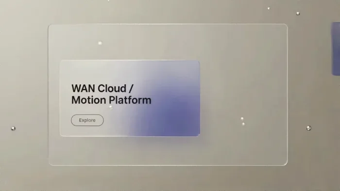
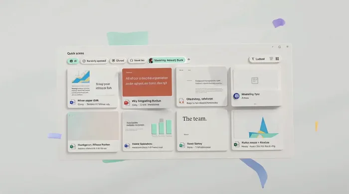
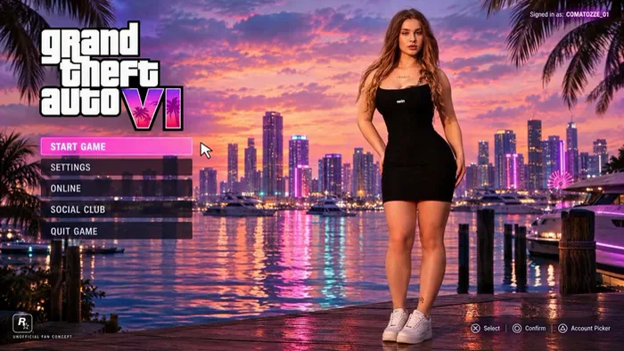
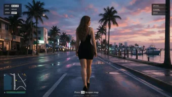
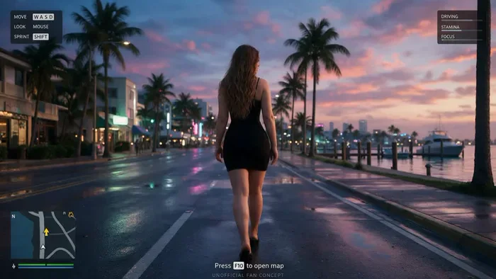

[← 総目次に戻る](../README.ja.md#table-of-contents) · [English](ui-typography.md) · [简体中文](ui-typography.zh-CN.md) · [日本語](ui-typography.ja.md)

### UI・タイポグラフィ UI & Typography

- [Case 3: WAN Cloud — Glass Homepage Motion (WAN Cloud 玻璃主页) — by Alibaba](#case-3)
- [Case 27: Glass UI Launch — Five-Image Storyboard (玻璃 UI 产品发布·五图分镜) — by Alibaba](#case-27)
- [Case 129: A Tropical Game Menu Selection (热带游戏菜单的选项切换) — by WeShop](#case-129)
- [Case 130: A Coastal Walk with a Third-Person HUD (第三人称 HUD 的海岸漫步) — by WeShop](#case-130)

### Case 3: WAN Cloud — Glass Homepage Motion (WAN Cloud 玻璃主页) — by Alibaba

▶ [ofox.ai で動画をすべて見る](https://ofox.ai/wan-3-prompts?utm_source=github&utm_medium=case&utm_campaign=awesome-ai-video-prompts#case-3)

**输入素材**：未公开 —— 本案例未收录可用的输入素材，请参阅来源

<strong>Prompt</strong> — 参考image1与image2，主题为企业级产品平台首页的空间化演绎，生成一支22秒、16:9横版、高级未来感UI主页演示动画。风格参考大面积留白、半透明玻璃卡片、低饱和雾紫与奶白色调、少量精致金属微装饰、高级产品官网hero section质感，视觉重点是多个玻璃浮卡在空间中建立层级关系并保留清晰…

~~~~text
参考image1与image2，主题为企业级产品平台首页的空间化演绎，生成一支22秒、16:9横版、高级未来感UI主页演示动画。风格参考大面积留白、半透明玻璃卡片、低饱和雾紫与奶白色调、少量精致金属微装饰、高级产品官网hero section质感，视觉重点是多个玻璃浮卡在空间中建立层级关系并保留清晰信息结构，品牌统一为WAN，所有文案使用原创通用内容。画质要求premium product website motion、sophisticated 3D UI、subtle iridescence、cinematic clean render、precise motion design、modern typography、soft shadows与elegant depth。音乐为轻电子、极简钢片音与柔和低频氛围，中段有轻微节奏感，结尾自然下落不戛然而止。0—4秒画面从一块浮在暖灰空间的超大半透明玻璃面板开始，逆光下容器边框呈现细腻透明边缘，左上角逐渐浮现WAN logo与简洁导航，背景散布银色微珠与半透明装饰球；4—8秒主卡片从左侧滑入主视觉区，雾紫渐变柔和晕开，标题“WAN Cloud / Motion Platform”与“Explore”按钮出现，第二张与第三张卡片从右上方与右下方漂入，运镜微微右移强化纵深；8—13秒页面活性展示：主卡片内部粒子微闪，次级卡片翻面，右侧细长玻璃滑杆缓慢滑动，底部浮现按钮组与状态点，镜头轻微环绕展示卡片边缘高光与半透明厚度；13—17秒三张卡片结构重组，主卡片放大居中，另外两张滑至辅助位置，标题更新为“Build elegant systems with WAN”，装饰球与金属微粒配合产生轻微空间张力，色彩稍微更明亮；17—22秒所有浮动元素减速稳定，画面停留在一个完整的品牌网页主画面上，镜头轻轻后退展示完整布局，屏幕下方淡入标语“WAN — Soft systems, vivid clarity.”，音乐以柔和上扬后自然落下的尾音伴随微小玻璃声与空气感残响结束。避免出现混乱构图、过多文字、丑陋仪表盘、企业模板感、刺眼霓虹、黑暗赛博朋克、低细节、噪点粒子、假玻璃、尖锐反射、错位卡片、随机符号、戛然而止、层次混乱、 messy web UI、真实商标或水印。
~~~~

**参数**：Wan 3.0 · 未标注 · i2v · 22s · 未标注 · 16:9 · 带音频
**来源**：阿里云 Wan 3.0 官方展示页 · [source](https://www.aliyun.com/benefit/scene/wan)

Wan 3.0 官方示例 · 阿里云万相展示页「图生视频」WAN Cloud 玻璃主页

[目次に戻る](#table-of-contents)

### Case 27: Glass UI Launch — Five-Image Storyboard (玻璃 UI 产品发布·五图分镜) — by Alibaba

▶ [ofox.ai で動画をすべて見る](https://ofox.ai/wan-3-prompts?utm_source=github&utm_medium=case&utm_campaign=awesome-ai-video-prompts#case-27)

**输入素材**：未公开 —— 本案例未收录可用的输入素材，请参阅来源

<strong>Prompt</strong> — 生成9秒高级产品发布动态视频，纯白棚拍，柔和自然光，电影级微距。风格：Google Apple/Material Design，结合彩色纸张工艺、半透明材质与UI界面，干净精致。 按5张图分镜： - 图1（0–1.48s）：白底中央，紧凑彩色纸张堆叠（白页+蓝绿紫半透明纸），留白充足，仅呼吸浮动，保…

~~~~text
生成9秒高级产品发布动态视频，纯白棚拍，柔和自然光，电影级微距。风格：Google Apple/Material Design，结合彩色纸张工艺、半透明材质与UI界面，干净精致。

按5张图分镜：
- 图1（0–1.48s）：白底中央，紧凑彩色纸张堆叠（白页+蓝绿紫半透明纸），留白充足，仅呼吸浮动，保持克制开场。 @Image1
- 图2（1.48–3s）：纸张通过paper wipe/mask reveal切出UI面板。主面板→卡片→按钮/标签依次浮现（Material ease），周围纸张装饰漂浮。 @Image2
- 图3（3–4.64s）：斜向俯视，空间视差。UI面板悬浮于绿色网格纸、蓝色透明带、紫色折叠纸、橙色卡片之上，镜头缓慢平移+微压。 @Image3
- 图4（4.64–8.52s）：横向卡片墙，多卡片（内容/文件/任务）按card cascade、layout reflow、soft slide滑入排列，中途转向任务完成场景，右侧功能区和高亮提示形成。 @Image4
- 图5（8.52–9s）：最终UI稳定，高亮标语、右侧功能卡、彩色装饰锚点，smooth ease-out定格。 @Image5
~~~~

**参数**：Wan 3.0 · 未标注 · ref2v · 9s · 未标注 · 未标注 · 带音频
**来源**：《Wan3.0 视频创作者手册》（万相官方） · [source](https://alidocs.dingtalk.com/i/nodes/qnYMoO1rWxrkmoj2IjExdZLBJ47Z3je9)

Wan 3.0 官方示例 ·《Wan3.0 视频创作者手册》

[目次に戻る](#table-of-contents)

### Case 129: A Tropical Game Menu Selection (热带游戏菜单的选项切换) — by WeShop

| 输入 | 输出 |
|:---:|:---:|
|  |  |

▶ [ofox.ai で動画をすべて見る](https://ofox.ai/wan-3-prompts?utm_source=github&utm_medium=case&utm_campaign=awesome-ai-video-prompts#case-129)

<strong>Prompt</strong> — Animate the exact supplied image as a 10-second simulated game-interface interaction. Use it as the actual first frame, preserving its composition, Co…

~~~~text
Animate the exact supplied image as a 10-second simulated game-interface interaction. Use it as the actual first frame, preserving its composition, Comatozze character, pink-violet tropical dusk, typography and panel geometry. 0-2 seconds: hold the supplied main-menu layout. 2-4 seconds: a small white game-menu cursor moves from START GAME down to SETTINGS and the pink selection bar follows to SETTINGS. 4-6 seconds: move the same cursor down to ONLINE and highlight only ONLINE. 6-8 seconds: move back up to START GAME and restore its pink highlight. 8-10 seconds: hold START GAME selected with a brief soft confirmation pulse. Keep every menu word exactly unchanged; only move the cursor and selected-row highlight. The woman keeps the same standing pose, with subtle breathing; water reflections move gently. Locked full-screen 16:9 game presentation, with no browser or monitor frame. No cuts, no scene replacement, no letter morphing, no added HUD. This is an AI-generated interface interaction concept, not a recording of a playable game. No speech, music or sound.

~~~~

**参数**：Wan 3.0 I2V · WeShop · i2v · 10s · 1080p · Adaptive · off
**来源**：WeShop · [原帖](https://www.weshop.ai/solutions/ai-photo-generation/gta-6-ai-main-menu-from-photo)

Preview © 2026 WeShop · Prompt by WeShop

[目次に戻る](#table-of-contents)

### Case 130: A Coastal Walk with a Third-Person HUD (第三人称 HUD 的海岸漫步) — by WeShop

| 输入 | 输出 |
|:---:|:---:|
|  |  |

▶ [ofox.ai で動画をすべて見る](https://ofox.ai/wan-3-prompts?utm_source=github&utm_medium=case&utm_campaign=awesome-ai-video-prompts#case-130)

<strong>Prompt</strong> — Animate the exact supplied image as a 10-second simulated game-interface interaction. Use it as the actual first frame, preserving its composition, Co…

~~~~text
Animate the exact supplied image as a 10-second simulated game-interface interaction. Use it as the actual first frame, preserving its composition, Comatozze character, pink-violet tropical dusk, typography and panel geometry. 0-2 seconds: hold the supplied rear-view game scene. 2-8 seconds: simulate holding the forward movement control: the same woman takes several slow natural steps down the boulevard, and the third-person camera follows behind at a constant distance and height. Her black dress and long hair remain consistent. The minimap player arrow makes one small forward movement; health, armor, control-help and attribute panels stay fixed. 8-10 seconds: the character slows to a stop. Preserve one minimap only. Do not add panels, icons or words; do not turn her to face camera. Locked full-screen 16:9 game presentation, with no browser or monitor frame. No cuts, no scene replacement, no letter morphing, no added HUD. This is an AI-generated interface interaction concept, not a recording of a playable game. No speech, music or sound.

~~~~

**参数**：Wan 3.0 I2V · WeShop · i2v · 10s · 1080p · Adaptive · off
**来源**：WeShop · [原帖](https://www.weshop.ai/solutions/ai-photo-generation/gta-6-third-person-hud-ai-photo)

Preview © 2026 WeShop · Prompt by WeShop

[目次に戻る](#table-of-contents)
