[← Back to the full index](../README.md#table-of-contents) · [English](video-extend-edit.md) · [简体中文](video-extend-edit.zh-CN.md) · [日本語](video-extend-edit.ja.md)

### Video Extend & Edit (视频延长和编辑)

- [Case 36: Edit — Clear the Pool Clutter (视频编辑·移除泳池杂物) — by Alibaba](#case-36)
- [Case 37: Edit — Add a Vase to the Table (视频编辑·桌面新增花瓶) — by Alibaba](#case-37)
- [Case 38: Edit — Remove the Man on the Left (视频编辑·移除左侧的男人) — by Alibaba](#case-38)
- [Case 39: Edit — Age the Girl into a Young Woman (视频编辑·小女孩变年轻女人) — by Alibaba](#case-39)
- [Case 40: Edit — Scale Up the Sailing Ship (视频编辑·帆船等比放大) — by Alibaba](#case-40)
- [Case 41: Edit — Take the Hat Off (视频编辑·摘掉帽子) — by Alibaba](#case-41)
- [Case 57: Add Element — A Reef on the Beach (增加元素·沙滩添加礁石) — by Alibaba](#case-57)
- [Case 58: Change Element — Swap the Skater (修改元素·滑手换成女性) — by Alibaba](#case-58)
- [Case 59: Remove Element — Take Off the Sunglasses (删除元素·摘掉墨镜) — by Alibaba](#case-59)
- [Case 60: Relight — Soft Three-Point Lighting (光线编辑·补齐三点布光) — by Alibaba](#case-60)
- [Case 61: Motion Edit — Swap the Man and the Ostrich (动作编辑·人与鸵鸟换位) — by Alibaba](#case-61)
- [Case 62: Style Edit — Turn It into Clay Animation (风格编辑·改成黏土动画) — by Alibaba](#case-62)
- [Case 63: Dialogue Edit — Replace the Line (台词编辑·换一句英文台词) — by Alibaba](#case-63)
- [Case 64: Reference Edit — Hats and Shirt from Images (参考编辑·按图换帽子与衬衫) — by Alibaba](#case-64)
- [Case 65: Story Rewrite — Make Him Play the Guitar (剧情重塑·让他弹起吉他) — by Alibaba](#case-65)
- [Case 66: Extend Forward — 15s More of the Teahouse Deal (向后延长·茶楼谈生意 15 秒) — by Alibaba](#case-66)
- [Case 67: Extend Backward — The 15s Before the Waltz (向前延长·邀舞之前的 15 秒) — by Alibaba](#case-67)
- [Case 68: Extend Both Ways — Before and After the Snow Walk (向前向后延长·雪林前后各续一段) — by Alibaba](#case-68)

### Case 36: Edit — Clear the Pool Clutter (视频编辑·移除泳池杂物) — by Alibaba

▶ [Watch the full video on ofox.ai](https://ofox.ai/wan-3-prompts?utm_source=github&utm_medium=case&utm_campaign=awesome-ai-video-prompts#case-36)

**输入素材**（1 段视频，只取首帧）

| | | | |
|:---:|:---:|:---:|:---:|
|  编辑前视频 |  |  |  |

<strong>Prompt</strong> — 将视频1中泳池水面上的蓝色和黄色游泳圈全部去掉，池边石板地上的画纸、颜料罐、画笔和黑色收纳箱也全部去掉，用周围泳池水面和石板地面自然填充。仅保留女人漂浮在泳池中，女人的姿态动作和泳池背景保持不变。

~~~~text
将视频1中泳池水面上的蓝色和黄色游泳圈全部去掉，池边石板地上的画纸、颜料罐、画笔和黑色收纳箱也全部去掉，用周围泳池水面和石板地面自然填充。仅保留女人漂浮在泳池中，女人的姿态动作和泳池背景保持不变。
~~~~

**参数**：Wan 3.0 · 未标注 · edit · 未标注 · 未标注 · 未标注 · 带音频
**来源**：《Wan3.0 视频创作者手册》（万相官方） · [source](https://alidocs.dingtalk.com/i/nodes/qnYMoO1rWxrkmoj2IjExdZLBJ47Z3je9)

Wan 3.0 官方示例 ·《Wan3.0 视频创作者手册》

[Back to top](#table-of-contents)

### Case 37: Edit — Add a Vase to the Table (视频编辑·桌面新增花瓶) — by Alibaba

▶ [Watch the full video on ofox.ai](https://ofox.ai/wan-3-prompts?utm_source=github&utm_medium=case&utm_campaign=awesome-ai-video-prompts#case-37)

**输入素材**（1 段视频，只取首帧）

| | | | |
|:---:|:---:|:---:|:---:|
|  编辑前视频 |  |  |  |

<strong>Prompt</strong> — 编辑视频，视频1中女人右侧桌面空位处新增图片1中的花瓶，花瓶光影与窗户自然光方向一致，自然融入木桌场景。女人的动作和画面其余部分保持不变。

~~~~text
编辑视频，视频1中女人右侧桌面空位处新增图片1中的花瓶，花瓶光影与窗户自然光方向一致，自然融入木桌场景。女人的动作和画面其余部分保持不变。
~~~~

**参数**：Wan 3.0 · 未标注 · edit · 未标注 · 未标注 · 未标注 · 带音频
**来源**：《Wan3.0 视频创作者手册》（万相官方） · [source](https://alidocs.dingtalk.com/i/nodes/qnYMoO1rWxrkmoj2IjExdZLBJ47Z3je9)

Wan 3.0 官方示例 ·《Wan3.0 视频创作者手册》

[Back to top](#table-of-contents)

### Case 38: Edit — Remove the Man on the Left (视频编辑·移除左侧的男人) — by Alibaba

<a href="https://ofox.ai/wan-3-prompts?utm_source=github&utm_medium=case&utm_campaign=awesome-ai-video-prompts#case-38">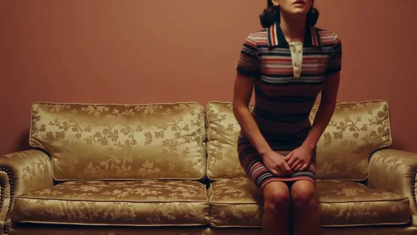</a>

▶ [Watch the full video on ofox.ai](https://ofox.ai/wan-3-prompts?utm_source=github&utm_medium=case&utm_campaign=awesome-ai-video-prompts#case-38)

**输入素材**（1 段视频，只取首帧）

| | | | |
|:---:|:---:|:---:|:---:|
| 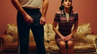 编辑前视频 |  |  |  |

<strong>Prompt</strong> — 视频1中左边的男人去掉，用周围背景自然填充该位置，其余人物、动作和画面保持不变。

~~~~text
视频1中左边的男人去掉，用周围背景自然填充该位置，其余人物、动作和画面保持不变。
~~~~

**参数**：Wan 3.0 · 未标注 · edit · 未标注 · 未标注 · 未标注 · 带音频
**来源**：《Wan3.0 视频创作者手册》（万相官方） · [source](https://alidocs.dingtalk.com/i/nodes/qnYMoO1rWxrkmoj2IjExdZLBJ47Z3je9)

Wan 3.0 官方示例 ·《Wan3.0 视频创作者手册》

[Back to top](#table-of-contents)

### Case 39: Edit — Age the Girl into a Young Woman (视频编辑·小女孩变年轻女人) — by Alibaba

<a href="https://ofox.ai/wan-3-prompts?utm_source=github&utm_medium=case&utm_campaign=awesome-ai-video-prompts#case-39">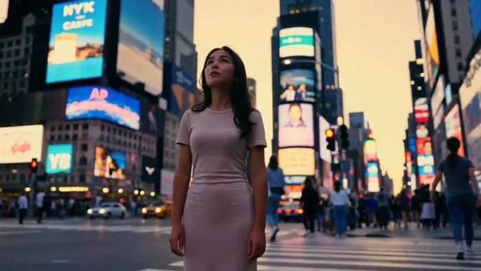</a>

▶ [Watch the full video on ofox.ai](https://ofox.ai/wan-3-prompts?utm_source=github&utm_medium=case&utm_campaign=awesome-ai-video-prompts#case-39)

**输入素材**（1 段视频，只取首帧）

| | | | |
|:---:|:---:|:---:|:---:|
| 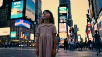 编辑前视频 |  |  |  |

<strong>Prompt</strong> — 视频1中的小女孩变成一位二十岁左右的年轻女人，面容成熟，连衣裙替换为同色系的修身长裙，仰头望向城市霓虹的动作和表情神态保持一致，时代广场街景和画面其余部分不变。

~~~~text
视频1中的小女孩变成一位二十岁左右的年轻女人，面容成熟，连衣裙替换为同色系的修身长裙，仰头望向城市霓虹的动作和表情神态保持一致，时代广场街景和画面其余部分不变。
~~~~

**参数**：Wan 3.0 · 未标注 · edit · 未标注 · 未标注 · 未标注 · 带音频
**来源**：《Wan3.0 视频创作者手册》（万相官方） · [source](https://alidocs.dingtalk.com/i/nodes/qnYMoO1rWxrkmoj2IjExdZLBJ47Z3je9)

Wan 3.0 官方示例 ·《Wan3.0 视频创作者手册》

[Back to top](#table-of-contents)

### Case 40: Edit — Scale Up the Sailing Ship (视频编辑·帆船等比放大) — by Alibaba

▶ [Watch the full video on ofox.ai](https://ofox.ai/wan-3-prompts?utm_source=github&utm_medium=case&utm_campaign=awesome-ai-video-prompts#case-40)

**输入素材**（1 段视频，只取首帧）

| | | | |
|:---:|:---:|:---:|:---:|
|  编辑前视频 |  |  |  |

<strong>Prompt</strong> — 视频1中左侧的帆船等比放大，使其更具视觉压迫感，桅杆和船帆细节更突出，水面倒影同步匹配。右侧人物、远处船队和海面雾气保持不变。

~~~~text
视频1中左侧的帆船等比放大，使其更具视觉压迫感，桅杆和船帆细节更突出，水面倒影同步匹配。右侧人物、远处船队和海面雾气保持不变。
~~~~

**参数**：Wan 3.0 · 未标注 · edit · 未标注 · 未标注 · 未标注 · 带音频
**来源**：《Wan3.0 视频创作者手册》（万相官方） · [source](https://alidocs.dingtalk.com/i/nodes/qnYMoO1rWxrkmoj2IjExdZLBJ47Z3je9)

Wan 3.0 官方示例 ·《Wan3.0 视频创作者手册》

[Back to top](#table-of-contents)

### Case 41: Edit — Take the Hat Off (视频编辑·摘掉帽子) — by Alibaba

<a href="https://ofox.ai/wan-3-prompts?utm_source=github&utm_medium=case&utm_campaign=awesome-ai-video-prompts#case-41">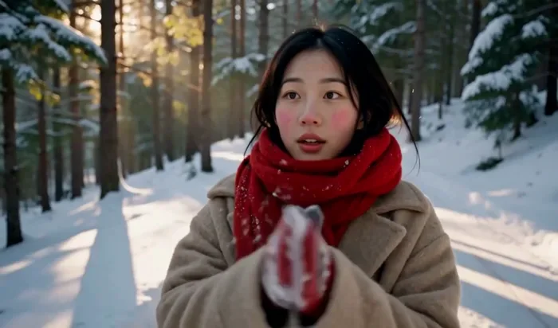</a>

▶ [Watch the full video on ofox.ai](https://ofox.ai/wan-3-prompts?utm_source=github&utm_medium=case&utm_campaign=awesome-ai-video-prompts#case-41)

**输入素材**（1 段视频，只取首帧）

| | | | |
|:---:|:---:|:---:|:---:|
|  编辑前视频 |  |  |  |

<strong>Prompt</strong> — 视频1中女人头上的帽子去掉，露出自然发型，女人的动作和画面其余部分保持不变。

~~~~text
视频1中女人头上的帽子去掉，露出自然发型，女人的动作和画面其余部分保持不变。
~~~~

**参数**：Wan 3.0 · 未标注 · edit · 未标注 · 未标注 · 未标注 · 带音频
**来源**：《Wan3.0 视频创作者手册》（万相官方） · [source](https://alidocs.dingtalk.com/i/nodes/qnYMoO1rWxrkmoj2IjExdZLBJ47Z3je9)

Wan 3.0 官方示例 ·《Wan3.0 视频创作者手册》

[Back to top](#table-of-contents)

### Case 57: Add Element — A Reef on the Beach (增加元素·沙滩添加礁石) — by Alibaba

▶ [Watch the full video on ofox.ai](https://ofox.ai/wan-3-prompts?utm_source=github&utm_medium=case&utm_campaign=awesome-ai-video-prompts#case-57)

**输入素材**（1 段视频，只取首帧）

| | | | |
|:---:|:---:|:---:|:---:|
|  编辑前视频 |  |  |  |

<strong>Prompt</strong> — 编辑视频1的内容。在沙滩上添加一块礁石，使礁石半埋在湿沙中，当海浪退潮时让海水轻轻没过礁石底部。

~~~~text
编辑视频1的内容。在沙滩上添加一块礁石，使礁石半埋在湿沙中，当海浪退潮时让海水轻轻没过礁石底部。
~~~~

**参数**：Wan 3.0 · 未标注 · edit · 未标注 · 未标注 · 未标注 · 带音频
**来源**：《Wan3.0 视频创作者手册》（万相官方） · [source](https://alidocs.dingtalk.com/i/nodes/qnYMoO1rWxrkmoj2IjExdZLBJ47Z3je9)

Wan 3.0 官方示例 ·《Wan3.0 视频创作者手册》

[Back to top](#table-of-contents)

### Case 58: Change Element — Swap the Skater (修改元素·滑手换成女性) — by Alibaba

<a href="https://ofox.ai/wan-3-prompts?utm_source=github&utm_medium=case&utm_campaign=awesome-ai-video-prompts#case-58">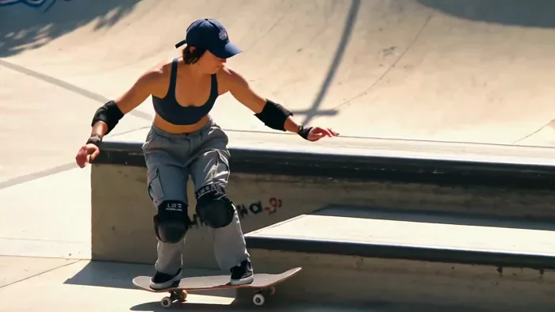</a>

▶ [Watch the full video on ofox.ai](https://ofox.ai/wan-3-prompts?utm_source=github&utm_medium=case&utm_campaign=awesome-ai-video-prompts#case-58)

**输入素材**（1 段视频，只取首帧）

| | | | |
|:---:|:---:|:---:|:---:|
|  编辑前视频 |  |  |  |

<strong>Prompt</strong> — 编辑视频，视频1中的滑板男人替换为一位短发女人，穿运动背心和宽松工装裤，保留原视频中的棒球帽、护膝护肘等护具，滑板动作、运动轨迹和滑板场背景完全保持不变。

~~~~text
编辑视频，视频1中的滑板男人替换为一位短发女人，穿运动背心和宽松工装裤，保留原视频中的棒球帽、护膝护肘等护具，滑板动作、运动轨迹和滑板场背景完全保持不变。
~~~~

**参数**：Wan 3.0 · 未标注 · edit · 未标注 · 未标注 · 未标注 · 带音频
**来源**：《Wan3.0 视频创作者手册》（万相官方） · [source](https://alidocs.dingtalk.com/i/nodes/qnYMoO1rWxrkmoj2IjExdZLBJ47Z3je9)

Wan 3.0 官方示例 ·《Wan3.0 视频创作者手册》

[Back to top](#table-of-contents)

### Case 59: Remove Element — Take Off the Sunglasses (删除元素·摘掉墨镜) — by Alibaba

<a href="https://ofox.ai/wan-3-prompts?utm_source=github&utm_medium=case&utm_campaign=awesome-ai-video-prompts#case-59">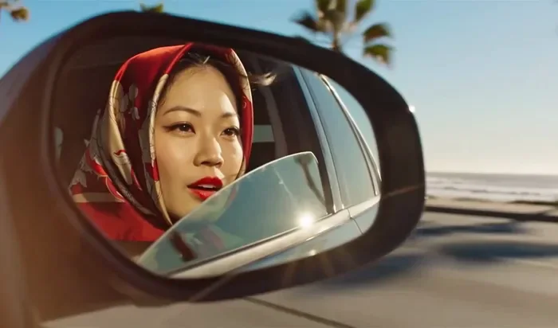</a>

▶ [Watch the full video on ofox.ai](https://ofox.ai/wan-3-prompts?utm_source=github&utm_medium=case&utm_campaign=awesome-ai-video-prompts#case-59)

**输入素材**（1 段视频，只取首帧）

| | | | |
|:---:|:---:|:---:|:---:|
|  编辑前视频 |  |  |  |

<strong>Prompt</strong> — 编辑视频，视频1中女人的墨镜去掉，露出自然眼妆和眼神，女人的动作和画面其余部分保持不变。

~~~~text
编辑视频，视频1中女人的墨镜去掉，露出自然眼妆和眼神，女人的动作和画面其余部分保持不变。
~~~~

**参数**：Wan 3.0 · 未标注 · edit · 未标注 · 未标注 · 未标注 · 带音频
**来源**：《Wan3.0 视频创作者手册》（万相官方） · [source](https://alidocs.dingtalk.com/i/nodes/qnYMoO1rWxrkmoj2IjExdZLBJ47Z3je9)

Wan 3.0 官方示例 ·《Wan3.0 视频创作者手册》

[Back to top](#table-of-contents)

### Case 60: Relight — Soft Three-Point Lighting (光线编辑·补齐三点布光) — by Alibaba

▶ [Watch the full video on ofox.ai](https://ofox.ai/wan-3-prompts?utm_source=github&utm_medium=case&utm_campaign=awesome-ai-video-prompts#case-60)

**输入素材**（1 段视频，只取首帧）

| | | | |
|:---:|:---:|:---:|:---:|
|  编辑前视频 |  |  |  |

<strong>Prompt</strong> — 编辑视频，视频1整体提亮光线，采用美剧质感的柔和三点布光，消除男人面部右侧的硬阴影，让五官轮廓均匀受光，肤色自然通透。背景白色瓷砖墙和窗户的光感同步提升，保持画面整体影调统一，男人的动作和画面内容不变。

~~~~text
编辑视频，视频1整体提亮光线，采用美剧质感的柔和三点布光，消除男人面部右侧的硬阴影，让五官轮廓均匀受光，肤色自然通透。背景白色瓷砖墙和窗户的光感同步提升，保持画面整体影调统一，男人的动作和画面内容不变。
~~~~

**参数**：Wan 3.0 · 未标注 · edit · 未标注 · 未标注 · 未标注 · 带音频
**来源**：《Wan3.0 视频创作者手册》（万相官方） · [source](https://alidocs.dingtalk.com/i/nodes/qnYMoO1rWxrkmoj2IjExdZLBJ47Z3je9)

Wan 3.0 官方示例 ·《Wan3.0 视频创作者手册》

[Back to top](#table-of-contents)

### Case 61: Motion Edit — Swap the Man and the Ostrich (动作编辑·人与鸵鸟换位) — by Alibaba

<a href="https://ofox.ai/wan-3-prompts?utm_source=github&utm_medium=case&utm_campaign=awesome-ai-video-prompts#case-61">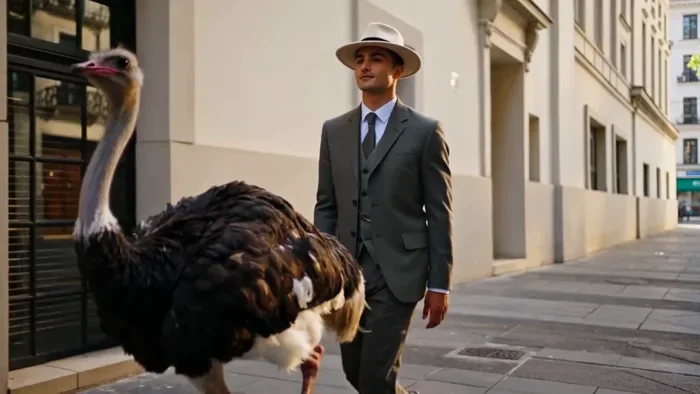</a>

▶ [Watch the full video on ofox.ai](https://ofox.ai/wan-3-prompts?utm_source=github&utm_medium=case&utm_campaign=awesome-ai-video-prompts#case-61)

**输入素材**（1 段视频，只取首帧）

| | | | |
|:---:|:---:|:---:|:---:|
|  编辑前视频 |  |  |  |

<strong>Prompt</strong> — 编辑视频，视频1中西装男人和鸵鸟的位置互换，鸵鸟移到画面左侧靠前位置，男人移到右侧紧跟鸵鸟，二者的行走动作和步伐节奏保持一致，街道背景不变。

~~~~text
编辑视频，视频1中西装男人和鸵鸟的位置互换，鸵鸟移到画面左侧靠前位置，男人移到右侧紧跟鸵鸟，二者的行走动作和步伐节奏保持一致，街道背景不变。
~~~~

**参数**：Wan 3.0 · 未标注 · edit · 未标注 · 未标注 · 未标注 · 带音频
**来源**：《Wan3.0 视频创作者手册》（万相官方） · [source](https://alidocs.dingtalk.com/i/nodes/qnYMoO1rWxrkmoj2IjExdZLBJ47Z3je9)

Wan 3.0 官方示例 ·《Wan3.0 视频创作者手册》

[Back to top](#table-of-contents)

### Case 62: Style Edit — Turn It into Clay Animation (风格编辑·改成黏土动画) — by Alibaba

<a href="https://ofox.ai/wan-3-prompts?utm_source=github&utm_medium=case&utm_campaign=awesome-ai-video-prompts#case-62">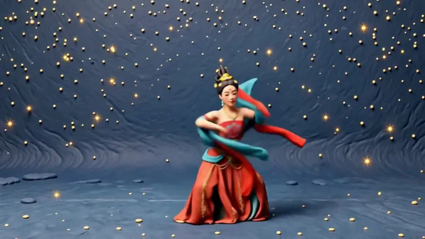</a>

▶ [Watch the full video on ofox.ai](https://ofox.ai/wan-3-prompts?utm_source=github&utm_medium=case&utm_campaign=awesome-ai-video-prompts#case-62)

**输入素材**（1 段视频，只取首帧）

| | | | |
|:---:|:---:|:---:|:---:|
| 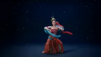 编辑前视频 |  |  |  |

<strong>Prompt</strong> — 编辑视频，将视频风格变为粘土动画风格

~~~~text
编辑视频，将视频风格变为粘土动画风格
~~~~

**参数**：Wan 3.0 · 未标注 · edit · 未标注 · 未标注 · 未标注 · 带音频
**来源**：《Wan3.0 视频创作者手册》（万相官方） · [source](https://alidocs.dingtalk.com/i/nodes/qnYMoO1rWxrkmoj2IjExdZLBJ47Z3je9)

Wan 3.0 官方示例 ·《Wan3.0 视频创作者手册》

[Back to top](#table-of-contents)

### Case 63: Dialogue Edit — Replace the Line (台词编辑·换一句英文台词) — by Alibaba

▶ [Watch the full video on ofox.ai](https://ofox.ai/wan-3-prompts?utm_source=github&utm_medium=case&utm_campaign=awesome-ai-video-prompts#case-63)

**输入素材**（1 段视频，只取首帧）

| | | | |
|:---:|:---:|:---:|:---:|
|  编辑前视频 |  |  |  |

<strong>Prompt</strong> — 编辑视频，将视频中男生的台词改为：“The deal is done.Now... we disappear."

~~~~text
编辑视频，将视频中男生的台词改为：“The deal is done.Now... we disappear."
~~~~

**参数**：Wan 3.0 · 未标注 · edit · 未标注 · 未标注 · 未标注 · 带音频
**来源**：《Wan3.0 视频创作者手册》（万相官方） · [source](https://alidocs.dingtalk.com/i/nodes/qnYMoO1rWxrkmoj2IjExdZLBJ47Z3je9)

Wan 3.0 官方示例 ·《Wan3.0 视频创作者手册》

[Back to top](#table-of-contents)

### Case 64: Reference Edit — Hats and Shirt from Images (参考编辑·按图换帽子与衬衫) — by Alibaba

▶ [Watch the full video on ofox.ai](https://ofox.ai/wan-3-prompts?utm_source=github&utm_medium=case&utm_campaign=awesome-ai-video-prompts#case-64)

**输入素材**（1 段视频，只取首帧）

| | | | |
|:---:|:---:|:---:|:---:|
|  编辑前视频 |  |  |  |

<strong>Prompt</strong> — 编辑视频，视频1中的女人戴上 图片1 中的帽子，自然贴合头型。 视频1 中的男人戴上中 图片2 的帽子，自然贴合头型，男人的赭棕色衬衫换成 图片3 中的蓝色水洗宽松牛仔衬衫，翻领敞开、袖子卷至前臂。两人的动作、服装和画面其余部分保持不变。

~~~~text
编辑视频，视频1中的女人戴上 图片1 中的帽子，自然贴合头型。 视频1 中的男人戴上中 图片2 的帽子，自然贴合头型，男人的赭棕色衬衫换成 图片3 中的蓝色水洗宽松牛仔衬衫，翻领敞开、袖子卷至前臂。两人的动作、服装和画面其余部分保持不变。
~~~~

**参数**：Wan 3.0 · 未标注 · edit · 未标注 · 未标注 · 未标注 · 带音频
**来源**：《Wan3.0 视频创作者手册》（万相官方） · [source](https://alidocs.dingtalk.com/i/nodes/qnYMoO1rWxrkmoj2IjExdZLBJ47Z3je9)

Wan 3.0 官方示例 ·《Wan3.0 视频创作者手册》

[Back to top](#table-of-contents)

### Case 65: Story Rewrite — Make Him Play the Guitar (剧情重塑·让他弹起吉他) — by Alibaba

<a href="https://ofox.ai/wan-3-prompts?utm_source=github&utm_medium=case&utm_campaign=awesome-ai-video-prompts#case-65">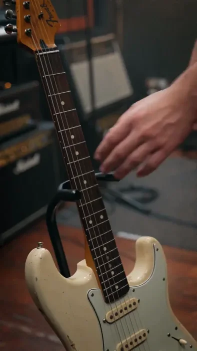</a>

▶ [Watch the full video on ofox.ai](https://ofox.ai/wan-3-prompts?utm_source=github&utm_medium=case&utm_campaign=awesome-ai-video-prompts#case-65)

**输入素材**（1 段视频，只取首帧）

| | | | |
|:---:|:---:|:---:|:---:|
|  编辑前视频 |  |  |  |

<strong>Prompt</strong> — 重塑@Video1 的剧情，让男人直接拿起吉他开始演奏一段音乐

~~~~text
重塑@Video1 的剧情，让男人直接拿起吉他开始演奏一段音乐
~~~~

**参数**：Wan 3.0 · 未标注 · edit · 未标注 · 未标注 · 未标注 · 带音频
**来源**：《Wan3.0 视频创作者手册》（万相官方） · [source](https://alidocs.dingtalk.com/i/nodes/qnYMoO1rWxrkmoj2IjExdZLBJ47Z3je9)

Wan 3.0 官方示例 ·《Wan3.0 视频创作者手册》

[Back to top](#table-of-contents)

### Case 66: Extend Forward — 15s More of the Teahouse Deal (向后延长·茶楼谈生意 15 秒) — by Alibaba

▶ [Watch the full video on ofox.ai](https://ofox.ai/wan-3-prompts?utm_source=github&utm_medium=case&utm_campaign=awesome-ai-video-prompts#case-66)

**输入素材**（1 段视频，只取首帧）

| | | | |
|:---:|:---:|:---:|:---:|
|  待延长视频 |  |  |  |

<strong>Prompt</strong> — 将视频1延长15s。角色A为梳背头、穿深灰色中式长衫、左手腕佩戴棕色佛珠手串的男人，角色B为穿深色中式长衫的男人。角色B缓缓放下茶碗，目光微沉，用指尖轻叩桌面两下，不紧不慢说"价钱好讲，但货要几时到埠，你要畀个准数我。"角色A笑容不减，端起盖碗刮了刮茶沫。角色A呷一口茶，将茶碗搁回茶托，身体前倾压低…

~~~~text
将视频1延长15s。角色A为梳背头、穿深灰色中式长衫、左手腕佩戴棕色佛珠手串的男人，角色B为穿深色中式长衫的男人。角色B缓缓放下茶碗，目光微沉，用指尖轻叩桌面两下，不紧不慢说"价钱好讲，但货要几时到埠，你要畀个准数我。"角色A笑容不减，端起盖碗刮了刮茶沫。角色A呷一口茶，将茶碗搁回茶托，身体前倾压低声音，佛珠随手势轻晃，语气笃定"最迟月底，码头嗰边我已经打点好晒，一船货齐齐整整运到你仓库门口。"说罢右手掌心朝下往桌面一按，目光直视角色B。角色B沉吟片刻，视线扫向窗外"萬安當"牌匾，竹帘被街上微风轻轻掀起。他转回头，嘴角浮起笑意，拿起盖碗朝角色A微微一举，"好，月底交货，我等你好消息。"两人相视而笑。保持民国商战片的沉稳调性，对话节奏从容，茶馆环境音低沉衬底。
~~~~

**参数**：Wan 3.0 · 未标注 · extend · 15s · 未标注 · 未标注 · 带音频
**来源**：《Wan3.0 视频创作者手册》（万相官方） · [source](https://alidocs.dingtalk.com/i/nodes/qnYMoO1rWxrkmoj2IjExdZLBJ47Z3je9)

Wan 3.0 官方示例 ·《Wan3.0 视频创作者手册》

[Back to top](#table-of-contents)

### Case 67: Extend Backward — The 15s Before the Waltz (向前延长·邀舞之前的 15 秒) — by Alibaba

▶ [Watch the full video on ofox.ai](https://ofox.ai/wan-3-prompts?utm_source=github&utm_medium=case&utm_campaign=awesome-ai-video-prompts#case-67)

**输入素材**（1 段视频，只取首帧）

| | | | |
|:---:|:---:|:---:|:---:|
|  待延长视频 |  |  |  |

<strong>Prompt</strong> — 将视频1向前延长15s。角色A为穿黑色燕尾服、白色衬衫、黑色领结及米色马甲的深棕色短发男性，角色B为穿米色泡泡袖复古长裙、裙身带黑色蕾丝花边、佩戴深色水滴耳环的棕色盘发女性。舞厅内水晶吊灯光芒映照大理石地面，宾客们三两交谈持杯低语，一段悠扬的华尔兹弦乐前奏缓缓响起，人群的谈话声逐渐安静。角色B从舞厅…

~~~~text
将视频1向前延长15s。角色A为穿黑色燕尾服、白色衬衫、黑色领结及米色马甲的深棕色短发男性，角色B为穿米色泡泡袖复古长裙、裙身带黑色蕾丝花边、佩戴深色水滴耳环的棕色盘发女性。舞厅内水晶吊灯光芒映照大理石地面，宾客们三两交谈持杯低语，一段悠扬的华尔兹弦乐前奏缓缓响起，人群的谈话声逐渐安静。角色B从舞厅一侧缓步走来，裙摆轻拂过大理石地面，目光环顾四周。角色A从人群中走出，穿过宾客径直来到角色B面前，微微欠身伸出右手，目光温柔注视着她。角色B垂眸浅笑，将右手轻轻搭上角色A的掌心，两人相视一笑，角色A引领角色B步入舞池中央，周围宾客自然后退让出空间，目光齐聚二人。角色A左手握住角色B右手举起，右手轻扶她的腰后，两人摆好华尔兹舞姿，随弦乐正拍踏出第一步，开始旋转。19世纪宫廷舞会的典雅氛围，暖金色调。
~~~~

**参数**：Wan 3.0 · 未标注 · extend · 15s · 未标注 · 未标注 · 带音频
**来源**：《Wan3.0 视频创作者手册》（万相官方） · [source](https://alidocs.dingtalk.com/i/nodes/qnYMoO1rWxrkmoj2IjExdZLBJ47Z3je9)

Wan 3.0 官方示例 ·《Wan3.0 视频创作者手册》

[Back to top](#table-of-contents)

### Case 68: Extend Both Ways — Before and After the Snow Walk (向前向后延长·雪林前后各续一段) — by Alibaba

▶ [Watch the full video on ofox.ai](https://ofox.ai/wan-3-prompts?utm_source=github&utm_medium=case&utm_campaign=awesome-ai-video-prompts#case-68)

**输入素材**（1 段视频，只取首帧）

| | | | |
|:---:|:---:|:---:|:---:|
|  待延长视频 |  |  |  |

<strong>Prompt</strong> — 以视频为中间段向前续写两秒：镜头平滑跟随，女孩向镜头缓缓走来，停下脚步，温柔地微微抬头，在冷空气中深吸一口气，嘴唇微张；以视频为中间段向后续写三秒：女孩搓完手，直视镜头，绽放出温暖灿烂的笑容。她缓缓抬起一只戴着手套的手，去接一片轻轻飘落的雪花，镜头缓慢后拉成中远景，展现阳光雪林小路，黄金时刻逆光，镜…

~~~~text
以视频为中间段向前续写两秒：镜头平滑跟随，女孩向镜头缓缓走来，停下脚步，温柔地微微抬头，在冷空气中深吸一口气，嘴唇微张；以视频为中间段向后续写三秒：女孩搓完手，直视镜头，绽放出温暖灿烂的笑容。她缓缓抬起一只戴着手套的手，去接一片轻轻飘落的雪花，镜头缓慢后拉成中远景，展现阳光雪林小路，黄金时刻逆光，镜头光晕，浅景深，温暖治愈氛围。
~~~~

**参数**：Wan 3.0 · 未标注 · extend · 未标注 · 未标注 · 未标注 · 带音频
**来源**：《Wan3.0 视频创作者手册》（万相官方） · [source](https://alidocs.dingtalk.com/i/nodes/qnYMoO1rWxrkmoj2IjExdZLBJ47Z3je9)

Wan 3.0 官方示例 ·《Wan3.0 视频创作者手册》

[Back to top](#table-of-contents)
